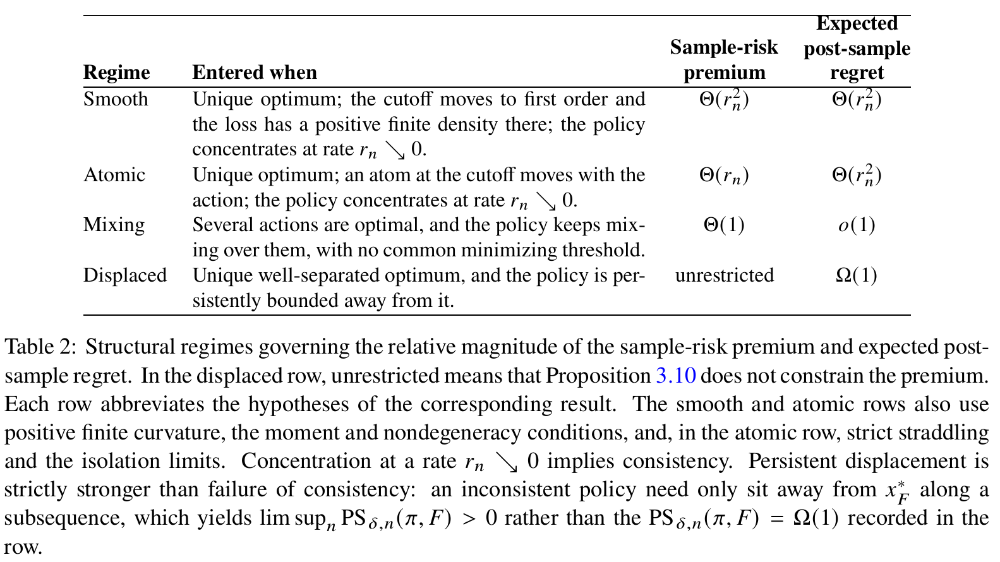

# How Risky Is Your Data-Driven Policy?

[官方论文](https://arxiv.org/abs/2611.04292) · [本地PDF](./assets/source/paper.pdf) · [HTML快照](./assets/source/paper.html)

版本记录：[Submitted on 3 Nov 2026]；本次核验与精读：2026-11-06。本篇为滚动窗口内首次入库；检索日不等于首次发表日。

阅读范围：§2 定义，§3 分解、平滑/原子/混合情形与局部展开，§4 SAA 结论及数值例证；附录证明仅按主文条件定位。未逐行复证全部数学证明，未声称逐页翻译。[[研究前沿/面向决策的履约建模/01-论文原文与精读/PolicySampleRisk/阅读覆盖|原文章节与公式索引]]；HTML为原始快照，外部样式和图片可能需要联网，PDF可离线阅读。

代码：本次核验的论文原文与元数据未提供可确认的作者实现入口；代码状态未知，不能据此断言不存在。未运行代码。 [[研究前沿/面向决策的履约建模/01-论文原文与精读/PolicySampleRisk/代码核验|核验记录]]

## 问题：训练程序本身也产生尾部风险

训练集 $D$ 决定动作 $x^\pi$，未来结果 $\xi$ 与训练及策略随机性独立。单次训练后评价 $Q_F(x)=\mathrm{CVaR}_{\delta,\xi}[c(x,\xi)]$，再跨训练平均，并不等于把训练、动作和未来结果联合起来计算 CVaR。论文研究的是后者相对知道分布的最优动作的 regret。

CVaR 的辅助阈值形式为

$$\phi_F(x,t)=t+\frac{\mathbb E[(c(x,\xi)-t)_+]}{1-\delta},\qquad Q_F(x)=\inf_t\phi_F(x,t).$$

关键分解（Eq.3.3–3.4）：

$$\mathcal R=\underbrace{\mathbb E Q_F(x^\pi)-\inf_xQ_F(x)}_{\mathrm{PS}}+\underbrace{\inf_t\mathbb E\phi_F(x^\pi,t)-\mathbb E\inf_t\phi_F(x^\pi,t)}_{\mathrm{SR}}.$$

两项均非负。PS 是动作质量损失；SR 是所有训练结果必须共用一个尾阈值所付出的额外代价。期望损失有塔式法则，CVaR 没有这种直接等价。

## 机制、定理与适用条件

**理论，Theorem 3.4/3.5、Table 2**：在唯一内部最优、正有限曲率、适当 Lipschitz/矩条件与策略集中条件下，若动作误差尺度为 $r_n$：

- 截止分位附近密度连续为正、分位随动作一阶变化：PS 与 SR 都为 $\Theta(r_n^2)$。
- 分位落在随动作移动且严格跨过分位水平的原子上，并满足隔离条件：PS 为 $\Theta(r_n^2)$，SR 为 $\Theta(r_n)$。
- 多个最优动作之间持续混合、没有共同最优阈值：PS 可趋零，SR 仍为正常数。

这些是代表性情形，不是全部损失的穷尽分类；“有原子”本身不足以推出慢率。

平滑情形（Eq.3.8–3.10）进一步有

$$\mathcal R\approx\frac{Q_F''(x^*)}{2}\{\mathrm{MSE}(x^\pi)+K\operatorname{Var}(x^\pi)\},\quad K=\frac{g_{x^*}(q^*)[q_F'(x^*)]^2}{(1-\delta)Q_F''(x^*)}.$$

方差相对偏差平方获得 $1+K$ 的权重，但这是局部渐近展开，不是已经验证的通用训练正则项。若分位导数为零，SR 可以是更低阶。

## 效果证据与边界

**数值例证，Table 3**：截断指数/对数正态平方损失，每行 12,000 次独立训练样本，SR 占总 regret 74.4%–93.5%；有限样本的比值仍远离某些很大的渐近 K。**精确分布数值计算，Table 4**：均匀需求 newsvendor，$n=110,430,1630,6430$ 时占比为 76.3%、89.1%、94.6%、97.3%，并非真实业务实验。

**SAA 理论，Proposition 4.2**：紧动作域、有界损失、连续性以及额外局部结构条件下，两类的动作都以 $n^{-1/2}$ 集中，但联合风险 regret 分别按 $n^{-1}$ 与 $n^{-1/2}$ 下降。主文理论结论及条件已读，附录证明未逐行复证。

迁移推断：评估履约/等待策略时，分别报告“固定训练后的未来尾风险”和“重采样训练、重新决策后的联合尾风险”。前者回答当前模型，后者评价建模程序的稳定性。时间依赖、环境变化、相关未来结果不在本文 iid 设定的直接保证内；不能把随机种子重复代替训练样本重采样。

## 原文关键图表

原文 Table 2，PDF 第 19 页；原始裁图，机制和证据解释见上文。裁图坐标与源文件校验值见 assets/source/figure-provenance.json。

## 方法卡

- [[研究前沿/面向决策的履约建模/02-可复用方法卡/PolicySampleRisk-combined-cvar|联合训练随机性与未来结果的 CVaR 风险分解]]

## 待验证想法

[[研究前沿/面向决策的履约建模/03-实验假设与结果/2026-11-06-训练样本波动的尾部风险|训练样本波动的尾部风险（未运行）]]
