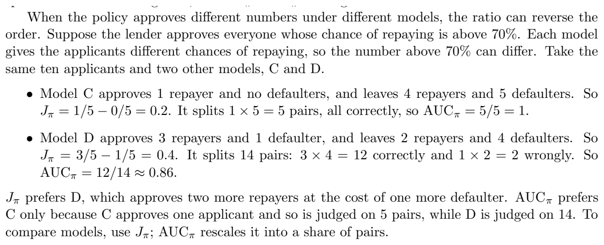

# 两种分数交给同一套动作规则，为什么按样本对算的指标仍能把优劣排反？

<!-- 全库方法复筛开始 -->
> **方法储备 · 面向决策的履约建模**。保留“One Curve, Different Weights: AUC, the Brier Score, Decision-Weighted AUC, and the Policy Youden Index”这一研究问题或机制；是否用于当前业务另行验证。
> 原有阅读范围与证据等级不变；储备不等于效果已验证。
> [[研究前沿/论文库复筛与阅读路线|全库阅读路线]] · [[研究前沿/面向决策的履约建模/存量论文分层索引|本方向完整分层]]
<!-- 全库方法复筛结束 -->

**能改哪一环？** 改履约分数送入固定 PK 规则时的模型选型。§5 的十人算例中，动作规则相同，按样本对计算的指标与按实际触发动作计算的指标仍会给出相反排序。

**第一步怎么验证？** 冻结同一批候选、PK 规则及业务代价，只替换两版履约分，先统计实际改选司机的请求比例。若几乎从不改选，AUC 的提升难以通过此规则起效；若改选集中在少数场景，再用有随机覆盖的日志估计这些场景的完单价值，未执行司机不能直接套用已选司机的结果。（本地验证未运行。）

作者给出可手算的反例。两种模型都用 70% 的门槛，但一个模型只触发一次动作，另一个触发四次，导致进入加权 AUC 分母的样本对发生变化。

## 文献与版本

One Curve, Different Weights: AUC, the Brier Score, Decision-Weighted AUC, and the Policy Youden Index。Yegor Baranovski。arXiv v1 首投于 2026-11-10。 检索及精读于 2026-11-16。精读 Youden 曲线分解、定理 1、决策加权定义及 §5 十人算例。 [一手来源](https://arxiv.org/abs/2611.14465v1)

本地资料　[paper-v1.pdf](./assets/source/paper-v1.pdf) · [paper-v1.html](./assets/source/paper-v1.html)

## 方法与关键计算

给定分数 S、二元结果 Y 和冻结的动作概率函数 π。分别在两类中求平均动作概率，计算 $J_\pi=E[\pi(S)\mid Y=1]-E[\pi(S)\mid Y=0]$。确定性门槛时就是该点的 TPR−FPR。作者还按两人在动作概率上的差给正负样本对加权，得到决策加权 AUC；只有当动作概率有区别时，这个样本对才贡献权重。

## 效果证据与对照

§5 的十人构造里，C 批准 1 个正例、0 个负例，D 批准 3 个正例、1 个负例。固定规则的 Jπ 为 0.20、0.40，决策加权 AUC 却为 1.00、12/14≈0.86；它们分别只在 5 对、14 对被策略区分的样本上计算。

理论推导把普通 AUC、理想概率预测的 Brier 表达与决策加权评价联系到同一条阈值曲线。例子验证了可发生的排序逆转，不估计逆转在实际模型中的频率。

§5 固定门槛的十人反例，给出正负人数和两种分母。 [原文第 12 页](./assets/source/paper-v1.pdf#page=12)

## 能迁移到什么问题

二元结果需可观测，π 要事先确定。正负类等权对应特定代价；若动作改变标签，单纯对历史标签算 Jπ 无法识别策略收益。

文中定理与十人例可逐项手算；此次未核实作者代码库。

[[研究前沿/面向决策的履约建模/02-可复用方法卡/PolicyYouden-冻结动作函数并分别统计两类的触发率|冻结动作函数并分别统计两类的触发率]] · [[研究前沿/面向决策的履约建模/03-实验假设与结果/PolicyYouden-比较固定线上阈值下的触发差和全局 AUC 排名|比较固定线上阈值下的触发差和全局 AUC 排名（未运行）]]
