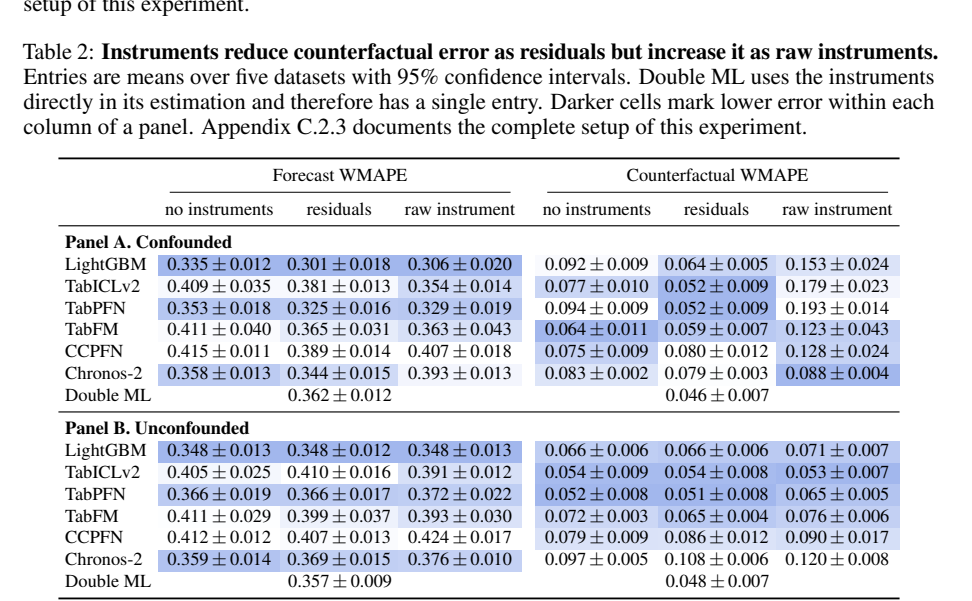

# 历史销量预测变准，价格变化的响应可能更差

<!-- 全库方法复筛开始 -->
> **方法储备 · 面向决策的履约建模**。保留“From Forecasting to World Modeling: Can Temporal Foundation Models Recover Causal Response?”这一研究问题或机制；是否用于当前业务另行验证。
> 原有阅读范围与证据等级不变；储备不等于效果已验证。
> [[研究前沿/论文库复筛与阅读路线|全库阅读路线]] · [[研究前沿/面向决策的履约建模/存量论文分层索引|本方向完整分层]]
<!-- 全库方法复筛结束 -->

From Forecasting to World Modeling: Can Temporal Foundation Models Recover Causal Response?  
Juwon Hong; Minha Hwang; Venkatesh Shankar。2026-11-11 首次提交 arXiv，本次核对 v1。[arXiv v1](https://arxiv.org/abs/2611.15009v1)

观测预测误差能否告诉我们，模型对一次提价的响应方向和幅度是否可信？

## 怎样从输入得到输出

给出原价格与提高 10% 的价格，同一预测器各算一次销量，并与可控制反事实的 CausalDemand 真值比较。分有、无隐藏需求冲击两种数据生成机制；增加上下文、增加原始工具变量、增加第一阶段残差分别做对照。真实商店记录只有方向校验，无法直接量得干预幅度。

预测差为 $\widehat\Delta=\hat q(1.1p,x)-\hat q(p,x)$；控制函数先在训练样本用工具变量及协变量解释价格，留下 $v=p-\hat E[p\mid z,x]$，在评估提价时保持该行原始残差不变，表示同一次未观测冲击。并排报告观测 WMAPE 和反事实 WMAPE。

## 哪个对照支持这个判断

表 2 的五套有混杂模拟中，TabPFN 加原始工具变量，观测 WMAPE 从 0.353 降到 0.329，反事实 WMAPE 从 0.094 升到 0.193；改给第一阶段残差，反事实误差为 0.052。表 1 真实零售记录只能检查方向，例如早餐谷物 TabPFN 的方向通过率为 0.788。

表 2，相同模拟数据和估计器的三种工具变量输入。[本地原文](./assets/source/paper.pdf#page=4)

## 使用条件与可检验的迁移

残差法依赖外生工具和结构假设。图 1 各模型可用上下文上限不同；零售理论预期的负号无法提供每行的真实效应。不同预训练架构间还混有数据与容量差异。

同一个履约响应模型可同时在真实已执行动作上评预测误差，在随机处理对照上评动作差；两个指标选出的模型可能不同。

[[研究前沿/面向决策的履约建模/02-可复用方法卡/PriceResponseAudit-method|方法卡 · 历史销量预测变准，价格变化的响应可能更差]] · [[研究前沿/面向决策的履约建模/03-实验假设与结果/PriceResponseAudit-预测选出的模型能否恢复动作差|待验证 · 预测选出的模型能否恢复动作差]]

## 阅读范围与复现入口

15 页，核对图 1、表 1–2 与附录 C 的干预构造和时间划分；未复算模拟。文中提供 [CausalDemand 数据集](https://huggingface.co/datasets/jean-jsj/CausalDemand)，全套评估脚本公开位置待核实。 本地验证状态为未运行。
