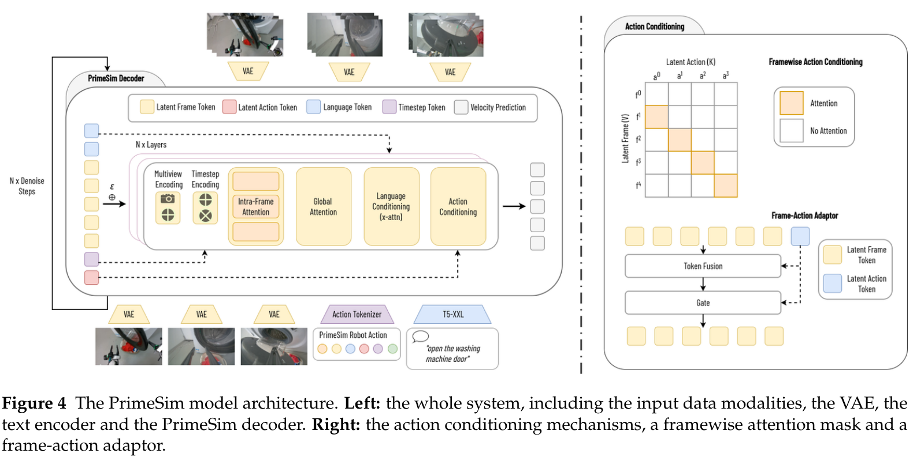

# PrimeSim: A Generalist World Model Simulator from Large-Scale Cross-Embodiment Demonstrations

[官方论文](https://arxiv.org/abs/2611.04870) · [本地PDF](./assets/source/paper.pdf) · [HTML快照](./assets/source/paper.html)

版本记录：[Submitted on 3 Nov 2026]；本次核验与精读：2026-11-06。本篇为滚动窗口内首次入库；检索日不等于首次发表日。

阅读范围：§2.1.4 动作数据对齐，§3.2–3.3 条件生成及四阶段后训练，§4.1/4.3–4.5 行为/速度/长程/策略与组件证据，§6 限制；大规模数据工程及附录未逐项复现。未逐行复证全部数学证明，未声称逐页翻译。[[研究前沿/面向决策的履约建模/01-论文原文与精读/PrimeSim/阅读覆盖|原文章节与公式索引]]；HTML为原始快照，外部样式和图片可能需要联网，PDF可离线阅读。

代码：已核验[作者仓库](https://github.com/PrimebotTech/PrimeSim)，commit `c0ae256d53d1a504e3ec9817958c7b0b92007ef7`；截至本次仅 README、LICENSE 与 .gitignore，README 明确代码及权重 coming soon；未发布可执行实现。 [[研究前沿/面向决策的履约建模/01-论文原文与精读/PrimeSim/代码核验|核验记录]]

## 问题与整体方法

动作条件世界模型必须真的响应动作，并能长期使用自己的预测继续生成。PrimeSim 在 30,110 小时、22 平台机器人轨迹上统一动作接口，训练多视角生成器，再依次做因果自回归、4 步蒸馏、短片自 rollout 与整 episode 适配。这里“causal”多指时间注意力遮罩，不等于从观测数据识别因果效应。

## 模块一：动作时间对齐及直接注入

31 维统一动作包含末端位姿、夹爪、身体关节和底盘速度，缺失槽置零。窗口内相对首帧：$\widetilde p_t=R_0^T(p_t-p_0)$，$\widetilde R_t=R_0^TR_t$，关节减初值；夹爪与速度保留原语义。整 episode 续接时参考改为 episode 起点，避免每窗口重置跳变。

两层 MLP 生成逐 latent frame 动作 token。shifted-diagonal mask 只允许帧访问驱动该转移的动作，再用 adapter 将动作残差直接注入帧表示。原文不同段落对 $a_t$ 是“进入帧 t”还是“驱动 t→t+1”的索引记号不一致；复现需以 transition 对齐验证，不能直接照搬下标。多视角每 3 个 DiT block 中 2 个视角内 attention、1 个全视角，加 camera identity token。

联合 latent flow matching：$x_\tau=(1-\tau)x_0+\tau\epsilon$，$\mathcal L=\mathbb E\|u_\theta(x_\tau,\tau,c)-(\epsilon-x_0)\|^2$。该阶段不另设独立动作或多视角 loss。

## 模块二：自 rollout 蒸馏与有界多尺度记忆

先以 clean history teacher forcing 做 chunk-causal adaptation；用冻结因果 teacher 的局部 ODE 转移进行 consistency distillation，从 50 步变 4 步。再让 student 使用自己生成的 KV 历史，以更强双向 teacher 为参考、fake-score 网络跟踪 student，最小化反向 KL 型 DMD 目标。

Eq.11–13 的方向近似为 $g=(\widehat x_{0,fake}-\widehat x_{0,teacher})/\max(\mathbb E|\widetilde x_0-\widehat x_{0,teacher}|,10^{-8})$；用 $\tfrac12\|\widetilde x_0-\operatorname{sg}(\widetilde x_0-g)\|^2$ 更新 student，fake-score 用生成样本上的 flow matching 更新。teacher 双向结构不进入推理 student。

整 episode 时延续 latent KV，generator 在 episode 末累计更新，fake-score 每窗口更新。记忆分为初始场景 sink、稀疏慢记忆、稠密最近记忆：旧 local 合并 slow 后按时间降采样至固定容量，保留时间位置和多视角同步索引。只有初始观察是真实帧，其余均为自生成历史；训练与推理采用同一更新机制。

## 实验与归因

**组件消融，Tables 9–11**：相对首帧动作 PSNR 24.56，对绝对 22.23/逐帧差分 21.34；双路径 conditioning 24.56 对常规双路径23.31；视角 token 和分组 attention 逐步提升。主要在单 embodiment 小数据上，不能单靠这些消融证明跨平台机制效果。

**阶段消融，Table 6**：50步teacher→4步CD→4步DMD，FPS 1.12→10.04→10.12，LPIPS 0.153→0.193→0.176。蒸馏加速有质量损失，DMD只部分恢复，并非全指标同时优于teacher。

**长程，Tables 7–8**：10 条 610–1,046 帧 held-out episodes；整 episode 训练相对短片训练 mean PSNR12.572→18.709。相同21slot下 hierarchical(3+9+9)对rolling(3+18)，mean PSNR19.519对18.709，末窗LPIPS0.321对0.400，支持记忆组织价值。

**行为评估，Table 1**：WorldSimProbe 的动作轨迹、动作来源保留、交互 grounding/dynamics 领先；局部动作校准70.2仍低于LingBot-VA77.0。视觉清晰度不替代动作响应和无接触交互检查。

**策略模拟，§4.4/Fig.9**：8 个固定策略、各300个相同初态，世界模型与LIBERO物理模拟器排序 Spearman1.00、均值绝对差2.8个百分点；在模型中200步GRPO后，LIBERO成功率61.7%→73.2%。这是仿真到仿真验证，无真实硬件上的策略训练收益证据，成功分类器还可被长训练利用。

**速度**：单A100短窗口10.12时间帧/s=30.35视角帧/s；长KV约7.63时间帧/s。外部模型的分辨率、视数、采样步数不等，不能称同计算预算倍数提升；计时也不含完整策略闭环。

## 迁移与边界

有价值的迁移顺序：先做动作—状态时间对齐检查及双路径注入，再验证自 rollout 的分布漂移与多尺度记忆，最后才用模型筛策略。履约模型不必生成视频，可在状态/风险 latent 上借鉴。必须独立检查局部动作响应、不可发生结果、长程误差与策略排序；未识别的混杂和动作覆盖不足不会被上述架构自动解决。新平台多数需100–200步适配，非统一零样本。

## 原文关键图表

原文 Figure 4，PDF 第 6 页；原始裁图，机制和证据解释见上文。裁图坐标与源文件校验值见 assets/source/figure-provenance.json。

## 方法卡

- [[研究前沿/面向决策的履约建模/02-可复用方法卡/PrimeSim-aligned-action-conditioning|转移动作对齐 attention 与直接 adapter 双路径]]
- [[研究前沿/面向决策的履约建模/02-可复用方法卡/PrimeSim-self-rollout-memory|自生成历史上的整段训练与固定容量多尺度记忆]]
