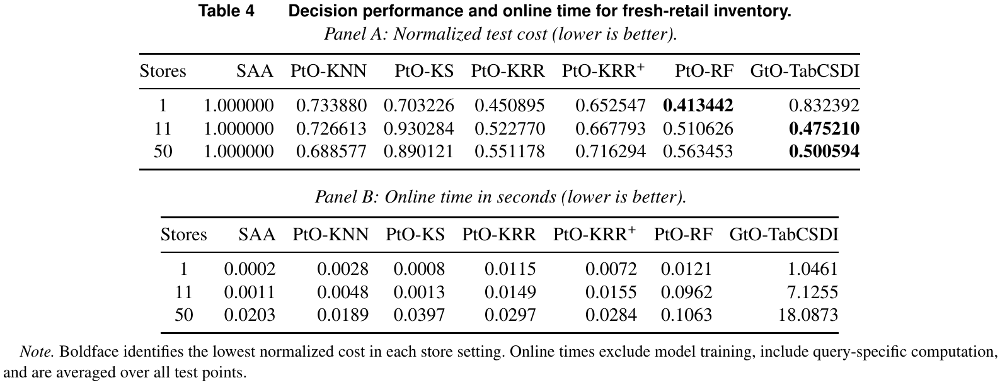

# Contextual Decision Making: Predictive or Generative

[官方论文](https://arxiv.org/abs/2610.32584) · [本地 PDF](./assets/source/paper.pdf) · [HTML 快照](./assets/source/paper.html)

首次提交：2026-10-23；本次精读：2026-11-05；核验版本：v1。会议正式发表日期未核验。本文是旧队列补精读，不是今日新发表。

阅读范围：核心方法、关键公式、主实验/理论条件及与迁移直接相关的附录。未逐行复证全部证明，也不称逐页翻译；具体覆盖见 [[研究前沿/面向决策的履约建模/01-论文原文与精读/PtOGtO/阅读覆盖|阅读覆盖]]。HTML 为原始快照，外部样式/图片可能需要联网；PDF 是完整离线原文。

代码状态：原文未提供可核验的公开官方仓库入口；未把文中本地脚本名、提交哈希或同名项目当成已取得代码。本次未运行作者代码。

## 1. 问题和术语

本文比较两种上下文随机优化路线：PtO学习条件期望目标，GtO学习条件分布、生成场景后优化。这里PtO不是简单“先预测一个均值再代入任何目标”；它包括KNN、核平滑、KRR等构造期望成本的加权方法。论文的贡献是学习难度、凸结构和计算成本之间的界限与选择框架。

## 2. 两条计算路线（§2–4）

给定上下文 $x$，目标为 $\min_{z\in\mathcal Z}\mathbb E[c(z;X,Y)\mid X=x]$。PtO将历史场景加权，GtO从学习的条件分布生成场景：

$$
\widehat h_P(z;x)=\sum_i\omega_{n,i}(x)c(z;X_i,Y_i),\qquad
\widehat h_G(z;x)=\frac1m\sum_{j=1}^m c(z;x,\widetilde Y_j).
$$

若每个场景成本对决策凸，非负权重保凸。KRR可产生负权重、利用高阶平滑，但失去一般保凸保证；截断负权重又可能损害统计效率。**负权重并不必然导致非凸或难解**，具体要看结构：有符号newsvendor仍可专门求解，产品布局的标准LP重写则可能失效。

GtO的等权场景平均保留凸性；训练可用条件扩散模型，分布学习不受唯一架构限制。生成对象是外生不确定结果 $Y\mid X$，不是决策 $z$；不能把动作改变后的结果分布当作自动处理好了。

## 3. 理论证据与适用范围（§3.3、4.3、5）

非负、只依赖协变量的权重类存在最坏regret下界 $c_0n^{-4/(d_x+4)}$。这个定理不覆盖所有决策聚焦学习、直接策略或任意PtO架构。

GtO在条件分布学习误差率成立及有界/Lipschitz/紧凸域等假设下，期望regret上界分解为

$$
C\{n^{-\alpha_0}(\log n)^{\alpha_1}+m^{-1/2}\}.\qquad\text{(15)}
$$

前项是模型误差，后项是场景蒙特卡洛误差。增加场景数只能降低后项。比较平滑度时，GtO还承担结果维度 $d_y$，不能以“生成模型表达力强”取代样本复杂度判断。

多任务可以复用同一条件场景集合，但只有不确定性机制不变时成立。若改价格会改变需求，既有 $Y\mid X$ 不是新价格下的反事实分布；需另建动作条件与识别方案。

## 4. 实验与成本权衡（§6、附录10）

论文比较合成newsvendor、产品布局及鲜食库存。真实案例使用FreshRetailNet-LT中商品156、50家店，先恢复缺货截断需求，再用指定过量/缺货成本；采购价和实际售价不可得。所以这是恢复需求和假定成本下的离线决策评价，不是真实利润线上提升。

1店/11店/50店的归一测试成本：GtO-TabCSDI为0.832392/0.475210/0.500594；对应最好PtO为RF0.413442/RF0.510626/KRR0.551178。50店GtO相对KRR约低9.2%，但query计算含生成与求解耗时18.0873秒 vs0.0297秒。1店GtO反而明显较差。扩大店数同时改变数据量和异质性，不能只归因为样本量。

图表为原始PDF裁图，页码见图片说明及附件溯源记录；数字与标记以原图为准。

## 5. 可复用的研究单元

一是“条件场景生成→等权SAA→可替换业务目标”的接口；二是检查学习器是否破坏优化器依赖的数学结构。迁移到接单/取消/等待风险建模时，应先确定结果随机性是否受动作影响，再比较相同端到端预算下的决策质量。该论文不提供某个神经模块的独立消融收益；方法卡按框架/审计机制记录。

## 方法卡与后续实验

- [[研究前沿/面向决策的履约建模/02-可复用方法卡/PtOGtO-scenario-interface|条件场景生成到等权随机优化]]
- [[研究前沿/面向决策的履约建模/02-可复用方法卡/PtOGtO-convexity-audit|检查预测权重是否破坏下游优化结构]]
