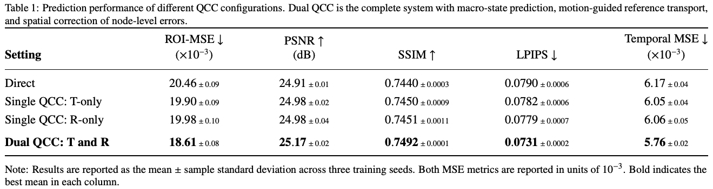

# 用同一份空间分组对照宏观状态和生成帧

<!-- 全库方法复筛开始 -->
> **方法储备 · 司乘行为序列建模**。保留“宏观一致性约束的视觉状态预测”这一研究问题或机制；是否用于当前业务另行验证。
> 原有阅读范围与证据等级不变；储备不等于效果已验证。
> 已恢复此前因业务距离被移出的原笔记；旧取舍原因仅作历史记录。
> [[研究前沿/论文库复筛与阅读路线|全库阅读路线]] · [[研究前沿/司乘行为序列建模/存量论文分层索引|本方向完整分层]]
<!-- 全库方法复筛结束 -->

QCC-WM: Linking Macro-State Dynamics and Visual Generation via Quotient Causal Construction  
Zhizhong Fu、Wei Zhou 等十位作者。11 月 9 日提交 arXiv v1。作者页自列 Medical Image Analysis DOI 10.1016/j.media.2026.104391；Crossref 显示该 DOI 的注册题名为《Hierarchical causal construction for semantic-granularity-aligned counterfactual medical image generation》，署名也与本稿部分不同。两者对应关系未获核实，仅按 arXiv v1 登记。 [DOI 注册元数据](https://api.crossref.org/works/10.1016/j.media.2026.104391) [作者或出版社记录](https://arxiv.org/abs/2611.12353v1)

超声轨迹四步预测中，完整方法与直接解码的 ROI-MSE 为 0.01861 与 0.02046；16 步时感知距离领先，结构相似度仍落后于部分基线。

## 作者要解决什么问题

如果宏观模型预测“哪里移动”而生成器画出的图并不支持这一判断，多步生成会累积不一致。需要能在帧和宏观状态上反复使用同一测量方式。

## 方法怎样从输入得到决策或预测

根据探头平移与旋转的动作响应，把局部特征软分到带空间锚点的两组宏观节点 → 固定参考分配递归预测节点内容与位移 → 依运动搬运历史外观，生成未来帧 → 用同一分配从生成帧读回节点 → 将目标节点和读回节点的误差映射回其空间区域作纠正。

记共享聚合算子为 $Q_0$，预测节点为 $\hat m$，生成帧特征为 $F(\hat x)$。节点误差可概括为 $e=\hat m-Q_0F(\hat x)$，再按原空间对应回传局部修正。这里只概括 §3.3–3.5 的接口；原文还有分支特定测量、运动变换、损失及分阶段训练。

## 实验观察和证据范围

表 1 同一划分和采样、三次训练：直接解码 / 单平移 / 单旋转 / 双分支的 4 步 ROI-MSE 为 0.02046 / 0.01990 / 0.01998 / 0.01861。表 2–4 的 4/8/16 步 LPIPS 相对各步最佳基线分别降低 48.59%、41.68%、30.23%，但 16 步 SSIM 为 0.5518，低于 MMVP 0.5669。图 4/5 拆开搬运和节点回读，在原空间位置反馈的效果不能等同整套系统相对基线的提升。

表 1，完整空间分组与单分支和直接生成对照。[原文 PDF](./assets/source/paper.pdf#page=8)

评测来自带探头动作的超声序列，指标为像素/感知/时间一致性；论文把闭环控制留作未来工作。模型名中的 causal construction 描述构造方法，观测轨迹预测不能证明未执行动作在新场景的因果效应。

## 可采用的部分

最小单元是把同一聚合函数施加在模型输出与宏观目标上，对照生成后再聚合是否一致。原模型依赖空间节点与局部可回写结构，其预测收益还与运动搬运和双分支共同决定。

当细粒度事件预测与按区域汇总的履约状态同时存在，可固定聚合映射比较两者。动作语义、地理分配和总量守恒须可验证，原论文未执行此迁移。

[[研究前沿/面向决策的履约建模/02-可复用方法卡/QCCWM-state-readback|方法卡：用固定参考测量回读生成状态并做局部纠正]]

## 阅读与核验范围

16 页原文，核读 §3 的固定参考测量、§4 表 1–5 与图 4/5，重点对照两个数据集、多步预测及弱项。 原文给出公开数据和部分基线的 OpenSTL 地址；核对论文与公开题名检索，未取得 QCC-WM 作者实现。 本地未运行原作者实验。 [本地 PDF](./assets/source/paper.pdf) · [本地 HTML 原文](./assets/source/paper.html)
