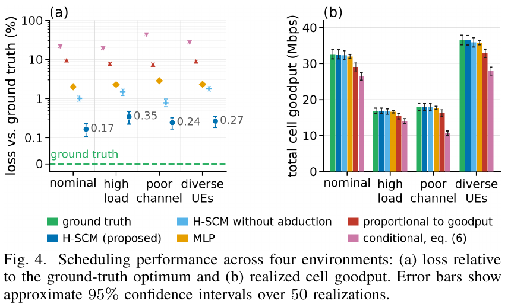

# From Confounding to Counterfactuals: A Cross-Layer Causal Model for RAN Scheduling

[官方论文](https://arxiv.org/abs/2611.00635) · [本地PDF](./assets/source/paper.pdf) · [HTML快照](./assets/source/paper.html)

版本记录：[Submitted on 31 Oct 2026]；本次核验与精读：2026-11-06。本篇为滚动窗口内首次入库；检索日不等于首次发表日。

阅读范围：§II 机制设定，§III 图、识别、残差反事实及预算优化，§IV 图发现/响应/调度模拟和消融，§V 局限。未逐行复证全部数学证明，未声称逐页翻译。[[研究前沿/面向决策的履约建模/01-论文原文与精读/RAN-SCM/阅读覆盖|原文章节与公式索引]]；HTML为原始快照，外部样式和图片可能需要联网，PDF可离线阅读。

代码：本次核验的论文原文与元数据未提供可确认的作者实现入口；代码状态未知，不能据此断言不存在。未运行代码。 [[研究前沿/面向决策的履约建模/01-论文原文与精读/RAN-SCM/代码核验|核验记录]]

## 问题与因果边界

无线调度中拥塞 $L$ 同时影响资源分配 $T$ 与链路质量，$\mathbb E[Y\mid T=t]$ 不能直接回答多分配资源的效果。论文在已构造的跨物理/MAC/网络层模拟器中，结合因果图发现、结构方程和个体残差推断，预测不同资源分配后的 goodput，再做共享预算优化。

给定图及 overlap，群体效果用 $\mathbb E_L\mathbb E[Y\mid T=t,L]$；个体反事实还额外保持从事实遥测推断出的外生状态。二者需要的假设不同。

## 关键模块与计算流程

1. PC 学习骨架，协议层级和处理顺序限制方向；DirectLiNGAM 仅用作非线性环境下的方向启发式。
2. 混合观测/干预数据提出边，再用固定中介的成对模拟器干预筛选；共享外生噪声，保留显著效应且保持无环。未被阻断的间接路径仍可能污染“直接边”。
3. 对每个节点用父节点拟合 GBM：$\widehat f_i=\arg\min_f\sum_n(v_i^{(n)}-f(\mathrm{Pa}_i^{(n)}))^2$，交叉拟合事实残差。
4. Abduction 推断个体残差；action 用 $T=t$ 替换分配机制；prediction 按拓扑顺序重算。残差规则因机制而异：多数加性、MAC 服务率乘性、队列只缩放流量项，不能统一当成加法修正。
5. 在共享预算下优化 $\max_{\{t_u\}}\sum_uw_u\widehat Y_{t_u}^{(u)}$，约束 $\sum_ut_u\le B$。

## 证据与归因

**模拟，§IV/Fig.2**：忽略拥塞的 OLS 对 $T=100$ 的均值预测 49.20 Mbps，对干预真值 28.39 高估 73.3%；调整拥塞后 31.18，误差 9.8%；H-SCM 跨拟合平均 27.64，误差 2.7%。这一对照不能描述成“比任何条件预测器都好”。

**模拟反事实**：5,000 个 held-out 个体，$T=50/100$ 与硬件归一化查询的 $R^2$ 为 0.979/0.988/0.994。正确结构与噪声形式、外生状态跨干预保持，是这些结果的解释前提。

**预算调度和消融，Fig.4**：4 个 UE 共享资源，50 次重复、4 种环境。相对真值最优的 realized goodput 损失为 H-SCM 0.17%–0.35%，去掉 abduction 0.8%–1.8%，MLP 2.0%–2.9%。这里有同机制去残差的消融，支持个体状态保留的价值，但仅在模拟器假设下。

发现图阶段每次使用 500 观测、2,940 干预样本，每个中介检验另需 2,000 成对实例；从 21 条可观测边恢复 19 条、无假阳性。部分内部干预仅模拟器可做，不能声称已在真实遥测中无监督识别出完整图。

## 迁移与局限

可借鉴“环境共享压力→中间机制→最终履约”的结构分解，以及固定个体残差比较候选动作。但真实场景中的干扰、隐藏混杂、非持久残差、错误结构均可能使反事实失效。预测残差包含模型误差，不能直接命名为稳定个体特质。论文仍未完成 operational RAN traces 验证。

## 原文关键图表

原文 Figure 4，PDF 第 6 页；原始裁图，机制和证据解释见上文。裁图坐标与源文件校验值见 assets/source/figure-provenance.json。

## 方法卡

- [[研究前沿/面向决策的履约建模/02-可复用方法卡/RAN-SCM-abduction-allocation|结构机制与个体残差共同驱动预算分配]]
