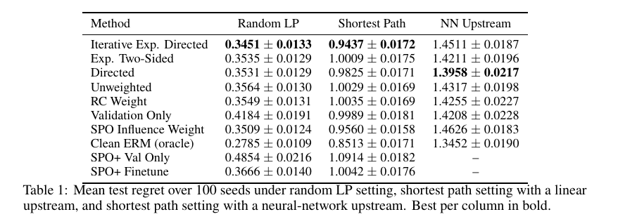

# RCIF：Reduced Cost Influence Functions for Predict-then-Optimize under Noisy Data

作者：William Zhang、Saurabh Amin、Georgia Perakis。首次提交：2026-11-01；修订：无后续修订记录；本次阅读：2026-11-05。状态：arXiv 预印本，未据此认定会议录用。

[官方摘要与版本](https://arxiv.org/abs/2611.02086) · [已读 HTML](https://arxiv.org/html/2611.02086v1) · [本地 PDF](./assets/source/paper.pdf) · [本地 HTML](./assets/source/paper.html)

**阅读深度：关键方法精读。** 已读方法、主实验及下列关键附录；不声称逐节全文精读或已完成复现。PDF 是完整原文；HTML 已保存，但其外链资源不保证离线加载。

## 问题与流程

上游预测成本，下游 LP 据此选择路线或分配方案。训练标签含噪声时，减少均方误差不一定改善决策。RCIF 借助少量干净验证样本，估计每条训练样本对 LP 决策边界的影响，再给样本加权、重新拟合；预测器和下游优化问题的接口保留。

## 两个耦合模块

[[研究前沿/面向决策的履约建模/02-可复用方法卡/RCIF-score|将训练样本影响传播到决策边界]]

[[研究前沿/面向决策的履约建模/02-可复用方法卡/RCIF-weights|按决策影响加权重拟合及非线性退化检查]]

LP 为 $x^*(c)=\arg\min_{x\in\mathcal X}c^\top x$。同一最优基对应一个成本锥；预测值只要仍在正确锥中，决策就可以不变。Reduced cost 衡量沿某个非基方向的松弛，训练点影响函数通过预测器传播到该方向：

$$
\mathcal I_{\widehat\theta}(w_j)=-H_{\widehat\theta}^{-1}\nabla_\theta\ell_j,
\qquad
\mathrm{RCIF}_k(z_v,w_j)=\delta(B,k)^\top\nabla_\theta f_{\widehat\theta}(z_v)\mathcal I_{\widehat\theta}(w_j).
$$

来源：§4、Definition 1。Directed 方案对已经正确的验证决策增加最脆弱方向的裕量，对错误决策只在真实成本要求换基的方向上寻找修正信号。聚合分数 $\Psi_j$ 后指数加权 $p_j\propto\exp(\lambda\Psi_j)$；迭代版累计各轮分数。它们应与加法权重方案区分。

## 效果与负结果

Table 1（p.9）报告 100 个种子的测试 regret。4×4 最短路、线性上游、400/100/200 条训练/验证/测试、20% 标签加噪时，迭代 Directed 为 **0.9437±0.0172**，无权重为 **1.0029±0.0169**，SPO Influence 为 **0.9560±0.0158**。相对无权重降低约 5.9%（本笔记据表计算），不能写成所有场景平均收益。

两层小神经网络上游时，迭代版本为 1.4511，无权重为 1.4317，反而退化；加法 Directed 为 1.3958。§7.4 显示干净验证集太小可能不如无权重，足够大时仅用干净数据又可能更好。理论依赖非退化 LP、可微且严格凸的经验风险，神经网络只提供经验探索，不能照搬严格保证。

## 代码核验与复现差异

[作者仓库](https://github.com/william-zhang64/Reduced-Cost-Influence-Functions)，已核验快照 `3b80d92d6f9c14311868dfa1474dfa2ca086677d`。已读 `rcif/scoring.py::rcif_scores`、`rcif/methods.py`；需要 Gurobi 的最优基/方向信息，不能只拿一个黑盒分配结果计算 RCIF。

**发现论文与实现命名差异：** `paper_methods()` 中 `Exp. Two-Sided` 实际绑定 `fit_rcif_additive(scheme="two_sided", phi=0.05)`。真正的一次指数实现是 `fit_rcif_exp`，列在 `extra_methods()` 的 `Exp. Two-Sided (exp)`。因此表中该对照的解释和复现应分别检查算法与注册名。本次未运行代码，不据此推断作者结果无效。

## 迁移推断

可研究带噪履约成本/服务时长标签如何影响分配决策，尤其关注接近换方案边界的样本；普通二分类 AUC 或任意非线性策略尚不满足本文接口。需有代表性的干净成本标注、稳定 LP 结构和可计算的影响函数。局部影响近似、验证集过拟合及求解耗时都是待测项。

[[研究前沿/面向决策的履约建模/03-实验假设与结果/2026-11-05-RCIF-候选假设|候选实验：待设计、未运行]]
