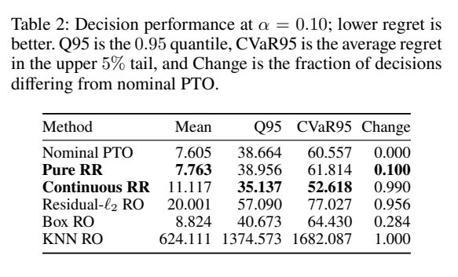

# 怎样给预测触发的决策遗憾设上界

<!-- 全库方法复筛开始 -->
> **方法储备 · 面向决策的履约建模**。保留“Beyond Prediction Residuals: Conformal Regret Calibration for Robust Contextual Linear Optimization”这一研究问题或机制；是否用于当前业务另行验证。
> 原有阅读范围与证据等级不变；储备不等于效果已验证。
> [[研究前沿/论文库复筛与阅读路线|全库阅读路线]] · [[研究前沿/面向决策的履约建模/存量论文分层索引|本方向完整分层]]
<!-- 全库方法复筛结束 -->

**Beyond Prediction Residuals: Conformal Regret Calibration for Robust Contextual Linear Optimization**  
arXiv 首次提交 2026-11-09（UTC），核验时版本历史仅有 v1；本次检索日为上海时间 2026-11-12。正式发表日期待核。 [官方版本历史](https://arxiv.org/abs/2611.11973v1)

[原版 PDF](./assets/source/paper.pdf) · [原文 HTML 快照](./assets/source/paper.html)

## 研究问题

标准共形法用预测参数的残差划出不确定集。在线性最小化中，同样大小的参数误差可能完全不影响最优顶点，也可能把决策推过分界。作者把每个校准样本的分数换成依赖求解器的 SPO+ 损失，把校准目标改为决策遗憾。

## 方法、计算与决策时点

令 $x^*(c)$ 是成本 $c$ 的最优决策，实际遗憾为 $c^\top[x^*(\hat c)-x^*(c)]$。若只校准这一差值，假设名义最优是顶点，任何其他决策在该集合上的最坏遗憾都可无界（命题 1）。式 (8) 的上界比较各可行解。校准集与测试可交换、预测器独立训练时，取第 $\lceil(n+1)(1-\alpha)\rceil$ 个分数，得到未来样本的边际证书。求解时可固定在顶点，也可允许连续混合。

## 实验结果与证据边界

表 2 在分数背包和 $\alpha=0.10$ 下，连续方案把最差 5% 的平均遗憾从 60.557 降到 52.618，平均遗憾却从 7.605 升到 11.117。附录 C 表 9 在真实太阳能月度分配数据的 96 个测试月见到同一权衡，残差球方法的尾部值 0.2471 与本文 0.2464 接近。可混合决策、成本已实现且可评估的场景最有意义。 [证据原文](https://arxiv.org/html/2611.11973v1#S5.T2)

*表 2 · 分数背包，平均与尾部遗憾，固定版 PDF 第 7 页。*

名义最优与相邻顶点之间的目标差最小值记作 $\Gamma$。定理 4 给出的最坏遗憾证书至多为 $\max(0,\eta-2\Gamma)$，这允许间隔足够大时直接用名义解。保证针对整个人群边际，并不保证每个子群、每次决策或均值都改善。

## 迁移到履约问题

用于能拿到全候选真实成本的回放，按成本分布和动作空间复核可交换性。 仅在业务可执行分配混合时解释连续解的尾部保护；保持所有约束与成本口径一致。 本地尚未运行验证。

## 方法卡与候选实验

- [[研究前沿/面向决策的履约建模/02-可复用方法卡/RegretCalibration-spo-margin|用下游损失标定名义决策的遗憾阈值]]
- [[研究前沿/面向决策的履约建模/02-可复用方法卡/RegretCalibration-robust-refinement|用相邻顶点的间隔决定是否修正名义解]]
- [[研究前沿/面向决策的履约建模/03-实验假设与结果/2026-11-12-可分配资源的尾部遗憾与平均成本|可分配资源的尾部遗憾与平均成本（未运行）]]

## 来源与实现核验

已检查论文正文外链和题名、作者的公开检索；本论文的作者实现入口未知。

本次核验公开 v1 正文、列明的方法和实验及下列证据定位。作者报告的数值未做独立复算。 [共形分数](https://arxiv.org/html/2611.11973v1#S3.SS3) · [遗憾证书](https://arxiv.org/html/2611.11973v1#S4.SS3) · [背包实验](https://arxiv.org/html/2611.11973v1#S5.SS2) · [太阳能分配](https://arxiv.org/html/2611.11973v1#A3.SS1)
