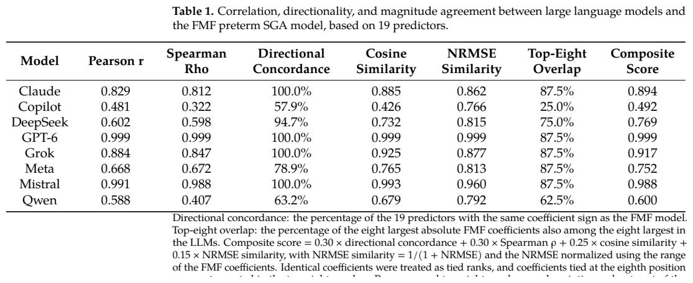

# 变化方向都对，概率能直接用来定阈值吗？

<!-- 全库方法复筛开始 -->
> **方法储备 · 面向决策的履约建模**。保留“方向判断正确与概率校准正确的差别”这一研究问题或机制；是否用于当前业务另行验证。
> 原有阅读范围与证据等级不变；储备不等于效果已验证。
> 已恢复此前因业务距离被移出的原笔记；旧取舍原因仅作历史记录。
> [[研究前沿/论文库复筛与阅读路线|全库阅读路线]] · [[研究前沿/面向决策的履约建模/存量论文分层索引|本方向完整分层]]
<!-- 全库方法复筛结束 -->

若两个模型给出相同的特征影响方向，在同一个阈值下会做出相同决定吗？ 固定输入和参考方程，分别比较局部响应形状与逐个场景的概率水平。

## 论文与阅读范围

Preterm Small-for-Gestational-Age Risk Estimates Using Large Language Models Versus the FMF Competing-Risks Model。Zelinschi 等。Diagnostics；精读 §2–4、表 1、图 1–3 和补充文件说明。 首次公开 2026-11-12，核验版本 期刊版，本次阅读 2026-11-13。 期刊上线 2026-11-12。 [一手来源](https://doi.org/10.3390/diagnostics16223742) · [journal.pdf](./assets/source/journal.pdf)

## 方法及关键假设

围绕两个参考人群逐项扰动 16 个原始变量，按相同定义编码为 19 列。对各模型输出和 FMF 方程计算的概率分别拟合局部加权线性回归，目标为 $\log(p/(1-p))$；连续变量统一缩放，高斯核宽 3.0。先报告代理模型自身加权拟合度，再比较符号、排序、方向夹角和误差。另逐样本计算赔率比和绝对对数赔率差。后者可发现由截距或概率尺度造成的系统差异。

## 证据和比较基线

表 1 中 Mistral 综合得分为 0.988，方向一致率 100%；参考场景输出为 1.65%，参考方程为 0.54%。其代理的加权 R² 为 0.82。相同评价下 GPT-6 的平均绝对对数赔率差为 0.003。这里的参考是已发表模型的实现，无真实结局；无法从两个模型的一致性推出任一模型在留出人群上的校准。

原文表 1，PDF 第 8 页。表内对照局部系数；具体场景的赔率偏差见结果与讨论。。[原表所在页](./assets/source/journal.pdf#page=8)

## 迁移条件与局限

各系统用同一提示各问一次；温度、搜索和工具调用受消费界面限制。孤立扰动覆盖不了变量交互。方法迁移到履约评分时可并行报告决策翻转率，但需要有真实结局的留出集才能评价校准。实现定位见补充材料 S4（参考方程）与 S5（代理/比较）。

[[研究前沿/面向决策的履约建模/02-可复用方法卡/RiskPerturbation-把局部响应和绝对概率分开验收|把局部响应和绝对概率分开验收]] · [[研究前沿/面向决策的履约建模/03-实验假设与结果/RiskPerturbation-在冻结决策阈值时检验两个风险模型的概率偏移|在冻结决策阈值时检验两个风险模型的概率偏移（未运行）]]

作者配套包已按目录核验。S4.py 的 compute_single_case_risk 实现参考风险；S5.py 的 alignment_table 与 absolute_agreement 分别做局部响应和绝对概率对照。文件未运行。 [补充包](./assets/source/author-supplement.zip)
