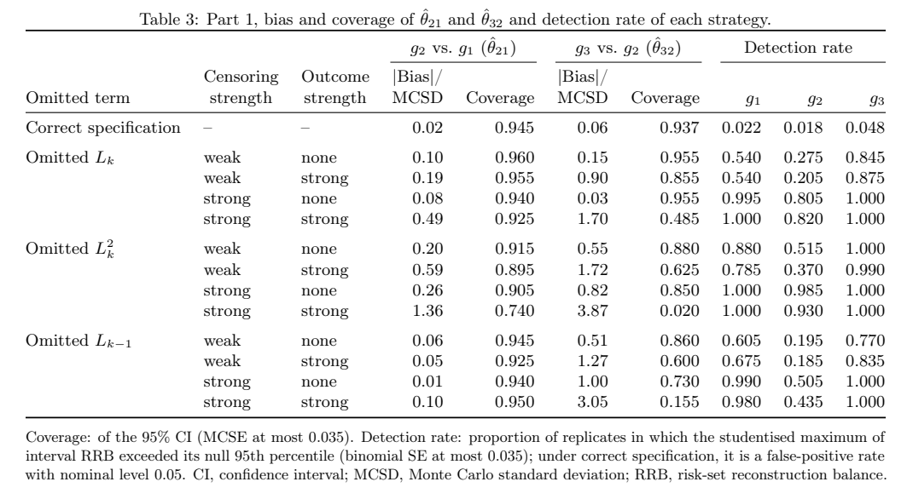

# 等待策略导致人工删失后，权重还原了哪个风险集

<!-- 全库方法复筛开始 -->
> **方法储备 · 面向决策的履约建模**。保留“按风险集进行样本平衡”这一研究问题或机制；是否用于当前业务另行验证。
> 原有阅读范围与证据等级不变；储备不等于效果已验证。
> 已恢复此前因业务距离被移出的原笔记；旧取舍原因仅作历史记录。
> [[研究前沿/论文库复筛与阅读路线|全库阅读路线]] · [[研究前沿/面向决策的履约建模/存量论文分层索引|本方向完整分层]]
<!-- 全库方法复筛结束 -->

Risk-set reconstruction balance: zero-targeted diagnostics for artificial censoring in clone-censor-weight analyses。作者为 Nonomiya, Yuta。arXiv 首投 2026-11-06，本次核验 v1。 [版本记录](https://arxiv.org/abs/2611.09553v1) · [本地 PDF](./assets/source/paper.pdf) · [本地 HTML](./assets/source/paper.html)

## 研究问题

策略偏离时截断跟踪的动态评估中，即使权重正确，不同策略组在期末的人群也可能自然不同。

## 方法与关键计算

在每个删失间隔比较“删失前在险人群”与“保留下来、按留存概率逆加权的人群”的特征均值，并标准化。累积版对照基线目标；区间版能纳入随时间变化的历史。用零目标而非固定经验阈值校验权重模型。

$$
\mathrm{RRB}(k)=\frac{\mu_{\mathcal U}-\mu_{\mathcal R}}{s}
$$

比较加权保留人与对应的删失前风险集，按同一尺度标准化。在正确模型下以零为参照，符号按作者式 (1)。 [原文定位](https://arxiv.org/html/2611.09553v1#S3.E1)

## 对照、结果和限制

§5 表 3 正确设定时三种策略的检测率为 0.022、0.018、0.048；漏掉对删失影响强、对结局无效的变量时为 0.995、0.805、1.000。说明诊断能发现选择机制错误，不能直接代表结局偏差大小。 [原文证据](https://arxiv.org/html/2611.09553v1#S5.T3)

原文 PDF 第 10 页。

要求足够正值性，且区间与累积诊断针对的失真不同。结局事件引起的风险集耗竭会让普通期末组间平衡偏离零。

## 复用和阅读范围

已核问题设定、方法与上文所列的关键对照，详细证明及未列出的实验以所附全文为准。已按公开仓库快照核对文件路径。[R/balance.R](https://github.com/Nonokyu/ccwbalance/blob/880d37a0c398189633824833dcb0396940dd0d33/R/balance.R)

[[研究前沿/面向决策的履约建模/02-可复用方法卡/RiskSetBalance-删失前风险集重构诊断|删失前风险集重构诊断]] · [[研究前沿/面向决策的履约建模/03-实验假设与结果/RiskSetBalance-策略切换导致人工截尾时，按区间重构能否更早发现权重错设|策略切换导致人工截尾时，按区间重构能否更早发现权重错设]]
