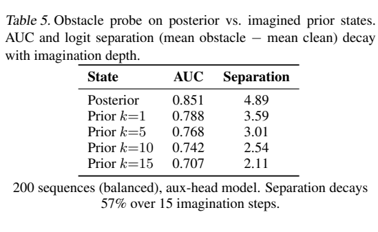

# 多步预测会不会悄悄丢掉决定终态的信号

<!-- 全库方法复筛开始 -->
> **方法储备 · 模型自进化**。保留“先验和后验分歧衡量认知不确定性”这一研究问题或机制；是否用于当前业务另行验证。
> 原有阅读范围与证据等级不变；储备不等于效果已验证。
> 已恢复此前因业务距离被移出的原笔记；旧取舍原因仅作历史记录。
> [[研究前沿/论文库复筛与阅读路线|全库阅读路线]] · [[研究前沿/模型自进化/存量论文分层索引|本方向完整分层]]
<!-- 全库方法复筛结束 -->

The Posterior-Prior Epistemic Gap: When World Model Imagination Fails to Carry Task-Relevant Signals  
Jaerock Kwon; Elahe Delavari; Donghyun Kim; Haewoon Nam。2026-11-11 首次提交 arXiv，本次核对 v1。[arXiv v1](https://arxiv.org/abs/2611.14955v1)

一步编码里已经能读出障碍，继续用模型向前滚时是否还能读出？

## 怎样从输入得到输出

CARLA 路线模型以观测构成后验状态，以相同动作在无新观测时递推先验状态。固定同一障碍读出头，对平衡的有障碍与无障碍样本计算分步 AUC 和 logit 均值差，再看模型集成分歧能否报警。

对 $k=0,1,5,10,15$ 计算 $\mathrm{AUC}(g(h_{t+k}),Y)$ 与正负类别的平均 logit 差。$g$ 固定，$k=0$ 使用后验，$k>0$ 使用前推先验；另设在先验上重新校准的对照才能量化读出分布变化。

## 哪个对照支持这个判断

表 5 的 200 条平衡序列中，AUC 从后验 0.851 降到先验第 1 步 0.788、第 15 步 0.707，logit 分离从 4.89 降到 2.11。集成分歧作为障碍分类器的 AUC 第 1 步 0.52、第 15 步 0.51。

表 5，同一个障碍读出器在观测态与不同滚动步的表现。[本地原文](./assets/source/paper.pdf#page=5)

## 使用条件与可检验的迁移

仅一个模型训练种子、三条固定高速路线、11 个 episode。后验训练的读出头用于先验存在分布偏移，结果不能唯一归因于信息丢失。依赖运行时特权坐标的避障结果也不能证明真实部署价值。

用最终取消或超时作为延后评价标签，逐步比较相同读出头在真实状态与预测状态上的区分度，再训练先验专用头定位是信号丢失还是尺度漂移。

[[研究前沿/面向决策的履约建模/02-可复用方法卡/RolloutProbe-method|方法卡 · 多步预测会不会悄悄丢掉决定终态的信号]] · [[研究前沿/面向决策的履约建模/03-实验假设与结果/RolloutProbe-终态风险信号在滚动状态的第几步开始衰减|待验证 · 终态风险信号在滚动状态的第几步开始衰减]]

## 阅读范围与复现入口

7 页，核对 §4–7、表 3–5 和图 1，未复现 CARLA 或独立随机种子。论文提供 [作者项目页](https://bimilab.github.io/paper-posterior-prior-epistemic-gap/)，具体训练入口待核实。 本地验证状态为未运行。
