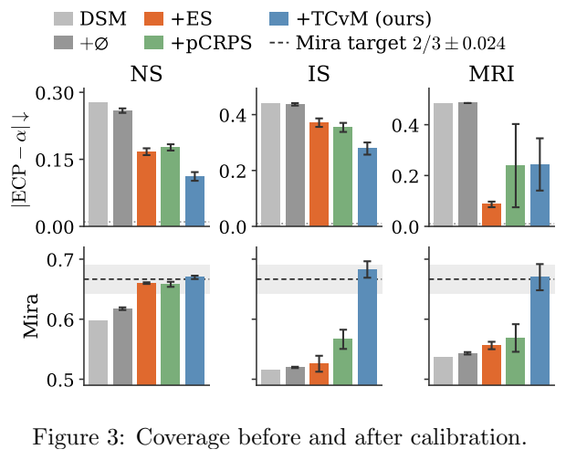

# 只会抽样、无法算密度的条件生成器，怎样在训练时纠正过窄的预测分布？

<!-- 全库方法复筛开始 -->
> **方法储备 · 推荐排序与特征表示**。保留“条件生成分布的覆盖校准训练”这一研究问题或机制；是否用于当前业务另行验证。
> 原有阅读范围与证据等级不变；储备不等于效果已验证。
> 已恢复此前因业务距离被移出的原笔记；旧取舍原因仅作历史记录。
> [[研究前沿/论文库复筛与阅读路线|全库阅读路线]] · [[研究前沿/推荐排序与特征表示/存量论文分层索引|本方向完整分层]]
<!-- 全库方法复筛结束 -->

单看均值误差容易漏掉过度自信。论文在同一模型上比较额外训练、能量分数和按抽样覆盖率训练，并报告两种校准指标不一致的情形。

## 文献与版本

Training Calibrated Conditional Generative Models with a Sample-Only Coverage Loss。Benjamin Remy、Raphael Rossellini、Chihway Chang、Rebecca Willett。arXiv v1 首投于 2026-11-11。 检索及精读于 2026-11-16。精读距离排序、TARP–CvM 目标、定理 1 的条件、图 3–4 与表 3。 [一手来源](https://arxiv.org/abs/2611.15829v1)

本地资料　[paper-v1.pdf](./assets/source/paper-v1.pdf) · [paper-v1.html](./assets/source/paper-v1.html)

## 方法与关键计算

每个带真值的观测用条件生成器抽多个候选，再抽依赖观测的参考点，把真值到参考点的距离放入生成样本的距离序列中。模型恰当时这个分位数应服从均匀分布。对多个参考规则分别累积与均匀分布的平方偏差，再聚合，训练时用可微近似让梯度穿过采样器。参考规则的丰富性是识别真分布的重要条件。

## 效果证据与对照

图 3 中 NS 与 IS 两个逆问题的覆盖误差为 0.11、0.28，最佳评分规则对照为 0.17、0.35。MRI 上能量分数在覆盖误差上最好，但只有 TARP–CvM 的 Mira 进入目标带，指标给出的结论不同。

额外 DSM 训练单列以控制优化步数。表 3 在 64 个留出观测、每例 32 个抽样上评价，MRI 均值重建的 PSNR 为 DSM 37.11、TARP–CvM 36.68；图 4 加大推理步数后 MRI 的 Mira 又偏离目标带。

图 3。覆盖误差与 Mira 对同一批模型的评价。 [原文第 12 页](./assets/source/paper-v1.pdf#page=12)

## 能迁移到什么问题

方法适合有重复抽样和观测真值的条件结果分布。有效覆盖依赖使用何种参考规则，不应由总体覆盖宣称每个动作分组都校准。

正文算法、定理和附录记录采样设置，本轮未核实公开实现仓库。

[[研究前沿/面向决策的履约建模/02-可复用方法卡/SampleCoverageLoss-按真值距离在条件样本中的分位数校准生成分布|按真值距离在条件样本中的分位数校准生成分布]] · [[研究前沿/面向决策的履约建模/03-实验假设与结果/SampleCoverageLoss-检验履约时长分布的覆盖改善是否牺牲均值精度|检验履约时长分布的覆盖改善是否牺牲均值精度（未运行）]]
