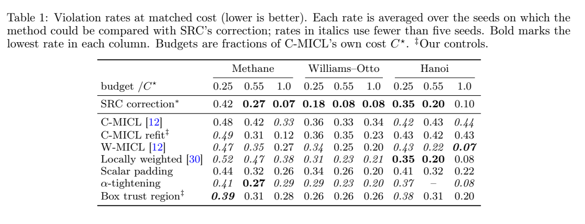

# 随机输入覆盖九成，优化器选中的方案安全吗

<!-- 全库方法复筛开始 -->
> **方法储备 · 面向决策的履约建模**。保留“Selected-Risk Calibration for Feasibility at Returned Decisions”这一研究问题或机制；是否用于当前业务另行验证。
> 原有阅读范围与证据等级不变；储备不等于效果已验证。
> [[研究前沿/论文库复筛与阅读路线|全库阅读路线]] · [[研究前沿/面向决策的履约建模/存量论文分层索引|本方向完整分层]]
<!-- 全库方法复筛结束 -->

**能改哪一环？** 改 PK 选中司机之后的超时风险校准。优化器会主动选到预测边界附近，论文表 1 在成本相近时比较了返回方案的实际违规率，全候选的平均校准可能遮住这类误差。

**第一步怎么验证？** 冻结候选生成与择优规则，在可核验真实截止约束的批次中，分别用全候选和返回候选调节风险裕量；锁定后以同一覆盖率在独立批次比较返回点超时率及其上界。若只有历史执行点有标签，就只在这些点报告误差；若上界仍超出目标，不采用新裕量。（本地验证未运行。）

**Selected-Risk Calibration for Feasibility at Returned Decisions**  
arXiv 首次提交 2026-11-05（UTC），核验时版本历史仅有 v1；本次检索日为上海时间 2026-11-12。正式发表日期待核。 [官方版本历史](https://arxiv.org/abs/2611.10050v1)

[原版 PDF](./assets/source/paper.pdf) · [原文 HTML 快照](./assets/source/paper.html)

## 研究问题

若优化器总在预测约束的边缘选点，随机抽点上的覆盖率不能回答执行时的违反率。作者把一次真实核验定义为抽一个目标、用固定求解器求解、在返回点评估真实约束。求解器无解也计一次违反。

## 方法、计算与决策时点

在独立样本上拟合约束 $\hat h(x)$ 和局部不确定度 $\hat\sigma(x)$。式 (8) 的裕量可在常数与按局部不确定度放大之间插值。先用一批目标把候选调到相同成本，再用另一批目标选违反次数最少的形状，锁定后才在认证目标上计算违反次数。

## 实验结果与证据边界

三个工艺/管网基准上独立随机输入的常规覆盖 0.889–0.940，但常规裕量下返回点违反率为 0.485、0.352、0.485。图 3 对 30 个有新目标评估的裕量做复核，22 个获认证的最高实际违反率为 0.050，8 个未通过的范围为 0.13–0.20；另 10 个没有这一独立评估。真实约束查询有成本，目标混合、求解器或启动点变化需要重审。 [证据原文](https://arxiv.org/html/2611.10050v1#S6.T1)

*表 1 · 成本相近时的真实约束违反率，固定版 PDF 第 11 页。*

算法 1 和定理 3 用单侧二项检验。每组 300 个独立目标、容忍率 0.12、40 个候选做家族校正时，通过阈值为至多 19 次违反。固定各类目标数时，作者给的是校验固定风险门槛的定理，单个二项上界并非普适的混合风险置信界。

## 迁移到履约问题

适用于能在独立回放对每个返回方案核验容量/截止时间的单元；仅能看到历史执行动作或求解器已变时需另行解决标签来源。 本地尚未运行验证。

## 方法卡与候选实验

- [[研究前沿/面向决策的履约建模/02-可复用方法卡/SelectedRisk-returned-feasibility|在求解器真正选中的方案上检验约束]]
- [[研究前沿/面向决策的履约建模/03-实验假设与结果/2026-11-12-随机抽点与求解器返回点的超时率|随机抽点与求解器返回点的超时率（未运行）]]

## 来源与实现核验

已检查论文正文外链和题名、作者的公开检索；本论文的作者实现入口未知。

本次核验公开 v1 正文、列明的方法和实验及下列证据定位。作者报告的数值未做独立复算。 [随机覆盖的反例](https://arxiv.org/html/2611.10050v1#S4) · [认证条件](https://arxiv.org/html/2611.10050v1#S5.SS2) · [新目标复核](https://arxiv.org/html/2611.10050v1#S6.SS3) · [真实核验代价](https://arxiv.org/html/2611.10050v1#S7)
