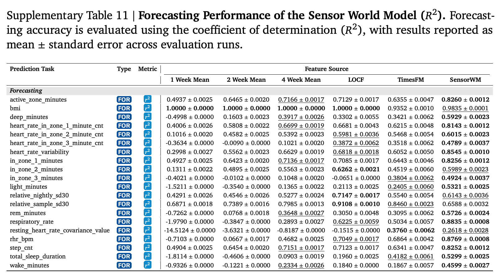

# 用动作和近期状态变化预测多步轨迹

同样的当前状态，正在上升或回落时，下一步预测会怎样改变？先读式（36）里相邻状态的差，再看事实轨迹与观察到的动作。作者比较了健康场景的整套模型；变化速度的独立贡献和履约场景中的效果仍待验证。

[[研究前沿/面向决策的履约建模/README#动作之后状态怎样变化|比较同一问题的其他方法]] · [[研究前沿/面向决策的履约建模/02-可复用方法卡/SensorWM-velocity-conditioned-transition|状态变化量的具体计算]] · [[研究前沿/面向决策的履约建模/03-实验假设与结果/2026-11-10-二阶状态转移是否改善高峰期履约滚动预测|未运行：积压速度的独立对照]]

**Personalized health coaching via coachable health age and counterfactual wearable trajectories**  
Simon A. Lee、Zeinab Esmaeilpour、Menglian Zhou 等。首次提交及当前版本 v1 均为 2026-11-05。arXiv v1 预印本。 [arXiv 版本记录](https://arxiv.org/abs/2611.08568v1)

[本地 PDF](./assets/source/paper.pdf) · [本地 HTML](./assets/source/paper.html) · [[研究前沿/面向决策的履约建模/01-论文原文与精读/SensorWM/阅读覆盖|阅读范围与原文定位]] · [[研究前沿/面向决策的履约建模/01-论文原文与精读/SensorWM/代码核验|代码核验]]

## 研究分三层，证据来自不同样本

作者先把可改变的生理/行为信号映射为综合的 Coachable Health Age（CHA），再用动作条件世界模型预测周状态，最后用模型推演给同一个计划生成器补充输入。CHA 的预后分析使用 All of Us 等人群；SensorWM 预训练使用 96,957 名同意研究的可穿戴设备使用者、228 万人周与 182,797 个有效 12 周窗口；另以未进预训练的 1,654 名 WEAR-ME 有标签参与者做轨迹和下游诊断，按人划分。盲评是 50 个抽样案例中质控后 49 个，不能混成同一试验规模。[第 2 节](https://arxiv.org/html/2611.08568v1#S2) · [第 4.2 节](https://arxiv.org/html/2611.08568v1#S4.SS2)

## 动作只改变转移算子

把信号聚合到周，原文把步数、主睡眠的睡着时长、有氧强度活动时长标为可替换的行为序列，其余生理值是状态，人口统计量是静态上下文。前两帧真实状态初始化，编码器映射到 128 维，动作与当前状态共同生成一个 $128\times128$ 线性算子，用它改变上周到本周的潜在位移。

$$
\widehat z_{t+1}=z_t+g(z_t,a_t)(z_t-z_{t-1}).\qquad\text{(36)}
$$

状态相同但近期趋势不同的人可有不同预测；若连续两状态完全相同，按此式当步位移为零。后一点是由方程得到的边界。训练同时惩罚多步潜状态误差、相邻位移误差，并以随机投影的 SIGReg 抑制编码塌缩；诊断解码器把潜状态还原为原量纲。推演候选方案时只替换之后的行为序列，从同一段历史递归预测。[式 (30)–(47)](https://arxiv.org/html/2611.08568v1#S4.SS2.SSS3) · [式 (48)–(54)](https://arxiv.org/html/2611.08568v1#S4.SS2.SSS5)

## 候选计划如何比较

先用维持现状的轨迹得到 $\mathrm{CHA}_{sq}$，再对静态候选行为强度 $c$ 滚动 12 周。按历史波动标准化每个行为改变，以 $E(c)=\sum_k[(c_k-b_k)/\sigma_k^{user}]^2$ 量化代价，用 $(\mathrm{CHA}_{sq}-\mathrm{CHA}_c)/(1+E(c))$ 给可行方案排序，并限定可改变的行为和候选范围。得分是模型预估，论文未随机指派并执行这些虚拟方案。[式 (55)–(56)](https://arxiv.org/html/2611.08568v1#S4.E55)

## 三种评估各自验证什么

| WEAR-ME 的观察轨迹预测，附表 11 | 末次观测延续 $R^2$ | TimesFM $R^2$ | SensorWM $R^2$ |
|---|---:|---:|---:|
| 静息心率 | 0.705 | 0.686 | 0.877 |
| 心率变异性 | 0.682 | 0.605 | 0.855 |
| 呼吸率 | 0.623 | 0.503 | 0.884 |

测试使用与轨迹对应的已观察行为输入。静息心率等预测改善能证明给定这些输入时对事实轨迹拟合更好，不能据此认定所有收益来自二阶转移。作者还把生成轨迹输入匹配的分类器，对照真实轨迹、静态特征与通用传感器编码，例如糖尿病分类 AUROC 为 0.724（生成轨迹）与 0.643（SensorFM），这测量预测信息保留。[图 3](https://arxiv.org/html/2611.08568v1#S2.F3) · [补充表 11–16](https://arxiv.org/html/2611.08568v1#A3.T11)

同一个生成模型、个人历史、计划格式和提示约束下，完整计划额外获得 CHA、预测轨迹和可行性排序。生活方式教练在每例五次、总计 245 次配对评阅中，有 175 次（71.4%）更偏好整套增强方案；预期依从性 174/245（71.0%）。按案例多数票，整体质量为 43/49。临床评定的安全强度通过率为 99.2% 和 97.6%。人类评估单位是同一案例的多次评阅，均衡抽样中不同作者组件共同变化；这些结果没有测量真实依从、临床结局或单独世界模型的因果贡献。[图 5](https://arxiv.org/html/2611.08568v1#S2.F5) · [附表 26–30](https://arxiv.org/html/2611.08568v1#A3.T26)

## 履约上的可检验联系

可把供需与积压的当前状态、最近变化，以及实际执行的操作拆开，比较显式变化量能否改善晚高峰或转折期的多步状态预测。要比较未采取的操作，需有动作支持并验证混杂、外部冲击、资源干扰和删失。作者在讨论中明确把行为轨迹推演限定为观察性条件关联。[第 3 节](https://arxiv.org/html/2611.08568v1#S3)

## 原文关键图表

附表 11 逐指标列出使用已知行为序列的预测结果。心率与呼吸率有增益，近静态 BMI 上的朴素持久性预测已经接近或达到 1。

## 方法与实验

[[研究前沿/面向决策的履约建模/02-可复用方法卡/SensorWM-velocity-conditioned-transition|用动作调制近期位移的二阶潜状态转移]] · [[研究前沿/面向决策的履约建模/02-可复用方法卡/SensorWM-effort-ranking|把候选变化按个体历史波动折算为执行代价]]

[[研究前沿/面向决策的履约建模/03-实验假设与结果/2026-11-10-二阶状态转移是否改善高峰期履约滚动预测|二阶状态转移是否改善高峰期履约滚动预测（未运行）]]
