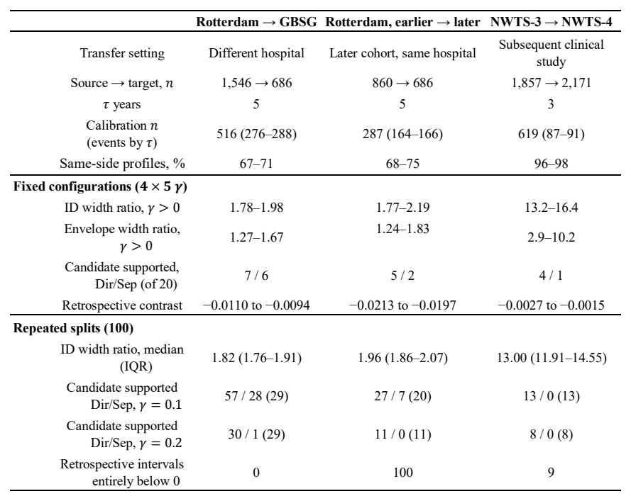

# 新场景的履约标签还没到，能先判断哪个模型更准吗？

<!-- 全库方法复筛开始 -->
> **方法储备 · 面向决策的履约建模**。保留“Comparing survival prediction models with sharp bounds on Brier-risk differences before local outcomes are available”这一研究问题或机制；是否用于当前业务另行验证。
> 原有阅读范围与证据等级不变；储备不等于效果已验证。
> [[研究前沿/论文库复筛与阅读路线|全库阅读路线]] · [[研究前沿/面向决策的履约建模/存量论文分层索引|本方向完整分层]]
<!-- 全库方法复筛结束 -->

表 2 中，从 NWTS-3 转到 NWTS-4 的 20 种配置里，共用同一个未知结局概率得到的界支持候选模型 4 次，两个风险各自求界再相减支持 1 次。

## 论文与阅读范围

Comparing survival prediction models with sharp bounds on Brier-risk differences before local outcomes are available。Won Gi Choi、Sun-Ho Kim、Min Soo Kim。首次公开 2026-10-07，所读版本 v4（2026-11-11）。精读 v4 §2–4、主表 1–2 与识别证明，对照 v3。v4 扩充模拟及第三个队列应用。 [一手来源](https://arxiv.org/abs/2610.09658v4) · [paper.pdf](./assets/source/paper.pdf) · [author-reproduction.zip](./assets/source/author-reproduction.zip)

## 怎样计算

在固定期限将结果定义成二元事件。对同一人的结局概率 $q$ 和两个模型的预测 $a,b$，候选相对参考的期望 Brier 损失差为 $b^2-a^2-2(b-a)q$。先从源域估计条件风险并处理右删失，在预先规定的对数赔率漂移限制下给目标域各人取 $q$ 的上下界。对同一个线性差值逐人取极值，然后按目标协变量分布平均。外层再考虑源域估计和抽样误差。只有整个不确定区间离开零才能支持某一方向。

## 与哪些方法比较

NWTS-3→NWTS-4 的 20 种配置里，单独求界的识别区间宽度是直接比较的 13.2–16.4 倍，含抽样波动的区间宽度比为 2.9–10.2。其余两个迁移的支持次数为 7 对 6、5 对 2。表 1 模拟中单独区间均宽约为直接法的 2.5–2.6 倍；总体删失 70% 时，直接法对名义 95% 包络的覆盖只有 0.809–0.858。

表 2 续页。识别区间宽度比、外包络宽度比和支持次数分列。 [原文第 19 页](./assets/source/paper.pdf#page=19)

## 适用条件与迁移

两种预测必须对应同一事件、期限和目标记录。漂移范围、源域覆盖和删失模型均会改变结论。目标标签到齐后仍需外部验证。作者包中 applications/rotterdam_temporal/02_outcome_free_evaluation.py 与 03_retrospective_contrast.py 分别对应无目标结局估计与事后核对。 [作者复现包](https://doi.org/10.5281/zenodo.24122902)

[[研究前沿/面向决策的履约建模/02-可复用方法卡/SharpBrierTransfer-让两个预测共用同一个未知结局|让两个预测共用同一个未知结局]] · [[研究前沿/面向决策的履约建模/03-实验假设与结果/SharpBrierTransfer-延迟标签到齐后复核先前的模型排序|延迟标签到齐后复核先前的模型排序（未运行）]]
