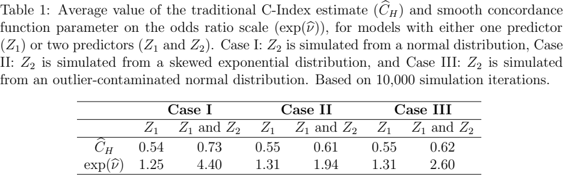

# 按分数差估计时长排序的可信度

Smooth Concordance Metrics for Survival Models · Hartman, Nicholas, Richards, Grace。arXiv 首投 2026-06-04，本次阅读版本 v3（2026-11-05）。6 月首投；本次读取 11 月 v3，核对 v2/v3 的表 1 主对照，不将该对照列为首次发布。 [版本记录](https://arxiv.org/abs/2606.06411v3) · [本地 PDF](./assets/source/paper.pdf) · [本地 HTML](./assets/source/paper.html)

## 研究问题

两个候选订单的风险分数只差一点时，是否有把握判断谁先发生事件？总体 C-index 把所有可比较对汇成一个数，很难回答这个问题。

## 方法及关键计算

在验证集中构造能判定事件顺序的样本对，以先发生者的标记为结局。式 (5) 设 $P(T_i<T_j\mid R_i-R_j)=\operatorname{logit}^{-1}(\nu h(R_i-R_j))$，常用 $h(r)=r$。§4.2 用无截距的加权 GEE 拟合曲线；在较早的观测时点按两例各自留观概率倒数的乘积加权。输出是给定分差的排序正确概率。

## 关键公式

$$
P(T_{i}<T_{j}|R_{i}-R_{j})=\frac{\exp(\nu h(R_{i}-R_{j}))}{1+\exp(\nu h(R_{i}-R_{j}))}
$$

风险分差通过函数 h 映射到对数优势尺度，参数 ν 刻画该分差对应的事件先后顺序。忽略删失会改变可观察样本对的构成。式 (6) 给出带权估计方程。 [公式原文](https://arxiv.org/html/2606.06411v3#S4.E5)

## 证据、对照与边界

§5 表 1 的 10,000 次模拟中，含离群值的预测变量加入模型后，C-index 从 0.55 升至 0.62，平滑模型每单位分差的优势比从 1.31 升至 2.60。表 2 另检验删失加权；二者数值尺度不同。

表 1　加入不同分布的风险变量前后的两种评价量，原文 PDF 第 13 页。

分数尺度会改变斜率，跨模型比较须先对齐分差的含义并检验拟合。该曲线用于评价风险排序，不给出调度动作的因果增益。

## 阅读覆盖与复用

已核对上述设定、关键计算、主对照及限制，附录证明未逐行复证。未从作者版本页、正文或公开检索核实可用的作者代码入口。

[[研究前沿/面向决策的履约建模/02-可复用方法卡/SmoothConcordance-按分数差估计时长排序的可信度|按分数差估计时长排序的可信度]] · [[研究前沿/面向决策的履约建模/03-实验假设与结果/SmoothConcordance-等待风险差多大时排序才稳定|等待风险差多大时排序才稳定]]

[[研究前沿/面向决策的履约建模/01-论文原文与精读/SmoothConcordance/原文导航|原文章节和图表索引]]
