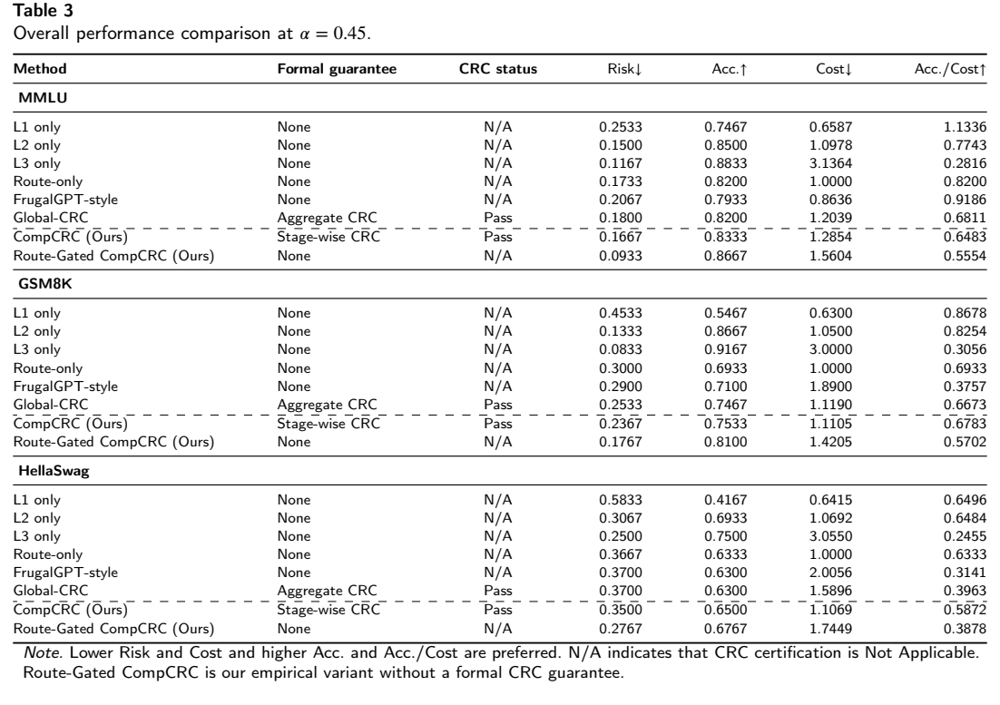

# 级联在哪一段接受了错误答案

<!-- 全库方法复筛开始 -->
> **方法储备 · 面向决策的履约建模**。保留“级联系统风险的组合界”这一研究问题或机制；是否用于当前业务另行验证。
> 原有阅读范围与证据等级不变；储备不等于效果已验证。
> 已恢复此前因业务距离被移出的原笔记；旧取舍原因仅作历史记录。
> [[研究前沿/论文库复筛与阅读路线|全库阅读路线]] · [[研究前沿/面向决策的履约建模/存量论文分层索引|本方向完整分层]]
<!-- 全库方法复筛结束 -->

Compositional Conformal Risk Control for Multi-Stage LLM Cascades  
Yuxia Sun; Jiahuang Wang; Haoting Liu; Zhiwei Huang; Tingrui Pei; Saiqin Long。2026-11-08 首次提交 arXiv，本次核对 v1。[arXiv v1](https://arxiv.org/abs/2611.11114v1)

只检查总风险，如何知道分级处理流程的哪一段贡献了错误？

## 怎样从输入得到输出

先按各阶段是否被路由到、是否接受和答案是否错误定义指示量。把不同阶段的损失都除以全部请求，因最终只能在一段接受而可以相加。独立数据分别设计候选预算、选择候选和认证；若某阶段未通过则采用预先指定的后备方案。

$L_k=1\{\text{在第 }k\text{ 段接受且错误}\},\quad L=\sum_k L_k$；设 $\sum_k\alpha_k\le\alpha$。用各段带有限样本修正的经验风险与预算比较，计算期望保证时后备策略也是全流程的一部分。

## 哪个对照支持这个判断

表 3 在比较预算 0.45 下，HellaSwag 逐级认证较全局认证风险由 0.370 降至 0.350，成本 1.5896 降至 1.1069；MMLU 风险由 0.1800 降至 0.1667，但成本由 1.2039 升至 1.2854。便宜与风险更低并不总是同时发生。

表 3，同一级联的全局认证与逐段认证比较。[本地原文](./assets/source/paper.pdf#page=12)

## 使用条件与可检验的迁移

理论针对固定预算、预设级联和条件交换性，事后挑预算或额外 Route-Gated 版本没有同样保证。错误被接受风险以全部请求为分母，不是各段接受样本的内部错误率。

多阶段确认流程若订单只在一段首次被确认，可按统一分母分解误接受风险；这样能比较分段风险预算和总预算两个可执行版本。

[[研究前沿/面向决策的履约建模/02-可复用方法卡/StageAcceptedRisk-method|方法卡 · 级联在哪一段接受了错误答案]] · [[研究前沿/面向决策的履约建模/03-实验假设与结果/StageAcceptedRisk-分段风险预算能否定位首个错误确认|待验证 · 分段风险预算能否定位首个错误确认]]

## 阅读范围与复现入口

21 页，核对算法 1、风险定义、认证失败处理、表 3–5 与预算比较范围，未复现实验。原稿给算法及实现细节，未核实可运行的作者代码位置。 本地验证状态为未运行。
