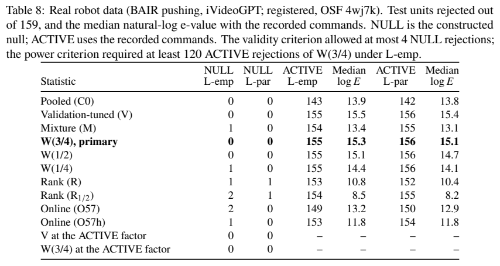

# StandIn v4 · 同一模型对真实执行动作有多敏感？

v4 新增真实机器人日志的预注册检验。同一模型和 159 条测试轨迹上，验证集加权的混合规则检出 155 条，直接合并分数检出 143 条，两者在同一人工空对照上都为 0。

v3 的第 10 节在模拟器中检验。v4 的 §11 和附录 L 新增 BAIR 推物体轨迹，使用冻结的 iVideoGPT，逐步以真下一帧给目标 token 评分。剩余 239 条合格轨迹随机分成 80 条验证、159 条测试，每条 14 个动作时点；同一条轨迹内的预测共同构成一个检验单位。模型、轨迹和候选动作固定，只换计分或混合规则。

## 预注册对照

在测试集揭盲前确定的门槛为，在经验动作分布下至少 120/159 条真实动作轨迹的检验达到 $E\ge20$。主规则占 155/159，验证集只选一个温度也占 155/159，直接合并占 143/159。改用参数化候选动作律，主规则为 156/159。空对照的动作标签由作者生成，主规则两次均为 0；经验分布下 12 项统计量中最多 2/159。该比例衡量检验规则在指定任务上的检出情况。

真实命令的原始采集程序无法确认。有效性依赖训练命令池与记录命令可交换或所拟动作分布合适。真实动作会影响物体已知，此实验证据针对检验功效。§12 对已分析的 4,512 个单位检查温度过大导致的表现退化，属于探索复核；原拟定的无条件下界在 82 个单位失败，修订后需附加适用条件。阅读覆盖 v3/v4 目录、§3.5 式 (9–10)、§11–12、表 8–9、附录 L。

[[研究前沿/面向决策的履约建模/02-可复用方法卡/StandIn-验证集选温度与整条轨迹的混合检验|怎样混合验证集与固定网格]] · [[研究前沿/面向决策的履约建模/01-论文原文与精读/StandIn/精读|已有精读]] · [v4 PDF](./assets/source/paper-v4.pdf#page=41) · [v4 HTML](./assets/source/paper-v4.html) · [作者预注册](https://osf.io/4wj7k/) · [论文](https://arxiv.org/abs/2611.01666v4)
