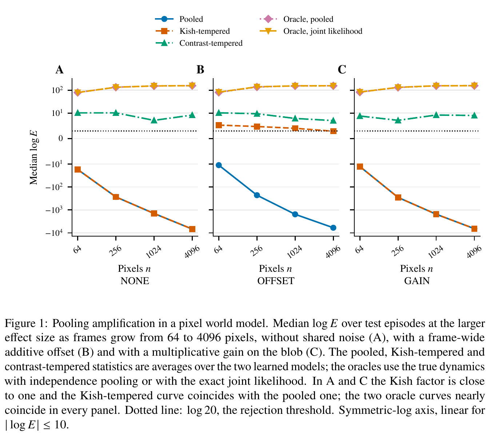
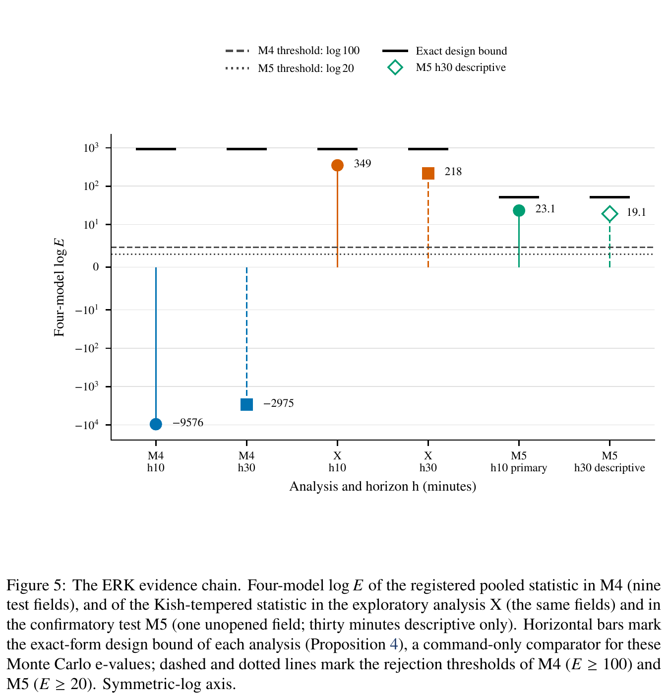

# Stand-In Effects and Pooling Amplification: Design-Based Tests of Whether Biological World Models Use Actions

[官方论文](https://arxiv.org/abs/2611.01666) · [本地 PDF](./assets/source/paper.pdf) · [HTML 快照](./assets/source/paper.html)

首次提交：2026-11-01；本次精读：2026-11-05；核验版本：v1。会议正式发表日期未核验。本文是旧队列补精读，不是今日新发表。

阅读范围：核心方法、关键公式、主实验/理论条件及与迁移直接相关的附录。未逐行复证全部证明，也不称逐页翻译；具体覆盖见 [[研究前沿/面向决策的履约建模/01-论文原文与精读/StandIn/阅读覆盖|阅读覆盖]]。HTML 为原始快照，外部样式/图片可能需要联网；PDF 是完整离线原文。

代码状态：原文未提供可核验的公开官方仓库入口；未把文中本地脚本名、提交哈希或同名项目当成已取得代码。本次未运行作者代码。

## 1. 为什么值得读

论文解释两种世界模型评价陷阱：未来动作与遗漏历史相关，模型可用未来动作当“历史替身”，所以去动作后预测变差不证明未来动作有作用；多个测量点共享同一个动作时，直接累加模型分数可能放大共同误设，反而丧失检验力。创新价值主要是评价机制、失败诊断和证据边界。

## 2. 设计和可检验命题（§2）

随机化单位是场、谱系或episode；细胞/像素只是同一单位内测量点。已知开放环随机分配规律 $Q_{i,t}$ 可以依赖完整历史动作和预先指定分层，不能只按模型能看见的短历史重采样。目标是未来窗口的sharp null：改变未来动作不改变任何相关目标。拒绝只说明某处存在响应，不给效应大小，也不证明预测校准或决策更优。

观测mask不能在零假设下响应被检验动作；模型和统计量参数须在独立训练信息上冻结。有跨单位影响时，own-channel检验要限制独立集与输入，不能随意相乘所有单位证据。

## 3. 条件随机化e值（§3–4）

对同一历史和实际结果，用候选动作计算固定分数 $T(a)$。精确形式及蒙特卡洛形式：

$$
e^{\mathrm{ex}}=\frac{e^{T(A^{F})}}{\sum_a Q(a)e^{T(a)}},\qquad
e^{\mathrm{mc}}=\frac{(B+1)e^{T(A^{F})}}{e^{T(A^{F})}+\sum_{b=1}^B e^{T(A^{(b)})}}.\qquad\text{(2–3)}
$$

MC分母必须包含实际动作分数。未来块按间隔 $h$ 分为不重叠余数网格，同网格按规定相乘，网格/模型间预先定权平均；固定时点按 $E\ge1/\alpha$ 拒绝。网格平均只是固定时点e值，不能未经证明在共同时间轴任意窥视停止。

正确设计律和sharp null下可交换性控制错误率，模型准确性主要影响power。零熵设计给 $e=1$，加再多模型也不会创造随机化信息。估计设计律的总变差误差界需要独立性等条件；论文真实案例重建律未获该定理自动授权。

## 4. 共享分数与tempering（§3.3–3.5、6）

原分数把单位内各site的log likelihood相加。共同误设可能令错误动作对全部site得分更高，差异随site数线性累积，使 $\log E$ 强烈为负。tempering取 $T=\lambda S$，$\lambda$由训练数据与允许的site数确定；它调下注强度，不改变检验零假设。

Kish因子 $[1+(n-1)\widehat\rho]^{-1}$ 在残差同方向相关时有用，但像素位移使残差正负抵消，相关中位数近零仍会漏掉动作对比方向上的误差。探索性contrast tempering沿候选动作预测差加权残差，并据训练期design effect缩放；其确认性证据更弱，不能包装成已经普适验证的修复。

图表为原始PDF裁图，页码见图片说明及附件溯源记录；数字与标记以原图为准。

## 5. 结果、反例和确认性级别（§5–9）

像素模拟大效应、无共享噪声时，64→4096像素，pooled的median logE −17.3→−6832，oracle79→157。contrast tempering在大效应各格拒绝率81.2%–100%，但证据不随像素增加；小效应最多25%。只有一个模拟器族、两类学习模型、每格一次训练，不能当广泛基准结论。

正确条件设计重采样在stand-in陷阱的双模型平均为0/64拒绝；忽略设计状态的错误重采样、换用有power统计量后为98.4%–100%。后一对照是事后探索性补充；预注册的Kish错误重采样阴性对照原本没有揭示问题，必须保留这一失败。

M4预注册pooled在ERK阳性对照失败；修复后的M5使用未打开的一个field、主检验10分钟，logE23.1（约1.1e10）。仅在工作设计律、mask与冻结假设下支持拒绝；不是新发现生物效应，也不证明预测提升。精确采集规律未完全核验，own-channel一些分析的界是空泛的，只属描述性。

图表为原始PDF裁图，页码见图片说明及附件溯源记录；数字与标记以原图为准。

## 6. 迁移价值与不可越过的条件

对等待、匹配动作和状态预测的评价很重要：普通打乱/去动作消融只能检验预测依赖，不能独立证明因果作用。可把记录真实随机化状态、有效随机化单位、设计熵、按设计重采样和负对照写进评估协议。该方法直接针对已知开放环随机设计，不能未经扩展套到受结果反馈影响的闭环策略或普通观察日志。

原文记录多阶段脚本名、哈希和注册编号，未给可核验公开仓库URL；本次没有取得这些执行记录，不宣称复现了其确认性实验。

## 方法卡与后续实验

- [[研究前沿/面向决策的履约建模/02-可复用方法卡/StandIn-design-randomization|保留完整随机化状态的动作作用检验]]
- [[研究前沿/面向决策的履约建模/02-可复用方法卡/StandIn-pooling-tempering|沿动作对比检查共享误差并缩放检验分数]]
- [[研究前沿/面向决策的履约建模/03-实验假设与结果/2026-11-05-动作检验负对照|动作消融是否被历史替身和簇内误差误导（未运行）]]
