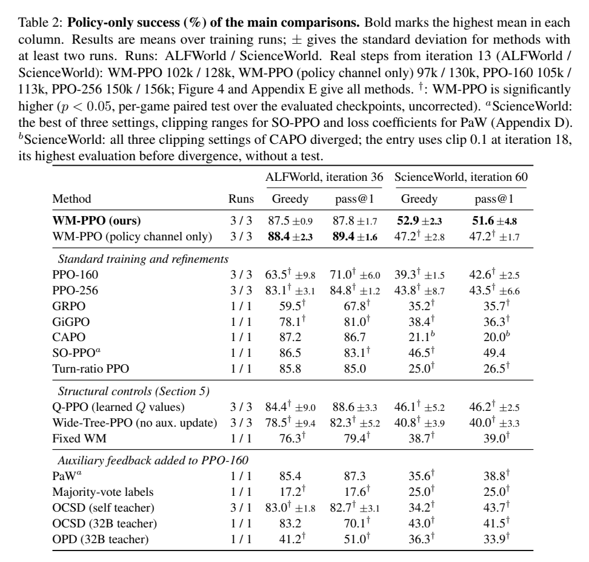

# 预测后继的偏好要积累多少真实证据才能用于训练

<!-- 全库方法复筛开始 -->
> **方法储备 · 司乘行为序列建模**。保留“价值一致的下一状态校准与策略训练”这一研究问题或机制；是否用于当前业务另行验证。
> 原有阅读范围与证据等级不变；储备不等于效果已验证。
> 已恢复此前因业务距离被移出的原笔记；旧取舍原因仅作历史记录。
> [[研究前沿/论文库复筛与阅读路线|全库阅读路线]] · [[研究前沿/司乘行为序列建模/存量论文分层索引|本方向完整分层]]
<!-- 全库方法复筛结束 -->

**Learning to Act with World Models by Valuing What Comes Next**  
arXiv 首次提交 2026-11-09（UTC），核验时版本历史仅有 v1；本次检索日为上海时间 2026-11-12。正式发表日期待核。 [官方版本历史](https://arxiv.org/abs/2611.12200v1)

[原版 PDF](./assets/source/paper.pdf) · [原文 HTML 快照](./assets/source/paper.html)

## 研究问题

终局奖励只能告诉策略这次是否成功。WM-PPO 先用世界模型为同一状态下采样的多个动作生成下一观测，价值网络把后继译成成功概率，由此给没有执行的动作提供候选偏好。

## 方法、计算与决策时点

第 3 节在真实链条旁抽取可以执行到终点的分支。对不同动作的配对，比较预测价值差 $\Delta\hat q$ 与真实终局差 $\Delta G$，按预测间隔分三档。式 (16) 按近期数据估计 $g_\ell=\mathrm{mean}[\Delta G\,\mathrm{sign}(\Delta\hat q)]$。门控后，一条辅助信号更新策略对同组行动的偏好，另一条用平均后继价值辅助更新 critic；两者均保留真实轨迹的 PPO 学习。测试时只运行策略。

## 实验结果与证据边界

表 2 三个种子的贪心成功率，ScienceWorld 的整套方法 52.9%，相同树和 critic、去辅助更新的 Wide-Tree-PPO 为 40.8%，仅开策略辅助为 47.2%。ALFWorld 的对应值 87.5%、78.5%、88.4%，加入价值辅助不保证再涨。图 9 的“门全开/仅最大间隔/自适应”是单种子消融，不能把整体提升都归给门。 [证据原文](https://arxiv.org/html/2611.12200v1#S4.T2)

*表 2 · 移除世界模型后的策略单独评测，固定版 PDF 第 15 页。*

有些候选不会执行，检验偏好的门需要同状态下两个不同动作都实际推进到终局。仅有一条自然履约记录时该条件通常缺失。模型在线随策略更新，gate 的配对由先前轮次提供，不能把当前测试回报当成可用标签。

## 迁移到履约问题

具有同起点可分叉模拟或配对实验时，可校准动作排序可信度；普通日志中的不同用户不可直接视为同状态双分支。 本地尚未运行验证。

## 方法卡与候选实验

- [[研究前沿/面向决策的履约建模/02-可复用方法卡/SuccessorPPO-branch-reliability|用同状态真实分支给候选动作的价值偏好定权]]

## 来源与实现核验

正文 Code and Data Availability 表示论文发表时拟发布代码与配置，本次未核得作者公开实现入口。

本次核验公开 v1 正文、列明的方法和实验及下列证据定位。作者报告的数值未做独立复算。 [真实分支门控](https://arxiv.org/html/2611.12200v1#S3.SS5) · [策略评估](https://arxiv.org/html/2611.12200v1#S4.SS2) · [同树对照](https://arxiv.org/html/2611.12200v1#S5.SS2) · [单种子门控消融](https://arxiv.org/html/2611.12200v1#S5.F9) · [局限](https://arxiv.org/html/2611.12200v1#S7)

## 2026-11-17 版本核验

v2 补充 ScienceWorld 固定世界模型时门控反复关闭的图 6d 说明，公开了训练配置、逐游戏结果和代码仓库。主要算法沿用 v1。 [v2 原文](./assets/source/paper-v2.html) · [作者代码](https://github.com/nuskonghou/wm-ppo)
