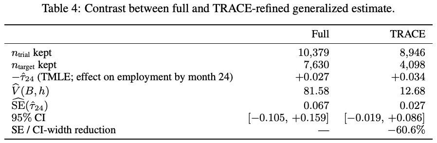

# 生存效应外推时，哪些人起初就少，哪些人后来失访

<!-- 全库方法复筛开始 -->
> **方法储备 · 面向决策的履约建模**。保留“低代表性群体下的生存评估”这一研究问题或机制；是否用于当前业务另行验证。
> 原有阅读范围与证据等级不变；储备不等于效果已验证。
> 已恢复此前因业务距离被移出的原笔记；旧取舍原因仅作历史记录。
> [[研究前沿/论文库复筛与阅读路线|全库阅读路线]] · [[研究前沿/面向决策的履约建模/存量论文分层索引|本方向完整分层]]
<!-- 全库方法复筛结束 -->

Characterizing Underrepresentation when Generalizing Causal Survival Estimates  
Bolun Liu、Sean McGrath、Yiren Hou、Elizabeth A. Stuart、Harsh Parikh。arXiv 注明将发表于 NeurIPS；本次核实的是 11 月 9 日提交的 v1，会议正式出版日待确认。 [作者或出版社记录](https://arxiv.org/abs/2611.11923v1)

同一就业试验外推，限定到代表性较好的目标人群后区间宽度缩窄 60.6%，目标样本同时剔除 46.3%。这是估计对象的改变。

## 作者要解决什么问题

把试验的时间到事件效应推广到目标群体时，某类人可能起初就很少进入试验，也可能开始有代表性却在后续区间大量失访。两类问题需要不同的补数方式。

## 方法怎样从输入得到决策或预测

试验中观测 X、随机处理、逐期删失和结局，目标群体只有 X → 拟合选择比与逐期留访概率 → 在效率界中拆分两种可发散的权重 → 树搜索基线保留子群 B，内部动态规划寻找需要加强留访的个体时段 h → 对近优树汇总，显示谁、何时、因何缺乏代表性。

基线稀少由 $\ell(X)=P(S=0\mid X)/P(S=1\mid X)$ 捕捉，随访稀少由 $\{\prod_{j<t}\pi^a_{C,j}(X)\}^{-1}$ 捕捉，其中每个因子为在风险且仍接受随访时继续未删失的概率。式 (2) 外层选 $B$、内层以稀疏惩罚选 $h$，自归一化的方差目标抑制任意删去大量样本。

## 实验观察和证据范围

附表 2 仿真每种设计 10 个种子。混合机制 2c 的删失子群精确率 1.00、召回率 0.48、时间定位 0.87；复杂交互的实验 1 召回仅 0.35。JTPA 到 CPS 的附表 4 中，目标样本由 7,630 减至 4,098；24 个月就业效应区间从 [−10.5, +15.9] 缩至 [−1.9, +8.6] 个百分点，作者报告 SE/宽度降约 60.6%。

附表 4，剔除一部分目标人群前后的样本数、标准误与区间。[原文 PDF](./assets/source/paper.pdf#page=42)

适用条件包括试验内部有效、条件独立删失、条件可推广及相应正性。取 B 后的目标人群与原 PATE 不同，区间以选定的 B、h 为条件；论文指出选择后推断仍待研究。表中两区间均含零，不能推断新的就业效益。

## 可采用的部分

可先画选择比与累计留访权重的两个分布；要复现论文的联合归因和四类分组，则需同一生存模型、树集与内层 DP，单画权重没有论文的恢复率。

有随机提醒试验、希望迁移到新活动人群时，可先诊断该多采样某子群还是补齐后段终态；选择后结果始终要写出保留人群与原人群差异。

[[研究前沿/面向决策的履约建模/02-可复用方法卡/SurvivalTRACE-bias-channel|方法卡：分开诊断试验入组稀少与随访期间流失]] · [[研究前沿/面向决策的履约建模/03-实验假设与结果/2026-11-13-区分入组不足与终态回传缺失|未运行假设：能否区分样本覆盖不足与随访途中丢失]]

## 阅读与核验范围

53 页原文，覆盖 §3–8、附录 M/P 及表 2–4；附录效率界证明按命题和假设核对，未逐行复推。 附录核对清单声明 R 代码随论文补充材料提供、仿真文件名为 sim_dgps.R；核过 arXiv 正文与公开题名/作者索引，未取得可检查的完整补充仓库。 本地未运行原作者实验。 [本地 PDF](./assets/source/paper.pdf) · [本地 HTML 原文](./assets/source/paper.html)
