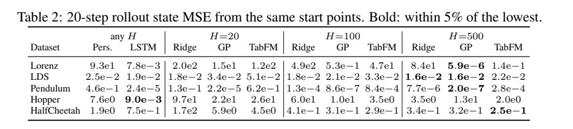

# 最近几条转移足以预测下一步，也足以滚动二十步吗

<!-- 全库方法复筛开始 -->
> **方法储备 · 司乘行为序列建模**。保留“不训练环境模型的 TabPFN 状态预测”这一研究问题或机制；是否用于当前业务另行验证。
> 原有阅读范围与证据等级不变；储备不等于效果已验证。
> 已恢复此前因业务距离被移出的原笔记；旧取舍原因仅作历史记录。
> [[研究前沿/论文库复筛与阅读路线|全库阅读路线]] · [[研究前沿/司乘行为序列建模/存量论文分层索引|本方向完整分层]]
<!-- 全库方法复筛结束 -->

**An Evaluation of Tabular Foundation Models as Training-Free World Models**  
arXiv 首次提交 2026-11-09（UTC），核验时版本历史仅有 v1；本次检索日为上海时间 2026-11-12。正式发表日期待核。 [官方版本历史](https://arxiv.org/abs/2611.11921v1)

[原版 PDF](./assets/source/paper.pdf) · [原文 HTML 快照](./assets/source/paper.html)

## 研究问题

履约状态变化可写成表格回归。作者将轨迹中最近 $H$ 条已执行动作及真实后继作为同一问题的上下文，询问预训练表格基础模型下一步状态变化量。测试端无需为直接表格路线拟合本任务的网络权重。

## 方法、计算与决策时点

式 (1) 每行形如 $([x_t,a_t],x_{t+1}-x_t)$。预测时输入当前状态和已知动作，分别为每一维输出作一次 TabPFN 标量回归，预测增量加回当前状态。所有状态维都作为输入，输出相关性并未联合建模。把预测状态喂回并沿记录动作序列继续滚动；另有先训练编码器的潜变量版，只作补充。

## 实验结果与证据边界

表 2 中 $H=20$ 时，五种系统的 20 步 TabFM 误差均不优于维持现状；HalfCheetah 的误差为 4.5，对照 1.9，到 $H=500$ 降至 0.25。表 1 的 Hopper 单步误差为 0.0083，全量训练 LSTM 为 0.000080。附表 8 的 Hopper 实现每步约 3.18–3.58 秒，未经优化的逐维调用不适合直接作为低延时引擎。 [证据原文](https://arxiv.org/html/2611.11921v1#S5.T2)

*表 2 · 固定起点和上下文长度的 20 步误差，固定版 PDF 第 4 页。*

同一批转移、同一预测起点时，分别比较保留最后观察、岭回归、近邻、GP、少样本神经网络；另外报告能看见全部训练集的 LSTM、MLP。论文评价开环预测；没有直接比较用不同预测器选择行动后的闭环收益。

## 迁移到履约问题

可作为没有足够数据重训的状态增量基线。逐维调用不刻画联合分布，实测扩展到实时高维动作仍有时延问题。 本地尚未运行验证。

## 方法卡与候选实验

- [[研究前沿/面向决策的履约建模/02-可复用方法卡/TabularDynamics-context-delta|以近期真实转移作为表格模型的现场示例]]
- [[研究前沿/面向决策的履约建模/03-实验假设与结果/2026-11-12-少量真实历史对一步和滚动预测的帮助是否一致|少量真实历史对一步和滚动预测的帮助是否一致（未运行）]]

## 来源与实现核验

使用了已公开的 TabPFN。本文对照、数据切分和滚动脚本的作者发布入口未核到。

本次核验公开 v1 正文、列明的方法和实验及下列证据定位。作者报告的数值未做独立复算。 [表格增量预测](https://arxiv.org/html/2611.11921v1#S3) · [实验设计](https://arxiv.org/html/2611.11921v1#S4) · [同数据量对照](https://arxiv.org/html/2611.11921v1#S5.SS1) · [滚动](https://arxiv.org/html/2611.11921v1#S5.SS3) · [附表](https://arxiv.org/html/2611.11921v1#A2)
