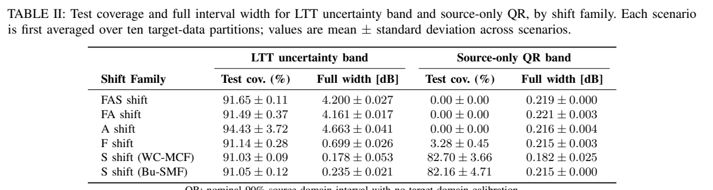

# 同一条风险区间，怎样分别评覆盖与接受决策

<!-- 全库方法复筛开始 -->
> **方法储备 · 面向决策的履约建模**。保留“分布漂移下共形风险约束的可行性”这一研究问题或机制；是否用于当前业务另行验证。
> 原有阅读范围与证据等级不变；储备不等于效果已验证。
> 已恢复此前因业务距离被移出的原笔记；旧取舍原因仅作历史记录。
> [[研究前沿/论文库复筛与阅读路线|全库阅读路线]] · [[研究前沿/面向决策的履约建模/存量论文分层索引|本方向完整分层]]
<!-- 全库方法复筛结束 -->

Conformal Risk Control for QoT-Aware Lightpath Feasibility Under Technology-Driven Domain Shift  
Kiarash Rezaei; Omran Ayoub; Paolo Monti; Carlos Natalino。2026-11-10 首次提交 arXiv，本次核对 v1。[arXiv v1](https://arxiv.org/abs/2611.13893v1)

域发生变化时，源域已经校准的预测区间能否直接拿来接受新任务？

## 怎样从输入得到输出

冻结预测光信噪比的回归器，用新环境标记样本按 Learn-Then-Test 搜索对称残差区间宽度。形成区间后，偏保守策略看下端是否越过可行门槛，偏效率策略用另一侧边界与裕度。不同时调整点模型和决策规则。

对 $I(x)=[f(x)-\lambda,f(x)+\lambda]$ 测量超出区间的频率。风险厌恶策略以 $f(x)-\lambda\ge\tau+\epsilon$ 为接受条件；目标域区间覆盖和按阈值分类的假接受率各自检验。

## 哪个对照支持这个判断

17 种光网络配置变化、每种 10 次目标域划分，目标域校准在 170 次中测试覆盖均达 90%，均值 91.81%；只用源域训练的分位区间在 170 次中均未达到 90%。附表中仅用 500 条目标域校准样本时只有 107/170 次选出区间，用 1,000 条时为 170/170。

表 II，网络技术切换后区间覆盖率与宽度。[本地原文](./assets/source/paper.pdf#page=6)

## 使用条件与可检验的迁移

两组的可用数据不同；不能把收益全归到 LTT 算法。区间保证不等于策略假接受率保证，预测误差方向及样本离可行门槛的距离都重要。样本门槛 1,000 仅属原实验。

在切换服务区域或时段后，给同一时长预测器校准误差带，再按到达期限评可行性，可以分清覆盖恢复与业务错误减少这两件事。

[[研究前沿/面向决策的履约建模/02-可复用方法卡/TargetBandDecision-method|方法卡 · 同一条风险区间，怎样分别评覆盖与接受决策]] · [[研究前沿/面向决策的履约建模/03-实验假设与结果/TargetBandDecision-目标域误差带能否减少到达承诺的误接受|待验证 · 目标域误差带能否减少到达承诺的误接受]]

## 阅读范围与复现入口

12 页，核对 §III–V、式 (3)–(4)、表 II、图 4 与附表 S2–S4；未复算物理网络模拟。论文给出 SDM QoT 数据集引用与策略公式，本研究公开运行脚本未知。 本地验证状态为未运行。\n\n## 2026-11-16 版本核验\n\n目标域风险带 v2 修正了补充材料的交叉引用。[[研究前沿/面向决策的履约建模/01-论文原文与精读/TargetBandDecision/版本更新-2026-11-16|版本对照和本地 v2 原文]]\n