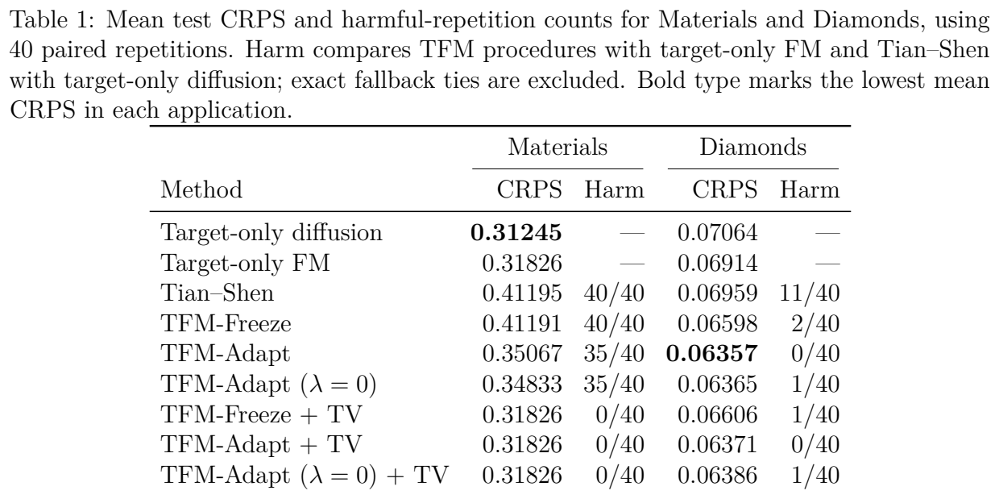

# 该冻结旧表示、让它适配，还是退回只用目标数据训练的模型？

<!-- 全库方法复筛开始 -->
> **近期主读 · 模型自进化**。迭代预训练表示的迁移验收；同测试集比较目标域独训、冻结表示和适配，另留独立目标验证集决定启用哪个分支，不用最终测试集选型。
> 证据边界：表 1 中 Materials 冻结迁移 40/40 次更差，Diamonds 适配减冻结的 CRPS 差为 −0.00241，95% 区间不跨零；锚定正则本身的增益不显著。 本地实验未运行。
> 已恢复此前因业务距离被移出的原笔记；旧取舍原因仅作历史记录。
> [[研究前沿/论文库复筛与阅读路线|全库阅读路线]] · [[研究前沿/模型自进化/存量论文分层索引|本方向完整分层]]
<!-- 全库方法复筛结束 -->

同测试集分别比较冻结、适配和目标基线，还留一份独立目标数据决定是否启用迁移，可以把新增表示的收益与兜底选择的收益分开。

## 文献与版本

Knowledge Transfer for Conditional Flow Matching: Frozen Estimation and Adaptation。Yian Huang、Jian Huang。arXiv v1 首投于 2026-11-11。 检索及精读于 2026-11-16。精读两种迁移程序、独立目标验证的风险界、表 1 和附表 2–3。 [一手来源](https://arxiv.org/abs/2611.15150v1)

本地资料　[paper-v1.pdf](./assets/source/paper-v1.pdf) · [paper-v1.html](./assets/source/paper-v1.html)

## 方法与关键计算

先在源域做条件流匹配，得到上下文表示。在目标域分别拟合只用目标数据的模型、冻结源表示只估速度头的模型、允许调整表示同时惩罚偏离源函数的模型；锚定系数可设零作消融。用独立目标验证样本比较候选与目标基线的配对能量分数，只有改善超过选择规则要求才切换，最后在未参与选择的样本报告 CRPS。

## 效果证据与对照

表 1 的 40 次配对中，Materials 的目标基线 CRPS 为 0.31826，冻结为 0.41191（40/40 次更差），适配为 0.35067（35/40 次更差）；加目标验证后两者均回到 0.31826。Diamonds 的目标基线为 0.06914，冻结为 0.06598，适配为 0.06357；适配减冻结的配对差为 −0.00241，95% 区间 −0.00299 至 −0.00183。

正惩罚与零惩罚的差为 −0.00007，区间横跨零；观察到的收益不能全归给锚定项。附表 2 中有关联的标量任务，保守验证也会舍弃有效迁移。

表 1。两个独立应用的 40 次配对测试，CRPS 越低越好。 [原文第 25 页](./assets/source/paper-v1.pdf#page=25)

## 能迁移到什么问题

可迁移的是冻结/适配/目标基线及独立选择的实验设计。论文验证条件生成分布，不能据此预测判别模型的 AUC 收益。目标验证须与拟合和最终评价分开。

算法、验证判据和附录给出实现细节；未核实作者公共代码入口。

[[研究前沿/面向决策的履约建模/02-可复用方法卡/TargetValidatedTransfer-用独立目标样本决定是否启用适配分支|用独立目标样本决定是否启用适配分支]] · [[研究前沿/面向决策的履约建模/03-实验假设与结果/TargetValidatedTransfer-用独立目标集检查冻结、解冻和回退三者的贡献|用独立目标集检查冻结、解冻和回退三者的贡献（未运行）]]

算法 2 明确保持源分支冻结，联合学习目标头和能读原始上下文的残差网络。式 (4.8) 则在独立验证集上执行另一步选择，只有候选相比仅目标训练的基线改善超过两倍同时置信界才切换。 [[研究前沿/面向决策的履约建模/02-可复用方法卡/TargetValidatedTransfer-冻结源表示并训练目标域残差分支|残差适配方法卡]]
