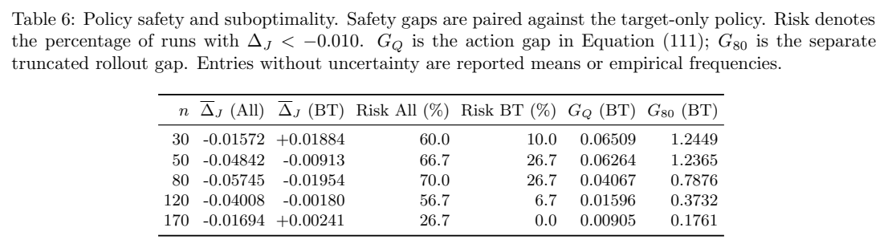

# 哪些历史任务值得借，哪些动作值得信

<!-- 全库方法复筛开始 -->
> **方法储备 · 模型自进化**。保留“用目标验证选择源域的贝叶斯 Q 迁移”这一研究问题或机制；是否用于当前业务另行验证。
> 原有阅读范围与证据等级不变；储备不等于效果已验证。
> 已恢复此前因业务距离被移出的原笔记；旧取舍原因仅作历史记录。
> [[研究前沿/论文库复筛与阅读路线|全库阅读路线]] · [[研究前沿/模型自进化/存量论文分层索引|本方向完整分层]]
<!-- 全库方法复筛结束 -->

**Bayesian transfer for offline Q-learning with multi-task Gaussian processes**  
arXiv 首次提交 2026-11-07（UTC），核验时版本历史仅有 v1；本次检索日为上海时间 2026-11-12。正式发表日期待核。 [官方版本历史](https://arxiv.org/abs/2611.10965v1)

[原版 PDF](./assets/source/paper.pdf) · [原文 HTML 快照](./assets/source/paper.html)

## 研究问题

目标任务日志少时，同一动作在另一个任务里可能有不同回报或覆盖。作者为每个来源和目标拟合多任务高斯过程，用目标留出预测证据与状态动作分布距离（MMD）筛选来源，再限定可选择的动作。

## 方法、计算与决策时点

第 2–4 节区分真实 Bellman 创新与递归标签的误差。第 5.2 节先独立形成各任务的伪响应，再构造目标—来源候选，允许拒绝整个提案回退到只学目标。目标下一步在行为策略支持的动作集合 $C_\beta(s')$ 中取后验下界的最大值；式 (104) 在仿真使用 $r+\gamma\max_{a'\in C_\beta}(\mu-0.75\sigma)$。训练和提取策略均依赖支持集合与后验不确定度。

## 实验结果与证据边界

30 个种子下，表 5 在目标样本 80 时，全来源、目标单独和方法的 Q 均方误差为 0.04081、0.02956、0.02360。表 6 按相对目标单独策略的价值损失超过 0.010 定义风险，该设定下降至 26.7%（全来源 70.0%），但方法相对目标单独的平均差仍为 −0.01954。表 8 有去悲观项对照。156 名人类目标在折扣 0.50 时即时收益比同数随机来源高 0.00443（表 12），长程闭环尚无对应实证。 [证据原文](https://arxiv.org/html/2611.10965v1#S5.T6)

*表 6 · 按目标样本数分层的负迁移频率，固定版 PDF 第 44 页。*

理论比较需要覆盖与核/误差正则条件；附录分别给出 bootstrap 稳定性、来源选择和策略界。仿真允许知道真正 Q 并另测截断滚动，真实人类任务仅能按已记录历史和任务给定的即时收益表评价动作。

## 迁移到履约问题

相邻城市/时段共享动作语义和奖励定义才可尝试，保留完全外部的时间测试段。 行为覆盖阈值和惩罚系数需在独立验证段设定，GP 标准差依赖模型假设。 本地尚未运行验证。

## 方法卡与候选实验

- [[研究前沿/面向决策的履约建模/02-可复用方法卡/TransferQ-source-gate|先按目标记录选来源，再允许整组回退]]
- [[研究前沿/面向决策的履约建模/02-可复用方法卡/TransferQ-supported-q|贝尔曼更新与选动作共用目标支持约束]]
- [[研究前沿/面向决策的履约建模/03-实验假设与结果/2026-11-12-相邻任务的加入或拒绝会怎样改变离线动作选择|相邻任务的加入或拒绝会怎样改变离线动作选择（未运行）]]

## 来源与实现核验

已检查论文正文外链和题名、作者的公开检索；本论文的作者实现入口未知。

本次核验公开 v1 正文、列明的方法和实验及下列证据定位。作者报告的数值未做独立复算。 [跨任务流程](https://arxiv.org/html/2611.10965v1#S2.SS4) · [策略界](https://arxiv.org/html/2611.10965v1#S4.SS5) · [来源筛选实现](https://arxiv.org/html/2611.10965v1#S5.SS2) · [模拟对照](https://arxiv.org/html/2611.10965v1#S5.SS4) · [人类数据](https://arxiv.org/html/2611.10965v1#S6)
