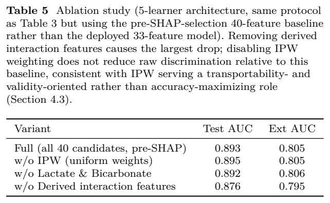

# 额外加权真的改善了外部预测，还是交互特征贡献了主要差异？

<!-- 全库方法复筛开始 -->
> **方法储备 · 面向决策的履约建模**。保留“Causal-Weighted Machine Learning for RRT Prediction in Acute Kidney Injury: Development, External Validation, and Clinical Decision Support”这一研究问题或机制；是否用于当前业务另行验证。
> 原有阅读范围与证据等级不变；储备不等于效果已验证。
> [[研究前沿/论文库复筛与阅读路线|全库阅读路线]] · [[研究前沿/面向决策的履约建模/存量论文分层索引|本方向完整分层]]
<!-- 全库方法复筛结束 -->

同一套模型、同一份留出样本下分别拿掉权重和交互特征，比单独看全模型指标更能判断下一轮该改什么。

## 文献与版本

Causal-Weighted Machine Learning for RRT Prediction in Acute Kidney Injury: Development, External Validation, and Clinical Decision Support。Zhaoyu Liao 等。Research Square 预印本 11-13 发布。 检索及精读于 2026-11-15。精读预测起点、§2.5–2.8、表 3–5、外部留出设计和代码声明。 [一手来源](https://doi.org/10.21203/rs.3.rs-11021990/v1) · [关联原始资料](https://github.com/gagagaga8/Causal-Weighted)

本地资料　[paper-v1.pdf](./assets/source/paper-v1.pdf)

## 方法与关键计算

按预测时点构建特征，五个基学习器的折外预测送入正则化 logistic 元学习器。两套时点相关的倾向模型产生逆概率权重；只在元学习器的损失中使用权重，重叠区间 [0.1,0.9] 外的记录不参与加权拟合。单独比较特征筛选前的 40 特征基线及移除各组件的版本。

## 效果证据与对照

表 5 在相同的 40 特征基线上，完整模型的内部/外部 AUC 为 0.893/0.805，移除加权为 0.895/0.805，移除派生交互特征为 0.876/0.795。此对照下外部区分力的变化主要出现在移除交互特征时。

表 3 的 33 特征最终模型为 0.894/0.807，与表 5 的特征集不同。外部 4,717 人来自 eICU 的留出一半，另一半参与开发，因此能支持同数据源留出，并非全程未见过该来源。文中也依据验证、内测及外测表现讨论权重形式的选择，独立迁移效果仍需新数据。

表 5，所有移除对照采用筛选前的 40 个特征。 [原文第 13 页](./assets/source/paper-v1.pdf#page=13)

## 能迁移到什么问题

原文预测的是 48 小时内实际记录的处置启动；行为同时受机构习惯等影响。加权的设计动机不能据此证明干预效应或决策收益。迁移到接单/完单时，先明确要预测历史动作，还是该动作下的潜在结果。

核实官方仓库目录 experiments/analysis/ablation_study.py、baseline_comparison.py 和 clinical_analysis/calibration_analysis.py，未复跑。

[[研究前沿/面向决策的履约建模/02-可复用方法卡/WeightingAblation-用同一特征集分别消融加权与交互|用同一特征集分别消融加权与交互]] · [[研究前沿/面向决策的履约建模/03-实验假设与结果/WeightingAblation-特征支路与策略加权对外部批次的贡献分别是多少|特征支路与策略加权对外部批次的贡献分别是多少（未运行）]]
