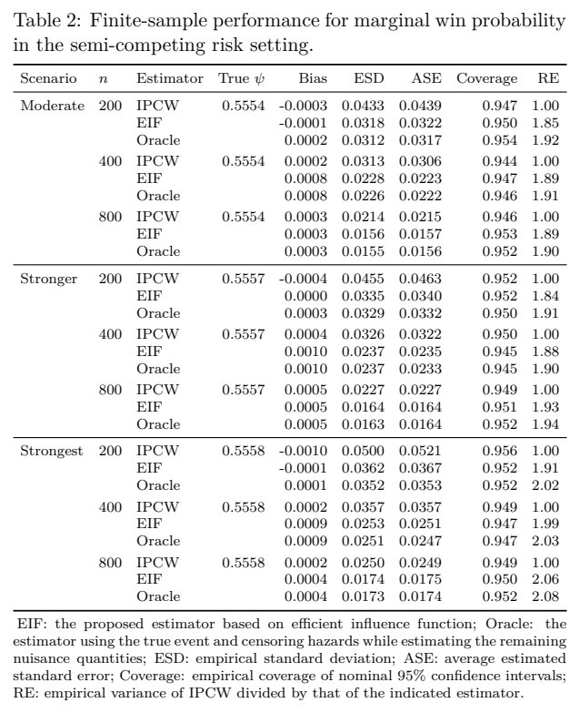

# 多个结果有优先级时，怎样比较两个动作？

<!-- 全库方法复筛开始 -->
> **方法储备 · 面向决策的履约建模**。保留“删失数据的边际胜算比较”这一研究问题或机制；是否用于当前业务另行验证。
> 原有阅读范围与证据等级不变；储备不等于效果已验证。
> 已恢复此前因业务距离被移出的原笔记；旧取舍原因仅作历史记录。
> [[研究前沿/论文库复筛与阅读路线|全库阅读路线]] · [[研究前沿/面向决策的履约建模/存量论文分层索引|本方向完整分层]]
<!-- 全库方法复筛结束 -->

表 2 中等情景、400 人模拟，优先级结局的胜率估计标准差从 IPCW 的 0.0313 降至 0.0228；对应覆盖率 0.944 与 0.947。

## 论文与阅读范围

Semiparametric Inference for Marginal Win Odds with Censored Time-to-Event Outcomes。Zhiguo Li。首次公开 2026-11-10，所读版本 v1（2026-11-10）。精读定义、定理 1–2、交叉拟合、表 1–2 和应用。 [一手来源](https://arxiv.org/abs/2611.14785v1) · [paper.pdf](./assets/source/paper.pdf) · [paper.html](./assets/source/paper.html)

## 怎样计算

预先设定比较时限及优先顺序，独立抽一人按处理方案、另一人按对照方案，两条结果路径相比，胜记 1、平局记 0.5、负记 0。以边际胜率 $\psi$ 换算胜算 $\psi/(1-\psi)$。各折估计结果过程、处理倾向与删失风险，用留出折中的影响函数修正插件估计，再汇总估计和标准误。

## 与哪些方法比较

半竞争终点表 2 同一格中，相对效率为 1.89（IPCW 方差除以 EIF 方差），知晓真实危害率的对照标准差为 0.0226。表 1 的单终点效率改善较小。估计精度的提升与干预效应的大小是两个量。

原文表 2。ESD 为经验标准差，RE 为两种方法的经验方差比。 [原文第 26 页](./assets/source/paper.pdf#page=26)

## 适用条件与迁移

需要比较规则、时间戳、动作支持及适当的条件可交换性与删失假设。两个独立人之间的比较不能解释为同一个人选两个动作的胜率。仓库 R/winodds.R 为接口，R/semicomp-core.R 实现半竞争终点。 [作者代码](https://github.com/zhiguoli919/winoddsEIF)

[[研究前沿/面向决策的履约建模/02-可复用方法卡/WinOddsEIF-为有优先级的结果估计删失校正胜率|为有优先级的结果估计删失校正胜率]] · [[研究前沿/面向决策的履约建模/03-实验假设与结果/WinOddsEIF-在有观察截止的多终点试验中比较胜率估计器|在有观察截止的多终点试验中比较胜率估计器（未运行）]]\n\n## 2026-11-16 版本核验\n\n删失胜率比较 v2 更新作者地址，估计量和实验表保持一致。[[研究前沿/面向决策的履约建模/01-论文原文与精读/WinOddsEIF/版本更新-2026-11-16|版本对照和本地 v2 原文]]\n