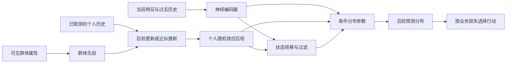

# 统一框架：数学怎样进入网络

返回 [[00-导读与核心结论]] · 下一篇 [[02-贝叶斯收缩与个体建模]]

## 1. 核心判断：统计学指定问题，网络学习其中难以手写的函数

“把统计方法加入神经网络”有三种不同含义：用统计语言解释已经存在的网络；把统计结构实际写进模型；把推断算法本身训练成网络。只有后两种会直接改变可计算对象或学习过程。解释上的相似，不能代替结构和目标上的等价。

一个适合贯穿本专题的任务是：给定用户的历史与当前情境，预测下一次行为。设 $i$ 是用户，$t$ 是时间，$x_{it}$ 是当时可见特征，$\mathcal H_{i,t-1}$ 是截至上一次事件的历史，$y_{it}$ 是待预测结果。通用编码器可以是 MLP、RNN、Transformer 或图网络：

$$
h_{it}=f_\theta(x_{it},\mathcal H_{i,t-1}).
$$

真正决定模型含义的是后续选择：预测一个数还是分布？是否有个人随机效应？个人之间如何共享？是否存在持续的隐状态？哪些输出必须为正？用什么目标训练？预测时积分掉哪些未知量？这些问题不由“用了 Transformer”自动回答。

一种可组合的统计结构是：

$$
b_i\sim p_\eta(b_i\mid c_i),\qquad
z_{it}\sim p_\psi(z_{it}\mid z_{i,t-1},h_{it},b_i),
$$
$$
y_{it}\sim p_\phi\!\left(y_{it}\mid h_{it},b_i,z_{it}\right).
$$

$c_i$ 是可见的群体或个人属性；$b_i$ 表示相对稳定的个体差异；$z_{it}$ 表示会变的状态。网络可以分别提供先验、转移或观测分布的参数，而概率规则负责把这些模块组合起来。这是本文的**综合建模框架**，不是某篇论文已经验证的单一算法。

图中个人历史同时承担两种工作：编码器提取情境特征，推断模块用历史中的输入与结果更新个人参数。新用户无历史时回退到先验。当前待预测的结果尚未发生，不能提前用于更新；它只能在被观测后加入下一步的历史。

这里“后验”要用训练/推断过程兑现：如果 $b_i$ 实际只是一张优化后的 embedding 表，就应称为点估计，不应在图示之外悄悄赋予它完整贝叶斯含义。

## 2. 数学进入网络的七个位置

| 进入位置 | 被改变的对象 | 代表方法 | 真正增加的能力 | 必须接受或检查的限制 |
|---|---|---|---|---|
| 数据生成与参数共享 | 联合分布、群体与个体关系 | 层次贝叶斯、混合效应 | 稀疏个体向群体借信息 | 可交换性、群体划分与先验是否合适 |
| 输出参数空间 | 网络输出的合法取值 | 指数族头、协方差参数化、混合密度 | 预测概率、尾部、异方差、多峰 | 分布族、支持集、参数可识别性 |
| 隐变量与时间结构 | 哪些变量持续、如何转移 | HMM、DMM、切换系统、VAE | 多机制、记忆、未观测因素 | 状态数、转移假设、推断成本 |
| 函数空间与架构 | 哪些函数允许被表示 | 等变网络、Deep Sets、单调网络、NAM | 对称性、可解释分解、约束满足 | 错误结构会排除真实函数 |
| 目标与估计方程 | 什么叫“预测得好” | 似然、proper score、MMD、正交得分、物理残差 | 学习分布、矩条件或目标参数 | 每个损失只约束它实际检查的性质 |
| 计算与优化过程 | 如何得到输出及更新参数 | LISTA、OptNet、ODE、自然梯度 | 固定成本近似推断、可微求解 | 数值稳定性、求解精度、近似误差 |
| 推断后的统计接口 | 如何把预测变成区间/决策 | 校准、conformal、Bayes decision | 可检验覆盖、成本敏感决策 | 交换性、独立校准数据、效用设定 |

这些位置不是互斥类别。例如，正态先验既定义生成模型，也对应 MAP 下的二次惩罚；HMM 同时规定概率结构和动态规划算法；Flow 同时改变分布表达和密度计算。讨论时要明确当前谈的是哪一个层面。

## 3. 一个最小例子：为什么“换输出头”并没有放弃深度表达

普通回归写成 $\hat y=w^\top h+b$。分布回归改为

$$
\mu(x)=g_\mu(h),\qquad
\sigma(x)=\epsilon+\operatorname{softplus}(g_\sigma(h)),\qquad
Y\mid x\sim\mathcal N(\mu(x),\sigma^2(x)).
$$

这里受约束的是 $Y\mid x$ 的形状；$x\mapsto\mu(x)$ 和 $x\mapsto\sigma(x)$ 仍然可以高度非线性。需要同时判断两个不同问题：

1. **输入映射是否灵活**：能否表达复杂情境与历史的相互作用？
2. **输出分布是否合适**：给定这些信息后，结果是单峰、双峰、计数、长尾，还是有删失？

强编码器不能弥补错误的支持集。例如普通 Gaussian 仍会给负等待时间分配概率。反过来，选对 Lognormal 也不能弥补完全没有捕捉到的交通情境。详见 [[03-条件分布建模]]。

同理，“线性混合效应”并不要求所有复杂性都线性：可以令总体均值为 $f_\theta(x)$，只把个体偏移 $b_i$ 保留为低维随机量。这种分工往往比把每个用户全部网络权重都设为随机变量更容易训练、诊断和更新；这是一项工程判断，而非所有任务上的最优性定理。

## 4. 结构限制为什么反而会增加能力

如果无约束大网络已经能逼近这些函数，为什么还要加入数学结构？答案要区分**可表达性**与**可学习性**。

在满足相应条件时，无约束网络可能表达一个单调函数，但有限数据训练未必找到它；单调架构直接排除违反方向的函数。无约束序列模型可能拟合持续的状态，但 HMM 把持续性明确为转移结构。一个输出数值的网络也可能很准，但没有额外分布模型时，不能直接计算尾部风险。

因此，“能力增加”不总等于函数集合变大。它也可能是：在相同样本下更稳定；可计算原来没有定义的后验或分位数；符合已知对称性；允许缺失变量的边缘化；让约束能够验证。这些收益来自限制了错误解释的空间，但若限制本身错误，就会造成结构性偏差。[Deep Sets](https://arxiv.org/abs/1703.06114)、[单调格点网络](https://arxiv.org/abs/1709.06680)、[OptNet](https://proceedings.mlr.press/v70/amos17a.html) 分别展示了结构、约束和计算这三类入口。

一个实用判断是：**先找出数据中最有把握、又最缺乏样本去重新发现的规律，再把它写成结构。** 不要因为一个方法有数学形式，就假定它更适合当前问题。

## 5. “不确定性”至少要分四层

假设二阶矩有限。设 $\Theta$ 汇总未知参数（包括个人效应），$Z$ 是未来状态，$D$ 是可用数据，条件特征省略。用全方差公式逐层展开：

$$
\operatorname{Var}(Y\mid D)=
\underbrace{\mathbb E_{\Theta\mid D}\mathbb E_{Z\mid\Theta,D}
[\operatorname{Var}(Y\mid Z,\Theta,D)]}_{\text{给定机制后的结果随机性}}
$$
$$
\quad+\underbrace{\mathbb E_{\Theta\mid D}
[\operatorname{Var}_{Z\mid\Theta,D}(\mathbb E[Y\mid Z,\Theta,D])]}_{\text{状态或机制不确定性}}
+\underbrace{\operatorname{Var}_{\Theta\mid D}
(\mathbb E[Y\mid\Theta,D])}_{\text{参数不确定性}}.
$$

第四层是**模型失配**：真实数据生成过程不在所设模型类里。它不会自动作为上式中的额外一项出现；上式只是在当前模型内部精确成立的分解。若模型错误且过度自信，三个内部量都可能很小。

这个分解的命名依赖建模层级：状态随机性可被归入广义 aleatoric，若状态可被新传感器识别，也会成为可约减的不确定性。因此不应声称某个方差头天然“纯粹测量认知不确定性”。本文使用分层命名，避免混淆。

## 6. 五类不能互相冒充的结论

| 声称 | 真正所需的证据 | 不足以支持它的现象 |
|---|---|---|
| 概率合法 | 非负、归一化、支持集正确 | 输出看起来像概率 |
| 概率准确/校准 | 留出集 proper score、可靠性/覆盖诊断 | 使用了似然损失 |
| 可识别 | 在明确假设下，观测分布能区分参数或等价类 | 隐空间图很漂亮 |
| 因果有效 | 干预或可信识别假设与估计设计 | 状态与结果高度相关 |
| 部署有效 | 与目标场景一致的时序、用户、分布切分 | 随机打散验证集很好 |

无监督解耦的限制以及有条件可识别模型的理论，说明“存在一个潜变量”远远弱于“恢复了真实潜变量”。[Locatello et al., 2019](https://proceedings.mlr.press/v97/locatello19a.html)；[Khemakhem et al., 2020](https://proceedings.mlr.press/v108/khemakhem20a.html)。同样，反事实预测的有效性需要可忽略性和重叠等条件，强表征不会替代它们。[Shalit et al., 2017](https://proceedings.mlr.press/v70/shalit17a.html)。

## 7. 阅读后续章节时始终追问的四个问题

1. **解决什么问题**：当前错误来自个人样本不足、分布形状错误、隐藏机制变化，还是错误的结构假设？
2. **怎样进入模型**：写成哪个随机变量、分布参数、约束、损失、更新式或数据生成流程？
3. **增加什么能力**：哪项可检验输出或性质是原模型没有的？
4. **施加什么限制**：为了得到该能力，排除了哪些真实可能性，增加了什么推断成本？

接下来的三条主线都沿用这四问。更多数学路径见 [[05-更多数学路径与统一比较]]；三条主线的组合及可证伪实验见 [[06-综合模型与验证方案]]。
