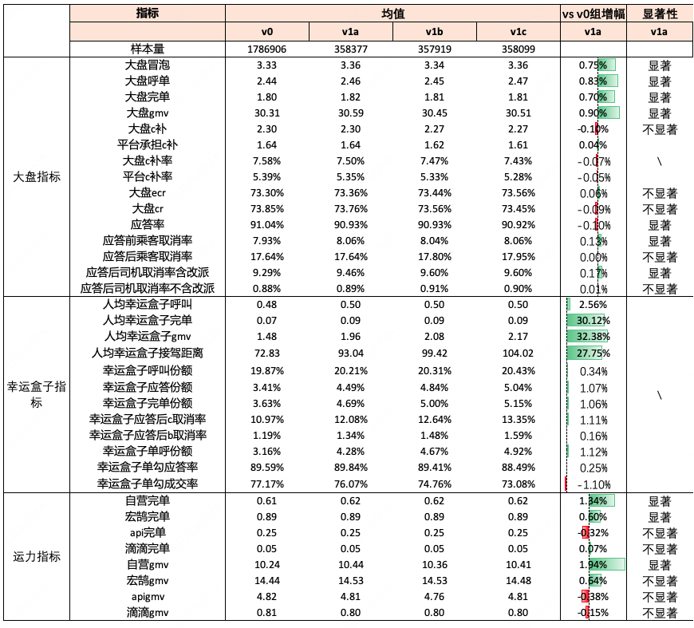

# 【LR25005】幸运盒子价格下探v1版策略

[Cooper 原文](https://cooper.didichuxing.com/knowledge/2199610335356/2204309602181)

## 1 背景

幸运盒子的出价逻辑中包含「确定候选价格区间」和「根据可用运力情况报价」两个步骤。

在当前v0版策略中，首先会根据b收入和价格水位确定候选价格区间，记为\[Pmin, Pmax\]，然后根据可用运力数Zr与运力阈值Z的关系，确定最终报价：

	1. 若Zr < Z ，报价为盒子原始定价P0（该价格高于表单最低价，幸运盒子不会被展示）

	2. 若Zr >= Z ，报价为候选价格区间的**上界**

对于第二步——根据运力阈值和可用运力数，“一刀切”地给出幸运盒子报价，思路过于简单，只考虑到用运力阈值Z保证cr，而忽略了在Zr >= Z的运力范围上，可用运力数越多报价可以越低从而牵引更多ecr这一提效点。

因此，我们很自然地想到**通过可用运力分位数进行一定的价格下探，找到较优的基于运力的报价逻辑，在低价牵引ecr提升的同时保证cr尽量少的降低，最终带来完单的提升**。

## 2 目标 & 约束

### 2.1 策略目标

- 主目标：拉齐 花业务补贴率下，大盘完单+0.5%

- 是否在 DDO 中：是

### 2.2 约束指标项 & 约束程度

| 约束项   | 约束方向   |
| --- | --- |
| CR   | **尽量少的降低**   |

## 3 技术方案

### 3.1 方案细节

为了保证cr，我们保留v0策略中的幸运盒子可展现的运力阈值Z，**在可用运力数Zr >= Z的情形中，进行基于可用运力数的价格下探，期望能探索到运力数和价格的最优组合，使得完单增量最大**。

为找到较优的基于运力的报价逻辑，我们制定了3种不同程度的价格下探v1策略（见下表）：

以v1a策略为例，z_p40记为 对 所有可用运力数Zr >= Z的幸运盒子冒泡的可用运力数Zr 升序排序后的40%分位数，报价逻辑为：

	1. 若Zr < Z ，报价为盒子原始定价P0（该价格高于表单最低价，幸运盒子不会被展示）

	2. 若Z<=Zr <=z_p40，报价为Pmax;

	3. 若z_p40<=Zr <=z_p70，报价为(1-70%)Pmin + 70%Pmax;

	4. 若z_p70<=Zr <=z_p90，报价为(1-50%)Pmin + 50%Pmax;

	5. 若z_p90<=Zr <=z_p100，报价为(1-20%)Pmin + 20%Pmax;

v1a->v1b->v1c，价格下探程度依次增加。

|    | P0   | Pmax   | 70分位点   | 50分位点   | 20分位点   | Pmin   |
| --- | --- | --- | --- | --- | --- | --- |
| v0（原始版本）   | 维持不变   | 100%   | /   | /   | /   | /   |
| **v1a（较难下探）**   | **维持不变**   | **40%**   | **30%**   | **20%**   | **10%**   | **0%**   |
| **v1b（中等下探）**   | **维持不变**   | **30%**   | **25%**   | **20%**   | **15%**   | **10%**   |
| **v1c（较易下探）**   | **维持不变**   | **20%**   | **20%**   | **20%**   | **20%**   | **20%**   |

### 3.2 数据测算

为得到上述v1版策略中的可用运力分位数，我们基于历史数据进行了实验城市可用运力数分布测算，为不同价格下探程度的v1策略确定了策略参数。

实验城市可用运力数分位数
| **index**   | **V0**   | 右  侧  均  基  于  剩  余  样  本  求  分  位  数   | **v1a**   | **v1b**   | **v1c**   |
| :---: | :---: | :---: | :---: | :---: | :---: |
| --策略对应分位数   | P0对应的运力数   | P0对应的比例   | **40%**   | **70%**   | **90%**   | **30%**   | **55%**   | **75%**   | **90%**   | **20%**   | **40%**   | **60%**   | **80%**   |
| **85**   | 1.6   | 16.8%   | 7   | 14.7   | 34.3   | 5.6   | 9.8   | 17.5   | 34.3   | 4.2   | 7   | 11.2   | 21   |
| **19**   | 3.2   | 17.0%   | 10.5   | 19.6   | 36.4   | 8.4   | 14   | 21.7   | 36.4   | 6.3   | 10.5   | 15.4   | 25.2   |
| **33**   | 1.6   | 13.9%   | 7   | 16.1   | 41.3   | 5.6   | 10.5   | 18.9   | 41.3   | 4.2   | 7   | 11.9   | 23.1   |
| **13**   | 1.6   | 16.9%   | 7   | 13.3   | 25.2   | 5.6   | 9.8   | 15.4   | 25.2   | 4.2   | 7   | 10.5   | 17.5   |
| **58**   | 1.6   | 11.8%   | 18.9   | 51.1   | 107.1   | 12.6   | 32.2   | 59.5   | 107.1   | 7.7   | 18.9   | 37.8   | 70.7   |
| **38**   | 1.6   | 14.9%   | 7.7   | 16.8   | 36.4   | 5.6   | 11.2   | 19.6   | 36.4   | 4.2   | 7.7   | 12.6   | 23.8   |
| **9**   | 0.7   | 10.1%   | 2.8   | 6.3   | 14   | 2.1   | 4.2   | 7   | 14   | 1.4   | 2.8   | 4.9   | 8.4   |
| **35**   | 1.6   | 22.6%   | 5.6   | 11.2   | 18.9   | 4.2   | 7.7   | 11.9   | 18.9   | 3.5   | 5.6   | 8.4   | 14   |
| **50**   | 1.6   | 12.3%   | 7.7   | 16.8   | 35   | 6.3   | 11.2   | 19.6   | 35   | 4.9   | 7.7   | 12.6   | 23.1   |
| **160**   | 1.6   | 11.3%   | 16.1   | 36.4   | 77   | 11.2   | 23.8   | 42.7   | 77   | 7.7   | 16.1   | 27.3   | 50.4   |
| **22**   | 1.6   | 25.8%   | 5.6   | 14   | 32.9   | 4.2   | 8.4   | 16.8   | 32.9   | 3.5   | 5.6   | 9.8   | 20.3   |
| **83**   | 1.6   | 33.5%   | 4.2   | 8.4   | 14   | 3.5   | 6.3   | 9.1   | 14   | 2.8   | 4.2   | 7   | 10.5   |
| **14**   | 1.6   | 21.0%   | 7.7   | 17.5   | 35   | 5.6   | 11.2   | 20.3   | 35   | 4.2   | 7.7   | 13.3   | 23.8   |
| **301**   | 0.7   | 13.4%   | 6.3   | 16.1   | 26.6   | 4.2   | 10.5   | 18.2   | 26.6   | 2.1   | 6.3   | 11.9   | 20.3   |
| **253**   | 0.7   | 19.8%   | 2.8   | 6.3   | 12.6   | 2.1   | 4.2   | 7   | 12.6   | 1.4   | 2.8   | 4.9   | 8.4   |
| **270**   | 1.6   | 40.2%   | 5.6   | 17.5   | 28   | 4.2   | 9.8   | 19.6   | 28   | 3.5   | 5.6   | 11.9   | 21.7   |
| **300**   | 1.6   | 36.4%   | 4.9   | 11.9   | 25.2   | 3.5   | 7   | 14   | 25.2   | 2.8   | 4.9   | 8.4   | 16.8   |
| **81**   | 2.0   | 33.8%   | 4.9   | 11.41   | 26.6   | 4.2   | 7.7   | 14   | 26.6   | 3.5   | 4.9   | 8.4   | 16.8   |
| **125**   | 1.5   | 12.8%   | 9.1   | 20.3   | 41.3   | 7   | 13.3   | 23.1   | 41.3   | 4.9   | 9.1   | 15.4   | 27.3   |
| **134**   | 1.5   | 17.7%   | 6.3   | 14   | 35.7   | 4.9   | 9.1   | 16.8   | 35.7   | 3.5   | 6.3   | 10.5   | 21.7   |
| **135**   | 1.5   | 28.9%   | 7   | 17.5   | 38.5   | 4.9   | 11.2   | 20.3   | 38.5   | 3.5   | 7   | 12.6   | 24.5   |
| **142**   | 1.5   | 24.8%   | 6.3   | 12.6   | 21.7   | 4.9   | 8.4   | 14   | 21.7   | 3.5   | 6.3   | 9.8   | 15.4   |
| **308**   | 1.5   | 15.4%   | 19.6   | 56   | 101.01   | 12.6   | 34.3   | 65.8   | 101.01   | 7   | 19.6   | 40.6   | 74.9   |

## 4 实验结果

### 4.1 实验背景

- 实验城市：85,19,33,13,58,38,9,35,50,160,22,83,14,301,253,270,300,81,125,134,135,142,308（幸运盒子一二期城市共23个，GMV占比27.83%）

- 实验周期：2025.04.18-2025.04.24

- 实验分流：

| 城市list   | 策略组名   | 含义   | 流量占比   |
| --- | --- | --- | --- |
| 85,19,33,13,58,38,9,35,50,160,22,83,14,301,253,270,300,81,125,134,135,142,308  【一二期城市】   | 空白组   |    | 5%   |
| v0_d1_1202   | v0（原始版本）   | 50%   |
| v1a_d1_0416   | v1a（较难下探）   | 10%   |
| v1b_d1_0416   | v1b（中等下探）   | 10%   |
| v1c_d1_0416   | v1c（较易下探）   | 10%   |
| v0_rct   | rct实验组   | 15%   |

### 4.2 实验核心结论

#### **三组策略中，v1a组在大盘完单上表现最好，分析其收益路径如下：**

- **大盘**：

	- <u>人均完单显著上涨**+0.70%**</u>。在对价格下探后，<u>人均冒泡显著上涨</u><u>**+0.75%**</u>，在ECR不显著+0.06pp情况下，带来人均呼叫显著上涨**+0.83%**，在考虑可用运力数分档下探的情况下，CR不显著-0.09pp，最终带来人均完单的提升。

- **幸运盒子**：

	- **规模：**<u>幸运盒子完单份额4.69%(相比v0+**1.06pp**)</u>。虽然价格下探导致幸运盒子单勾成交率有所下降(相比v0-1.10pp)，但对幸运盒子单呼份额的提升较大(相比v0**+1.12pp**)，二者综合后幸运盒子完单份额提升；

	- **效率：**<u>整体表现为应答率提升、C取消提升、CR下降</u>。单勾应答率89.84%(相比v0+0.25pp)，单勾成交率76.07%(相比v0-1.10pp)，主要原因是幸运盒子应答后C取消率相比v0+1.11pp，推测接驾距离变远(相比v0+27.8%)导致。

- **运力**：自营完单、宏鹄完单和自营GMV显著上涨，其他均不显著变化。

## 5 后续规划

1. 放量节奏：

在本期实验城市上进行v1a策略扩量，流量调整为：5%空白 ➕ 15%RCT ➕ 10%V0 ➕ 70%V1a 

2. 竞争人群策略

基于幸运盒子实验数据进行竞争人群的下钻分析，结合竞争人群的价敏和时敏特性进行价格下探，提升竞争人群的人均完单，从而带来大盘的完单提升。

## 6 引用和鸣谢

感谢幸运盒子项目所有相关团队的支持，特别感谢业务方苏格、宜东的输入和支持，感谢聪哥在实验上线中的耐心配置与认真校验，感谢之烁在策略方案中的关键决策！

## 7 推全情况与现状追踪

推全情况：推全v1a策略，一二期城市中，人均完单显著上涨+0.70%

现状追踪（2026.6.10）：已被[【LR26007】平台联合决策V3幸运盒子全天展现](https://cooper.didichuxing.com/knowledge/2199610335356/2207470039805)覆盖
