# 【LR25006】新流预分单升舱策略V1

[Cooper 原文](https://cooper.didichuxing.com/knowledge/2199610335356/2204428832540)

# 一、背景

1. 要做什么事？

在供需较差情况下，对小猪端内**预分单做升舱优化**(供需较差==根据线上供需情况和已等待时长的笛卡尔积判断==)

	1. 普通预分单：用户发单时未勾选该商家，等待一段时间未应答后，平台在水下为用户呼叫该商家，有运力举手后弹窗询问乘客是否接受

	2. 预分单升舱：用户发单时未勾选该商家，等待一段时间未应答后，平台在水下为用户呼叫该商家，有运力举手后直接应答，完单后补贴用户**升舱商家预估券后价-已勾选运力最高预估券后价**

> API运力升舱C补由API商家承担，自营宏鹄升舱C补由平台供需承担

2. 为什么要做升舱？

原本预分单存在用户不接受（不愿补差价or没看到弹窗）的问题，直接补贴差价，<u>提升用户接受度，降低乘客应答前取消，直接提升应答</u>，进而提升大盘CR

3. **目标和约束**

	1. 目标：大盘完单提升0.2%

	2. 约束：C补率0.2pp&ROI>3

4. 升舱链路

升舱针对的是**预分单举手运力**，符合升舱条件的进行升舱，不符合升舱条件的，依然走普通预分单链路

在判断差供需的前提下，预分单升舱的链路如下：

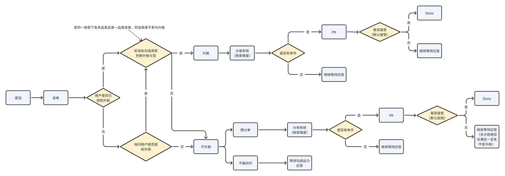

5. 产品形态

| 预分单   | 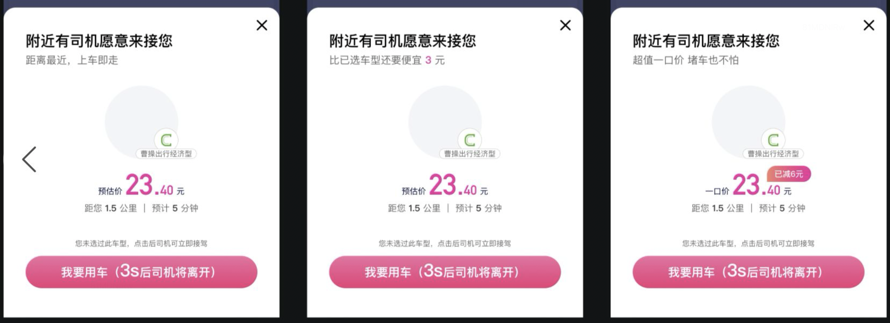   |
| --- | --- |
| 等待应答页升舱   | 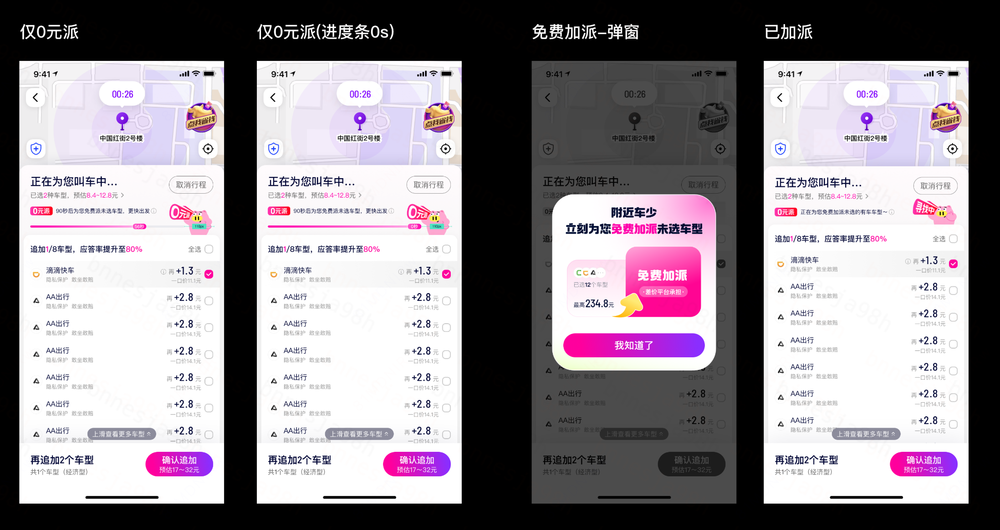   |

# 二、技术方案

## 2.1 问题抽象

> 基本假设

> 1.求解时升舱车型未知，以未勾选的第一个车型求解

> 2.不同品牌的应答率相互独立——即同一品牌若有低价品类被勾选，则升舱高价品类没有增量

> 3.暂时不考虑应答后取消的影响

**收益链路**

通过平台补贴直接替用户“接受”预分单，帮用户补充勾选运力，直接提升应答率，进而提升完单

## 2.2 离线问题建模

- **运筹优化模型定义**

	- 目标：**最大化增量完单**

	- 约束：**C补预算**

	- 数学模型：0-1整数规划问题

**增量完单** = 升舱后完单率 -（不升舱但接受预分单的完单率 + 不升舱且不接受预分单的完单率）

**C补** = (升舱价格 - 券后最高价) \* 升舱后完单率

- **参数定义**

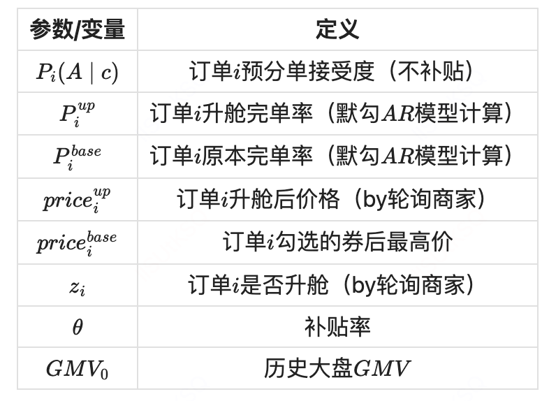

- **数学模型**

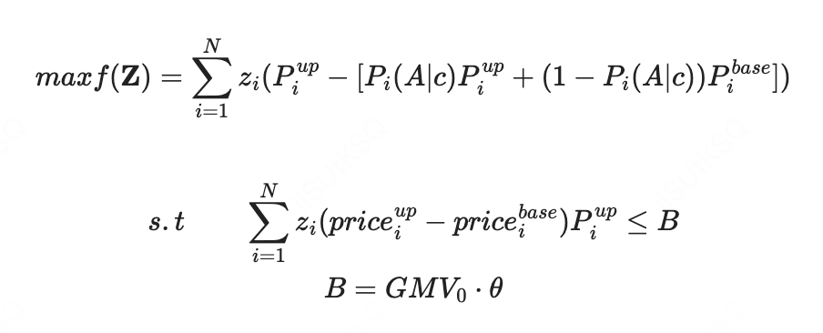

## 2.3 求解方法

该模型为包含N个0-1变量的整数规划模型，属于NP-hard问题，为方便求解，先将目标函数乘以-1转化为最小化问题，然后将约束乘以拉格朗日乘子==*λ*==加到目标函数上转化为拉格朗日函数：

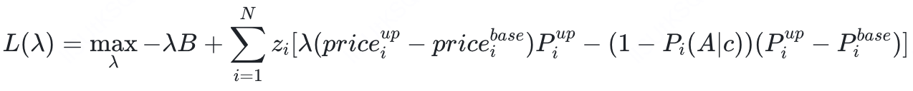

当决策变量Z的取值满足原约束条件时，拉格朗日函数等价于原目标函数的相反值，当不满足约束条件时，拉格朗日函数为正无穷

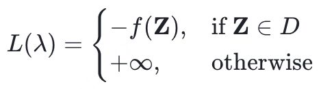

因此，原约束整数规划问题可转化为如下等价的无约束整数规划问题：

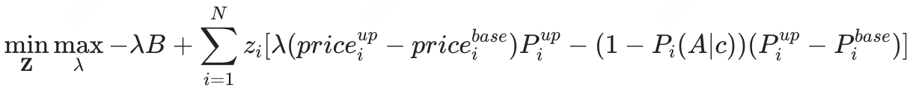

==由于决策变量Z的搜索空间远大于λ的搜索空间，原问题求解比较不直观，将其内外层优化顺序对调，转化为拉格朗日对偶问题，==[wiki](http://wiki.intra.xiaojukeji.com/pages/viewpage.action?pageId=515035084)已证明该类模型转化前后的强对偶性。因此，可根据连续背包问题符合贪心决策最优解的良好性质进行快速求解，得到最优解下各离线订单是否升舱，以及当前补贴率对应的最优$$\lambda$$（该$$\lambda$$为增量完单的ROI）

该优化问题为内外层嵌套优化，需要对内层优化问题进行表示，由于Z为0-1整数变量，在贪心算法的框架下，当z_i后面的系数计算结果小于0时，z_i必然取1，系数计算结果大于等于0时，z_i必然取0，故内层最小化问题可以简单表示：

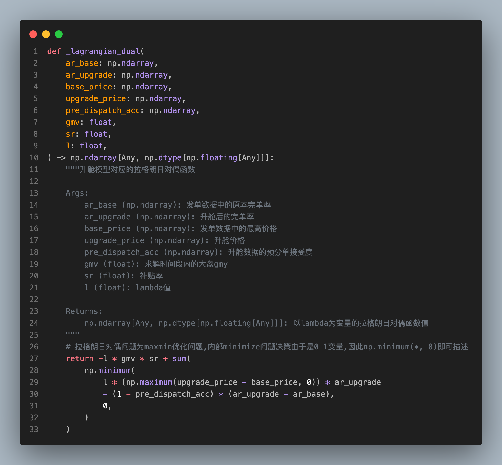

假定z_i已知，则外层最大化问题即为关于λ的凹函数（与凸函数有相同优秀性质），可采用三分法求解：

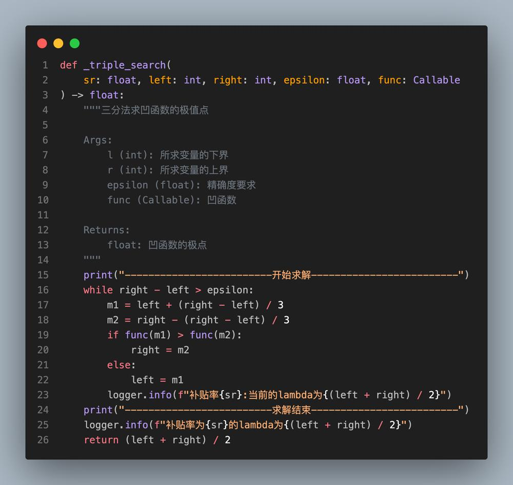

- 离线数据逻辑

1. **ar_base**：订单原本应答率:发单数据中所有已勾选发单运力与线上AR模型日志表 join 拿到已勾选发单运力 by product_id的平均AR，设每个product_id之间独立，(1−(1−AR1)(1−AR2)...(1−ARn))计算该订单原本完单概率

2. **ar_upgrade**: 订单升舱应答率:发单数据中未勾选发单运力经过升舱条件过滤后，按价格升序取第一个品牌，同上方式计算该订单升舱完单概率(升舱过滤：品牌维度已发单且非自营，则不参与升舱)

3. **price_base**：订单勾选券后最高价:发单数据中已勾选发单运力的最高价

4. **price_upgrade**：订单升舱价格:发单数据中未勾选发单运力经过升舱条件过滤后，按价格升序的结果中取第一个价格

5. **pre_dispatch_acc**：订单预分单接受度:上述升舱运力数据过新训练的预分单接受度模型拿接受度

6. **gmv**：GMV:离线求解时间窗内的应答gmv

- V1版本逻辑简化点：

	- 选择升舱的运力及其对应券后价时，按价格升序取第一个

	- 整体求解到应答这一步，未考虑PK+完单后续漏斗

- V1版本逻辑假设：

	- 计算应答率时假设不同product_id之间相互独立

**后续可优化点**

1. 选择升舱运力时，按$$\frac{\tau_r}{\tau_c}$$升序选取

2. 尝试训练升舱应答率模型，特征包括当前运力特征、同一订单下被勾选运力特征、乘客特征、订单实时特征等

## 2.4 策略框架

<!-- Cooper 原生图表来源信息
{"type": "flowchart", "sourceId": "MjIwNDQzMDU3NTg5Mg", "version": "6", "fileUrl": "附件/LR25006/图表01.svg"}
-->

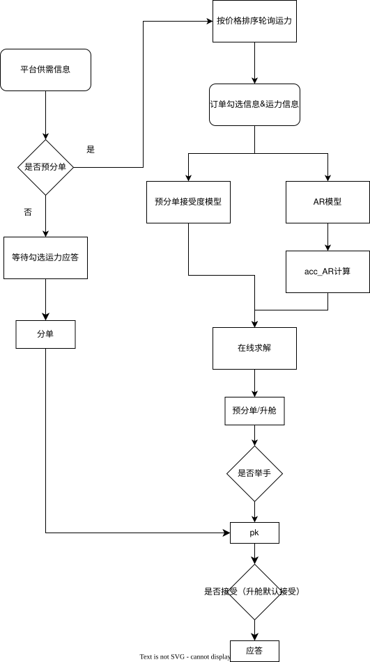

[图表 01 · SVG 源文件](附件/LR25006/图表01.svg) · [Cooper 原图](https://cooper.didichuxing.com/knowledge/2199610335356/2204428832540)

## 2.5 各模块介绍

### 2.5.1 预分单接受度模型

**模型类型**：xgboost二分类模型

**label**：某个呼叫下，给用户预分单某品牌运力，用户是否接受

**特征字段**：包括订单信息、乘客历史行为和天气特征

具体特征字段
| **特征字段**   | **特征口径**   | **特征类型**   |
| :---: | :---: | :---: |
| order_waiting_period   | 当前呼单已等待时长   | 线上传入特征   |
| city   | 当前订单城市id   |
| business_id   | 业务id   |
| start_dest_distance   | 当前订单起终点距离（单位：米）   |
| estimate_fee_amt   | 当前运力预估券后价（单位：元，保留到角）   |
| estimate_fee_max   | 发单勾选最高价（单位：元，保留到分）   |
| estimate_fee_min   | 发单勾选最低价（单位：元，保留到分）   |
| basic_total_fee_amt   | 当前运力预估券前价   |
| default_select_high_fee   | 默勾最高价   |
| predict_scene   | 预期管理场景   |
| wait_relay_selected_num   | 发单车型数   |
| default_selected_num   | 默勾车型数   |
| call_week   | 呼单所处周几（周日为0，周一到周六为1-6）   |
| call_hour   | 呼单所处小时（24小时制）   |
| flat   | 呼单起点纬度   |
| flng   | 呼单起点经度   |
| tlat   | 呼单终点纬度   |
| tlng   | 呼单终点经度   |
| pas_portrait_consume_ability_kf   | 乘客消费能力（该特征已停）   | 乘客特征     |
| pas_last_28day_asp_amt_kf   | 乘客最近28天订单的单均价格   |
| pas_last_7day_bubble_cnt_kf   | 乘客最近7天冒泡数   |
| pas_last_14day_bubble_cnt_kf   | 乘客最近14天冒泡数   |
| pas_last_28day_bubble_cnt_kfc   | 乘客最近28天冒泡数   |
| pas_last_14day_avg_start_dest_dis_kf   | 乘客最近14天单均里程   |
| pas_last_28day_avg_start_dest_dis_kf   | 乘客最近28天单均里程   |
| passenger_pre_dispatch_refuse_rate_14day   | 乘客近14天天预分单拒绝率  （口径：乘客近14天预分单拒绝量/近14天预分单弹窗量）   |
| passenger_pre_dispatch_refuse_rate_28day   | 乘客近28天天预分单拒绝率  （口径：乘客近28天预分单拒绝量/近28天预分单弹窗量）   |
| passenger_pre_dispatch_accept_rate_14day   | 乘客近14天天预分单接受率（口径：乘客近14天预分单接受量/近14天预分单弹窗量）   |
| passenger_pre_dispatch_accept_rate_28day   | 乘客近28天天预分单接受率（口径：乘客近28天预分单接受量/近28天预分单弹窗量）   |
| passenger_pre_dispatch_default_rate_14day   | 乘客近14天预分单默认拒绝率（口径：乘客近14天预分单默认拒绝量/近14天预分单弹窗量）   |
| passenger_pre_dispatch_default_rate_28day   | 乘客近28天预分单默认拒绝率（口径：乘客近28天预分单默认拒绝量/近28天预分单弹窗量）   |
| passenger_pre_dispatch_cnt_14day   | 乘客近14天预分单弹窗量   |
| passenger_pre_dispatch_cnt_28day   | 乘客近28天预分单弹窗量   |
| coord_start_humidity   | 起点实时湿度   | 天气特征  （dufe访问中台服务获取）   |
| coord\_ start_temperature   | 起点实时温度   |
| coord_start_intensity   | 起点实时降水强度   |
| coord_start_skycon   | 起点实时天气描述   |

**特征工程**：新增三个特征 **<u>预估券后价差</u>、<u>预估券后价差比例</u>、<u>单位距离预估券后价</u>**

| 特征   | 口径   | 公式   |
| :---: | :---: | :---: |
| 预估券后价差   | 预估券后价与表单勾选最高价之差   | estimate_fee_amt - estimate_fee_max   |
| 预估券后价差比例   | 预估券后价与表单勾选最高价之差除以表单勾选最高价   | (estimate_fee_amt - estimate_fee_max)/estimate_fee_max   |
| 单位距离预估券后价   | 预估券后价除以起终点距离   | estimate_fee_amt / start_dest_distance   |

**模型训练**：

	- **单调性约束**：**当前呼单已等待时长**、**预估券后价**、**预估券后价差比例**、**预估券后价差**设置单调性约束（**单增**、**单减**、**单减**、**单减**）

	- **样本不均衡**：训练数据中正样本与负样本比例约为1:3，设置正负样本比参数scale_pos_weight为3缓解样本不均衡问题

	- **模型评估**：测试集AUC 0.699，较原始线上版本提升**4.1pp**

**特征重要性**：

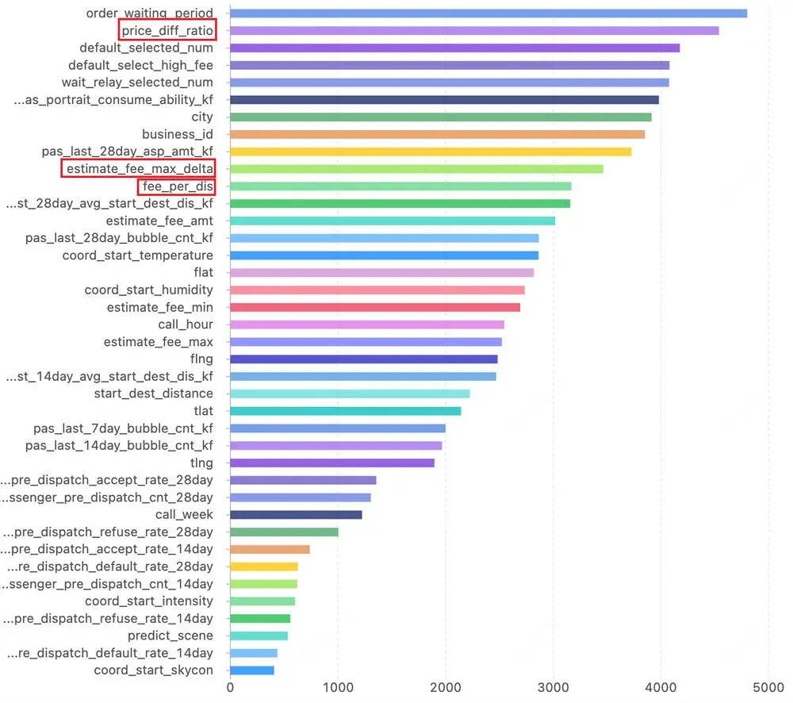

### 2.5.2 AR模型

> [【LR25003】平台补贴与流量分发联合决策V2](https://cooper.didichuxing.com/knowledge/2199610335356/2204226054240) 2.5.3 AR模型

呼叫前N个品牌的acc_AR（累计应答率），是基于前N个品牌中每个品牌的预估应答率进行计算的：

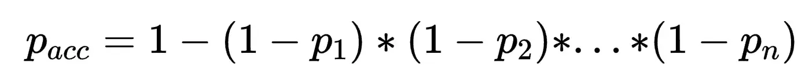

升舱第N+1页品牌，则计算对应的累积应答率

### 2.5.3 线上决策逻辑

根据贪心算法原理可知，当下图中的value/weight部分小于0时，决策该订单升舱符合全局最优

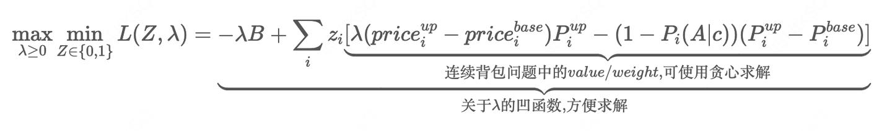

value/weight小于0等价于：

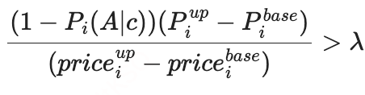

因此，线上判断订单是否升舱时，根据对应数据计算$$\frac{\tau_r}{\tau_c}$$，当$$\frac{\tau_r}{\tau_c} > \lambda$$时升舱，否则继续走原预分单的逻辑，其中：

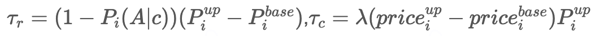

# 三、实验评估

## 3.1 大盘升舱评估

### 核心结论

**实验组1（100%升舱）——推全组**

- **<u>ROI：2.83</u>**

- **大盘：**人均完单显著**+1.02%**，人均GMV**+1.34%**，C补率显著**+0.33pp**，应答率显著**+0.72pp**，CR显著**+0.6pp，**毛利率+0.05%、毛利额+4.8k

- **运力：**人均自营、宏鹄、滴滴完单不显著变化；API完单显著**+4.29%**，其中哈罗完单增长不显著

- **升舱：**升舱完单占大盘总完单2.21%，GMV占2.16%，升舱订单C补率为25.17%。

- **策略触发面：**10.7%（可升舱订单/总订单），升舱商家找到运力概率约26%

 

**实验组2（随机升舱）**

- **<u>ROI：1.89</u>**

- **大盘：**人均完单不显著+0.46%，人均GMV**+0.69%**，C补率显著**+0.29pp**，应答率显著**+0.23pp**，CR不显著+0.10pp

- **运力：**人均自营、宏鹄、滴滴完单不显著下降；API完单显著**+2.48%**，其中哈罗完单不显著变化

- **升舱：**升舱完单占大盘总完单1.16%，GMV占1.37%，升舱订单C补率为29.45%

- **策略触发面：**7.1%（可升舱订单/总订单），升舱商家找到运力概率约26%

### 大盘指标

**收益路径分析**

CR收益完全来自于应答率提升，与预期收益路径一致。此外，应答后司机取消率也显著降低，来自于应答运力B实收更高。

实验组1 VS 实验组2：表明策略对于升舱钱效的判断符合预期，策略升舱相比于随机升舱，完单显著+1.02% VS 完单不显著+0.46%。表明：不进行策略判断，随机升舱或全量升舱的收益较低。

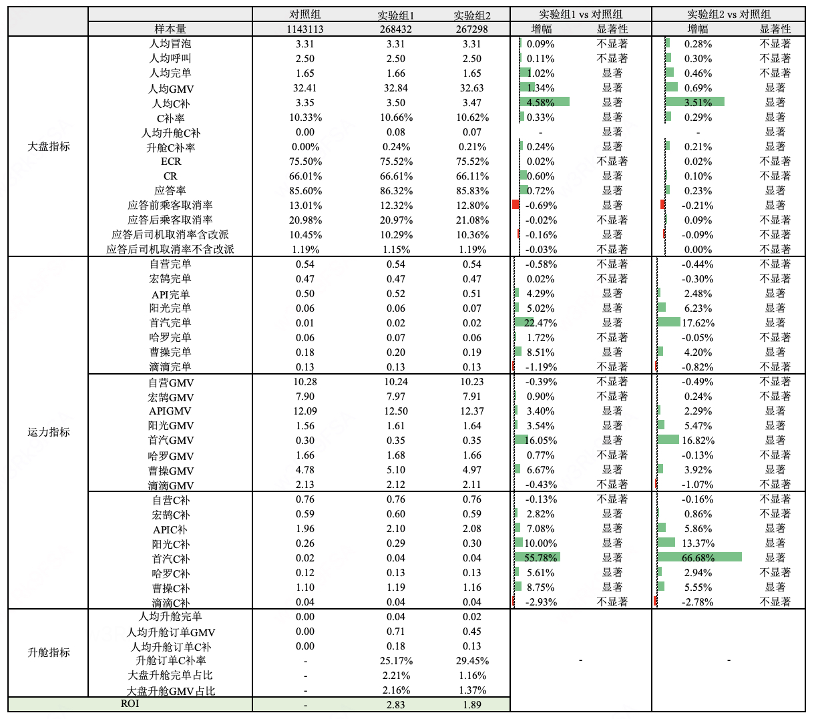

*ROI =* *△人均GMV / △人均总C补*

 

### 运力指标

- 自营GMV不显著负向、宏鹄GMV不显著正向，因此不计算ROI

- 实验组1API运力ROI：**2.97**，实验组2API运力ROI：**2.41**。两组运力ROI从大到小均为：<u>首汽>曹操>阳光>哈罗</u>。

- 在总升舱完单中，各运力完单贡献排序：曹操>宏鹄>阳光>首汽>哈罗>自营

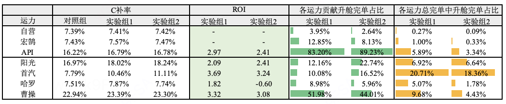

*各运力贡献升舱完单占比 = 各运力升舱完单 / 升舱总完单*

*各运力总完单中升舱完单占比 = 各运力升舱完单 / 各运力总完单*

## 3.2 新流升舱评估

- 实验分组说明：实验组1～3仅预算约束（lambda）不同

- 大盘：

	- 除实验组1完单不显著增，3个实验组的**完单、GMV、人均C补、C补率显著增**

	- 3个实验组的**CR和应答率显著增，应答前乘客取消率显著下降，其中实验组3下降幅度最大-7%**，应答后乘客取消率不显著变化

- 升舱：

	- 升舱完单占大盘完单**2%**，gmv占**2.44%**，升舱完单订单C补率**46%**

	- 策略触发面：**9%**（可升舱新流订单/呼叫订单）

	- 新流升舱应答率**22%**，CR为**16%**（升舱完单/可升舱订单）

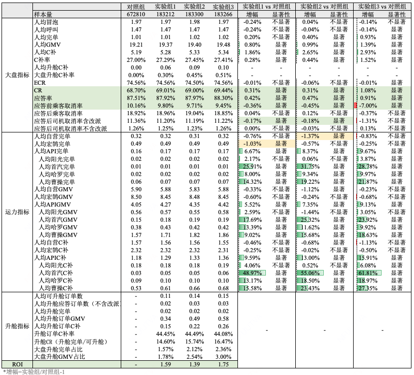

> 增幅为相对增幅

> ROI = △人均GMV/△人均总C补

 

### 运力指标

- 自营GMV、宏鹄GMV不显著变化，不计算ROI

- API对升舱总完单贡献94%，其中贡献度：曹操>首汽>哈啰>阳光

	- 实验组1-3 API整体ROI分别为**1.98、1.95、1.98**

	- 除阳光外的API运力ROI均为正，**范围在1.59-4.52**

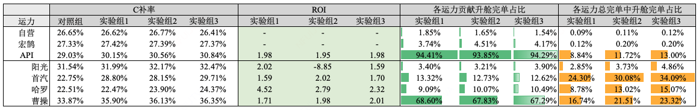

 

### 拉新指标

- 整体看，**delta冒泡完单率：实验组3**>实验组1>实验组2，**delta呼叫完单率：实验组3**>实验组1=实验组2

- 实验组3的新客、流失用户的拉新成本CAC均满足<=15的约束

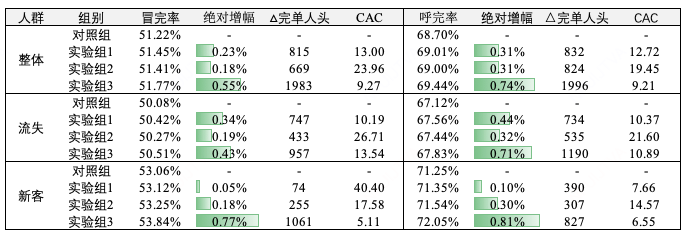

> CAC = △升舱补贴 / △完单人头数（理论上实验组多花的C补均来源于升舱C补）

 

## 3.3 新流放量后评估

业务方认可策略收益，20250410产出实验评估报告后，20250416决策放量**实验组3**，20250418配置新的预算完成放量

评估周期：20250519-20250525

相比于实验期：1.41pp的C补带来0.93%完单。CAC=9.21时，完单人头增量2000

放量期：0.3pp的C补带来0.48%完单。CAC=4.1时，完单人头增量2300。

|    | 应答前乘客取消率   | 应答率   | CR   | 完单   | C补率   |
| --- | --- | --- | --- | --- | --- |
| 实验组   | 0.106928336   | 0.870359182   | 0.67885343   | 0.99815304   | 0.00302   |
| 对照组   | 0.110382754   | 0.867234932   | 0.676176859   | 0.993375129   | 0   |
| 增量   | -0.35pp   | 0.31pp   | 0.27pp   | 0.48%   |    |

| 人群   | 组别   | 冒完率   | 绝对增幅   | delta完单人头   | CAC   |
| --- | --- | --- | --- | --- | --- |
| 整体   | 对照组   | 0.516878116   |    |    |    |
| 实验组   | 0.520166334   | 0.33pp   | 2271   | 4.1   |
| 新客   | 对照组   | 0.540575565   |    |    |    |
| 实验组   | 0.542865724   | 0.4pp   | 805   | 3.3   |
| 流失   | 对照组   | 0.502581384   |    |    |    |
| 实验组   | 0.506550733   | 0.23pp   | 1466   | 4.6   |

# 四、后续规划

1. 业务侧：呼叫后提应答的C补钱效高于提ECR，但是目前没有几个业务方出钱。希望能继续推进API投C补。

2. 产品侧：改变交易漏斗，即C不拒绝升舱后再展示给司机应答。（原因：升舱订单C取消很高，约28%）。

3. 策略侧：

	1. 当前仅考虑到AR增量，可改造为CR。

	2. 针对不同业务方的目标，进行差异化策略。

	3. 当前策略钱效离天花板还较远，可继续做模型优化。（原因：当前数据表明，升舱增量并非纯增量，如大盘实验中，升舱完单2.21%，增量仅1.02%。即约一半的订单不进行升舱也可完单）

4. 架构侧：

	1. 先播给商家，运力举手后再决策是否升舱。（原因：现在升舱后找运力概率比较低，约26%）

	2. API商家需要支持多次轮询。（原因：API当次无运力举手或被乘客拒绝后，不再进行预分单）

	3. 配合CR模型改造，需要支持同运力不同品类可升舱。（原因：当前认为同一运力升舱不会带来应答增量，但是高价品类会降低取消，从而有完单增量）

# 五、引用和鸣谢

本策略直接引用默勾acc_AR模型，在此致谢

致谢交易策略前期验证预分单C补效率

致谢交易引擎团队支持

致谢产品团队项目推进支持，致谢产品关赛前期产品方案与策略方案讨论

致谢冯宗旭【已离职】对于模型和策略开发

# 六、推全情况与现状

推全组效果：

- **<u>ROI：2.83</u>**

- **大盘：**人均完单显著**+1.02%**，人均GMV**+1.34%**，C补率显著**+0.33pp**，应答率显著**+0.72pp**，CR显著**+0.6pp**

现状：

- 升舱能力在新流人群推全使用

- 其余人群暂无预算
