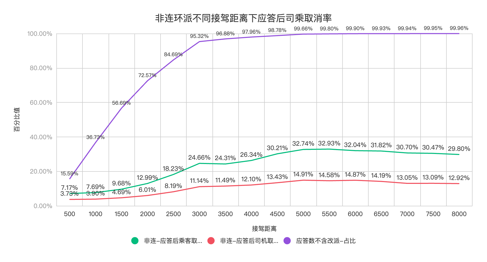
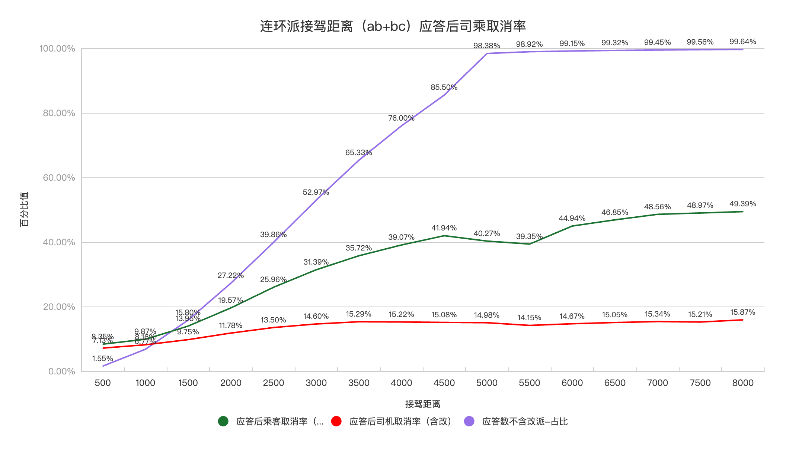
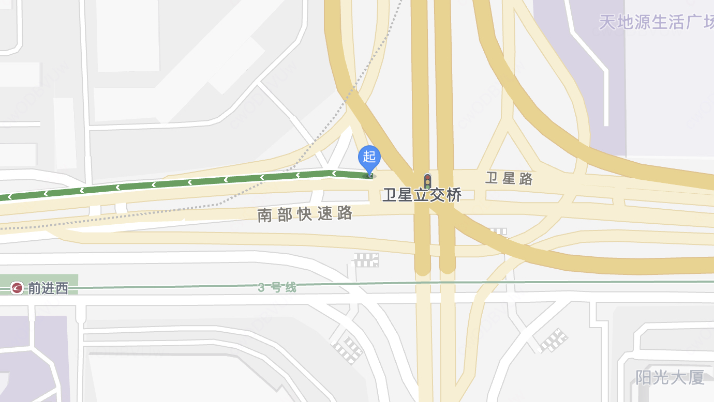
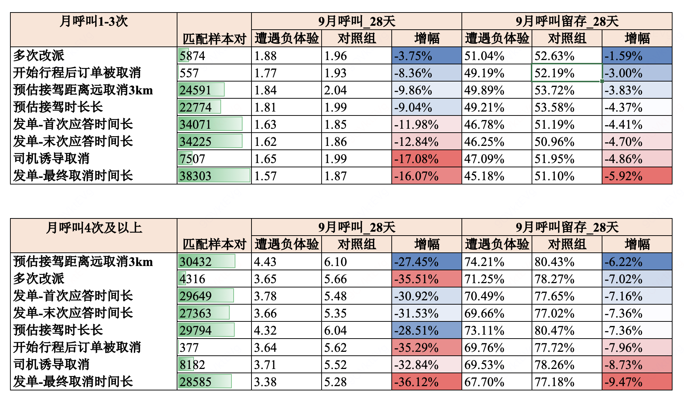
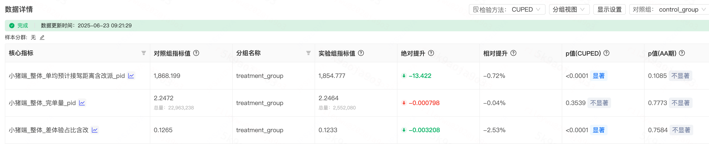
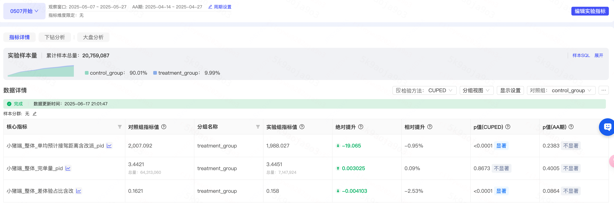

# 【LR25007】接驾体验优化-路口派单过滤V0

[Cooper 原文](https://cooper.didichuxing.com/knowledge/2199610335356/2204442434150)

**文档版本**

|    | **时间**   | **内容**   |
| --- | :---: | :---: |
| LR-V0   | -   |    |
| 补充文档放量后大流量下实验数据   | 26.6.11   | 补充在文档【实验结果】部分   |

# 1 背景

- 分单时自营和宏鹄连环派和扩播上限均不会超过6km，实际中发现存在接驾距离大于6km以上的订单（非连环派占比0.07%，连环派占比0.68%），同时这些订单的应答后司乘取消率均较高，

 

*数据为24.12月全月数据*

- 当前的派单系统分为分单和pk两大环节，DO对（司机乘客匹配对）从进入分单到pk胜出后应答，是存在时间差的，存在分单时司机符合接驾距离约束，但是应答时距离乘客较远的情况，比如：分单时司机在路口，分单过程中，司机在按照自己方向行驶，在pk胜出时，司机已从路口驶向乘客起点相反的方向，比如下面的例子：司机在进入分单矩阵时预估接驾距离：4940，应答时预估接驾距离8400，就是当时分单时司机在路口； 

- [DS之前对接驾距离远对乘客的留存进行过分析](https://cooper.didichuxing.com/docs2/document/2203047198854)：接驾距离较远对乘客留存有明显的负向影响。

 

在保证应答的前提下，用户接驾体验的好坏会直接会影响单次成交转化以及未来是否再次呼叫。从乘客视角出发，一个相对好的接驾体验首先是平台不蠢（派单不能异常远，比如出现10km派单），其次是平台能用&好用（平均接驾距离很近，打车经常会出现500m内派单），本次策略主要优化“极差去尾”，针对应答时超过分单接驾约束的DO对进行过滤。

# 2 目标

**目标：降低接驾距离和接驾差体验占比（含改），并且约束完单不显著负向**

# 3 技术方案

## 策略逻辑

- 在司机举手环节，原接口会返回司机距离订单的接驾距离dis_original，因为司机定位点不准，未成功绑路等原因，对于路口的司机，返回的dis_original可能并非是司机真实通过路口后的接驾距离（因为返回的dis_original可能是司机右转的接驾距离，但是真实情况是司机直走）

- 本策略会请求地图新接口，每个举手都会返回新的接驾距离dis_new，对于路口的司机，会返回路口直行时的接驾距离，将两者取max( dis_original，dis_new) 进行过滤，连环派和非连环派的过滤上限拉齐分单处，配置如下：

	- 非连环派约束6km；

	- 连环派ab约束5km，bc约束3km，ab+bc 约束5km

# 4 实验结果

[【接驾体验优化】路口派单过滤](https://x.intra.hongyibo.com.cn/exp/418268311650305?globalBusinessId=120000&globalProjectId=261878894821377&expFlowTab=dashboard&dashboardTab=metricDetail&windowTab=420940303368194)

- **实验类型**：全国乘客分流

- **实验周期**：25.5.6\~25.5.23

- **实验流量**：实验组10%，对照组90%

- **实验结果**：单均预计接驾距离（含改）显著-**13.2m**，差体验占比（含改）显著**-1.8%**，完单量不显著+0.03%，应答量（含改）显著**-0.2%**，应答后乘客取消率（不含改）显著**-0.15pp**，应答后司机取消率（含改）显著**-0.04pp**，

其他数据分析
**过滤数据**

- **应答量的降低就是来自于单独路口派单被过滤的订单，同时对于那些除了路口派单还有其他场景的订单，剔除掉路口派单的远距离订单之后，整体的应答不降低，不过，接驾距离可以降低不少；**

> 当前pk处除了新增的路口派单过滤，还有其他一些过滤逻辑，具体列表如下，下面数据表格中【其他过滤】是以下过滤汇总；本数据是以订单id为key，统计该订单下的不同司机的过滤情况；

> R1 = 1 // 真换车，新司机不满足顶替上一个司机的条件 距离or时间

> R2 = 2 // 真换车，接驾久被过滤

> R3 = 3 // 真换车，参数不足被过滤

> R7 = 7 // 路面接驾距离过滤

> R77 = 77 // 发生过DO取消

> R118 = 118 // 黑名单过滤, 乘客拉黑司机

**过滤占比：**

| 举手类型   | 路口派单过滤   | 其他过滤   | 不过滤   |    |
| --- | --- | --- | --- | --- |
| only举手   | no_lukou_filter   | no_other_filter   | 1   | 54.9084%   |
| only举手   | no_lukou_filter   | one_or_more_other_filter   | 0   | 0.0510%   |
| **only举手**   | **one_or_more_lukou_filter**   | **no_other_filter**   | **0**   | **0.1716%**   |
| both举手   | no_lukou_filter   | no_other_filter   | 1   | 43.6668%   |
| both举手   | no_lukou_filter   | one_or_more_other_filter   | 0   | 0.0105%   |
| both举手   | no_lukou_filter   | one_or_more_other_filter   | 1   | 0.1504%   |
| **both举手**   | **one_or_more_lukou_filter**   | **no_other_filter**   | **0**   | **0.0061%**   |
| both举手   | one_or_more_lukou_filter   | no_other_filter   | 1   | 1.0299%   |
| both举手   | one_or_more_lukou_filter   | one_or_more_other_filter   | 0   | 0.0014%   |
| both举手   | one_or_more_lukou_filter   | one_or_more_other_filter   | 1   | 0.0040%   |
|    |    |    |    |    |

**连环派和非连环派占比**

时间：0506-0523

实验组中，连环派占比有降低-0.41pp

| **group_name**   | **is_serial_assign**   | **ord_num**   | **连环派占比**   |
| --- | :---: | :---: | :---: |
| control_group   | 非连环派   | 60357960   | 74.02%   |
| treatment_group   | 非连环派   | 6734759   | 74.43%   |
| control_group   | 连环派   | 21186519   | 25.98%   |
| treatment_group   | 连环派   | 2314137   | 25.57%   |

# 

# 4 后续规划

- 放量节奏：5.28放量30%，5.30放量50%，6.3放量90%，6.9全量

- 当前配置是全国一个约束，后续随着[【LR25002】连环派&非连环扩播上限by城市约束](https://cooper.didichuxing.com/knowledge/2199610335356/2204259728071)放量完成，需要by城市在pk处拉齐分单配置，实验观察实际效果；

- 5.29前提需求开发城市粒度过滤能力（当前也支持城市维度配置，但是配置过于复杂，只能一个城市一个城市配置，想改造成批量json字段实现的能力）

# 5 引用和鸣谢

特别感谢合作方：产品志诚，工程加罗，地图团队的伙伴们。

# 6 附录

- [接驾体验优化-降低应答接驾距离大的bad-case-BRD](https://cooper.didichuxing.com/docs2/document/2203965005223)

- [分单优化-路口场景接驾距离计算优化（PRD）](https://cooper.didichuxing.com/docs2/document/2204052498936)

- [路口派单迭代优化](https://cooper.didichuxing.com/docs2/document/2204310904447)

# 

---

2026.6.11 补充内容开始

# 放量实验和策略线上现状

策略已推全，90%流量下实验结果如下：

原10%实验流量下结果为：

完单有折损是因为分流的挤占效应导致，后续将路口派单能力和其他接驾距离优化实验一起打包时间片实验看整体效果

2026.6.11 补充内容结束

---
