# 【LR25009】品牌优惠实时预算控制算法设计以及离线仿真

[Cooper 原文](https://cooper.didichuxing.com/knowledge/2199610335356/2204571469455)

# 0. 编辑记录

| **日期**   | **修改内容**   |
| --- | --- |
| 2025-06-09   | 初版文档发布   |

# 1. 背景概述

### 1.1 品牌优惠

品牌优惠（[宏鹄商家C补](https://cooper.didichuxing.com/docs/document/2201022083496) + API共补/独补）上线半年有余，已在多城的宏鹄商家开启共补活动。实验结果表明，宏鹄品牌共补优惠的钱效较高（商家ROI>9，商家完单提升50%+，GMV提升70%+），商家也有进一步共补的意愿。

目前品牌优惠已提[二期需求](https://cooper.didichuxing.com/docs2/document/2202529441677)，即将接入智能呼返&熔断能力。

> 附：[宏鹄共补一期评估](https://cooper.didichuxing.com/docs2/document/2202402202087)、[宏鹄共补二期评估](https://cooper.didichuxing.com/docs2/document/2202853245113)

### 1.2 预算执行误差

对于实时补贴类抓手而言，实际核销补贴率会随着冒泡分布的变化而波动，从而导致实际核销补贴率与预算补贴率之间产生误差。

基于平台其他抓手的历史经验，[智能策略对冒泡分布的变化更加敏感](https://cooper.didichuxing.com/knowledge/share/page/7NzmNSEn0d9A#页面《实时预算控制&实时求解需求文档》)。因此，品牌优惠接入智能呼返&熔断能力后，预计将比一期（人工呼返，选定时段&里程段定折）在商家维度上更难控准预算。

### 1.3 预算控制必要性

在平台资源逐步收缩的背景下，未来会开启更多的宏鹄共补活动，且长期也会牵引宏鹄与API商家进行独补。

品牌优惠涉及商家出资，商家会格外关注自身的补贴花费情况。若品牌优惠无法做到by商家控准执行补贴率，会导致参与商家的信任度降低，进一步导致参与意愿的降低，影响平台毛利的提升。

因此，我们希望**<u>针对品牌优惠建设实时预算控制能力</u>**，确保不同策略在冒泡分布发生变化或熔断频繁触发等场景下，依然能准确执行预算。

同时，为了能够在离线预判断算法控制效果，规避掉部分糟糕的算法带来的线上代价，同时对参数依赖的方法可以快速调参，我们还提出了一套离线仿真流程

# 2. 方法设计

## 2.1 离线仿真系统

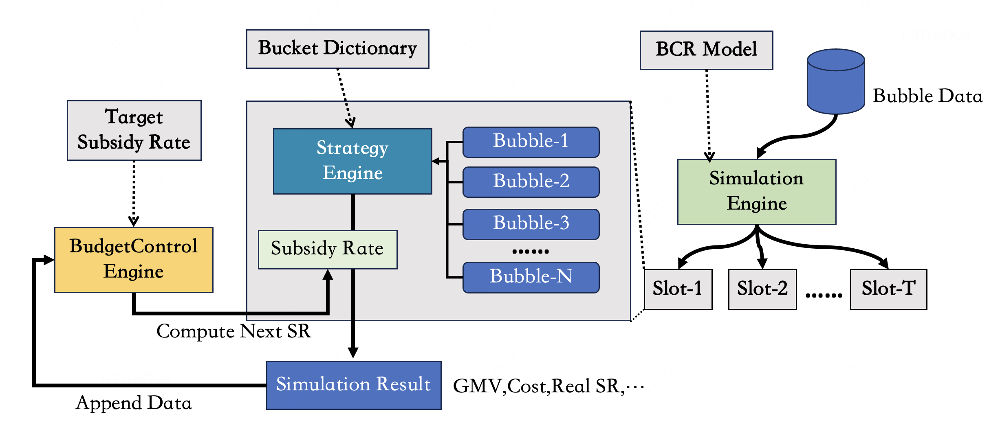

如上图所示，我们将整个仿真系统划分成了三个引擎：

- **Simulation Engine**

	- **主要是用来读取真实冒泡数据，同时附加冒泡在不同折扣下的仿真BCR**

	- **会利用冒泡上的时间信息，按顺序划分出对应数量的时间片**

- **Strategy Engine**

	- **主要是读取策略字典，在给定补贴率下对每一个冒泡输出一个对应的折扣**

- **BudgetControl Engine**

	- **主要是进行预算控制算法的实现，读取目标补贴率，输出控制后的策略补贴率，并且在每一个时间片结束之后，会将该时间片的信息记录下来，便于后续的补贴率控制**

**上述流程为：**

1. 分时间片先划分trace，按顺序得到多个时间片下的trace集合

2. 按时间片顺序，开始给对应时间片给一个预算补贴率

3. 对于这个时间片，开始计算该时间片内的总BCR，GMV，Cost等指标

	1. 对于时间片内的第 i 个冒泡，通过BCR模型计算，得到对应不同折扣下的预估BCR

	2. 然后通过特征计算桶的哈希，得到对应的分桶

	3. 根据这个分桶，查找预算补贴率对应的字典，得到应该发放的折扣

	4. 应用该折扣到冒泡上，基于该单价格，分别得到 Cost，GMV

	5. 将Cost和GMV累计进该时间片内

4. 得到该时间片的总的仿真预算消耗，计算下一个时间片的预算补贴率，如果时间片未耗尽，则跳3

## 2.2 PID & HPID & PIDSR 算法

这里我们首先写出基于原始 **PID 算法**的控制方程

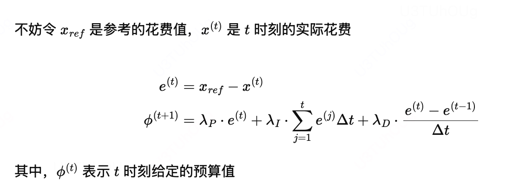

其中，涉及四个可调整参数$$\lambda_P, \lambda_I, \lambda_D, \Delta t$$ 

**History-based PID, HPID 算法**

在PID算法的基础上，将 x_ref 修改成历史的参考补贴率，即

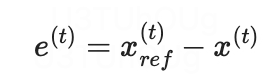

然后这里给出 **PIDSR** 的控制方程，即 **补贴率视角下的 PID 算法**

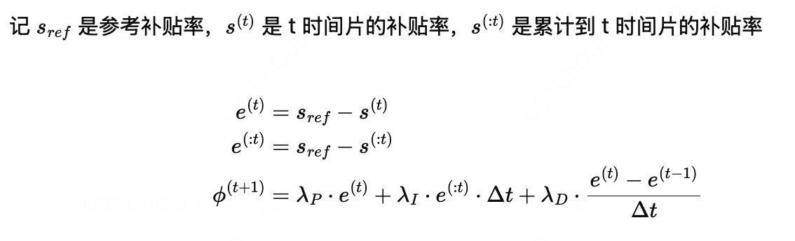

## 2.2 RASR控制算法

> **补贴率视角下基于预估分布的残差均摊策略，Residual Amortized Subsidy Rate View，RASR**

**其核心原理即，基于历史的分布，估计出未来时间片的GMV，将累计到当前时间片的误差，均摊到未来每一个时间片上**

如下图所示，我们可以先估计出未来时间片的分布

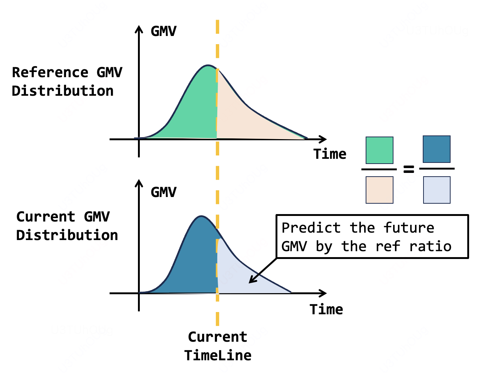

有了未来时间片的GMV，便可以估计出一个合理的针对未来时间片的补贴率 s，使得整体补贴率等于目标补贴率，即

$$\frac{COST^{past} + s\cdot GMV^{future}}{GMV^{past} + GMV^{future}} = S^*$$

 

此时，这个未来时间片的理想补贴率 s，和实际的补贴率是不一致的，我们需要先计算历史分布的基础上，后续时间片的实际补贴率 

$$s^{future}_{ref} = \frac{COST^{future}_{ref}}{GMV^{future}_{ref}}$$

最终，叠加 buffer 为 理想补贴率$$s$$ 和 基于历史分布的实际补贴率$$s^{future}_{ref}$$  的差 

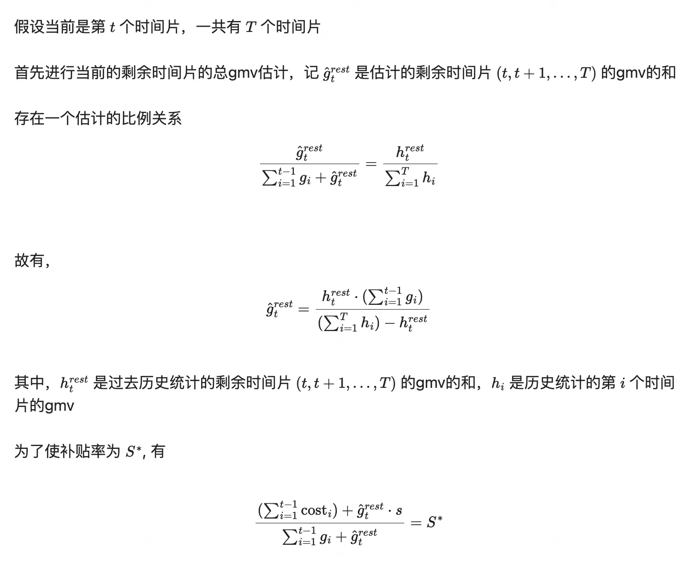 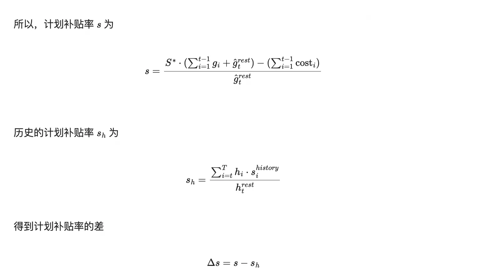

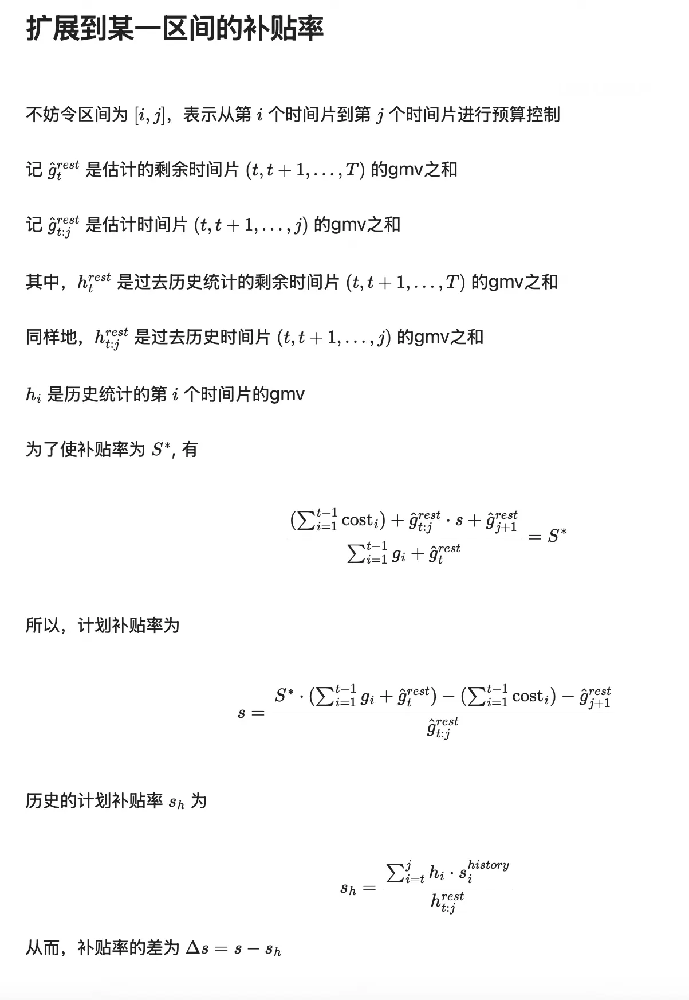

### 2.2.1 RASRET 算法

> **ET后缀代表 with Error Trend，即对误差的趋势进行捕捉**

进一步地，在RASR上加入一个分段调节系数，即

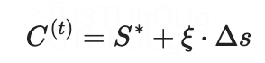

其中，系数的分段可以参考如下形式

 

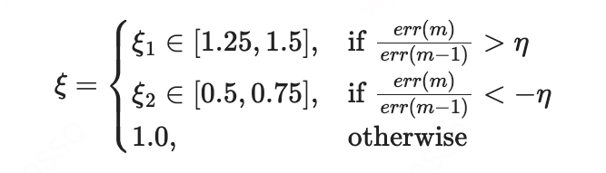

 

**err函数**是一个带符号的误差累积函数, 形式为：

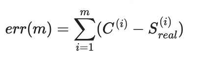 

 

### 2.2.2 RASR-V2算法

和 RASR 不同的是，RASR-V2 是从 Cost 的角度出发来进行误差均摊

首先，我们还是需要使用比例估计出 **未来剩余时间片的 GMV**，记作$$GMV^{future}_{estimate}$$

然后基于历史分布，计算出历史分布下的过去时间片的补贴率，记作$$s_{ref}^{past}$$ 

$$s_{ref}^{past} = \frac{COST^{past}_{ref}}{GMV^{past}_{ref}}$$

然后，按照这个历史补贴率，计算出现在，过去时间片的理想花费

$$COST^{past}_{ideal} = s_{ref}^{past} \cdot GMV^{past}$$

接着，计算出和实际花费的差值，并将改差值均摊到未来剩余的所有时间片

$$\begin{aligned} \Delta COST &= COST^{past} - COST^{past}_{ideal}\\ \Delta s^{future} &= \frac{\Delta COST}{GMV^{future}_{estimate}}\\ \Delta s &= s - \Delta s^{future} \end{aligned}$$

# 3. 实验分析

我们在实际落地中，将时间片的大小设定为30分钟

并且对所有产出的浮点数补贴率，使用四舍五入进行转换

在RASR算法中，所有的历史周期数据，为最近的4个工作日的数据聚合而成

## 3.1 离线仿真实验

我们在离线仿真平台上对多种不同的控制算法进行了仿真实现

| **策略**   | **总执行误差**  **（绝对误差）**  Y'-Y   | **天累计准确性**  **（绝对误差的绝对值）**  mean(abs(y'-y))   | **天累计波动性**  **（基于绝对误差）**  std((y'-y))   | **完单数**  **（v.s.无控制）**  (F_i-F_0)/F_0   | **by天执行误差**  **（绝对误差的绝对值）**  abs(y'-y)   |
| :---: | :---: | :---: | :---: | :---: | :---: |
| **No Control**   | +1.298pp   | 1.267pp   | 0.086   | /   | 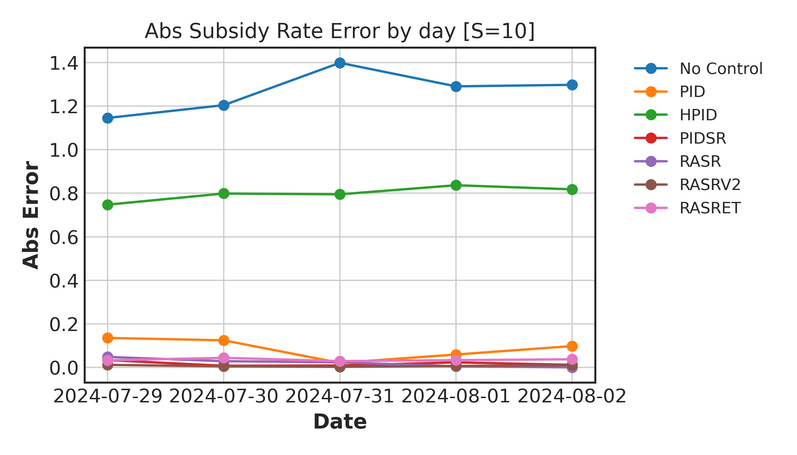   |
| **PID**   | -0.098pp   | 0.087pp   | 0.042   | **-0.1%**   |
| **HPID**   | +0.818pp   | 0.799pp   | 0.030   | -0.3%   |
| **RASR**   | **+0.0004pp**   | 0.021pp   | 0.017   | -0.2%   |
| **RASRET**   | -0.037pp   | 0.035pp   | 0.005   | -0.2%   |
| **PIDSR**   | -0.012pp   | 0.017pp   | 0.009   | -   |
| **RASRV2**   | 0.010pp   | **0.007pp**   | **0.003**   | -0.2%   |

> RASR-V2 和 RASR 的原理是一致的，后续所有线上实验都是RASR-V2

## 3.2 线上误差控制结果

### 3.2.1  RASR 和 PIDSR 的对比实验

| **覆盖城市**   | **南宁市**   |
| --- | --- |
| **流量占比**   | **No Control : PIDSR : RASR = 40% : 30% : 30%**   |
| **时间周期**   | **2025-03-03 \~ 2025-03-07 **  **2025-03-17 \~ 2025-03-21**   |
| **主要结论**   | **RASR 误差控制效果较 PIDSR 更好，RASR 平均误差降低 31.26%**   |

|    | **日期**   | **0303**   | **0304**   | **0305**   | **0306**   | **0307**   | **Avg**   |
| --- | --- | :---: | :---: | :---: | :---: | :---: | :---: |
| **绝对误差**  **\[误差降低比率\]**   | **No Control**   | 0.0123   | 0.0127   | 0.0125   | 0.0054   | 0.0123   | -   |
| **PIDSR**   | **0.0084**  **\[31.40%\]**   | 0.0114  \[10.54%\]   | 0.0116  \[6.99%\]   | 0.0041  \[23.60%\]   | **0.0069**  **\[43.72%\]**   | 23.25%   |
| **RASR**   | 0.0104  \[15.09%\]   | **0.0093**  **\[27.03%\]**   | **0.0083**  **\[33.64%\]**   | **0.0014**  **\[73.22%\]**   | 0.0090  \[35.12%\]   | **35.12%**   |

|    | **日期**   | **0317**   | **0318**   | **0319**   | **0320**   | **0321**   | **Avg**   |
| --- | --- | :---: | :---: | :---: | :---: | :---: | :---: |
| **绝对误差**  **\[误差降低比率\]**   | **No Control**   | 0.0342   | 0.0149   | 0.0181   | 0.0187   | 0.0226   | -   |
| **PIDSR**   | **0.0265**  **\[22.34%\]**   | **0.0124**  **\[17.10%\]**   | 0.0114  \[37.63%\]   | 0.0156  \[16.62%\]   | **0.0134**  **\[40.84%\]**   | 26.90%   |
| **RASR**   | 0.0269  \[21.29%\]   | 0.0124  \[16.94%\]   | **0.0108**  **\[40.56%\]**   | **0.0151**  **\[19.38%\]**   | 0.0139  \[38.85%\]   | **27.40%**   |

### 3.2.2 误差控制效果追踪

| **覆盖城市**   | **南宁市**   |
| --- | --- |
| **流量占比**   | **No Control  : RASR = 40% : 60%**   |
| **时间周期**   | **2025-05-26 \~ 2025-05-29 **   |
| **主要结论**   | **扩量到60%，RASR 平均误差降低 27.78%**   |

|    | **日期**   | **0526**   | **0527**   | **0528**   | **0529**   | **Avg**   |
| --- | --- | :---: | :---: | :---: | :---: | :---: |
| **绝对误差**  **\[误差降低比率\]**   | **No Control**   | 0.0239   | 0.0314   | 0.0283   | 0.0298   | -   |
| **RASR**   | **0.0169**  **\[29.27%\]**   | **0.0237**  **\[24.61%\]**   | **0.0200**  **\[29.42%\]**   | **0.0215**  **\[27.81%\]**   | **27.78%**   |

### 3.2.2 控制算法下策略钱效的分析实验

| **覆盖城市**   | **南宁市**   |
| --- | --- |
| **流量占比**   | **No Control : PIDSR : RASR = 40% : 30% : 30%**  **空白组 5% 为正交流量**   |
| **时间周期**   | **2025-03-17 \~ 2025-03-21**   |
| **主要结论**   | **RASR 钱效损失相比 PIDSR 更低**   |

| 0317-0321   | **人均完单**   | **人均GMV**   | **aFROI**   | **ROI**   | **商家C补率**   |
| --- | :---: | :---: | :---: | :---: | :---: |
| **空白组**   | 1.4028   | 20.0869   | -   | -   | 0.004%   |
| **No Control**   | 1.9866   | 27.6710   | 0.3694   | 4.9346   | 1.336%   |
| **PIDSR**   | **1.9341**   | 27.6760   | **0.3492**   | 4.9910   | 1.350%   |
| **RASR**   | **2.0321**   | **28.8467**   | **0.3809**   | **5.3484**   | **1.401%**   |

> **RASR 人均完单和人均GMV都没有负向, PIDSR 由于频繁的调整，出现了钱效的损失** 

### 3.2.3 温州市的误差控制以及钱效损失

| **覆盖城市**   | **温州市**   |
| --- | --- |
| **流量占比**   | **No Control : RASR = 70% : 30%**   |
| **时间周期**   | **2025-05-19 \~ 2025-05-23 **   |
| **主要结论**   | **RASR 误差控制效果在温州市也验证有效，同时钱效并无损失**  **内层误差平均降低17.83% 和 7.72%**   |

**【误差控制结果】**

| **城市**   |    | **日期**   | **0519**   | **0520**   | **0521**   | **0522**   | **0523**   | **Avg**   |
| :---: | --- | --- | :---: | :---: | :---: | :---: | :---: | :---: |
| **温州**   | **绝对误差**  **\[误差降低比率\]**   | **No Control**   | 0.0257   | 0.0271   | 0.0214   | 0.0309   | 0.0221   | -   |
| **RASR**   | **0.0179**  \[30.17%\]   | **0.0243**  \[10.40%\]   | **0.0186**  \[13.38%\]   | **0.0242**  \[22.09%\]   | **0.0216**  \[13.13%\]   | **17.83%**   |

【**钱效变化】**

| **城市**   | **Method**   | **人均完单**   | **人均GMV**   | **C补率**   | **aFROI**   |
| :---: | --- | :---: | :---: | :---: | :---: |
| **温州**   | **No Control**   | 5.8749   | 93.9790   | 3.37%   | 0.0981   |
| **RASR**   | **6.1174**   | **99.1555**   | 2.92%   | **0.1913**   |

> **规模指标无负向，人均完单 +4.12%，人均GMV +5.5%** 

> **同时由于抑制了超花情况，C补率降低，aFROI提升较多**

# 4. FAQ

# 5. 未来规划

- 结合强化学习进行预算控制，提高钱效保持

- 对外层控制算法进行实现，并进行评估

# 6. 致谢

感谢之烁在算法设计和修改上提出的宝贵建议

感谢组内同学在具体实现和仿真等各方面给出的建议和支持

# 7. 目标&约束

## 7.1 策略目标

- 品牌优惠商家的ROI、完单ROI提升

- 预算执行准确率提升

## 7.2 约束指标项

由于该策略为控制预算花费，目标位ROI、完单ROI提升，因此无特定约束。

# 8. 推全情况与现状追踪

推全情况：目前线上已推全——<https://yunchou.intra.hongyibo.com.cn/experimentManage?layerId=140>

现状追踪：目前品牌优惠没有补贴。
