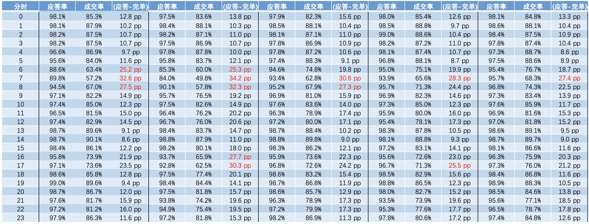
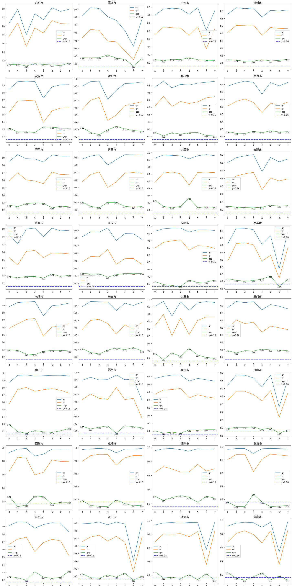
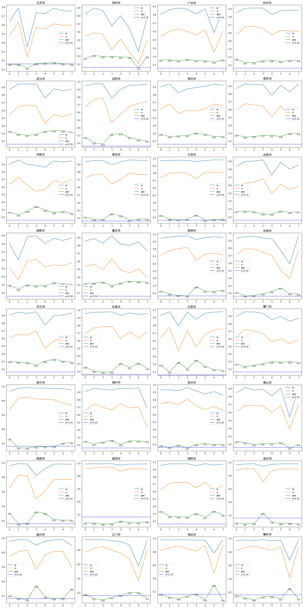
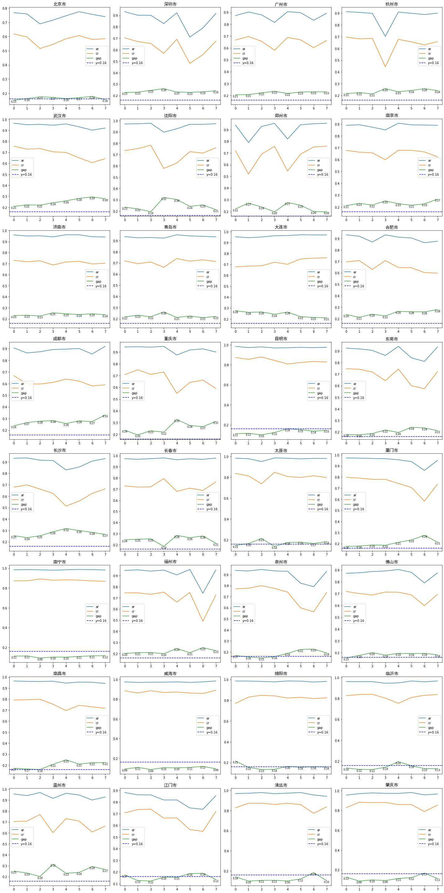
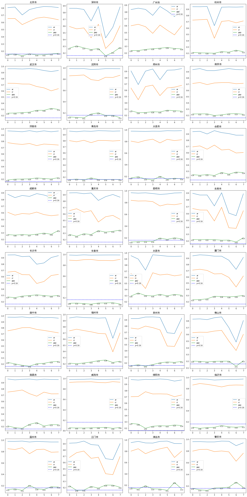
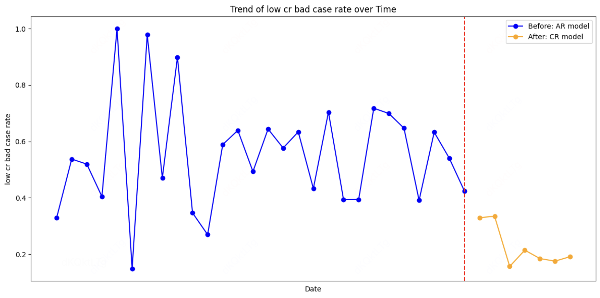
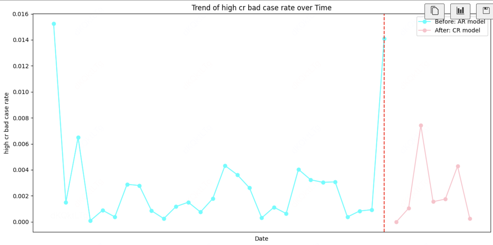
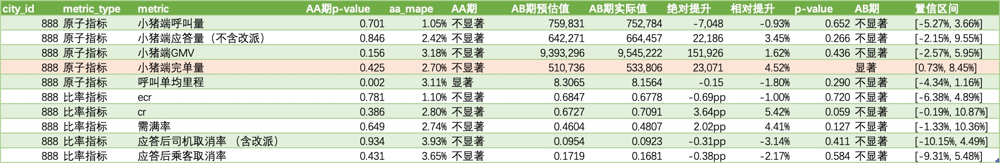
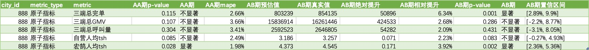
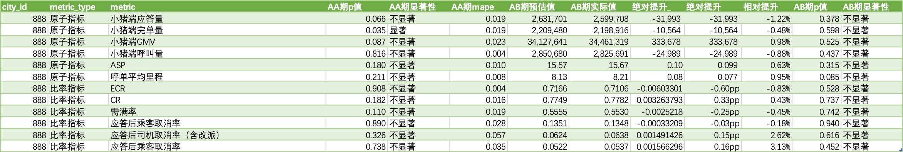

# 【LR25018】动调触发切换为预估成交率模型

[Cooper 原文](https://cooper.didichuxing.com/knowledge/2199610335356/2204792890251)

## 一、背景

‏全城动调初始的背景为，当未来时段为**用车高峰**，预计出现**应答率下跌**（供不应求）情况时，小猪的策略为**对司机&乘客同幅度涨价**，这会使得：

（1）乘客需求抑制 

（2）司机完单意愿增加

在提升成交率率的同时也提升GMV

目前上线使用动调应答率模型的城市施行的具体策略为：预估未来1小时城市应答率，当低于阈值（根据城市过去28天平均应答率向下10pp）时，触发动调涨价。

在使用预估应答率进行全城动调时，发现了以下问题：

- 应答率与成交率之间的差距主要来源于应答后的订单取消。在高峰时段或恶劣天气等特殊场景下，取消率往往大幅上升。因此，可能出现应答率处于尚可甚至不错的水平，但实际成交率往往已跌至很低（40%左右），整体履约表现处于极差水平。

我们以沈阳市为例，选取全天没有异常天气的一天查看分时应答率与成交率数据，发现沈阳在06-09时、16-17时普遍存在应答率与成交率的gap大于16pp的统计经验值的情况。

在对其他城市进行验证后，发现大部分城市在7-8时，17-18时也应答率和成交率差距非常大的情况。

| 时段   | 7时   | 8时   | 17时   | 18时   |
| --- | --- | --- | --- | --- |
| 应答率与成交率gap   |    |    |    |    |

对上述情况，我们的解决方案是把通过预估未来一小时的应答率改为预估未来一小时的成交率，当成交率小于阈值时即触发动调。

## 二、目标&约束

### 2.1 策略目标

解决由于应答后取消带来的应答率和成交率差距大，导致的对差成交场景漏识别的问题。

低cr无动调bad case率降低10pp。

小猪端完单率显著正向（由于评估方法为causal impact，提升具体数值仅能作为参考，主要考虑是否显著）

### 2.2 约束指标项 & 约束程度

| 约束项   | 约束项指标   |
| --- | --- |
| 高cr有动调bad case率   | 上升不超过0.1pp   |

## 三、模型开发及上线

### 选用模型

初版选用与应答率相同的**xgboost**，但新增了实时应答后乘客取消率、司机含改派取消率等特征：

### 新增基础特征（不包含计算特征）

| 特征名   | 含义   |
| --- | --- |
| pre_cancel_after_strive_05   | 调用时刻前5分钟乘客应答后取消数   |
| pre_cancel_after_strive_10   | 调用时刻前10分钟乘客应答后取消数   |
| pre_cancel_after_strive_120   | 调用时刻前120分钟乘客应答后取消数   |
| pre_cancel_after_strive_30   | 调用时刻前30分钟乘客应答后取消数   |
| pre_cancel_after_strive_60   | 调用时刻前60分钟乘客应答后取消数   |
| pre_reassign_05   | 调用时刻前5分钟改派数   |
| pre_reassign_10   | 调用时刻前10分钟改派数   |
| pre_reassign_120   | 调用时刻前120分钟改派数   |
| pre_reassign_30   | 调用时刻前30分钟改派数   |
| pre_reassign_60   | 调用时刻前60分钟改派数   |
| trend_cancel_after_strive_10_05   | （调用-5分钟）时刻前10分钟乘客应答后取消数   |
| trend_cancel_after_strive_10_10   | （调用-10分钟）时刻前10分钟乘客应答后取消数   |
| trend_cancel_after_strive_10_15   | （调用-15分钟）时刻前10分钟乘客应答后取消数   |
| trend_cancel_after_strive_10_20   | （调用-20分钟）时刻前10分钟乘客应答后取消数   |
| trend_cancel_after_strive_30_15   | （调用-15分钟）时刻前30分钟乘客应答后取消数   |
| trend_cancel_after_strive_30_30   | （调用-30分钟）时刻前30分钟乘客应答后取消数   |
| trend_cancel_after_strive_30_45   | （调用-45分钟）时刻前30分钟乘客应答后取消数   |
| trend_cancel_after_strive_60_20   | （调用-20分钟）时刻前60分钟乘客应答后取消数   |
| trend_cancel_after_strive_60_40   | （调用-40分钟）时刻前60分钟乘客应答后取消数   |
| trend_reassign_10_05   | （调用-5分钟）时刻前10分钟改派数   |
| trend_reassign_10_10   | （调用-10分钟）时刻前10分钟改派数   |
| trend_reassign_10_15   | （调用-15分钟）时刻前10分钟改派数   |
| trend_reassign_10_20   | （调用-20分钟）时刻前10分钟改派数   |
| trend_reassign_30_15   | （调用-15分钟）时刻前30分钟改派数   |
| trend_reassign_30_30   | （调用-30分钟）时刻前10分钟改派数   |
| trend_reassign_30_45   | （调用-45分钟）时刻前10分钟改派数   |
| trend_reassign_60_20   | （调用-20分钟）时刻前60分钟改派数   |
| trend_reassign_60_40   | （调用-40分钟）时刻前60分钟改派数   |

新增特征中trend_cancel_after_strive_60_20、trend_cancel_after_strive_30_15、trend_reassign_60_40在特征重要性中靠前，说明增加的指标是有效的

### 模型效果

在同一批城市上离线训练的效果

应答率模型的MAE：**==0.0271==**

新增特征后成交率模型的MAE：**0.0523**

成交率模型上线后的线上MAE：**0.0454**

需要看到，因为预测任务难度提升，导致平均绝对误差相比预估应答率有所上涨，虽已达到业务同学约束的误差范围，但后续需要持续迭代模型精度

### 整体时间线

## 四、实验评估

### 评估指标

在实验过程中，我们使用以下指标进行策略评估

**业务核心指标**

- 小猪端完单

- 小猪端GMV

**策略评估指标**（及其计算方式）

| 评估指标   | 定义   |
| --- | --- |
| 低cr无动调bad case率   | 城市对应时段CR（成交率）低于 min(过去28天均值\*0.9, 0.60)，但没有触发动调的冒泡比例。   |
| 高cr有动调bad case率   | 城市对应时段CR（成交率）高于 max(过去28天均值\*1.1, 0.75)，但触发了动调的冒泡比例。   |
| 总bad case率   | 低cr无动调和高cr有动调的冒泡占总冒泡的比例。   |

**观测指标**

动调触发冒泡占比（口径：触发动调的冒泡占总冒泡的比例）

全城动调导致的金额变化率（口径：动调冒泡涨价金额除以动调前价格）

### 评估方法

### 评估结果

### 策略指标结果

1、动调开城城市在全国的GMV占比：**80.40%**

2、策略评估指标 bad case率，我们会看第一批城市切换前57城的bad case率，和最后一批城市切换后57城的bad case率曲线进行前后对比；

3、业务评估指标需要用到Causal Impact，它要求必须以切换的时间点前后进行评估，所以每一批城市业务指标会分别进行评估，无法全国打包（下次LR会补充后两批城市的业务指标评估结果）

#### 全部切换前后低cr无动调bad case率变化（开城的57个城市汇总，每天一个数据点）

| 第一批切换前低cr无动调bad case率   | 全量切换后低cr无动调bad case率   | 切换模型后低cr无动调bad case率变化   |
| ---: | ---: | ---: |
| 46.96%   | 21.83%   | **-25.13pp(-53.5%)**   |

#### 全部切换前后高cr有动调bad case率变化

| 第一批切换前高cr有动调bad case率   | 全量切换后高cr有动调bad case率   | 切换模型后高cr有动调bad case率变化   |
| ---: | ---: | ---: |
| 0.21%   | 0.24%   | **+0.03pp(+14.29%)**   |

#### 全部切换**总bad case率变化**

| 第一批切换前总bad case率   | 全量切换后总bad case率   | 切换模型后总bad case率变化   |
| ---: | ---: | ---: |
| 4.18%   | 1.25%   | **-2.93pp**   |

### 业务指标评估结果

#### 第一批城市Casual Impact评估结果

通过评估结果我们看到，在切换为成交率模型触发后：

小猪端呼叫量不显著-0.93%，小猪端应答量（不含改派）不显著+3.45%，小猪端完单量显著**+4.52%**，小猪端GMV不显著+1.62%**。**

ecr不显著**-**0.69pp，cr不显著（但接近显著）+3.64pp，需满不显著正，应答后司乘取消均不显著下降。符合我们对涨价后的预期。

发单里程AA期显著+3.11%，AB期不显著-1.80%。可以看出长里程呼叫受涨价的抑制更严重，使得GMV（应付）的增长不如完单的增长。

#### 补充第一批城市三端聚合评估

三端总完单**显著正向**，三端总GMV不显著正向，三端总呼叫量不显著正向。

自营TSH不显著正向，宏鹄TSH AA期检验不通过所以不作为参考（但方向为正）。

结合大聚合完单显著正向的评估结果来看，判断端内完单显著正向的收益路径是：

司机受涨价牵引TSH增加，应答量提升，叠加涨价后应答后取消相关的所有率指标的降低，促成最终完单的显著提升（并且因为涨价平均发单里程降低，使得GMV的相对提升不如完单）。

#### 第二、三批城市Casual Impact评估结果

核心指标：小猪端完单量AA期显著负，AB期不显著-0.48%，AA期拟合较差，AB期相较AA期下降减少；小猪端GMV不显著+0.98%。

其他观测指标均无显著变化且变幅很小。

## 五、后续计划

1. 完成策略owner交接（可欣->一鹏，可欣后续专职创新策略相关模型开发）。

2. 完成模型离线迭代并上线。

候选模型：

	1. Hiearchical Multiscale LSTM（已完成开发和离线训练流程，待更换label为成交率后对比线上模型效果）+位置编码

	2. TFT（完成代码开发，待用真实数据训练对比效果）+位置编码

重点解决：

	1. 预估准确度提升

	2. 通过引入位置编码（Positional Encoding）方法，希望可以降低判断时延，解决上升沿召回低的问题

3. 最优动调**涨价幅度**设计。需要引入弹性，将涨价幅度转化为一个能求解的**最优化问题**，并在Q3完成策略方案设计，并争取进入开发阶段。

**附：原始数据与评估结果**

[全量评估数据-七天_final_v2.csv](附件/LR25018/013.csv)

[第一批城市Causal.zip](附件/LR25018/014.zip)

[全量评估数据二三批城市打包.csv](附件/LR25018/015.csv)

[第二批城市Causal.zip](附件/LR25018/016.zip)

第一批城市causal impact评估结果：

[汇总结果-3.xlsx](附件/LR25018/017.xlsx)

# 六 推全情况与现状追踪

LR后预估成交率模型已扩量到全部动调开城城市，后续交接给建玲进行迭代，目前线上版本需询问目前负责的同学。

## 引用和鸣谢

感谢杜展老师、门畅老师在全流程的指导和帮助，感谢欣艾在评估上提供的支持，感谢价格引擎工程团队的支持！

##
