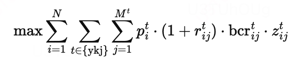
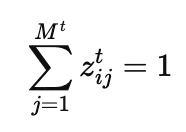
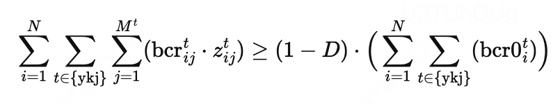
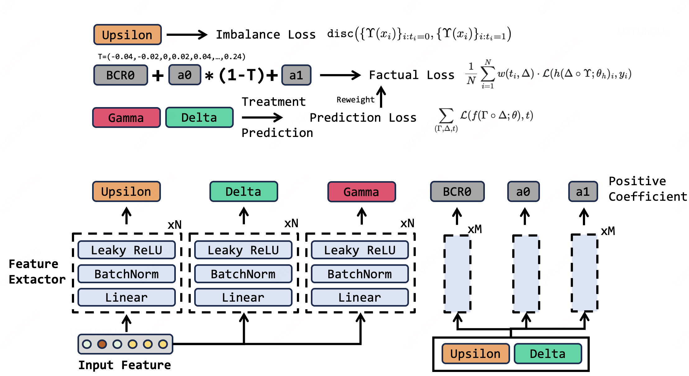
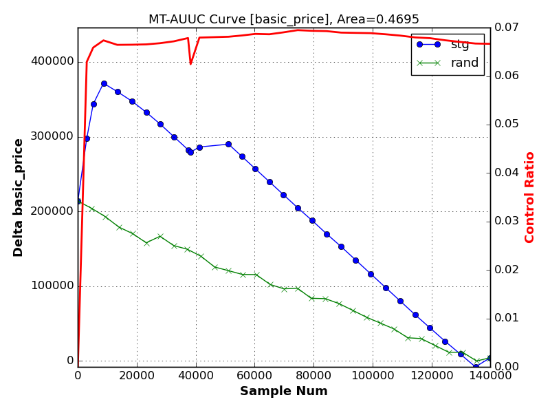
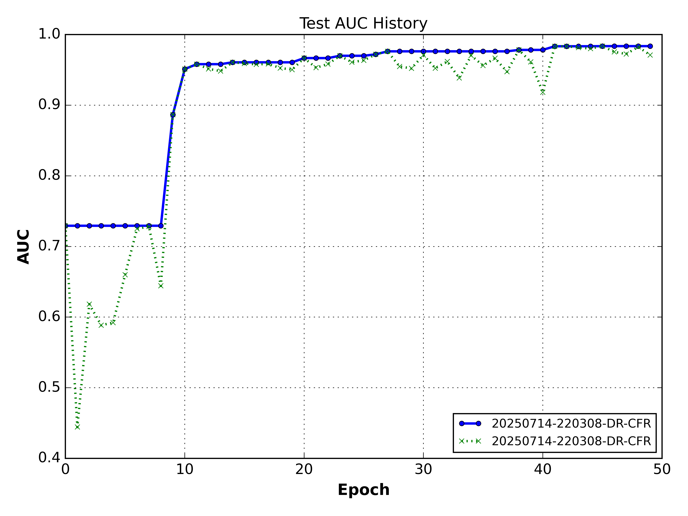

# 【LR25024】自营联盟端动态智能定价V1.0

[Cooper 原文](https://cooper.didichuxing.com/knowledge/2199610335356/2205053124235)

# 0. 编辑记录

| **日期** <br> | **修改内容** <br> |
| --- | --- |
| 2025-08-07 <br> | 初版文档发布 <br> |
| 2025-08-11 <br> | 修正 2.1 节中的约束公式 <br>修正错误的章节编号 <br>修改 2.3 中的模型概览图 <br>追加 4.4 节价格调整系数比例统计 <br>补充 2.4 节中的聚类方式 <br>追加 4.4 节中冒泡等数据的比例 <br>修正决策变量z的公式 <br> |
| 2025-08-12 <br> | 修正 2.1 节中的决策变量符号 <br>增加 1.1 节描述自营联盟端呼返和定价现状和未来规划 <br>增加 1.2 节描述自营在小猪端和联盟端的定价补贴策略对比 <br>补充 4.2 节中MT-AUUC指标的计算细节以及最高点和面积含义 <br> |
| 2025-08-19 <br> | 增加智能呼返和 <br> |

# 1. 背景概述

过去**人工调整端外定价水位**的方式存在以下弊端：

1. **调价前后缺乏有效的数据支撑**：~~调价前，部分渠道取不到表单内商家的实付/应付定价水位，无法实现精准定位~~~~；调价后，没有人群分流能力，难以科学评估策略效率。~~

	1. 当前其定价主要依赖人工，缺少人群分流能力，没有实验对照，难以确认其调价的效果

2. **灵活性差：**

	1. 人工调整无法精细化调价，最多只能分时分费项，而期望的动态智能定价是可以到订单维度精细化调价。

3. **分渠道联动性差**：难以从整体效率角度出发在每个时空颗粒度下通过定价去实现更优的供需匹配。

	1. 希望能够根据供需情况，去粗糙地给端外涨价，从而维护端外vs端内的价差，并使得自营GMV最大化。

	2. 等所有较大规模的渠道智能定价都上线后，希望将这个分端价差维护的能力实现智能化。

		1. 比如：捕捉到用户多平台比价，那就自动提高其他渠道的价格，让用户流动到端内或者流动到渠道费更低/有特殊合作的渠道

希望给出一种**动态的定价策略**，包括**涨价动作和降价动作****，目标是最大化GMV，作用在端外**

同时希望针对端外的**特价盒子**，**能复用已有的智能决策结果**，**同涨或者同降相同的比例，具备防倒挂能力**

该需求可按照端外现状，按建设顺序分为三期

**一期：滴滴端【小猪一口价 + 特价盒子】**

二期：腾讯出行【小猪特价，小猪打车】

三期：百度地图【小猪特价，小猪一口价】

由于联盟端在60城同时上线特价盒子和一口价，剩余73城仅上线一口价。

对于一口价&特价盒子均开城城市，最大化二者GMV总和；

**对于仅一口价开城城市，最大化一口价GMV，本LR文档方案主要针对仅有小猪一口价的73城**

**73城联盟端自营完单份额现状**为：

- 73城联盟端自营完单占花业务在联盟端总完单约 9% - 10%

- 73城联盟端自营完单占自营73城全渠道（PBD+联盟端+小猪端）完单约 19%

本需求主要解决 **调价前后缺少有效数据支撑** 以及 **灵活性差** 两个问题

## 1.1 联盟端自营呼返和定价现状及未来规划

目前因为联盟端毛利约束，基本没有C补。业务目前只在部分高定高补城市做了涨价加补。暂时目标是先做司机心智，不上动态智能定价。

后期会规划在其他非高定高补城市进行动态定价，建设冒泡维度判断该订单应该涨价or降价的能力。

## 1.2 ==自营在联盟端和小猪端的定价补贴策略对比==

由于联盟端并没有补贴策略，这里首先给定价策略的对比

|  <br> | **小猪端 【定价策略】** <br> | **联盟端（73城） 【定价策略】** <br> | **小猪端【呼返策略】** <br> |
| --- | --- | --- | --- |
| **目标** <br> | 最大化自营GMV <br> | 最大化自营GMV <br> | 最大化自营三品类完单 <br> |
| **涉及品类** <br> | 小猪特价、小猪打车、小猪特快 <br> | 小猪一口价 <br> | 小猪特价、小猪打车、小猪特快 <br> |
| **调价范围** <br> | 0pp - 24pp <br> | -4pp - 24pp <br> | 8折、85折、90折、95折、100折 <br> |
| **策略类型** <br> | 分时分里程字典 <br>【收益不明显，仍在迭代实验中】 <br> | 线上模型 + 规划求解字典 <br> | 线上模型 + 规划求解字典 <br> |
| **所需特征** <br> | 时间，里程段 <br> | 离在线特征 + P维度特征 <br> | 离在线特征 <br> |

这里小猪端和联盟端定价策略方案不同，其实是有先后顺序的背景：

- 我们首先在小猪端进行RCT实验，使用分时分里程字典进行涨价，发现效果不佳

	- 发现分时分里程涨价策略下，由于其粒度过于粗糙，其 CR 降低较多

	- 而CR的下降来源于仅盒子呼叫的增加，呼叫的自营车型数下降，较低的价格导致PK胜率下降以及司机取消数增加

- 然后开始在联盟端进行动态智能定价策略开发，便直接使用更加精细化的模型方案来实现

- 后续开始也推进小猪端的线上模型策略

## 1.3 自营智能呼返和动态智能定价的配合

小猪端内：智能呼返只会作用在 **高定高补** or **缺C** 的城市，动态智能定价作用在其他所有城市

小猪端外：由于毛利约束故没有呼返，只有定折在高定高补城市，动态智能定价作用在其他所有城市

> 高定高补城市：在API份额较高(>30%) 的城市，会仿照API的打法，使用高定高补，增加司机收入

# 2. 方法设计

## 2.0 符号定义

| **符号** <br> | **含义** <br> |
| :---: | :---: |
| $$N$$ <br> | 总冒泡数量 <br> |
| $$M$$ <br> | Treatment的种类数，包含涨价或者降价 <br> |
| $$p_i$$ <br> | 第 i 个冒泡的应付价格 <br> |
| $$bcr_{ij}$$ <br> | 第 i 个冒泡应用第 j 种调价幅度下的冒泡完单概率 <br> |
| $$bcr0_{i}$$ <br> | 第 i 个冒泡不调价的冒泡完单概率 <br> |
| $$[]^{ykj}, []^{tjbox}$$ <br> | 任意变量，ykj 上标表示小猪一口价，tjbox 上标表示特价盒子 <br> |
| $$z_{ij}$$ <br> | 决策变量，决定第 i 个冒泡是否应用第 j 种Treatment，1为应用，0为不应用 <br> |
| $$r_j$$ <br> | 第 j 种调整系数，可正可负 <br> |
| $$D$$ <br> | 整体完单降幅【为离散值：0.5%, 1%, 2%】 <br> |

## 2.1 问题形式化

最大化GMV，其优化目标可以写成以下形式：



| **约束名称** <br> | **形式化** <br> |
| :---: | :---: |
| **决策空间约束** <br> |  <br> |
| **完单降幅约束** <br> |  <br> |

**使用约束系数 D 来控制整体完单降幅**

**策略选型**：

- **基于人工规则：过于依赖先验知识，最不灵活**

- **分桶运筹规划：离散分桶会可能导致非全局最优，但是策略表现较为稳定**

- **Lambda 贪心：利用完单率约束，引入拉格朗日因子**

**一期我们选择分桶策略，根据经验，该类策略表现更加稳定**

## 2.3 模型设计

我们这里参考自营呼返的策略设计，使用了线性扩展的双塔DR-CFR



## 2.4 分桶方案

参考自营呼返策略的设计，我们使用基于模型输出聚类分桶的方案，具体流程为：

- 线上冒泡

- 获取实时特征，离线特征，进行特征拼接

- 调用模型，获取 BCR0 和 BCR 向量

- 基于 BCR0 和 BCR 向量，以及价格，获取三种类型下的聚类分桶结果【每一个类别都有10个中心，一共 10^3 种组合】

	- 这里我们使用Kmeans方法进行聚类

- 基于聚类分桶，查找字典，获取调价系数（该系数可正可负）

	- 该字典由离线规划求解得到，通过限制不同的完单降幅，生成不同的字典

> 由于价格特征在特价盒子和小猪一口价之间无法共享

> 我们出于一致性的考量，采用里程来代替价格

# 3. 特征工程

由于自营联盟端在先前并没有搭建离线和在线特征，我们这里首次搭建了联盟端自营的离在线特征

我们参考已有的特征工程，从离/在线特征，不同聚合粒度下搭建联盟端特征 【一共171个】：

- 随单特征

- 格子特征

	- 离/在线特征

	- 计数特征：去重冒泡数、发单数、应答数、完单数

	- 频率特征：冒泡发单率、竞争CR、冒泡完单率

- 城市特征

	- 离/在线特征

	- 计数特征：去重冒泡数、发单数、应答数、完单数

	- 频率特征：冒泡发单率、竞争CR、冒泡完单率

- 人维度特征

> 对于所有的实时特征，在工程侧做了2min的特征缓存，降低获取特征部分的压力

## 3.1 随单特征

| **特征名** <br> | **描述** <br> | **备注** <br> |
| --- | --- | --- |
| semi_hour_of_day <br> | 0\~47，第几个半小时 <br> | - <br> |
| hour <br> | 0\~23，小时数 <br> | - <br> |
| day_of_week <br> | 1\~7，星期数 <br> | 1 对应 星期一 <br>7 对应 星期日 <br> |
| city_id <br> | 0\~400，城市ID <br> | - <br> |
| start_dest_dis <br> | 起终点距离 <br> | 单位：米 <br> |
| eta <br> | 预估时间 <br> | 单位：秒 <br> |

> 这里不使用价格特征，原因是由于特价盒子和小猪一口价，其出价链路并行，无法获取另一方的价格

> 为了联盟端方案的一致性，暂不使用价格特征

> 这里我们使用里程特征来作为价格特征的替代

## 3.2 格子特征

| **流量渠道** <br> | 滴滴端 <br> |
| --- | --- |
| **运力商家** <br> | 小猪自营 <br> |
| **空间粒度** <br> | 格子（及周围1圈） <br> |
| **时间粒度** <br> | 5，15，30分钟 <br> |
| **对应hive表** <br> | **kflower_strategy.dm_zy_external_start_grid_features_di** <br>**kflower_strategy.dm_zy_external_dest_grid_features_di** <br> |
| **数梦任务链接** <br> | [https://studio.data.didichuxing.com/batch?projectId=1143&taskId=41707179](https://studio.data.didichuxing.com/batch?projectId=1143&taskId=41707179) <br>[https://studio.data.didichuxing.com/batch?projectId=1143&taskId=41863007](https://studio.data.didichuxing.com/batch?projectId=1143&taskId=41863007) <br> |

**实时特征**

- 计数特征：

	- 过去5，15，30分钟内，起点格子(及周围1圈)，在滴滴端小猪自营的去重冒泡数、发单数、应答数、完单数【自营】

	- 过去5，15，30分钟内，终点格子(及周围1圈)，在滴滴端小猪自营的去重冒泡数、发单数、应答数、完单数【自营】

- 频率特征：

	- 过去5，15，30分钟内，起点格子(及周围1圈)，在滴滴端小猪自营的冒泡发单率、竞争CR、冒泡完单率【自营】

	- 过去5，15，30分钟内，终点格子(及周围1圈)，在滴滴端小猪自营的冒泡发单率、竞争CR、冒泡完单率【自营】

其中，这些特征的统计方式参考下表：

| **名称** <br> | **统计方式** <br> |
| --- | --- |
| 自营冒泡发单率 <br> | 自营发单数 / 自营去重冒泡数 <br> |
| 自营竞争CR <br> | 自营完单数 / 自营发单数 <br> |
| 自营冒泡完单率 <br> | 自营完单数 / 自营去重冒泡数 <br> |

> 目前，在滴滴端，有些城市没有特价盒子，

> 当前，有特价盒子的，那么小猪特价必定在盒子内 (2025.04.28, 之后可能会有部分城市小猪特价退出特价盒子，1-2个月内不会改变)

> 没有特价盒子的少量城市，同时有小猪特价和小猪一口价

**离线特征**

- 计数特征：

	- 过去1，7，21天内，起点格子(及周围1圈)，在滴滴端小猪自营的人均冒泡数、人均发单数、人均应答数、人均完单数【自营】

	- 过去1，7，21天内，终点格子(及周围1圈)，在滴滴端小猪自营的人均冒泡数、人均发单数、人均应答数、人均完单数【自营】

- 频率特征：

	- 过去1，7，21天内，起点格子(及周围1圈)，在滴滴端小猪自营的冒泡发单率、竞争CR、冒泡完单率【自营】

	- 过去1，7，21天内，终点格子(及周围1圈)，在滴滴端小猪自营的冒泡发单率、竞争CR、冒泡完单率【自营】

> 此处的人均特征，都是除以去重乘客的总数

> 人均冒泡数 = 所有自营冒泡数 / 去重冒泡乘客数

> 人均发单数 = 所有自营发单数 / 去重发单乘客数

> 人均应答数 = 所有自营应答数 / 去重订单乘客数

> 人均完单数 = 所有自营完单数 / 去重订单乘客数

## 3.3 城市特征

| **流量渠道** <br> | 滴滴端 <br> |
| --- | --- |
| **运力商家** <br> | 小猪自营 <br> |
| **空间粒度** <br> | 城市 <br> |
| **时间粒度** <br> | \[实时\] 5，15，30分钟 <br>\[离线\] 过去1天 <br> |
| **对应hive表** <br> | **kflower_strategy.dm_zy_external_city_features_di** <br> |
| **数梦任务链接** <br> | [https://studio.data.didichuxing.com/batch?projectId=1143&taskId=41707239](https://studio.data.didichuxing.com/batch?projectId=1143&taskId=41707239) <br> |

**实时特征**

- 计数特征：

	- 冒泡城市，过去5，15，30分钟，滴滴端小猪自营的去重冒泡数，发单数，应答数，完单数【自营】

- 频率特征：

	- 冒泡城市，过去5，15，30分钟，滴滴端小猪自营的冒泡发单率，竞争CR，冒泡完单率【自营】

**离线特征**

- 计数特征：

	- 冒泡城市，过去一天， 滴滴端小猪自营的冒泡数，发单数，应答数，完单数 【自营】

- 频率特征：

	- 冒泡城市，过去一天，滴滴端小猪自营的冒泡发单率，竞争CR，冒泡完单率 【自营】

## 3.4 P维度特征

| **流量渠道** <br> | 滴滴端 <br> |
| --- | --- |
| **运力商家** <br> | 小猪自营 <br> |
| **空间粒度** <br> | - <br> |
| **时间粒度** <br> | \[离线\] 过去1,7,21天 <br> |
| **对应hive表** <br> | **kflower_strategy.dm_zy_external_bubble_basic_features_di** <br> |
| **数梦任务链接** <br> | [数梦任务链接](https://studio.data.didichuxing.com/batch?projectId=1143&taskId=41681001) <br> |

**离线特征**

- 计数特征：

	- 过去1，7，21天，滴滴端小猪自营的累计去重冒泡数，发单数，完单数，里程总和

- 频率特征：

	- 过去1，7，21天，滴滴端小猪自营的冒泡发单率，发单完单率

# 4. 实验结果

## 4.1 数据集准备

我们首先进行了RCT实验，为期两周，回收对应数据之后

根据第一周数据进行模型训练，根据后一周的数据进行离线测试

**数据集细节**

|  <br> | **时间周期** <br> | **样本数** <br> | **路径** <br> |
| --- | --- | --- | --- |
| 训练数据集 <br> | 6.26 - 7.02 <br> | 1500000 <br> | **\[c73\] /home/luban/ofs/kxp_workspace/zy_workspace/zy_data_collect/data/zy_external_inc_rct/2025-06-26_2025-07-02_c73_ext.csv** <br> <br> |
| 测试数据集 <br> | 7.03 - 7.09 <br> | 1500000 <br> | **\[c73\] /home/luban/ofs/kxp_workspace/zy_workspace/zy_data_collect/data/zy_external_inc_rct/2025-07-03_2025-07-09_c73_ext.csv** <br> |
| 字典生成数据集 \[c73\] <br> | 7.03 - 7.09 \[观察数据集\] <br> | 1500000 <br> | **\[c73\] /home/luban/ofs/kxp_workspace/zy_workspace/zy_data_collect/data/zy_external_inc_rct/obs_2025-07-03_2025-07-09_c73_ext.csv** <br> |

> 注1：在收集数据时，由于先前6月22日基础特征缺失，导致离线特征中的7天统计特征可能产生偏差，这里我们对所有离线特征都进行重新关联

> 注2：由于端外数据量较大，这里我们对冒泡数据进行了一次下采样，最终收集150w的数据

```Python
import os
import click
from loguru import logger
import yaml
from datetime import datetime
import pprint as pp
from rich.table import Table
from rich.console import Console
import numpy as np
import findspark
# Init Findspark
findspark.init()
#import warnings
#warnings.filterwarnings("ignore")
import pyspark


CITI_ID_MAP = {
    "c60": [8,26,25,58,42,308,74,32,157,33,160,254,50,85,60,153,156,19,34,134,38,13,22,138,29,81,16,301,9,143,300,83,6,12,35,44,305,14,24,62,15,133,18,37,21,136,306,5,36,86,11,3,20,87,23,2,84,17,47,82],
    "c73": [125,1,39,45,46,53,92,93,94,102,105,123,135,137,139,142,145,146,147,154,155,159,161,162,166,222,224,226,253,256,257,258,259,261,262,283,307,89,168,28,30,41,54,63,64,72,79,167,178,193,220,235,241,243,281,294,298,302,76,51,55,56,59,71,101,107,127,219,227,244,245,263,280]
}


COLLECT_DATA_SQL = """
WITH bubble_table AS (
    SELECT
        pid,
        city_id,
        trace_id,
        estimate_id,
        kflower_strategy.getgridid('GCJ02', 13, from_lng, from_lat) as start_grid_id,
        kflower_strategy.getgridid('GCJ02', 13, to_lng, to_lat) as dest_grid_id,
        dyna_smart_adjust_v3_exp_group_name as exp_group,
        pas_base_price as basic_price,
        get_json_object(external_smart_v3_model_feature, '$.by_order_feature_data') as order_feature_json,
        get_json_object(external_smart_v3_model_feature, '$.start_grid_feature_data') as start_grid_feature_json,
        get_json_object(external_smart_v3_model_feature, '$.dest_grid_feature_data') as dest_grid_feature_json,
        dt
    FROM
        kflower_marketplace.dwd_kf_trd_dups_partner_passenger_estimate_di
    WHERE
        dt between '{start_dt}' and '{end_dt}'
        and pid <> 0
        and product_id = 80
        and channel = "didi"
        and city_id in ({cities})
        and level_type in (102, 103, 105)
        and dyna_smart_adjust_v3_exp_group_name <> ''
    ORDER BY rand()
    LIMIT 1500000
),

offline_pid_feature_table AS (
    SELECT
        passenger_id as pid,
        dt,
        zy_1d_bubble_cnt as zy_external_dynamic_pricing_pid_features_zy_1d_bubble_cnt,
        zy_1d_call_cnt as zy_external_dynamic_pricing_pid_features_zy_1d_call_cnt,
        zy_1d_cr as zy_external_dynamic_pricing_pid_features_zy_1d_cr,
        zy_1d_distance as zy_external_dynamic_pricing_pid_features_zy_1d_distance,
        zy_1d_ecr as zy_external_dynamic_pricing_pid_features_zy_1d_ecr,
        zy_1d_finish_cnt as zy_external_dynamic_pricing_pid_features_zy_1d_finish_cnt,
        zy_21d_bubble_cnt as zy_external_dynamic_pricing_pid_features_zy_21d_bubble_cnt,
        zy_21d_call_cnt as zy_external_dynamic_pricing_pid_features_zy_21d_call_cnt,
        zy_21d_cr as zy_external_dynamic_pricing_pid_features_zy_21d_cr,
        zy_21d_distance as zy_external_dynamic_pricing_pid_features_zy_21d_distance,
        zy_21d_ecr as zy_external_dynamic_pricing_pid_features_zy_21d_ecr,
        zy_21d_finish_cnt as zy_external_dynamic_pricing_pid_features_zy_21d_finish_cnt,
        zy_7d_bubble_cnt as zy_external_dynamic_pricing_pid_features_zy_7d_bubble_cnt,
        zy_7d_call_cnt as zy_external_dynamic_pricing_pid_features_zy_7d_call_cnt,
        zy_7d_cr as zy_external_dynamic_pricing_pid_features_zy_7d_cr,
        zy_7d_distance as zy_external_dynamic_pricing_pid_features_zy_7d_distance,
        zy_7d_ecr as zy_external_dynamic_pricing_pid_features_zy_7d_ecr,
        zy_7d_finish_cnt as zy_external_dynamic_pricing_pid_features_zy_7d_finish_cnt
    FROM
        kflower_strategy.dm_zy_external_pid_features_di
    WHERE
        dt BETWEEN DATE_SUB('{start_dt}', 1) AND '{end_dt}'
),

offline_start_grid_feature AS (
    SELECT
        start_grid_id,
        dt,
        zy_start_grid_1d_bubble_cnt as zy_external_dynamic_pricing_start_grid_features_zy_1d_bubble_cnt,
        zy_start_grid_1d_call_cnt as zy_external_dynamic_pricing_start_grid_features_zy_1d_call_cnt,
        zy_start_grid_1d_finish_cnt as zy_external_dynamic_pricing_start_grid_features_zy_1d_finish_cnt,
        zy_start_grid_1d_answer_cnt as zy_external_dynamic_pricing_start_grid_features_zy_1d_answer_cnt,
        zy_start_grid_1d_distance as zy_external_dynamic_pricing_start_grid_features_zy_1d_distance,
        zy_start_grid_1d_ecr as zy_external_dynamic_pricing_start_grid_features_zy_1d_ecr,
        zy_start_grid_1d_cr as zy_external_dynamic_pricing_start_grid_features_zy_1d_cr,
        zy_start_grid_1d_bcr as zy_external_dynamic_pricing_start_grid_features_zy_1d_bcr,
        zy_start_grid_7d_bubble_cnt as zy_external_dynamic_pricing_start_grid_features_zy_7d_bubble_cnt,
        zy_start_grid_7d_call_cnt as zy_external_dynamic_pricing_start_grid_features_zy_7d_call_cnt,
        zy_start_grid_7d_finish_cnt as zy_external_dynamic_pricing_start_grid_features_zy_7d_finish_cnt,
        zy_start_grid_7d_answer_cnt as zy_external_dynamic_pricing_start_grid_features_zy_7d_answer_cnt,
        zy_start_grid_7d_distance as zy_external_dynamic_pricing_start_grid_features_zy_7d_distance,
        zy_start_grid_7d_ecr as zy_external_dynamic_pricing_start_grid_features_zy_7d_ecr,
        zy_start_grid_7d_cr as zy_external_dynamic_pricing_start_grid_features_zy_7d_cr,
        zy_start_grid_7d_bcr as zy_external_dynamic_pricing_start_grid_features_zy_7d_bcr,
        zy_start_grid_21d_bubble_cnt as zy_external_dynamic_pricing_start_grid_features_zy_21d_bubble_cnt,
        zy_start_grid_21d_call_cnt as zy_external_dynamic_pricing_start_grid_features_zy_21d_call_cnt,
        zy_start_grid_21d_finish_cnt as zy_external_dynamic_pricing_start_grid_features_zy_21d_finish_cnt,
        zy_start_grid_21d_answer_cnt as zy_external_dynamic_pricing_start_grid_features_zy_21d_answer_cnt,
        zy_start_grid_21d_distance as zy_external_dynamic_pricing_start_grid_features_zy_21d_distance,
        zy_start_grid_21d_ecr as zy_external_dynamic_pricing_start_grid_features_zy_21d_ecr,
        zy_start_grid_21d_cr as zy_external_dynamic_pricing_start_grid_features_zy_21d_cr,
        zy_start_grid_21d_bcr as zy_external_dynamic_pricing_start_grid_features_zy_21d_bcr
    FROM
        kflower_strategy.dm_zy_external_start_grid_features_di
    WHERE
        dt BETWEEN DATE_SUB('{start_dt}', 1)  AND '{end_dt}'
),

offline_dest_grid_feature AS (
    SELECT
        dest_grid_id,
        dt,
        zy_dest_grid_1d_bubble_cnt as zy_external_dynamic_pricing_dest_grid_features_zy_1d_bubble_cnt,
        zy_dest_grid_1d_call_cnt as zy_external_dynamic_pricing_dest_grid_features_zy_1d_call_cnt,
        zy_dest_grid_1d_finish_cnt as zy_external_dynamic_pricing_dest_grid_features_zy_1d_finish_cnt,
        zy_dest_grid_1d_answer_cnt as zy_external_dynamic_pricing_dest_grid_features_zy_1d_answer_cnt,
        zy_dest_grid_1d_distance as zy_external_dynamic_pricing_dest_grid_features_zy_1d_distance,
        zy_dest_grid_1d_ecr as zy_external_dynamic_pricing_dest_grid_features_zy_1d_ecr,
        zy_dest_grid_1d_cr as zy_external_dynamic_pricing_dest_grid_features_zy_1d_cr,
        zy_dest_grid_1d_bcr as zy_external_dynamic_pricing_dest_grid_features_zy_1d_bcr,
        zy_dest_grid_7d_bubble_cnt as zy_external_dynamic_pricing_dest_grid_features_zy_7d_bubble_cnt,
        zy_dest_grid_7d_call_cnt as zy_external_dynamic_pricing_dest_grid_features_zy_7d_call_cnt,
        zy_dest_grid_7d_finish_cnt as zy_external_dynamic_pricing_dest_grid_features_zy_7d_finish_cnt,
        zy_dest_grid_7d_answer_cnt as zy_external_dynamic_pricing_dest_grid_features_zy_7d_answer_cnt,
        zy_dest_grid_7d_distance as zy_external_dynamic_pricing_dest_grid_features_zy_7d_distance,
        zy_dest_grid_7d_ecr as zy_external_dynamic_pricing_dest_grid_features_zy_7d_ecr,
        zy_dest_grid_7d_cr as zy_external_dynamic_pricing_dest_grid_features_zy_7d_cr,
        zy_dest_grid_7d_bcr as zy_external_dynamic_pricing_dest_grid_features_zy_7d_bcr,
        zy_dest_grid_21d_bubble_cnt as zy_external_dynamic_pricing_dest_grid_features_zy_21d_bubble_cnt,
        zy_dest_grid_21d_call_cnt as zy_external_dynamic_pricing_dest_grid_features_zy_21d_call_cnt,
        zy_dest_grid_21d_finish_cnt as zy_external_dynamic_pricing_dest_grid_features_zy_21d_finish_cnt,
        zy_dest_grid_21d_answer_cnt as zy_external_dynamic_pricing_dest_grid_features_zy_21d_answer_cnt,
        zy_dest_grid_21d_distance as zy_external_dynamic_pricing_dest_grid_features_zy_21d_distance,
        zy_dest_grid_21d_ecr as zy_external_dynamic_pricing_dest_grid_features_zy_21d_ecr,
        zy_dest_grid_21d_cr as zy_external_dynamic_pricing_dest_grid_features_zy_21d_cr,
        zy_dest_grid_21d_bcr as zy_external_dynamic_pricing_dest_grid_features_zy_21d_bcr
    FROM
        kflower_strategy.dm_zy_external_dest_grid_features_di
    WHERE
        dt BETWEEN DATE_SUB('{start_dt}', 1)  AND '{end_dt}'
),

label_data AS (
    SELECT
        distinct trace_id,
        max(label_is_td_call_zy) as label_is_td_call_zy,
        max(label_is_td_answer_zy) as label_is_td_answer_zy,
        max(label_is_td_finish_zy) as label_is_td_finish_zy ,
        max(label_tjbox_is_td_call_zy) as label_tjbox_is_td_call_zy,
        max(label_tjbox_is_td_answer_zy) as label_tjbox_is_td_answer_zy,
        max(label_tjbox_is_td_finish_zy) as label_tjbox_is_td_finish_zy
    FROM 
        kflower_strategy.dm_zy_external_bubble_basic_features_di
    WHERE
        dt BETWEEN DATE_SUB('{start_dt}', 1) AND '{end_dt}'
    group by trace_id
)

SELECT
    bubble_table.trace_id,
    bubble_table.pid,
    get_json_object(order_feature_json, '$.semi_hour_of_day') as semi_hour_of_day,
    get_json_object(order_feature_json, '$.hour') as hour,
    get_json_object(order_feature_json, '$.day_of_week') as day_of_week,
    city_id,
    get_json_object(order_feature_json, '$.start_dest_dis') as start_dest_dis,
    get_json_object(order_feature_json, '$.eta') as eta,
    zy_external_dynamic_pricing_pid_features_zy_1d_bubble_cnt,
    zy_external_dynamic_pricing_pid_features_zy_1d_call_cnt,
    zy_external_dynamic_pricing_pid_features_zy_1d_cr,
    zy_external_dynamic_pricing_pid_features_zy_1d_distance,
    zy_external_dynamic_pricing_pid_features_zy_1d_ecr,
    zy_external_dynamic_pricing_pid_features_zy_1d_finish_cnt,
    zy_external_dynamic_pricing_pid_features_zy_21d_bubble_cnt,
    zy_external_dynamic_pricing_pid_features_zy_21d_call_cnt,
    zy_external_dynamic_pricing_pid_features_zy_21d_cr,
    zy_external_dynamic_pricing_pid_features_zy_21d_distance,
    zy_external_dynamic_pricing_pid_features_zy_21d_ecr,
    zy_external_dynamic_pricing_pid_features_zy_21d_finish_cnt,
    zy_external_dynamic_pricing_pid_features_zy_7d_bubble_cnt,
    zy_external_dynamic_pricing_pid_features_zy_7d_call_cnt,
    zy_external_dynamic_pricing_pid_features_zy_7d_cr,
    zy_external_dynamic_pricing_pid_features_zy_7d_distance,
    zy_external_dynamic_pricing_pid_features_zy_7d_ecr,
    zy_external_dynamic_pricing_pid_features_zy_7d_finish_cnt,
    get_json_object(start_grid_feature_json, '$.coord_last_5min_start_order_cnt_dd') as coord_last_5min_start_order_cnt_dd,
    get_json_object(start_grid_feature_json, '$.coord_last_5min_start_answer_order_cnt_dd') as coord_last_5min_start_answer_order_cnt_dd,
    get_json_object(start_grid_feature_json, '$.coord_last_5min_start_order_finish_charge_cnt_dd') as coord_last_5min_start_order_finish_charge_cnt_dd,
    get_json_object(start_grid_feature_json, '$.coord_last_5min_start_unique_user_bubble_dd') as coord_last_5min_start_unique_user_bubble_dd,
    get_json_object(start_grid_feature_json, '$.coord_last_5min_start_cr_dd') as coord_last_5min_start_cr_dd,
    get_json_object(start_grid_feature_json, '$.coord_last_5min_start_ecr_dd') as coord_last_5min_start_ecr_dd,
    get_json_object(start_grid_feature_json, '$.coord_last_5min_start_bcr_dd') as coord_last_5min_start_bcr_dd,
    get_json_object(start_grid_feature_json, '$.coord_1circle_last_5min_start_order_cnt_dd') as coord_1circle_last_5min_start_order_cnt_dd,
    get_json_object(start_grid_feature_json, '$.coord_1circle_last_5min_start_answer_order_cnt_dd') as coord_1circle_last_5min_start_answer_order_cnt_dd,
    get_json_object(start_grid_feature_json, '$.coord_1circle_last_5min_start_order_finish_charge_cnt_dd') as coord_1circle_last_5min_start_order_finish_charge_cnt_dd,
    get_json_object(start_grid_feature_json, '$.coord_1circle_last_5min_start_unique_user_bubble_dd') as coord_1circle_last_5min_start_unique_user_bubble_dd,
    get_json_object(start_grid_feature_json, '$.coord_1circle_last_5min_start_cr_dd') as coord_1circle_last_5min_start_cr_dd,
    get_json_object(start_grid_feature_json, '$.coord_1circle_last_5min_start_ecr_dd') as coord_1circle_last_5min_start_ecr_dd,
    get_json_object(start_grid_feature_json, '$.coord_1circle_last_5min_start_bcr_dd') as coord_1circle_last_5min_start_bcr_dd,
    get_json_object(start_grid_feature_json, '$.coord_last_15min_start_order_cnt_dd') as coord_last_15min_start_order_cnt_dd,
    get_json_object(start_grid_feature_json, '$.coord_last_15min_start_answer_order_cnt_dd') as coord_last_15min_start_answer_order_cnt_dd,
    get_json_object(start_grid_feature_json, '$.coord_last_15min_start_order_finish_charge_cnt_dd') as coord_last_15min_start_order_finish_charge_cnt_dd,
    get_json_object(start_grid_feature_json, '$.coord_last_15min_start_unique_user_bubble_dd') as coord_last_15min_start_unique_user_bubble_dd,
    get_json_object(start_grid_feature_json, '$.coord_last_15min_start_cr_dd') as coord_last_15min_start_cr_dd,
    get_json_object(start_grid_feature_json, '$.coord_last_15min_start_ecr_dd') as coord_last_15min_start_ecr_dd,
    get_json_object(start_grid_feature_json, '$.coord_last_15min_start_bcr_dd') as coord_last_15min_start_bcr_dd,
    get_json_object(start_grid_feature_json, '$.coord_1circle_last_15min_start_order_cnt_dd') as coord_1circle_last_15min_start_order_cnt_dd,
    get_json_object(start_grid_feature_json, '$.coord_1circle_last_15min_start_answer_order_cnt_dd') as coord_1circle_last_15min_start_answer_order_cnt_dd,
    get_json_object(start_grid_feature_json, '$.coord_1circle_last_15min_start_order_finish_charge_cnt_dd') as coord_1circle_last_15min_start_order_finish_charge_cnt_dd,
    get_json_object(start_grid_feature_json, '$.coord_1circle_last_15min_start_unique_user_bubble_dd') as coord_1circle_last_15min_start_unique_user_bubble_dd,
    get_json_object(start_grid_feature_json, '$.coord_1circle_last_15min_start_cr_dd') as coord_1circle_last_15min_start_cr_dd,
    get_json_object(start_grid_feature_json, '$.coord_1circle_last_15min_start_ecr_dd') as coord_1circle_last_15min_start_ecr_dd,
    get_json_object(start_grid_feature_json, '$.coord_1circle_last_15min_start_bcr_dd') as coord_1circle_last_15min_start_bcr_dd,
    get_json_object(start_grid_feature_json, '$.coord_last_30min_start_unique_user_bubble_dd') as coord_last_30min_start_unique_user_bubble_dd,
    get_json_object(start_grid_feature_json, '$.coord_last_30min_start_order_finish_charge_cnt_dd') as coord_last_30min_start_order_finish_charge_cnt_dd,
    get_json_object(start_grid_feature_json, '$.coord_last_30min_start_answer_order_cnt_dd') as coord_last_30min_start_answer_order_cnt_dd,
    get_json_object(start_grid_feature_json, '$.coord_last_30min_start_order_cnt_dd') as coord_last_30min_start_order_cnt_dd,
    get_json_object(start_grid_feature_json, '$.coord_last_30min_start_cr_dd') as coord_last_30min_start_cr_dd,
    get_json_object(start_grid_feature_json, '$.coord_last_30min_start_ecr_dd') as coord_last_30min_start_ecr_dd,
    get_json_object(start_grid_feature_json, '$.coord_last_30min_start_bcr_dd') as coord_last_30min_start_bcr_dd,
    get_json_object(start_grid_feature_json, '$.coord_1circle_last_30min_start_unique_user_bubble_dd') as coord_1circle_last_30min_start_unique_user_bubble_dd,
    get_json_object(start_grid_feature_json, '$.coord_1circle_last_30min_start_order_finish_charge_cnt_dd') as coord_1circle_last_30min_start_order_finish_charge_cnt_dd,
    get_json_object(start_grid_feature_json, '$.coord_1circle_last_30min_start_answer_order_cnt_dd') as coord_1circle_last_30min_start_answer_order_cnt_dd,
    get_json_object(start_grid_feature_json, '$.coord_1circle_last_30min_start_order_cnt_dd') as coord_1circle_last_30min_start_order_cnt_dd,
    get_json_object(start_grid_feature_json, '$.coord_1circle_last_30min_start_cr_dd') as coord_1circle_last_30min_start_cr_dd,
    get_json_object(start_grid_feature_json, '$.coord_1circle_last_30min_start_ecr_dd') as coord_1circle_last_30min_start_ecr_dd,
    get_json_object(start_grid_feature_json, '$.coord_1circle_last_30min_start_bcr_dd') as coord_1circle_last_30min_start_bcr_dd,
    zy_external_dynamic_pricing_start_grid_features_zy_1d_bubble_cnt,
    zy_external_dynamic_pricing_start_grid_features_zy_1d_call_cnt,
    zy_external_dynamic_pricing_start_grid_features_zy_1d_finish_cnt,
    zy_external_dynamic_pricing_start_grid_features_zy_1d_answer_cnt,
    zy_external_dynamic_pricing_start_grid_features_zy_1d_distance,
    zy_external_dynamic_pricing_start_grid_features_zy_1d_ecr,
    zy_external_dynamic_pricing_start_grid_features_zy_1d_cr,
    zy_external_dynamic_pricing_start_grid_features_zy_1d_bcr,
    zy_external_dynamic_pricing_start_grid_features_zy_7d_bubble_cnt,
    zy_external_dynamic_pricing_start_grid_features_zy_7d_call_cnt,
    zy_external_dynamic_pricing_start_grid_features_zy_7d_finish_cnt,
    zy_external_dynamic_pricing_start_grid_features_zy_7d_answer_cnt,
    zy_external_dynamic_pricing_start_grid_features_zy_7d_distance,
    zy_external_dynamic_pricing_start_grid_features_zy_7d_ecr,
    zy_external_dynamic_pricing_start_grid_features_zy_7d_cr,
    zy_external_dynamic_pricing_start_grid_features_zy_7d_bcr,
    zy_external_dynamic_pricing_start_grid_features_zy_21d_bubble_cnt,
    zy_external_dynamic_pricing_start_grid_features_zy_21d_call_cnt,
    zy_external_dynamic_pricing_start_grid_features_zy_21d_finish_cnt,
    zy_external_dynamic_pricing_start_grid_features_zy_21d_answer_cnt,
    zy_external_dynamic_pricing_start_grid_features_zy_21d_distance,
    zy_external_dynamic_pricing_start_grid_features_zy_21d_ecr,
    zy_external_dynamic_pricing_start_grid_features_zy_21d_cr,
    zy_external_dynamic_pricing_start_grid_features_zy_21d_bcr,
    get_json_object(start_grid_feature_json, '$.zy_external_dynamic_pricing_city_features_zy_city_1d_bubble_cnt') as zy_external_dynamic_pricing_city_features_zy_city_1d_bubble_cnt,
    get_json_object(start_grid_feature_json, '$.zy_external_dynamic_pricing_city_features_zy_city_1d_call_cnt') as zy_external_dynamic_pricing_city_features_zy_city_1d_call_cnt,
    get_json_object(start_grid_feature_json, '$.zy_external_dynamic_pricing_city_features_zy_city_1d_finish_cnt') as zy_external_dynamic_pricing_city_features_zy_city_1d_finish_cnt,
    get_json_object(start_grid_feature_json, '$.zy_external_dynamic_pricing_city_features_zy_city_1d_ecr') as zy_external_dynamic_pricing_city_features_zy_city_1d_ecr,
    get_json_object(start_grid_feature_json, '$.zy_external_dynamic_pricing_city_features_zy_city_1d_cr') as zy_external_dynamic_pricing_city_features_zy_city_1d_cr,
    get_json_object(start_grid_feature_json, '$.zy_external_dynamic_pricing_city_features_zy_city_1d_bcr') as zy_external_dynamic_pricing_city_features_zy_city_1d_bcr,
    get_json_object(dest_grid_feature_json, '$.city_last_5min_unique_user_bubble_dd') as city_last_5min_unique_user_bubble_dd,
    get_json_object(dest_grid_feature_json, '$.city_last_5min_create_order_cnt_dd') as city_last_5min_create_order_cnt_dd,
    get_json_object(dest_grid_feature_json, '$.city_last_5min_answer_order_cnt_dd') as city_last_5min_answer_order_cnt_dd,
    get_json_object(dest_grid_feature_json, '$.city_last_5min_finish_order_cnt_dd') as city_last_5min_finish_order_cnt_dd,
    get_json_object(dest_grid_feature_json, '$.city_last_15min_unique_user_bubble_dd') as city_last_15min_unique_user_bubble_dd,
    get_json_object(dest_grid_feature_json, '$.city_last_15min_create_order_cnt_dd') as city_last_15min_create_order_cnt_dd,
    get_json_object(dest_grid_feature_json, '$.city_last_15min_answer_order_cnt_dd') as city_last_15min_answer_order_cnt_dd,
    get_json_object(dest_grid_feature_json, '$.city_last_15min_finish_order_cnt_dd') as city_last_15min_finish_order_cnt_dd,
    get_json_object(dest_grid_feature_json, '$.city_last_30min_unique_user_bubble_dd') as city_last_30min_unique_user_bubble_dd,
    get_json_object(dest_grid_feature_json, '$.city_last_30min_create_order_cnt_dd') as city_last_30min_create_order_cnt_dd,
    get_json_object(dest_grid_feature_json, '$.city_last_30min_answer_order_cnt_dd') as city_last_30min_answer_order_cnt_dd,
    get_json_object(dest_grid_feature_json, '$.city_last_30min_finish_order_cnt_dd') as city_last_30min_finish_order_cnt_dd,
    get_json_object(dest_grid_feature_json, '$.coord_last_5min_end_order_cnt_dd') as coord_last_5min_end_order_cnt_dd,
    get_json_object(dest_grid_feature_json, '$.coord_last_5min_end_answer_order_cnt_dd') as coord_last_5min_end_answer_order_cnt_dd,
    get_json_object(dest_grid_feature_json, '$.coord_last_5min_end_order_finish_charge_cnt_dd') as coord_last_5min_end_order_finish_charge_cnt_dd,
    get_json_object(dest_grid_feature_json, '$.coord_last_5min_end_unique_user_bubble_dd') as coord_last_5min_end_unique_user_bubble_dd,
    get_json_object(dest_grid_feature_json, '$.coord_last_5min_end_cr_dd') as coord_last_5min_end_cr_dd,
    get_json_object(dest_grid_feature_json, '$.coord_last_5min_end_ecr_dd') as coord_last_5min_end_ecr_dd,
    get_json_object(dest_grid_feature_json, '$.coord_last_5min_end_bcr_dd') as coord_last_5min_end_bcr_dd,
    get_json_object(dest_grid_feature_json, '$.coord_1circle_last_5min_end_order_cnt_dd') as coord_1circle_last_5min_end_order_cnt_dd,
    get_json_object(dest_grid_feature_json, '$.coord_1circle_last_5min_end_answer_order_cnt_dd') as coord_1circle_last_5min_end_answer_order_cnt_dd,
    get_json_object(dest_grid_feature_json, '$.coord_1circle_last_5min_end_order_finish_charge_cnt_dd') as coord_1circle_last_5min_end_order_finish_charge_cnt_dd,
    get_json_object(dest_grid_feature_json, '$.coord_1circle_last_5min_end_unique_user_bubble_dd') as coord_1circle_last_5min_end_unique_user_bubble_dd,
    get_json_object(dest_grid_feature_json, '$.coord_1circle_last_5min_cr_dd') as coord_1circle_last_5min_cr_dd,
    get_json_object(dest_grid_feature_json, '$.coord_1circle_last_5min_ecr_dd') as coord_1circle_last_5min_ecr_dd,
    get_json_object(dest_grid_feature_json, '$.coord_1circle_last_5min_bcr_dd') as coord_1circle_last_5min_bcr_dd,
    get_json_object(dest_grid_feature_json, '$.coord_last_15min_end_order_cnt_dd') as coord_last_15min_end_order_cnt_dd,
    get_json_object(dest_grid_feature_json, '$.coord_last_15min_end_answer_order_cnt_dd') as coord_last_15min_end_answer_order_cnt_dd,
    get_json_object(dest_grid_feature_json, '$.coord_last_15min_end_order_finish_charge_cnt_dd') as coord_last_15min_end_order_finish_charge_cnt_dd,
    get_json_object(dest_grid_feature_json, '$.coord_last_15min_end_unique_user_bubble_dd') as coord_last_15min_end_unique_user_bubble_dd,
    get_json_object(dest_grid_feature_json, '$.coord_last_15min_end_cr_dd') as coord_last_15min_end_cr_dd,
    get_json_object(dest_grid_feature_json, '$.coord_last_15min_end_ecr_dd') as coord_last_15min_end_ecr_dd,
    get_json_object(dest_grid_feature_json, '$.coord_last_15min_end_bcr_dd') as coord_last_15min_end_bcr_dd,
    get_json_object(dest_grid_feature_json, '$.coord_1circle_last_15min_end_order_cnt_dd') as coord_1circle_last_15min_end_order_cnt_dd,
    get_json_object(dest_grid_feature_json, '$.coord_1circle_last_15min_end_answer_order_cnt_dd') as coord_1circle_last_15min_end_answer_order_cnt_dd,
    get_json_object(dest_grid_feature_json, '$.coord_1circle_last_15min_end_order_finish_charge_cnt_dd') as coord_1circle_last_15min_end_order_finish_charge_cnt_dd,
    get_json_object(dest_grid_feature_json, '$.coord_1circle_last_15min_end_unique_user_bubble_dd') as coord_1circle_last_15min_end_unique_user_bubble_dd,
    get_json_object(dest_grid_feature_json, '$.coord_1circle_last_15min_cr_dd') as coord_1circle_last_15min_cr_dd,
    get_json_object(dest_grid_feature_json, '$.coord_1circle_last_15min_ecr_dd') as coord_1circle_last_15min_ecr_dd,
    get_json_object(dest_grid_feature_json, '$.coord_1circle_last_15min_bcr_dd') as coord_1circle_last_15min_bcr_dd,
    get_json_object(dest_grid_feature_json, '$.coord_last_30min_end_unique_user_bubble_dd') as coord_last_30min_end_unique_user_bubble_dd,
    get_json_object(dest_grid_feature_json, '$.coord_last_30min_end_order_finish_charge_cnt_dd') as coord_last_30min_end_order_finish_charge_cnt_dd,
    get_json_object(dest_grid_feature_json, '$.coord_last_30min_end_answer_order_cnt_dd') as coord_last_30min_end_answer_order_cnt_dd,
    get_json_object(dest_grid_feature_json, '$.coord_last_30min_end_order_cnt_dd') as coord_last_30min_end_order_cnt_dd,
    get_json_object(dest_grid_feature_json, '$.coord_last_30min_end_cr_dd') as coord_last_30min_end_cr_dd,
    get_json_object(dest_grid_feature_json, '$.coord_last_30min_end_ecr_dd') as coord_last_30min_end_ecr_dd,
    get_json_object(dest_grid_feature_json, '$.coord_last_30min_end_bcr_dd') as coord_last_30min_end_bcr_dd,
    get_json_object(dest_grid_feature_json, '$.coord_1circle_last_30min_end_unique_user_bubble_dd') as coord_1circle_last_30min_end_unique_user_bubble_dd,
    get_json_object(dest_grid_feature_json, '$.coord_1circle_last_30min_end_order_finish_charge_cnt_dd') as coord_1circle_last_30min_end_order_finish_charge_cnt_dd,
    get_json_object(dest_grid_feature_json, '$.coord_1circle_last_30min_end_answer_order_cnt_dd') as coord_1circle_last_30min_end_answer_order_cnt_dd,
    get_json_object(dest_grid_feature_json, '$.coord_1circle_last_30min_end_order_cnt_dd') as coord_1circle_last_30min_end_order_cnt_dd,
    get_json_object(dest_grid_feature_json, '$.coord_1circle_last_30min_cr_dd') as coord_1circle_last_30min_cr_dd,
    get_json_object(dest_grid_feature_json, '$.coord_1circle_last_30min_ecr_dd') as coord_1circle_last_30min_ecr_dd,
    get_json_object(dest_grid_feature_json, '$.coord_1circle_last_30min_bcr_dd') as coord_1circle_last_30min_bcr_dd,
    zy_external_dynamic_pricing_dest_grid_features_zy_1d_bubble_cnt,
    zy_external_dynamic_pricing_dest_grid_features_zy_1d_call_cnt,
    zy_external_dynamic_pricing_dest_grid_features_zy_1d_answer_cnt,
    zy_external_dynamic_pricing_dest_grid_features_zy_1d_finish_cnt,
    zy_external_dynamic_pricing_dest_grid_features_zy_1d_ecr,
    zy_external_dynamic_pricing_dest_grid_features_zy_1d_cr,
    zy_external_dynamic_pricing_dest_grid_features_zy_1d_bcr,
    zy_external_dynamic_pricing_dest_grid_features_zy_7d_bubble_cnt,
    zy_external_dynamic_pricing_dest_grid_features_zy_7d_call_cnt,
    zy_external_dynamic_pricing_dest_grid_features_zy_7d_answer_cnt,
    zy_external_dynamic_pricing_dest_grid_features_zy_7d_finish_cnt,
    zy_external_dynamic_pricing_dest_grid_features_zy_7d_ecr,
    zy_external_dynamic_pricing_dest_grid_features_zy_7d_cr,
    zy_external_dynamic_pricing_dest_grid_features_zy_7d_bcr,
    zy_external_dynamic_pricing_dest_grid_features_zy_21d_bubble_cnt,
    zy_external_dynamic_pricing_dest_grid_features_zy_21d_call_cnt,
    zy_external_dynamic_pricing_dest_grid_features_zy_21d_answer_cnt,
    zy_external_dynamic_pricing_dest_grid_features_zy_21d_finish_cnt,
    zy_external_dynamic_pricing_dest_grid_features_zy_21d_ecr,
    zy_external_dynamic_pricing_dest_grid_features_zy_21d_cr,
    zy_external_dynamic_pricing_dest_grid_features_zy_21d_bcr,
    basic_price,
    label_is_td_call_zy,
    label_is_td_answer_zy,
    label_is_td_finish_zy ,
    label_tjbox_is_td_call_zy,
    label_tjbox_is_td_answer_zy,
    label_tjbox_is_td_finish_zy
FROM
    bubble_table 
        LEFT JOIN offline_pid_feature_table 
            ON bubble_table.pid = offline_pid_feature_table.pid
                AND bubble_table.dt = offline_pid_feature_table.dt
        LEFT JOIN offline_start_grid_feature 
            ON bubble_table.start_grid_id = offline_start_grid_feature.start_grid_id
                AND bubble_table.dt = offline_start_grid_feature.dt
        LEFT JOIN offline_dest_grid_feature 
            ON bubble_table.dest_grid_id = offline_dest_grid_feature.dest_grid_id
                AND bubble_table.dt = offline_dest_grid_feature.dt
        LEFT JOIN label_data
            ON bubble_table.trace_id = label_data.trace_id
"""

def init_spark():
    # Init spark
    spark = pyspark.sql.SparkSession.builder.appName("myapp").config(
        conf=pyspark.SparkConf().setAll(
            [
                ("spark.yarn.queue", "root.kflower_strategy_prod"),
                ("spark.executor.memory", "16g"),
                ("spark.driver.memory", "16g"),
                ("spark.driver.maxResultSize", "16g"),
                {"spark.executor.memoryOverhead", "4096"}
                # ("spark.sql.execution.arrow.enabled", "true"),
                # ("spark.sql.execution.arrow.pyspark.enabled", "true")
            ]
        )
    ).enableHiveSupport().getOrCreate()
    return spark


def print_conf_table(conf):
    # Print conf table
    table = Table(title="Data Collect Conf")
    table.add_column("Key", justify="left", style="cyan")
    table.add_column("Value", justify="left", style="green")
    for key, value in conf.items():
        table.add_row(key, value if type(value) == str else str(value))
    console = Console()
    console.print(table)

@click.command()
@click.option("-c", "--conf_path", help="Conf file path")
@click.option("-g", "--group", type=click.Choice(['c60', 'c73']))
def collect_data(conf_path, group):
    if not os.path.exists(conf_path):
        logger.error(f"Path not found. [{conf_path}]")
    with open(conf_path, "r") as f:
        conf = yaml.safe_load(f)
    print_conf_table(conf)
    start_dt = conf.get("start_dt", datetime.now().strftime("%Y-%m-%d"))
    end_dt = conf.get("end_dt", datetime.now().strftime("%Y-%m-%d"))
    sql = COLLECT_DATA_SQL.format(start_dt=start_dt, end_dt=end_dt, cities=",".join(map(str, CITI_ID_MAP[group])))
    save_name = conf.get("save_name", "tmp_save")
    logger.info(f"SQL: {sql}")
    spark = init_spark()
    df = spark.sql(sql).cache().toPandas()
    # Mkdir for output
    output_dir = f"{conf['output_dir']}/{save_name}"
    os.makedirs(output_dir, exist_ok=True)

    df.to_csv(f"{output_dir}/{start_dt}_{end_dt}_{group}_ext.csv", header=True, index=False, sep=",")
    logger.success(f"Save to csv: {output_dir}/{start_dt}_{end_dt}_ext.csv")
    spark.stop()

if __name__ == "__main__":
    collect_data()
```

***由于luban机器上执行pyspark拉取数据不稳定，尝试多次之后只成功拉取了3天的数据***

***这里，我们尝试在数梦任务上对hdfs进行写入，然后使用 hadoop get 在luban上获取***

## 4.2 离线实验

我们选择 DR-CFR 进行离线评测，评估指标使用 MT-AUUC【这是由于涨价本身并没有COST，因此这里选择对MT-AUCC进行改造】

和MT-AUCC区别在于：

- 没有边际ROI计算

- 不需要计算凸包

- 按照业务指标的Uplift进行降序排序 【也就是按照gmv预测值的提升进行排序】

	- 对应每一个冒泡$$b$$，计算其在第 i 种调价系数 r_i 下的gmv预测值$$g_i = BCR_i \cdot p_{b} \cdot (1 + r_i)$$

	- 其中$$p_b$$代表冒泡的基础价格

	- 计算其gmv的Uplfit，即$$\Delta g_i = g_i - g_0 = g_i -BCR0_i\cdot p_b$$

	- 构造$$M$$个$$(b, \Delta g_i)$$ 冒泡-gmv提升值 的二元组，其中$$M$$表示调价系数的种类数

- 截取不同的分位点，选取 Uplift 降序下，前$$k$$个二元组

	- 选取真实发生的二元组，统计和空白组的 gmv 的差（先用均值做差，然后缩放到实验组样本数）

	- $$y(k) = (\frac{G^T(k)}{N^T(k)} - \frac{G^C(k)}{N^C(k)})(N^T(k) + N^C(k))$$

	- 其中$$k$$表示前$$k$$个二元组，$$G^T(k)$$表示对应前$$k$$个二元组中，Treatment恰好是真实Treatment 的样本的GMV的和

- 底部是随机排序绘制的线

最高点：

- 纵坐标代表在模型预测提升值排序下所能达到的最大真实GMV提升

- 横坐标代表对应最大真实GMV提升的分位点

面积（和随机线的面积之差）：

- 表示在模型Uplift排序下，在不同分位点上的相对随机排序，累计的真实GMV提升

	- 计算时会对X和Y坐标进行缩放

| **MT-AUUC Curve** <br> | **AUC History** <br> |
| :---: | :---: |
|  <br> |  <br> |

## 4.3 双周在线实验

我们进行了两次不同随机种子的实验，每次维持一周

| **分流方式** <br> | 乘客ID分流 <br> |
| --- | --- |
| **实验流量** <br> | 5% <br> |
| **覆盖城市** <br> | 联盟端仅小猪一口价73城 <br> |
| **覆盖品类** <br> | 小猪一口价 <br> |
| **实验周期** <br> | 2025-07-18 00:00:00 ～ 2025-07-24 23:59:59 <br>2025-07-29 00:00:00 ～ 2025-08-04 23:59:59 <br> |

| **策略名** <br> | **乘客数** <br> | **自营GMV** <br> | **自营完单** <br> | **自营呼叫** <br> | **自营ECR** <br> | **自营CR** <br> | **自营ASP** <br> | **联盟端整体完单** <br> | **联盟端整体GMV** <br> |
| :---: | :---: | :---: | :---: | :---: | :---: | :---: | :---: | :---: | :---: |
| **2025-07-18 ～ 2025-07-24** <br> |
| 空白组 <br> | 16858115 <br> | 0.2373 <br> | 0.0168 <br> | 0.2440 <br> | 0.0850 <br> | 0.0688 <br> | 14.12 <br> | 0.0592 <br> | 1.5154 <br> |
| 策略组 <br>\[DR-CFR\] <br> | 886900 <br> | **0.2550** <br>**\[+7.49%\]** <br> | **0.0183** <br>**\[+8.87%\]** <br> | **0.2624** <br>**\[+7.55%\]** <br> | **0.0914** <br>\[+7.44%\] <br> | **0.0697** <br>\[+1.22%\] <br> | 13.94 <br>\[-1.27%\] <br> | 0.0610 <br>\[+3.06%\] <br> | 1.5334 <br>\[+1.18%\] <br> |
| **2025-07-29 ～ 2025-08-04** <br> |
| 空白组 <br> | 17279789 <br> | 0.2159 <br> | 0.0147 <br> | 0.2559 <br> | 0.0931 <br> | 0.0575 <br> | 14.69 <br> | 0.0568 <br> | 1.5435 <br> |
| 策略组 <br>\[DR-CFR\] <br> | 910349 <br> | **0.2336** <br>**\[+8.15%\]** <br> | **0.0163** <br>**\[+11.36%\]** <br> | **0.2742** <br>**\[+7.16%\]** <br> | **0.0996** <br>\[+7.00%\] <br> | **0.0597** <br>\[+3.92%\] <br> | 14.26 <br>\[-2.88%\] <br> | **0.0584** <br>\[+2.73%\] <br> | **1.5587** <br>\[+0.98%\] <br> |

平均来看：

1. **自营整体GMV显著+7.82%，完单显著+10.12%，呼叫显著 +7.36%**

2. **平台整体完单显著+2.89%，平台GMV不显著+1.08%**

## 4.4 价格调整系数比例统计

我们统计了冒泡和完单的价格调整系数的比例，该比例一定程度反映了策略涨/降价的分布，以及策略的准确性

\[2025-07-18 至 2025-07-24\]

| **调价系数** <br> | **-4%** <br> | **0%** <br> | **+8%** <br> | **+24%** <br> | **Total ** <br> | **Control** <br> |
| --- | :---: | :---: | :---: | :---: | :---: | :---: |
| **去重冒泡** <br> | 98%(2077637) <br> | 1.4%(30590) <br> | 0.1%(1598) <br> | 0.4%(7660) <br> | 2117485 <br> | 47466967 <br> |
| **发单** <br> | 91%(103458) <br> | 6.7%(7676) <br> | ==0.5%(610)== <br> | 1.8%(1790) <br> | 113534 <br> | 1989524 <br> |
| **完单** <br> | 92% (8866) <br> | 2.6% (254) <br> | 1.3% (123) <br> | 4.0% (394) <br> | 9637 <br> | 172132 <br> |

> 注：这里去重冒泡口径下会出现同个去重trace_id 下有多个调价系数的结果，去除了重复的部分，所以整体求和偏小

> 当前冒泡去重ID的条件是：10分钟内，起点距离不超过1公里，终点距离不超过1公里

> 2025-08-11: 这里重复原因排查到是由于工程落日志时对命中缓存的冒泡没有落缓存结果导致的，该去重冒泡结果仅供参考，后续会更新对应数据 

【修正口径后的统计】

| **调价系数** <br> | **-4%** <br> | **+8%** <br> | **+24%** <br> | **Total ** <br> | **Control** <br> |
| --- | :---: | :---: | :---: | :---: | :---: |
| **去重冒泡** <br> | 99.6%(2515870) <br> | 0.1%(1734) <br> | 0.3%(7800) <br> | 2525404 <br> | 47938128 <br> |
| **发单** <br> | 98%(137136) <br> | ==0.4%(583)== <br> | 1.5%(2057) <br> | 139776 <br> | 2438369 <br> |
| **完单** <br> | 95% (11181) <br> | 1.2% (137) <br> | 3.7%(437) <br> | 11755 <br> | 208874 <br> |
| **ECR** <br> | 0.0545 <br> | **0.****3362** <br> | **0.2637** <br> | 0.0553 <br> | 0.0508 <br> |
| **CR** <br> | 0.0815 <br> | **0.2349** <br> | **0.2124** <br> | 0.0841 <br> | 0.0856 <br> |

		

# 5. FAQ

# 6. 未来规划

确定做：

- 继续在60城上进行动态智能定价策略的实验

- 进行模型迭代更新

- 在73城进行逐步扩量，按照以下时间节点：

	- 0812: 30%

	- 0819: 60%

	- 0826: 90%

不确定做：

- 考虑更多特征，比如乘客的时序行为特征、动调特征、天气情况

# 7. 目标&约束

## 7.1 策略目标

- 小猪自营联盟端GMV显著提升

## 7.2 约束指标项

- 完单降幅约束符合业务对各城市要求，具体作为策略字典中的key，对不同城市的约束包括：完单降幅不超过 0%、0.5%、1%。

# 8. 推全情况与现状追踪

推全情况：目前线上已推全——<https://ether.intra.hongyibo.com.cn/commonWrapperDeployV3/detail/5094>

现状追踪：策略组流量：90%，空白组流量10%

# 9. 致谢

感谢门畅老师在策略设计和实现上提出的宝贵建议

感谢组内同学给出的实现建议和有力支持

感谢工程同学的高效推进
