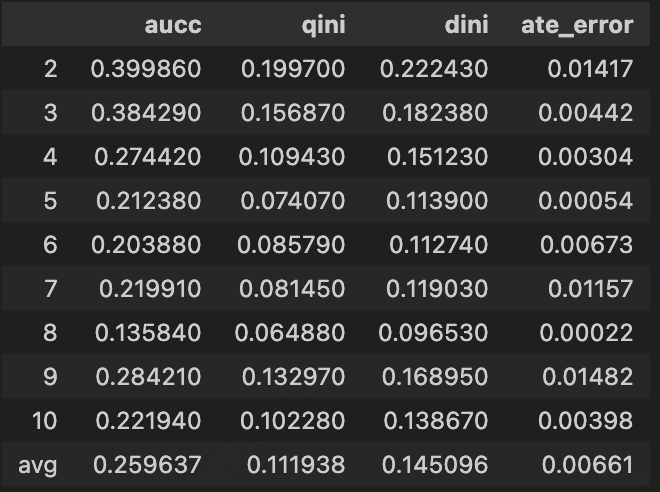
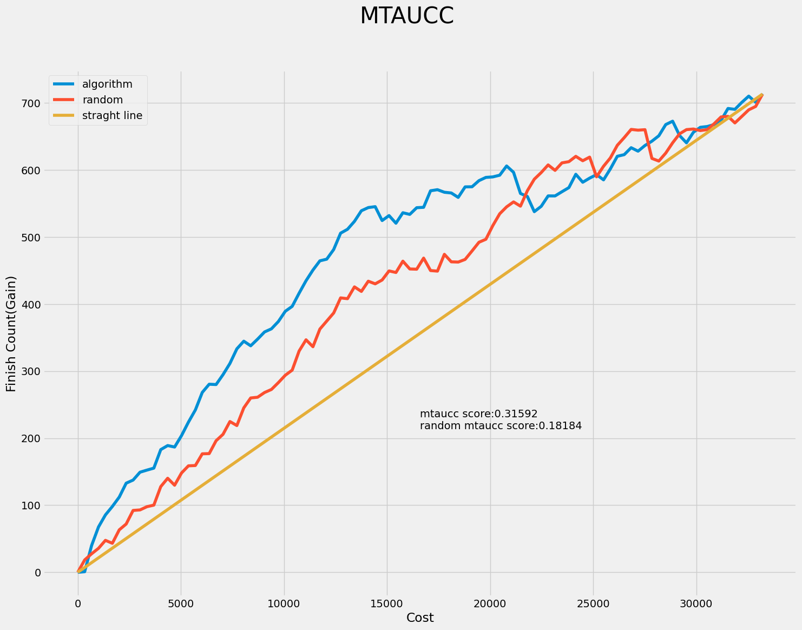
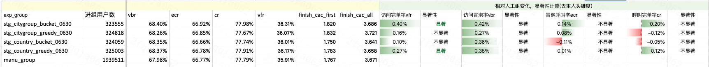

# 【LR25027】流失召回算法策略v0

[Cooper 原文](https://cooper.didichuxing.com/knowledge/2199610335356/2205121614750)

# 1 背景

        流失召回项目目前日均c补率为0.5%，日均c补花费20万+，预算相对充足且稳定；目前流失召回活动为人工配置，按城市固定价格，日均流失召回人数13万，有一定的算法提效空间；

        流失用户的特征稀疏性是建模的难点，借助我们近期开发的用户多端历史行为特征等P维度特征，算法模型可以利用更丰富的信息准确建模流失用户的价格弹性，从而在**最大化访完率的目标**下，制定差异化发券策略。

         综上，我们期望优化流失召回策略，更加精准地为流失用户发券，提升线上策略钱效，**降低花费且带来更多完单人头**。

         流失用户含当日流失召回+流失未召回，流失召回：90天以上无完单且当日完单，流失未召回：90天以上无完单且当日未完单

# 2 目标 & 约束

## 2.1 策略目标

- 主目标：最大化访问完单率

- 是否在 DDO 中：否(交接项目)

## 2.2 约束指标项 & 约束程度

| 约束项 <br> | 约束方向 <br> | 约束程度（前置明确） <br> |
| --- | --- | --- |
| 大盘 C 补率(流失召回人群) <br> | 不抬升 <br> | 与对照组拉齐，允许 ±0.1pp 内波动 <br> |
| 大盘人均完单 / GMV <br> | 不显著负向 <br> | 不允许出现显著负向（p&lt;0.05） <br> |

# 3 策略方案

## 3.1 特征工程

	- 策略可使用特征包含以下内容,共800+特征：

| 表名 <br> | [kflower_app.dm_kf_mkt_pas_split_tool_index_di](https://datamap.didichuxing.com/detail?uri=hive://mycluster-tj:kflower_app:dm_kf_mkt_pas_split_tool_index_di&keyword=dm_kf_mkt_pas_split_tool_index_di,pas,split,di,mkt,dm,index,kf,tool) <br> | [kflower_strategy.hxz_pid_feature_package_click](https://datamap.didichuxing.com/detail?uri=hive://mycluster-tj:kflower_strategy:hxz_pid_feature_package_click&keyword=hxz_pid_feature_package_click,package,feature,pid,hxz,click) <br> | [kflower_strategy.dm_user_behavior_multi_app_stat](https://datamap.didichuxing.com/detail?uri=hive://mycluster-tj:kflower_strategy:dm_user_behavior_multi_app_stat&keyword=kflower_strategy,dm_user_behavior_multi_app_stat,kflower_strategy+dm_user_behavior_multi_app_stat) <br> | [kflower_strategy.dm_user_pricing_prefer_stat](https://datamap.didichuxing.com/detail?uri=hive://mycluster-tj:kflower_strategy:dm_user_pricing_prefer_stat&keyword=dm_user_pricing_prefer_stat) <br> | [kflower_strategy.dm_user_common_behavior_stat](https://datamap.didichuxing.com/detail?uri=hive://mycluster-tj:kflower_strategy:dm_user_common_behavior_stat&keyword=stat,common,dm_user_common_behavior_stat,dm,behavior,user) <br> | [kflower_strategy.dm_user_compete_tag_stat](https://datamap.didichuxing.com/detail?uri=hive://mycluster-tj:kflower_strategy:dm_user_compete_tag_stat) <br> | ==[kflower_strategy.competition_pid_tag](https://datamap.didichuxing.com/detail?uri=hive://mycluster-tj:kflower_strategy:competition_pid_tag&keyword=kflower_strategy+competition_pid_tag,kflower_strategy,competition_pid_tag,kflower,competition,pid,tag,strategy)== <br> | [kflower_strategy.city_history_statistics_data](https://datamap.didichuxing.com/detail?uri=hive://mycluster-tj:kflower_strategy:city_history_statistics_data) <br> | [kflower_strategy.city_hour_history_statistics_data](https://datamap.didichuxing.com/detail?uri=hive://mycluster-tj:kflower_strategy:city_hour_history_statistics_data) <br> | [kflower_strategy.city_time_history_statistics_data](https://datamap.didichuxing.com/detail?uri=hive://mycluster-tj:kflower_strategy:city_time_history_statistics_data) <br> |
| --- | --- | --- | --- | --- | --- | --- | --- | --- | --- | --- |
| 含义 <br> | 用户历史参与裂变活动的特征，pid求和所有canvas_type的特征值即可 <br> | 套餐的展现和点击情况 <br> | 用户多端行为统计，如用户在hxz/wyc/pbd端上的冒泡/呼叫/完单/gmv等统计，以及竞争双冒行为统计 <br> | 平台呼返联合决策搭建p维度特征，如用户历史1个月内的未呼叫价格，乘客维度勾选特价/特快/非盒子的历史发单占比/ecr/cpm等 <br> | ==wyc加工的用户公共特征== <br>==**推荐使用！**== <br> | 考虑到双冒用户在行为习惯上的特点，分周中周末统计了双冒行为、以及手机型号、访问端/app等 <br> | 用户离线标签，即过去xx天是否发生竞争行为 <br> | 城市历史统计特征 <br> | 平台口径城市&小时维度特征 <br> | 平台口径城市&星期&小时维度特征 <br> |

	- 只选取<u>缺失率<0.75且零率<0.9</u>的特征，参与后续特征优选

	- 使用 「XGB建模访完率的特征重要性」和 「基于因果的特征重要性」两种方式，对候选特征进行重要性判断，最后根据特征重要性择优选取top100特征参与弹性建模

	- 最终参加弹性建模的特征中，**含59维P维度特征,34维城市特征（不含city_id）,3维实时特征（当天首次访问的city_id/hour/weekday），**其中P维度特征中有39维特征来源于「wyc加工的用户公共特征」

## 3.2 弹性建模

- 建模粒度：

天降工程实现：天降抓手的线上展现逻辑为，每个用户一天只能在首次访问时弹窗一张立减券，该立减券全天有效，旨在牵引流失用户在当天访问中完成转化。

样本粒度：流失用户首次访问粒度

label：用户**当天**是否完单

- 借鉴前人工作和组内算法现状，本次备选的弹性建模方案为 DRCFR 、双塔、多头DNN+连乘机制、多头DNN+单调性惩罚

- [离线实验结果](https://cooper.didichuxing.com/knowledge/2199610335356/2204655691103)：

| 最优模型版本 <br> | AUC <br> | ate_error/dini/qini/aucc <br> | algo_mtaucc <br> | random_mtaucc <br> | 备注 <br> |
| --- | --- | --- | --- | --- | --- |
| DRCFR+分段函数形式 <br> | 0.6351 <br> |  <br> | ==**0.31592**== <br> | 0.18184 <br> |  <br> |

## 3.3 规划求解

- 立减券范围：0,2-10元，每天发一张，当天有效

- 求解目标：最大化访问完单率（P维度当天访问有完单的概率）

- 约束：$$完单cac=\frac{核销立减券总金额}{完单总人数}$$

- 问题抽象：

	- **在完单cac约束下，如何通过发券使得访问完单率最大化？**

$$\min\limits_Z\     \ f(Z)=-\begin{aligned}\sum_{i=0}^{n-1}\sum_{j=0}^{m-1}\tau_{ij}*z_{ij}\end{aligned}$$

$$s.t.\ \ \ g(Z)=\frac{\sum_{i=0}^{n-1}\sum_{j=0}^{m-1}(vfr_{0}+\tau_{ij})*coupon_j*z_{ij}}{\sum_{i=0}^{n-1}\sum_{j=0}^{m-1}(vfr_{0}+\tau_{ij})*z_{ij}} -finish\_cac\leq0$$

$$\forall i, \  \ \sum_{j=0}^{m-1}z_{ij} = 1$$

	- 符号说明：

$$n$$为进组访问总人数

$$vfr_{0}$$表示无优惠下的访问完单率，即访问后当天是否完单

$$\tau_{ij}$$表示第$$i$$个用户在第$$j$$种立减券下的vfr弹性，即受到第$$j$$种立减券获得的访问完单率的提升

决策变量$$z_{ij}\in \left \{ 0,1 \right \}$$，表示第i个用户是否要给予第j种立减券

由于分桶策略和贪心策略各有优劣，两版策略都曾作为流召求解策略上线，前人的工作并未证明哪者更优，本期实验将同时上线两种求解方案。

### 3.3.1 分桶策略

==区分*城市分框*及分周中周末（周末含节假日）场景==

根据 $$vfr_{0}$$✖️kid（不同立减券下的ite）维度对**访问用户**进行聚合分桶，调用python求解器直接求解得到各桶对应券金额。

### 3.3.2 贪心策略

==区分*城市分框*及分周中周末（周末含节假日）场景，分场景求解贪心策略==

贪心求解流程
根据证明[多折扣发券场景整数规划求解](https://cooper.didichuxing.com/knowledge/2199610335356/2200888860863)，可知贪心求解流程如下：

1. 通过用户历史数据和立减券面额数据用模型预测出每种优惠面额的vfr预估值$$vfr_0^i,…,vfr_{m-1}^i$$；

2、删除不满足“递增且凸”的面额，对于第$$i$$个用户而言，即满足以下两个条件之一的面额：

      1）$$vfr_l^i \leq vfr_{l-1}^{i}$$

      2）$$(vfr_{l+1}^i - vfr_{l}^{i})/(vfr_{l+1}^i*d_{l+1}-vfr_{l}^i*d_l) \geq (vfr_{l}^i - vfr_{l-1}^{i})/(vfr_l^i*d_l-vfr_{l-1}^{i}*d_{l-1})$$

3、计算每个用户剩余面额的边界roi和增量花费，对于用户$$i$$的第$$l$$个立减券面额而言:

      $$边界roi：roi_i^l=(vfr_{l}^i - vfr_{l-1}^{i})/(vfr_l^i*d_l-vfr_{l-1}^{i}*d_{l-1})$$

      $$增量花费：cost_i^l=vfr_l^i*d_l-vfr_{l-1}^{i}*d_{l-1}$$

4、数据扩充，对于每一个用户和每一个立减券面额我们做一个item ,对该item维护一行数据，对于第$$i$$个用户的第$$l$$个立减金额而言，该数据为$$(i,d_{l}^{i},cost_{l}^{i},roi_{l}^{i})$$

5、排序，对步骤四产生的数据按照边界roi逆序排序，得到有序的数据集$$H$$

6、数据累加，对有序数据集H中的增量花费进行累加操作，得到数据集$$H\ '$$，其中对于数据集$$H$$和$$H\ '$$中数据对应关系为

      $$(i,d_{l}^{i},cost_{l}^{i},roi_{l}^{i})\ \ -->\ \ (i,d_{l}^{i},cost_{l}^{i},all\_cost_{l}^{i},roi_{l}^{i})$$，

      $$其中：add\_cost_{l}^{i}=\sum\limits_{j \in n}\sum\limits_{m\in D}cost_j^m * x_j^m$$

                  $$x_j^m=\bigg \{ \ ^{1\ roi_j^m > roi_l^i}_{0\ roi_j^m \leq roi_l^i}$$

7、顺序遍历数据集，找到最接近预算的累计花费对应的item，此item之前所有的item对应的用户的最大面额即为分配结果；此item的边界roi即为该预算对应的临界roi

# 4 实验评估

## 4.1 实验设置

**人工组策略逻辑**：by城市测算cac，城市维度固定立减券金额，如：city_id = 6的所有流失用户发放4元天降立减券

人工组by城市cac测算逻辑：
流失首单分城市发券策略

1. 先确定流失整体的cac

2. 根据分城市的流失人人头，流失30dltv，30d留存率，成交率和供需分框，进行分城市测算

	1. 根据流失30dltv/10得出一个每个城市的大概单价a（其中流失人头数小于50的，或者ltv/10<=2的城市直接给2元）

	2. 根据这个单价a和流失人头算出一个cac1，比如说是4.5，但这个不是实际的cac，因为不是每个流失人头都会领这个活动的券核销，所以在这个cac基础上再除一个系数，cac2 = cac1 / 1.55  = 4.5/1.55=2.9 （cac2大概就是实际的cac）

	3. 假设cac2 = 2.9，如果目标cac是3块，那会在单价a的基础上进行调整，直到cac2满足目标cac

	4. 进行调整的依据：就是高留存城市加钱，低留存城市减钱，非缺b城市加钱，缺b城市减钱

	5. 最后的cac要符合：高留存城市cac> 低留存城市；非缺b城市cac>缺B城市cac

==供需分框取数看数：==[https://yunchou.intra.xiaojukeji.com/city_framing](https://yunchou.intra.xiaojukeji.com/city_framing)

供需制定新的分城市发展分框，要求投入优先级：重点增长城市>潜力增长城市>核心城市>待探索城市 ，文件名称：6月城市发展分框 链接：[https://cooper.didichuxing.com/docs2/sheet/2204756514259](https://cooper.didichuxing.com/docs2/sheet/2204756514259)

20

**算法组策略**：弹性建模+策略求解

	- 本次上线4个策略组，使用同一个弹性模型的预测结果，但是策略求解方式不同，具体如下：

| 策略组名 <br> | 是否将城市分框 <br> | 求解方式 <br> | 是否需要进行城市级预算分配 <br> |
| --- | --- | --- | --- |
| stg_citygroup_bucket_0630 <br> | 是，将城市分为8个框，框内城市样本 <br> | 分桶求解，将样本分为30个桶，桶维度求解立减券最优分配 <br> | 是，根据城市框的总体弹性，将全国完单cac分配到各个城市框 <br> |
| stg_citygroup_greedy_0630 <br> | 是，将城市分为8个框，框内城市样本 <br> | 弹性求解，按照样本的钱效，样本粒度求解立减券最优分配 <br> | 是，根据城市框的总体弹性，将全国完单cac分配到各个城市框 <br> |
| stg_country_bucket_0630 <br> | 否，全国所有样本 <br> | 分桶求解，将样本分为30个桶，桶维度求解立减券最优分配 <br> | 否，按照全国完单cac执行策略求解结果 <br> |
| stg_country_greedy_0630 <br> | 否，全国所有样本 <br> | 弹性求解，按照样本的钱效，样本粒度求解立减券最优分配 <br> | 否，按照全国完单cac执行策略求解结果 <br> |

## 4.2 实验结果

评估日期：2025.08.04-2025.08.12，[实验报告](https://cooper.didichuxing.com/knowledge/2199610335356/2205113636375)

分流方式：人工组60%流量，四个策略组各10%

**核心结论**：拉齐首单完单总cac后，策略组stg_citygroup_bucket_0630比人工组manu_group，访问完单率vfr+0.40pp

收益来源：访问冒泡率vbr显著+0.42pp，通过更优的登端天降发券策略提升访问用户到冒泡的转化，从而带来访问完单率的提升

**流失用户日均完单增量**：流失用户日均访问人数35w，算法最优策略扩量95%后，访完率vfr+0.40pp可带来1330个流召完单人头增量，访呼率+0.37%对应1230个流失呼叫人头；

大盘人均完单相对人工组+0.74%可带来1354单完单增量，大盘人均呼叫相对人工组+1.45%可带来4074单呼叫增量；

\*vfr:实验期内实验组去重完单人数/去重访问用户数

*\*finish_cac_first：流失首单天降策略带来的花费/完单人头*

*\*finish_cac_all：流失首单总c补/完单人头*



## 4.3 下钻分析

**由于AB实验的策略组效率并不相同，以下结论仅供参考**

- 供需城市分框

	1. 城市资源投入相差较大，无法直接对比策略效率

	2. 从投资效率来看，对比BC平衡城市，BC双差能带来更多的vfr增量（该增量来源一部分是钱效高一部分是算法策略更优）

	3. 从投资效率来看，对比缺C城市，缺B城市能带来更多的vfr增量（基础cac不一致并不完全可比）（即缺b城市更适合加补）

| exp_group <br> | city_group <br> | 进组用户数 <br> | vfr <br> | finish_cac_first <br> | delta_vfr <br> | delta_cac <br> |
| --- | --- | --- | --- | --- | --- | --- |
| manu_group <br> | balance_bc <br> | 458881 <br> | **42.6%** <br> | **2.314** <br> |  <br> |  <br> |
| stg_citygroup_bucket_0630 <br> | balance_bc <br> | 77062 <br> | **41.5%** <br> | **1.282** <br> | -1.17% <br> | -1.032 <br> |
| manu_group <br> | lack_c <br> | 289013 <br> | **39.6%** <br> | **1.838** <br> |  <br> |  <br> |
| stg_citygroup_bucket_0630 <br> | lack_c <br> | 49344 <br> | **39.3%** <br> | **1.481** <br> | -0.35% <br> | -0.357 <br> |
| manu_group <br> | lack_b <br> | 713992 <br> | **35.1%** <br> | **1.708** <br> |  <br> |  <br> |
| stg_citygroup_bucket_0630 <br> | lack_b <br> | 119838 <br> | **36.0%** <br> | **2.187** <br> | 0.91% <br> | 0.479 <br> |
| manu_group <br> | worse_bc <br> | 485099 <br> | **28.5%** <br> | **1.028** <br> |  <br> |  <br> |
| stg_citygroup_bucket_0630 <br> | worse_bc <br> | 82381 <br> | **30.6%** <br> | **2.107** <br> | 2.12% <br> | 1.079 <br> |

- 城市留存高低

	1. 城市资源投入相差较大，无法直接对比策略效率

	2. 从结果上看，算法策略组给了低留存城市更多资源，换来了更多的vfr增量（该增量来源一部分是钱效高一部分是算法策略更优）

| exp_group <br> | city_group <br> | 进组用户数 <br> | vfr <br> | finish_cac_first <br> | delta_vfr <br> | delta_cac <br> |
| --- | --- | --- | --- | --- | --- | --- |
| manu_group <br> | high_retain <br> | 1271104 <br> | **39.6%** <br> | **2.024** <br> |  <br> |  <br> |
| stg_citygroup_bucket_0630 <br> | high_retain <br> | 213068 <br> | **39.0%** <br> | **1.567** <br> | -0.59% <br> | -0.457 <br> |
| manu_group <br> | low_retain <br> | 673404 <br> | **29.0%** <br> | **1.096** <br> |  <br> |  <br> |
| stg_citygroup_bucket_0630 <br> | low_retain <br> | 113431 <br> | **31.4%** <br> | **2.400** <br> | 2.45% <br> | 1.304 <br> |

	- 进一步下钻长期留存

- 城市规模

	1. 算法策略组在大城市和小城市之间并无资源投入差异，说明算法视角下 城市规模与投资效率无关

（metro城市为GMV份额>1pp城市，共28城，共占平台GMV 71%）

| exp_group <br> | city_group <br> | 进组用户数 <br> | vfr <br> | finish_cac_first <br> | delta_vfr <br> | delta_cac <br> |
| --- | --- | --- | --- | --- | --- | --- |
| manu_group <br> | metro <br> | 963876 <br> | **38.8%** <br> | **2.090** <br> |  <br> |  <br> |
| stg_citygroup_bucket_0630 <br> | metro <br> | 161926 <br> | **38.9%** <br> | **1.800** <br> | 0.03% <br> | -0.290 <br> |
| manu_group <br> | non_metro <br> | 980567 <br> | **33.1%** <br> | **1.391** <br> |  <br> |  <br> |
| stg_citygroup_bucket_0630 <br> | non_metro <br> | 165391 <br> | **34.0%** <br> | **1.833** <br> | 0.99% <br> | 0.442 <br> |

- 用户分层（流失时间90-120,120-180,180-360,360+）

	1. 用户流失时间分层人群占比，上次完单时间大于360天>上次完单时间介于(180，360\]>上次完单时间介于(120，180\]>上次完单时间介于(90，120\]

	2. 投资效率上，算法策略更倾向于把资源给到流失时间更长的流失用户，并且在流失时间短的人群中少投入并不会降低vfr

| exp_group <br> | fin_gap_level <br> | 进组用户数 <br> | vfr <br> | finish_cac_first <br> | delta_vfr <br> | delta_cac <br> |
| --- | --- | --- | --- | --- | --- | --- |
| manu_group <br> | last_fin_90_120 <br> | 371021 <br> | **42.9%** <br> | **1.468** <br> |  <br> |  <br> |
| stg_citygroup_bucket_0630 <br> | last_fin_90_120 <br> | 62187 <br> | **42.9%** <br> | **1.260** <br> | 0.00% <br> | -0.208 <br> |
| manu_group <br> | last_fin_120_180 <br> | 416022 <br> | **39.3%** <br> | **1.418** <br> |  <br> |  <br> |
| stg_citygroup_bucket_0630 <br> | last_fin_120_180 <br> | 69409 <br> | **39.8%** <br> | **1.314** <br> | 0.50% <br> | -0.105 <br> |
| manu_group <br> | last_fin_180_360 <br> | 500370 <br> | **35.1%** <br> | **1.698** <br> |  <br> |  <br> |
| stg_citygroup_bucket_0630 <br> | last_fin_180_360 <br> | 83317 <br> | **35.4%** <br> | **1.700** <br> | 0.28% <br> | 0.003 <br> |
| manu_group <br> | last_fin_360 <br> | 651861 <br> | **30.4%** <br> | **2.355** <br> |  <br> |  <br> |
| stg_citygroup_bucket_0630 <br> | last_fin_360 <br> | 108598 <br> | **31.1%** <br> | **2.781** <br> | 0.63% <br> | 0.425 <br> |

- 14d内是否有访问未呼叫行为（有/无）

	1. 分层人群占比，14d内未访问>14d内访问未呼叫>14d内访问且呼叫

	2. 从投资效率来看，14d内访问未呼叫>14d内未访问>14d内访问且呼叫（基础cac不一致并不完全可比），但算法策略给了14d内访问且呼叫人群更多的资源投入，显然不太合理，是一个优化点

| exp_group <br> | info_14d <br> | 进组用户数 <br> | vfr <br> | finish_cac_first <br> | delta_vfr <br> | delta_cac <br> |
| --- | --- | --- | --- | --- | --- | --- |
| manu_group <br> | vis_no_call_14d <br> | 267080 <br> | **30.8%** <br> | **1.619** <br> |  <br> |  <br> |
| stg_citygroup_bucket_0630 <br> | vis_no_call_14d <br> | 44332 <br> | **31.4%** <br> | **1.478** <br> | 0.55% <br> | -0.140 <br> |
| manu_group <br> | no_vis_14d <br> | 1610989 <br> | **36.5%** <br> | **1.801** <br> |  <br> |  <br> |
| stg_citygroup_bucket_0630 <br> | no_vis_14d <br> | 268984 <br> | **36.9%** <br> | **1.867** <br> | 0.37% <br> | 0.066 <br> |
| manu_group <br> | vis_and_call_14d <br> | 61442 <br> | **42.4%** <br> | **1.482** <br> |  <br> |  <br> |
| stg_citygroup_bucket_0630 <br> | vis_and_call_14d <br> | 10239 <br> | **42.8%** <br> | **1.840** <br> | 0.36% <br> | 0.358 <br> |

# 5 后续规划

扩量计划：最优组扩量并小流量人工组，持续观测长期留存；同时上线新的策略组保证长期留存不负；最终期望达到长短期双正

模型迭代：出发点是 模型的auc低，只能对ite排序预估准确但是对边际收益预估不准

新增特征：加入访问格子特征、访问渠道特征、用户实时绑券信息

策略求解：考虑不强依赖模型的策略求解，如 更合理更优的城市预算分配

指标搭建：基于流召视角下的钱效指标，衡量策略效率和资源腾挪空间

# 6 引用和鸣谢

感谢之烁@周之烁在策略求解、实验评估、业务沟通上的全力支持和认真指导；

感谢工程同学@胡涛和@韩明非两位老师在链路搭建和实验配置中的配合和支持；

感谢业务同学@周祎和@庞佩琴在需求推进中的支持和宝贵建议；

感谢DS同学@张顺瑶在实验评估和数据分析中提供的支持。

# 7 TODO完成情况

| todo-0818LR会议 <br> | 完成情况 <br> |
| --- | --- |
| 1. 修改合适标题 <br><br> | done，已将标题【流失召回策略重上线策略】修改为【流失召回算法策略v0】 <br> |
| 2. 针对特征缺失的问题，需要尝试一些特征填充的方法，比如借助历史信息填充缺失的city_id  <br><br> | done，见表格下方 <br> |
| 3. 下钻分析不同策略组的差异来源  <br><br> | done，见表格下方 <br> |
| 4. 需要明确未下线的人工活动和策略之间的重叠，并评估人工活动带来的影响 <br><br> | done，见表格下方 <br> |
|  5. 补充策略下日均呼叫、完单的估计 <br> | done，补充至「3.2实验结果」“**流失用户日均完单增量**”部分 <br> |

- **todo2: city_id=-1，未获取定位样本的解决：**

```SQL
select
    a.passenger_id,
    a.apollo_city,
    b.reg_city_id,
    b.resident_city_id,
    call_tab.latest_call_time,
    call_tab.city_id

from
    (
        select
            distinct apollo_key passenger_id,
            group_name exp_group,
            dims.city as apollo_city
        from
            apollo.pre_flow_data_etl --获取实验人群pid
        where
            year = '2025'
            and month = '08'
            and day = '16'
            and exp = 'kf_pope2_97976_1755249680'
            and dims.city = -1
            and group_name in ('control_group')
    ) a
    left join (
        select
            distinct passenger_id,
            reg_city_id,
            resident_city_id
        from
            kflower_dw.dwm_kf_pas_profile_df
        where
            dt = '2025-08-16'
            and finish_life_cycle in (8)
    ) b on a.passenger_id = b.passenger_id
    left join (
        select passenger_id,call_time as latest_call_time,city_id
        from (
        select
            dt,
            passenger_id
            ,start_city_id as city_id
            ,call_time
            ,row_number() over(partition by passenger_id
        ORDER BY  call_time desc ) call_index
        from kflower_dw.dwd_kf_trd_unity_order_anycar_di
		where 
			dt between '2025-05-17' and  '2025-08-17' --过去90天的最近呼叫
			and passenger_id <> 0
			and is_hxz_call = 1
			and to_date(call_time) = dt
			and product_id <> 26 --脏数据
        ) tmp 
        where call_index = 1
    ) call_tab on a.passenger_id = call_tab.passenger_id
```

未取到city_id的样本占全实验样本的4%左右；

尝试从表kflower_dw.dwm_kf_pas_profile_df中获取用户的注册城市和常驻城市；尝试获取用户90d呼叫中最近一次的城市id，作为替代；

所有未取到city_id的样本可以分为如下不重不漏的5类（分母都是所有未取到city_id的样本总数，和为100%）

		1. 仅resident_city_id有值：51.99%

		2. 仅90天内最近一次呼叫的city_id有值：29.90%

		3. 二者都有值且取值相同：5.43%

		4. 二者都有值且取值不同：4.61%

		5. 二者都没有值：8.07%

判断「二者都有值且取值相同」作为city_id替代值更为置信，但是该替代值能取到的几率较低，且city_id为实时特征，使用离线特征作为补充推断线上实现成本较高，暂且对该部分未定位用户实行兜底策略

- **todo3: 下钻分析不同策略组的差异来源** ：

由于本次上线缺乏空白组，简单以 roi = vfr/finish_cac_all作为钱效指标的计算方式来衡量各组效率；

对比结果发现，stg_country_bucket_0630>stg_country_greedy_0630>stg_citygroup_bucket_0630>stg_citygroup_greedy_0630>manu_group，即全国统一求解优于城市分框求解，同时受限于模型准确性，分桶求解优于贪心求解；从此指标视角下，stg_country_bucket_0630为最优组，这主要是由于该组cac最低

因此判断现在的评估逻辑--“基本拉齐cac后，对比vfr的大小”并不严谨，如stg_country_bucket_0630组目前vfr最低可能是cac较低导致。

后续评估会和业务申请预留5%空白组，并制定钱效指标，帮助衡量策略效果。

| exp_group <br> | vfr <br> | finish_cac_all <br> | roi <br> |
| --- | --- | --- | --- |
| stg_citygroup_bucket_0630 <br> | **36.31%** <br> | **3.686** <br> | 0.0985 <br> |
| stg_citygroup_greedy_0630 <br> | **36.07%** <br> | **3.721** <br> | 0.0969 <br> |
| stg_country_bucket_0630 <br> | **36.01%** <br> | **3.641** <br> | 0.0989 <br> |
| stg_country_greedy_0630 <br> | **36.17%** <br> | **3.658** <br> | 0.0989 <br> |
| manu_group <br> | **35.91%** <br> | **3.671** <br> | 0.0978 <br> |

- **todo4: 未下线的人工活动和策略之间的重叠，并评估人工活动带来的影响：**

经与业务同学确认，线上有两个未下线流失用户实验，均为城市维度策略，如city_id = 5针对流失用户发放x元立减券；

分别统计各策略组中核销其他流失实验券的情况，发现在各实验组中剔除掉核销其他券的流失用户后，各实验组cac基本拉齐，算法策略组相比人工组有更高的vfr提升。

需要注意的是，由于其他实验券在算法策略组和人工策略组上的作用人群不同，因此并不完全可比，此结果仅供参考。

| exp_group <br> | 不同策略组总cac <br> | 不同策略组总vfr <br> | 相比人工delta_vfr <br> | 去除未下线核销用户后cac <br> | 去除未下线核销用户后vfr <br> | 去除后相比人工delta_vfr <br> | 未下线核销用户占比 <br> |
| --- | --- | --- | --- | --- | --- | --- | --- |
| manu_group <br> | 1.767 <br> | 35.91% <br> |  <br> | 1.833 <br> | 35.07% <br> |  <br> | 7.71% <br> |
| stg_citygroup_bucket_0630 <br> | 1.820 <br> | 36.31% <br> | 0.40% <br> | 1.875 <br> | 35.62% <br> | 0.55% <br> | 9.13% <br> |
| stg_citygroup_greedy_0630 <br> | 1.832 <br> | 36.07% <br> | 0.16% <br> | 1.887 <br> | 35.39% <br> | 0.32% <br> | 9.09% <br> |
| stg_country_bucket_0630 <br> | 1.750 <br> | 36.01% <br> | 0.10% <br> | 1.806 <br> | 35.28% <br> | 0.21% <br> | 9.77% <br> |
| stg_country_greedy_0630 <br> | 1.783 <br> | 36.17% <br> | 0.26% <br> | 1.839 <br> | 35.46% <br> | 0.39% <br> | 9.41% <br> |
