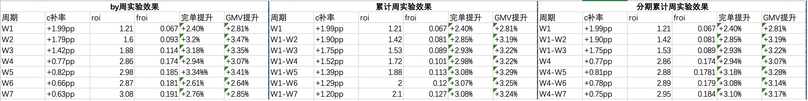
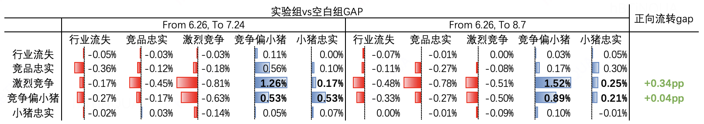
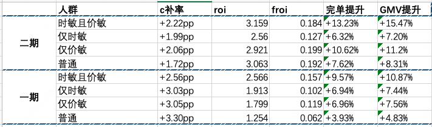
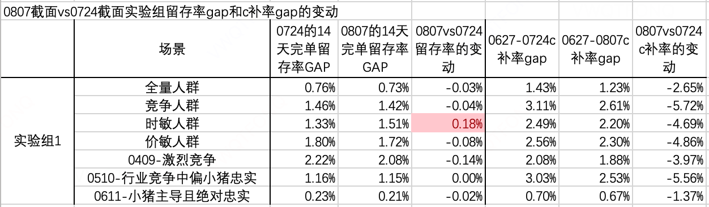

# 【LR25028】ACTI分人群多抓手联合策略

[Cooper 原文](https://cooper.didichuxing.com/knowledge/2199610335356/2205183981137)

# 1 背景

暑期需求转旺，参考去年暑期hxz呼叫份额有明显下滑，通过[2024年暑期城市呼叫份额相关性分析](https://cooper.didichuxing.com/knowledge/2199610335356/2204582548788)，最终筛选出**大盘人群hxz呼叫份额下跌的top3相关性指标**（**均为竞争人群相关指标**，且相关性均高于大盘人群指标如大盘ECR、CR、价格水位变化等）。

项目初期，通过不同抓手的竞争vs非竞争人群对比分析，我们验证了**竞争人群短期钱效&长期钱效双高**；随后，我们在峰期时段对竞争用户开启了[峰期免溢价(补贴版)实验](https://cooper.didichuxing.com/knowledge/share/page/9AAaAdNmIHaG)，验证了**对竞争人群做抓手组合有1+1>2的收益，且不同人群有不同诉求（低价/确定性）**。

但是在7月初，已建设的实验能力仅支持「同一实验组内，最多圈定一类人群投放组合策略&感知」，无法支持「分人群精细化策略投放」，策略钱效较低。因此，希望对该能力进行优化，对不同类型的竞争用户投放组合策略，进一步提升竞争人群策略的总体钱效。

# 2 策略方案

## 2.1 整体思路

- 核心逻辑：

根据不同人群的需求和抓手特点，定制**分人群精细化策略**

- 人群划分：

将大盘用户分为竞争人群和非竞争人群；其中竞争人群可分为「时敏&价敏」、「仅时敏」、「仅价敏」和「普通竞争」四大类；

- 策略思路：

「非竞争人群」不投放策略

「时敏&价敏竞争用户」生效较深券+较强确定性抓手+感知

「非价敏仅时敏竞争用户」生效较强确定性抓手+感知

「非时敏仅价敏竞争用户」生效较深券+感知

「普通竞争用户」生效券+确定性抓手+感知

## 2.2 人群划分思路

- **价敏人群划分思路**

根据[离线产出的竞争用户roi表](https://cooper.didichuxing.com/docs2/document/2204650154251)，对用户的roi排序，用户排序越靠前价敏程度越高；具体会有「ROI底表」、「定折分档表」、「多折扣分档表」三种表，可满足不同使用需求。

> 「竞争用户roi表」是基于ecr弹性模型计算得到，模型来源：[【LR25008】流量份额天降算法V0](https://cooper.didichuxing.com/knowledge/2199610335356/2204469664796)

	- 以发放定折券为例：

	1. 假设某次实验预算为大盘当天的0.2pp，竞争用户GMV占比为50%，那么对应竞争用户的当天补贴率为0.4pp；实验拟对价敏用户发放9折券对应的实花补贴率约为4%，那么对应的覆盖人群比例为10%；

	2. 「定折分档表」记录的是在固定x折下，对用户在该折扣下的ROI进行降序排序，再对其进行等频分档10档；

根据预算和可覆盖人群比例，最后确定分档为1的竞争用户为本期实验的价敏用户

- **时敏人群划分思路**

根据[离线产出的用户应答前后时敏得分表](https://cooper.didichuxing.com/knowledge/2199610335356/2204699134426)，对用户的应答前/后取消率变化值进行排序，用户排序越靠前时敏程度越高；

时敏分计算公式如下：

	- 应答前时敏分 = 120s应答前取消率-4s应答前取消率

	- 应答后时敏分 = 预估接驾时长>Xmin的应答后取消率 - 预估接驾时长<Xmin的应答后取消率

在规则版的时敏用户记分中，会进行细分人群和细分场景的处理，最终得到细分人群在包含所有场景下的综合时敏分值。

	1. 考虑到部分低频用户的历史发单数少，对其进行by用户计算的取消率结果置信度低；结合用户的历史呼叫数、峰期呼叫订单占比、长单订单占比、是否双呼等将用户划分进几十个细类；

	2. 考虑到不同细分人群的订单结构不同，区分平/高峰期、长短里程订单不同场景计算应答前/后取消率时敏分，最后对各场景的取消率时敏分进行汇总，得到不同细分人群的时敏分。

根据预算和人群覆盖面二者关系，最终确定实验作用的时敏用户。

## 2.3 策略产出

- 实验时间

一期：6.30-7.20，共三周，W1-W3

二期：7.21-至今，W4-W7

- **城市框**：

8,13,14,16,18,19,25,26,35,42,50（GMV占全国31%）

- **券名与感知：**

券：消暑畅行券

感知：“消暑畅行优惠” 

- **具体策略：**

| **实验周期**   | **实验分流**   | **实验人群**   | **实验策略**   | **备注**   |
| :---: | :---: | :---: | :---: | :---: |
| **一期**   | 空白组10%   | 无   | /   | /   |
| 实验组90%   | 非竞争人群-无   | /   | 策略：  - A（券）：全天1张9折券 \[W1:全天2张9折券\]，一次发放下周7天的所有券   - B（必无车赔）：全天必现   	- 所有参数与峰期免溢价时期参数一致   - C（强升舱）：除去钱效极低场景的升舱（约为必升舱触发面的70%）   	- lambda = 0.001，其他参数与峰期免溢价时期参数一致   - Cm（弱升舱）：仅在钱效较高场景升舱（约为必升舱触发面的30%）   	- lambda  = 0.08，其他参数与峰期免溢价时期参数一致    |
| 竞争人群：   | - 均提前触达   - 城市框X    	- 时间段p（高峰）：A+B+C+感知   	- 时间段q（平峰）：A+B+Cm+感知   - 城市框Y ：A+B+Cm+感知    |
| **二期**   | 空白组10%   | 无   | /   | /   |
| 实验组90%   | 非竞争人群& 无策略竞争人群 42%   | /   | - **A1**（深折扣券）：全天1张88折券，一次发放下周7天的所有券   - **A2**（浅折扣券）：全天1张9折券，一次发放下周7天的所有券   - **B**（必无车赔）：全天除00:00-06:00外必现   	- 所有参数与峰期免溢价时期参数一致   - **C1**（必升舱）：能升舱的场景均升舱   	- 无lambda配置，随机升舱且概率为100%   - **C2**（强升舱）：除去钱效极低场景的升舱   	- lambda = 0.001，其他参数与C1参数一致   - **C3**（弱升舱）：仅在钱效较高场景升舱   	- lambda  = 0.08，其他参数与C1参数一致    |
| 第一类竞争人群（时敏&价敏）3%   | 所有城市  - 触达 + A1 + 感知   - 高峰：B+C2   - 平峰：B+C3    |
| 第二类竞争人群（仅时敏）7%   | 所有城市  - 触达 + A2 + 感知   - 高峰：B+C2   - 平峰：B+C3    |
| 第三类竞争人群（仅价敏）18%   | 所有城市  - 触达 + A1 + 感知，*无无车赔、无升舱*    |
| 第四类竞争人群（普通）29%    | 所有城市  - 触达 + A2 + 感知，*无无车赔、无升舱*    |

- **具体人群口径：**

「竞争人群」即历史14d有同ODT双冒用户；

「时敏划分」实验开始前90天总呼叫数0-32且应答前取消率 > 0.3 的用户，[划分依据](https://cooper.didichuxing.com/knowledge/2199610335356/2204699134426#:~:text=%2D0.04375-,3.4.2%20%E8%80%83%E8%99%91%E5%BA%94%E7%AD%94%E5%89%8D%E5%8F%96%E6%B6%88%E7%8E%87,-%E5%8A%A0%E5%85%A5%E5%8E%86%E5%8F%B2%E5%BA%94%E7%AD%94)

「价敏划分」流量竞争人群弹性模型预测的90折roi排前20%的用户

# 3 实验评估

## 3.1 大盘总体目标

- **W1-W3，11城打包结果：**

C补率提升1.75pp，ROI=1.53，FROI=0.089，完单+2.93%，GMV+3.22%，ECR+0.73pp，CR+0.26pp（均显著）

- **W4-W6，11城打包结果：**

C补率提升0.78pp，ROI=2.89，FROI=0.179，完单+3.08%，GMV+3.14%，ECR+0.50pp，CR+0.09（均显著）

- **「W4-W6」相比「W1-W3」roi****+88.9%，froi+101.1%，**增量来源于c补减少、长期效应、人群策略精细化

	- 挑选「W1-W3」实验中钱效较高的竞争人群，人群占全量竞争人群45%，大盘c补率可与「W4-W6」拉齐，roi = 1.93，froi = 0.122；相比原始「W1-W3」roi+26.1%,froi+37.1%

	- 根据by周实验效果来看，在c补率近似不变的情况下W4->W7 roi+7.7% froi+9.8%，假设长期效应带来的效率增量如此（未考虑策略不同、周期不同带来的长期效应差异）

	- 剔除c补减少、长期效应后，由策略细化带来的效率增量为**roi+55.1%,froi+54.2%**

## 3.2 大盘总体-长期效应

- **长期放大效应**：从by周实验效果来看，对比首周c补率和其他各指标，随着实验周期拉长，c补率收缩，大盘完单和GMV相对首周一直正向，完单提升和GMV提升一直维持在较高水平。

- **长期人群流转**：对比一期W1-W3，二期W4-W7的竞争人群正向流转（to竞争偏忠实、绝对忠实）更明显

## 3.3 人群差异

- **短期人群差异**

		1. 相比于一期进行整体竞争人群策略，二期分人群策略在人群c补分配上更加合理，「时敏且价敏人群」有更高的c补投入，「普通人群」有更低的c补投入，最终人群策略效率上二期分人群钱效表现也更加接近，这与最优化求解的思路相一致。

- **长期人群差异**

		2. 人群的长期留存有差异：时敏人群、偏小猪忠实人群长期完单留存提升更明显，在补贴率减少时还出现了留存率的逆势增长

# 4 后续规划

1. 建模分场景P维度时敏弹性模型

2. 融合用户价敏弹性和时敏弹性，求解P维度多抓手组合策略方案

3. 打通线上多抓手联动链路，实现P维度多抓手灵活生效，实现自动化线上线上，提升实验配置人效

4. 考虑人群标签实时性的策略

	1. 长期的竞争人群策略--多抓手联合决策（离线绑券）

	2. 实时的竞争人群策略--平台联合呼返竞争人群策略（实时双冒用户识别模型）

5. 考虑预算控制能力

# 5 引用和鸣谢

- **引用**

[【LR25008】流量份额天降算法V0](https://cooper.didichuxing.com/knowledge/2199610335356/2204469664796)

- **鸣谢**

暑期策略涉及的抓手联动打通和实验配置工作复杂且繁琐，用户画像的建设工作也是新领域的探索，在此对分单引擎团队、API团队、QA团队，以及策略部内部各位提供支持的同学们郑重表示感谢！

API同学@钟子贤

工程同学@刘志远

运营同学@王雨潭

策略同学@周之烁@陈嘉曦@李天一

# 6. 目标&约束

## 6.1 策略目标

- 识别出短期/长期钱效均高的竞争人群，便于对该部分人群做特定策略

- 圈选出的竞争人群ROI、完单ROI均高于普通人群

## 6.2 约束指标项

无特定约束

# 7. 推全情况与现状追踪

目前竞争人群，四类竞争子人群均已投入后续ACTI多抓手联合决策的使用。
