# 【LR25029】城市维度 B 弹建模

[Cooper 原文](https://cooper.didichuxing.com/knowledge/2199610335356/2205200233446)

# 1 问题定义与形式化

## 1.1 问题背景

随着网约车行业运营向精细化发展，理解并量化城市维度下不同干预措施的效果，对于预算分配和资源投放具有重要意义。然而，由于城市间特性、交通路网状况及供需结构存在显著差异，构建具备**弹性量化能力**的模型，成为业务提效和策略调优的关键挑战。在此背景下，我们希望进行“**城市维度下的弹性建模**”。核心任务是估计城市层面上司机相关业务指标 $$Y$$ 关于运营干预变量 $$X$$ 的弹性，即在控制其他协变量 $$Z$$ 后，研究条件期望$$E[Y \mid X, Z]$$，以量化不同城市在面对相同运营干预（如司机补贴策略等）下，司机行为指标（如登端转化率、出车时长等）的响应平均值和响应差异，为资源在不同城市间的优化分配提供基础。

> 提问1：现状B弹模型存在什么问题？使得需要重新建设；新的B弹模型与现状模型，二者有什么区别和联系？

> 现状B弹模型是观测**每个司机每一天**的行为（X：司机当天个体的B补率，Y：司机当天在线时长，Z：司机历史做单行为/供需等协变量特征）在训练集上进行建模，随后在评估集的样本上：保持每个样本自身协变量不变，将每个样本的补贴率 $$X$$ 统一取：0%，1%，...，30%，再计算所有样本在各个 $$X$$ 下 $$\hat{Y}$$ 的均值，作为该城市在不同补贴率下的**人均在线时长**的预估。在理论和实际应用中存在如下若干问题：

> 1、根据我们H1所做[司机弹性分析报告](https://cooper-vpn.xiaojukeji.com/docs2/document/2204036587211)，不仅是出车司机的人均TSH会受补贴率影响，出车司机数也会显著受到补贴率的影响（司机打开APP登陆状态下即可在首页查看当日补贴活动，部分司机会根据奖励是否丰厚决策是否在平台出车），而资源分配中使用的是城市总TSH（出车司机数$$\times$$人均TSH）作为特征，所以仅建模人均TSH是不够的；

> 2、司机与乘客/冒泡建模样本的数量级不同，现状模型在周维度定期更新过程中，中腰部城市(TOP 30-50)受限于样本量，建模效果不甚理想，且这些城市由于样本量小，周对周B弹数值结果波动较大，而业务需要我们至少能稳定覆盖宏鹄、自营TOP 50城市。

> 

> 新的模型在城市维度建模，协变量选取城市水平的数值特征，并直接建模最终城市维度总TSH，所以可以解决上述两个问题。两个模型相同点是：均为观察数据建模。具体模型对比可见下图

> 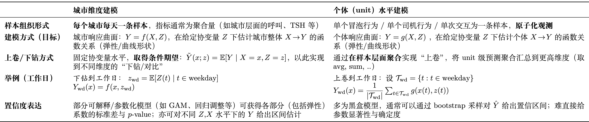

## 1.2 问题定义

我们将本问题形式化为以下结构：

**输入**：

1. **干预变量** $$X$$：与司机补贴策略程度直接相关的度量指标，我们采用的是不同口径下的 B 补率。

2. **协变量** $$Z$$：可能影响城市司机行为指标的其他因素。

> 提问2：最终使用的是什么口径下的B补率？原因是什么

> 以宏鹄为例，我们查看了宏鹄TOP 50城市总（平台+商家）B补率 和 总（平台+商家）**净**B补率（扣除平台和商家卡收入）两种补贴率的分布情况，发现：

> 在大部分城市，总B补贴率的分布几乎都高于20%以上，会导致模型在较低补贴率区间无法较好拟合（样本稀疏），并且净补贴率更具有实际意义，所以我们最终选取总净B补率作为干预的口径

> 

> 

  

**输出**：

司机相关业务指标 $$Y$$，包括：

1. **登端转化率**（结合登端司机数的预估，可以给出不同B补率下出车司机数的预测）

2. 在线司机的**人均 TSH**；

3. 直接建模**城市总 TSH**。

> 提问3：为什么要建模三个指标？

> 初始时我们根据分析报告的learning，分两步进行了建模，采用完全相同的X与Z，

> 1、先建模登端转化率：出车司机人头数/登端司机人头数（这里假设登端司机数不受B补率影响），随后再根据基期登端司机数得到不同补贴率下**出车司机数的预估**

> 2、再建模出车司机数的**人均TSH**，二者相乘得到总TSH

> 尝试之后发现每一步骤上的建模效果都尚可。但在回测过程中，我们发现我们始终是以最终的**城市总TSH**来衡量数值和相对提升的误差，这样不如直接建模总TSH。

> 所以最终我们选择直接建模**城市总 TSH**。（但若想看出车司机数关于B补率的响应曲线也可以单独建模步骤一）

**建模目标**：

- **估计因果效应响应面**：

    $$\hat{m}(X,Z) = \hat{E}[Y \mid X,Z]$$

> 提问4：因果响应曲面如何理解？

> 在每一组协变量$$Z$$的具体数值下，都存在一条$$Y$$（城市总TSH）关于$$X$$（B补率）的曲线，所有这些曲线组成了一个高维曲面（因果效应响应面，Causal Response Surface）。我们目标是希望在曲面的每一个点上的$$\hat Y$$估计准确。或者至少，在$$Z$$密度大的区域$$\hat Y$$和$$\partial{\hat Y}/\partial X$$是尽可能准确的

- **估计干预** $$X$$ **对指标** $$Y$$ **的弹性（Elasticity）**：

$$\text{Elasticity} = \frac{\partial \hat{m}(X,Z)}{\partial X}$$

- **同步输出区间估计和统计显著性检验指标**（部分模型支持）

    例如弹性估计的置信区间和 p-value，用于判断估计结果是否在统计意义上显著可靠。

## 1.3 建模评估方法与指标

为科学评估建模效果，设计以下评估指标：

**响应值估计准确性**

  衡量对条件期望：$$\hat{m}(X,Z) = \hat{E}[Y \mid X,Z]$$的预测准确性，采用**平均绝对误差百分比（MAPE）量化偏差**，用于检验整体预测值的准确性。

**弹性估计准确性**

  衡量对弹性$$\widehat{\text{Elasticity}} = \frac{\partial \hat{m}(X,Z)}{\partial X}$$  的估计准确性。不同城市和不同 $$X$$ 水平下的B弹通过通过真实观测值计算，并与模型在预测时给出的弹性 $$\left.\frac{\partial \hat{m}(X,Z)}{\partial X}\right|_{Z_t}$$进行对比，采用**平均绝对误差（MAE）量化偏差**，衡量弹性估计的准确性及数量级的一致性。

**评估方式**

在W-1周模型给出预测后，在W+1周使用W周真实发生的业务数据进行回测验证，比较预测值与实际观测值之间的误差分布和趋势一致性，并检验模型在实际场景中的可用性和稳健性。

> 提问5：有无参考基线，模型与模型，模型与基线分别具体怎么进行对比

> 响应值的准确性以下图所示为例，不同模型在T-7日对于T日的总TSH预估为$$\hat Y$$，真值为$$Y$$，我们选用：

> $$MAPE=ABS(\hat Y - Y)/Y$$的大小对比不同模型

> $$MAPE_{基线} = ABS(Y_{T-7}-Y)/Y$$作为基线

>  

> 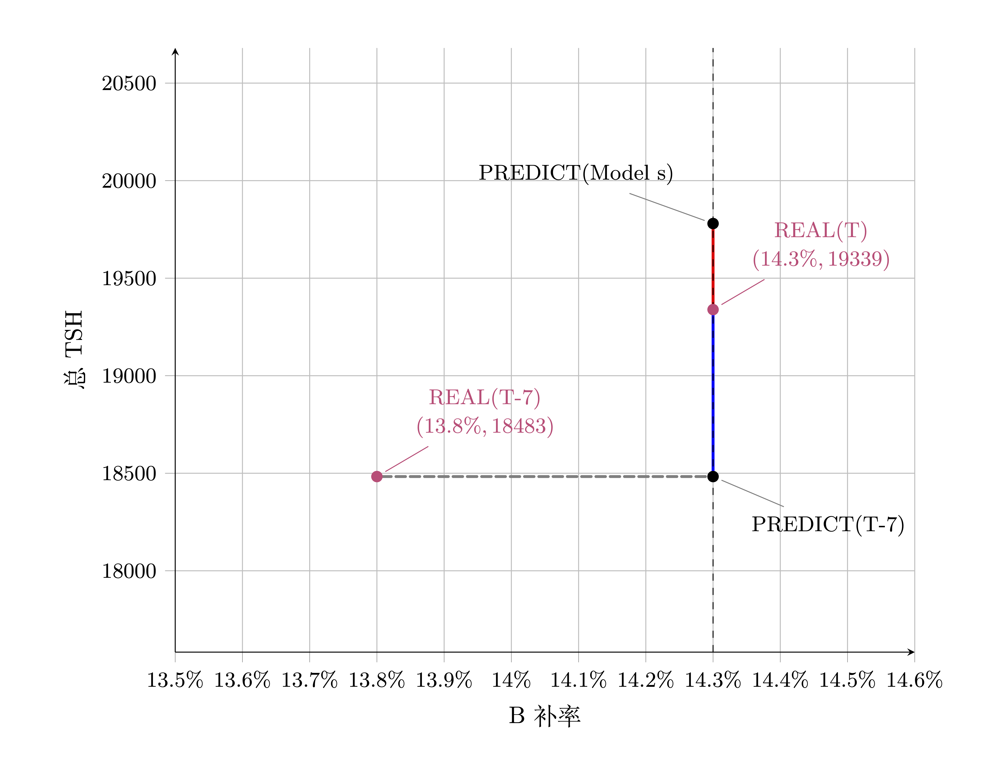

> 弹性的准确性以下图所示为例，不同模型在W-1周对于W周的总TSH预估为$$\hat Y$$，真值为$$Y$$，补贴率为$$X$$我们选用：

> $$MAE=\frac{\hat Y_W - Y_{W-1}}{X_W-X_{W-1}}-\frac{Y_{W} - Y_W-1}{X_W-X_{W-1}}$$的大小对比不同模型

> $$MAE_{基线} = \frac{Y_{W-1} - Y_{W-2}}{X_{W-1}-X_{W-2}}-\frac{Y_{W} - Y_{W-1}}{X_{W}-X_{W-1}}$$作为基线

> 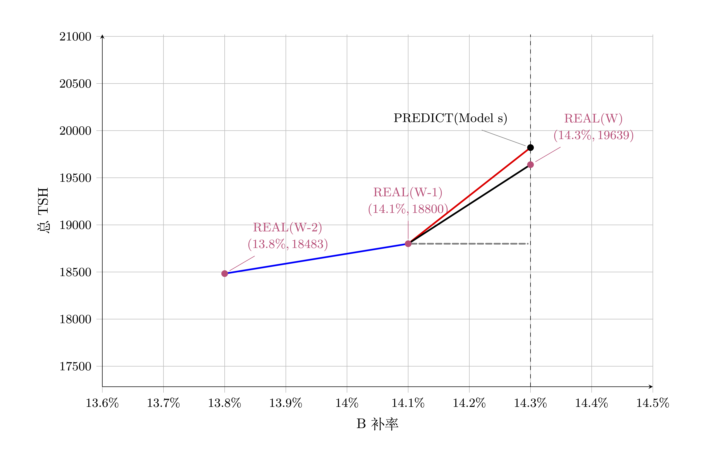

## 1.4 问题假设

在下文的建模过程中我们需要接受如下假设：

1. **因果效应可识别性假设**

   我们假设本问题中的因果效应是可识别的。这要求模型满足**马尔可夫性**，即：

- 因果效应可以用有向无环图（DAG）表示（重点是不存在环结构，即 $$Y$$ 不能反过来影响 $$X$$ 或 $$Z$$）；

- 模型中的误差项（扰动项）彼此相互独立。

   在满足可识别性假设下，我们理论上能够仅从**观测数据**中推导出干预后分布的形式，从而获得条件期望，即因果响应面。

2. **协变量集合** $$S$$ **的可调性假设**

   我们假设协变量集合 $$S$$ 是因果效应 $$P(Y \mid \text{do}(X))$$ 的一个可调集合。这要求：

- $$S$$ 中的任意变量均不为干预变量 $$X$$ 在因果图中的后代节点（即任意协变量 $$Z$$ 不受 $$X$$ 影响）；

- 控制 $$S$$（条件化 $$S$$ 在某个水平）可以阻断所有从 $$X$$ 到 $$Y$$ 的后门路径，即在给定 $$S$$ 下可认为不存在其他混淆变量。

   在满足可调集合的假设下，我们可将干预后的分布写为：

   $$P(Y \mid \text{do}(X=x_0)) = \sum_{z_1\in Z_1} \cdots \sum_{z_n\in Z_n} P(Y \mid X=x_0, Z_1=z_1, \ldots, Z_n=z_n) \cdot P(Z_1=z_1,  \ldots, Z_n=z_n)$$

   进一步，边际条件期望（即平均干预效应）可表示为：

 $$E[Y \mid \text{do}(X=x_0)] = \sum_{z_1\in Z_1} \cdots \sum_{z_n \in Z_n} E[Y \mid X=x_0, Z_1=z_1, \ldots, Z_n=z_n] \cdot P(Z_1=z_1,\ldots, Z_n=z_n)$$

   即通过在协变量的联合分布下对条件期望 $$E[Y \mid X,Z]$$ 进行边际求和，就可以实现不同干预水平 $$x_0$$ 下平均因果效应的计算。

# 2 数据理解与预处理

在进行城市维度 B 弹可解释性建模过程中，我们需要尽可能全面地捕捉并挖掘可能影响干预（B 补率水平）或影响司机行为指标（登端转化率、出车时长等）的因素。根据我们的业务理解和数据可得性，初步筛选的协变量如下表所示。

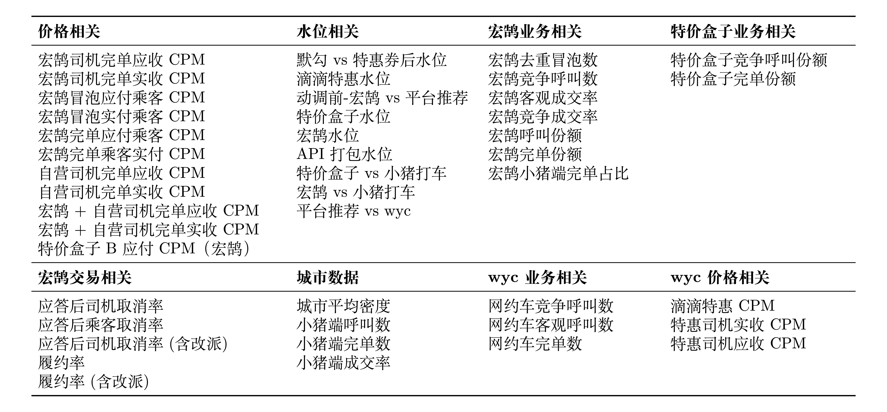

## 2.1 特征筛选

为降低变量维度、避免多重共线性带来的干扰，同时保持模型的可解释性和业务可读性，我们首先在同一组变量内部进行特征聚类，筛选组内具有代表性的特征用于后续建模。具体过程如下：

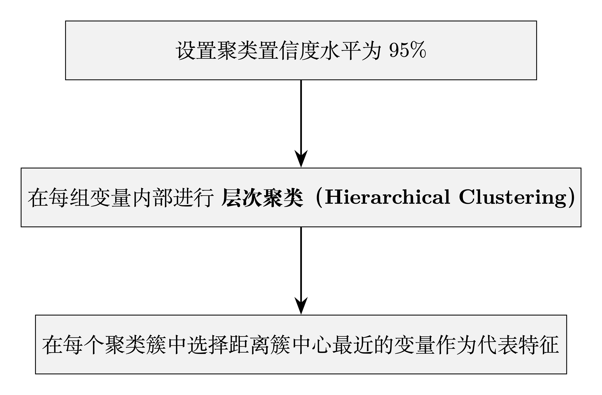

---

**“价格相关”组特征筛选**

我们首先对“价格相关”组的变量进行层次聚类，结果如下：

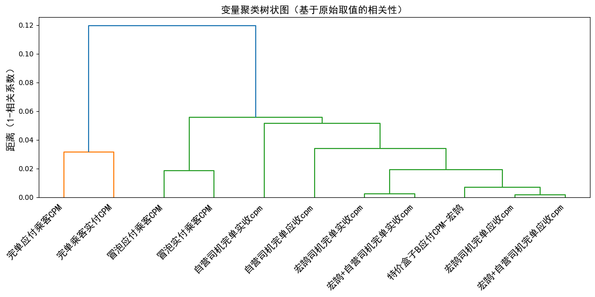

经聚类初筛，**价格相关组**最终保留以下变量作为该组的代表变量：

- 宏鹄完单乘客实付 CPM

- 宏鹄司机完单应收 CPM

---

**“水位相关组”特征筛选**

在水位相关组中，使用层次聚类进行组内降维，聚类结果如下：

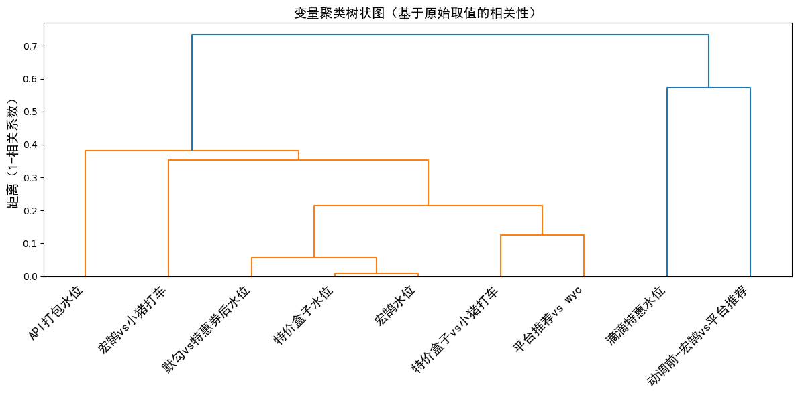

因此，水位类需要保留的特征：

- 特价盒子水位

- 特价盒子 vs 小猪打车

- 平台推荐 vs wyc

- 宏鹄 vs 小猪打车

- API 打包水位

- 滴滴特惠水位

- 动调前 - 宏鹄 vs 平台推荐

由于变量数量仍然较多，我们进一步查看每一维变量与干预变量 $$X$$ 和结果变量 $$Y$$ 的皮尔逊相关系数，以便进一步剔除无关变量。

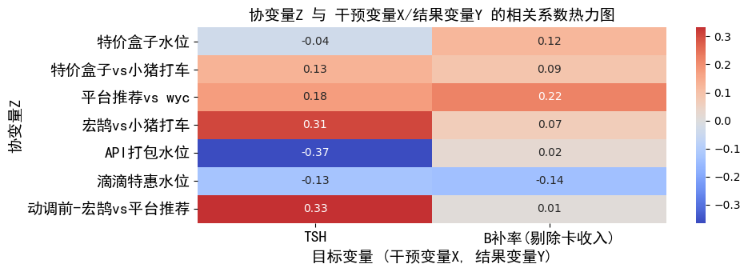

根据热力图结果，剔除与干预 $$X$$ 和结果 $$Y$$ 相关性极低的变量后，**水位类变量**最终保留：

- 特价盒子水位

- 宏鹄 vs 小猪打车

- API 打包水位

- 滴滴特惠水位

- 平台推荐 vs wyc

这一筛选过程确保了保留的特征具有更高的相关性和代表性，同时避免无关特征引入噪声，影响后续建模的稳定性和可解释性。

---

对于 **“宏鹄业务相关”**、**“特价盒子业务相关”**、**“宏鹄交易相关”**、**“城市相关”**、**“wyc业务相关”** 和 **“wyc价格相关”** 这些组，由于组内变量数量较少，我们不再进行聚类，但剔除相关性极低的变量后，最终分别保留：

- **宏鹄业务相关**：宏鹄客观成交率、宏鹄竞争呼叫数、宏鹄完单份额

- **宏鹄交易相关**：应答后司机取消率（含改派）、履约率

- **城市数据**：城市平均密度、小猪端成交率

- **wyc业务相关**：网约车客观呼叫数、网约车完单数

- **wyc价格相关**：滴滴特惠 CPM、特惠司机实收 CPM

- **特价盒子业务相关**：特价盒子竞争呼叫份额、特价盒子完单份额

---

最终，初筛后的协变量如下：

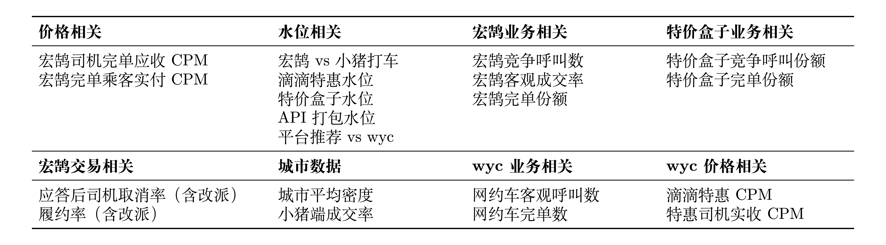

为了尽可能满足假设二（协变量覆盖的完整性），经过与司机运营相关的业务同学进行了充分讨论后，业务同学认为当前协变量已较为全面，但建议补充：

1. 小猪自营 B 补率

2. 司机服占比（司机服务时长 / 司机在线时长）

然而，

**小猪自营 B 补率**：在模型推理阶段无法获得（相当于自营侧的规划补贴率，在模型推理时拿不到）。且尝试加入后模型预测性能没有提升，所以最终决策不纳入协变量集合；

**司机服占比**：属于结果变量的下游衍生指标，若纳入协变量会破坏**假设一**（“结果变量不能反向影响干预或协变量”）的基础。所以我们将T-7的历史值纳入协变量集，以保证模型闭环与因果结构清晰。

## 2.2 协变量分类与因果图构建

在 因果建模前，为了更准确识别协变量对干预变量和对结果变量的作用路径，我们将协变量区分为以下四类：

**1) 工具变量（Instrumental Variable, IV）**

此类协变量**仅**通过影响干预变量进而间接影响结果变量。不存在其他通路影响结果变量的水平。

<!-- Cooper 原生图表来源信息
{"type": "flowchart", "sourceId": "MjIwNTIwMjcyNDgxNA", "version": "", "fileUrl": "附件/LR25029/图表01.svg"}
-->

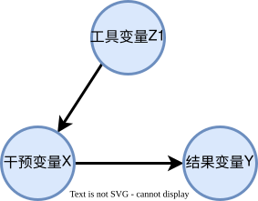

[图表 01 · SVG 源文件](附件/LR25029/图表01.svg) · [Cooper 原图](https://cooper.didichuxing.com/knowledge/2199610335356/2205200233446)

**2) 混淆变量（Confounder）**

此类协变量既影响干预变量的水平，也影响结果变量的水平。

<!-- Cooper 原生图表来源信息
{"type": "flowchart", "sourceId": "MjIwNTIwMjc2NzcyNg", "version": "", "fileUrl": "附件/LR25029/图表02.svg"}
-->

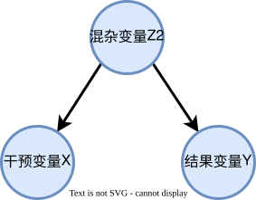

[图表 02 · SVG 源文件](附件/LR25029/图表02.svg) · [Cooper 原图](https://cooper.didichuxing.com/knowledge/2199610335356/2205200233446)

**3) 中介变量（Mediator）**

干预变量影响某一个中介变量的水平，这个中介变量又进一步影响结果变量的水平。中介变量的存在会破坏假设二，当有中介变量存在时，该中介变量需要提级为干预变量，原先的干预变量变为模型的混淆变量。

<!-- Cooper 原生图表来源信息
{"type": "flowchart", "sourceId": "MjIwNTIwMjc5NDY3Ng", "version": "", "fileUrl": "附件/LR25029/图表03.svg"}
-->

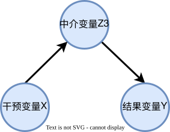

[图表 03 · SVG 源文件](附件/LR25029/图表03.svg) · [Cooper 原图](https://cooper.didichuxing.com/knowledge/2199610335356/2205200233446)

**4) 结果驱动变量（Outcome Predictor）**

与结果变量相关，对结果变量水平的预测有帮助

<!-- Cooper 原生图表来源信息
{"type": "flowchart", "sourceId": "MjIwNTIwMjg1MzI4NQ", "version": "", "fileUrl": "附件/LR25029/图表04.svg"}
-->

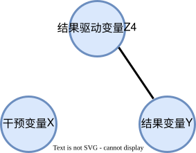

[图表 04 · SVG 源文件](附件/LR25029/图表04.svg) · [Cooper 原图](https://cooper.didichuxing.com/knowledge/2199610335356/2205200233446)

在下文尝试的不同 模型中，对于这几类变量的考量与处理有所差异，所以需要我们事先明确每一个变量的类型。

### 领域知识注入

在明确变量类型这一过程中，协变量与干预、协变量与结果之间是否存在因果关联，需要司机运营相关的业务同学协助提供一些**先验**的领域知识，具体地：

- 对于每一个协变量，若业务同学有 80% 以上的信心确认其与干预或与结果变量存在因果效应（即 A 会影响 B），我们会视为存在因果路径，并在建模中进行显式调整。

- 对于业务同学无法确认的协变量，将交由算法自动挖掘处理，我们使用 **Peter-Clark (PC)** 算法等结构学习方法，基于数据探索潜在的因果关系（因果挖掘，Causal Discovery）

**特别地**，我们注意到业务同学确认有一些协变量对于干预或者结果是反向影响或相互影响，这会破坏我们的建模假设一，所以我们的处理方式是：**时序因果阻断**

即将该特征当日的值替换为历史值（具体选用了当日前一天的过去七天的滑动平均值）加入进来，这些变量我们将以“\_MA7”后缀进行标注。

举例：宏鹄的客观成交率。当日总TSH（结果变量Y）会反向影响当日的宏鹄客观成交率，同样地，当日B补率（干预变量X）也会反向影响当日的宏鹄客观成交率，这会破坏我们的假设1与2（因果图不存在环结构），因此我们这里使用历史值来替换当日值，阻断结果变量Y与干预变量X对该协变量的反向影响。

对于业务不确定是否有影响的协变量，我们通过Peter-Clark算法从数据出发进行因果挖掘，得到结果如下：

通过结合领域知识与算法自动挖掘，可在数据驱动与业务理解之间取得平衡，为后续弹性建模和因果响应面估计奠定可靠基础。

最终的最终，汇总后的协变量及其分类结果如下：

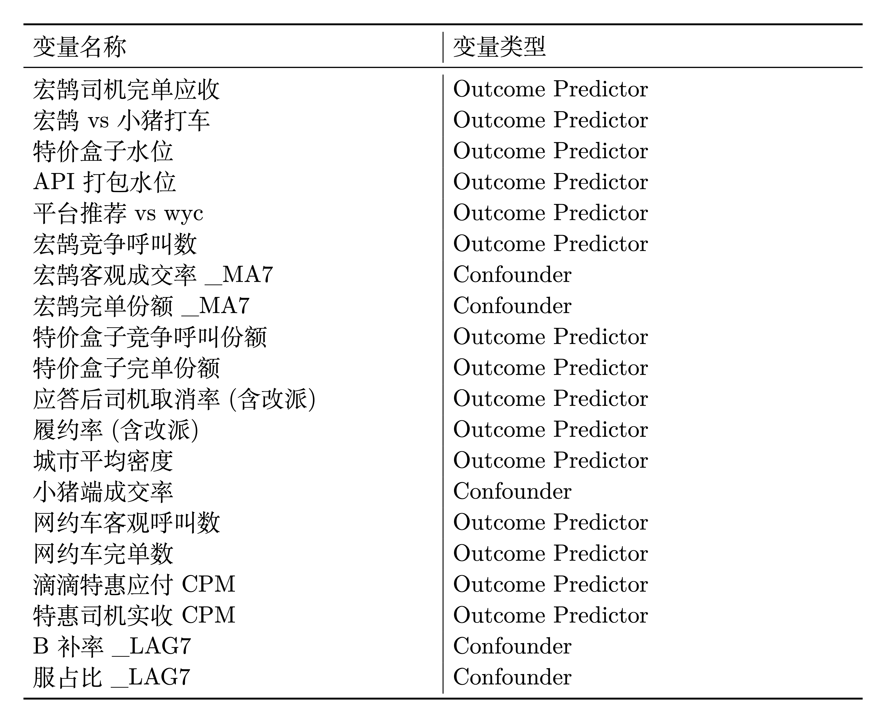

# 3 建模方法

在模型选型方面，我们几乎尝试了所有机器学习领域与统计学习（可解释性建模）领域关于因果建模的方法，并将所有方法在业务真实数据上的回测结果进行横向对比，选取稳健最优者。下文我们将以 宏鹄-福州市（34）为例展示各模型响应曲线结果。

## 3.1 回归调整方法

### 基本思路

回归调整（Regression Adjustment）是最基础且直观的因果响应面估计方法，其核心思路是直接拟合干预变量、协变量与结果变量之间的关系，进而得到所求条件期望和其偏导数。

---

### 3.1.1 线性回归调整

#### 模型形式

假设结果变量 $$Y$$ 与干预变量 $$X$$ 及混淆变量 $$Z$$ 之间存在线性关系：

$$Y = \beta_0 + \beta_X X + \beta_Z^\top Z + \epsilon$$

其中：

- $$\beta_0$$：截距项；

- $$\beta_X$$：干预变量 $$X$$ 的回归系数；

- $$\beta_Z$$：混淆变量 $$Z$$ 的回归系数向量；

- $$\epsilon$$：噪声项，满足 $$E[\epsilon \mid X,Z] = 0$$。

#### 参数估计

利用最小二乘法，选择 $$\beta = (\beta_0, \beta_X, \beta_Z^\top)^\top$$ 来最小化残差平方和：$$\hat{\beta} = \arg\min_{\beta} \sum_{i=1}^n \left( Y_i - \beta_0 - \beta_X X_i - \beta_Z^\top Z_i \right)^2$$

估计后即可得到：$$\hat{E}[Y \mid X,Z] = \hat{\beta}_0 + \hat{\beta}_X X + \hat{\beta}_Z^\top Z$$

#### 关于 *X* 的偏导数计算

在 OLS 模型中，因其对 $$X$$ 是线性的，估计的条件期望关于 $$X$$ 的偏导数为：$$\frac{\partial \hat{E}[Y \mid X,Z]}{\partial X} = \hat{\beta}_X$$

即回归系数 $$\hat{\beta}_X$$ 本身即为关于干预变量 $$X$$ 的偏导数，且不依赖于 $$X$$ 与 $$Z$$ 的具体取值。

#### 引入非线性

我们尝试将$$X$$、$$X与Log(X)$$、$$X与X^2$$、$$X、Log(X)与X^2$$作为变量加入到模型中进行回归，来引入$$Y$$与$$X$$的非线性关系，结果如下：

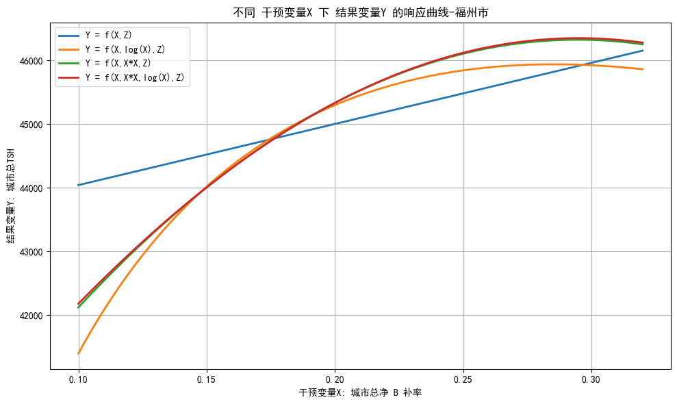

#### 小结

线性回归（OLS）的优点在于实现简单、计算高效且具有良好的可解释性，能够直接获得偏导数用于因果效应估计。

但其缺点在于需要根据建模效果手动选择并引入非线性变量，无法自动习得非线性；同时，在不同协变量水平下（比如周中、周末），响应曲线的形状无差异（斜率只取决于各$$X$$项前的系数，与$$Z$$无关），即$$X$$与$$Z$$没有交互项。

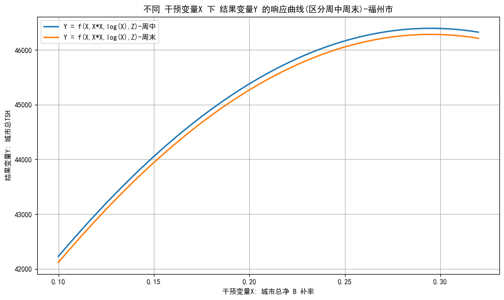

### 3.1.2 样条回归调整（待尝试）

#### 模型形式

为捕捉干预变量 $$X$$ 与结果变量 $$Y$$ 之间的非线性关系，同时控制协变量 $$Z$$，采用样条回归（Spline Regression）建模条件期望：

$$Y = \beta_0 + f_X(X) + \beta_Z^\top Z + \epsilon$$

其中：

- $$\beta_0$$ 为截距项；

- $$f_X(X)$$ 为关于 $$X$$ 的平滑非参数函数，通常采用自然样条（Natural Splines）或 B 样条（B-Splines）表示；

- $$\beta_Z$$ 为混淆变量 $$Z$$ 的回归系数向量；

- $$\epsilon$$ 为噪声项，满足 $$E[\epsilon \mid X,Z] = 0$$。

#### 估计方式

将 $$f_X(X)$$ 表示为 $$K$$ 个基函数的线性组合：$$f_X(X) = \sum_{k=1}^{K} \theta_k B_k(X)$$

其中 $$B_k(X)$$ 为样条基函数，$$\theta_k$$ 为待估参数。通过最小化加权残差平方和或带平滑惩罚项的最小二乘问题进行参数估计：

$$\hat{\beta}, \hat{\theta} = \arg\min_{\beta,\theta} \sum_{i=1}^n \left( Y_i - \beta_0 - \sum_{k=1}^{K} \theta_k B_k(X_i) - \beta_Z^\top Z_i \right)^2  + \lambda \int \left[ f_X''(x) \right]^2 dx$$

其中 $$\lambda$$ 为平滑参数，控制拟合与平滑之间的权衡，可通过交叉验证确定。

#### 关于 *X* 的偏导数计算

由于$$f_X(X) = \sum_{k=1}^{K} \hat{\theta}_k B_k(X)$$

则其关于 $$X$$ 的偏导数为：$$\frac{\partial \hat{E}[Y \mid X,Z]}{\partial X} = \sum_{k=1}^{K} \hat{\theta}_k B_k'(X)$$

其中 $$B_k'(X)$$ 为基函数关于 $$X$$ 的导数，可通过解析或数值方式计算，具体取值依赖于 $$X$$ 的位置

## 3.2 广义加性模型 (GAM) 方法

### 模型形式

广义加性模型（Generalized Additive Model, GAM）用于在控制协变量 $$Z$$ 的条件下，灵活拟合干预变量 $$X$$ 与结果变量 $$Y$$ 之间的非线性关系，同时捕捉协变量的非线性影响。

模型形式为：$$Y = \beta_0 + f_X(X) + \sum_{j=1}^{p} f_{Z_j}(Z_j) + \epsilon$$

其中：

-  为截距项；

- $$f_X(\cdot)$$ 为关于干预变量 $$X$$ 的平滑函数（如：样条函数）；

- $$f_{Z_j}(\cdot)$$ 为关于协变量 $$Z_j$$ 的平滑函数（如：样条函数）；

- $$\epsilon$$ 为噪声项，满足 $$E[\epsilon \mid X,Z] = 0$$。

### 参数估计

GAM 将每个平滑函数使用样条函数（如自然样条、B 样条等）展开为基函数的线性组合：

$$f_X(X) = \sum_{k=1}^{K_X} \theta_k B_k(X), \quad f_{Z_j}(Z_j) = \sum_{l=1}^{K_{Z_j}} \gamma_{j,l} S_l(Z_j)$$

并通过最小化带平滑惩罚项的残差平方和进行参数估计：

$$\min_{\theta,\gamma} \sum_{i=1}^{n} \left( Y_i - \beta_0 - \sum_{k} \theta_k B_k(X_i) - \sum_{j} \sum_{l} \gamma_{j,l} S_l(Z_{i,j}) \right)^2 + \text{Penalty}$$

其中惩罚项用于控制平滑程度（防止过拟合），参数通常使用 GCV（广义交叉验证）或 REML（带约束的最大似然估计）自动选择。

### 期望与关于 *X* 的偏导数计算

拟合完成后，条件期望为：

$$\hat{E}[Y \mid X,Z] = \hat{\beta}_0 + \hat{f}_X(X) + \sum_{j=1}^{p} \hat{f}_{Z_j}(Z_j).$$

其中 $$\hat{f}_X(X)$$ 表示干预变量 $$X$$ 的非线性影响，可直接用拟合模型预测。

关于 $$X$$ 的偏导数为：

$$\frac{\partial \hat{E}[Y \mid X,Z]}{\partial X} = \hat{f}_X'(X)$$

实际计算中可通过预测矩阵提取导数，或使用有限差分近似。

### 实际效果

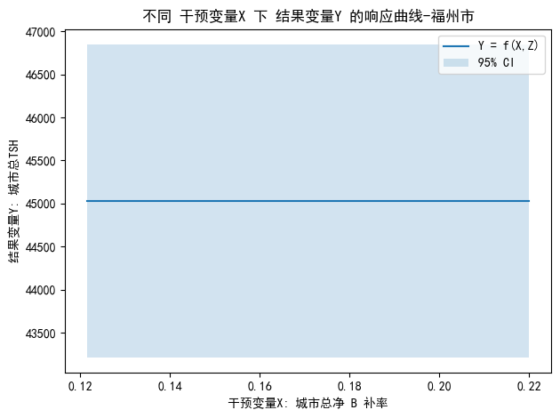

### 小结

尝试调用现成的pygam库实现，发现无论怎么调整代码均建模失败，后面有时间手动实现一版再看下效果。

## 3.3 广义倾向性得分 (GPS) 方法

### 模型形式

广义倾向性评分（Generalized Propensity Score, GPS）方法用于连续或多值处理（Treatment）下的因果效应估计。其核心思路是先建模干预变量 $$X$$ 在协变量 $$Z$$ 条件下的分布，再利用 GPS 调整混淆，从而实现对 $$E[Y \mid X,Z]$$ 及其关于 $$X$$ 的偏导数的准确估计。

在连续处理下，GPS 定义为： $$R = r(X,Z) = f_{X \mid Z}(X \mid Z),$$ 

即干预变量$$X$$ 在给定协变量$$Z$$下的条件**概率密度**。

此时条件期望可进一步表示为： $$E[Y \mid X = x, R = r],$$ 

从而实现与协变量$$Z$$的解耦，以便估计不同干预水平$$X$$下的因果响应面。

### 估计方式

GPS 方法通常分两步：

1. **第一步：估计 GPS**

2. **第二步：建模** $$Y \sim X, R$$

### 期望与关于 *X* 的偏导数计算

在完成 GPS 回归拟合后，条件期望可近似为： $$\hat{E}[Y \mid X,Z] \approx \hat{h}(X, \hat{r}(X,Z)),$$ 其中 $$\hat{r}(X,Z)$$ 为估计得到的 GPS 值。

关于干预变量 $$X$$ 的偏导数为： $$\frac{\partial \hat{E}[Y \mid X,Z]}{\partial X} = \frac{\partial \hat{h}(X,R)}{\partial X} + \frac{\partial \hat{h}(X,R)}{\partial R} \cdot \frac{\partial \hat{r}(X,Z)}{\partial X},$$ 其中：

- 第一项反映 $$X$$ 对结果的直接影响；

- 第二项反映 $$X$$ 通过 GPS 对结果的间接影响。

实际计算中，可利用自动微分或有限差分方法进行数值计算（比如直接从响应曲线上计算）

### 具体实现

（1）GPS基学习器采用XGBoost，当参数 决策树数量n 采用不同数值时，城市总TSH周中周末预测结果如下：

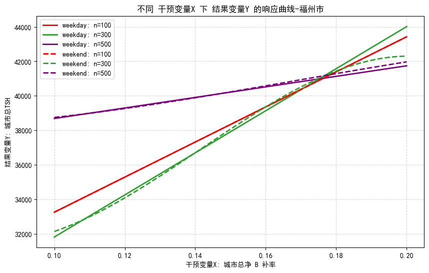

（2）GPS基学习器采用SVR，城市总TSH周中周末预测结果如下：

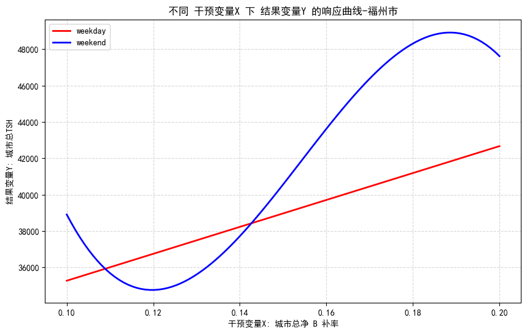

### 小结

GPS基学习器如果使用XGB进行预测，发现其对决策树数量参数n过于敏感，而如果使用SVR则预测，发现其不满足单调性预期。

## 3.4 双重机器学习方法（尝试过但弃用，原因见小结）

### 模型形式

双重机器学习（Double Machine Learning, DML）方法旨在在存在高维协变量 $$Z$$ 时，实现对 $$E[Y \mid X,Z]$$ 及其关于 $$X$$ 的偏导数（即因果效应）的稳健估计。其核心思想是结合 **Neyman Orthogonality** 与机器学习方法，通过去偏（Debiasing）和交叉拟合（Cross-fitting）减少高维协变量对因果估计产生的偏误。

考虑如下因果模型：

$$Y = \theta_0 X + g(Z)  + \epsilon_Y$$

$$X = m(Z) + \epsilon_X$$

其中：

- $$g(Z)$$ 表示结果变量 $$Y$$ 关于协变量 $$Z$$ 的条件期望；

- $$m(Z)$$ 表示处理变量 $$X$$ 关于协变量 $$Z$$ 的条件期望；

- $$\epsilon_Y$$ 为结果方程噪声项，满足 $$E[\epsilon_Y \mid Z] = 0$$；

- $$\epsilon_X$$ 为干预方程噪声项，满足 $$E[\epsilon_X \mid Z] = 0$$。

### 估计方式

DML 方法主要步骤如下：

1. **拟合 Nuisance Parameters**

   使用任意机器学习方法（随机森林、Boosting、神经网络等）估计：$$\hat{m}(Z) \approx E[X \mid Z], \quad    \hat{g}(Z) \approx E[Y \mid Z]$$

2. **计算残差**

   计算干预残差与结果残差：$$\tilde{X} = X - \hat{m}(Z), \quad    \tilde{Y} = Y - \hat{g}(Z)$$

3. **残差回归估计因果效应**

   在交叉拟合下，利用残差回归估计 $$\theta_0$$：

$$\hat{\theta}_0 =    \frac{\sum_{i=1}^n \hat{\epsilon}{X,i} \hat{\epsilon}{Y,i}}{\sum_{i=1}^n \hat{\epsilon}_{X,i}^2}$$

残差回归
核心思路

- 用残差 $$\tilde{X}$$ 表示 **“**$$Z$$ **导致** $$X$$ **变化之外的部分”**（纯粹的 $$X$$ 自身的变化）：

  $$\tilde{X} := X - \mathbb{E}[X \mid Z]$$

- 残差 $$\tilde{Y}$$ 表示 **“**$$Z$$ **导致** $$Y$$ **变化之外的部分”**（由 $$X$$ 导致的变化部分）：

  $$\tilde{Y} := Y - \mathbb{E}[Y \mid Z]$$

- 由于 $$\tilde{Y}$$ 中唯一与 $$\tilde{X}$$ 相关的部分是 $$\theta_0 \tilde{X}$$，可通过二者的商提取出 $$X$$ 对 $$Y$$ 的影响。

该思想依赖于 **Partial Linear Model (PLM)** 假设：

$$Y = \theta_0 X + g(Z) + \epsilon_Y$$

并且满足：

$$\mathbb{E}[\epsilon_Y \mid X,Z] = 0$$

推导过程

从 Partial Linear Model 出发：

$$Y = \theta_0 X + g(Z) + \epsilon_Y$$

对 $$Z$$ 取条件期望：

$$\mathbb{E}[Y \mid Z] = \theta_0 \mathbb{E}[X \mid Z] + g(Z)$$

构造残差：

$$\tilde{Y} := Y - \mathbb{E}[Y \mid Z], \quad \tilde{X} := X - \mathbb{E}[X \mid Z]$$

则：

$$\tilde{Y} = \theta_0 \tilde{X} + \epsilon_Y$$

由于：

$$\mathbb{E}[\tilde{X} \cdot \epsilon_Y] = 0$$

两边乘以 $$\tilde{X}$$ 并取期望：

$$\mathbb{E}[\tilde{X} \tilde{Y}] = \theta_0 \mathbb{E}[\tilde{X}^2]$$

从而得到：

$$\boxed{\theta_0 = \frac{\mathbb{E}[\tilde{X} \tilde{Y}]}{\mathbb{E}[\tilde{X}^2]}}$$

在有限样本中：

$$\boxed{\hat{\theta}_0 = \frac{\sum_{i=1}^n \tilde{X}_i \tilde{Y}i}{\sum{i=1}^n \tilde{X}_i^2} = \frac{\sum_{i=1}^n \hat{\epsilon}{X,i} \hat{\epsilon}{Y,i}}{\sum_{i=1}^n \hat{\epsilon}_{X,i}^2}}$$

其中：

$$\hat{\epsilon}_{X,i} = X_i - \hat{m}(Z_i), \quad \hat{\epsilon}_{Y,i} = Y_i - \hat{g}(Z_i)$$

且 $$\hat{m}(Z)$$、$$\hat{g}(Z)$$ 可用回归方法（线性回归、随机森林、神经网络等）估计。

### 小结

我们在两步建模过程中尝试了各种不同的基学习器，但每一步的R方都较低；

且本方法只能给出弹性值的估计，无法给出响应曲线（TSH - B补率曲线）的估计，导致无法串联后续资源分配，因而弃用。

## 3.5 双重鲁棒估计器法

### 模型形式

Doubly Robust Learner (DRLearner) 是由 Künzel 等人提出的一种估计异质性因果效应（Heterogeneous Treatment Effect, HTE）的元学习方法。它结合了结果预测模型（Outcome Model）与倾向性得分模型（Propensity Model），具备双重稳健性，指的是

- 如果倾向得分模型 $$\hat{e}(X)$$ 估计正确，则最终ITE的预估与真实值一致

- 如果结果预测模型 $$\hat{m}(X,T)$$ 估计正确，则最终ITE的预估与真实值一致

其核心思想是：在高维或非线性场景下，先用机器学习模型拟合处理变量与结果变量的条件期望，再通过残差修正构造ITE伪标签，最终建模**个体处理效应**（Individual Treatment Effect, ITE）。

> 在ITE的估计中，建模采用如下步骤

> 1、估计结果模型
>
> $$\hat{\mu}_1(X) = \mathbb{E}[Y \mid T=1, X],      \quad      \hat{\mu}_0(X) = \mathbb{E}[Y \mid T=0, X]$$

> 2、估计倾向得分模型
>
> $$\hat{e}(X) = \mathbb{P}(T=1 \mid X)$$

> 3、构造校正后的ITE预估
>
> $$\tilde{Y}_i =      \frac{T_i - \hat{e}(X_i)}{\hat{e}(X_i) (1 - \hat{e}(X_i))}     \cdot     (Y_i - \hat{m}(X_i, T_i))     +     \left(\hat{\mu}_1(X_i) - \hat{\mu}_0(X_i)\right)$$，其中$$\hat{m}(X_i, T_i) = T_i \cdot \hat{\mu}_1(X_i) + (1-T_i) \cdot \hat{\mu}_0(X_i)$$

> 4、用任意学习器$$h$$进行 $$\tilde{Y}_i$$$$\sim X_i$$

> 5、得到ITE的双重鲁棒估计器

> $$\hat{\tau}(X) = h(X).$$

由于我们的场景不关注ITE，所以参考其思想我们改造了适用于估计响应曲线的 DR Learner，如下：

$$\hat{m}(X,Z) = \hat{m}_0(X,Z) + \hat{r}(X,Z)$$

其中：

- $$\hat{m}_0(X,Z)$$：基于 $$(X,Z)$$ 的初步回归拟合；

- $$\hat{r}(X,Z)$$：基于残差加权的误差校正项。

### 参数估计方式

在 双重鲁棒估计器(DRL) 建模中，根据协变量对干预变量和对结果变量的作用路径，理论上对于中介变量、工具变量、混淆变量、结果驱动变量 这四类变量的处理如下：

- 中介变量：被干预变量影响，其存在会破坏假设二，需要将其**提级为干预变量**，原先的干预变量变为模型的混淆变量。

- 工具变量：直接影响干预变量，用于估计**广义倾向评分GPS。**

- 混淆变量：同时影响干预变量与结果变量，用于估计**广义倾向评分GPS与结果变量。**

- 结果驱动变量：只影响结果变量，用于估计**结果变量。**

**在我们的本次建模中，通过上述变量分析，协变量$$Z$$只存在混淆变量$$Z_1$$与结果驱动变量$$Z_2$$，即**$$Z=(Z_1,Z_2)$$，因此只需要对二者进行处理

具体估计建模方式如下：

1. **估计 GPS**

   使用 GPS 模型估计干预变量 $$X$$ 在混淆变量 $$Z_1$$ 条件下的条件概率密度：$$\hat{e}(X \mid Z_1) = \hat{f}_{X \mid Z_1}(X \mid Z_1)$$

2. **拟合初步回归** $$\hat{m}_0(X,Z)$$

   构造特征 $$[X,Z]$$，使用回归模型拟合$$Y = m_0(X,Z) + \epsilon_Y$$

   得到：$$\hat{m}_0(X,Z)$$

3. **计算残差与加权**

   计算残差：$$R = Y - \hat{m}_0(X,Z)$$

   并计算权重：$$w = \frac{1}{\hat{e}(X \mid Z_1)}$$

   以提升 GPS 稀疏区域的估计准确性。

4. **拟合残差校正模型**

   使用回归模型拟合：$$R = r(X,Z) + \epsilon$$

   并带入加权 $$w$$ 以获得：$$\hat{r}(X,Z)$$

5. **组合得到最终响应面估计**

   综合预测：$$\hat{m}(X,Z) = \hat{m}_0(X,Z) + \hat{r}(X,Z)$$

   得到对条件期望 $$E[Y \mid X,Z]$$ 的稳健估计。

### 期望与关于 *X* 的偏导数计算

最终估计的条件期望为：

$$\hat{E}[Y \mid X,Z] = \hat{m}_0(X,Z) + \hat{r}(X,Z)$$

关于干预变量 $$X$$ 的偏导数为：$$\frac{\partial \hat{E}[Y \mid X,Z]}{\partial X} = \frac{\partial \hat{m}_0(X,Z)}{\partial X} + \frac{\partial \hat{r}(X,Z)}{\partial X}$$

计算方式：

- 若回归器可微（如神经网络、样条回归），可直接使用自动微分计算；

- 若使用树模型，可采用有限差分近似计算偏导。

### 具体实现

（1）DRL基学习器为XGBoost，城市总TSH周中周末预测结果如下：

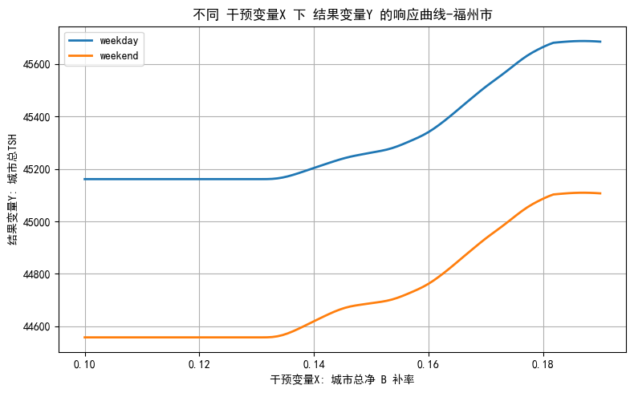

（2）DRL基学习器为RandomForest（RF），城市总TSH周中周末预测结果如下：

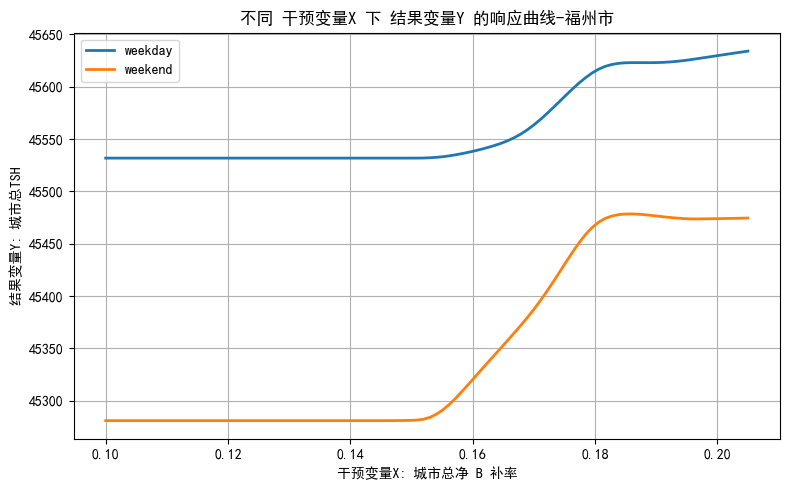

### 小结

从响应曲线可以观察到，DRL基学习器如果使用XGBoost进行建模，发现周中周末的TSH值有区分度，弹性没有区分度；

而如果使用RF进行建模，周中周末的TSH值与弹性都有区分度。建模具体准确程度需要看回测数值结果。

### Top50城 DRL(RF) 拟合结果

（1）宏鹄50城拟合结果

小结：

宏鹄近期净总 B 补率处于较高水位（接近 20%），很多城市 TSH 处于饱和水平（继续提高 B 补率，边际 TSH 增量有限）；

其中呼和浩特市，阳江市，广州市与赣州市的周中还有投资潜力和空间。

**关于成都市弹性响应曲线的问题分析**

问题：从成都市弹性响应曲线上可以看到 ，B补率>0.12 之后TSH就呈现出几乎无弹性的现象，是否因为该城市的训练样本中 B补率>0.12 样本太少？

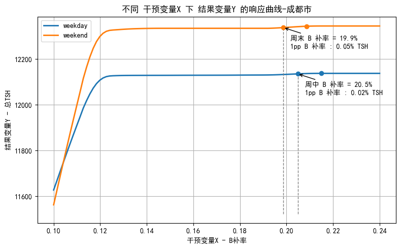

具体分析如下，我们以周中的弹性曲线为例，查看了成都市 “B 补率—TSH” 的原始散点分布情况，发现训练样本中 存在相对较多的 B补率>0.12 样本，如下图所示：

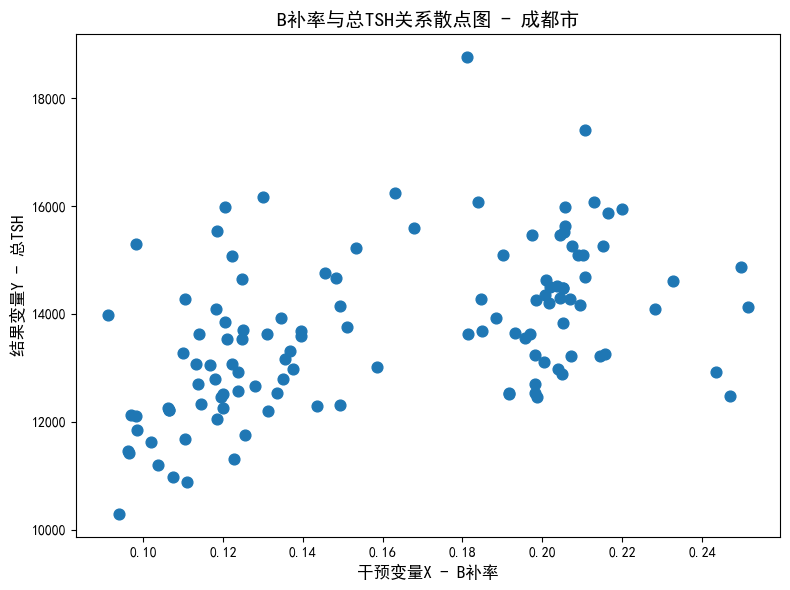

在 B 补率集中分布的位置上（11%-14%，18%-21%），在相近的补贴率区间下，TSH的上下分布差异很大，仅通过 B 补率—TSH 分布来看无法给出良好的弹性关系。

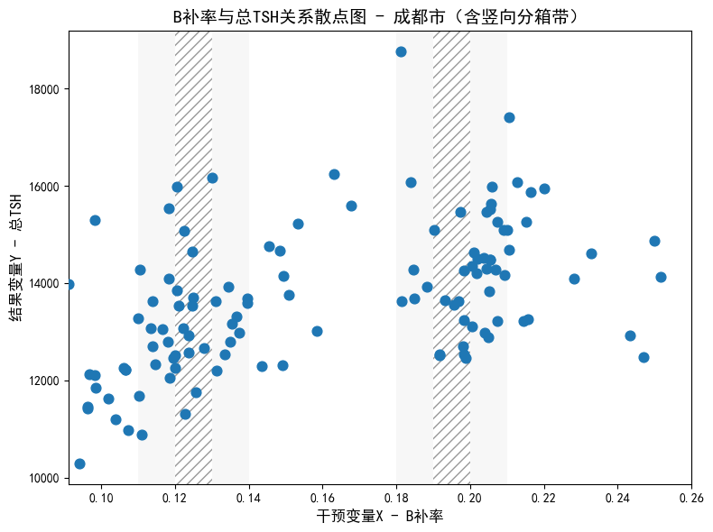

但是如果在协变量 Z 密集分布的空间区域，存在某一个（或几个）子区域中协变量 Z 距离很接近，且 X 与 Y 能呈现良好的分布，那么我们可以得到在这个子区域下的良好的弹性响应曲线。比如下图中我们人工（假的）将上面的散点分为几簇，以展示在某一簇 Z 下，TSH 与 B 补率呈现较强的单调性（在这个协变量水平下，Y关于X的弹性是learnable的）：

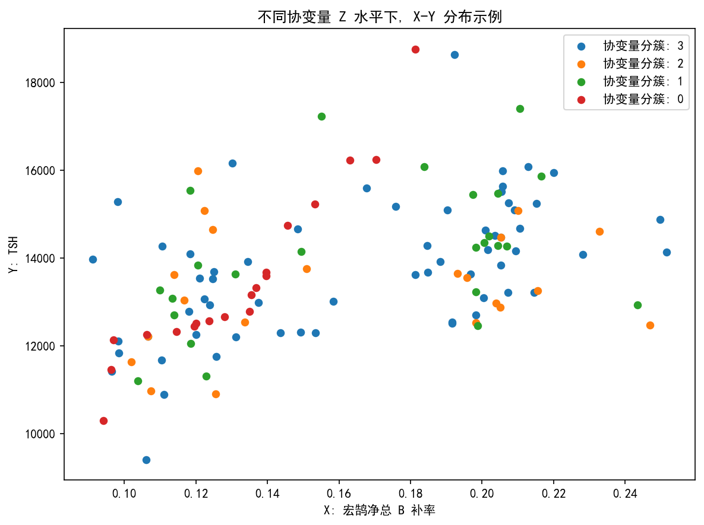

于是我们将成都市真实的所有样本点，根据协变量 Z 进行 K-Means聚类，根据手肘法将协变量 Z 在空间的分布聚类为四簇，然后查看每一簇 Z 下 B 补率 与 TSH 的关系如下图

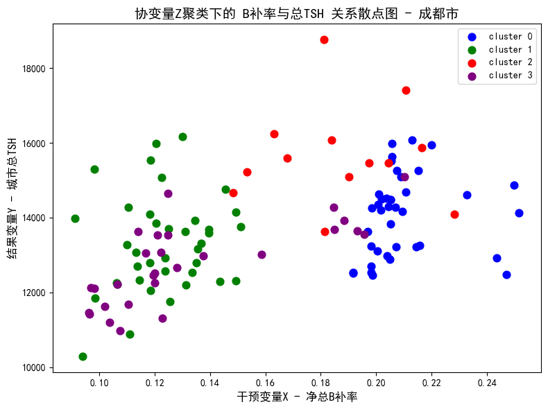

| 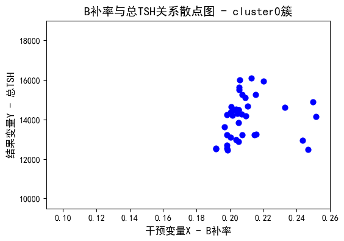   | 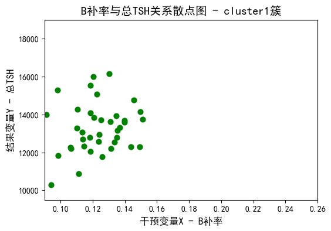   |
| --- | --- |
| 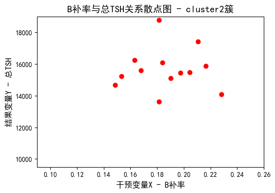   | 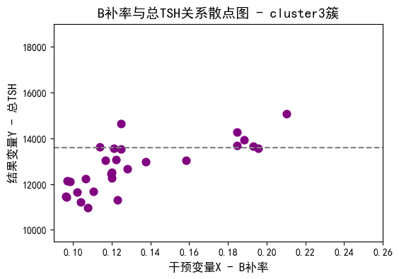   |

因此，对于协变量簇 0、1、2 ，由于B补率分布比较集中，且TSH与B补率相关系数较小，不存在良好的、可学习的 TSH 与 B 补率水平的弹性关系；

对于协变量簇 3 ，其B补率分布相对分散，且TSH与B补率相关系数较大，TSH 近似在\[0, 12%\]的 B 补率区间上递增， 在\[12%, 20%\]的 B 补率区间上稳定，但不能给出断言（因为该区间上样本点较少）；

结论：整体来看，我们模型习得的聚合后的弹性曲线与协变量簇 3 上体现的弹性趋势是一致的，相当于描绘了可刻画弹性的子空间下较为合理的弹性响应关系。

提问：为什么协变量会聚类出这些簇？底层具有什么类内特征吗？

我们查看了每个簇中的散点在日期分布上时间区间（相应还查看了X单纯与Y的相关系数），如下表所示：

| cluster   | 数据集中分布时间区间   | X与Y的相关系数   |
| --- | --- | --- |
| 0   | 2025.06.25 \~ 2025.08.15   | 0.39   |
| 1   | 2025.03.03\~ 2025.05.10   | 0.36   |
| 2   | 样本点较少，分散在3、4、5、6、7月的一些极个别散点   | 0.45   |
| 3   | 2025.05.12 \~ 2025.06.23   | 0.77   |

结论是在 2025.03.03-2025.05.10 与 2025.06.25 \~ 2025.08.15 日期区间上的样本（对应簇0、簇1、簇2），即使考虑协变量的分布，也无法得到很好的“ B 补率- TSH ”的关系，因为本身缺乏弹性。

（2）自营50城拟合结果

小结：

自营的部分城市，还有较大的B补投资空间，主要可能是由于相比宏鹄，自营城市B补率水位普遍低一些。

# 4 实验结果

我们基于业务真实数据进行天维度的建模，并且进行数据回测，最终在上述建模方法以及现有基线模型上，横向对比响应值与弹性两种预测结果的好坏。

## 4.1 实验设置

本次实验主要涉及的数据集选取、建模方法、基线模型、评估指标如下：

1. 数据集

|    | 训练集   | 测试集   |
| --- | --- | --- |
| week1   | 0210-07-20   | 0721-0727   |
| week2   | 0210-0727   | 0728-0803   |
| week3   | 0210-0803   | 0804-0810   |
| week4   | 0210-0810   | 0811-0817   |

1. 建模方法

	1. 回归调整类：OLS(T)，OLS(T+logT)，OLS(T+T2)，OLS(T+logT+T2)

	2. 广义倾向得分类：GPS(OLS)，GPS(XGB)，GPS(SVR)，

	3. 广义加性模型：GAM

	4. 双重鲁棒估计器：DRL(XGB)，DRL(RF)

2. 对比基线

	1. 基线1：当前B弹线上模型-个体DRCFR

	2. 基线2：将历史同期值作为本周期预测值

3. 评估指标

	1. 评估响应值TSH预测好坏

	2. 评估弹性预测好坏

## 4.2 实验结果

**本次城市维度B弹建模，对于宏鹄与自营运力分开进行建模，最终实验结论：DRL(RF)模型无论是基于宏鹄运力数据，还是自营运力数据进行建模，在预测响应值城市总TSH、预测弹性这两方面均表现最优，并且效果远超现有基线模型。**

### **4.2.1 宏鹄运力**

（1）对于响应值TSH**首周**回测结果如下表，从整体来看DRL(RF)模型在宏鹄Top50城市(临沂市除外)的表现最好，其平均MAPE最低(3.38%)，相比 现有线上模型DRCFR 优化了65.7%，相比 T-7同期值 优化了39.2%。

（2）此外，我们也选取了单周最优模型DRL(RF)与最优基线(T-7同期值)，对宏鹄单周的响应值TSH预测结果进行对比，从下表可知 ，DRL(RF)模型在4个单周上平均MAPE 均优于 T-7同期值。

、

（3）对于弹性**首周**回测结果如下表，从整体来看DRL(RF)模型在宏鹄Top50城市(剔除观测数据中弹性非凸的城市)的表现最好，其平均 MAE 最低(2.90pp)，相比现有基线 W-2同期值 优化了88.3%。

（4）此外，我们也选取了单周最优模型DRL(RF)与最优基线(T-7同期值)，对宏鹄单周的弹性预测结果进行对比，从下表可知 ，DRL(RF)模型在4个单周上的平均MAPE 均优于 T-7同期值。

|    | week_1   | week_2   | week_3   | week_4   |
| :---: | :---: | :---: | :---: | :---: |
|    | DRL   | T-7   | DRL   | T-7   | DRL   | T-7   | DRL   | T-7   |
| average    | **2.91pp**   | 24.9pp   | **2.70pp**   | 8.28pp   | **5.20pp**   | 19.91pp   | **3.45pp**   | 8.46pp   |

**基于宏鹄运力数据的建模结论：DRL(RF)模型在响应值预测、以及弹性预测这两方面均表现最优，并且效果远超现有基线模型。**

### 4.2.2 自营运力

（1）对于响应值TSH**首周**回测结果如下表，从整体来看DRL(RF)模型在自营Top50城市的表现最好，其平均MAPE最低(4.21%)，相比 现有线上模型DRCFR 优化了64.1%，相比 T-7同期值 优化了17.1%。

（2）此外，我们也选取了单周最优模型DRL(RF)与最优基线(T-7同期值)，对自营单周的响应值TSH预测结果进行对比，从下表可知 ，DRL(RF)模型在4个单周上平均MAPE 均优于 T-7同期值。

（3）对于弹性**首周**回测结果如下表，从整体来看DRL(RF)模型在自营Top50城市(剔除观测数据中弹性非凸的城市)的表现最好，其平均 MAE 最低(4.43pp)，相比现有基线 W-2同期值 优化了35.9%。

（4）此外，我们也选取了单周最优模型DRL(RF)与最优基线(T-7同期值)，对自营单周的弹性预测结果进行对比，从下表可知 ，DRL(RF)模型在4个单周上的平均MAPE 均优于 T-7同期值。

|    | week_1   | week_2   | week_3   | week_4   |
| :---: | :---: | :---: | :---: | :---: |
|    | DRL   | T-7   | DRL   | T-7   | DRL   | T-7   | DRL   | T-7   |
| average    | ==4.43pp==   | ==6.92pp==   | ==3.18pp==   | ==7.7pp==   | ==2.86pp==   | ==3.90pp==   | ==4.63p==   | ==23.4pp==   |

**基于自营运力数据的建模结论：DRL(RF)模型在响应值预测、以及弹性预测这两方面均表现最优，并且效果远超现有基线模型。**

# 5 业务收益

（1）预期收益

该项目为离线探索，不需要线上推全，预期收益为 预估城市总TSH的响应值MAPE降低10%。

（2）实际收益

相对最优基线（历史同期值），预估城市总TSH响应值MAPE**降低30.62%**，弹性MAE**降低71.62%**。

# 6 推全情况与现状追踪

- 2025.12：该项目为离线探索，不需要线上推全，已经正式上线并正常运行。

# 7 后续规划

1. 完成有商家新开城的城市，模型对于当周预测值准确性影响的分析以及应对方式，产出分析报告如下：

我们取0811-0817周有新商家开城的城市，新商家TSH 与 城市总TSH 的数据如下：

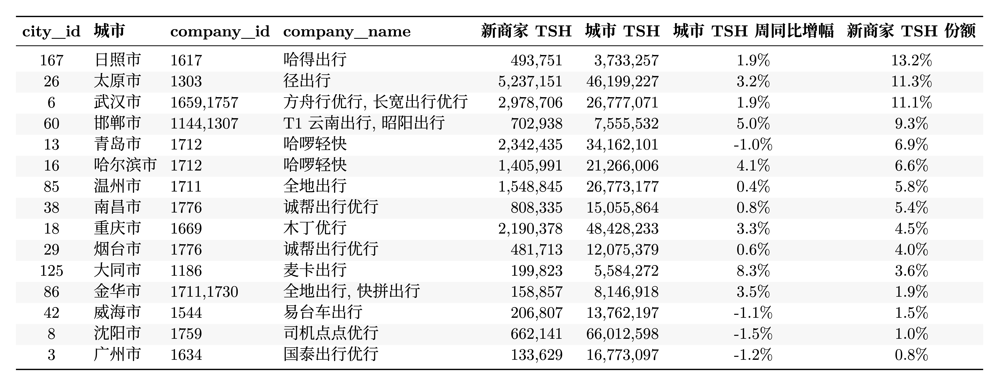

我们发现，部分城市新商家的TSH份额较高，但不能带动城市整体TSH同幅度提升，我们猜测是司机在宏鹄SaaS内部流转到新商家所致（即并未拉来平台新司机）。

模型在有新开城商家的城市，预测值误差如下：

我们看到，在 新商家TSH份额 与 城市TSH增幅 幅度较为一致的城市，模型误差确实较高，但其余城市模型误差与均值无明显差异

结论：由于这类城市在新商家开城城市占比较少，且我们无法准确判断哪些新商家开城城市会有这样的表现，我们在周维度TSH预测中暂时不考虑新商家的影响。

2. 完成本次最优模型（DRL+RF）对目前运筹中资源分配模块使用的周维度不同B补率下城市TSH预估值的替换；

3. 与宏鹄运营同学进一步讨论沟通B弹在宏鹄司机补贴策略中具体的应用方式（业务同学Q2提了需求，希望在后续宏鹄B资源分配中考虑司机弹性因素）

# 8 引用与鸣谢

感谢 门畅老师、展哥、欣艾 在策略求解、实验评估、业务沟通上的全力支持和认真指导；

感谢 宏鹄运营同学（镜伊、贤君）与供需运营同学（郝璐、刘健）在需求推进中的支持与建议，及在协变量选取讨论与先验领域知识方面提供的宝贵信息；
