# 【LR25031】司机无单调度v2

[Cooper 原文](https://cooper.didichuxing.com/knowledge/2199610335356/2205431323794)

> 下载说明：本篇正文、图片和 SVG 图表文件已保存；其中 4 个图表内的 7 个图片资源返回 HTTP 401/403，未能下载。原始引用及 Cooper 入口均已保留，位置已在对应图表下标出。

目标：提升宏鹄+自营gmv

约束：ROI大于2.5

核心工作内容：

  1.基于因果的端到端的调度方案： 绝对值准 → 序准

  2.提出端到端的评估指标 Dispatch-AUCC

  3.解决实验组挤占的问题 & 随机调度方案

  4.动态阈值 & ROI控制

实验结果：人均gmv显著+3.56%,人均完单显著+3.53%（司机分流实验）

---

# 0.编辑记录

| **日期**   | **记录**   |
| :---: | :---: |
| 2025-09-18   | 发布初版   |
| 2025-09-25   | 加调度v1 cost模型的mape  加4.3.3 长期RCT实验方案以及影响  加4.4.3 运筹规划vs贪心算法   |
| 2025-09-29   | 加4.4.3 运筹规划vs贪心算法 的图   |
| 2025-10-15   | 加4.3.3 长期RCT实验方案以及影响的说明  每张图加入title   |
| 2025-10-17   | 更新公式和原问题的解释  补充到APPENDIX使用无单比例保证ROI的证明   |
| 2025-10-20   | 4.3.3 中加入随机调度vs空白组时间片实验   |
| 2025-10-21   | 更改k下表的说明  加入不用k下表情况下原问题的定义   |
| 2026-01-14   | 增加调度产品形态   |
| 2026-06-11   | 增加后续调度放量情况（按照共补逻辑放量）   |

# 1. 背景

司机无单调度是指将长时间听不到单的司机从接单概率低的区域牵引到接单概率更高的区域，带来司机应答率的提升，**目标是带来司机完单和gmv的提升**。

| **调度任务下发**   | **调度行程中**   | **达到目的地领里程费**   | **目的地等单中**   | **无单补贴**   |
| :---: | :---: | :---: | :---: | :---: |
|    | 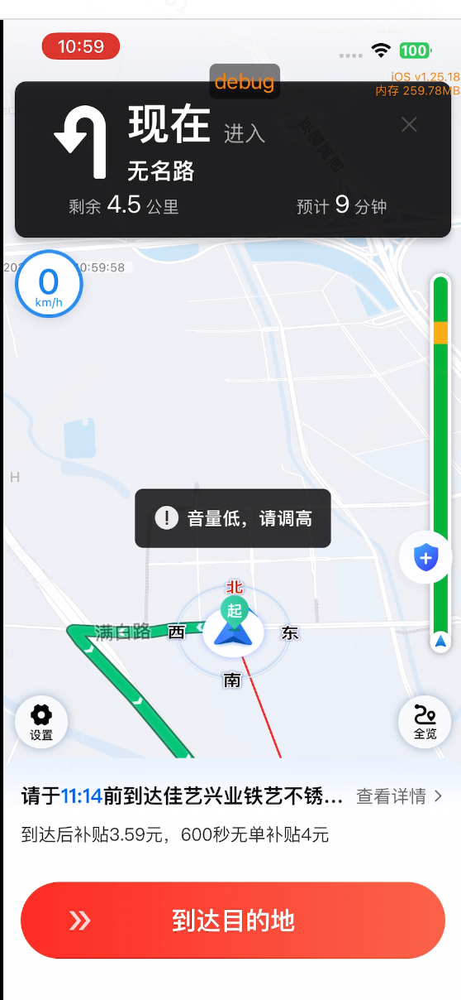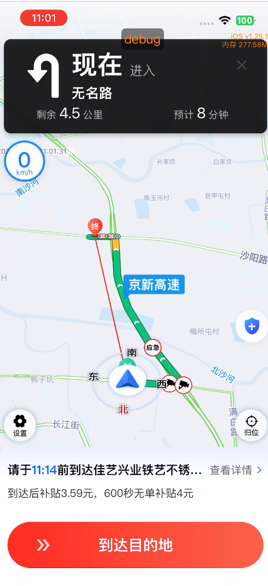   |    | 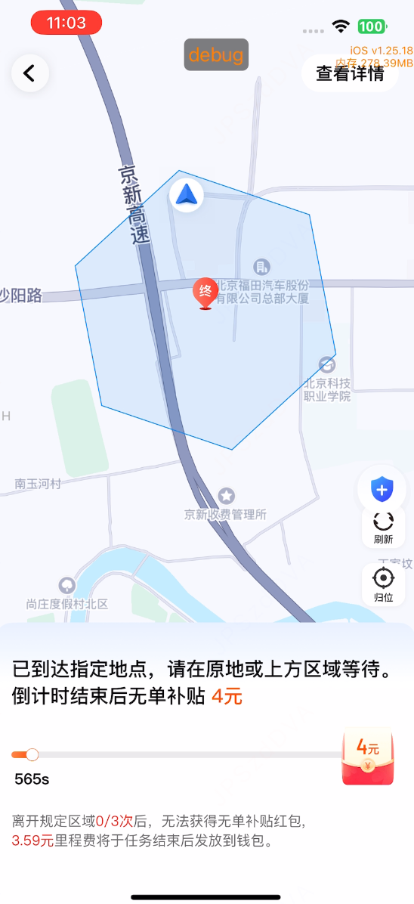   | 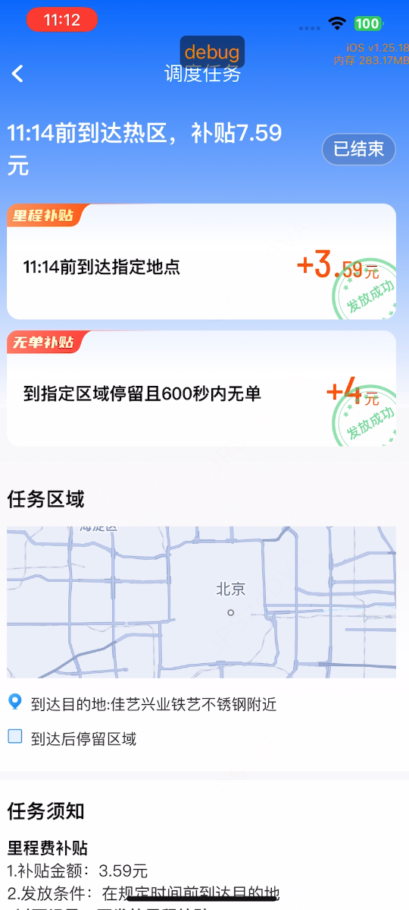   |

图1.1 司机调度过程司机端示意图

[**历史调度策略**](https://cooper.didichuxing.com/knowledge/2199610335356/2203874016930)**（v1）存在的问题**：

- **无单调度V1**：调度v1策略整体分为两步：ML+OR（Operation Research）：

	- **ML部分预测运筹规划求解需要的gmv、cost**，该部分会建立5个模型*（**司机起点格子接单概率，司机终点接单概率，司机中途接单概率，司机接受度模型，未播订单数模型）*，分别预测链路中的各个环节，通过上述模型结果去计算司机调度*(司机-格子对)*带来的gmv提升和对应的cost；

	- **OR部分基于ML给出的司机-格子对的gmv、cost，求解【roi约束下最大化gmv目标】的调度策略**，并下发给司机。ML部分预测的gmv、cost输入到黑盒的运筹规划当中，ML的误差会在运筹规划中被进一步叠加，

- V2方案核心改动是格子/司机匹配算法，其他流程不变

<!-- Cooper 原生图表来源信息
{"type": "flowchart", "sourceId": "MjIwNTQzMTM0MTM0OA", "version": "", "fileUrl": "附件/LR25031/图表01.svg"}
-->

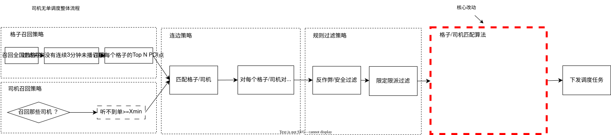

[图表 01 · SVG 源文件](附件/LR25031/图表01.svg) · [Cooper 原图](https://cooper.didichuxing.com/knowledge/2199610335356/2205431323794)

图1.2 调度整体流程

V2方案主要贡献如下：

1. **基于因果的端到端的调度方案**：将问题 由 ML + OR 求解的形式 转化为 **uplift模型 + 贪心算法** 的形式

	1. 第一：降低模型数量，维护更简单；

	2. 第二：使用Dispatch-AUCC评估，离在线更一致*（之前降低了mape，但是线上实验效果并没有更优）*

2. 提出了**端到端的评估指标 Dispatch-AUCC**：由于调度约束一个司机至多调度到一个格子，所以我们在AUCC上的基础上加入了过滤逻辑来反映调度线上实际生效的情况，并作为我们的离线评估指标来反映线上效果：**该指标通过模拟真实调度过程，衡量按决策因子排序生成的策略在累计成本—收益空间中的表现，**更准确刻画了策略的实际有效性；

3. **解决实验组挤占的问题 & 设计随机调度方案**：

	1. **挤占问题**：调度v1策略在运筹规划时会召回实验组的司机和全量的热格子*（存在格子挤占效应）*，分流实验中实验组的司机挤占了对照组司机的格子，使得分流实验的实验效果会显著优于时间片实验的实验效果；

	2. **随机调度方案**：为了构建uplift模型的训练数据和评估指标，并防止对照组司机挤占实验组司机的格子（跟补贴不同的是，如果固定对照组司机，由于对照组司机不会真实下发调度，导致对照组司机会在每一轮重复召回，挤占实验组司机的格子），我们设计了随机调度方案来收集rct数据

4. **动态阈值 & ROI控制**：由于线上分布和离线分布总是存在差异，并且调度会在一定程度上改变线上司机的分布，所以我们设计了动态阈值来适应供需分布的变化并控制ROI的约束

# 2. 调度数学化 & 求解

本部分是调度问题的数学求解，包括了问题定义、决策指标的推导、约束条件的满足方式，**核心的思路是对司机-格子对的roi进行排序，并将高于阈值的司机-格子对作为候选调度集合，最后使用过滤的方法满足调度的约束，产出调度结果**

## 2.1 问题定义

每一轮的调度策略会影响下一轮，但是轮次之间的影响难以刻画，因此该版本问题由全局最优（Global）简化为单轮最优：

<!-- Cooper 原生图表来源信息
{"type": "flowchart", "sourceId": "MjIwNTQzMTMzOTk0Mg", "version": "12", "fileUrl": "附件/LR25031/图表02.svg"}
-->

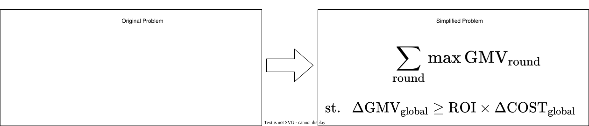

[图表 02 · SVG 源文件](附件/LR25031/图表02.svg) · [Cooper 原图](https://cooper.didichuxing.com/knowledge/2199610335356/2205431323794)（本图有 2 个内嵌图片未能下载，请到原文核对。）

==由于仅需确保整体ROI符合预设的ROI约束条件，我们可以将整体ROI分解为各轮次的ROI（==$$\text{ROI}_{\text{round}}$$==），随后通过实时调控每一轮的ROI，以保障整体ROI满足约束要求==

<!-- Cooper 原生图表来源信息
{"type": "flowchart", "sourceId": "MjIwNTYxMjY5NzczNg", "version": "1", "fileUrl": "附件/LR25031/图表03.svg"}
-->

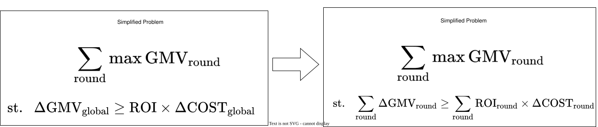

[图表 03 · SVG 源文件](附件/LR25031/图表03.svg) · [Cooper 原图](https://cooper.didichuxing.com/knowledge/2199610335356/2205431323794)

下面对单轮最优问题进行建模：

首先，在建模之前约定数学符号：

<!-- Cooper 原生图表来源信息
{"type": "flowchart", "sourceId": "MjIwNTQzMTM0ODkxMA", "version": "5", "fileUrl": "附件/LR25031/图表04.svg"}
-->

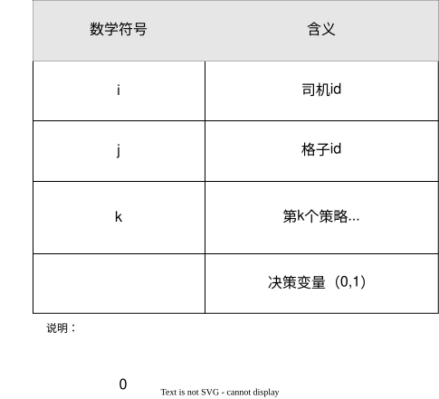

[图表 04 · SVG 源文件](附件/LR25031/图表04.svg) · [Cooper 原图](https://cooper.didichuxing.com/knowledge/2199610335356/2205431323794)（本图有 2 个内嵌图片未能下载，请到原文核对。）

我们定义调度场景的个体为司机-格子对(i-j)，干预为司机-格子对(i,j)是否下发调度，由此单轮最大化gmv的问题定义如下：

*（**单轮优化目标**：最大化单轮gmv）*

              

*（**roi约束**：调度roi大于ROI）*

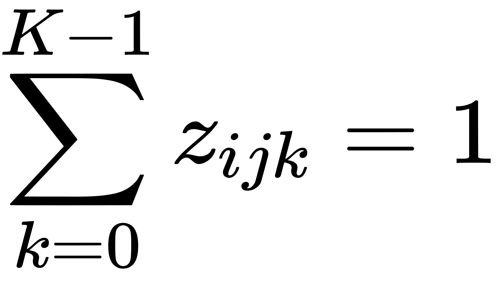  

*（**决策变量约束**：每个司机-格子对需要下发一个策略）*

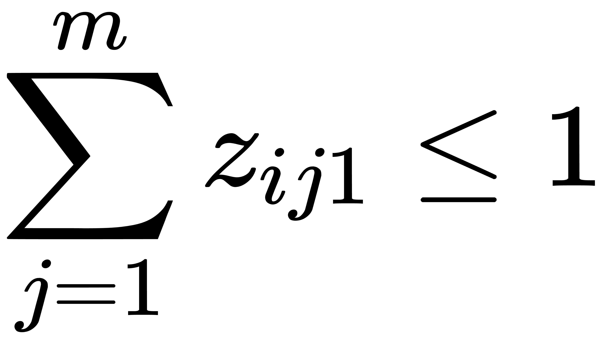 

*（**司机约束**：每个司机i最多能调度到一个格子）*

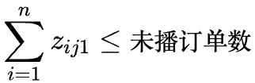

*（**格子约束**：每个格子j最多能调度到一个司机j）*

上述问题中，单轮GMV可以用所有格子-司机对的gmv的和来表示，同时我们需要满足如下约束：

	- 调度需要满足roi的约束

	- 对一个司机来说至多只能调度到一个格子

	- 1个格子当前轮次能调度的司机至多为N个（N为未播订单数，因为当前**召回的格子99.4%的未播订单数小于等于1，因此后续该约束为1**）

	- 由于目前我们只有调度这个策略所以K=2

如果不加入k下表并且我们只有调度这个策略的公式
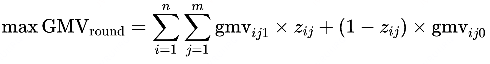

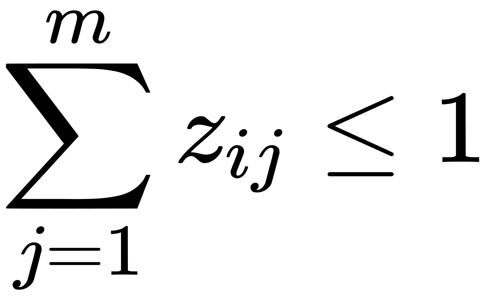

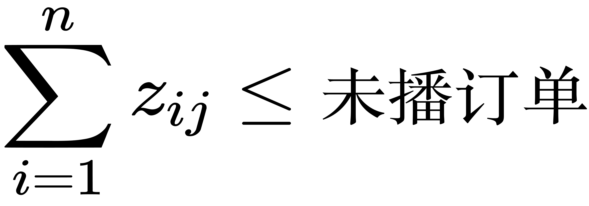

## 2.2 贪心求解 & 决策函数

      我们希望能够通过贪心策略来求解上述的最大化问题：类似于广告投放和实时竞价，我们希望能够对**司机-格子对统一评判打分、排序、截断topN输出**，希望从gmv最大化的角度对收益最大的司机-格子对下发调度。为了**明确司机-格子对价值的评判标准**，我们下面将进行对偶问题的转化和贪心求解：

<!-- Cooper 原生图表来源信息
{"type": "flowchart", "sourceId": "MjIwNTQzMTMwNTA5Ng", "version": "4", "fileUrl": "附件/LR25031/图表05.svg"}
-->

[图表 05 · SVG 源文件](附件/LR25031/图表05.svg) · [Cooper 原图](https://cooper.didichuxing.com/knowledge/2199610335356/2205431323794)（本图有 2 个内嵌图片未能下载，请到原文核对。）

        原始问题转化为对偶问题以后，假设我们已经确定当前轮次最优的$$\lambda$$,我们可以基于贪心的思想求解得到最优的策略（**在这部分我们先不考虑格子和司机的约束，后面通过过滤逻辑来满足约束条件，这里先通过贪心推导得到决策函数**），具体的，对应每一个司机-格子对，只有当调度带来的gmv大于不调度的gmv且整体满足ROI约束，我们才会考虑下发调度，即：

对上式进行变化，可以得到我们的**决策指标（实际上，不下发调度无调度b补，即**$$\text{cost}_{ij0}=0$$**）**：

按照以上的公式，需要对每个$$\lambda$$ ， 司机j  $$\text{gmv}_{ijk} + \lambda \times  \left[ (\text{gmv}_{ijk} - \text{gmv}_{ij0} - \text{ROI}_{\text{round}}(\text{cost}_{ijk} -\text{cost}_{ij0} ))  \right]$$的排序准才能做最佳决策，所以我们模型的性能依赖于不同的$$\lambda$$，然而在评估模型时测试所有的$$\lambda$$下公式的排序较困难， 为了解决这个问题我们通过推到得到了一个新的决策公式 *（此决策公式的排序不依赖于$$\lambda$$并且模型排序部分和阈值计算方式是分开的）*

*\*$$roi_{ij}$$：如果司机i调度的格子j，一块钱的调度费能带来$$roi_{ij}$$的gmv*

*\*阈值和$$\text{ROI}_{\text{round}}$$有关，它的计算方式在第5章中解释*

        综上，我们通过问题转化，贪心求解得到了我们的决策指标，具体的，当司机-格子对的roi大于阈值，我们会考虑对该司机-格子对下发调度。但上述求解过程中，我们暂时先忽略了司机只能调度到一个格子，格子只能调度一个司机的限制，下面我们通过过滤来解决该问题

## 2.3 排序 & 过滤保证调度约束

      在2.2章节中，我们明确将司机与格子对调度的投资回报率（roi）作为调度的决策指标。对于那些调度roi较高的司机-格子组合，我们需要优先进行调度下发。线上生效流程具体如下：

	- **步骤1**：在每一轮中，召回司机-格子对，并对司机-格子对的roi及GMV进行预测

	- **步骤2**：将司机-格子对按照roi进行降序排序，并依据阈值确定可用于下发调度的司机-格子候选集合。具体而言，我们使用ROI限制和DISPATCH AUCC曲线来初始化阈值，此方法将在4.4 - 4.5部分进行详尽阐述，其核心思路在于离线确定累计增益值最高的点

	- **步骤3**：为确保满足决策约束条件，我们采用二次过滤方法：

		- **司机约束**：每个司机i最多仅能被调度至1个格子。

		- **格子约束：**每个格子j最多只能接受1个司机

为确保满足此约束条件，针对每位司机，我们仅保留预测GMV最高的格子，

基于上述步骤，我们得出了当前轮次需要下发调度的司机 - 格子集合。具体的排序及过滤流程图如下所示：

<!-- Cooper 原生图表来源信息
{"type": "flowchart", "sourceId": "MjIwNTQzMTM2NzUwMA", "version": "1", "fileUrl": "附件/LR25031/图表06.svg"}
-->

[图表 06 · SVG 源文件](附件/LR25031/图表06.svg) · [Cooper 原图](https://cooper.didichuxing.com/knowledge/2199610335356/2205431323794)（本图有 1 个内嵌图片未能下载，请到原文核对。）

图2.1 调度匹配算法流程

# 3. 司机无单调度整体流程

**每一分钟**策略会根据以下的图执行**一轮**司机无单调度的流程：

<!-- Cooper 原生图表来源信息
{"type": "flowchart", "sourceId": "MjIwNTQzMTM0ODYwOA", "version": "", "fileUrl": "附件/LR25031/图表07.svg"}
-->

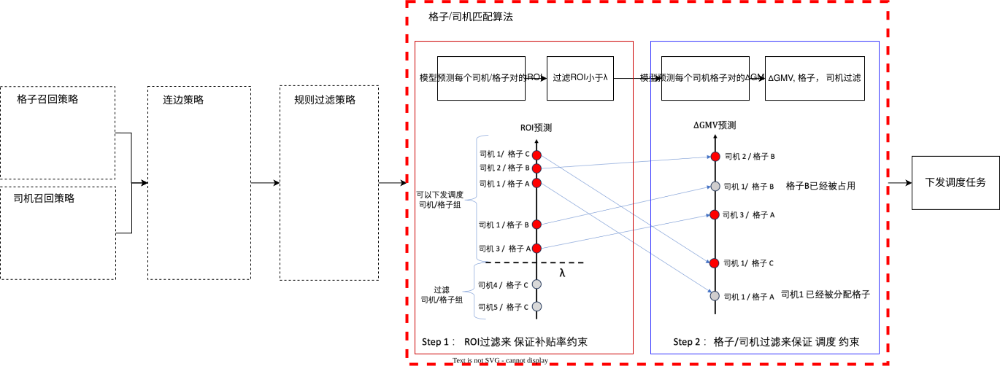

[图表 07 · SVG 源文件](附件/LR25031/图表07.svg) · [Cooper 原图](https://cooper.didichuxing.com/knowledge/2199610335356/2205431323794)

图3.1 调度每轮整体的流程

# 4. 模型结构

根据第2章的定义，策略需要对每一个**司机/格子对预测调度任务的ROI和**$$\bold{\Delta \text{GMV}}$$，本章会介绍模型上的核心工作内容

## 4.1 模型整体框架

出于降低工程成本以及方案迭代优化的灵活性的目的， 我们决定把过滤策略放到模型中，并且将如下入参传给工程同学：

		- 每个司机-格子的过滤信息

		- 每个司机-格子对任务的价值

具体模型框架如以下的图所示：

<!-- Cooper 原生图表来源信息
{"type": "flowchart", "sourceId": "MjIwNTQzMTMwNTEwNA", "version": "", "fileUrl": "附件/LR25031/图表08.svg"}
-->

[图表 08 · SVG 源文件](附件/LR25031/图表08.svg) · [Cooper 原图](https://cooper.didichuxing.com/knowledge/2199610335356/2205431323794)

图4.1 调度模型的框架图

## 4.2 UPLIFT 模型

我们使用DRCFR+多头的模型结构来预测不同干预（**调度/不调度**）的完单率和调度费用

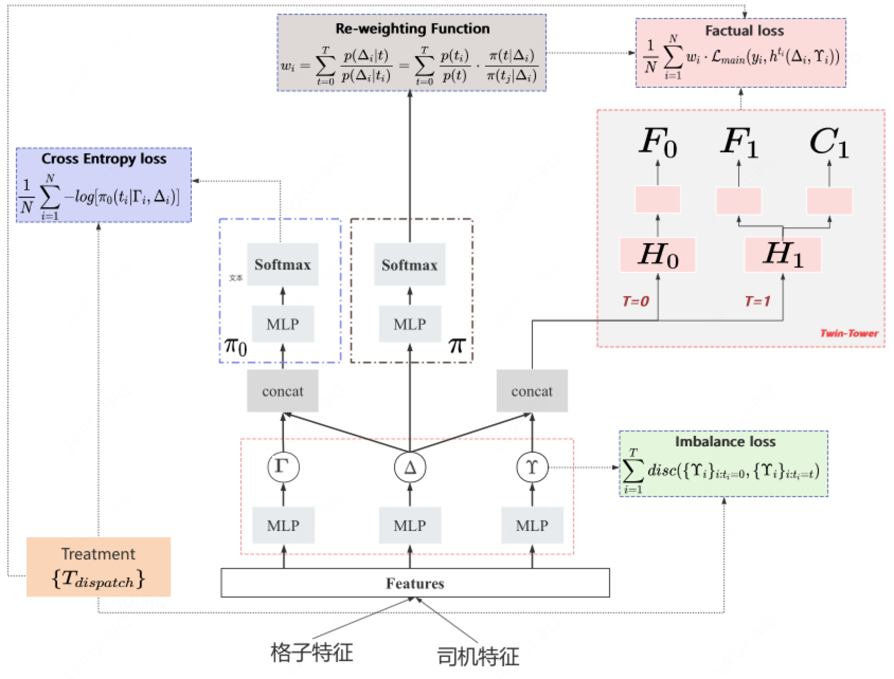

图4.2 UPLIFT模型的结构图

## 4.3 数据搭建

### 4.3.1 标签定义

为简化问题起见，我们仅考量由任务调度所产生的**短期效益**，而非调度可能赋予司机持续获得机会的概率。鉴于司机抵达目的地后需等候10分钟，现将我们的标签定义阐述如下：

| **标签**   | ** 标签定义**   |
| :---: | :---: |
|  finish_label   | 在0 到 eta+10 司机是否接单   |
| cost_label   | 在0 到 eta+10 司机产生cost的金额   |

[**采集数据任务**]( https://studio.data.didichuxing.com/?projectId=1143&taskId=45590729)

### 4.3.2 随机调度实验

         **背景：**uplift模型的训练及评估依赖于随机调度实验，为了降低开发成本我们决定召回所有司机进行调度整体的流程并且在播单阶段只下发需要下发调度的司机（司机分流）。直接使用此方案会带来数据 不平衡的问题， 本章的目标是通过流程上的小改造来解决数据不平衡的问题。

         **核心解决的问题**：司机分流下调度存在轮与轮之间**对照组司机挤占实验组司机流量的问题(左图)**。具体而言，当前轮召回的实验组和对照组司机在下一轮的表现并不一致，实验组司机下发调度任务以后再下一轮不会被召回，但对照组司机虽然下发了调度任务但在播单环节不会真实下发调度任务，所以在下一轮的调度环节仍旧会被召回，导致一些需要下发调度任务的实验组司机由于上一轮对**照组司机重复下发调度任务** 无法被成功下发，使得对照组和实验组的分布不一致

**解决方案：**通过每轮重新分配司机分组可解以上提出的挤占问题，具体流程如下（右图）：

<!-- Cooper 原生图表来源信息
{"type": "flowchart", "sourceId": "MjIwNTQzMTMyNDAzNA", "version": "", "fileUrl": "附件/LR25031/图表09.svg"}
-->

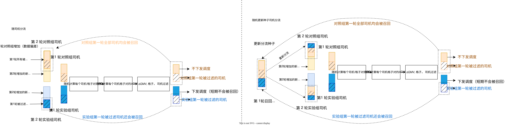

[图表 09 · SVG 源文件](附件/LR25031/图表09.svg) · [Cooper 原图](https://cooper.didichuxing.com/knowledge/2199610335356/2205431323794)

图4.3 随机调度流程图

### 4.3.3. 长期RCT实验

         **背景：**由于供需随着时间会有波动， 我们需要长期采集RCT数据来训练调度中的uplift模型， 但是目前的RCT实验需要关闭调度主流量策略来确保数据不会被调度策略干扰， 但明显是不可能的， 此方案的目的是希望在**保留主流量运行的情况下采集未被主流量策略干预的RCT数据**。

        **方案 ：**==由于采用贪心算法进行司机与格子的匹配，每个司机-格子对仅会受到排在其前方的司机-格子对的影响。因此，为避免主流量策略下的司机-格子对干扰RCT组的司机-格子对，只需将RCT组的司机-格子对排在前面即可。最终，我们会为RCT组的司机-格子对随机分配一个远高于主流量策略下司机-格子对的分数， 整体流程根据以下的图执行：==

<!-- Cooper 原生图表来源信息
{"type": "flowchart", "sourceId": "MjIwNTQ3MDc0MDI4Nw", "version": "1", "fileUrl": "附件/LR25031/图表10.svg"}
-->

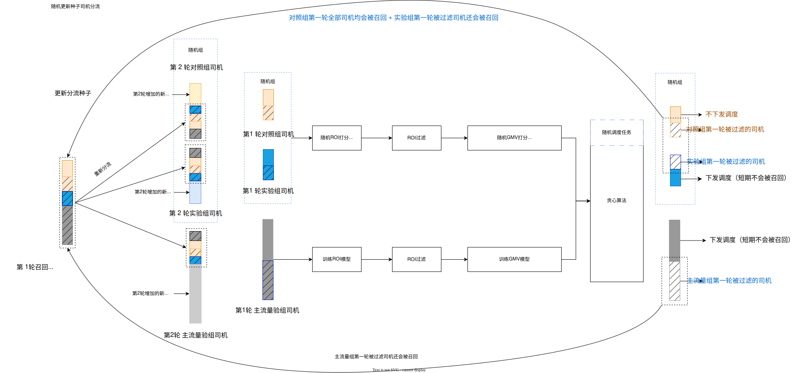

[图表 10 · SVG 源文件](附件/LR25031/图表10.svg) · [Cooper 原图](https://cooper.didichuxing.com/knowledge/2199610335356/2205431323794)

     图4.4 长期随机调度流程图

**RCT的影响：**为了评估RCT数据采集对主流量调度的影响， 我们根据以上的流程，模拟不同随机流量占比下对DISPATCH AUCC的影响。

| **随机组流量占比**   | **DISPATCH AUCC**   | **相对变化**   |
| :---: | :---: | :---: |
| 0%   | 11256672310.1115   | 0.0%   |
| 1%   | 11013478483.9035   | -2.2%   |
| 2%   | 10836012270.8589   | \*-3.7%   |
| 3%   | 10674700882.741   | -5.2%   |
| 4%   | 10480416231.7273   | -6.9%   |
| 5%   | 10306967255.1885   | -8.4%   |

**说明 ：**

- 假如没有随机调度情况下，调度的收益为**+2%**完单提升并且**DISPATCH AUCC**的相对变化为 \***-3.7%**， 则加入小流量的随机调度后，在同样的预算下调度的收益变成 2% \*( 100% - 3.7%) = **1.93% 完单提**升

**随机实验效率的影响：**

- **评估日期：**2025.10.11-2025.10.17

- **实验城市 ：**==南京市,苏州市,福州市,绵阳市,吉林市==

- **实验人群** ： 大聚合宏鹄和自营司机

- **分流方式：**司机流量分流 50% 对照组*（不下发调度）*50% 实验组*（下发调度策略）*

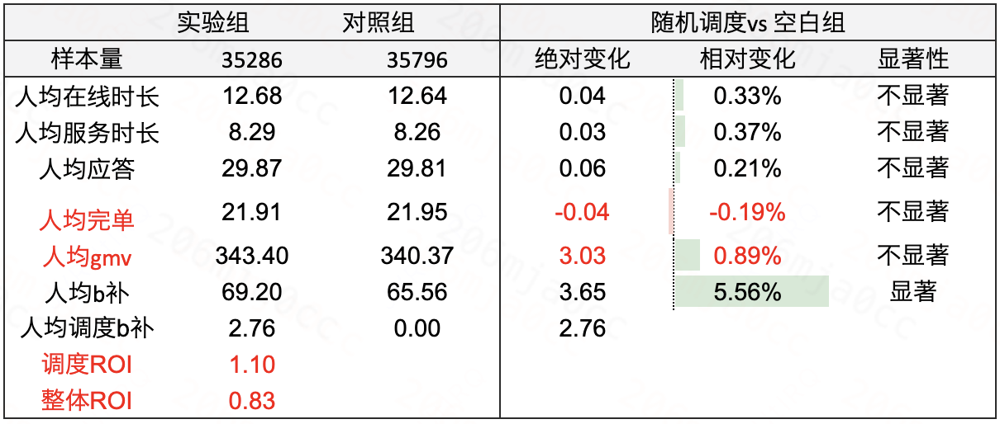

图4.5 随机调度vs空白组司机分流实验结果

同一批城市 （策略vs空白组）
- **评估日期：**2025.09.01-2025.09.07

- **实验城市 ：**==南京市,苏州市,福州市,绵阳市,吉林市==

- **实验人群** ： 大聚合宏鹄和自营司机

- **分流方式：**司机流量分流 50% 对照组*（不下发调度）*50% 实验组*（下发调度策略）*

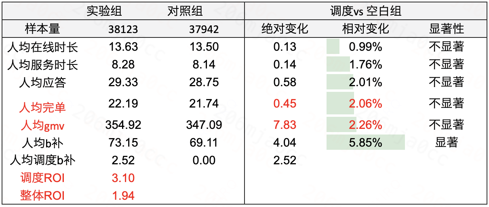

## 4.4 评估

### 4.4.1评估指标

     **核心解决的问题**：uplift模型可以通过AUCC来评估模型排序的好坏，并判断线上的收益的正向程度，确保离在线的一致性。但在调度场景这个一致性是不成立的，原因在于dp对的干预不是独立的，对同一个司机我们只能给定一个策略，即司机最多只能调度到一个格子，同样对格子而言，最多只能被调入一个司机。但是在计算AUCC的时候部分策略不允许下发（二次过滤逻辑）会被在ATE中计算， ATE和实际ATE存在误差。

|    | ** 可评估不同预算下的UPLIFT**   | ** 考虑流程中的二次过滤 **   |
| :---: | :---: | :---: |
| AUCC   | 可以   | 否   |
| DISPATCH-AUCC   | 可以   | 是   |

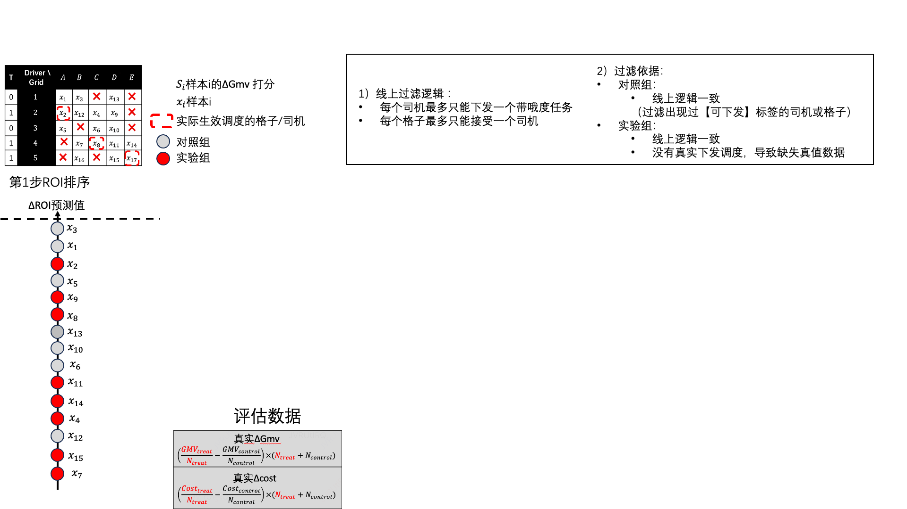

### 4.4.2 模型选择 & 评估

**模型选择方法**：出于模型鲁棒性的考虑，即**模型需要在不同阈值和供需场景下表现都较为稳定**，我们选择dispatch-aucc曲线下面积最高的模型作为我们的上线模型

**阈值选择方法**：我们选择dispatch-aucc最高的点和预算对应的点的最小值作为我们的初始化阈值

**结论**：

		- 随机调度能带来gmv的提升

		- DRCFR模型具有比较强的uplift排序能力，**相对随机和双塔模型的增益有较大幅度的提升**

| **模型**   | **DRCFR**   | **双塔**   | **V1**   |
| :---: | :---: | :---: | :---: |
| **DISPATCH AUCC**  （召回数据）   | 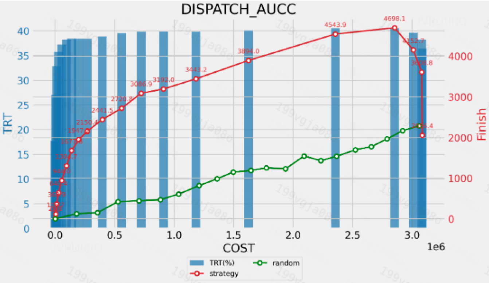   | 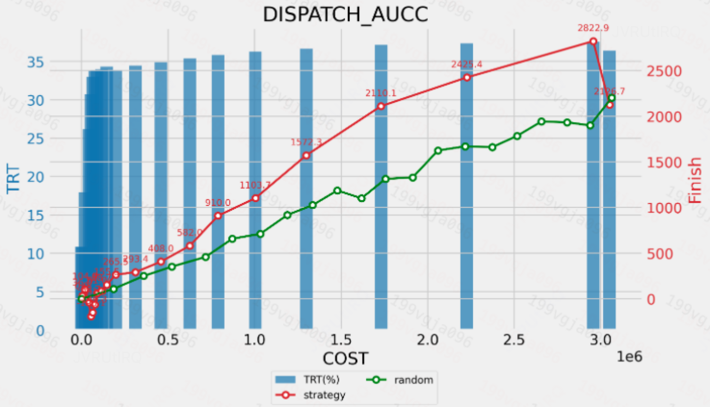   |      |
| **面积**   | **1.1256e10**   | 0.4265e10   |    |
| **COST MAPE**  （播单数据）   | **0.3883**   | 0.3897   | 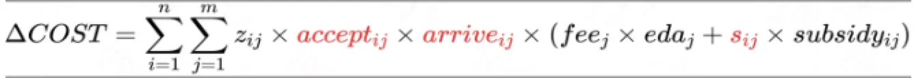  0.3984   |
| **finish AUC**  （播单数据）   | **0.7193**   | 0.6838   |    |

### 4.4.3 对比贪心和运筹规划

==若模型预测值的误差为零，那么运筹规划算法（====追求全局最优====）所得结果会优于贪心算法（====仅着眼局部最优====）。然而，要训练出一个零误差的模型极具挑战性，而且提升模型准确性并不一定能保证运筹规划算法求解结果得到改善。本章将对比使用同一模型时，运筹规划算法和贪心算法的求解结果。==

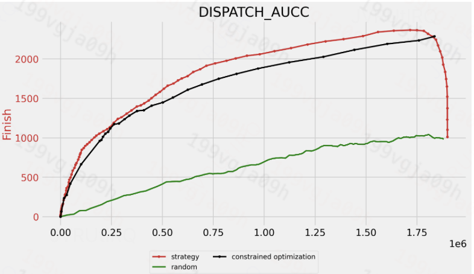

图4.6 贪心算法和运筹规划在不同预算下求解结果对比

根据以上的图大部分的情况下使用目前的模型，**贪心算法相对比OR求出的结果收益更大**。

# 5.动态阈值 

最终的结果只需要确保整体的调度ROI满足ROI约束， 我们可以根据实际线上效果来调整阈值来确保ROI约束。

<!-- Cooper 原生图表来源信息
{"type": "flowchart", "sourceId": "MjIwNTYxMDEyNDM1NQ", "version": "3", "fileUrl": "附件/LR25031/图表11.svg"}
-->

[图表 11 · SVG 源文件](附件/LR25031/图表11.svg) · [Cooper 原图](https://cooper.didichuxing.com/knowledge/2199610335356/2205431323794)

图5.1 阈值线上更新流程图

**由于实时获取每个组的gmv需要开发， 我们本次版本简化流程， 使用无单比例来控制ROI***（具体的证明在appendix中）*。

我们by小时根据前6小时调度的效果来调整过滤占比*(保持无单比例在20%)*

为了快速验证方法（未使用工程人力），我们实现了by小时更新dufe特征的功能， 整体的更新流程按照以下的图执行：

<!-- Cooper 原生图表来源信息
{"type": "flowchart", "sourceId": "MjIwNTQzMTI5MzcxOQ", "version": "1", "fileUrl": "附件/LR25031/图表12.svg"}
-->

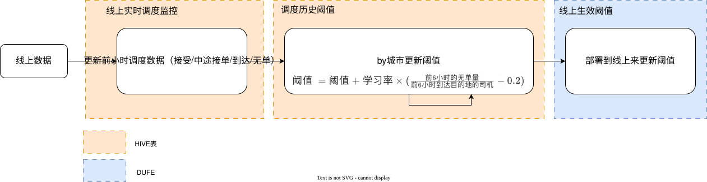

[图表 12 · SVG 源文件](附件/LR25031/图表12.svg) · [Cooper 原图](https://cooper.didichuxing.com/knowledge/2199610335356/2205431323794)

图5.2 简化版阈值线上更新流程图

后续希望更改实时更新apollo的任务来保证阈值更新的实时性

**阈值的初始化 ：**

我们使用预算ROI和DISPATCH AUCC曲线来初始化阈值 *（选择DISPATCH AUCC途中完单最大满足ROI限制的阈值）*

# 6. 实验评估

## 6.1 实验方案

         **调度v1司机分流存在的问题**：调度v1策略在运筹规划时只会召回实验组的司机和全量的热格子，而不考虑对照组，可以认为分流实验中实验组的司机挤占了对照组司机的格子，使得分流实验的实验效果会显著优于时间片实验的实验效果

**调度v1司机分流运筹规划逻辑：**当前的司机分流实验是从召回源头分流，如果整体大盘1000个司机，10%的分流方式，实验组司机和对照组司机数量如下：

|   ** **   | **整体**   | **调度召回司机-Xmin听不到单**   | **召回格子**  **（实验/对照组不共享格子）**   | **运筹规划逻辑1匹配出的**  **司机/格子对**   | **真实下发调度**   |
| :---: | :---: | :---: | :---: | :---: | :---: |
| 大盘   | 1000   | 500   | 100   |  100   | 100   |
| 实验组   | 100   | 50   | **100**   | **20**   | 20   |
| 对照组   | 900   | 450   | **0**   | **0**   | 0   |

**结论**：**调度v1司机分流****实验组的司机会和全部格子匹配**，这样能下发调度任务的司机偏多，**导致高估了实际收益**

**解决方法：**为了解决以上的问题， 我们在运筹规划阶段可以召回所有司机-格子对（实验组+ 对照组）进行匹配

|     | 整体   | 调度召回司机-Xmin听不到单   | 召回格子  **（实验/对照组共享格子）**   | **运筹规划逻辑2匹配出的**  **司机/格子对**   | 真实下发调度   |
| :---: | :---: | :---: | :---: | :---: | :---: |
| 大盘   | 1000   | 500   | 100   | 100   |    |
| 实验组   | 100   | 50   | **100**   | **10**   | 10   |
| 对照组   | 900   | 450   | **90**   | 0   |

**当前司机分流运筹规划的流程如下（工程流程图）：**

<!-- Cooper 原生图表来源信息
{"type": "flowchart", "sourceId": "MjIwNTQzMTM2NTgwNg", "version": "1", "fileUrl": "附件/LR25031/图表13.svg"}
-->

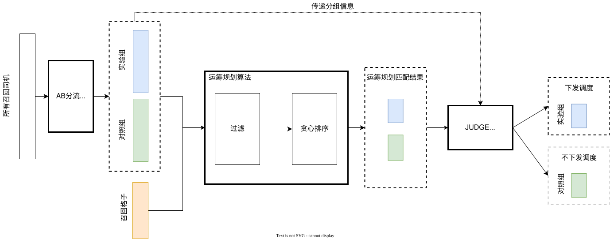

[图表 13 · SVG 源文件](附件/LR25031/图表13.svg) · [Cooper 原图](https://cooper.didichuxing.com/knowledge/2199610335356/2205431323794)

图6.1 非挤占司机分流实验流程图

## 6.2 实验结果 & 下钻分析

### 6.2.1 实验配置

- **评估日期：**2025.09.01-2025.09.07

- **实验城市 ：**==南京市,苏州市,厦门市,福州市,绵阳市,淄博市,吉林市,潍坊市,台州市,绍兴市,大理白族自治州,漳州市,莆田市,保山市 （占宏鹄+自营大聚合15%的gmv ）==

- **实验人群** ： 大聚合宏鹄和自营司机

- **分流方式：**司机流量分流 50% 对照组*（不下发调度）*50% 实验组*（下发调度策略）*

**（后续同步的数据都根据以上的配置来计算）**

### 6.2.2 业务收益

[**实验数据**](https://cooper-vpn.xiaojukeji.com/docs2/sheet/2205321951372)

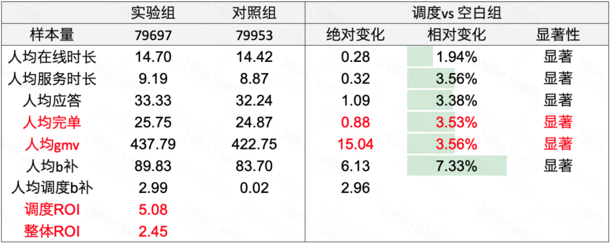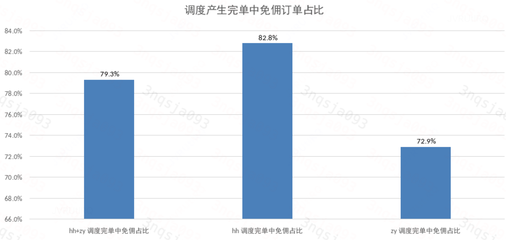

图6.2 调度司机分流实验结果（左） 调度订单免用订单占比（右）

**结论 ：**

	- 司机人均完单显著**+3.53%**，人均gmv显著**+3.56%**

	- **调度ROI为****5.08，****整体ROI为****2.45****，目前调度完成的订单中约80% 属于免佣订单，** **导致调度ROI和整体ROI的gap较大**

	- **tsh的提升（显著****+1.94%****）能明显看出调度提升了司机在线时长的留存**

[**调度v1实验结果**：](https://cooper.didichuxing.com/docs2/document/2203446209548)

司机调度roi（两个计算口径）：

	- 整体roi(Delta 司机人均GMV/司机调度人均b补）：3.87

	- (Delta 司机人均GMV/Delta 司机人均b补)：2.60

### 6.2.3 触发调度的任务质量

该部分对触发调度的任务质量进行分析，具体的分析口径为：比较实验组和对照组触发调度任务的平均完单概率和平均gmv

**结论 ：**每个任务平均可以**提升3.74pp的完单概率****， 提升13.73%的gmv**

|    **组**   | ** 完单概率**   | ** gmv（元）**   |  **调度费用（元）**   |
| :---: | :---: | :---: | :---: |
|  平均   |  ATE   |  相对提升   |  平均   |  ATE   |  相对提升   |  平均   |  ATE   |  相对提升   |
| 对照组   | 25.24%   | **3.74pp**   | **+14.77%（显著）**   | 4.8802   | **0.6703**   | **+13.73%（显著）**   | 0   | 0.2861   | $$+ \infin$$   |
| 实验组   | 28.97%   | 5.5505   | 0.2861   |

**说明 ：**

$$\text{平均 完单概率计算逻辑 } = \frac{本组播出任务从0到eta+10分钟完单量}{本组播出任务}$$

$$\text{平均gmv计算逻辑概率} = \frac{本组播出任务从0到eta+10分钟gmv}{本组播出任务}$$

### 6.2.4 复购率

|    |  **初次下发调度接受率**   |
| :---: | :---: |
| 0.3831   |
| ** **    **复购**   |  **接受过n次调度任务的司机下次下发调度接受概率**    |
| ** 接受次数**   | ** 1**   | ** 2**   | ** 3**   | ** 4**   | ** 5**   |
| **接受率**   | 0.4892   | 0.5298   | 0.5465   | 0.5588   | 0.5928   |
| ** 样本量**   | 27134   | 19673   | 15244   | 12214   | 9888   |

# 7.结论

核心的收益来源来自于司机的tsh提升以及司机接单概率的提升。

# 8.未来的优化方向

- 当前是通过By小时调整阈值的方法来控制ROI，该策略在实验中已经被验证是有效的（控制线上的无单比例保持稳定，从而减少成本），后续可以优化成实时调整 *（降低更新阈值的延迟）*

- 当前的模型使用了400多个特征，可以通过特征优选和特征消融等方式选择重要性高的特征，保证模型的鲁棒性

- 当前使用的模型是在多个场景被验证有效的DR-CFR模型，可以在模型结构上做更多的调研和尝试

# 9.鸣谢

司机无单调度从v1升级到v2牵涉到大量策略算法细节和工程链路的改造，在迭代和评估中得到了诸多老师的指导：

感谢丹哥，门畅老师，辉哥，方舟老师在多次策略评审上对方案提出的建议和修改意见！

感谢工程同学加罗，要飞，志远的细心开发和耐心配置！

感谢ether同学范浩辰，吴义东，吴悠在ifx模型升级上给出的建议和指导！

感谢之烁，嘉曦在因果评估指标上的技术分享和指导！

感谢ds欣雨在实验评估和下钻分析中给出的solid的评估脚本和口径！

感谢鸿霏帮我们搭建了调度的核心看板，用于中间过程的监控和分析！

感谢调度小分队：荣莉、丞勇、心一在迭代和开发过程中的讨论和合作！

# 10.To do 项

|  事项   |    |
| --- | --- |
| 计算随机调度实验：调度任务ROI   |    |

# APPENDIX

## 证明使用无单比例控制ROI的合理性

**数学符号 ：** 

$$\Delta \text{gmv} _{中途接单} = \text{gmv}_{实验组中途接单} - \text{gmv}_{对照组中途接单}  \geq 0$$ ： 实验组和对照组之间中途接单场景下的gmv 提升

$$\Delta \text{gmv} _{目的地接单} = \text{gmv}_{实验组目的地接单} - \text{gmv}_{对照组目的地接单}  \geq 0$$ ： 实验组和对照组之间目的地接单场景下的gmv 提升

$$\Delta \text{gmv} _{目的地无单} = \text{gmv}_{实验组目的地无单} - \text{gmv}_{对照组目的地无单}  \leq0$$ : 实验组和对照组之间目的地无单场景下的gmv 降福

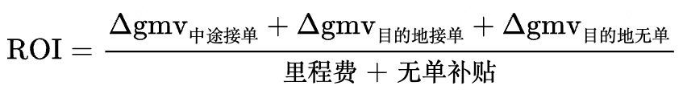

我们假设asp不变， 导致

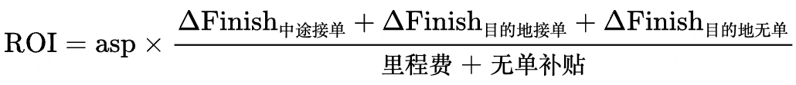

如果**无单比例提升**的话， $$\Delta \text{Finish}_{目的地无单}$$会降低 、无单补贴会提升导致**ROI整体会降低**

所以无单比例和ROI之间是一个负相关的关系。

# 

---

2026.6.11 内容开始

# 放量实验和策略线上现状

放量表现：

- 司机人均完单显著**+3.53%**，人均gmv显著**+3.56%**

- **调度ROI为****5.08，****整体ROI为****2.45****，目前调度完成的订单中约80% 属于免佣订单，** **导致调度ROI和整体ROI的gap较大**

- **tsh的提升（显著****+1.94%****）能明显看出调度提升了司机在线时长的留存**

**后续因平台预算资源有限，司机调度未在全国放量，后续推进的是调度共补**，参与共补的商家对应的城市的gmv覆盖全国gmv58%，但是整体参与共补的商家的gmv占宏鹄gmv的5%左右；

2026.6.11 内容结束

---
