# 【LR25034】贵必赔Agent架构设计及落地实践

[Cooper 原文](https://cooper.didichuxing.com/knowledge/2199610335356/2205576738545)

# 1. 背景与挑战

## 1.1 业务背景

- **规则摘要**：

	- 用户在端内完成含“贵就双倍赔”标识的车型订单并支付车费。

	- 若发现其他特定平台，在同应答时段、同起终点的指定车型(**特价盒子vs端外独乘最低价**; **小猪特价vs端外小猪自营**)下，显示价格低于花小猪平台，可在完成订单后12小时内申请双倍差价赔付。

	- 申请需要上传其他特定平台的**【行程预估页】**、比价车型的**【价格明细页】**。

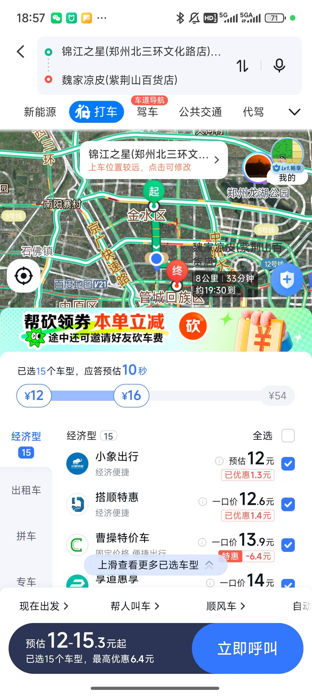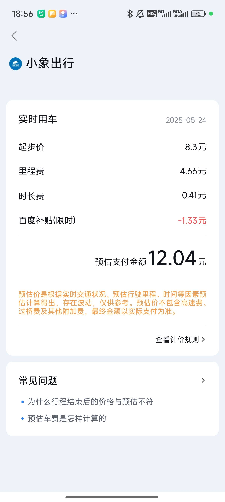

> PRD: [贵必赔扩展品类-小猪特价PRD](http://wiki.intra.xiaojukeji.com/pages/viewpage.action?pageId=1238427698); [二期-特价盒子贵必赔PRD](http://wiki.intra.xiaojukeji.com/pages/viewpage.action?pageId=1198691103#id-%E4%BA%8C%E6%9C%9F-%E7%89%B9%E4%BB%B7%E7%9B%92%E5%AD%90%E8%B4%B5%E5%BF%85%E8%B5%94-%EF%BC%886%EF%BC%89ocr%E4%BD%BF%E7%94%A8%E8%AF%B4%E6%98%8E); [一期-特价盒子百亿补贴](http://wiki.intra.xiaojukeji.com/pages/viewpage.action?pageId=1198690892); 

## 1.2 总览**V0与V1**

|  <br> | **审核V0缺陷** <br> | **审核V1改进** <br> | 标志版本 <br> |
| :---: | :---: | :---: | --- |
| **地点算法精度低** <br> | 地点对比采用精确匹配，召回率低 <br> | **名称相似度+关键词匹配+高频场景提取规则** <br> | V1.0(满血) <br> |
| **技术瓶颈** <br> | OCR识别效果不佳 <br> | **基于Few-Shot的VLM** <br> |
| 文本信息可绕过验证 <br> | 增加**图片来源**筛选 <br> | V1.1.1 <br> |
| 无法成对提取比价车型信息(如下折叠块). <br> | **基于Few-Shot的VLM Backbone优化** <br> |
| 提取价格精度低 <br> |
| **多赔** <br> | 路线不一致导致多赔 <br> | 新增**路线不一致**、**改派**筛选等拒赔原因 <br> | V1.0(满血) <br> |
| 小猪特价没有比较端外小猪服务最低价，而是和端外独乘最低价比较 <br>误赔比例极高 <br> | 可以**成对提取端外价格** <br> |
| 比hxz更便宜：上传材料为端内历史订单 <br> | 增加V0未有的不赔付原因：**非花小猪打车平台** <br> | V1.1.1 <br> |
| **乘客体验** <br> | 证据材料复杂，需要同时上传行程预估页和价格明细页。 <br> | **无需**上传普通乘客难以找到的**价格明细页**; <br>V1.1.2.乘客提交成功率提升4pp <br> | V1.1.0 <br> |
| 审核结果召回低 <br> | **离线召回提升61.63pp** <br> | V1.1.2 <br> |

> V1.1.2为线上运行版本

审核逻辑V0的缺陷--无法成对提取比价车型信息
| **行程预估页** <br> | **价格明细页** <br> | **审核逻辑V0的缺陷** <br> |
| :---: | :---: | :---: |
| 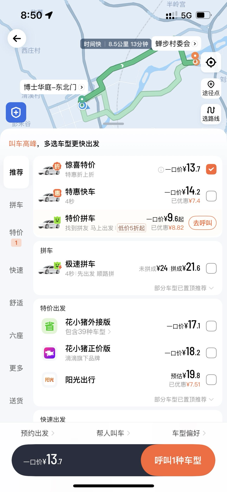 <br> | 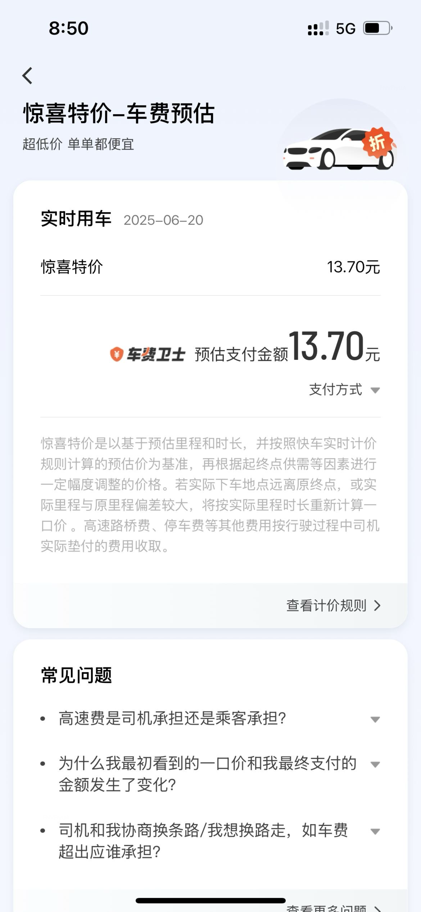 <br> | 原订单信息：小猪特价完单, 实际支付15.92元 <br> <br>**正确审核逻辑**：小猪特价对比的品类在这里是【花小猪外接版】和【花小猪正价版】。 <br>因为==15.92&lt;17.1==且==15.92&lt;18.2==，**不赔付**。 <br> <br>**V0**的赔付逻辑是： <br>冒泡页中有花小猪外接版、花小猪正价版这几个字✅ <br>价格明细页中的价格==13.7&lt;15.92==，价格更贵❌ <br>按照V0的赔付结论：**赔付**(15.92-13.7)\*2 = 4.44 <br> <br>**原因：V0无法提取小猪在端外的价格** <br> |

## 1.3 技术挑战与效果

- Agent**设计:** 

	- **复杂规则**：涉及多模态理解和复杂规则推理，构建端到端的审核系统. **离线召回提升61.63pp.** 见第2节

	- **资源消耗**：资源调优后的大模型计算资源消耗下降91.1% 见第2.2节

- **数据集**建设**：**

	- **数据集建设**：由于没有历史数据，需要人工方式构建离线**数据集**，并完成数据标注. 见第3节

	- **辅助标注模块**：设计辅助标注模块，减少约**80%**人工标注时间. 见第3节

- ==大模型多Agent系统**落地**==：

	- **上线流程从0到1**：确立了大模型上线标准流程，为后续快速应用提供了完整可直接复用的实践经验. 见第4.5节

	- **线上稳定性**：终版采用了离线部署、异步MQ、搭建后端监听、配置DIFY重试等方式保证线上稳定性. 见第4.3节

	- **DIFY到EINO**：辅助工程构建从DIFY到EINO的过程，为以后的DIFY项目快速稳定上线提供了直接的**映射关系**. 见第4.5节

# 2 多模态Agent技术方案设计与演进

> 本节中列举的所有prompt都是2025-10-16日的线上运行prompt.

> [贵必赔大模型优化审核-策略方案](https://cooper.didichuxing.com/knowledge/2199610335356/2204858078938); [工程侧：贵必赔大模型优化审核方案](https://cooper.didichuxing.com/knowledge/2200078294087/2205021120823)

**设计赔付类Agent**，替代原有严格匹配的审核规则

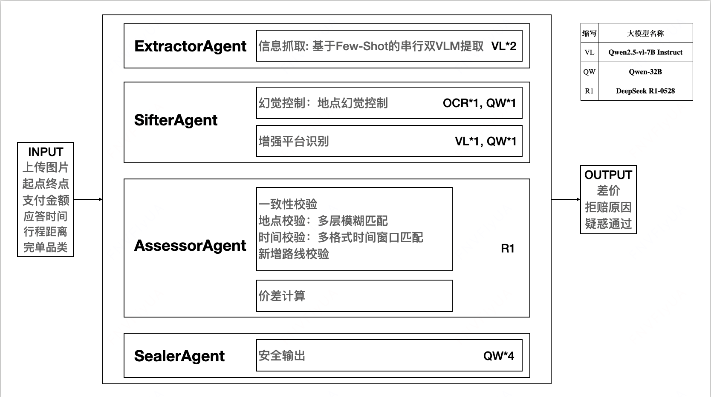

## 2.1 Agent架构设计

核心Agent组件

- ExtractorAgent**信息抓取**：抓取用户图像数据中的订单信息.

- SifterAgent**主体审核规则：**

	- **一致性校验**：比对图像和订单中的行程信息，确保二者内容吻合.

	- **价差计算**：验证并确认是否存在更低的同类价格.

- SifterAgent**高频场景针对性**调优：平台识别增强、幻觉控制.

- **安全输出**：满足条件时，计算并生成具体价差。若不满足条件，总结不赔付原因.

### 2.1.1 ExtractorAgent: 信息抓取

- **方案**：**基于Few-Shot的串行双VLM提取**，显著提升复杂UI界面下，信息提取的<u>准确率</u>和<u>完整率</u>.

	- **Few-Shot优化**：针对复杂价格场景；截图时间定位；网约车商家名称；网约车服务类型；地点.

> 发现不同平台的地点名称不一样，小猪的完单起终点和乘客截图中的展示地点命名方式差异很大。也是V0的识别效果差的原因.

	- **订单信息增强**：提供原始订单信息给VL模型提升召回率.

	- **两次串行提取**：

		- 提升识别召回+减少幻觉。第一次基础提取，第二次基于前次结果的验证增强提取

		- **动态Temperature**：第二次提取使用更高Temperature增强创造性

```PlainText
<背景信息>
这可能是一张打车类 APP 的【行程预估页】截图。

该乘客的另一个订单起点为：`{{#1747727586529.starting_name#}}`，终点为：`{{#1747727586529.dest_name#}}`，订单创建时间为：`{{#1747727586529.answer_time#}}`。
</背景信息>

<任务描述>
请对图片内容进行解析与分析，并最终返回如下字段的信息。 
<目标字段>
1. 截图时间（仅从图片中识别的时间水印或状态栏时间获取，不要使用任何文本中的日期）；
2. 起点（必须是图片中直接显示的完整文字）；
3. 终点（必须是图片中直接显示的完整文字）；
4. 提取所有图片中出现的地点；
5. 所有网约车商家品类及对应价格（格式为：商家/品类 + 对应价格）；
6. 行程距离（如出现“公里”、“km”等单位附近的数值，则提取为路程长度）；
</目标字段>
- **所有信息必须严格来源于图片中实际显示的文字内容**。
- **未识别出的内容请返回“无”**，切勿虚构或猜测。
- 价格信息很重要。
</任务描述>

<提取规则>
1. **不提取优惠金额信息**（例如“已优惠X元”、“优惠X元”等）；
2. **提取的价格应为优惠后的预估价格**；
3. 若出现类似“AAAA XX-YY元”的形式，则取最低价（XX元）作为价格，提取的网约车类别为AAAA；
4. **复杂情况处理示例**：
   - 示例一：
     ```
     旅程约车①11.5元
     敢坐敢赔 隐私保护 特惠 已优惠 2.41元
     ```
     → 商家：旅程约车；价格：11.5元

   - 示例二：
     ```
     鞍马出行 
     敢坐敢赔 隐私保护
     预估14元
     新人专享 已优惠5元
     ```
     → 商家：鞍马出行；价格：14元

   - 示例三：
     ```
     曹操出行 
     特惠 已优惠14元
     预估19元
     敢坐敢赔 隐私保护
     ```
     → 商家：曹操出行 ；价格：19元

5. **起点与终点必须真实存在于图片中**，不能通过联想、推理生成；
6. 提取所有图片中出现的地点；
7. 若存在路径长度信息，需提取数字+单位（如“10.5公里”→“10.5公里”）；
</提取规则>

<截图时间定位提示>
- 常见位置：状态栏左上角或右上角；
- 也可能出现在截图角落的水印中（如左上角、右下角）；
- 如果识别到多个截图时间，请以最离外部的距离最近的那个截图时间为准。
</截图时间定位提示>

<注意事项>
- “个人常走”不是地点标识，但其附近可能包含有效起点或终点信息；
- 所有提取内容必须基于图像中可见的文字，严禁无中生有或推测生成；
- 请确保信息完整；
</注意事项>

<已知网约车商家名称>
吉汽出行,新出租测试1,T3出行,乖乖马优行,八骏马出行,花小猪自营,途途行,搭顺出行,交运出行,方舟行,嗒程用车,领航拼哒,德爱出行,灰马快跑,蜂派出行,天津出行,鑫钜专车,云能行约车,乐拼用车,呼我出行,果粒出行,资运出行,二百出行,呼我惠选,够谱出行,优巴士出行,J刻出行,T1中裕出行,华逸出行,司机小磊,czc聚合端,老兵出行,联途优行,大迪出行,京通众达,天府行网约车,光彩出行,约约出行,代步出行,经纬出行,连点约车,江西约车,易约出行,豫州行,民途出行,聚多行,花小猪自营,子一出行,相安出行,普惠出行优行,大昌出行,来回快车,弘扬优行,城舟专车,郝司机精选代驾 ,出行猫,婉美出行,福伴出行,万顺叫车,优客出行,博通出行,江南优行,呼我优行,安心出行,乐拼优行,老兵出行,同港出行,一喂顺风车,安安用车优行,尚车出行,三牛出行,东潮出行,木丁出行,相安出行,花小猪代驾,华通代驾,行八方代驾,车马出行,鸿鹄测试顺风车,e路合乘,每橙专车,稳稳出行,天府小鹿,黄鹤行,陶陶出行,网路出行,径出行,幸福驾道,云帆优行,900司机畅行版,国泰出行,魔女出行a,花小猪自营,花小猪自营,帮邦行,新出租测试4,安达代驾,量子出行,直哒车,豚仔代驾,蓝道出行,麦卡出行,亿启出行,江南出行,飞嘀打车,呼我出行,首邀约车,开心出行,团子出行,曹操出行,顺道出行,同城打车,顺道出行,马达出行,快客约车,国泰优行,花小猪自营,疾跑代驾,车小云,C20出行,民途出行,皖美出行,蔷薇出行,美易行,拼客优行,快大侠,秒秒帮出行,易旅出行,花小猪自营,放心出行,滴滴出行,享约车,明智优行,昭交约车,哈啰顺风车,糖果优行,及客出行,僖行天下乘客端,集薪出行,多彩出行,车大吉出行,易台车出行,酷狗出行,摩捷打车,红城约车,吉刻上车,AA出行,欧亚出行,零壹代驾,城舟出行,花小猪测试,同港打车,鼎骏出行,AA出行乘客极速版,黄金出行,径出行优选,麦卡出行,满讯出行,益民出行,云滴出行,云滴优行,飞嘀打车,畅兴出行,网宜约车乘客端,拼哒出行,博约出行,门户顺风车测试,方舟行,永顺叫车,麦田出行,e道出行,900出行,南旺出行顺风车,炫狗出行,量子优选,循理专车,易通出行,万合顺励,麦田特惠,众车出行,花小猪自营,彝州出行,阳光出行,易行打车,好好出行,滴滴出行,佳恒出行,海派约行,翼沨出行,飞豹出行,宽窄优行,众逸出行,呼我出行,玖玖专车,云南出行优行,拼客出行,如祺出行,长宽出行,领航约车,快客优行,约客多优行,幸福千万家优行,幸福专车,花小猪自营,安渝出行,蛋卷出行,云帆优行极速版,众众行,网路优行,径出行,易约出行,大雁出行,捷伴出行,哆达达约车,900行,花小猪自营,T1三合出行,旗妙出行,风铃出行,亿启出行,叮叮出行,优行一步,云滴万通行,量子出行,糖果出行,易来客运,江西约车优行,光彩出行,交通约车,唐诗出行,花小猪自营,逍遥游,帮邦行七座商务车,新出租测试3,逸乘出行,哎呦喂打车,融宜出行,任我打车,易惠出行,闪电代驾,如祺特选,张飞快跑,小猪侠代驾,花小猪自营,熊大叫车,同港优行,哎呦喂,任我打车顺风车,悦行惠选,保交行快车,大粤出行,三生出行,联途出行,江南出行,新出租测试2,通帆出行,首汽约车,易达出行,益维出行,前行出行,万合出行,逸乘优行,光彩出行,高格出行,快橙约车,六时出行,赶点出行,橙迹出行,省运优行,郝司机代驾,深驾约车,宏鹄燕京,e_代驾,麦田优行,恒妍出行,蜂派优行,迅达出行,飞鸿出行,砥砺前行,飞嘀优行,安通行,客多行用车,云能行,鲲鹏出行,享道出行,飞豹出行,联途出行,蓝道出行,途途E约车,仟僖出行,天津出行优行,悦程出行,点点约车,直哒车优行,弘扬出行,大昌出行,牛牛网约车,滴滴出租车,捎点宝出行,陕水务出行,铁航专线,诚帮出行,闪见出行,恒途出行,悦程出行,明智特惠,麦卡出行,风驰出行,宝宝出行,小叫车,中军出行,恒好出行,六六约车,江西约车,62580约车,快达用车,暖心出行,出行加,哈啰城际顺风车,秦汉出行,乐满分出行,马到用车,雷利用车,哈得出行,悦行租车,星徽出行,海贝出行,快马嘟嘟,百靓出行,蓝道优行,国泰出行,程师傅代驾,糖果出行,司机点点,逸乘出行,摩驰达出行,风驰出行,任我优行,悦行优选,车马上到,哈啰出行,普惠出行,拼哒优行,易达出行,畅行出行,哈喽优车,顺路约车,牦牛出行,车马出行乘客端,呼我优选,易约出行,斑马快跑,辽易行,云鸟出行,鸿鹄测试,桔易出行,云南出行,滴滴城际顺风车,伙力优行,花小猪自营,昭阳出行,力力专车,鸿鹄测试2,连点约车,拼哒约车,悦道约达,旦旦出行,大粤出行,明智出行,云帆优行,润心出行,UTo出行,天使出行,铃滴出行,土生途行,网乐专车,快来用车,丁当约车,初八打车,E车电驴智能版,逸乘特惠,顺康出行,花小猪自营,振兴出行,幸福千万家,嗒个滴,T1出行,恒好用车,伙力出行,星护代驾,明智出行,昇伽出行,花小猪自营,约尚出行,僖行天下,快乐出行,木丁出行,T1神州,风叱出行,叮叮出行,花小猪自营,卿卿出行,弘扬出行,网路出行,顺道好司机,奇妙旅程,量子惠选,太友出行,相安优行,蛋卷出行,同路出行,博约出行,约客多,张飞快跑,赶点优行,犇犇约车,南旺出行,一苇出行,T1云南出行,耀陌约车,优驾出行,享途知行代驾,网路出行,乖乖马出行,木丁优行,巡享出行,省运专车,骏达出行,优迅快车客户端,七彩筋斗云,普路托出行,长宽出行,益民出行,时驾代驾,蜂派出行,约尚出行,代步出行,同港打车,城舟出行,江南出行,麦田出行,同城打车,优客出行,享约车,七彩筋斗云,铃滴出行,易约出行,星徽出行,开心出行,呼我出行,哆达达约车,大粤出行,拼哒约车,尚车出行,巡享出行,鸿鹄测试,安渝出行,陶陶出行,蛋卷出行,光彩出行,风驰出行,美易行,哈喽优车,T1出行,明智出行,连点约车,玖玖专车,来回快车,团子出行,普惠出行,普路托出行,弘扬出行,益民出行,易达出行,众逸出行,天津出行,三生出行,T1神州,麦卡出行,嗒个滴,前行出行,鸿鹄测试2,900行,哎呦喂打车,耀陌约车,量子出行,安通行,易通出行,快客约车,伙力出行,恒好出行,方舟行,飞嘀打车,司机点点,幸福千万家,酷狗出行,约约出行,老兵出行,陕水务出行,宝宝出行,铁航专线,风叱出行,领航拼哒,帮邦行,黄鹤行,网路出行,蓝道出行,帮邦行七座商务车,出行加,省运专车,T1三合出行,优行一步,吉汽出行,民途出行,雷利用车,网乐专车 ,秦汉出行,云能行,T1中裕出行,博约出行,大昌出行,风铃出行,熊大叫车,优驾出行,万合出行,乐拼用车,糖果出行,顺道出行,飞豹出行,够谱出行,顺路约车,E车电驴智能版,江西约车,卿卿出行,宏鹄测试,博通出行,交运出行,联途出行,闪见出行,途途E约车,悦行租车,欧亚出行,力力专车,大迪出行,百靓出行,径出行,云帆优行,约客多,首邀约车,长宽出行,昭阳出行,蔷薇出行,C20出行,婉美出行,安心出行,鑫钜专车,花小猪打车
</已知网约车商家名称>

<已知网约车服务类型>
- 经济型快车: 普通快车, 特惠快车,一口价, 轻快车型, 惊喜特价, 远必省; 
- 高端/专车服务:舒适型专车, 商务专车, 豪华专车;
- 特殊场景服务: 特快,接送机/接送站,拼车/顺风车,企业用车;
- 聚合平台特色服务:高德打车“轻快联盟”,美团打车“聚合模式”,京东打车服务;
- 会员/权益类服务:滴滴里程会员,T3出行高端会员;
- 未来趋势（试点/概念）:自动驾驶网约车.
</已知网约车服务类型>

<示例地点格式（用 东西湖区武汉青创城市政府|厦门市建筑行业协会(七星西路)S342|金富豪家具城对面前山|Nicki Peach 舞蹈工作室Twerk南关区|吉林农业大学-西2门朝云街|屈臣氏(七彩云南第一店)北侧-上车点保山职业学院西南侧东二环路|兴泰商务广场-西1门
</示例地点格式（用 $$$ 分隔）>
```

```PlainText
<背景信息>
这可能是一张打车类 APP 的【行程预估页】截图。

该乘客的另一个订单起点为：`{{#1747727586529.starting_name#}}`，终点为：`{{#1747727586529.dest_name#}}`，订单创建时间为：`{{#1747727586529.answer_time#}}`。
</背景信息>

<任务描述>
请对图片内容进行解析与分析，并最终返回如下字段的信息。  
<目标字段>
1. 截图时间（仅从图片中识别的时间水印或状态栏时间获取，不要使用任何文本中的日期）；
2. 起点（必须是图片中直接显示的完整文字）；
3. 终点（必须是图片中直接显示的完整文字）；
4. 提取所有图片中出现的地点；
5.所有网约车商家品类及对应价格（格式为：商家/品类 + 对应价格）；
6. 行程距离（如出现“公里”、“km”等单位附近的数值，则提取为路程长度）；
</目标字段>
- **所有信息必须严格来源于图片中实际显示的文字内容**。
- **未识别出的内容请返回“无”**，切勿虚构或猜测。
- 价格信息很重要。
- 上一次提取的结果是：{{#17496334653070.text#}}，请对识别出来的信息进行验证，对于没有识别出来的信息再次尝试识别。
</任务描述>

<提取规则>
1. **不提取优惠金额信息**（例如“已优惠X元”、“优惠X元”等）；
2. **提取的价格应为优惠后价格**；
3. 若出现类似“AAAA XX-YY元”的形式，则取最低价（XX元）作为价格，提取的网约车类别为AAAA；
4. **复杂情况处理示例**：
   - 示例一：
     ```
     旅程约车①11.5元
     敢坐敢赔 隐私保护 特惠 已优惠 2.41元
     ```
     → 商家：旅程约车；价格：11.5元

   - 示例二：
     ```
     鞍马出行 
     敢坐敢赔 隐私保护
     预估14元
     新人专享 已优惠5元
     ```
     → 商家：鞍马出行；价格：14元

   - 示例三：
     ```
     曹操出行 
     预估19元
     敢坐敢赔 隐私保护
     特惠 已优惠14元
     ```
     → 商家：曹操出行 ；价格：19元

5. **起点与终点必须真实存在于图片中**，不能通过联想、推理生成；
6. 提取所有图片中出现的地点；
7. 若存在路径长度信息，需提取数字+单位（如“10.5公里”→“10.5公里”）；
</提取规则>

<截图时间定位提示>
- 常见位置：状态栏左上角或右上角；
- 也可能出现在截图角落的水印中（如左上角、右下角）；
- 如果识别到多个截图时间，请以最离外部的距离最近的那个截图时间为准。
</截图时间定位提示>

<注意事项>
- “个人常走”不是地点标识，但其附近可能包含有效起点或终点信息；
- 所有提取内容必须基于图像中可见的文字，严禁无中生有或推测生成；
- 请确保输出信息完整；
</注意事项>

<已知网约车商家名称>
吉汽出行,新出租测试1,T3出行,乖乖马优行,八骏马出行,花小猪自营,途途行,搭顺出行,交运出行,方舟行,嗒程用车,领航拼哒,德爱出行,灰马快跑,蜂派出行,天津出行,鑫钜专车,云能行约车,乐拼用车,呼我出行,果粒出行,资运出行,二百出行,呼我惠选,够谱出行,优巴士出行,J刻出行,T1中裕出行,华逸出行,司机小磊,czc聚合端,老兵出行,联途优行,大迪出行,京通众达,天府行网约车,光彩出行,约约出行,代步出行,经纬出行,连点约车,江西约车,易约出行,豫州行,民途出行,聚多行,花小猪自营,子一出行,相安出行,普惠出行优行,大昌出行,来回快车,弘扬优行,城舟专车,郝司机精选代驾 ,出行猫,婉美出行,福伴出行,万顺叫车,优客出行,博通出行,江南优行,呼我优行,安心出行,乐拼优行,老兵出行,同港出行,一喂顺风车,安安用车优行,尚车出行,三牛出行,东潮出行,木丁出行,相安出行,花小猪代驾,华通代驾,行八方代驾,车马出行,鸿鹄测试顺风车,e路合乘,每橙专车,稳稳出行,天府小鹿,黄鹤行,陶陶出行,网路出行,径出行,幸福驾道,云帆优行,900司机畅行版,国泰出行,魔女出行a,花小猪自营,花小猪自营,帮邦行,新出租测试4,安达代驾,量子出行,直哒车,豚仔代驾,蓝道出行,麦卡出行,亿启出行,江南出行,飞嘀打车,呼我出行,首邀约车,开心出行,团子出行,曹操出行,顺道出行,同城打车,顺道出行,马达出行,快客约车,国泰优行,花小猪自营,疾跑代驾,车小云,C20出行,民途出行,皖美出行,蔷薇出行,美易行,拼客优行,快大侠,秒秒帮出行,易旅出行,花小猪自营,放心出行,滴滴出行,享约车,明智优行,昭交约车,哈啰顺风车,糖果优行,及客出行,僖行天下乘客端,集薪出行,多彩出行,车大吉出行,易台车出行,酷狗出行,摩捷打车,红城约车,吉刻上车,AA出行,欧亚出行,零壹代驾,城舟出行,花小猪测试,同港打车,鼎骏出行,AA出行乘客极速版,黄金出行,径出行优选,麦卡出行,满讯出行,益民出行,云滴出行,云滴优行,飞嘀打车,畅兴出行,网宜约车乘客端,拼哒出行,博约出行,门户顺风车测试,方舟行,永顺叫车,麦田出行,e道出行,900出行,南旺出行顺风车,炫狗出行,量子优选,循理专车,易通出行,万合顺励,麦田特惠,众车出行,花小猪自营,彝州出行,阳光出行,易行打车,好好出行,滴滴出行,佳恒出行,海派约行,翼沨出行,飞豹出行,宽窄优行,众逸出行,呼我出行,玖玖专车,云南出行优行,拼客出行,如祺出行,长宽出行,领航约车,快客优行,约客多优行,幸福千万家优行,幸福专车,花小猪自营,安渝出行,蛋卷出行,云帆优行极速版,众众行,网路优行,径出行,易约出行,大雁出行,捷伴出行,哆达达约车,900行,花小猪自营,T1三合出行,旗妙出行,风铃出行,亿启出行,叮叮出行,优行一步,云滴万通行,量子出行,糖果出行,易来客运,江西约车优行,光彩出行,交通约车,唐诗出行,花小猪自营,逍遥游,帮邦行七座商务车,新出租测试3,逸乘出行,哎呦喂打车,融宜出行,任我打车,易惠出行,闪电代驾,如祺特选,张飞快跑,小猪侠代驾,花小猪自营,熊大叫车,同港优行,哎呦喂,任我打车顺风车,悦行惠选,保交行快车,大粤出行,三生出行,联途出行,江南出行,新出租测试2,通帆出行,首汽约车,易达出行,益维出行,前行出行,万合出行,逸乘优行,光彩出行,高格出行,快橙约车,六时出行,赶点出行,橙迹出行,省运优行,郝司机代驾,深驾约车,宏鹄燕京,e_代驾,麦田优行,恒妍出行,蜂派优行,迅达出行,飞鸿出行,砥砺前行,飞嘀优行,安通行,客多行用车,云能行,鲲鹏出行,享道出行,飞豹出行,联途出行,蓝道出行,途途E约车,仟僖出行,天津出行优行,悦程出行,点点约车,直哒车优行,弘扬出行,大昌出行,牛牛网约车,滴滴出租车,捎点宝出行,陕水务出行,铁航专线,诚帮出行,闪见出行,恒途出行,悦程出行,明智特惠,麦卡出行,风驰出行,宝宝出行,小叫车,中军出行,恒好出行,六六约车,江西约车,62580约车,快达用车,暖心出行,出行加,哈啰城际顺风车,秦汉出行,乐满分出行,马到用车,雷利用车,哈得出行,悦行租车,星徽出行,海贝出行,快马嘟嘟,百靓出行,蓝道优行,国泰出行,程师傅代驾,糖果出行,司机点点,逸乘出行,摩驰达出行,风驰出行,任我优行,悦行优选,车马上到,哈啰出行,普惠出行,拼哒优行,易达出行,畅行出行,哈喽优车,顺路约车,牦牛出行,车马出行乘客端,呼我优选,易约出行,斑马快跑,辽易行,云鸟出行,鸿鹄测试,桔易出行,云南出行,滴滴城际顺风车,伙力优行,花小猪自营,昭阳出行,力力专车,鸿鹄测试2,连点约车,拼哒约车,悦道约达,旦旦出行,大粤出行,明智出行,云帆优行,润心出行,UTo出行,天使出行,铃滴出行,土生途行,网乐专车,快来用车,丁当约车,初八打车,E车电驴智能版,逸乘特惠,顺康出行,花小猪自营,振兴出行,幸福千万家,嗒个滴,T1出行,恒好用车,伙力出行,星护代驾,明智出行,昇伽出行,花小猪自营,约尚出行,僖行天下,快乐出行,木丁出行,T1神州,风叱出行,叮叮出行,花小猪自营,卿卿出行,弘扬出行,网路出行,顺道好司机,奇妙旅程,量子惠选,太友出行,相安优行,蛋卷出行,同路出行,博约出行,约客多,张飞快跑,赶点优行,犇犇约车,南旺出行,一苇出行,T1云南出行,耀陌约车,优驾出行,享途知行代驾,网路出行,乖乖马出行,木丁优行,巡享出行,省运专车,骏达出行,优迅快车客户端,七彩筋斗云,普路托出行,长宽出行,益民出行,时驾代驾,蜂派出行,约尚出行,代步出行,同港打车,城舟出行,江南出行,麦田出行,同城打车,优客出行,享约车,七彩筋斗云,铃滴出行,易约出行,星徽出行,开心出行,呼我出行,哆达达约车,大粤出行,拼哒约车,尚车出行,巡享出行,鸿鹄测试,安渝出行,陶陶出行,蛋卷出行,光彩出行,风驰出行,美易行,哈喽优车,T1出行,明智出行,连点约车,玖玖专车,来回快车,团子出行,普惠出行,普路托出行,弘扬出行,益民出行,易达出行,众逸出行,天津出行,三生出行,T1神州,麦卡出行,嗒个滴,前行出行,鸿鹄测试2,900行,哎呦喂打车,耀陌约车,量子出行,安通行,易通出行,快客约车,伙力出行,恒好出行,方舟行,飞嘀打车,司机点点,幸福千万家,酷狗出行,约约出行,老兵出行,陕水务出行,宝宝出行,铁航专线,风叱出行,领航拼哒,帮邦行,黄鹤行,网路出行,蓝道出行,帮邦行七座商务车,出行加,省运专车,T1三合出行,优行一步,吉汽出行,民途出行,雷利用车,网乐专车 ,秦汉出行,云能行,T1中裕出行,博约出行,大昌出行,风铃出行,熊大叫车,优驾出行,万合出行,乐拼用车,糖果出行,顺道出行,飞豹出行,够谱出行,顺路约车,E车电驴智能版,江西约车,卿卿出行,宏鹄测试,博通出行,交运出行,联途出行,闪见出行,途途E约车,悦行租车,欧亚出行,力力专车,大迪出行,百靓出行,径出行,云帆优行,约客多,首邀约车,长宽出行,昭阳出行,蔷薇出行,C20出行,婉美出行,安心出行,鑫钜专车,花小猪打车
</已知网约车商家名称>

<已知网约车服务类型>
- 经济型快车: 普通快车, 特惠快车,一口价, 轻快车型, 惊喜特价, 远必省; 
- 高端/专车服务:舒适型专车, 商务专车, 豪华专车;
- 特殊场景服务: 特快,接送机/接送站,拼车/顺风车,企业用车;
- 聚合平台特色服务:高德打车“轻快联盟”,美团打车“聚合模式”,京东打车服务;
- 会员/权益类服务:滴滴里程会员,T3出行高端会员;
- 未来趋势（试点/概念）:自动驾驶网约车.
</已知网约车服务类型>

<示例地点格式（用 东西湖区武汉青创城市政府|厦门市建筑行业协会(七星西路)S342|金富豪家具城对面前山|Nicki Peach 舞蹈工作室Twerk南关区|吉林农业大学-西2门朝云街|屈臣氏(七彩云南第一店)北侧-上车点保山职业学院西南侧东二环路|兴泰商务广场-西1门
</示例地点格式（用 清昌大道|浓妆淡抹(福清清昌万达广场店)东南侧-上车点沧林路|金派好全屋定制(信实楼店)俄黄路|玉腾物流解放大路|优一百超市江霞广场|百老泉酒业有限公司(湛江店)群力地区|辣近龙虾·海鲜烧烤(群力店)如家neo.临沂(泰盛人民广场红旗路店)未央区|陕西鼎盛创新集装箱房屋有限公司蒲昌路|达美乐比萨(沈北万达店)$$ 分隔）>
```

- **模块迭代收益**

| **Extractor版本号** <br> | **主要技术** <br> | **解决的问题** <br> | **优势** <br> | **局限性** <br> |
| --- | --- | --- | --- | --- |
| E0 (原有) <br> | OCR+正则化提取 <br> | 分开获取价格和行程信息 <br> | 快速上线 <br> | 识别精度低，有效信息召回率极低 <br> |
| E0.1 <br> | OCR+LLM <br> | 基础审核 <br> | 雅典娜OCR识别效果差 <br> |
| E1.0 <br> | 通用VLM+视觉问答 <br> | 提升信息识别完整率：截图时间、起终点、商家/车型价格 <br> | 强于传统OCR <br> | 有效信息召回率低，如无法区分商家/车型，复杂界面效果差 <br> |
| E1.1 <br> | Few-Shot优化 <br> | 提升召回率 <br> | 成本较Finetune低 <br> | 大模型推理时间长 <br> |
| E1.2 <br> | 小参数量模型+Few-Shot <br> | 平衡效果与效率 <br>提升地点、商家价格对、优惠后价格 <br> | 推理时间显著降低 <br> | 可能遗漏关键信息 <br> |
| **E1.3 (线上)** <br> | **串行VLM+订单信息增强** <br> | **全面优化** <br> | **高精度+合理耗时** <br> | **资源消耗较高** <br> |

> vl-72B的信息提取时间长，特别是对于问题比较复杂（更长的）Prompt需要的时间很长，可能超过10min. 

复杂界面充斥着噪声：例如“券”、“优惠”等噪声存在，使得传统方法很难提取价格信息
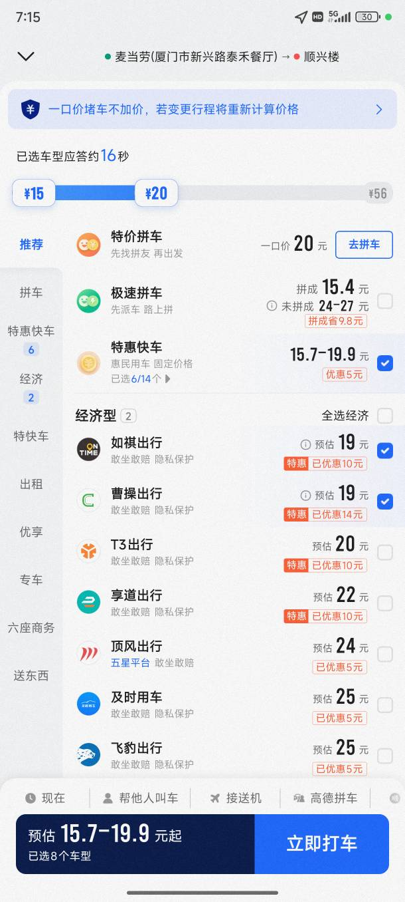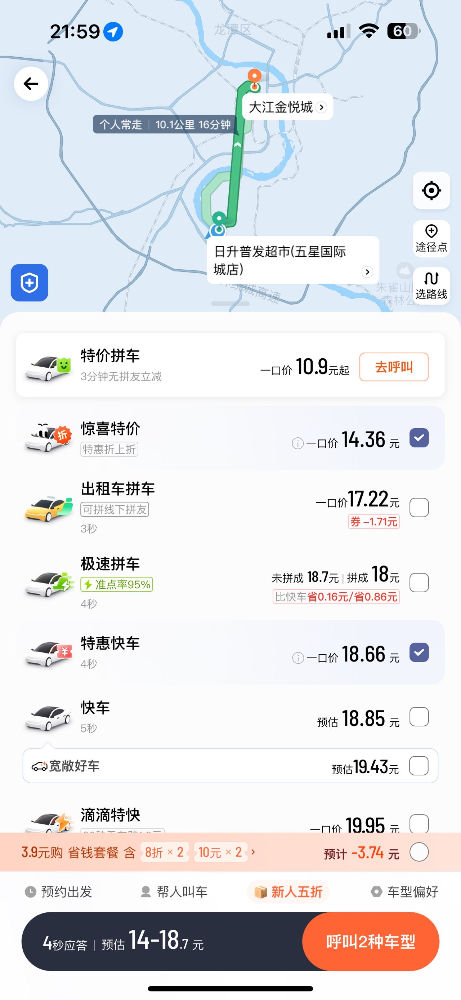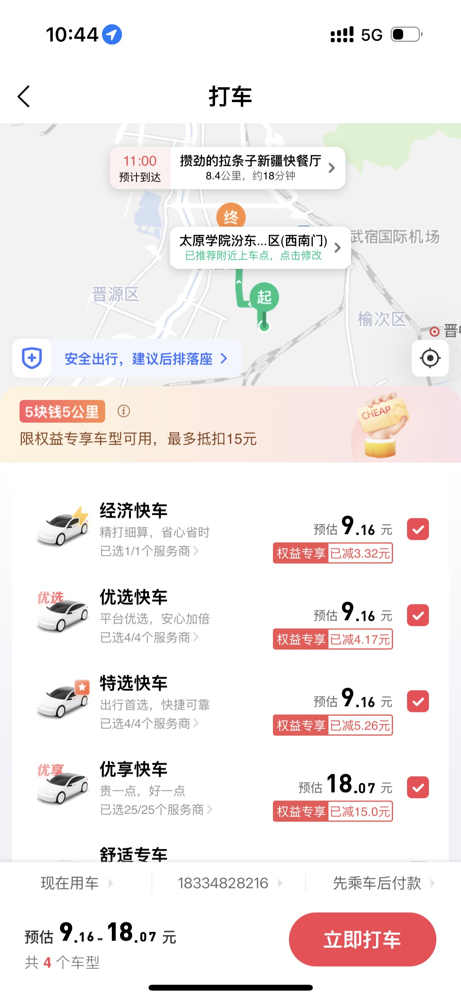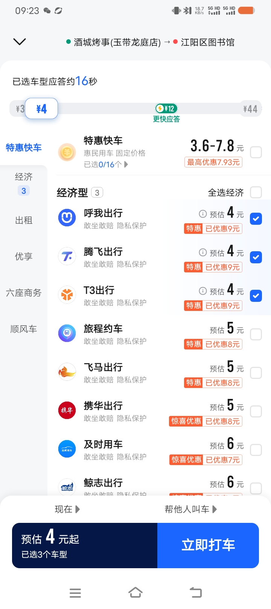

E0和E1.3对比的典型示例
| 日期, 订单序号 <br> | OCR识别 bad case <br>【行程预估页】 <br> | Qwen-vl-7B bad case <br>【行程预估页】 <br> | OCR识别 bad case <br>【价格明细页】 <br> | Qwen-vl-7B bad case <br>【价格明细页】 <br> | 正确版本 <br> |
| --- | --- | --- | --- | --- | --- |
| 2025-05-25, 1 <br> | 起点识别错误: 识别成玉锦邮西. <br> | 1.把情感沟通位-==9.9卡券化项目识别成一个商家.== <br>==2.无法把实惠好价识别成一个商家，导致价格错位。把实惠好价的价格错误识别成另外一个商家的价格.== <br> | 截图时间一定识别不出. <br> | 截图时间可能识别不出. (重复多次识别) . <br> | 起点：玉锦麟邸西 <br>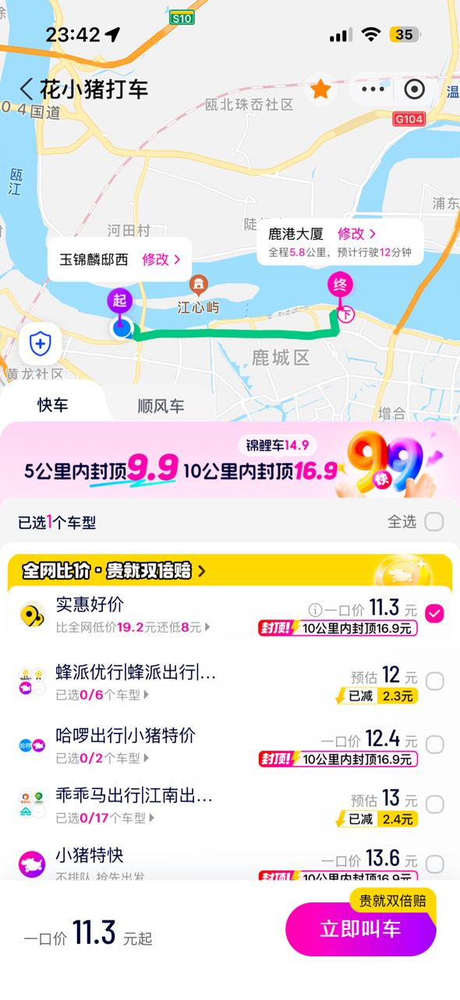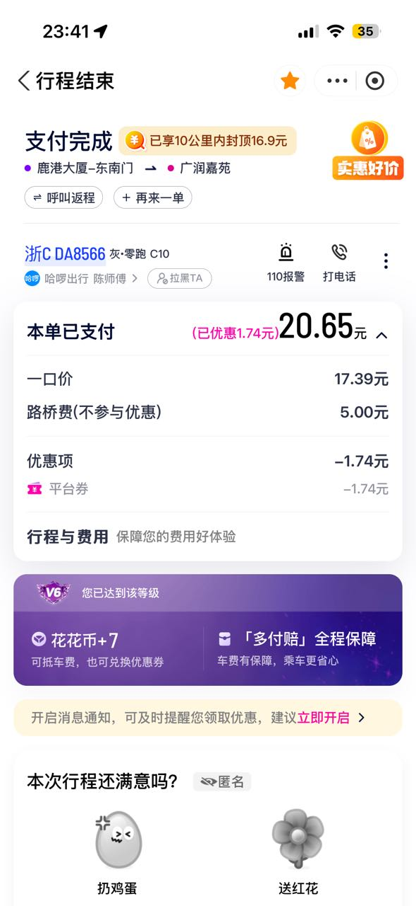 <br> |

### 2.1.2 **AssessorAgent: 主体审核规则**

#### 2.1.2.1 一致性校验

**地点校验：多层模糊匹配**

- **方案**：采用基于文本相似度的地名匹配，平衡<u>精度</u>与<u>开发和调用</u>效率.

> Q: 为什么选择地名文本匹配而非物理距离计算？

> A: 初期探索了基于高德MCP和滴滴地图API的物理距离方案, 但为了效率选择地名相似度。1. 跨平台地点命名差异导致无法准确定位; 2. 开发周期较长，影响上线进度. 

- **多层次模糊匹配:** 名称相似度+关键词匹配+高频场景提取规则.

- **地点校验**：

	- **严格基础规则**：若忽略修饰词后的Jaccard相似度为0，则一定不是相同地点

	- **融合匹配：**

		- Levenshtein距离 ≥ 85% 或 Jaro-Winkler距离 ≥ 85%

		- 接受起终点相反

> 有时人也无法从截图上判断出是起点还是终点

	- **关键词匹配**：交通枢纽、商业综合体、地标建筑

	- **排除误匹配：**排除常见高频词的单独匹配

```PlainText
#### **起终点匹配规则**
- **基础要求**：
  - 截图必须显示起点
  - 截图必须显示终点
<基本匹配规则>
1. 严格规则：如果忽略修饰词（"入口"、"出口"、"东门"等）后的Jaccard 相似度=0，则判断一定不是相同地点。
2. **名称相似度匹配**
   - 使用字符串相似度算法（如Levenshtein距离、Jaro-Winkler距离）
   - Levenshtein距离≥85%或者Jaro-Winkler距离≥85%可视为相同地点（如"北京西站南广场"与"北京西站南广场停车场"）
3. **关键词匹配**
   - 包含相同核心关键词（如"首都T3航站楼"与"首都机场T3"）
   - 忽略修饰词（"入口"、"出口"、"东门"等）
4. 匹配优先级: 名称相似度 > 关键词匹配。
5. 排除误匹配: 排除常见高频词（如"小区"、"大厦"）的单独匹配。
</基本匹配规则>

<特殊场景处理>
1. 交通枢纽处理: 火车站/机场不同出入口、停车场统一归为枢纽主名称。示例："虹桥火车站2F出发层" → "虹桥火车站"
2. 商业综合体处理: 同一商场不同定位点归为商场主名称。示例："万达广场(西门)" → "万达广场"
3. 地标建筑处理: 包含地标名称即视为相同。示例："东方明珠电视塔停车场" → "东方明珠"
</特殊场景处理>

<审核流程>

#### **第一步：基础资格验证（一票否决）**
1. 截图信息完整性：
 - 如果截图信息中（起点、终点）有一个为未知或者空→ **拒绝**

2. 订单信息完整性：
   - 如果以下信息有一个为未知或者空 → **拒绝**
起点: {{#1747727586529.starting_name#}},

终点: {{#1747727586529.dest_name#}}, 

#### **第三步：行程匹配验证**
1. 起点匹配：
   - 订单起点：{{#1747727586529.starting_name#}}
   - 与[行程预估页]起点模糊匹配
LLM逻辑上的OCR识别结果为{{#17477998897500.text#}}.
2. 终点匹配：
   - 订单终点：{{#1747727586529.dest_name#}}
   - 与[行程预估页]终点模糊匹配
3. 如果是订单起点和与[行程预估页]终点模糊匹配，订单终点与[行程预估页]起点模糊匹配，则也认为通过。
4. 如果图片中有多个地点，只要订单起点在[行程预估页]的ocr识别结果{{#17506612157620.result#}}中能找到相似地点，且订单终点在[行程预估页]的ocr识别结果{{#17506612157620.result#}}中中能找到相似地点，则也视为起终点匹配。
5. 路线匹配：
   - 订单实际距离: {{#1747727586529.max_order_dis_dri_real_dis#}}
  -  其他平台预估路线与实际距离差≤2公里

### **执行优先级**
1. 基础验证 → 2. 时效验证 → 3. 商家验证 →  
4. 行程验证 → 5. 路线验证 → 6. 价格验证  
（任一环节失败则不赔付，但是需要检验所有不赔付原因）
```

**新增路线校验**

> V0之外的新增规则1

- **背景：**意识到乘客可能因中途改道导致实际路线与预估不符，从而产生不合理价差。

- **规则：V1新增拒绝条件**预估与实际里程一致性，其他平台距离 < 花小猪距离 - 2km

```PlainText
#### **第一步：基础资格验证（一票否决）**
订单信息完整性：
   - 如果以下信息有一个为未知或者空 → **拒绝**
实际距离: {{#1747727586529.max_order_dis_dri_real_dis#}}

#### **路线一致性**
- **通过条件**：
  - 其他平台预估路线与实际距离差≤2公里
- **即时拒绝**：
  - 其他平台距离 < 花小猪距离 - 2km
```

**时间校验：多格式时间窗口匹配**

- **挑战：**截图时间解析面临跨天、12/24小时制、时间格式多样的复杂情况。

> |材料显示时间与订单时间差|≤30分钟

- **优化策略**

	- **信息最小**：订单时间仅提供小时+分钟，减少噪声干扰

> 更多信息会导致更多的幻觉

	- **规则精细**：设计多场景时间差计算逻辑

	- **容错处理**：无法识别截图时间时采用有利用户原则

```PlainText
#### **第一步：基础资格验证（一票否决）**
3. 订单信息完整性：
   - 如果以下信息有一个为未知或者空 → **拒绝**
创建时间：{{#1747727586529.answer_time#}},

#### **1. 截图时间有效性（30分钟窗口）**
- 对比对象：截图时间 vs 订单发起时间
- 通过条件：时间差 ≤ 30分钟（支持跨±1天，支持12/24小时制）
-  在无法获得任何截图时间信息，也就是截图时刻小时数和截图时刻分钟数都不知道的情况下 → 通过

#### **第二步：时效性验证**
1. 解析截图时间：
   - 行程预估页：{{#17477998897500.text#}}

2. 比对订单发起时间：{{#1747727586529.answer_time#}}
3. 计算截图时间与订单发起时间的时间间隔
   - 如果截图时间的小时数>12, 截图的时间间隔 = min(截图时间和订单发起同天的时间间隔，截图时间在订单发起的前一天的时间间隔，截图时间在订单发起的后一天的时间间隔)
   - 如果截图时间的小时数<13, 截图的时间间隔 = min(截图时间和订单发起同天的时间间隔，截图时间在订单发起的前一天的时间间隔，截图时间在订单发起的后一天的时间间隔, (截图时间+12h)和订单发起同天的时间间隔，(截图时间+12h)在订单发起的前一天的时间间隔，(截图时间+12h)在订单发起的后一天的时间间隔,)
  - 无法获得任何截图时间信息，认为该张截图通过此规则。
4. 验证标准：
   - 双截图时间差均≤30分钟
```

#### 2.1.2.2 价差计算

- 业务规则

	- **特价盒子**：对比端外独乘服务的网约车车型价格

	- **小猪特价**：对比端外小猪服务价格

```PlainText
#### **第一步：基础资格验证（一票否决）**
2. 服务类型验证：截图中没有任何这里列出的车型{{#env.allow_kflower_type#}}

 → **拒绝**
3. 订单信息完整性：
   - 如果以下信息有一个为未知或者空 → **拒绝**
实际支付价格: {{#1747727586529.actual_cost_capital#}}

#### **2. 筛选服务类型**
- **允许服务**：
  - {{#env.allow_kflower_type#}}
- **禁止服务**：
  - 其他所有车型和商家


#### **5. 价格比对与赔付**
- **赔付公式**：
  ```
  赔付金额 = (花小猪价 > 竞品最低价) ? (花小猪价 - 竞品价) : 0
  ```

- **比较基准**：仅比较其他平台的花小猪服务价格：{{#env.allow_kflower_type#}}

- **特殊情况**：若出现价格区间（如“特惠快车24-34元”），取**最低价**（24元）


#### **第四步：价格赔付计算**
1. 获取花小猪实付价：{{#1747727586529.actual_cost_capital#}}
2. 提取竞品最低价（花小猪服务）
  - 可能会出现"AAAA XX-YY元"的字段，这种情况下，是一个范围价格。应该提取的网约车类别为AAAA，最低价格是XX元。
3. 执行赔付计算：
   - 花小猪价 > 竞品价 → 差价赔付
   - 否则 → 赔付0元

#### **第五步：总结疑惑通过的子规则**
- 列出所有存在疑问但仍按“有利于用户”原则通过的规则（如“未解析到截图时间”、“未识别路线距离”等）

#### **第六步：总结不通过赔付的原因列表**
- 若拒绝赔付，列出所有不通过的原因（从固定选项中选择： {{#1747727586529.ALL_FAIL_REASONS_TJ#}}）
<审核流程>

## 输出格式要求

```json
{
  "审核结论": "通过" | "拒绝",
  "赔付失败原因": ["原因1", "原因2"],
  "赔付金额": 0.0,
  "疑惑通过的子规则": ["规则1", "规则2"]
}
```
```

### 2.1.3 SifterAgent: 场景针对性调优

**提升评估效果**的同时，**降低**了“不合规图片”和“地点校验不合法”两种**高频场景**的计算**资源消耗**.

#### 2.1.3.1 平台识别增强

> V0之外的新增规则2

- 离线数据集：大量用户误传花小猪平台截图，导致误赔付。

- **方案：**新增**平台粗判断VLM**，专注识别非花小猪打车平台

> 减少幻觉Trick：只让VLM判断是否为非hxz打车平台，不判断更细节的--是否为行程预估页/价格明细页。

- **视觉特征：**品牌色系、Logo特征、UI组件

```PlainText
请严格分析用户上传的图片，并根据以下步骤判断截图来源是哪一个平台（仅限：`高德`、`滴滴`、`花小猪`、`其他打车平台`、`非打车平台`），并输出唯一结果。不要使用“|”符号列出多个选项，请只选择一个最符合的平台。

#### 判断流程如下：

1. **多维度特征识别**
   - **品牌色系检测**：
     • 高德：深蓝色 (#0081FF)  
     • 滴滴：活力橙 (#FF7D00)  
     • 花小猪：粉紫色 (#FF63A5 + 紫色渐变)  
     • 其他打车平台：如 T3 出行 (蓝+金)、曹操出行 (绿系)  
     • 非打车平台：无明显平台色系或颜色杂乱  

   - **Logo特征验证**：
     • 高德：顶部有 "AMAP" 或底部显示 "高德打车"  
     • 滴滴：橙色 "DIDI" 字母或 "滴滴出行" 文字
     • 花小猪：紫色卡通猪头图标 + 「花小猪打车」字体  
     • 美团打车：黄色 "美团打车" 标识  

   - **独家UI组件**：
     • 高德：聚合车型价格对比面板  
     • 滴滴：安全中心悬浮球  
     • 花小猪：动态优惠券弹窗  

2. **深度内容分析**
   - **关键文本定位（OCR优先区域）**：
     1. 顶部状态栏："XX打车" 品牌标识  
     2. 订单页："订单详情" 页头 / 司机信息卡样式  
     3. 支付页：特有支付方式（如滴滴的 "滴滴支付"）  

   - **导航栏特征**：
     • 高德：常驻 "路线规划" 按钮  
     • 花小猪：底部有 "省钱" 独立标签  
     • 非打车平台：缺少行程进度条等打车相关元素  

3. **平台交叉验证**
   - **地图服务标识**：
     • 高德：自带 "高德地图" 水印  
     • 滴滴：使用腾讯地图或其他第三方地图  

   - **订单编号规则**：
     • 滴滴：11位纯数字  
     • 花小猪："HXZ" 前缀 + 8位数字  

   - **车辆信息展示**：
     • 合规平台：显示车牌号、司机星级  
     • 非打车平台：无标准化车辆信息卡  

4. **判断优先级**：
   1. 先排除非打车平台（如无行程/支付相关元素）  
   2. 确认是否具有独家特征（如花小猪的紫色渐变背景）  
   3. 匹配次级特征（如高德的地图样式）  
   4. 最后通过文本关键词兜底判断  

5. **特殊情形处理**：
   - 若为聚合平台（如高德中显示曹操出行）：标注实际服务商（如高德）  
   - 局部截图：基于可见元素反向排除  
   - 新平台或未知平台：归类为 “其他打车平台”，并提取其 UI 特征  
   - 如果OCR提取到“花小猪正价版”，则为滴滴平台

---

### 🧾 输出格式要求：

请以 JSON 格式返回以下字段，确保 `platform` 是唯一的字符串值（不是多个选项）：

```json
{
  "platform": "高德", 
  "confidence": 0.92,
  "evidence": {
    "visual": ["检测到深蓝色界面", "发现顶部 AMAP Logo"],
    "text": ["OCR识别出'高德打车'字样"],
    "context": ["存在聚合车型比价面板"]
  },
  "warning": ["低分辨率警告"]
}
```

---

### 📢 注意事项：

- `platform` 字段必须是一个字符串，从以下五者中选择唯一一个：
  - `"高德"`
  - `"滴滴"`
  - `"花小猪"`
  - `"其他打车平台"`
  - `"非打车平台"`

- 不要使用 `|` 符号，不要输出多个平台，不要用数组。
- 如果不确定，可以降低 confidence 值，但 platform 必须为一个具体值。
```

```PlainText
请根据输入，判断是否为非花小猪的打车平台截图：

### 判断逻辑如下：
- 如果confidence < 0.8时强制返回`"Y"`
- 如果 `platform` 字段为 `"花小猪"` 或 `"非打车平台"` → 返回 `"N"`
- 如果 `platform` 字段为 `"高德"`、`"滴滴"` 或 `"其他打车平台"`或包含多个平台或其他内容 → 返回 `"Y"`

### ⚠️ 输出要求：
- 仅返回一个字符：`"Y"` 或 `"N"`
- 不添加任何解释、空格或格式
- 输出需保证 JSON 可解析（用于后续系统调用）

---

### 💡 示例

#### 输入：
```json
{
  "platform": "花小猪",
  ...
}
```
✅ 输出：
```
N
```

---

#### 输入：
```json
{
  "platform": "滴滴",
  ...
}
```
✅ 输出：
```
Y
```

---

#### 输入：
```json
{
  "platform": "非打车平台",
  ...
}
```
✅ 输出：
```
N
```
```

#### 2.1.3.2 幻觉控制

- **地点幻觉校验：**因地点对审核准确性影响最大。

- **幻觉抑制**：

	- 加入**OCR**减少地点信息幻觉：提供原始订单提高召回的同时增加了大模型幻觉。

	- 20%字符覆盖度阈值

VLM的幻视示例
| 测试日期 <br> | 当天订单序号 <br> | 关注原因 <br> | 备注图片 <br> |
| --- | --- | --- | --- |
| **2025-05-16** <br> | 5 <br> | 幻视： <br>&lt;车型不符&gt;行程预估页截图显示您选择的是【花小猪顺风车】车型，而活动规则要求必须为独乘服务网约车车型（顺风车不属于独乘服务）&lt;/车型不符&gt; <br>&lt;平台名称不匹配&gt;您上传的行程预估页平台名称为【花小猪顺风车】，而价格明细页平台名称为【嘀咕打车】，两者未匹配到同一商家&lt;/平台名称不匹配&gt; <br>实际上： <br>都是花小猪打车，没有顺风车字段，也没有嘀咕打车 <br> | 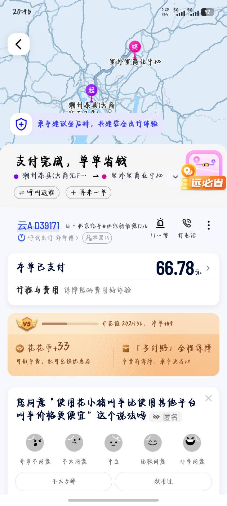 <br> |

```PlainText
请判断以下内容是否提供了完整的起点和终点信息。

- 起点为：{{#1747727586529.starting_name#}}  
- 终点为：{{#1747727586529.dest_name#}}  
- 用户输入内容为：{{#17506612157620.result#}}


### 判断逻辑如下：
1. **预处理规则**：
   - 忽略修饰词（"入口"、"出口"、"东门"、"南侧“、”上车点“等）
   - 仅保留起点、终点名称和用户输入中的 **字母（a-zA-Z）、汉字（中文字符）和数字（0-9）**，忽略其他符号、空格和标点。

2. **完整起点判断**：
- 按照集合方式处理字符，如果用户输入中包含起点名称中 **至少 20% 的字符**，则认为提供了**完整起点**
- 否则视为**未提供完整起点**。

3. **完整终点判断**：
- 按照集合方式处理字符，如果用户输入中包含终点名称中 **至少 20% 的字符**，则认为提供了**完整终点**
- 否则视为**未提供完整终点**。

4. **最终判断结果**：
   - 若同时提供了完整起点和完整终点 → 返回：“Y”；
   - 否则 → 返回：“N”。

---
### ⚠️ 输出要求：
- 仅返回一个字符：`"Y"` 或 `"N"`
- 不添加任何解释、空格或格式
- 输出需保证 JSON 可解析（用于后续系统调用）

### 📌 补充说明：
- “字符”指单个汉字、英文字母或数字；
- 不要求完全匹配，只要满足一定覆盖度即可；
- 可用于自然语言中模糊提及地点的情况（如“从北京出发”中识别出“北京”作为“北京西站”的简写）；
```

### 2.1.4 **SealerAgent:** 安全输出

- **双重提取**赔付金额提升推理成功率**：**首次尝试结构化提取；再尝试自然语言理解；兜底返回-1

> 提取失败率？提取失败怎么办？在线上链路中会详细介绍。提取结论，截止到10月20日，没有输出差价失败的订单。

- **输出安全性强保证**：拒绝原因输出映射关系，防止模型推理细节泄露

拒绝赔付原因--拒绝赔付codes
| ==**refuse_reasons**== <br>==**（**==**展现给乘客的措辞）** <br> | **refuse_codes** <br> | **备注** <br> |
| :---: | :---: | :---: |
| 没有行程预估页图片，审核不通过 <br> | 1001 <br> | - <br> |
| 上传材料非特定平台图片，审核不通过 <br> | 1002 <br> | - <br> |
| 上传材料内订单起终点与当前订单起终点信息不一致，审核不通过 <br> | 1003 <br> | - <br> |
| 上传材料内截图时间与订单发起时间间隔超过30分钟，审核不通过 <br> | 1004 <br> | - <br> |
| 上传材料内比价订单预估路线与当前订单路线距离差异过大，审核不通过 <br> | 1005 <br> | - <br> |
| 上传材料内应答车型非独乘服务车型，审核不通过 <br> | 2006 <br> | 特价盒子 <br> |
|  上传材料内应答车型非花小猪服务车型，审核不通过 <br> | 3006 <br> | 小猪特价 <br> |
| 上传材料内比价车型价格高于当前订单实付价格，审核不通过 <br> | 2007 <br> | 特价盒子 <br> |
| 3007 <br> | 小猪特价 <br> |
| 上传材料不符合规则 <br> | 1008 <br> | 模型判断失败（赔付金额提取失败，或赔付原因提取失败） <br> |
| 通过赔付 <br> | 8888 <br> | - <br> |

```JSON
你是一个专业的参数提取器。请提取所有不赔付的原因，并将其转换为对应的字母编码列表。

预定义原因对照表：
{"a": "行程预估页起终点与订单起终点不匹配",
"b": "截图时间与订单发起时间间隔 > 30分钟",
"c": "路线距离不一致（其他平台预估距离与实际距离差 > 2公里）",
"d": "截图未提供花小猪服务品类及价格信息，无法验证服务类型和进行价格比对",
"e": "截图中没有花小猪服务比本单价格更便宜“or”用户实付价不高于竞品最低价"or“价格比对显示花小猪价不高于竞品价”}

要求：
- string数组，例如：["a", "d"] 或 []
- 仅输出数组，不加解释、不加文本、不加额外格式
```

```JSON
 你是一个专业的参数提取器。请提取所有不赔付的原因，并将其转换为对应的字母编码列表。

预定义原因对照表：
{
 "a": "行程预估页起终点与订单起终点不匹配",
"b": "截图时间与订单发起时间间隔 > 30分钟",
"c": "路线距离不一致（其他平台预估距离与实际距离差 > 2公里）",
"d": "截图未提供独乘网约车品类及价格信息，无法验证服务类型和进行价格比对",
"e": "截图中没有独乘网约车品类比本单价格更便宜"或者”用户实付价不高于竞品最低价"}  

要求：
- 输出一个char数组，例如：["a", "d"] 或 []
- 不需要额外解释或格式说明
```

## 2.2 资源调优

- **评估**：从分类精度和回归准确两个方向评估模型

	- **分类**：二分类预测，标签为是否赔付.

	- **回归**：数值预测，标签为赔付金额（拒绝赔付时金额为0）.

- **模型迭代**

	- V1.0满血版：最大化准召、最小化运行时间(大部分推理并行)，为辅助人工标注提供高质量预测结果.

	- V1.0.1轻量版：保证准召不显著降低的情况下，减少计算资源消耗。但Recall下降19.05pp，ACC下降11.51pp，数值误差翻倍.

	- V1.1.0单图优化：关键突破--发现仅用冒泡页可提升效果，简化审核复杂度.

	- V1.1.1串行提取：通过串行调用两次VL，增强复杂界面下的信息抓取能力. 

	- V1.1.2抗幻觉：引入OCR辅助校验，有效抑制地点幻觉.

- **输入简化：**从双图（行程预估页+价格明细页）到单图（仅行程预估页）

	- **必要性**：逻辑复杂度不变，减少模型数量会引发幻觉问题；所以如果要减少计算资源消耗，只能降低逻辑复杂度.

	- **效果**：AUC和数值ERROR几乎不变的情况下，大大降低了计算资源消耗。资源调优后的大模型计算资源消耗比V1.0满血版下降91.1pp.

	- **业务考量**：

		- 提升乘客体验。

		- 开销：并不会增加很多赔付。从双图到单图，预计赔付成功率提升2.3pp，单均赔付金额提升0.1元

|  <br> | **版本名称** <br> | **分类/回归** <br> | **二分类任务：是否赔付（Y/N）** <br> | **回归任务（单位，元）** <br>**赔付金额=min(差价\*2,20)** <br> | **数值任务效果 | 真实赔付(T/F)== 预估赔付(T/F)** <br> | **预估赔付金额&gt;0** <br> |  <br> |
| :---: | :---: | :---: | :---: | :---: | :---: | :---: | :---: |
| **审核** <br> | **Extractor** <br> | **样本量** <br> | **BIAS** <br>**越正表明越倾向于多赔** <br> | **Recall** <br> | **ACC** <br> | **Precision** <br> | **AUC** <br> | **F1 ** <br> | **BIAS** <br> | **MSE** <br> | **MAE** <br> | **True MEAN** <br> | **PRED MEAN** <br> | **BIAS** <br> | **MSE** <br> | **MAE** <br> | **True MEAN** <br> | **PRED MEAN** <br> | **BIAS** <br> | **MSE** <br> | **MAE** <br> | **模型节点配置** <br> | **计算时间** <br> | **备注** <br> |
| 冒泡页 <br>+价格明细 <br> | V0 <br>(机审+客服) <br> | E0 <br> | 287 <br> | -0.1951 <br> | 0.0794 <br> | 0.7909 <br> | 0.7143 <br> | 0.5352 <br> | 0.1429 <br> | -1.1405 <br> | 12.5958 <br> | 1.1544 <br> | 0.0000 <br> | 0.0089 <br> | 0.0089 <br> | 0.0089 <br> | 0.0089 <br> | 5.9457 <br> | 1.0000 <br> | -4.9457 <br> | 53.9943 <br> | 5.5171 <br> | 无 <br> | 极小 <br> | 使用OCR,  <br>包含13个小猪特价 <br> |
| V1.0 <br>(满血) <br> | E1.2 <br> | 273 <br> | 0.0879 <br> | 0.8254 <br> | 0.8315 <br> | 0.5977 <br> | 0.8294 <br> | 0.6933 <br> | 0.7580 <br> | 15.7310 <br> | 1.3104 <br> | 0.9775 <br> | 2.0635 <br> | 1.0859 <br> | 13.6665 <br> | 1.0859 <br> | 3.1122 <br> | 6.2214 <br> | 3.1092 <br> | 41.8440 <br> | 3.3814 <br> | 2\*Qwen2.5-vl-7B Instruct, <br>7\*Qwen-32B, <br>7\*DeepSeek-R1-0528 <br> |  <br> | 有一个case尝试4次，也无法输出结果 <br> |
| V1.0.1 <br>(轻量) <br> | 275 <br> | 0.1164 <br> | 0.6349 <br> | 0.7164 <br> | 0.4211 <br> | 0.6877 <br> | 0.5063 <br> | 1.3458 <br> | 28.1697 <br> | 2.1964 <br> | 0.7534 <br> | 2.7016 <br> | 1.9482 <br> | 26.7167 <br> | 1.9482 <br> | 2.3453 <br> | 7.4149 <br> | 5.0697 <br> | 70.5102 <br> | 5.1842 <br> | 2\*Qwen2.5-vl-7B Instruct, <br>2\*Qwen-32B, <br>DeepSeek-R1-0528 <br> |  <br> |  <br> |
| 仅冒泡页 <br> | V1.1.0 <br>(单图优化) <br> | 274 <br> | 0.0620 <br> | 0.7971 <br> | 0.8358 <br> | 0.6395 <br> | 0.8229 <br> | 0.7097 <br> | 0.7107 <br> | 11.7821 <br> | 1.1199 <br> | 1.1072 <br> | 2.0755 <br> | 0.9683 <br> | 10.9685 <br> | 0.9683 <br> | 3.4502 <br> | 6.2898 <br> | 2.8395 <br> | 33.5395 <br> | 2.9930 <br> | 2\*Qwen2.5-vl-7B Instruct, <br>3\*Qwen-32B, <br>DeepSeek-R1-0528 <br> | 5min/5个 <br> |  <br> |
| V1.1.1 <br>(串行提取) <br> | E1.3 <br> | 274 <br> | 0.0547 <br> | 0.8551 <br> | 0.8723 <br> | 0.7024 <br> | 0.8666 <br> | 0.7712 <br> | 0.4353 <br> | 9.5979 <br> | 0.8528 <br> | 1.0668 <br> | 1.7429 <br> | 0.6761 <br> | 7.6758 <br> | 0.6761 <br> | 3.4736 <br> | 5.5648 <br> | 2.0912 <br> | 23.8575 <br> | 2.1102 <br> | 4\*Qwen2.5-vl-7B Instruct, <br>4\*Qwen-32B, <br>DeepSeek-R1-0528 <br> |  <br> | 串行提取两次， <br>新增平台识别 <br> |
| V1.1.2 <br>(抗幻觉) <br> | 287 <br> | -0.0244 <br> | 0.6957 <br> | 0.8780 <br> | 0.7742 <br> | 0.8157 <br> | 0.7328 <br> | -0.0276 <br> | 5.4005 <br> | 0.6339 <br> | 0.8335 <br> | 1.1643 <br> | 0.3308 <br> | 2.9263 <br> | 0.3308 <br> | 4.0661 <br> | 5.4558 <br> | 1.3897 <br> | 12.4237 <br> | 1.4168 <br> | 4\*Qwen2.5-vl-7B Instruct, <br>5\*Qwen-32B, <br>DeepSeek-R1-0528 <br> |  <br> | 使用OCR,  <br>包含13个小猪特价 <br> |

> **v0625**提取赔付金额失败概率：9/292 = 0.0308. 把这部分的值设为0后计算表现。之前的任务提取没有记录失败概率，但失败也是直接设置为0的。

> BIAS = **PRED MEAN-True MEAN**

> 红色为最优，蓝色为次优

## 2.3 模型平铺总览

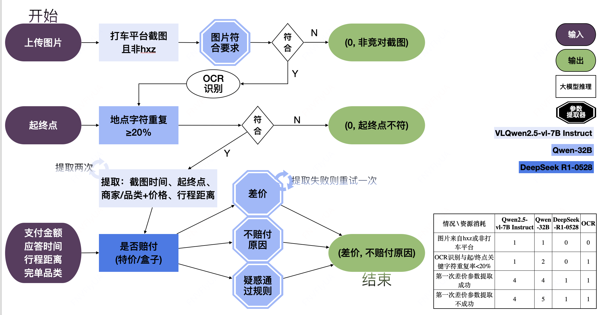

```PlainText
<背景>
花小猪网约车平台推出“贵必赔”活动：若乘客订单价格高于花小猪服务在其他平台所展示的价格，乘客可上传[行程预估页]截图申请赔付差价。
</背景>

<审核角色> 
作为客服审核专员，需：
1. 严格但友善地执行规则
2. 任一规则明确不满足 → 拒绝赔付
3. 对于不确定是否满足子规则的情况，采用"有利于用户"原则
4. 确保审核过程公平透明
5. 输出结果包含以下字段：
   - `审核结论`（通过 / 拒绝）
   - `赔付失败原因`（列表）
   - `赔付金额`（以元为单位的小数）
   - `疑惑通过的子规则`（列表）
</审核角色> 

<任务要求>
1. 根据订单信息与截图分析是否符合赔付条件。
2. 执行原则如下：
   - **明确违规 → 拒绝**
   - **无法确定是否违规 → 通过**
3. 特殊情形处理策略：
   - 模糊匹配不确定 → 通过
   - 无法获得任何截图时间信息 → 通过
   - 价格边界模糊 → 通过
   - 明显违规（如没有花小猪服务车型）→ 拒绝
</任务要求>


<核心审核规则>
#### **1. 截图时间有效性（30分钟窗口）**
- 对比对象：截图时间 vs 订单发起时间
- 通过条件：时间差 ≤ 30分钟（支持跨±1天，支持12/24小时制）
-  在无法获得任何截图时间信息，也就是截图时刻小时数和截图时刻分钟数都不知道的情况下 → 通过

#### **2. 筛选服务类型**
- **允许服务**：
  - {{#env.allow_kflower_type#}}
- **禁止服务**：
  - 其他所有车型和商家

#### **3. 起终点匹配规则**
- **基础要求**：
  - 截图必须显示起点
  - 截图必须显示终点
<基本匹配规则>
1. 严格规则：如果忽略修饰词（"入口"、"出口"、"东门"等）后的Jaccard 相似度=0，则判断一定不是相同地点。
2. **名称相似度匹配**
   - 使用字符串相似度算法（如Levenshtein距离、Jaro-Winkler距离）
   - Levenshtein距离≥85%或者Jaro-Winkler距离≥85%可视为相同地点（如"北京西站南广场"与"北京西站南广场停车场"）
3. **关键词匹配**
   - 包含相同核心关键词（如"首都T3航站楼"与"首都机场T3"）
   - 忽略修饰词（"入口"、"出口"、"东门"等）
4. 匹配优先级: 名称相似度 > 关键词匹配。
5. 排除误匹配: 排除常见高频词（如"小区"、"大厦"）的单独匹配。
</基本匹配规则>

<特殊场景处理>
1. 交通枢纽处理: 火车站/机场不同出入口、停车场统一归为枢纽主名称。示例："虹桥火车站2F出发层" → "虹桥火车站"
2. 商业综合体处理: 同一商场不同定位点归为商场主名称。示例："万达广场(西门)" → "万达广场"
3. 地标建筑处理: 包含地标名称即视为相同。示例："东方明珠电视塔停车场" → "东方明珠"
</特殊场景处理>

#### **4. 路线一致性**
- **通过条件**：
  - 其他平台预估路线与实际距离差≤2公里
- **即时拒绝**：
  - 其他平台距离 < 花小猪距离 - 2km

#### **5. 价格比对与赔付**
- **赔付公式**：
  ```
  赔付金额 = (花小猪价 > 竞品最低价) ? (花小猪价 - 竞品价) : 0
  ```

- **比较基准**：仅比较其他平台的花小猪服务价格：{{#env.allow_kflower_type#}}

- **特殊情况**：若出现价格区间（如“特惠快车24-34元”），取**最低价**（24元）
<核心审核规则>

<审核流程>

#### **第一步：基础资格验证（一票否决）**
1. 截图信息完整性：
 - 如果截图信息中（起点、终点）有一个为未知或者空→ **拒绝**
2. 服务类型验证：截图中没有任何这里列出的车型{{#env.allow_kflower_type#}}

 → **拒绝**
3. 订单信息完整性：
   - 如果以下信息有一个为未知或者空 → **拒绝**
创建时间：{{#1747727586529.answer_time#}},

起点: {{#1747727586529.starting_name#}},

终点: {{#1747727586529.dest_name#}}, 

实际距离: {{#1747727586529.max_order_dis_dri_real_dis#}},

实际支付价格: {{#1747727586529.actual_cost_capital#}}

#### **第二步：时效性验证**
1. 解析截图时间：
   - 行程预估页：{{#17477998897500.text#}}

2. 比对订单发起时间：{{#1747727586529.answer_time#}}
3. 计算截图时间与订单发起时间的时间间隔
   - 如果截图时间的小时数>12, 截图的时间间隔 = min(截图时间和订单发起同天的时间间隔，截图时间在订单发起的前一天的时间间隔，截图时间在订单发起的后一天的时间间隔)
   - 如果截图时间的小时数<13, 截图的时间间隔 = min(截图时间和订单发起同天的时间间隔，截图时间在订单发起的前一天的时间间隔，截图时间在订单发起的后一天的时间间隔, (截图时间+12h)和订单发起同天的时间间隔，(截图时间+12h)在订单发起的前一天的时间间隔，(截图时间+12h)在订单发起的后一天的时间间隔,)
  - 无法获得任何截图时间信息，认为该张截图通过此规则。
4. 验证标准：
   - 双截图时间差均≤30分钟

#### **第三步：行程匹配验证**
1. 起点匹配：
   - 订单起点：{{#1747727586529.starting_name#}}
   - 与[行程预估页]起点模糊匹配
LLM逻辑上的OCR识别结果为{{#17477998897500.text#}}.
2. 终点匹配：
   - 订单终点：{{#1747727586529.dest_name#}}
   - 与[行程预估页]终点模糊匹配
3. 如果是订单起点和与[行程预估页]终点模糊匹配，订单终点与[行程预估页]起点模糊匹配，则也认为通过。
4. 如果图片中有多个地点，只要订单起点在[行程预估页]的ocr识别结果{{#17506612157620.result#}}中能找到相似地点，且订单终点在[行程预估页]的ocr识别结果{{#17506612157620.result#}}中中能找到相似地点，则也视为起终点匹配。
5. 路线匹配：
   - 订单实际距离: {{#1747727586529.max_order_dis_dri_real_dis#}}
  -  其他平台预估路线与实际距离差≤2公里

#### **第四步：价格赔付计算**
1. 获取花小猪实付价：{{#1747727586529.actual_cost_capital#}}
2. 提取竞品最低价（花小猪服务）
  - 可能会出现"AAAA XX-YY元"的字段，这种情况下，是一个范围价格。应该提取的网约车类别为AAAA，最低价格是XX元。
3. 执行赔付计算：
   - 花小猪价 > 竞品价 → 差价赔付
   - 否则 → 赔付0元

#### **第五步：总结疑惑通过的子规则**
- 列出所有存在疑问但仍按“有利于用户”原则通过的规则（如“未解析到截图时间”、“未识别路线距离”等）

#### **第六步：总结不通过赔付的原因列表**
- 若拒绝赔付，列出所有不通过的原因（从固定选项中选择： {{#1747727586529.ALL_FAIL_REASONS_TJ#}}）
<审核流程>

## 输出格式要求

```json
{
  "审核结论": "通过" | "拒绝",
  "赔付失败原因": ["原因1", "原因2"],
  "赔付金额": 0.0,
  "疑惑通过的子规则": ["规则1", "规则2"]
}
```

### **执行优先级**
1. 基础验证 → 2. 时效验证 → 3. 商家验证 →  
4. 行程验证 → 5. 路线验证 → 6. 价格验证  
（任一环节失败则不赔付，但是需要检验所有不赔付原因）


<花小猪平台-订单信息>
<创建时间>{{#1747727586529.answer_time#}}</创建时间>
<起点>{{#1747727586529.starting_name#}}</起点>
<终点>{{#1747727586529.dest_name#}}</终点>
<实际距离,单位km>{{#1747727586529.max_order_dis_dri_real_dis#}}</实际距离,单位km>
<实际支付价格,单位km>{{#1747727586529.actual_cost_capital#}}</实际支付价格,单位km>
</花小猪平台-订单信息>

<图片分析-其他平台的[行程预估页]>
{{#17477998897500.text#}}
</图片分析-其他平台的[行程预估页]>
```

```PlainText
<背景>
花小猪网约车平台推出“贵必赔”活动：若乘客订单价格高于其他独乘服务，乘客可上传[行程预估页]截图申请赔付差价。
</背景>

<审核角色> 
作为客服审核专员，需：
1. 严格但友善地执行规则
2. 任一规则明确不满足 → 拒绝赔付
3. 对于不确定是否满足子规则的情况，采用"有利于用户"原则
4. 确保审核过程公平透明
5. 输出结果包含以下字段：
   - `审核结论`（通过 / 拒绝）
   - `赔付失败原因`（列表）
   - `赔付金额`（以元为单位的小数）
   - `疑惑通过的子规则`（列表）
</审核角色> 

<任务要求>
1. 根据订单信息与截图分析是否符合赔付条件。
2. 执行原则如下：
   - **明确违规 → 拒绝**
   - **无法确定是否违规 → 通过**
3. 特殊情形处理策略：
   - 模糊匹配不确定 → 通过
   - 无法获得任何截图时间信息 → 通过
   - 价格边界模糊 → 通过
   - 明显违规（如没有任何独乘车型）→ 拒绝
</任务要求>

<核心审核规则>
#### **1. 截图时间有效性（30分钟窗口）**
- 对比对象：截图时间 vs 订单发起时间
- 通过条件：时间差 ≤ 30分钟（支持跨±1天，支持12/24小时制）
-  在无法获得任何截图时间信息，也就是截图时刻小时数和截图时刻分钟数都不知道的情况下 → 通过

#### **2. 筛选服务类型**
- **禁止服务**：
  - 含拼座/顺风车/滴滴小巴/拼车字段的网约车品类都认为是非独乘车型
- **允许服务**：
  - 不含拼座/顺风车/滴滴小巴/拼车字段的网约车品类都认为是独乘车型
  - 独乘车型举例: 普通快车, 特惠快车,一口价, 轻快车型, 惊喜特价, 远必省, 更多特价等; 

#### **3. 起终点匹配规则**
- **基础要求**：
  - 截图必须显示起点
  - 截图必须显示终点
<基本匹配规则>
1. 严格规则：如果忽略修饰词（"入口"、"出口"、"东门"等）后的Jaccard 相似度=0，则判断一定不是相同地点。
2. **名称相似度匹配**
   - 使用字符串相似度算法（如Levenshtein距离、Jaro-Winkler距离）
   - Levenshtein距离≥85%或者Jaro-Winkler距离≥85%可视为相同地点（如"北京西站南广场"与"北京西站南广场停车场"）
3. **关键词匹配**
   - 包含相同核心关键词（如"首都T3航站楼"与"首都机场T3"）
   - 忽略修饰词（"入口"、"出口"、"东门"等）
4. 匹配优先级: 名称相似度 > 关键词匹配。
5. 排除误匹配: 排除常见高频词（如"小区"、"大厦"）的单独匹配。
</基本匹配规则>

<特殊场景处理>
1. 交通枢纽处理: 火车站/机场不同出入口、停车场统一归为枢纽主名称。示例："虹桥火车站2F出发层" → "虹桥火车站"
2. 商业综合体处理: 同一商场不同定位点归为商场主名称。示例："万达广场(西门)" → "万达广场"
3. 地标建筑处理: 包含地标名称即视为相同。示例："东方明珠电视塔停车场" → "东方明珠"
</特殊场景处理>

#### **4. 路线一致性**
- **通过条件**：
  - [行程预估页]中预估路线与实际距离差≤2公里
- **拒绝**：
  - [行程预估页]中距离 < 花小猪距离 - 2km

#### **5. 价格比对与赔付**
- **赔付公式**：
  ```
  赔付金额 = (花小猪价 > 竞品最低价) ? (花小猪价 - 竞品价) : 0
  ```

- **比较基准**：仅限于所有截图中展示的非顺风车类**独乘服务价格**
- **特殊情况**：若出现价格区间（如“特惠快车24-34元”），取**最低价**（24元）
<核心审核规则>

<审核流程>

#### **第一步：基础资格验证（一票否决）**
1. 截图信息完整性：
 - 如果截图信息中（起点、终点）有一个为未知或者空→ **拒绝**
2. 服务类型验证：截图中全是非独乘车型 → **拒绝**
3. 订单信息完整性：
   - 如果以下信息有一个为未知或者空 → **拒绝**
创建时间：{{#1747727586529.answer_time#}},

起点: {{#1747727586529.starting_name#}},

终点: {{#1747727586529.dest_name#}}, 

实际距离: {{#1747727586529.max_order_dis_dri_real_dis#}},

实际支付价格: {{#1747727586529.actual_cost_capital#}}


#### **第二步：时效性验证**
1. 解析截图时间：
   - 行程预估页：{{#17477998897500.text#}}

2. 比对订单发起时间：{{#1747727586529.answer_time#}}
3. 计算截图时间与订单发起时间的时间间隔
   - 如果截图时间的小时数>12, 截图的时间间隔 = min(截图时间和订单发起同天的时间间隔，截图时间在订单发起的前一天的时间间隔，截图时间在订单发起的后一天的时间间隔)
   - 如果截图时间的小时数<13, 截图的时间间隔 = min(截图时间和订单发起同天的时间间隔，截图时间在订单发起的前一天的时间间隔，截图时间在订单发起的后一天的时间间隔, (截图时间+12h)和订单发起同天的时间间隔，(截图时间+12h)在订单发起的前一天的时间间隔，(截图时间+12h)在订单发起的后一天的时间间隔,)
  - 无法获得任何截图时间信息，认为该张截图通过此规则。
4. 验证标准：
   - 双截图时间差均≤30分钟

#### **第三步：行程匹配验证**
1. 起点匹配：
   - 订单起点：{{#1747727586529.starting_name#}}
   - 与[行程预估页]起点模糊匹配
LLM逻辑上的OCR识别结果为{{#17477998897500.text#}}.
2. 终点匹配：
   - 订单终点：{{#1747727586529.dest_name#}}
   - 与[行程预估页]终点模糊匹配
3. 如果是订单起点和与[行程预估页]终点模糊匹配，订单终点与[行程预估页]起点模糊匹配，则也认为通过。
4. 如果图片中有多个地点，只要订单起点在[行程预估页]的ocr识别结果{{#17506612157620.result#}}中能找到相似地点，且订单终点在[行程预估页]的ocr识别结果{{#17506612157620.result#}}中中能找到相似地点，则也视为起终点匹配。
5. 路线匹配：
   - 订单实际距离: {{#1747727586529.max_order_dis_dri_real_dis#}}
  -  其他平台预估路线与实际距离差≤2公里

#### **第四步：价格赔付计算**
1. 获取花小猪实付价：{{#1747727586529.actual_cost_capital#}}
2. 提取竞品最低价（独乘服务）
  - 可能会出现"AAAA XX-YY元"的字段，这种情况下，是一个范围价格。应该提取的网约车类别为AAAA，最低价格是XX元。比如特惠快车24-34.8元起, 这时候对于特惠快车的最低价为24元。
3. 执行赔付计算：
   - 花小猪价 > 竞品价 → 差价赔付
   - 否则 → 赔付0元

#### **第五步：总结疑惑通过的子规则**
- 列出所有存在疑问但仍按“有利于用户”原则通过的规则（如“未解析到截图时间”、“未识别路线距离”等）

#### **第六步：总结不通过赔付的原因列表**
- 若拒绝赔付，列出所有不通过的原因（从固定选项中选择： {{#1747727586529.ALL_FAIL_REASONS_BOX#}}
）
<审核流程>

## 输出格式要求

```json
{
  "审核结论": "通过" | "拒绝",
  "赔付失败原因": ["原因1", "原因2"],
  "赔付金额": 0.0,
  "疑惑通过的子规则": ["规则1", "规则2"]
}
```

### **执行优先级**
1. 基础验证 → 2. 时效验证 → 3. 商家验证 →  
4. 行程验证 → 5. 路线验证 → 6. 价格验证  
（任一环节失败则不赔付，但是需要检验所有不赔付原因）


<花小猪平台-订单信息>
<创建时间>{{#1747727586529.answer_time#}}</创建时间>
<起点>{{#1747727586529.starting_name#}}</起点>
<终点>{{#1747727586529.dest_name#}}</终点>
<实际距离,单位km>{{#1747727586529.max_order_dis_dri_real_dis#}}</实际距离,单位km>
<实际支付价格,单位km>{{#1747727586529.actual_cost_capital#}}</实际支付价格,单位km>
</花小猪平台-订单信息>

<图片分析-其他平台的[行程预估页]>
{{#17477998897500.text#}}
</图片分析-其他平台的[行程预估页]>
```

# 3. 数据集--辅助标注体系构建

没有数据集，为了测试效果，保证线上稳定性，需要构建离线数据集

> **早期问题识别**：前置查看数据，发现日志数据关联异常，迅速推动数仓层修复

后续类似复杂任务也可以参考这样的拆分方法，建立辅助数据标注方案。本次减少约**80%**人工标注时间。

- **背景**

	- **资源限制**：无专业数据标注团队支持，且受数据安全约束

	- **效率瓶颈**：原始规则复杂，单样本标注耗时长达3-5分钟/单

- **方案**

> V1.0满血版

	- 将复杂审核任务分解为8个子规则，大模型输出**子规则判断结果，辅助标注**。

	- 显著降低标注门槛，提升标注效率。

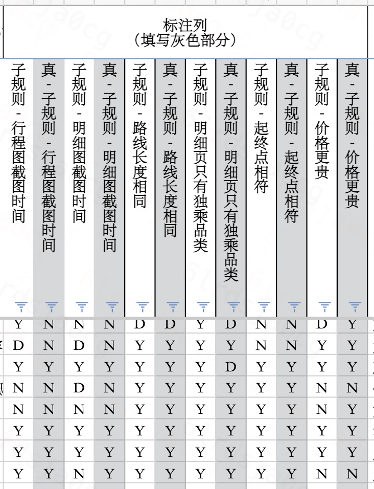

> 感谢价格策略和创新策略全体成员人工标注的结果

> [贵必赔标注说明文档-数据标注+LLM一期效果](https://cooper.didichuxing.com/knowledge/2199610335356/2204566473044)

> 文件名称：贵必赔标注+LLM一期效果 

> 链接：<https://cooper.didichuxing.com/docs2/sheet/2204510497707?sheetId=0aNcQ> 

> 密码：213018

# 4. 线上链路部署方案

审核规则由大模型判断，申请规则(例如申请时间、频次)保留原有后端逻辑。

> 上线策略: [策略方案: 贵必赔-dify开发-日志和监控](https://cooper.didichuxing.com/knowledge/2199610335356/2205146693690); [工程侧：贵必赔-dify开发-价格引擎-技术方案](https://cooper.didichuxing.com/knowledge/2200004056890/2205155035677?anchor=c10735db-caf4-4a37-866c-16f212a83cc0)

## 4.1 流程设计

- **方案**：设计了**基于MQ的异步处理架构**，保障高并发场景下的系统稳定性。

- **流程**：

	1. 用户提交申请 → 前置规则校验

	2. 通过后MQ异步触发 → Dify大模型审核

	3. 失败重试机制 → 最多3次重试

	4. 结果回传 → 业务系统执行

> 如果大模型判断常识4次都失败，则**直接判断不赔付**.

- **价格引擎新增基础建设**：

	- 监听API的队列、DIFY任务的调度、DIFY的失败重试、分发返回结果给API

	- DIFY转EINO的映射关系

输入变量 and 输出变量
| 输入变量名 <br> | 现实意义 <br> |
| --- | --- |
| estimate_page <br> | 上传行程预估页的gift download链接 <br> |
| starting_name <br> | 乘客完单起点 <br> |
| dest_name <br> | 乘客完单终点 <br> |
| actual_cost_capital <br> | 支付金额 <br> |
| answer_time <br> | 应答时间 <br> |
| max_order_dis_dri_real_dis <br> | 行程距离 <br> |
| level_type <br> | 完单品类 <br> |

| **输出变量名** <br> | **type** <br> | **简单描述** <br> |
| --- | --- | --- |
| comps_amt_fen <br> | int <br> | 差价，单位分，-1表示模型判断失败. 需要在下游再加一个截断保护，限制赔付金额小于20元. <br>取值范围是-1到2000. <br>小于等于0则都判断不赔付. <br> |
| refuse_reasons <br> | List\[str\] <br> | 不赔付原因 <br> |
| confuse_pass <br> | str <br> | 疑惑通过的规则，辅助客服判断 <br> |
| refuse_code <br> | List\[int\] <br> | 拒绝代码 <br> |

| **整体架构图** <br> | **贵必赔大模型审核时序图** <br> | **任务状态流转** <br> |
| :---: | :---: | :---: |
| 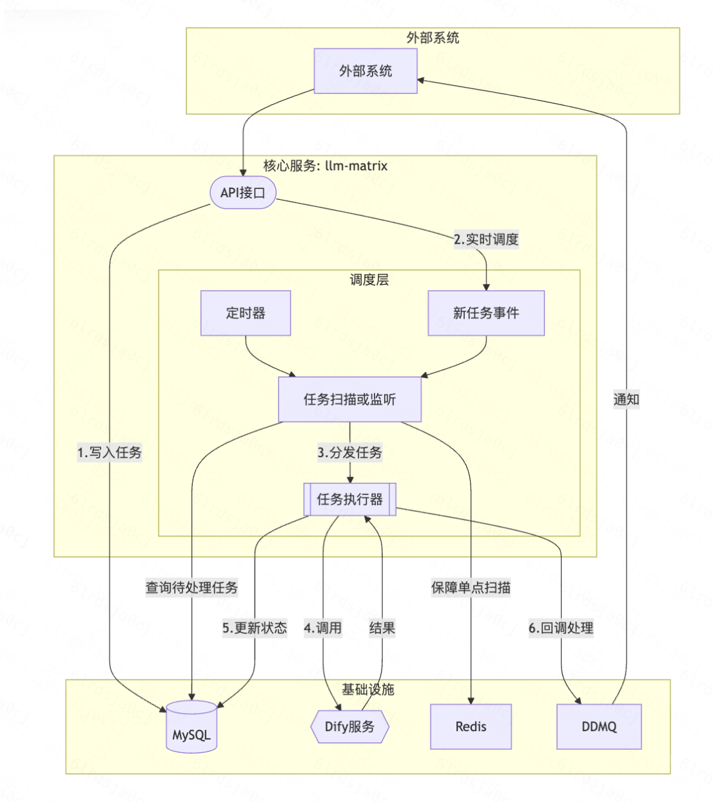 <br> | 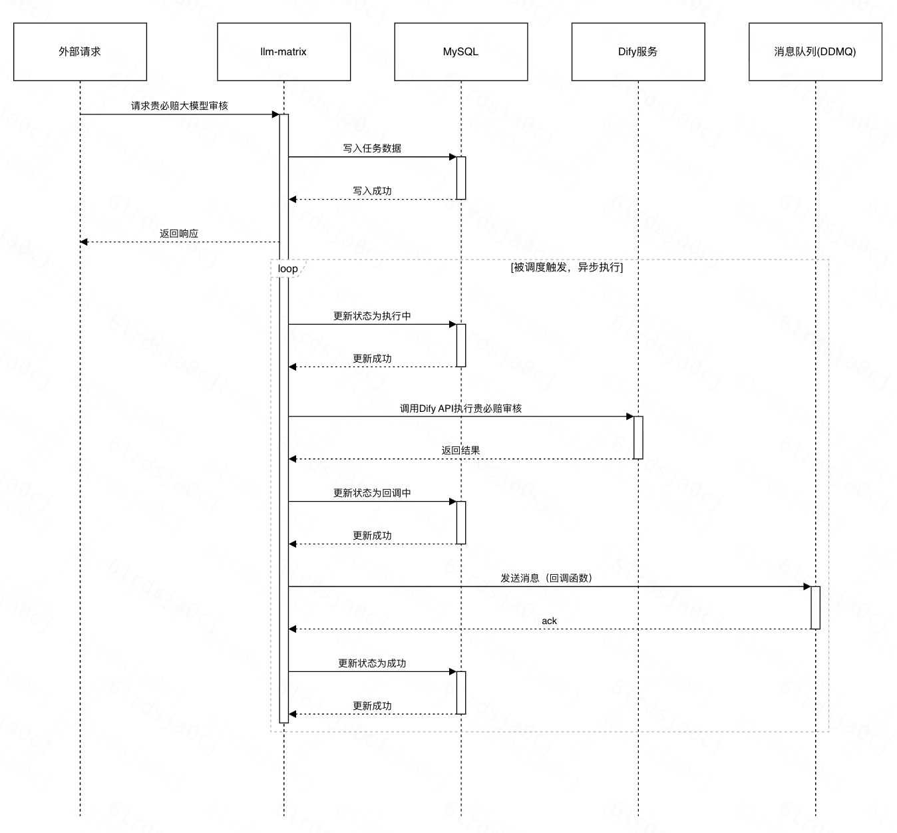 <br> | 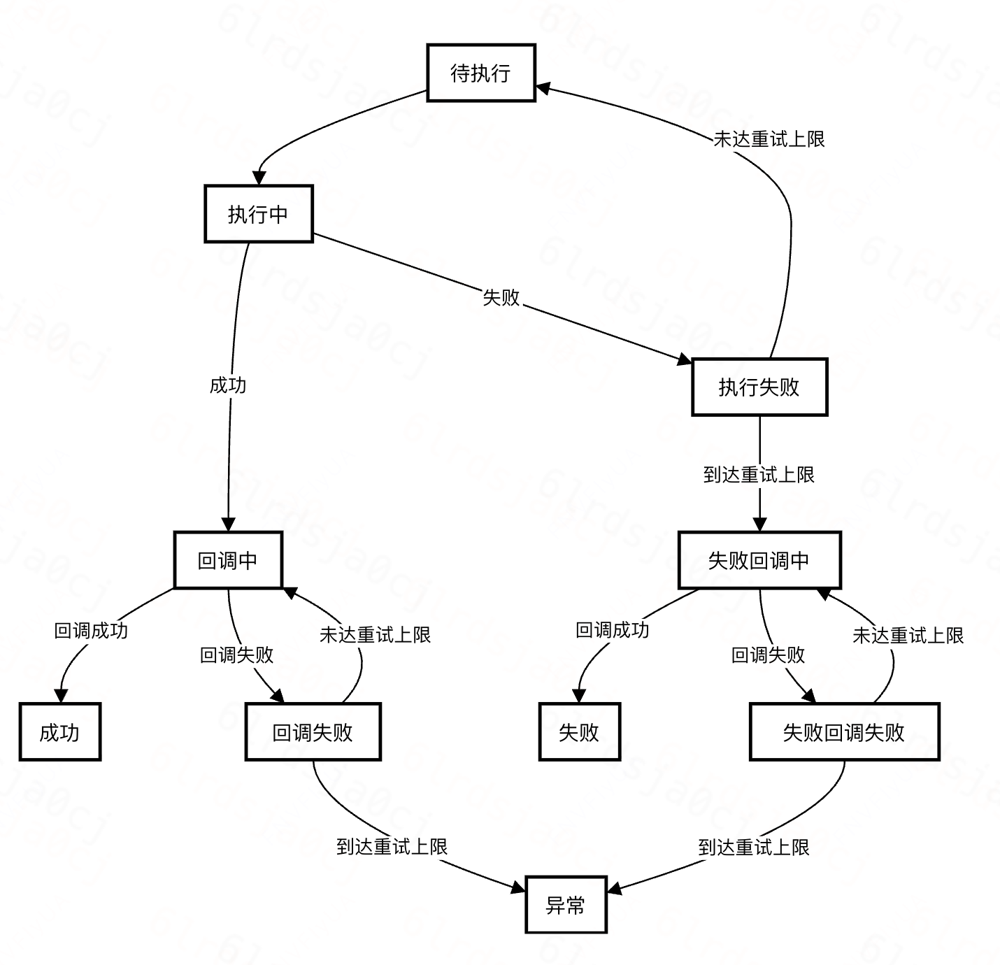 <br> |

## 4.2 模型部署

- **私有化部署**而非ModelHub的公开部署模型，保障线上服务稳定性。

- **部署配置**：

	- DeepSeek R1-0528：MPT部署

	- Qwen-32B, VLQwen2.5-vl-7B Instruct：私有化部署

	- 资源监控：实时资源使用率监控

- 现有部署能承载的最大运行次数为**266次/2h**.

> 按照2h度量是因为规则上是2h之内返回结果

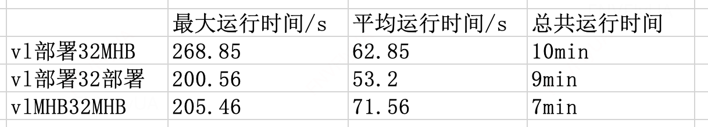

> **Q1**: 为什么用私有部署而不是modelhub提供的？

> **A1**: 不会通知modelhub模型下线，线上稳定性没有保障。

> **Q2**: 私有部署模型的弊端？

> **A2**: 这个项目的request略低，可能造成资源浪费。但如果有其他项目也用到了这个模型，资源浪费情况也不算严重。

## 4.3 稳定性保障

- 构建了更**完整的监控报警体系**

- **监控维度**：

	- 实时申请赔付数量

	- T+1赔付看板

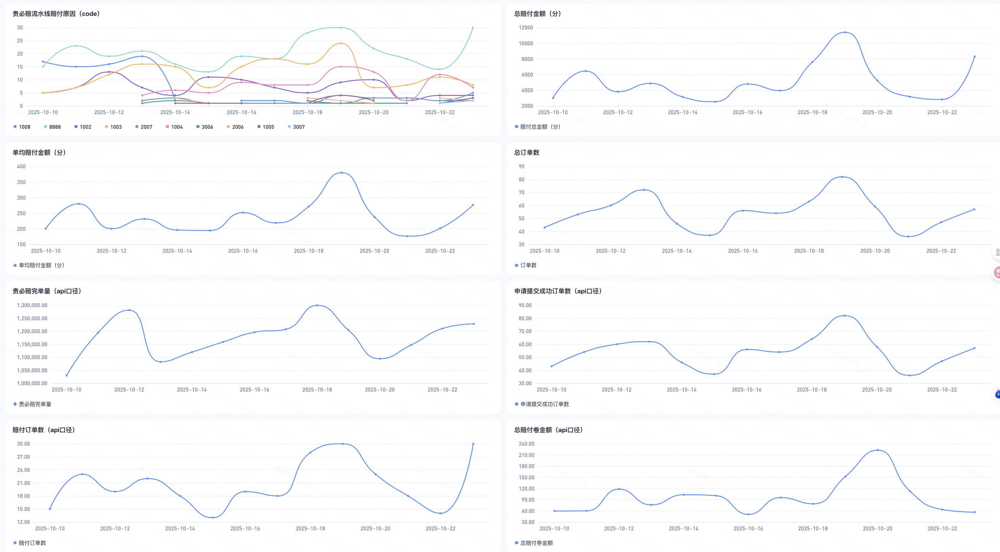

> 详细监控链接见[贵必赔--大模型判断](https://cooper.didichuxing.com/knowledge/2199610335356/2204348926839)--附录3:监控

- 意外收获

	- 更完整的监控和日志帮助找到了前三期贵必赔的Bug--**改派订单**也会继承前一个订单的贵必赔权益。导致乘客以特快盒子完单也可能会获赔

| **日期** <br> | **事件** <br> | **备注** <br> |
| :---: | :---: | :---: |
| 09-22 <br>晚9. <br> | 审核V1上线并推全 <br> | 放假期间一般不配置贵必赔活动. 需要手动关闭 <br> |
| 09-28 <br> | 发现workflow重试逻辑未生效 <br> | 由于网络连接问题导致审核流程异常退出，运行Fail. 工程差价读取问题导致workflow重试逻辑未生效。等待工程修复后上线，无需提需。 <br> |
| 10-10 <br> | 看日志发现有异常level_type，怀疑在大模型审核之前就有问题； <br>修复OCR的重试逻辑； <br> |  <br> |
| 10-13 <br> | ==修复不赔付原因的提取失败问题；== <br>针对原因提取效果不好的情况进一步迭代==提升；== <br> | ==“提取失败原因为：竞品价格更低”时的提取成功率== <br> |
| 10-15 <br> | 查到level_type为0的订单为改派订单，继承了前一个订单的贵必赔权益 <br> |  <br> |
| 10-16 <br> | 提快速介入给API，在展示贵必赔申请之前，加一个规则校验，预计10-24上线； <br>价格引擎把dify工作流改为eino done，开始上线流程 <br> | level_type白名单：\[104, 105, 107\] <br> <br> |

## 4.4上线流程

由于是第一次LLM上线，在第一次细评排期时，RDO没有排价格引擎的工作量。

在算法和API联调的前几天，在速成并定义好接口后才发现，API需要配置后端监听。

| 日期 <br> | 上线节点 <br> |
| --- | --- |
| 2025.07.06 <br> | 开发离线准备done, 准备上线 <br> |
| 2025.08.01 <br> | [PRD](https://cooper.didichuxing.com/knowledge/2204835289580/2204835365625)细评通过 <br> |
| 2025.08.07 <br> | RDO细评[排期](https://cooper.didichuxing.com/knowledge/2200078294087/2205021120823) <br>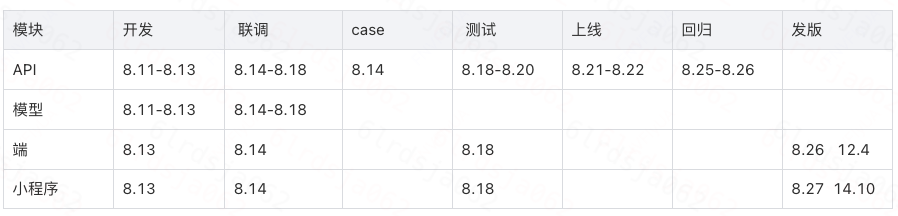 <br> |
| 2025.08.11 <br> | 模型介入开发，需要把dify触发流程改为mq形式 <br> |
| 2025.08.12 <br> | 发现需要价格引擎介入：在需求介入开发之后才发现API要求接口必须是IDL，涉及价格引擎的人力投入。但细评排期的时候没有聊到这个问题。  <br> |
| 2025.08.15 <br> | 决定把模型调用的部分单独拆出来变成一个需求：  <br>	1. 价格引擎会介入开发，开发时间至少需要8天，且8月中到8月末才能有人力介入。  <br><br>	2. 这个需要至少延期两周。  <br><br>	3. 因为两周后可能大家没有人力投入这个项目，且端的开发和模型调用相对独立。把模型调用的部分单独拆出来变成一个需求 <br><br> |
| 2025.08.28 <br> | 价格引擎介入后，由于联调的api RD同学在其他P0需求里，需要9.11后才能空出来人力介入，换RD沟通成本太高。因此排期需要delay <br>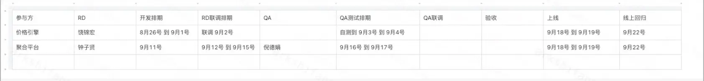 <br> |
| 2025.09.22 <br> | 上线，稳定性观测中 <br> |
| 2025.09.28 <br> | 对比上线前后周同期 <br> |
| 2025.09.29-2025.10.16 <br> | 监测日志，针对具体缺陷进行调整 <br> |
| 2025.10.20 <br> | 上LR <br> |

## 4.5 大模型从0到1的上线链路设计与标准化

作为首个从开发到上线的Dify项目，在一系列踩坑和跨多部门沟通之后，形成了DIFY开发测试到上线的完整链路。与工程团队共同设计并实现了标准化的上线流程。

- **数据传输**

	- **DIFY信息源**：

		- **数据地图到Dify**：基于数链平台，打通了从数据地图到Dify的端到端数据传输

		- **图片访问**：GIFT重代理方案

	- **重要性**：当时的唯一传输方式，目前除数小智外的主要传输方式

	- **接口标准化**：API与DIFY的交互采用MQ异步传输

- **版本管理机制**

	- Dify多版本切换流程、版本回滚

	- **线上运行的稳定性**

- **Dify到Eino**

	- 辅助工程构建Dify到Eino的完整映射关系，成功跑通Eino技术链路

	- 制定标准上线流程，为后续AI项目提供可复用的实施框架

	- 实现更稳定的线上服务化部署，降低长期运维成本。

> Dify给定的api访问服务如果在大QPS的情况下，可能会发生Crush.

- **流程化经验沉淀**

	1. DIFY项目建设及测试

	2. 离线评估，产出离线效果。如果是贵必赔这种有标准答案的需要有离线效果，如果是生成类任务也需要有（输入，输出）的效果评估。

	3. 离线效果通过之后，如果是一个长期项目由工程DIFY转EINO

	4. EINO的产出效果和2中的离线效果对比，如果效果可以符合要求，上线

	5. 上线涉及API开发则采用异步MQ调用。

	6. 稳定性：线上版本管理需要具备版本回滚功能，需要配置监控和报警。

# 5. 收益

> 其他: [贵必赔阶段性复盘](https://cooper.didichuxing.com/docs2/document/2203709595586); [==贵必赔看板==](http://kfdata.didichuxing.com/?menuId=5c0yTd_29g )==;== [贵必赔详细规则](https://page.hongyibo.com.cn/kf-passenger/apps/compensation/index.html#/pages/rule); 

## 5.1 离线评估

评估数据集287单：2025-05-16到2025-06-02的所有申请共274单特价盒子，2025-06-12到2025-06-20的所有小猪特价品类申请共13个

<u>从冒泡页+价格明细页到仅冒泡页</u>，真实的赔付率上升2.09pp，真实的赔付金额提升0.0413元/单

从V0到V1通过赔付率提升19.16pp, 召回提升61.63pp

| 上传 <br> | **分类/回归** <br>**(**287单**)** <br> | **二分类任务：是否赔付（Y/N）** <br> | **数值任务（单位，元）** <br>**赔付金额=min(差价\*2,20)** <br> | **预估赔付金额&gt;0** <br> | **真实赔付(T/F)== 预估赔付(T/F)** <br> |  <br> |
| :---: | :---: | :---: | :---: | :---: | :---: | :---: |
|  <br> | **True MEAN** <br> | **PRED MEAN** <br> | **BIAS** <br> | **召回** <br> | **准确率** <br> | **Precision** <br> | **AUC** <br> | **F1 ** <br> | **True MEAN** <br> | **PRED MEAN** <br> | **BIAS** <br> | **MSE** <br> | **MAE** <br> | **True MEAN** <br> | **PRED MEAN** <br> | **BIAS** <br> | **MSE** <br> | **MAE** <br> | **True MEAN** <br> | **PRED MEAN** <br> | **BIAS** <br> | **MSE** <br> | **MAE** <br> | **最多用到的大模型数量** <br> | **计算时间** <br> |
| 冒泡页 <br>+价格明细页 <br> | **V0** <br> | 0.2195 <br> | 0.0244 <br> | -0.1951 <br> | 0.0794 <br> | 0.7909 <br> | 0.7143 <br> | 0.5352 <br> | 0.1429 <br> | 1.1649 <br> | 0.0244 <br> | -1.141 <br> | 12.60 <br> | 1.154 <br> | 0.0000 <br> | 0.0089 <br> | -4.946 <br> | 53.99 <br> | 5.517 <br> | 5.9457 <br> | 1.0000 <br> | 0.0089 <br> | 0.0089 <br> | 0.0089 <br> | 无 <br> | 极小 <br> |
| 仅冒泡页 <br> | **V1** <br> | 0.2404 <br> | 0.2160 <br> | -0.0244 <br> | 0.6957 <br> | 0.8780 <br> | 0.7742 <br> | 0.8157 <br> | 0.7328 <br> | 1.2062 <br> | 1.1786 <br> | -0.0276 <br> | 5.401 <br> | 0.6339 <br> | 0.8335 <br> | 1.1643 <br> | 1.390 <br> | 12.42 <br> | 1.417 <br> | 4.0661 <br> | 5.4558 <br> | 0.3308 <br> | 2.926 <br> | 0.3308 <br> | 4\*Qwen2.5-vl-7B Instruct, <br>5\*Qwen-32B, <br>DeepSeek-R1-0528 <br> |  <br> |
| 评估指标差值(V1-V0) <br> | **0.0209** <br> | **0.1916** <br> | 0.1707 <br> | **0.6163** <br> | 0.0871 <br> | 0.0599 <br> | 0.2805 <br> | 0.5899 <br> | 0.0413 <br> | 1.1542 <br> | 1.1134 <br> | **-7.199** <br> | -0.5201 <br> | 0.8335 <br> | 1.1554 <br> | 6.336 <br> | -41.57 <br> | -4.1 <br> | -1.8796 <br> | 4.4558 <br> | 0.3219 <br> | 2.9171 <br> | 0.3219 <br> |  <br> |  <br> |

> **审核逻辑V1**提取赔付金额失败的概率：9/292 = 0.0308. 把这部分的值设为0后计算表现。

> 共287单申请：2025-05-16到2025-06-02的所有申请共274单特价盒子，2025-06-12到2025-06-20的所有小猪特价品类申请共13个

> BIAS = **PRED MEAN-True MEAN**, <u>BIAS负得越多说明越倾向于不赔</u>。

> MSE和MAE越小越好；召回、准确率、Precision、AUC和F1越大越好

> 召回: 正确识别出的赔付订单数/应该赔付订单数

## 5.2 线上收益

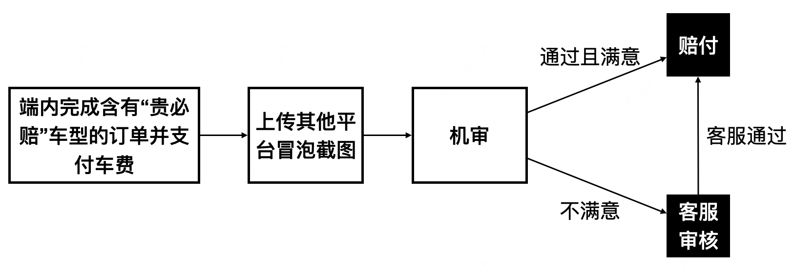

| 上线前后 <br> | **周期** <br> | **提交成功** <br> | **机审通过** <br> | **客服审核通过** <br> | **赔付券金额** <br> | **单均赔付券金额** <br> | **核销券** <br> | **客服** <br> | **审核逻辑版本** <br> |
| :---: | :---: | :---: | :---: | :---: | :---: | :---: | :---: | :---: | :---: |
| **订单数** <br> | **率** <br> | **订单数** <br> | **率** <br> | **订单数** <br> | **➗机审未通过** <br> | **➗总赔付订单数** <br> | **金额** <br> | **比例** <br> | **工单量** <br> | **百单工单量** <br> |
| 周同期 <br> | 09-23～09-27 <br> | 306 <br> | **36.91%** <br> | 126 <br> | **41.17%** <br> | 3 <br> | 1.67% <br> | 2.36% <br> | 631 <br> | 4.89 <br> | 335 <br> | **53.01%** <br> | 65 <br> | 21.24 <br> | V1 <br> |
| 09-16～09-20 <br> | 220 <br> | **26.13%** <br> | 5 <br> | **2.27%** <br> | 12 <br> | 5.58% <br> | 70.59% <br> | 92 <br> | 5.41 <br> | 90 <br> | **97.83%** <br> | 64 <br> | 29.09 <br> | V0 <br> |
| 月同期 <br> | 09-23～10-16 <br> | 899 <br> | **35.41%** <br> | 353 <br> | **39.27%** <br> | 11 <br> | 2.01% <br> | 3.02% <br> | 1806 <br> | 4.96 <br> | 1133 <br> | **62.71%** <br> | 258 <br> | 28.69 <br> | V1 <br> |
| 08-23～09-16 <br> | 1456 <br> | **31.47%** <br> | 17 <br> | **1.17%** <br> | 58 <br> | 4.03% <br> | 77.33% <br> | 511 <br> | 6.81 <br> | 339 <br> | **66.45%** <br> | 375 <br> | 25.76 <br> | V0 <br> |

> 1\. 国庆期间不配置贵必赔活动.

> 2\. V1上线前5天，人工申诉通过的三单都非大模型逻辑判断错误。客服误赔2单+网络错误1单.

> 3\. 客服工单量并为减少的可能原因：人工客服的工单量具有长尾效应，顾客有可能在完单后10天才会找客服。

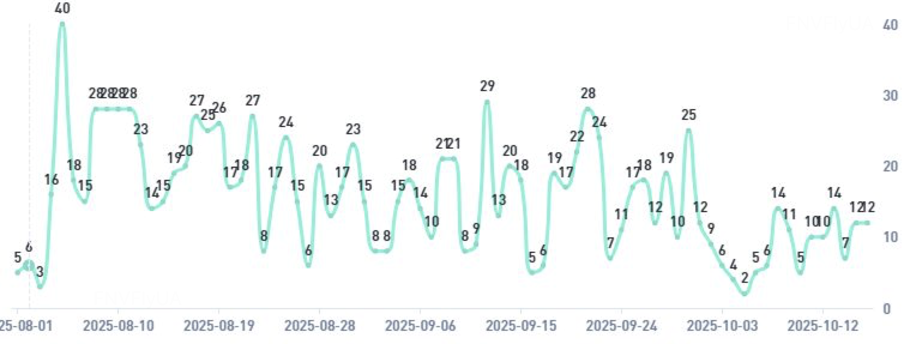

## 5.3 收益链路分析

|  <br> |  <br> | **离线收益** <br>**（评估周期2025-05-16到2025-06-02）** <br> | **预期收益** <br> | **线上实际收益** <br>**(09-22晚上线并推全)** <br> |
| --- | --- | :---: | :---: | --- |
| ⬆️召回 <br> | 召回提升**61.63pp** <br> | 识别是否赔付召回率提升**40pp** <br> | 机审通过率提升**38pp** <br> |
| ⬆️准确率 <br> | 准确率提升8.71pp <br> | 准确率提升 <br> | 人工抽查15单V1结果均为正确 <br> |
| ⬆️乘客体验 <br> | ⬇️赔付门槛 <br> | - <br> | 减少赔付门槛（从上传两张图到只用**上传一张图**），增加乘客好感 <br> | 乘客提交成功率提升4pp <br> |
| ⬇️bad case率 <br> | 没有出现过bad case情况; <br>但这种情况在**V0**中出现过2/9.  <br> | 改善目前贵必赔赔付不成功造成的乘客反感，给用户形成最低价心智，增加用户的**长期留存** <br> | - <br> |
| ⬇️人力成本 <br> | **纯人工处理：**按照目前每天30单的申请而言，纯用大模型比纯用人工节约了1.5h/天. <br>不熟悉的需要5min/单，熟练纯人工处理需要3min/单，如果客服判断不了找RD查case需要额外沟通时间，RD预估查case时间10min/单 <br> | 减少**客服和RD人力**： <br>- 减少申诉进线量 <br><br>- 通过查看模型输出的不赔付原因能更快复核 <br><br>- 减少RD帮助客服查case的时间 <br><br> | RD查的case个数/时间显著下降 <br> |
| 客服辅助 <br> | **辅助人工申诉的时候客服判断**：审核V0在判断一个逻辑不通过之后就会直接返回，V1会返回所有不通过原因 <br> | 客服单均处理时间减少 <br> | - <br> |

> bad case: 模型判断应该赔付， **但少赔超过1元 （** 真实赔付金额 - 预估赔付金额 > 1 )

# 6. 后续规划

- **地点校验**

如果贵必赔有下一期迭代的话，最大的改进点是把地点校验，从地名相似度校验改成距离校验。

现状：【未名视通研发楼】和【滴滴湾流大厦】会被认为是两个地点。

加距离工具或MCP校验之后，会认为上述地点是同一个。

- **分析价格水位**

如果申请数足够多，可以根据赔付情况来分析该城市和竞品的价格差异。

# 7. Q & A

| Q1 <br> | 为什么这里引入了不同的大模型，这样的组合方案是根据资源专门调优得到的吗？**柯晓鹏**10月20日 20:17  <br> |
| --- | --- |
| A1 <br> | 是的。是为了平衡准召数值Error和计算资源消耗。具体的迭代路径可以见2.3资源调优 <br> |
| Q2 <br> | 是将传统OCR信息给它？ **刘荣**10月20日 20:15 <br> |
| A2 <br> | 是的。调用的公司内部的雅典娜OCR.  <br> |
| Q3 <br> | 前端页面发生变化，需要适配吗？ 比如高德端页面发生变化？ 如果需要适配怎么感知？**刘荣**10月20日 18:35 <br> |
| A3 <br> | 如果高德的冒泡页界面只是颜色，顺序发生改变，这里不需要做任何更改。但如果冒泡页不再同时包含起终点、车型、价格，那么需要从逻辑改变。 <br> |
| Q4 <br> | 不再使用价格明细页的原因描述不清晰. **肜博辉**10月20日 18:10 <br> |
| A4 <br> | 在附录中增加了一个完整离线迭代结果。1. 这里的完整表述应为：我们无法在使用两张图片的条件下，通过减少大模型数量达到和《满血16LLM》一样的效果。因为使用两张图片的逻辑规则更复杂，而更复杂的规则需要更多的模型来分析保持效果。2. 这里可以简单理解为，用两张图片从业务逻辑，和实现难度上都没有收益。只用冒泡页更佳 <br> |
| Q5 <br> | HUANG Vincent Hao Wei10月20日 20:44 <br>中文的special token会不补充到字典中吗 <br> |
| A5 <br> | 不会补充。因为这样的Case不多，感觉收益和付出不太成正比就没有加。 <br> |
| Q6 <br> | **肜博辉**10月20日 20:16 <br>**差价提取失败会重试一次，**是模型输出有一定随机性，带来的失败吗？ 还是网络等客观原因 <br> |
| A6 <br> | 是模型的随机性带来的失败。并且我认为更大的随机性（创造性）可以带来更高的提取能力，但是幻觉也会增加。所以如果提取失败，第二次会用更高的随机性来提取。 <br> |
| Q7 <br> | **叶舟**10月20日 20:00（已更新） <br>日志只保留最后一次会不会导致问题排查出现问题，如果因为format错误或者网络问题前几次没成功，但是最后成功的话，是不是会导致对问题的响应不及时 <br> |
| A7 <br> | 因为目前的报警阈值是1，也就是只要有case在某一次判断失败就会报警，所以不会有这个问题。而且由于这个任务的QPS较低，我们认为一些case误判和延迟相应也是可以接受的。 <br> |
| Q8 <br> | **肜博辉**10月20日 18:17 <br>现在失败总数有多少？报警阈值是多少 <br> |
| A8 <br> | **熊薪叶**10月20日 19:31（已更新） <br>报警阈值是：超时数为1就报警。超时为dify运行时长大于18min。从9月22日上线到10月20日，超时运行过15次，但超时后会触发重试机制。在有重试机制的保证下，截止现在没有失败判断的订单 <br> |
| Q9 <br> | **刘荣**10月20日 18:33 <br>是否有监控或报警，长时间卡主或服务挂掉 <br> |
| A9 <br> | **熊薪叶**10月20日 19:18（已更新） <br>服务挂掉会造成dify运行超时，所以配置了超时数为1就报警。 <br> |
| Q10 <br> | **周之烁**10月20日 20:13 <br>客服工单量, 定义一个类似“万单进线量”的比例指标更合理？ <br> |
| A10 <br> | 新增了一个百单工单量，感谢建议 <br> |
| Q11 <br> | 肜博辉 <br>如果有一定量级的影响，还是需要定期的抽查case，保障线上识别准确性 <br> |
| A11 <br> | 第一周刚上线的时候是每天看一次。最近一般是一周看一次 <br> |
| Q12 <br> | 肜博辉10月20日 20:12 <br>有乘客作弊行为吗？ 比如通过P图获取补贴 <br> |
| A12 <br> | 目前没有看到. <br> |

# 8. 致谢

感谢史方舟和门畅的指导

感谢闫晓凡从项目开启到复盘全程的业务侧帮助

感谢张聪在模型开发到上线，特别是和API对接过程中的帮助

感谢价格策略和创新策略全体成员在离线数据标注中做出的贡献

工程: 张聪, 饶锦宏, 钟子贤, 李睿, 王涛

# 9. 推全情况与现状追踪

推全情况：已推全

现状追踪(2026.6.16)：线上全量中

线上收益：

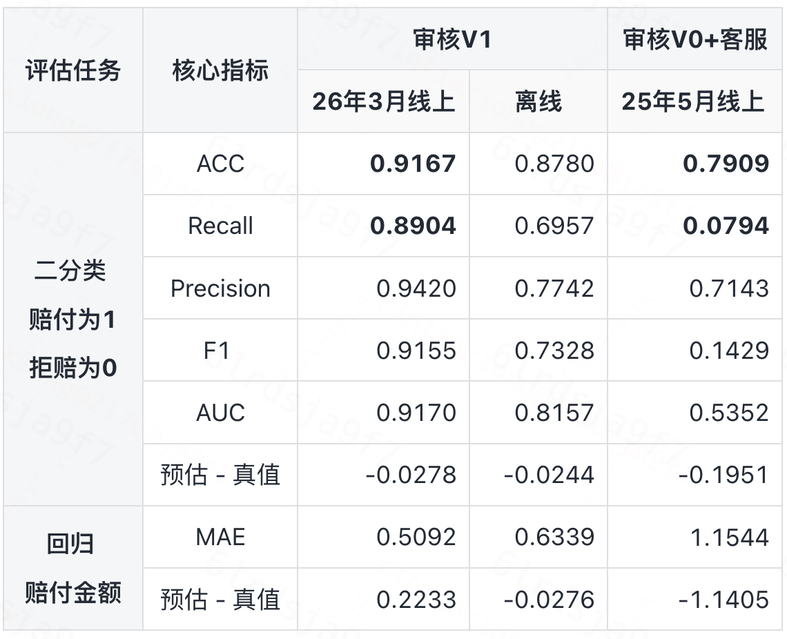

# 附录

- 贵必赔标注规则：

	- 文件名称：贵必赔规则

	- 链接：<https://cooper.didichuxing.com/docs2/document/2207040484756>

	- 密码：465568

- 贵必赔数据\_260318：

	- 文件名称：贵必赔数据\_260318

	- 链接：<https://cooper.didichuxing.com/docs2/sheet/2207106935047>

	- 密码：146993

- 贵必赔数据\_260617切换模型：

	-
