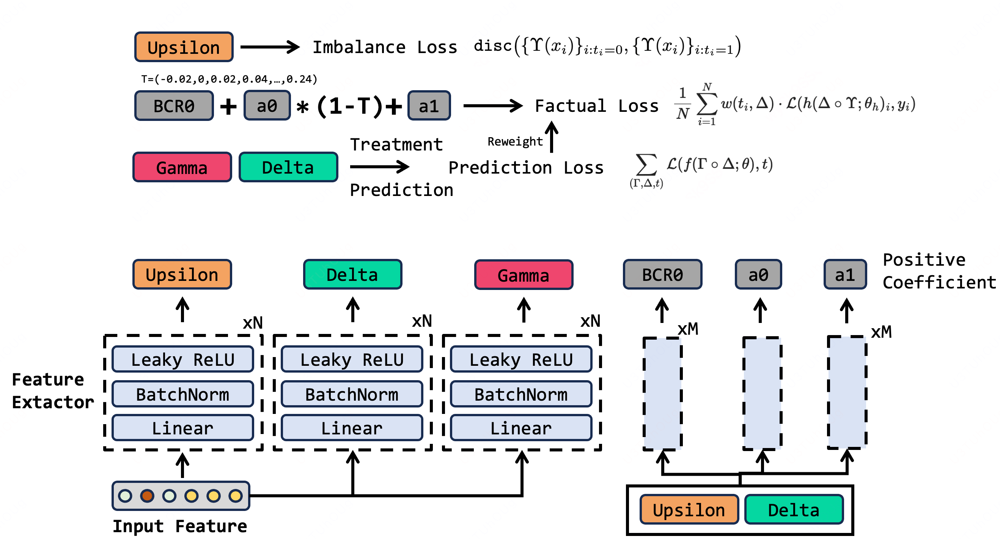
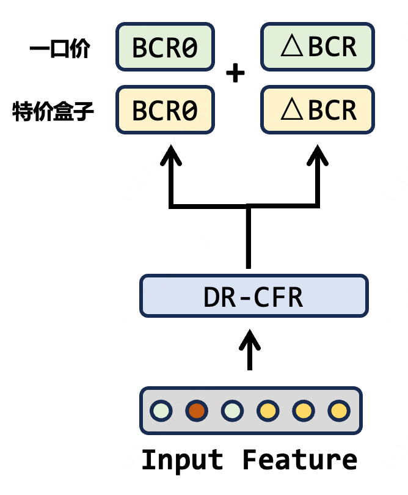
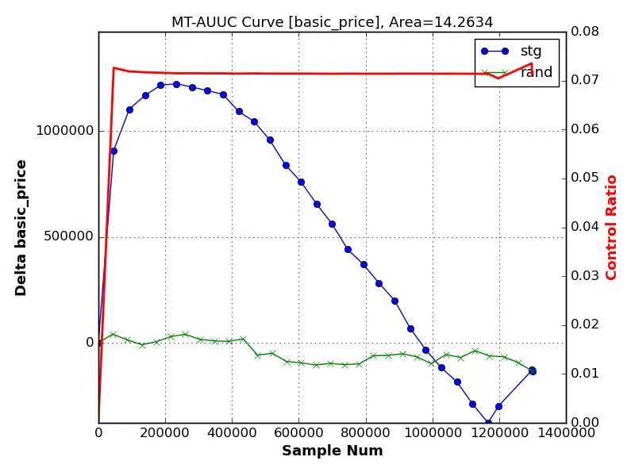
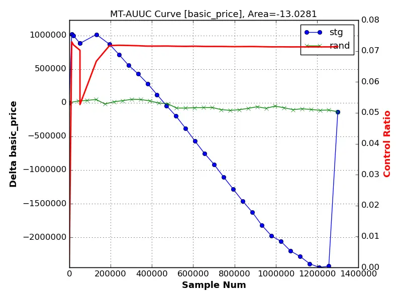

# 【LR25036】自营联盟端含盒子城市动态智能定价策略

[Cooper 原文](https://cooper.didichuxing.com/knowledge/2199610335356/2205677444068)

# 0. 编辑记录

| **修改时间** <br> | **修改内容** <br> |
| --- | --- |
| 2025.10.23 <br> | 发布第一版 <br> |
| 2025.10.27 <br> | 修正约束公式 <br>修正调价幅度的表达 <br>增加MAE和AUC的结果数据 <br>补充和73城策略的差异 <br>补充联盟端其他商家的完单和GMV表现 <br> |

# 1. 背景概述

可参考LR文档 [【LR25024】自营联盟端动态智能定价V1.0](https://cooper.didichuxing.com/knowledge/2199610335356/2205053124235)

过去**人工调整端外定价水位**的方式存在以下弊端：

1. **调价前后缺乏有效的数据支撑**：当前其定价主要依赖人工，缺少人群分流能力，没有实验对照，难以确认其调价的效果

2. **灵活性差：**人工调整无法精细化调价，最多只能分时分费项，而期望的动态智能定价是可以到订单维度的精细化调价。

由于联盟端在60城同时上线特价盒子和一口价，剩余73城仅上线一口价。

对于仅一口价开城城市，最大化小猪一口价GMV

**对于一口价&特价盒子均开城城市，最大化自营GMV总和；**

**本LR文档方案主要针对有小猪一口价以及特价盒子的60城**

由于暂时无法进行特价盒子和小猪一口价的协同分流，我们本次策略方案**只对小猪一口价生效**

**联盟端60城自营完单份额现状**为：

- 联盟端60城自营完单占花业务在联盟端总完单约 83%

- 联盟端60城自营完单占自营60城全渠道（PBD+联盟端+小猪端）完单约 26%

## 1.1 联盟端自营呼返和定价现状及未来规划

目前因为联盟端毛利约束，基本没有C补。业务目前只在部分高定高补城市做了涨价加补。暂时目标是先做司机心智，不上动态智能定价。

后期会规划联动小猪一口价和特价盒子进行联合动态定价。

## 1.2 ==自营在联盟端和小猪端的定价补贴策略对比==

由于联盟端并没有呼返策略，这里首先给定价策略的对比

|  <br> | **小猪端 【定价策略】** <br> | **联盟端【定价策略】** <br> | **小猪端【呼返策略】** <br> |
| --- | --- | --- | --- |
| **目标** <br> | 最大化自营GMV <br> | 最大化自营GMV <br> | 最大化自营三品类完单 <br> |
| **涉及品类** <br> | 小猪特价、小猪打车、小猪特快 <br> | 小猪一口价 <br> | 小猪特价、小猪打车、小猪特快 <br> |
| **调价范围** <br> | +0pp 至 +24pp <br> | -2pp 至 +24pp (60城) <br> | 8折、85折、90折、95折、100折 <br> |
| **策略类型** <br> | 分时分里程字典 <br>【收益不明显，仍在迭代实验中】 <br> | 线上模型 + 规划求解字典 <br> | 线上模型 + 规划求解字典 <br> |
| **所需特征** <br> | 时间，里程段 <br> | 离在线特征 + P维度特征 <br> | 离在线特征 <br> |

这里小猪端和联盟端定价策略方案不同，其实是有先后顺序的背景：

- 我们首先在小猪端进行RCT实验，使用分时分里程字典进行涨价，发现效果不佳

	- 发现分时分里程涨价策略下，由于其粒度过于粗糙，其 CR 降低较多

- 然后开始在联盟端进行动态智能定价策略开发，便直接使用更加精细化的模型方案来实现

- 后续规划开始推进小猪端的线上模型策略

## 1.3 自营智能呼返和动态智能定价的配合

小猪端内：智能呼返只会作用在 **高定高补** or **缺C** 的城市，动态智能定价作用在其他所有城市

小猪端外：由于毛利约束故没有呼返，只有定折在高定高补城市，动态智能定价作用在其他所有城市

> 高定高补城市：在API份额较高(>30%) 的城市，会仿照API的打法，使用高定高补，增加司机收入

# 2. 方法设计

**这里，我们需要明确和73城动态定价策略中优化问题的差异**：

1. **优化目标：最大化一口价GMV ---&gt; 最大化盒子内外自营GMV**

2. **模型建模：仅预测一口价BCR ----&gt; 同时预测盒子内自营BCR 以及 一口价BCR**

## 2.0 符号定义

| **符号** <br> | **含义** <br> |
| :---: | :---: |
| $$N$$ <br> | 总冒泡数量 <br> |
| $$M$$ <br> | Treatment的种类数，包含涨价或者降价 <br> |
| $$p_i$$ <br> | 第 i 个冒泡的应付价格 <br> |
| $$bcr_{ij}$$ <br> | 第 i 个冒泡应用第 j 种调价幅度下的冒泡完单概率 <br> |
| $$bcr0_{i}$$ <br> | 第 i 个冒泡不调价的冒泡完单概率 <br> |
| $$[]^{ykj}, []^{tjbox}$$ <br> | 任意变量，ykj 上标表示小猪一口价，tjbox 上标表示特价盒子 <br> |
| $$z_{ij}$$ <br> | 决策变量，决定第 i 个冒泡是否应用第 j 种Treatment，1为应用，0为不应用 <br> |
| $$r_j$$ <br> | 第 j 种调整系数，可正可负 <br> |
| $$D$$ <br> | 整体完单降幅【为离散值：0.5%, 1%, 2%】 <br> |

## 2.1 问题形式化

最大化GMV，其优化目标可以写成以下形式：

$$\begin{aligned} \max \sum_{i=1}^N\sum_{j=1}^M\sum_{t\in\{\text{ykj,tjbox}\}} p_i\cdot (1 + r_j\cdot \mathbb{1}[t\neq \text{tjbox}])\cdot \text{bcr}_{ij}^t\cdot z_{ij} \end{aligned}$$

> 1\[t!= tjbox\] 是 indicator function

| **约束名称** <br> | **形式化** <br> |
| :---: | :---: |
| **决策空间约束** <br> | $$\begin{aligned} \sum_{j=1}^M z_{ij} = 1 \end{aligned}$$ <br> |
| **完单降幅约束** <br> | $$\begin{aligned} \sum_{i=1}^N\sum_{j=1}^M\sum_{t\in\{\text{ykj,tjbox}\}} (\text{bcr}^t_{ij} \cdot z_{ij}) \geq D\cdot \sum_{i=1}^N\sum_{j=1}^M \sum_{t\in\{\text{ykj,tjbox}\}} \text{bcr0}_i^{t} \end{aligned}$$ <br> |

**使用约束系数 D 来控制整体完单降幅**

**策略选型**：

- **基于人工规则：过于依赖先验知识，最不灵活**

- **分桶运筹规划：离散分桶会可能导致非全局最优，但是策略表现较为稳定**

- **Lambda 贪心：利用完单率约束，引入拉格朗日因子**

**一期我们选择分桶策略，根据经验，该类策略表现更加稳定**

## 2.3 模型设计

我们这里参照[**自营联盟端73城动态定价**](https://cooper.didichuxing.com/knowledge/2199610335356/2205053124235)的策略设计，使用了线性扩展的双塔DR-CFR



**同时，我们增加额外的两个分支，用于预测特价盒子中自营的 BCR0 和 BCR向量**



> 我们通过分别控制线性系数的正负来控制了一口价和特价盒子对调价系数的单调性相反

## 2.4 分桶方案

参考自营呼返策略的设计，我们使用基于模型输出聚类分桶的方案

我们会先利用离线数据，使用 Kmeans 算法分别对 BCR0向量、BCR向量 和 里程进行聚类，分别聚10类。

线上的具体流程为：

- 线上用户冒泡

- 获取实时特征，离线特征，进行特征拼接

- 调用模型，获取 BCR0 和 BCR 向量

- 基于 BCR0 和 BCR 向量，以及里程，获取三个聚类分桶【每一个类别都有10个中心，一共 10^3 种组合】

- 基于聚类分桶，查找字典，获取小猪一口价的调价系数（该系数可正可负）

	- 该字典由离线规划求解得到，通过限制不同的完单降幅，生成不同的字典

> 由于价格特征在特价盒子和小猪一口价之前无法共享

> 我们出于未来可能同盒子进行联合决策的考量，采用里程来代替价格

> 这里由于调价系数可正可负，

> 为了防止倒挂，业务方会前置控制小猪一口价和特价盒子之间的价差为至少3pp

> 使得小猪一口价在动态降价后应付仍然低于特价盒子的应付 （调价范围是 -2pp \~ 24pp）

# 3. 特征工程

这里我们所有的特征都和先前73城的保持一致，可以参考  [【LR25024】自营联盟端动态智能定价V1.0](https://cooper.didichuxing.com/knowledge/2199610335356/2205053124235)

# 4. 实验结果

## 4.1 数据集准备

我们首先进行了RCT实验，为期两周，回收对应数据之后

根据第一周数据进行模型训练，根据第二周的数据进行离线测试

**数据集细节**

|  <br> | **时间周期** <br> | **样本数** <br> | **路径** <br> |
| --- | --- | --- | --- |
| 训练数据集 <br> | 08.23 - 08.29 <br> | 10251258 <br> | **\[c60\] /home/luban/ofs/kxp_workspace/zy_workspace/zy_data_collect/data/zy_external_inc_rct/c60_data/2025-08-23_2025-08-29_c60_ext_cleaned.csv** <br> |
| 测试数据集 <br> | 08.30 - 09.05 <br> | 10251849 <br> | **\[c60\] /home/luban/ofs/kxp_workspace/zy_workspace/zy_data_collect/data/zy_external_inc_rct/c60_data/2025-08-30_2025-09-05_c60_ext_cleaned.csv** <br> |
| 字典生成数据集 <br> | 08.30 - 09.05 <br> | **\[c60\] /home/luban/ofs/kxp_workspace/zy_workspace/zy_data_collect/data/zy_external_inc_rct/c60_data/2025-08-30_2025-09-05_c60_ext_cleaned.csv** <br> |

## 4.2 离线实验

我们选择 DR-CFR 进行离线评测，评估指标使用 MT-AUUC

> 这里补充一下对应模型的 AUC 和 MAE 供参考

> 小猪一口价BCR：AUC=0.8914，MAE=0.0065

> 特价盒子BCR的：AUC=0.9874，MAE=0.0040

| **MT-AUUC Curve** <br> |
| :---: |
|  <br> |

### 4.2.1 同MHDNN的离线对比

离线测试多头DNN的MT-AUUC较差，故选择DR-CFR，其MT-AUUC如下所示



## 4.3 双周在线实验

我们进行了两次不同随机种子的实验，每次维持一周

| **分流方式** <br> | 乘客PID分流 <br> |
| --- | --- |
| **实验流量** <br> | 5% <br> |
| **覆盖城市** <br> | 联盟端包含特价盒子和小猪一口价的60城 <br> |
| **覆盖品类** <br> | 小猪一口价 <br> |
| **实验周期** <br> | 2025-09-22 00:00:00 ～ 2025-09-28 23:59:59 <br>2025-10-09 00:00:00 ～ 2025-10-15 23:59:59 <br> |

| **策略名** <br> | **乘客数** <br> | **联盟端自营GMV** <br> | **联盟端自营完单** <br> | **联盟端自营呼叫** <br> | **联盟端自营应答** <br> | **联盟端自营ECR** <br> | **联盟端自营CR** <br> | **联盟端自营ASP** <br> | **联盟端GMV** <br> | **联盟端完单** <br> |
| :---: | :---: | :---: | :---: | :---: | :---: | :---: | :---: | :---: | :---: | :---: |
| **2025-09-22 ～ 2025-09-28** <br> |
| 空白组 <br> | 44189715 <br> | 0.5211 <br> | 0.0325 <br> | 0.4734 <br> | 0.0457 <br> | 0.1600 <br> | 0.0687 <br> | **16.02** <br> | 2.1168 <br> | 0.1118 <br> |
| 策略组 <br>\[DR-CFR\] <br> | 2598734 <br> | **0.5345** <br>**\[+2.57%\]** <br> | **0.0340** <br>**\[+4.63%\]** <br> | **0.4799** <br>**\[+1.38%\]** <br> | **0.0479** <br>**\[+4.76%\]** <br> | **0.1621** <br>\[+0.21pp\] <br> | **0.0709** <br>\[+0.21pp\] <br> | 15.70 <br>\[-1.97%\] <br> | **2.1305** <br>**\[+0.65%\]** <br> | **0.1131** <br>**\[+1.12%\]** <br> |
| **2025-10-09 ～ 2025-10-15** <br> |
| 空白组 <br> | 42327289 <br> | 0.5551 <br> | 0.0352 <br> | 0.5100 <br> | 0.0502 <br> | 0.1716 <br> | 0.0690 <br> | **15.77** <br> | 2.3943 <br> | 0.0924 <br> |
| 策略组 <br>\[DR-CFR\] <br> | 2489446 <br> | **0.5674** <br>**\[+2.21%\]** <br> | **0.0365** <br>**\[+3.66%\]** <br> | **0.5168** <br>**\[+1.34%\]** <br> | **0.0521** <br>**\[+3.81%\]** <br> | **0.1742** <br>\[+0.26pp\] <br> | **0.0706** <br>\[+0.16pp\] <br> | 15.55 <br>\[-1.39%\] <br> | **2.4019** <br>\[+0.32%\] <br> | **0.0932** <br>**\[+1.01%\]** <br> |

双周平均来看：

1. **平均自营联盟端整体GMV显著+2.39%，完单显著+4.14%，呼叫显著+1.36%**

2. **联盟端整体完单+1.06%，联盟端整体GMV+0.48%**

## 4.4 价格调整系数比例统计

我们统计了冒泡和完单的价格调整系数的比例，该比例一定程度反映了策略的偏好，给出了涨/降价的分布

\[2025-09-22 至 2025-09-28\]

| **调价系数** <br> | **-2%** <br> | **+24%** <br> | **Total ** <br> |
| --- | :---: | :---: | :---: |
| **去重冒泡** <br> | 8799662 <br> | 10902 <br> | 8810564 <br> |
| **发单** <br> | 1589453 <br> | 5305 <br> | 1594758 <br> |
| **完单** <br> | 99% (88216) <br> | 1% (537) <br> | 88753 <br> |
| **人均GMV提升** <br> | +1.8% <br> | +140.43% <br> | +2.57% <br> |

\[2025-10-09 至 2025-10-15\]

| **调价系数** <br> | **-2%** <br> | **+24%** <br> | **Total ** <br> |
| --- | :---: | :---: | :---: |
| **去重冒泡** <br> | 7831905 <br> | 12441 <br> | 7844346 <br> |
| **发单** <br> | 1347523 <br> | 6369 <br> | 1353892 <br> |
| **完单** <br> | 99% (93353) <br> | 1% (724) <br> | 94077 <br> |
| **人均GMV提升** <br> | +1.43% <br> | +148.45% <br> | +2.21% <br> |

## 

### 4.3.1 策略对其他商家的影响

| **策略名** <br> | **联盟端自营** <br>**GMV** <br> | **联盟端自营** <br>**完单** <br> | **联盟端宏鹄** <br>**GMV** <br> | **联盟端宏鹄** <br>**完单** <br> | **联盟端API** <br>**GMV** <br> | **联盟端API** <br>**完单** <br> | **联盟端整体** <br>**GMV** <br> | **联盟端整体** <br>**完单** <br> |
| :---: | :---: | :---: | :---: | :---: | :---: | :---: | :---: | :---: |
| **2025-10-13 ～ 2025-10-19** <br> |
| 空白组 <br> | 0.6506 <br> | 0.0381 <br> | 0.5429 <br> | **0.03158** <br> | 1.529 <br> | 0.0657 <br> | 2.7231 <br> | 0.1353 <br> |
| 策略组 <br> | **0.6659** <br>**\[+2.34%\]** <br> | **0.0396** <br>**\[+3.89%\]** <br> | **0.5434** <br>\[+0.10%\] <br> | 0.03153 <br>\[-0.16%\] <br> | **1.533** <br>\[+0.23%\] <br> | **0.0658** <br>\[+0.23%\] <br> | 2.7424 <br>\[+0.71%\] <br> | 0.1368 <br>\[+1.17%\] <br> |

可以看到，对于宏鹄和API商家，其GMV和完单变化都较小，均无显著影响

# 5. FAQ

**==Q1: 动态定价策略和呼返、动调之间的关系？==**

**A1:** 

|  <br> | **相同点** <br> | **不同点** <br> |
| --- | --- | --- |
| 动调 <br> | 都是动态调整定价 <br> | 目标不同： <br>- 动态定价可针对最大化自营GMV or 完单， <br><br>- 而动调目标是保证准确捕捉低CR情况涨价，高CR不涨 <br><br>粒度不同： <br>- 动态定价为最细的冒泡粒度，而动调是城市/格子 <br><br> |
| 呼返 <br> | 都是冒泡粒度调整 <br> | 形式不同： <br>- 呼返是补贴，不改变司机收入，产生补贴费用，有预算限制 <br><br>- 动态定价直接修改定价，会改变司机收入，不产生补贴费用 <br><br>感知不同： <br>- 乘客对呼返有直接感知 <br><br>- 动态定价下，涨价情况下司机有感知，乘客均无直接感知 <br><br> |

==呼返作为一种补贴手段，用于在定价基础上去进行补贴投放，产生补贴费用，并且乘客能有较强感知（表单提示）。==

==现有的动调是在城市/格子级别上的动态调整，动态定价粒度则可以视为最细粒度的动调。==

**Q2：如何确定完单降幅D？**

**A2:**  我们人工设定了一系列离散的D值（0, 0.01,0.02），目前取值为0。

**Q3: ==BCR通常和实付（考虑补贴）有关，当城市补贴率分布发生变化时，是否需要重新建模BCR uplift并重新求解？==**

**==A3:==** ==BCR的确和补贴情况有关，但由于联盟端由于毛利约束并没有补贴，因此这种情况的影响较小。==

**Q4: ==为什么采用线性扩展双塔？离线有尝试过其他形式的函数吗？==**

**A4:** 离线尝试了多头DNN，以及二阶多项式，但MT-AUUC较差，故实际没有使用。

# 6. 未来规划

确定做：

- 分三步扩量至90%：

	- 10.27/28 扩量至 30%

	- 11.5/6 扩量至 50%

	- 11.17/18 扩量至 90%

不确定做：

- 进行模型迭代更新

- 考虑更多特征，比如乘客的时序行为特征、前置动调特征、天气情况

# 7. 目标&约束

## 7.1 策略目标

- 小猪自营联盟端GMV显著提升

## 7.2 约束指标项

- 完单降幅约束符合业务对各城市要求，具体作为策略字典中的key，对不同城市的约束包括：完单降幅不超过 0%、0.5%、1%。

# 8. 推全情况与现状追踪

推全情况：目前线上已推全——<https://ether.intra.hongyibo.com.cn/commonWrapperDeployV3/detail/5094>

现状追踪：策略组流量：90%，空白组流量10%

# 9. 致谢

感谢门畅老师在策略方案设计、实验评估，LR文档编写中给出指导和建议

感谢工程侧 陈光岚 的支持，提供了稳健的工程实现

感谢所有价格策略同学的支持

# 10. 参考引用

- [【LR25024】自营联盟端动态智能定价V1.0](https://cooper.didichuxing.com/knowledge/2199610335356/2205053124235)

# X. 附录

## X.1 涨价样本特征分析

我们分析了涨价样本的特征，将其和降价样本的特征进行比较，选取出前10差异大的特征

1. 乘客过去21天ECR \[标准化后差异 +31101%\]

2. 乘客过去7天累计完单里程  \[标准化后差异 +22157%\]

3. 乘客过去7天完单数  \[标准化后差异 +18548%\]

4. 乘客过去7天成交率  \[标准化后差异 +10046%\]

5. 终点格子过去30分钟完单数 \[标准化后差异 +10046%\]

6. 乘客过去7天呼叫数 \[标准化后差异 +6051%\]

7. 乘客过去21天呼叫数 \[标准化后差异 +4647%\]

8. 乘客过去21天累计完单里程 \[标准化后差异 +4604%\]

9. 乘客过去一天完单里程 \[标准化后差异 +4307%\]

10. 乘客过去一天完单数 \[标准化后差异 +4148%\]

**策略倾向于在那些高频用户上，且终点短时间内低完单的冒泡进行涨价**

```PlainText
2025-10-20 17:47:09.817 | INFO     | main:main:218 - zy_external_dynamic_pricing_pid_features_zy_21d_ecr: 31101.93% [0.00, 1.19]
2025-10-20 17:47:09.818 | INFO     | main:main:218 - zy_external_dynamic_pricing_pid_features_zy_7d_distance: 22157.41% [-0.01, 2.79]
2025-10-20 17:47:09.818 | INFO     | main:main:218 - zy_external_dynamic_pricing_pid_features_zy_7d_finish_cnt: 18548.36% [-0.02, 3.98]
2025-10-20 17:47:09.818 | INFO     | main:main:218 - zy_external_dynamic_pricing_pid_features_zy_7d_cr: 10046.61% [-0.03, 2.60]
2025-10-20 17:47:09.818 | INFO     | main:main:218 - coord_last_30min_end_order_finish_charge_cnt_dd: -6251.71% [-0.00, -0.23]
2025-10-20 17:47:09.818 | INFO     | main:main:218 - zy_external_dynamic_pricing_pid_features_zy_7d_call_cnt: -6057.32% [0.03, 1.96]
2025-10-20 17:47:09.818 | INFO     | main:main:218 - zy_external_dynamic_pricing_pid_features_zy_21d_call_cnt: 4647.99% [-0.03, 1.35]
2025-10-20 17:47:09.818 | INFO     | main:main:218 - zy_external_dynamic_pricing_pid_features_zy_21d_distance: 4604.46% [-0.04, 1.91]
2025-10-20 17:47:09.818 | INFO     | main:main:218 - zy_external_dynamic_pricing_pid_features_zy_1d_distance: -4307.39% [0.01, 0.48]
2025-10-20 17:47:09.818 | INFO     | main:main:218 - zy_external_dynamic_pricing_pid_features_zy_1d_finish_cnt: 4148.02% [-0.02, 0.73]
2025-10-20 17:47:09.818 | INFO     | main:main:218 - coord_last_5min_end_order_finish_charge_cnt_dd: -4117.02% [-0.00, -0.17]
2025-10-20 17:47:09.819 | INFO     | __main__:main:218 - coord_last_15min_end_order_finish_charge_cnt_dd: -3829.30% [-0.01, -0.22]
2025-10-20 17:47:09.819 | INFO     | __main__:main:218 - zy_external_dynamic_pricing_pid_features_zy_21d_cr: 3802.98% [-0.05, 1.86]
2025-10-20 17:47:09.819 | INFO     | __main__:main:218 - zy_external_dynamic_pricing_pid_features_zy_21d_finish_cnt: 3759.51% [-0.07, 2.43]
2025-10-20 17:47:09.819 | INFO     | __main__:main:218 - zy_external_dynamic_pricing_pid_features_zy_1d_cr: 3190.34% [-0.02, 0.59]
2025-10-20 17:47:09.819 | INFO     | __main__:main:218 - zy_external_dynamic_pricing_pid_features_zy_7d_ecr: -2984.07% [0.04, 1.38]
2025-10-20 17:47:09.819 | INFO     | __main__:main:218 - coord_last_5min_end_answer_order_cnt_dd: 2738.87% [0.01, -0.17]
2025-10-20 17:47:09.819 | INFO     | __main__:main:218 - coord_last_15min_end_answer_order_cnt_dd: 2733.75% [0.01, -0.20]
2025-10-20 17:47:09.819 | INFO     | __main__:main:218 - coord_last_30min_end_answer_order_cnt_dd: 2393.71% [0.01, -0.22]
```
