# 【LR25038】联合决策acc_CR模型迭代V0

[Cooper 原文](https://cooper.didichuxing.com/knowledge/2199610335356/2205698304808)

> 修订记录

| 时间   | 修订摘要   |
| --- | --- |
| 2025-11-03   | 完成初版   |
| 2025-11-09   | - 背景中「乘客取消」改成司乘取消   - 增加2.0业务背景   - 更改2.2中的符号，与LR25039保持一致   - 增加2.3.1 样本集构建   - 增加2.3.3中的计算示例   - 补充3.5单调性分析的原因    |
| 2025-11-21   | - 增加2.0中问题8「折扣如何影响CR」    |

## 一、背景

> [联合决策acc_CR模型迭代策略方案](https://cooper.didichuxing.com/knowledge/2199610335356/2204114677167)

联合决策V2中，成交率预估基于XGBoost的acc_AR模型，存在以下值准问题：

- AR模型首先预估单呼商家$$l$$的应答概率$$\hat ar_l$$，之后根据全概率公式计算出累计应答率$$\hat{acc\_ar}=1-\prod\limits_{l=1}^k (1-\hat{ar_l})$$，会高估应答率，预测值无法感知到供需变化

- AR模型未考虑司乘取消，会高估成交率

- 商家完单概率$$\hat {pr_{lk}}=\frac{ar_{l}}{\sum_{l=1}^{l=k}ar_{l}}$$，直接对单呼商家应答概率进行归一化，预估不准

因此，为提升成交率、商家完单概率值准，将联合决策中，基于XGBoost的acc_AR模型迭代为基于深度的acc_CR模型。

## 二、约束&目标

## 2.1 策略目标

- 全年主目标：拉齐花业务补贴率下，大盘人均完单+0.5%

- 是否在 DDO 中：是

## 2.2 约束指标项 & 约束程度

|    | 约束方向   | 约束程度（前置明确）   |
| --- | --- | --- |
| 花业务补贴率   | 不抬升   | 与对照组拉齐，允许 ±0.1pp 内波动   |
| 幸运盒子份额   | 不负   | 不负   |

## 三、技术方案

### 3.0 业务背景

1. acc_CR模型如何影响联合决策的结构？

	1. 如图所示，acc_CR通过更准确的预测成交率，影响默勾和折扣的决策

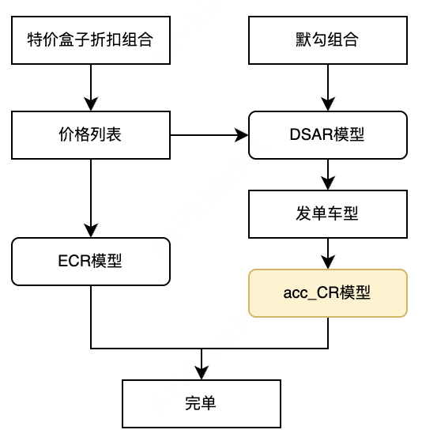

联合决策的完整链路，黄色为变更模型，将acc_AR模型替换为acc_CR模型

2. 品类、商家、车型是什么概念？

	1. 品类：为了满足不同的司乘需求，小猪存在多个品类，如低价对应幸运盒子、特价盒子、超值达，确定性对应特快盒子、小猪特快，大盘需求对应盒子外（普通品类）

	2. 商家：一个商家可以有多个品类，品类间有[发单优先级](https://cooper.didichuxing.com/docs2/document/2203352674960)；例如一个商家同时发单特价盒子、盒子外、特快盒子时，由于优先级为特快盒子 > 盒子外 > 特价盒子，最终会以特快盒子发单

	3. 车型：一个车型对应唯一的商家 X 品类组合，在冒泡表中有唯一的estimate_id

3. 为什么acc_CR模型设定3个建模目标？

	1. 由于联合决策的决策空间为折扣、默勾，需要得到折扣每个折扣、每种默勾下的模型输出值，用于规划求解，因此设定以下3个建模目标

		1. 建模目标1️⃣：折扣$$j$$下勾选至第$$k$$个商家时的呼叫完单率$$acc\_cr_{jk}$$，下游规划求解中使用

		2. 建模目标2️⃣：折扣$$j$$下勾选至第$$k$$个商家时，若呼叫完单，是由商家$$l$$完单概率$$pr_{jkl}$$，为多分类任务，目的是在规划求解中得到加权的gmv、cost，其中$$gmv_{jk}=\sum\limits_{l=1}^k pr_{jkl}*应付$$，$$cost_{jk}=\sum\limits_{l=1}^kpr_{jkl}*前置优惠后金额*（1-d_j)$$

		3. 建模目标3️⃣：折扣$$j$$下单呼商家$$l$$时是否能应答$$ar_{jk}$$，是为了1）作为辅助任务，辅助模型训练；2）用于下游交易的任务

4. 对建模目标1，为什么模型输出是分品类$$m$$单商家对呼叫完单的贡献$$\upsilon_{l}^m$$？

	1. 分品类原因：由于一个商家在不同品类（特价、盒子外、特快）的应付价格、成交能力不同，因此需要分特价、盒子外、特快3个品类进行建模，最终根据发单优先级，取真实发单的品类对应的结果。

	2. 单商家建模原因：在规划求解中，**需要得到勾选至每个车型对应**的$$acc\_cr_{jk}$$，此时有如下两种建模选择，综合考虑使用2️⃣

		1. 1️⃣ 模型输入为所有商家特征，模型直接输出勾选至每个车型对应的$$acc\_cr_{jk}$$；优点是可以一次性输出所需要结果；缺点是由于每个冒泡的商家数不同，需要进行padding，且输入特征数量为商家数X每个商家特征数（约5000+维），模型建模复杂

		2. 2️⃣ 模型输入为单商家特征，输出单商家对呼叫完单的贡献；可以by商家过模型后，通过聚合前$$k$$个商家真实发单品类对呼叫完单的贡献之和，得到勾选至第$$k$$个商家的呼叫完单率$$acc\_cr_{jk}$$；优点是模型参数量少，建模较简单；缺点是一个呼叫需要多次过模型，聚合后才能得到结果

5. 对建模目标2，为什么模型输出是分品类$$m$$单商家对商家完单的贡献$$\phi_l^m$$？

	1. 同4，最终使用每个商家真实发单品类对应的商家完单贡献，并对前$$k$$个商家完单贡献进行softmax，得到多分类输出$$pr_{jkl}$$

6. 为什么选用response model？

	1. 真实供需对CR非常大，折扣对CR的影响较小；模型主要建模不同供需特征下的CR，因此选用response model

7. 如何建模折扣$$j$$对呼叫完单贡献的影响？

	1. 在模型特征中引入特价盒子实付价，不同折扣对应的特价盒子实付价不同，由模型学出不同折扣对结果的影响。

8. 折扣如何影响CR？

	1. 由于表单按照实付价格进行排序，因此特价盒子折扣会影响特价盒子实付->表单排序->折叠->默勾到K的真实发单品类->默勾到K的acc_CR-> 折扣、默勾决策结果->真实CR

	2. 如表所示，特价盒子100折时，由于C盒子外实付低于特价盒子，因此会被折叠，不被计入acc_cr阈值；特价盒子82折时，C盒子外实付高于特价盒子，不会被实付折叠，可以正常展现，会被计入acc_cr

| 同价合并后车型   | 特价盒子100折   |            | 同价合并后车型   | 特价盒子82折   |
| :---: | :---: | :---: | :---: | :---: |
| 商家   | 品类   | 实付价   | 实付折叠   | 商家   | 品类   | 实付价   | 实付折叠   |
| -   | C   | 盒子外   | 9   | 是   | 1   | A   | 特价盒子   | 8.2   | 否   |
| 1   | A   | 特价盒子   | 10   | 否   | C   | 特价盒子   | 8.2   | 否   |
| C   | 特价盒子   | 10   | 否   | 2   | C   | 盒子外   | 9   | 否   |
| 2   | B   | 特快盒子   | 12   | 否   | 3   | B   | 特快盒子   | 12   | 否   |

### 3.1 业务抽象

假设如下：

1. 商家在特价盒子、盒子外、特快盒子对呼叫完单/商家完单贡献不同

2. 商家的呼叫完单/商家完单贡献与商家在价格列表的顺序无关，e.g. 存在3个商家A、B、C，商家顺序为「ABC」vs 「ACB」，商家B的完单贡献相同

3. 在计算商家完单概率时，商家之间存在竞争关系：e.g「勾选商家AB」 与「勾选商家ABC」时， 商家A的完单概率不同

### 3.2 符号说明

| 符号   | 含义   |
| --- | --- |
| $$i$$   | 呼叫$$i$$   |
| $$j$$   | 特价盒子第$$j$$个折扣，对应折扣为$$d_j$$，90折对应0.9   |
| $$k$$   | 默勾至第$$k$$个商家   |
| $$l$$   | 第$$l$$个商家   |
| $$m_{ijkl}$$，简写为$$m$$   | 呼叫$$i$$第$$j$$个折扣默勾至第$$k$$个商家时，商家$$l$$的真实发单品类，0代表特价盒子，1代表盒子外，2代表特快盒子   |
| $$\hat \upsilon_{ijl}^*$$   | 呼叫$$i$$第$$j$$个折扣下，商家$$l$$在品类$$*$$下的呼叫完单贡献   |
| $$\hat \phi^*_{ijl}$$   | 呼叫$$i$$第$$j$$个折扣下，商家$$l$$在品类$$*$$下的商家完单贡献   |
| $$acc\_cr_{ijk}$$   | 呼叫$$i$$第$$j$$个折扣默勾至第$$k$$个车型下，呼叫完单概率   |
| $$pr_{ijkl}$$   | 呼叫$$i$$第$$j$$个折扣下默勾至第$$k$$个车型，商家$$l$$完单概率   |
| $${ar}_{ijl}$$   | 呼叫$$i$$第$$j$$个折扣下，单呼商家$$l$$时应答概率   |

### 3.3 acc_CR模型

#### 2.3.1 样本集

1. 样本：

	1. 训练样本：09.08-09.14，随机下采样至10%

	2. 测试样本：09.15-09.21，随机下采样至2%

2. label构建：取呼叫$$i$$真实折扣$$j$$勾选到商家$$k$$的结果

	1. 呼叫完单概率$$acc\_cr_{ijk}$$：取呼叫对应的is_td_finish

	2. 商家完单概率$$pr_{ijkl}$$：取呼叫商家$$l$$对应的is_td_finish

	3. 单呼商家$$l$$应答概率$$ar_{ijl}$$：呼叫时商家$$l$$是否向平台pk模块举手，详见[【LR25003】](https://cooper.didichuxing.com/knowledge/2199610335356/2204226054240)

#### 3.3.2 特征工程

> [acc_CR模型特征一览](https://cooper.didichuxing.com/knowledge/2199610335356/2205679248871)

模型主要使用四类特征，包含订单基础特征、实时运力特征、商家维度历史统计特征、乘客维度历史统计特征：

- 订单基础特征：时间、城市、eta、etd、「特价盒子、盒子外、特快盒子」价格等

- 实时运力特征：城市/起点格子维度，实时冒泡-完单交易漏斗、在线/空车/举手司机数等

- 商家维度历史统计特征：城市/起点格子维度，历史冒泡-完单交易漏斗、在线/空车/举手司机数等

- 乘客维度历史统计特征：P维度，历史呼叫-完单交易漏斗、平均asp、eta、etd等

#### 3.3.3 模型结构

模型为多任务架构的response model：

- 输入为呼叫$$i$$第$$j$$个折扣下商家$$l$$的特征，不同折扣的特价盒子实付价不同

- 输出为多任务

	- $$\hat \upsilon_{ijl}^*$$：第$$j$$个折扣下，商家$$l$$分别在「特价盒子、盒子外、特快盒子」下，对呼叫完单贡献

	- $$\hat {\phi}_{ijl}^{\ast}$$：第$$j$$个折扣下，若呼叫完单，商家$$l$$分别在「特价盒子、盒子外、特快盒子」下的商家完单贡献

	- $$\hat {ar}_{ijl}$$：第$$j$$个折扣下，单呼商家$$l$$的应答概率

之后对呼叫$$i$$第$$j$$个折扣默勾到商家$$k$$时，所有商家的结果进行聚合，得到建模目标：

- **呼叫$$i$$第$$j$$个折扣默勾至第$$k$$个商家时的完单概率**：$$\hat {acc\_cr}_{ijk}=\{\sigma(\sum\limits_{l=1}^{k}\hat{\upsilon}_{ijl}^{m})-0.5\}*2$$，目的是归一至0-1，为二分类任务

- **呼叫$$i$$第$$j$$个折扣默勾至第$$k$$个商家完单时，由商家$$l$$完单的概率**：$$\hat{pcr_{ijkl}}=Softmax(\hat \phi_{ij1}^{m},...,\hat{\phi}_{ijk}^{m})_l$$，为多分类任务

- **呼叫$$i$$第$$j$$个折扣时，**单呼商家$$l$$的应答概率：$$\hat {ar}_{ijl}$$

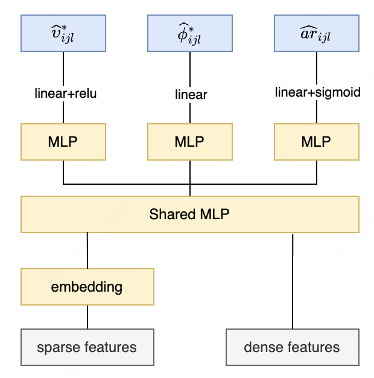

Loss包含3部分：

$$\def\BCE#1#2{-\frac{1}{N}\sum_{i=1}^{N}#1\log(#2)+(1-#1)\log(1-#2)} \def\CE#1#2{-\frac{1}{N}\sum_{i=1}^{N}\sum_{l=1}^{k}#1\log(#2)}  L_{cr}=\BCE{acc\_cr_{ijk}}{\hat {acc\_cr_{ijk}}} \\ L_{pcr}=\CE{pr_{ijkl}}{\hat{pr_{ijkl}}}\\ L_{ar}=\BCE{ar_{ijl}}{\hat{ar_{ijl}}}$$

模型整体Loss为：$$L=L_{cr}+\alpha L_{pcr}+\beta L_{ar}$$

此处补充一个示例，以理解如何由by商家的结果聚合得到最终的$$acc\_cr_{ijk}$$、$$pr_{ijkl}$$

当特价盒子折扣为82折，勾选至C-特快盒子时，可以看到由于C-盒子外实付低于特价盒子实付，因此被实付折叠，不会计入acc_CR；由于优先级为盒子外>特价盒子，因此商家B的真实发单品类为盒子外。

| 同价合并后车型   | 商家   | 品类   | 实付   | 是否被实付折叠   | 是否真实发单品类   |
| --- | --- | --- | --- | --- | --- |
| /   | C   | 盒子外   | 8   | ✅   |    |
| 1   | A   | 特价盒子   | 8.2   |    | ✅   |
| B   | 特价盒子   | 8.2   |    |    |
| 2   | B   | 盒子外   | 10   |    | ✅   |
| 3   | C   | 特快盒子   | 12   |    | ✅   |

此时商家ABC对应的真实发单品类、模型输出如下：

| 商家   | 真实发单品类$$m$$   | 呼叫完单贡献$$\upsilon$$   | 商家完单贡献$$\phi$$   | 单呼应答概率  $$ar$$   |
| :---: | :---: | :---: | :---: | :---: |
| 0-特价盒子   | 1-盒子外   | 2-特快盒子   | 0-特价盒子   | 1-盒子外   | 2-特快盒子   |
| A   | 0-特价盒子   | 1   | 2.1   | 3.2   | 0   | 0.1   | 0.2   | 0.5   |
| B   | 1-普通品类   | 1.1   | 2   | 3.1   | 1.1   | 0   | 1.3   | 0.6   |

则勾选至商家C时，商家对应真实发单品类的输出，为上表中黄色背景部分，计算出的呼叫完单率、商家完单率如下表所示：

| 商家   | 真实发单品类$$m$$   | 呼叫完单贡献   | 勾选至C的呼叫完单率   | 商家完单贡献   | 商家完单概率   |
| :---: | :---: | :---: | :---: | :---: | :---: |
| A   | 0-特价盒子   | 1   | $$acc\_cr_{jC}=(\sigma(1+2+3)-0.5)*2\\=(\sigma(6)-0.5)*2\\=0.99$$   | 0   | $$pr_{jCA}^0=softmax(0,0,1)_0=\frac{1}{1+1+e}$$   |
| B   | 1-盒子外   | 2   | 0   | $$pr_{jCB}^1=softmax(0,0,1)_1=\frac{1}{1+1+e}$$   |
| C   | 2-特快盒子   | 3   | 1   | $$pr_{jCC}^2=softmax(0,0,1)_2=\frac{e}{1+1+e}$$   |

#### 3.3.4 离线评估结果

离线使用AUC进行评估预测准确性：

| 呼叫完单AUC   | 商家完单AUC   | 应答AUC   |
| --- | --- | --- |
| 0.784   | 0.901   | 0.889   |

## 四、实验结论

### 4.1 实验背景

- 实验城市：2,5,6,8,9,12,13,14,15,16,17,19,21,22,24,25,26,29,32,33,34,35,38,42,44,50,58,60,74,81,83,85,86,125,133,134,153,157,160,254

	- Top40城，无区县定价城市（重庆18）

- 实验周期：2025.10.15-2025.10.28

- 拉齐指标和观测指标：拉齐花业务补贴率，观测人均完单、花业务adj-froi

- 分流方式：运筹随机分流

- 实验内容：

| 组别   | 分流   | 策略   |
| --- | --- | --- |
| 联合决策V2   | 79%   | 联合决策V2，只给特价盒子折扣，使用acc_AR模型   |
| acc_CR   | 5%   | 联合决策V2，只给特价盒子折扣，使用acc_CR模型   |

### 4.2 实验结论

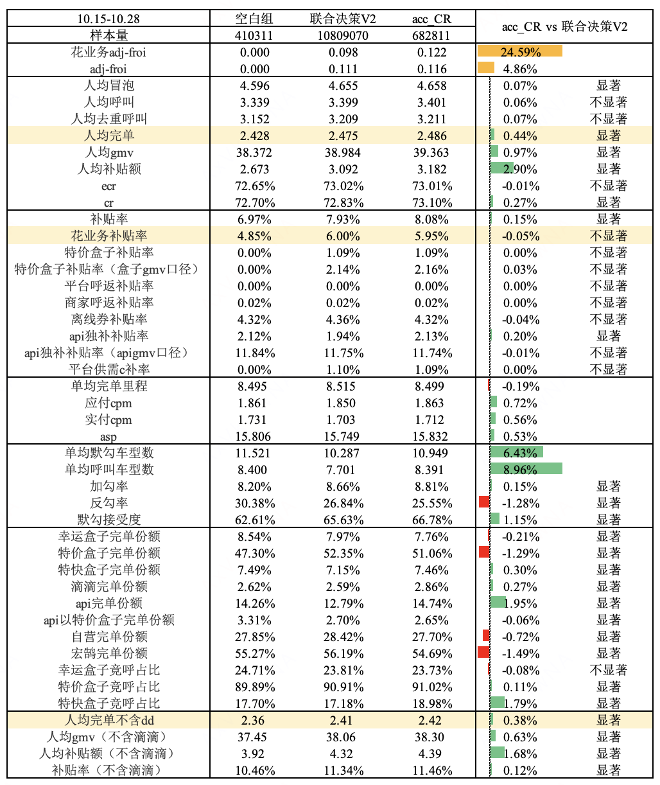

acc_CR vs 联合决策V2，花业务补贴率少花0.05pp情况下，实验结论如下：

- 主要结论：<u>人均完单显著**+0.44%\]**，花业务adj-froi **+24.6%**</u>

- 交易漏斗：人均冒泡、人均呼叫、人均去重呼叫微涨（+0.06%），人均GMV显著+0.97%，ecr不显著-0.01pp，**cr显著+0.27pp**

- 乘客体验：**默勾接受度显著+1.15pp**，反勾率显著-1.28pp

- 订单结构：单均完单里程-0.19%，实付cpm+0.56pp

- 品类份额：**特价盒子完单份额显著-1.29pp**，特快盒子完单份额显著+0.3pp，滴滴完单份额显著+0.27pp，**api完单份额显著+1.95pp**

### 4.3 cr值准分析

分析口径
- 分析时间范围：10.15-10.21

- 城市：V3实验城市

- 订单范围：联合决策V2的呼叫，去除未应答、乘客前取消、取消时间<30s的订单

- 幸运盒子输出值：acc_CR模型在「真实发放折扣」下的特价盒子logits输出 \* 0.9

左图为预测acc_AR与真实AR的对比，右图为为10分钟 X 「周中｜周五｜周六日」的真实ar、真实cr、预测cr，结论如下：

- acc_AR模型值准性较差，相比真实应答率，模型预测的acc_AR偏高，且无法反应出供需变化

- acc_CR模型考虑了乘客取消，在周中、周五、周末的值准性均非常好，且能够反映出供需变化，即高峰预测CR低，平峰预测CR高

| 预测acc_AR vs 真AR -from祖尧   | 周一-周四   | 周五   | 周末   |
| --- | --- | --- | --- |
| 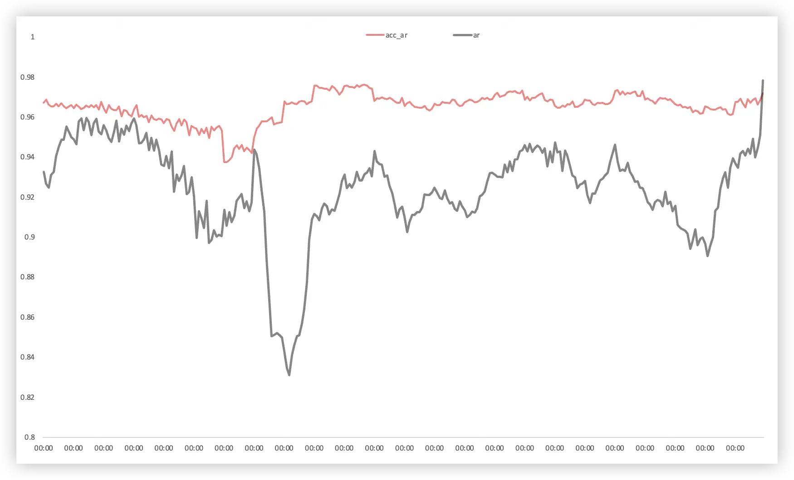   | 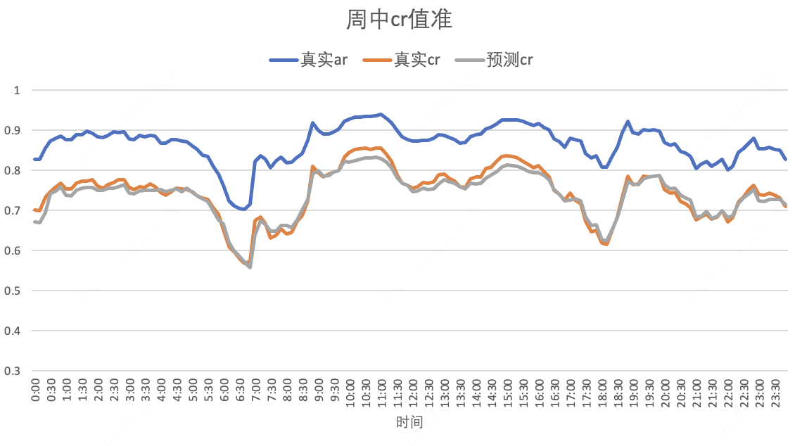   | 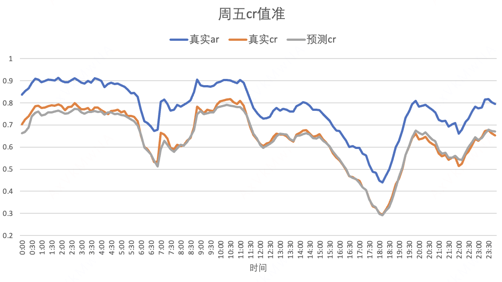   | 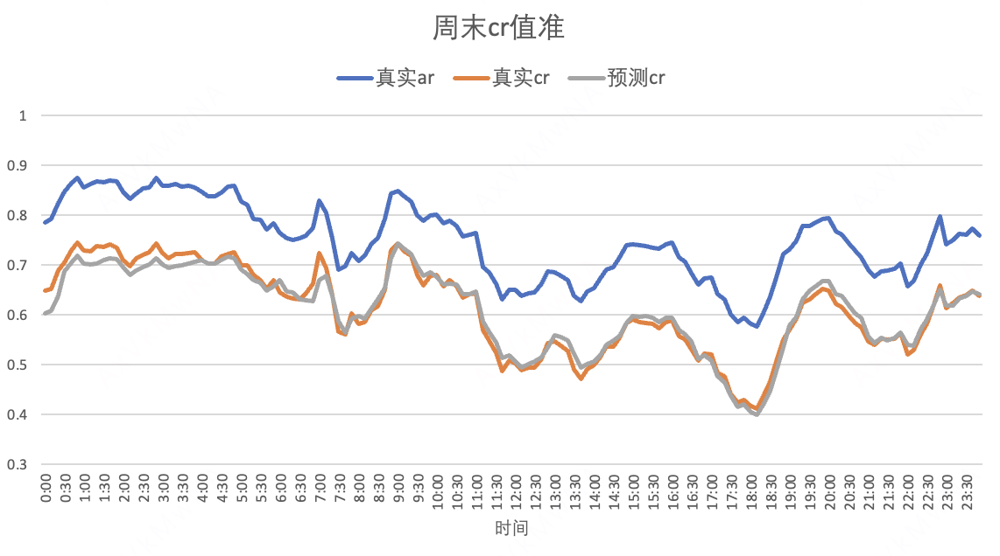   |

### 4.4 默勾分析

此处想探究CR值准性好，对默勾及CR的影响，可以观察到以下现象：

- 以周五晚高峰为例，由于acc_CR模型能够感知到成交率非常低，因此相比于联合决策V2，acc_CR组会倾向于在默勾时多勾，提升平均呼叫车型数，从而提升晚高峰CR

- 以周五早高峰为例，由于acc_CR模型能够感知到成交率略降，因此相比于联合决策V2，acc_CR组在会倾向于在默勾时少勾，提高默勾接受度的同时，维持平均呼叫车型数、CR不变。

因此可以得到以下结论：

- 由于acc_CR模型值准性较好，默勾更准，可以在CR略低时少勾提升默勾接受度，在CR极低时多勾提升整体CR

|    | 周中   | 周五   | 周末   |
| --- | --- | --- | --- |
| 真实CR对比   | 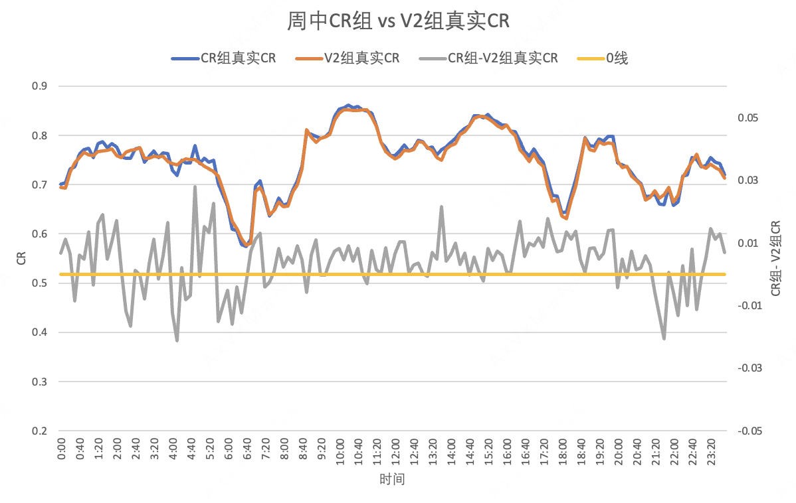   | 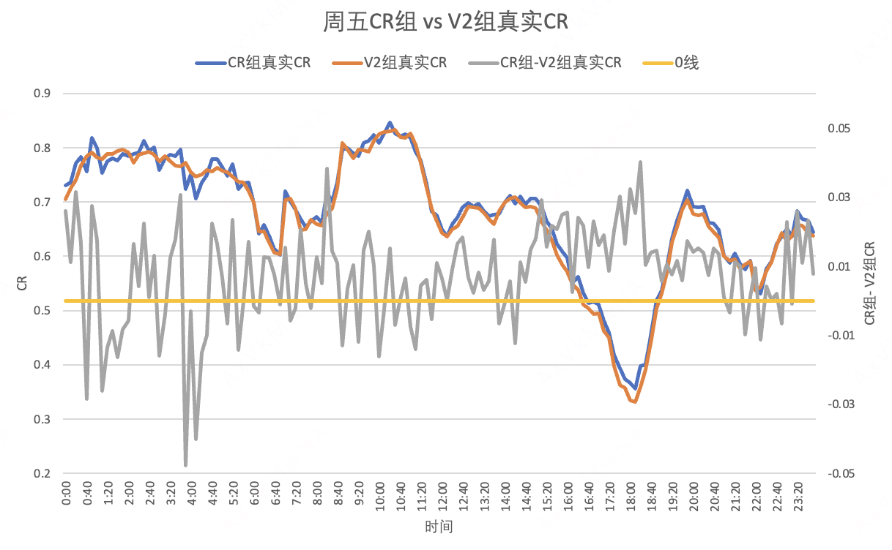   | 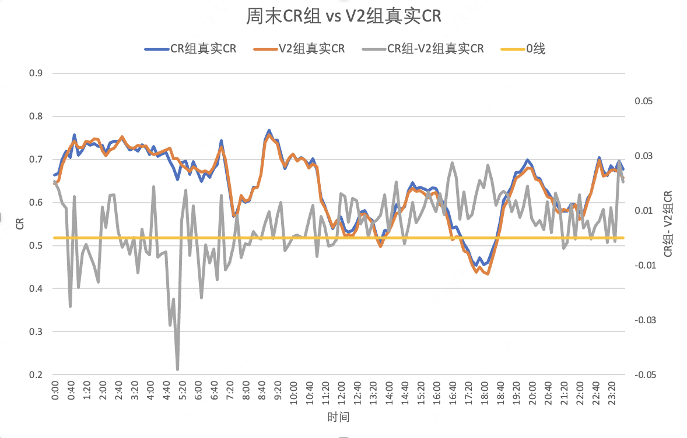   |
| 车型数     | 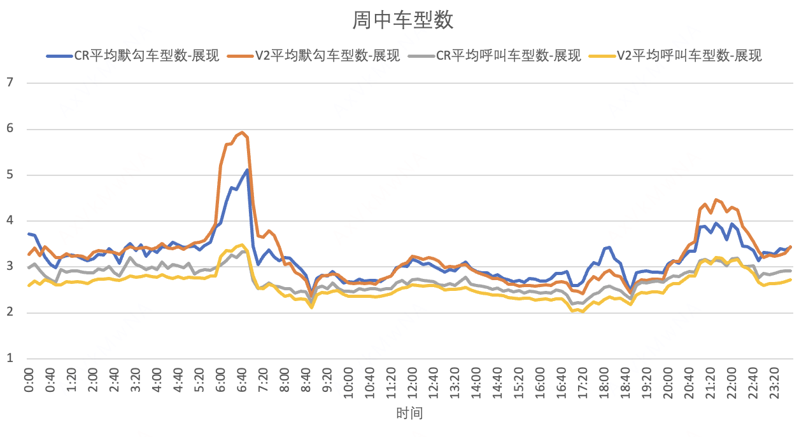   | 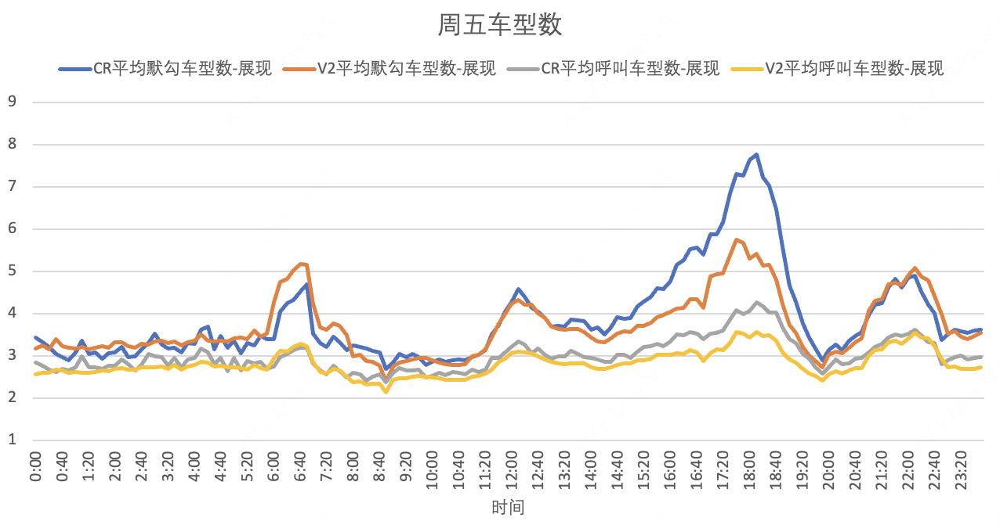   | 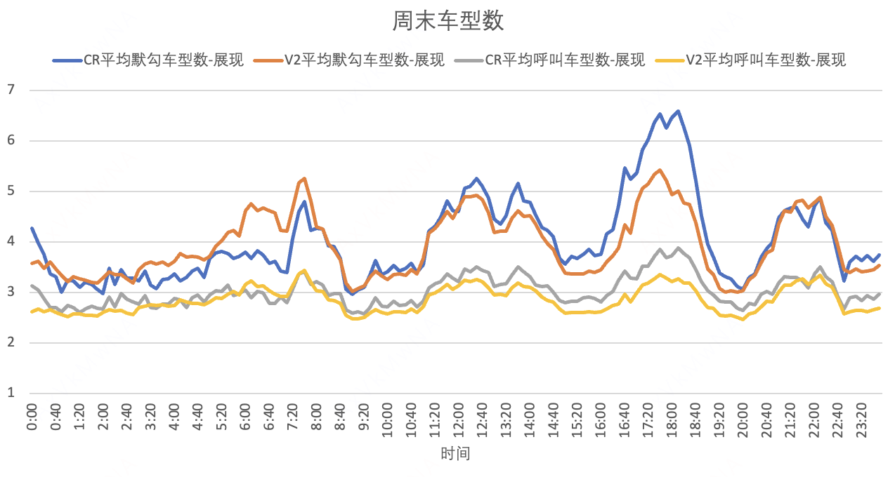   |
| 默勾接受度   | 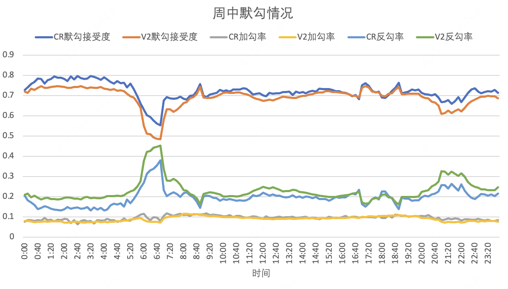   | 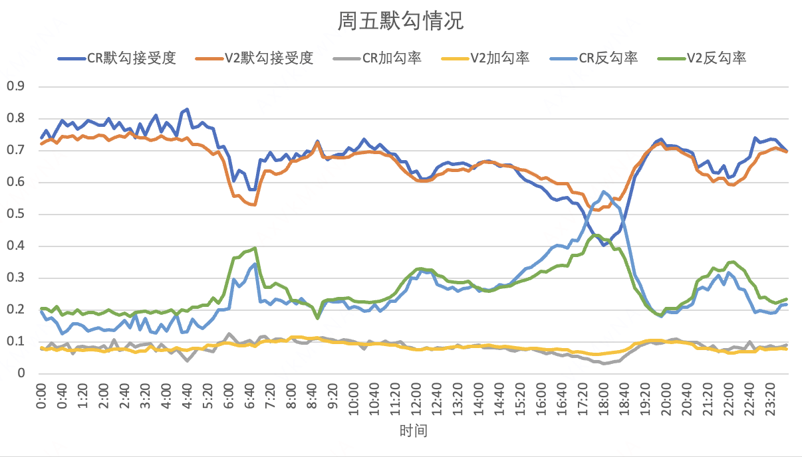   | 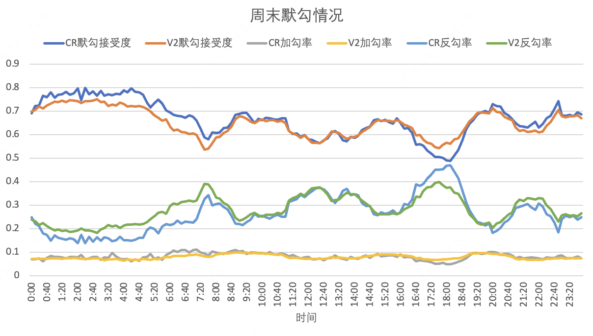   |

### 4.5 单调性分析

此处想要探究是否应该在模型呼叫完单贡献输出中，添加品类间的单调性约束。

从商家、乘客视角分别考虑，品类间的排序不同，具体如下：

- 从商家视角考虑，基于商家在「特价盒子、盒子外、特快盒子」下的应付价格、成交能力排序，商家在不同品类下对呼叫完单的贡献排序应该为「特快盒子 > 盒子外 > 特价盒子」。

- 从乘客角度考虑，对于价敏用户，实付越低，成交率越高，即「特价盒子 > 盒子外 > 特快盒子」；对于时敏用户，应答越快，成交率越高，排序应该为「特快盒子 > 盒子外 > 特价盒子」

从模型的实际输出结果看，只有75.28%的呼叫商家在不同品类下对呼叫完单的排序满足「特快盒子 > 盒子外 > 特价盒子」，因此模型中未强制添加品类间的单调性约束。

| 单调性   | 呼叫维度单调比例   |
| --- | --- |
| 特快盒子 &gt; 盒子外   | 75.95%   |
| 特快盒子 &gt; 特价盒子   | 86.16%   |
| 盒子外 &gt; 特价盒子   | 92.58%   |
| 特快盒子 &gt; 盒子外 &gt; 特价盒子   | 75.28%   |

## 五、后续规划

1. 确定做：随联合决策V3一起推全

2. 不确定做：

	1. 特征工程：引入摇摆人群离线+实时特征，引入分品类司机愿接开关实时特征

	2. 模型结构优化：尝试多任务模型、Loss权重调优、uplift模型等

	3. 分时间片设定acc_CR阈值

## 六、引用和鸣谢

感谢国华、门畅老师的全程指导与分析建议

感谢工程张聪、昕昊同学耐心且全面的支持，为模型上线提供保障

感谢所有价格策略同学的问题解答

## 七、附录

- [【LR25003】平台补贴与流量分发联合决策V2](https://cooper.didichuxing.com/knowledge/2199610335356/2204226054240)

- [联合决策acc_CR模型迭代策略方案](https://cooper.didichuxing.com/knowledge/2199610335356/2204114677167)

## 八、推全情况与现状追踪

推全情况：推全acc_CR模型，大盘完单+0.82%，其中TOP城市70% 完单+0.44%，剩余城市30% 完单+1.71%

现状追踪（2026-06-12）：是最新模型
