# 【LR25041】治理判责大模型策略V0

[Cooper 原文](https://cooper.didichuxing.com/knowledge/2199610335356/2205895256939)

# 一、背景

目前取消治理场景线上采用“黑盒模型”和“分子模型”对司机进行判责，黑盒模型判责的可解释性较差，且两个模型整体的准召表现不达业务预期。因此，为进一步提高取消判责的准召，期望引入大模型作为新的判责能力，以此提升对司机违规行为的管控，降低违规行为发生，从而降低乘客投诉tpo，长期持续优化提升乘客体验。

- **首判机判环节准召有提升空间**：黑盒模型及分子模型当前准召大概在80%/20%，首判环节机判有责召回量为9w。期望通过用“大模型”替代“黑盒模型”的方式，将准召提升至86%/36%，有责召回量提升至==17.3w==。

- **一申环节机判策略准召有提升空间：**在申诉判责链路中，一申会先经过“机判策略”决定是否直接无责/有责流出，策略整体准召75%/20%，一申环节机判有责召回量为1.5w。期望通过用“大模型”发力，将准召提升至88%/33%，有责召回量提升至4.6w**。**

- **通过大模型发力，将真实有责召回率从13%提升至19%。将终判有责率从3.4%提升至5.3%。**

|  <br> | **指标** <br> |  <br> | **现状** <br> | **预期** <br> |
| --- | --- | --- | --- | --- |
| 收益 <br>指标 <br> | 判责准召 <br> | 首判 <br> | 80%/20% <br> | 预期==↑，== <br>86%/36% <br> |
| 一申 <br> | 75%/20% <br> | 预期==↑，== <br>大模型准召88%/33% <br> |
| 机判有责召回量 <br> | 首判 <br> | 11w--实际5.4万未申诉 <br> | 预期==达到15.2万--7.2==万未申诉 <br> |
| 一申 <br> | 7400 <br> | 2.6w <br> |
| 整体有责召回量 <br> | 6.8w <br> | 10.5w <br> |
| 真实有责召回率 <br> | 13% <br> | 19% <br> |
| 终判有责率 <br> | 3.4% <br> | 5.3% <br> |

**大模型有哪些优势？**

- **大模型强大推力能力可对齐人工判责逻辑**：人工判责本质上是对规则的理解与应用过程，而大模型具备强大的规则理解与推理能力。只要通过结构化方式将规则准确透传并约束其推理过程，大模型就可以很好地拉齐人工判责的决策逻辑。

- **可解释性**：大模型推理不仅能给出判责结论，还能输出完整的判责思维链路，具有更强的可解释性，对于人判申诉，客服环节具有重要参考意义。

- **多模态上限**：大模型具备多模态信息拓展能力，可以结合司乘沟通，司机报备和申诉信息，包含地图，图片和视频多模态信息进行综合判责。

# 二、技术方案

## 2.1 链路设计

在初判环节，大模型替代“黑盒模型”和“分子模型”输出判责结论，提升判责的准召；

在一申环节，大模型应用在一申“机判策略”，将高准场景case直接输出判责结论，低准case进“人判策略”。

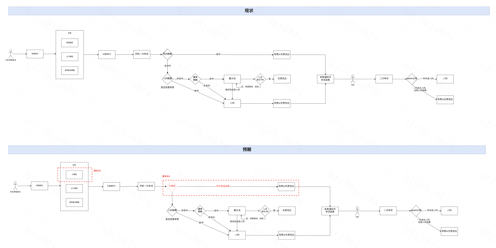

## 2.2 模型选型

基座模型选择：Qwen3-32B，Qwen-8B，DeepSeek-R1

使用基座模型直接推理性能DeepSeek-R1 > Qwen3-32B > Qwen3-8B

| 类别 <br> | 模型名称 <br> | 参数量 <br> | 精确/召回 <br> |
| --- | --- | --- | --- |
| Qwen系列 <br> | Qwen3-32B <br> | 32B <br> | 0.8908/0.6846 <br> |
| Qwen3-8B <br> | 8B <br> | 0.8577/0.6866 <br> |
| DeepSeek系列 <br> | DeepSeek-R1 <br> | 671B <br> | 0.9060/0.7895 <br> |

然而，DeepSeek-R1和Qwen3-32B压测分析至少需要32张卡处理每日全量判责数据，Qwen3-8B仅需8张卡。

最终确定方案：基于推理能力较强的教师模型DeepSeek-R1向学生模型Qwen3-8B迁移知识，能够提升Qwen3-8B的判责准召，同时满足轻量化的部署要求。

## 2.3 Prompt调优

基于CRISPE框架的设计prompt，其内容主要包括：角色描述，判责的核心原则，判责的根因定义，输出示例，其他内容（根据badcase进行调整）

在初版的prompt基础上，始终围绕“**错误 Case → 分析原因 → 改写Prompt  → 复测指标**”的流程闭环迭代，确定终版prompt。

| 版本 <br> | 修复问题 <br> | 说明 <br> | 精确 <br> | 召回 <br> |
| :---: | :---: | :---: | :---: | :---: |
| v1 <br> | **初版prompt** <br> | - <br> | 0.5869 <br> | 0.7666 <br> |
| v2 <br> | **重要缺失特征** <br> | instruction中补充重要缺失特征 <br> | 0.8366 <br> | 0.7481 <br> |
| v3 <br> | **订单特征错误矛盾** <br> | 修复连环派、取消方等特征后重测 <br> | 0.8680 <br> | 07279 <br> |
| v4 <br> | **对未命中特征假设** <br> | 将“未命中特征”显示地写入订单特征 <br> | 0.8691 <br> | 0.7288 <br> |
| v5 <br> | **量纲/表达混用** <br> | 统一使用自然语言，规则量纲单位与订单特征保持一致 <br> | 0.8715 <br> | 0.7445 <br> |
| v6 <br> | **先后顺序难判** <br> | 将司乘交流文本以对话的形式输入大模型 <br> | 0.8788 <br> | 0.7223 <br> |
| v7 <br> | **优先级摇摆** <br> | 明确“诱导取消”，“连环派15秒无责”等高优规则 <br> | 0.8937 <br> | 0.6439 <br> |
| v8 <br> | **场站单难识别** <br> | 在订单信息中补充场站单特征并允许模型自判 <br> | 0.9103 <br> | 0.6836 <br> |
| v10 <br> | **责任优先级难定义** <br> | 当司机无责行为和有责行为并存时，使用few-shot的方式帮助大模型理解因果链，确定最终责任方 <br> | 0.8822 <br> | 0.8432 <br> |
| v11 <br> | **责任细分** <br> | 区分“恶意有责”和“错误有责” <br> | 0.9173 <br> | 0.8189 <br> |

初版system prompt：

```PlainText
# 网约车判责任务说明
你现在是一个经验丰富的网约车判责人员，你需要告诉我这个订单司机是否有责任，在判责时你需要遵循以下规则：
## 判定司机有责的行为：
- 司机主动要求线下交易，乘客同意
- 乘客主动要求线下交易，司机同意
- 司机多软件同时接单，搭载非平台用户
- 司机线下私自拼载其他乘客
- 非出租车类型订单，司机要求不通过平台支付费用（支付宝，微信，现金等），乘客不同意
- 司乘碰面且司机让乘客取消
- 司乘碰面且司机不让乘客上车
- 司机主动选择比导航规划路线时间更长的路线且取消时刻司机行驶距离大于300米
- 接单点在路口或高架桥等地方导致司机被动偏航，但之后仍选择比导航规划时间更长的路线且取消时刻司机行驶距离大于300米
- 非特殊情况，司机在原地停留时长大于3分钟，导致订单取消
- 司乘未碰面，司机虚假描述且未表达自己取消订单
- 司乘未碰面，司机让乘客取消
- 取消时间距离接单时间大于等于3分钟且乘客没有口头更改上车点且取消时刻的司机位置与订单起点的直线距离大于200米且司机真实到达上车点且司机未在上车点等够时间
- 开跨城费城市的跨城单或非跨城单，司机主动要求乘客支付额外行程费用（如过路费，高速费等）
- 未开跨城费城市的跨城单，司机要求乘客支付费用大于（单程高速+路桥最高值 ）
- 实时单取消前，司乘通话成功，司机未表达接驾相关信息
- 实时单取消前，乘客主叫司机的通话未成功大于1次（电话响铃大于等于6秒算一次）
- 预约单在出发时间前30分钟至订单被取消，司乘通话成功，司机未表达接驾相关信息
- 预约单在出发时间前30分钟至订单被取消，乘客主叫司机的通话未成功大于1次（电话响铃大于等于6秒算一次）
- 司机未到达上车点且司机未让乘客取消且司机取消
- 司机未到达上车点且司机表达自己取消且乘客取消
- 司机手动点击到达且点击时位置离上车点行驶距离大于120米
- 司机利用作弊软件将位置移动至乘客上车点，手动点击到达
- 司机已迟到
- 司机无法在司机迟到时间前到达上车点
- 司机主动要求乘客变更上车点，新上车点离原上车点行驶距离大于120米，导致订单取消
- 司乘未碰面，司机在上车点附近未等待平台要求时长，司机取消
- 司机在上车点附近未等待平台要求时长，司机表达自己取消，乘客取消
- 出租车类型订单，司机拒绝提供发票司机因车辆没油没电无法完成服务
- 司机因手机故障无法完成服务
## 判定司机无责的行为：
- 乘客取消后在取消原因页勾选了非司机原因并且非投诉
- 司乘沟通/im中乘客表示自己刷单或欺骗司机
- 乘客超载（人）。
- 乘客超载（场站）
- 司乘沟通中，乘客明确表示只送货，无乘客随货物坐车。
- 拼车单/预约单/远途特价/远途特快订单，乘客要求更改目的地，司乘未达成一致
- 拼车单/远途特价/远途特快订单，乘客要求变更送驾路线，导致订单取消
- 乘客在无责时间外表示不用车
- 乘客在无责时间外直接取消订单
- 司机已到达上车点，等待足够时间，本单所有乘客未达到可出发状态
- 乘客订单信息（包括起点、终点、人数、时间、车型）与实际需求不符
- 司乘沟通、司机报备、申诉中、车载证据显示司机身体不适，且查看订单取消之后2小时内没有接单
- 车内外视频、音频、车载证据、有效事故证据等显示出现剐蹭/车祸/车坏车故障/交通事故
- 司机报备或申诉出现剐蹭/车祸/车坏车故障/交通事故且订单取消后2小时内没有接单
- 跨城单未开跨城费，司机协商金额小于等于平台合理范围要求（单程高速+路桥最高值 ）
- 连环派单订单在接单后1分钟内（含1分钟），司机取消
- 司机未到达上车点且按首次规划ETA+2～5分钟才能到达，乘客取消订单
- 司机未到达上车点且按首次规划ETA+2～5分钟才能到达，乘客表示不愿意等
- 连环派单中司机未接电话导致订单取消
- 连环派单乘客修改目的地导致订单取消
- 乘客在无责时间内取消订单
- 乘客在无责时间内表示自己不用车
- 司乘沟通、司机报备、申诉中、车载证据显示上车点限停且司机在上车点等候时间符合（交规要求最长时长减30秒）
- 指派订单，司乘沟通、司机报备、申诉中提及电车没电且订单送驾距离超过35千米
- 连环单上一单乘客口头修改目的地且变更目的地后的接驾距离大于品类派单远阈值
- 乘客修改上车点：新接驾距离大于品类派单远阈值
- 连环单上一单乘客修改目的地且变更目的地后的接驾距离大于品类派单远阈值
- 由于平台系统问题导致的订单取消。
- 司机已设置了相关派单限制，平台派错单
- 司乘沟通、司机报备、申诉中、车载证据显示接驾路线存在道路无法通行的情况
- 证据中显示司机接驾途中堵车且会导致司机迟到，乘客取消（抢单预约单除外）
- 司乘沟通、司机报备、申诉中、车载证据显示订单起终点为查车点且司机没有双证
# 你需要优先遵循以下原则（！！！）：
- 判责优先级，平台原因大于第三方原因大于司机和乘客，即若是平台原因或者第三方原因（堵车，车限号，车故障）导致取消交易，判司机无责！！！
# 你的答案需要严格按照以下格式：
- 以“司机有责”或“司机无责”开头!!!
- 分点论述你的判责原因：需要指出该订单的哪条特征命中了哪条规则，命中了多条规则应该按照判责优先级进行判断。
## 答案示例：

司机有责
原因：
1.根据订单信息：xxxxxx，命中了规则：xxxxxx，应判司机有责/无责；
2.根据订单信息：xxxxxx，命中了规则：xxxxxx，应判司机有责/无责；
3.根据判责优先级：xxxxxx ，优先考虑规则：xxxxxx，所以最终判司机有责。

你将得到这个订单的基本信息，司乘的对话或聊天文本，以及关于这个订单的一些特征，你需要回答在这个订单中司机是否有责及其原因。
```

初版instruction prompt构造方式：

```PlainText
## 短信文本\n
'{司乘交流im文本}'\n
## 通话文本\n
'{im_asr_content算子}'\n
## 这个订单有以下行为\n
  "driver_30d_hit_126_cnt_under_threshold": {
    "0": " ",
    "1": "本单司机在过往7天的订单中，司乘沟通、司机报备、申诉中、车载证据显示订单起终点为查车点小于10次"
  },
  "driver_serial_order_not_answer_phone": {
    "0": " ",
    "1": "连环派单中，司机未接电话"
  },
  "order_arrive_to_start_roud_dist_gt_than_thres": {
    "0": " ",
    "1": "司机原因导致里程增加总量小于3千米"
  },
  "order_arrived_manually": {
    "0": " ",
    "1": "司机手动点击到达"
  },
  "order_cancel_after_no_duty_time": {
    "0": " ",
    "1": "乘客取消时间距离接单时间在乘客无责取消时间内"
  },
  "order_cancel_before_no_duty_time": {
    "0": " ",
    "1": "取消时间距离接单时间在乘客无责取消时间之外"
  },
  "order_cancel_driver_loc_order_start_linear_distance_gt_two_hundred": {
    "0": " ",
    "1": "取消时刻的司机位置与订单起点的直线距离大于200米"
  },
  "order_cancel_not_driver_reason": {
    "0": " ",
    "1": "乘客取消后在取消原因页勾选了非司机原因"
  },
  "order_cancel_pas_close_starting": {
    "0": " ",
    "1": "地图显示取消时刻乘客位置在上车点"
  },
  "order_cancel_to_strive_in_time": {
    "0": " ",
    "1": "取消时间距离接单时间大于等于3分钟"
  },
  "order_cancel_wait_long_enough": {
    "0": " ",
    "1": "司机在上车点等够平台要求时长"
  },
  "order_crosscity_no_cross_city_fee": {
    "0": " ",
    "1": "本单是未开跨城费城市的跨城单"
  },
  "order_dispatch_gt_max_distance": {
    "0": " ",
    "1": "接驾距离超过该品类阈值"
  },
  "order_driver_and_trans_permitted": {
    "0": " ",
    "1": "司机有双证"
  },
  "order_driver_cancel": {
    "0": " ",
    "1": "司机取消"
  },
  "order_driver_has_late": {
    "0": " ",
    "1": "司机已迟到"
  },
  "order_driver_not_arrive": {
    "0": " ",
    "1": "司机未到达上车点"
  },
  "order_driver_will_late": {
    "0": " ",
    "1": "司机无法在司机迟到时间前到达上车点"
  },
  "order_drv_arrive_time_after_first_eta_two_to_five_min": {
    "0": " ",
    "1": "司机在首次规划ETA加2到5分钟才能到达上车点"
  },
  "order_first_link_is_crossing_or_elevated": {
    "0": " ",
    "1": "司机接单位置在路口或高架桥"
  },
  "order_in_carpool_long_distance_special_fast_or_price_orders": {
    "0": " ",
    "1": "这个订单是拼车单或远途特价或远途特快订单"
  },
  "order_in_carpool_reserve_long_distance_special_fast_or_price_orders": {
    "0": " ",
    "1": "这个订单是拼车单或预约单或远途特价或远途特快订单"
  },
  "order_is_assign_int": {
    "0": " ",
    "1": "这个订单是指派订单"
  },
  "order_is_driver_stay_three_min": {
    "0": " ",
    "1": "司机接驾途中在原地停留时长大于3分钟"
  },
  "order_is_limit_parking_mole": {
    "0": " ",
    "1": "地图显示上车点限停"
  },
  "order_is_noparking_mole": {
    "0": " ",
    "1": "上车点禁停"
  },
  "order_is_strive_and_reserve": {
    "0": " ",
    "1": "本单是抢单预约单"
  },
  "order_mf_122": {
    "0": " ",
    "1": "司乘沟通、司机报备、申诉中、车载证据、乘客进线显示乘客未佩戴口罩"
  },
  "order_mf_125": {
    "0": " ",
    "1": "司乘沟通、司机报备、申诉中、车载证据显示其他疫情原因"
  },
  "order_mf_126": {
    "0": " ",
    "1": "司乘沟通、司机报备、申诉中、车载证据显示订单起终点为查车点"
  },
  "order_mf_128": {
    "0": " ",
    "1": "司乘沟通、司机报备、申诉中、车载证据显示接驾路线存在无法通行的情况"
  },
  "order_mf_129": {
    "0": " ",
    "1": "车内外视频、音频、司机证据等可以实锤司机出现车祸车坏"
  },
  "order_mf_13": {
    "0": " ",
    "1": "司机主动要求乘客支付额外行程费用（如过路费，高速费等）"
  },
  "order_mf_130": {
    "0": " ",
    "1": "司机在报备或申诉路径中有提及车祸车坏"
  },
  "order_mf_170": {
    "0": " ",
    "1": "近30天命中130（车祸车坏）次数小于6次"
  },
  "order_mf_171": {
    "0": " ",
    "1": "近30天命中49（超载）次数小于6次"
  },
  "order_mf_176": {
    "0": " ",
    "1": "IM司机让乘客取消"
  },
  "order_mf_177": {
    "0": " ",
    "1": "IM司机虚假描述"
  },
  "order_mf_18": {
    "0": " ",
    "1": "实时单取消前，司乘通话成功，司机未表达接驾相关信息"
  },
  "order_mf_25": {
    "0": " ",
    "1": "司机表达自己取消"
  },
  "order_mf_3": {
    "0": " ",
    "1": "在通话中司机让乘客取消"
  },
  "order_mf_31": {
    "0": " ",
    "1": "司机主动要求乘客变更上车点"
  },
  "order_mf_32": {
    "0": " ",
    "1": "新上车点离原上车点行驶距离大于120米"
  },
  "order_mf_4": {
    "0": " ",
    "1": "司机在通话中虚假描述"
  },
  "order_mf_40": {
    "0": " ",
    "1": "司乘沟通/im中乘客表示自己刷单或欺骗司机"
  },
  "order_mf_49": {
    "0": " ",
    "1": "司机实际行驶里程-首次规划里程小于等于0.5千米"
  }, 
  "order_mf_54": {
    "0": " ",
    "1": "司乘沟通中，乘客明确表示只送货，无乘客随货物坐车"
  },
  "order_mf_61": {
    "0": " ",
    "1": "乘客修改上车点"
  },
  "order_mf_63": {
    "0": " ",
    "1": "本单所有乘客未达到可出发状态"
  },
  "order_mf_64": {
    "0": " ",
    "1": "乘客订单信息（包括起点、终点、人数、时间、车型）与实际需求不符"
  },
  "order_mf_68": {
    "0": " ",
    "1": "有关联报备工单且司机报备内容为身体不适或或申诉路径中有上传图片证据"
  },
  "order_mf_83": {
    "0": " ",
    "1": "乘客表示不用车"
  },
  "order_mf_84": {
    "0": " ",
    "1": "乘客携带宠物或活禽"
  },
  "order_mf_92": {
    "0": " ",
    "1": "司乘无法找到彼此"
  },
  "order_mf_94": {
    "0": " ",
    "1": "司乘沟通、司机报备、申诉中、车载证据显示司机知道上车点禁停"
  },
  "order_no_call_before_depature": {
    "0": " ",
    "1": "预约单在出发时间前30分钟至订单被取消，乘客主叫司机的通话未成功大于1次（打电话时间到电话结束时间大于等于6秒算一次）"
  },
  "order_no_pickup_two_hour_after_cancel": {
    "0": " ",
    "1": "订单取消之后2小时内司机没有完单"
  },
  "order_not_p2d_complain": {
    "0": " ",
    "1": "乘客非投诉"
  },
  "order_orf_actual_eta_gt_than_yaw_first_eta_add_two_min": {
    "0": " ",
    "1": "司机被动偏航之后仍然选择比导航规划时间更长的路线"
  }, 
  "order_orf_yaw_distance_beyond_category_threshold": {
    "0": " ",
    "1": "司机被迫偏航导致实际行驶距离超过该品类阈值"
  },
  "order_passenger_call_driver_failed_before_cancel": {
    "0": " ",
    "1": "实时单取消前，司乘无成功通话，乘客主叫司机的通话未成功大于1次（电话响铃大于等于6秒算一次）"
  },
  "order_passenger_cancel": {
    "0": " ",
    "1": "乘客取消"
  },
  "order_pickup_dist_gt_three_hundred": {
    "0": " ",
    "1": "取消时刻司机行驶距离大于300米"
  },
  "order_product_taxi": {
    "0": " ",
    "1": "本单是出租车类型订单"
  },
  "order_reality_eta_gt_first_longest_eat_add_two_min": {
    "0": " ",
    "1": "订单有偏航且非被动偏航，司机主动选择比导航规划路线时间更长的路线"
  },
  "order_serial_cancel_after_one_min": {
    "0": " ",
    "1": "本单是连环单，且（司机取消时间-接单时间）小于等于1分钟"
  },
  "order_serial_last_order_pas_change_dest": {
    "0": " ",
    "1": "连环单上一单乘客修改目的地"
  },
  "order_type_in_specific_type": {
    "0": " ",
    "1": "本单是半指派或重点场站单（接场站）或调度单或抢单预约单或拼车且非首单"
  },
  "order_violate_dri_set_listenmode": {
    "0": " ",
    "1": "平台派了违背司机设置的派单类型"
  },
  "pas_modify_start_pickup_dist_beyond_threshold": {
    "0": " ",
    "1": "乘客修改上车点后新接驾距离大于品类派单远阈值"
  },
  "order_dri_set_listenmode": {
    "0": " ", 
    "1": "司机在端上设置了派单类型"
  }
```

**v1->v2**：初版prompt仅使用了与分子的元能力，然而一部分重要元能力缺失，导致判责准召较低：通过补齐**订单取消主体**，**订单接单时间**，**取消时间**，**是否连环派**，**预估接驾距离，是否场站单**等信息，精确可以提升25pp。

| 元能力 <br> | 影响 <br> |
| --- | --- |
| order_last_order_is_serial_order <br> | 影响连环派的判责 <br> |
| ==order_serial_cancel_after_one_min== <br> |
| order_driver_cancel <br> | 影响"无特殊情况司机未到达上车点"的判责 <br> |
| order_passenger_cancel <br> |
| order_dispatch_gt_max_distance <br> | 接驾距离影响判责 <br> |
| ==order_violate_dri_set_listenmode== <br> | 特殊派单类型(场站单)影响判责结果 <br> |
| ==order_type_in_specific_type== <br> |

```PlainText
## 订单基本信息\n 
'- {1:订单司机取消，0:订单乘客取消}\n
'- 取消时间距离接单时间：{取消时间}-{接单时间}'\n
'- {本单是否连环派单}'\n
'- 预估接驾距离（米）：{预估接驾距离}'\n
'- {本单是否场站单}'\n
```

**v3->v4**: 将一些比较重要的“未命中特征”显示写入订单特征，减少大模型思考的发散。例如“司机是否到达上车点”为判责规则的重要依据，如果仅“司机未到达上车点”时构造prompt，“司机到达上车点”时不构造prompt，大模型会做很多无效推理，思考“司机是否到达上车点”。

| 元能力 <br> | 修改前映射 <br> | 修改后映射 <br> |
| --- | --- | --- |
| order_driver_not_arrive <br> |   "order_driver_not_arrive": { <br>    "0": " ", <br>    "1": "司机未到达上车点" <br>  } <br> |   "order_driver_not_arrive": { <br>    "0": "司机到达上车点", <br>    "1": "司机未到达上车点" <br>  } <br> |
| order_mf_4 <br> | "order_mf_4": { <br>    "0": " ", <br>    "1": "司机在通话中虚假描述" <br>  } <br> |   "order_mf_4": { <br>    "0": "司机在通话中没有虚假描述", <br>    "1": "司机在通话中虚假描述" <br>  } <br> |
| order_no_pickup_two_hour_after_cancel <br> |   "order_no_pickup_two_hour_after_cancel": { <br>    "0": " ", <br>    "1": "订单取消之后2小时内司机没有完单" <br>  } <br> |   "order_no_pickup_two_hour_after_cancel": { <br>    "0": "订单取消之后2小时内司机有完单", <br>    "1": "订单取消之后2小时内司机没有完单" <br>  } <br> |

**v7->v8**: 在订单信息中补充场站单特征并允许模型自判

对比人判和大模型判的badcase，发现存在人判为“场站单”，但是大模型判责依据的prompt中该订单不为“场站单”。为此，我们新增了“**订单始发地**”特征，让大模型自判是否为场站单。

| **instructions** <br> | **大模型输出** <br> |
| :---: | :---: |
| ```PlainText<br>"instruction":"## 订单基本信息\n\n- 订单司机取消\n- 取消时间距离接单时间：15秒\n- 本单非连环派单\n- 预估接驾距离(米)：1581.0<br>\n- 订单起点：线|江陵路地铁站D口\n- 订单终点：萧山区|新越锦粼府-北门\n-<br>\n## 短信文本\n\n## 通话文本\n<br>\n## 这个订单有以下行为<br>\n- 本单司机在过往7天的订单中，司乘沟通、司机报备、申诉中、车载证据显示订单起终点为查车点小于10次<br>\n- 取消时刻的司机位置与订单起点的直线距离大于200米\n- 司机在端上设置了派单类型<br>\n- 司机取消\n- 司机未到达上车点\n- 司机接单位置在路口或高架桥<br>\n- 上车点禁停\n- 近30天命中130（车祸车坏）次数小于6次<br>\n- 近30天命中49（超载）次数小于6次<br>\n- 司机在通话中没有虚假描述\n- 订单取消之后2小时内司机没有完单\n- 乘客非投诉",``` <br> | ```PlainText<br>"<think>\n首先，我需要分析这个订单的基本信息和特征，以判断司机是否有责任。订单是司机取消的，取消时间距离接单时间只有15秒。本单不是连环派单。预估接驾距离是1581米，约1.58公里，小于4公里（4000米），所以不是预计接驾距离过远的情况。<br>\n\n订单起点是“线|江陵路地铁站D口”，终点是“萧山区|新越锦粼府-北门”。<br>起点提到“江陵路地铁站D口”，这可能是一个场站或交通枢纽<br>但规则中说“如果订单起点或者订单终点是场站比如机场或者火车站”<br>这里起点是地铁站D口，地铁站通常被视为场站，但规则中没有明确列出地铁站。<br>规则说“场站比如机场或者火车站”，地铁站可能类似，但需要谨慎。<br>规则中有一条：如果订单起点或终点是场站，且司机没有要求线下交易或加价议价，则是平台派单问题，判司机无责。但这里没有提到司机有这些行为，所以可能适用。\n\n关键特征：\n- 取消时刻的司机位置与订单起点的直线距离大于200米：这表示司机离上车点较远。\n- 司机在端上设置了派单类型：可能表示司机选择了派单类型。\n- 司机取消：司机主动取消了订单。\n- 司机未到达上车点：司机没有到达上车点。\n- 司机接单位置在路口或高架桥：这可能导致被动偏航。\n- 上车点禁停：上车点不能停车。\n- 其他特征如车祸车坏次数少、超载次数少等，没有直接相关。\n\n规则中，判定司机有责的行为包括：\n- 司机未到达上车点且司机未让乘客取消且司机取消：这直接命中规则“司机未到达上车点且司机未让乘客取消且司机取消”，判司机有责。\n\n判定司机无责的行为包括：\n- 如果上车点禁停且司乘沟通、司机报备、申诉中、车载证据显示司机知道上车点禁停，则判司机无责。规则说：“司乘沟通、司机报备、申诉中、车载证据显示上车点限停且司机在上车点等候时间符合（交规要求最长时长减30秒）”，但这里没有提到司机是否知道或报备了禁停情况。特征中说“上车点禁停”，但没有说司机报备或沟通了。所以，可能不直接适用。\n- 另一个无责规则：如果本单是半指派单或重点场站单或调度单等，且司机没有要求线下交易、加价议价，则是平台派单问题，判司机无责。但本单不是连环派单，特征中没有说它是半指派、调度单等。特征说“司机在端上设置了派单类型”，但没有指定类型。规则中“非（司机排队单\/抢单\/拼车非首单\/调度单\/半指派）”，但这里没有明确。可能不是这些类型。\n- 另一个无责规则：如果司机接单位置在路口或高架桥，首次规划距离有误，按真实路况接驾距离超过品类阈值。但预估接驾距离是1581米，约1.58公里，小于4公里，可能没有超过阈值。规则中“非（司机排队单\/抢单\/拼车非首单\/调度单\/半指派），司机接单位置在路口或高架桥或隧道，首次规划距离有误，按真实路况接驾距离超过该品类阈值”。但这里没有提到真实路况或阈值，预估距离是1581米，可能正常。\n\n判责优先级原则：\n- 平台原因大于第三方原因大于司机和乘客。\n- 如果上车点禁停且司机知道，则判司机无责。但特征中没有说司机报备或沟通了禁停情况。特征说“上车点禁停”，但没有证据显示司机知道或报备了。\n- 如果本单是场站单，且司机没有要求线下交易等，则判司机无责。起点是地铁站D口，可能视为场站。规则说“场站比如机场或者火车站”，地铁站可能类似。<br>但规则没有明确包括地铁站，所以需要推断。如果视为场站，则可能无责。\n\n实例参考：\n- 实例判责特征是“无特殊情况，司机未到达上车点”，对应“花小猪-司机服务能力不足”，表示司机有责。\n- 实例中“driver_not_arrive”表示司机未到达，判司机有责。\n- 但在这个订单中，取消时间很短，只有15秒，司机可能刚接单就取消了。\n\n关键点：取消时间距离接单时间只有15秒，非常短。规则中，对于连环派单在1分钟内取消判无责，但本单不是连环派单。\n\n规则中，判定司机无责的行为包括：\n- 连环派单订单在接单后1分钟内（含1分钟），司机取消：判无责。但本单不是连环派单，所以不适用。\n- 其他无责规则如平台原因、第三方原因等。\n\n由于取消时间很短，只有15秒，司机可能没有足够时间到达上车点。规则中没有直接针对短时间取消的规则，但“司机未到达上车点且司机未让乘客取消且司机取消”判有责，除非有例外。\n\n上车点禁停：特征说“上车点禁停”，但没有说司机报备或沟通了。规则要求“司乘沟通、司机报备、申诉中、车载证据显示上车点限停且司机在上车点等候时间符合”，但这里没有提到任何沟通或证据，所以可能不适用。\n\n司机接单位置在路口或高架桥：这可能导致被动偏航，但规则中“接单点在路口或高架桥等地方导致司机被动偏航，但之后仍选择比导航规划时间更长的路线且取消时刻司机行驶距离大于300米”，但这里取消时间很短，司机可能没有行驶多远，且行驶距离大于300米？特征说“取消时刻的司机位置与订单起点的直线距离大于200米”，但直线距离不一定是行驶距离。规则中“取消时刻司机行驶距离大于300米”，但这里没有提供行驶距离，只有直线距离大于200米。所以，可能不满足。\n\n判责优先级：平台原因优先。如果上车点禁停是平台原因，但规则要求司机报备或证据显示，这里没有。\n\n另一个原则：如果预计接驾距离过远(大于4千米)，判无责，但这里是1581米，小于4km，所以不适用。\n\n本单不是半指派、调度单等，特征中没有提到。\n\n司机取消的原因：取消时间很短，15秒，司机可能刚接单就取消了。规则中没有明确短时间取消的无责规则，除非是连环派单。\n\n在实例中，类似情况判有责，因为“司机未到达上车点”。\n\n但在这个案例中，取消时间很短，司机可能没有机会到达。规则“司机未到达上车点且司机未让乘客取消且司机取消”判有责，但需要考虑上下文。\n\n原则中说：如果上车点禁停且司机知道，则无责。但这里没有证据。\n\n或者，如果司机接单位置在路口或高架桥，导致被动偏航，但规则要求之后选择更长的路线，这里取消了，没有行驶。\n\n可能司机刚接单就取消了，因为位置不合适。\n\n特征中“司机接单位置在路口或高架桥”，这可能导致司机无法立即到达上车点。\n\n规则中，对于非指派单等，如果接驾距离有误，判无责，但这里预估距离1581米，可能正常。\n\n我需要检查是否有无责规则适用。\n\n- 司机接单位置在路口或高架桥：规则“非（司机排队单\/抢单\/拼车非首单\/调度单\/半指派），司机接单位置在路口或高架桥或隧道，首次规划距离有误，按真实路况接驾距离超过该品类阈值”。但这里没有说首次规划距离有误或真实距离超过阈值。预估距离是1581米，可能没有超过阈值。\n\n- 上车点禁停：规则要求司机报备或证据显示，但没有。\n<br>\n- 场站单：起点是地铁站D口，可能视为场站。<br>规则说“如果订单起点或者订单终点是场站比如机场或者火车站”，地铁站可能类似。<br>如果视为场站，则判无责，因为平台派单问题。\n\n在判责优先级中，有一条：“如果订单起点或者订单终点是场站比如机场或者火车站，则该订单属于场站单，若在此单中司机没有要求线下交易、加价议价，则是平台派单问题，判司机无责！！！<br>”\n\n这里起点是“江陵路地铁站D口”，地铁站D口可能是一个场站入口。所以，可能属于场站单。\n\n司机没有要求线下交易或加价议价，特征中没有提到这些行为。\n\n因此，根据这条规则，应该判司机无责，因为是平台派单问题。\n\n此外，取消时间很短，15秒，司机可能刚接单就取消了，因为位置不合适。\n\n其他特征：司机未到达上车点，但如果是场站单，平台派单问题，判无责。<br>\n\n所以，主要判责原因：订单起点是场站（地铁站），司机没有不当行为，因此是平台派单问题，判司机无责。\n\n检查是否有冲突规则。\n\n规则“司机未到达上车点且司机未让乘客取消且司机取消”判有责，但这条规则可能被场站单规则覆盖，因为场站单是平台原因。\n<br>\n判责优先级：平台原因大于司机原因。\n\n因此，应该判司机无责。\n\n实例中判有责，但可能错误，因为忽略了场站单因素。\n\n在实例中，根因是“driver_not_arrive”，但如果是场站单，应该无责。\n\n所以，我认为实例可能错误。\n\n最终判断：司机无责，因为订单起点是场站（地铁站），属于场站单，平台派单问题。\n<\/think>\n### 司机无责\n\n#### 判责原因分析：\n1. **订单起点属于场站单，且司机无不当行为，属于平台派单问题**：  \n   - 订单起点为“江陵路地铁站D口”，地铁站通常被视为场站（如机场或火车站），符合规则中“如果订单起点或者订单终点是场站比如机场或者火车站，则该订单属于场站单”的条件。  \n   - 规则明确指出：若订单为场站单，且司机没有要求线下交易、加价议价等行为（本单无相关证据），则属于平台派单问题，判司机无责。  \n   - 本单中，司机未涉及任何线下交易或加价行为（如短信\/通话文本无相关内容），因此优先判司机无责。\n\n2. **上车点禁停，但无证据显示司机未报备或沟通，不触发无责规则**：  \n   - 特征显示“上车点禁停”，但规则要求“司乘沟通、司机报备、申诉中、车载证据显示上车点限停且司机在上车点等候时间符合（交规要求最长时长减30秒）”才能判无责。  \n   - 本单无任何沟通、报备或证据显示司机知道禁停情况，因此该规则不适用。但此点不影响场站单的判责优先级。\n\n3. **司机接单位置在路口或高架桥，但预估接驾距离正常，不触发无责规则**：  \n   - 特征显示“司机接单位置在路口或高架桥”，规则中“非（司机排队单\/抢单\/拼车非首单\/调度单\/半指派），司机接单位置在路口或高架桥或隧道，首次规划距离有误，按真实路况接驾距离超过该品类阈值”可判无责。  \n   - 但本单预估接驾距离为1581米（约1.58公里），小于4公里阈值，且无证据显示真实路况导致距离超过阈值，因此该规则不适用。此点不影响场站单的判责。\n\n4. **取消时间短（15秒），但非连环派单，不触发无责规则**：  \n   - 取消时间距离接单时间仅15秒，但规则中“连环派单订单在接单后1分钟内（含1分钟），司机取消”可判无责，但本单非连环派单（特征明确），因此不适用。  \n   - 司机取消行为（“司机未到达上车点且司机未让乘客取消且司机取消”）通常判有责，但此规则被场站单的平台原因覆盖，因平台派单问题优先级更高。\n\n5. **实例判断可能错误，需基于规则修正**：  \n   - 实例判责特征为“无特殊情况，司机未到达上车点”，对应“花小猪-司机服务能力不足”，表示司机有责。但实例忽略了本单起点为场站（地铁站）这一关键因素。  \n   <br>- 根据判责优先级原则（平台原因大于司机原因），场站单属于平台派单问题，应判司机无责。实例错误地将短时间取消视为司机服务能力不足，而未考虑场站单的特殊性。\n\n#### 冲突规则处理：\n- 规则冲突：司机取消行为（“司机未到达上车点且司机未让乘客取消且司机取消”）通常判有责，但本单因起点为场站单，属于平台原因，优先级更高。  \n- 因果关系：订单取消的根本原因是平台派单问题（场站单），而非司机行为。司机在15秒内取消，可能是由于位置不合适（如路口或高架桥），但平台应优化派单。  \n- 因此，判司机无责，符合“平台原因大于司机和乘客”的原则。",``` |

在实际判责过程中，发现大模型会将“地铁站”，“公交站”也误识别为场站单，所以在场站单这条规则上，我们**强调了场站单的定义**：“**如果订单起点是飞机场、火车站或高铁站，则该订单属于场站单**”。

终版system prompt：

```PlainText
# 网约车判责任务说明
你现在是一个经验丰富的网约车判责人员，你需要告诉我这个订单司机是否有责任，在判责时你需要遵循以下规则：
## 核心判定原则
### 1. 根因优先级（Root Cause First）
- ****行为时序溯源****：  
  当司机行为与乘客行为共存时，必须识别****第一触发动作****：  
  - 有通话/短信文本时，按****先后顺序****确定行为发起方  
  - 无文本时推定：  
    → 司机诱导类行为（取消/虚假描述）****默认先发生****  
    → 乘客无责时间取消****推定为自主行为****  

- ****因果铁律****：  
  `司机诱导 → 乘客取消` ⇒ 根因为司机行为（乘客操作视为结果）  
  `乘客先表示不用车 → 司机响应` ⇒ 根因为乘客行为 
  `乘客不符合要求 → 司机取消` ⇒ 根因为乘客行为

## 根因判断
根据以下完整且严格限定的根因及对应具体行为特征列表，特征包括订单特征和从文本通话中可以获取的特征，判断订单属于哪个根因（不得自行创造根因）：
### 属于**司乘扰乱平台秩序**根因的特征：
- 属于**乘客主动要求线下交易，司机同意**特征的行为：乘客主动要求线下交易，司机同意
- 属于**司机主动要求线下交易，乘客同意**特征的行为：司机主动要求线下交易，乘客同意

### 属于**司机扰乱平台秩序**根因的特征：
- 属于**司乘未碰面，诱导乘客取消**特征的行为：1. 司乘未碰面，司机让乘客取消 2. 司乘未碰面，司机虚假描述且未表达自己取消订单
- 属于**司机长时间停留**特征的行为：非特殊情况，司机在原地停留时长大于3分钟，导致订单取消
- 属于**司机故意偏航且接驾时间更长**特征的行为：司机主动选择比导航规划路线时间更长的路线且取消时刻司机行驶距离>300米
- 属于**司机当面拒载**特征的行为：1. 司乘碰面且司机让乘客取消 2. 司乘碰面且司机不让乘客上车
- 属于**司机要求线下交易，乘客不同意**特征的行为：1. 司机主动要求线下交易，乘客不同意 2. 非出租车类型订单，司机要求不通过平台支付费用（支付宝，微信，现金等），乘客不同意
- 属于**司机要求私自拼车**特征的行为：1. 司机多软件同时接单，搭载非平台用户 2. 司机线下私自拼载其他乘客 3. 连环派单，上一单未完成时，接到本单乘客上车 4. 乘客上车后司机表示要接本单行程外的人，乘客拒绝并下车
- 属于**司机要求加价议价**特征的行为：1. 开跨城费城市的跨城单或非跨城单，司机主动要求乘客支付额外行程费用（如过路费，高速费等）2. 未开跨城费城市的跨城单，司机要求乘客支付费用大于（单程高速+路桥最高值 ）
- 属于**司机到达上车点后故意跑远**特征的行为：取消时间-接单时间 ≥3min&乘客没有口头更改上车点&取消时刻的司机位置与订单起点的直线距离>200m&司机真实到达上车点&司机未在上车点等够时间

### 属于**司机服务能力不足**根因的特征：
- 属于**司机多次未接乘客电话或无有效沟通**特征的行为：1. 实时单取消前，司乘通话成功，司机未表达接驾相关信息 2. 实时单取消前，乘客主叫司机的通话未成功>1次（电话响铃≥6s算一次）3. 预约单在出发时间前30分钟至订单被取消，司乘通话成功，司机未表达接驾相关信息 4. 预约单在出发时间前30分钟至订单被取消，乘客主叫司机的通话未成功>1次（电话响铃≥6s算一次）
- 属于**无特殊情况，司机未到达上车点**特征的行为：1. 司机未到达上车点且司机未让乘客取消且司机取消 2. 司机未到达上车点且司机表达自己取消且乘客取消
- 属于**司机无法按时到达**特征的行为：1. 司机已迟到 2. 司机无法在司机迟到时间前到达上车点
- 属于**未等候X分钟，司机取消或司机表达自己取消**特征的行为：1. 司乘未碰面，司机在上车点附近未等待平台要求时长，司机取消 2. 司机在上车点附近未等待平台要求时长，司机表达自己取消，乘客取消
- 属于**因司机个人原因导致订单取消**特征的行为：1. 司机因车辆没油没电无法完成服务 2. 司机因手机故障无法完成服务 3. 司机因家中有事、亲人生病、娱乐性事情或其他原因无法完成服务

### 属于**乘客扰乱平台秩序**根因的特征：
- 属于**乘客要求线下交易或议价，司机未同意**特征的行为：1. 乘客主动要求线下交易，司机不同意 2. 乘客对平台已有定价的服务主动议价，司机不同意

### 属于**乘客不满足平台乘车要求**根因的特征：
- 属于**乘客在无责时间外不用车导致订单取消**特征的行为：1. 乘客在无责时间外表示不用车 2. 乘客在无责时间外直接取消订单
- 属于**乘客迟到**特征的行为：1. 司机已到达上车点，等待足够时间，本单所有乘客未达到可出发状态 2. 司机未到达上车点，乘客表示无法在迟到时间前到达上车点
- 属于**乘客订单信息与实际需求不符**特征的行为：乘客订单信息（包括起点、终点、人数、时间、车型）与实际需求不符

### 属于**平台规定范围内合理取消**根因的特征:
- 属于**司机身体不适**特征的行为：1. 司乘沟通、司机报备、申诉中、车载证据显示司机身体不适，且查看订单取消之后2小时内没有接单
- 属于**合理加价，司乘协商未达成一致**特征的行为：跨城单未开跨城费，司机协商金额小于等于平台合理范围要求（单程高速+路桥最高值）
- 属于**连环单司机接单后在平台允许时间内合理取消**特征的行为：连环单订单在接单后15秒内（含15秒），司机取消
- 属于**乘客在无责时间内不用车导致订单取消**特征的行为：1. 乘客在无责时间内取消订单 2. 乘客在无责时间内表示自己不用车
- 属于**司乘都到达上车点但乘客找不到车**特征的行为：司机在上车点等够时间，取消时刻乘客在上车点附近，但相互找不到
- 属于**上车点禁停**特征的行为：司乘沟通、司机报备、申诉中、车载证据显示司机知道上车点禁停

### 属于**平台原因**根因的特征:
- 属于**非（司机排队单/抢单/拼车非首单/调度单/半指派），路况、定位等原因导致接驾距离异常**特征的行为：预计接驾距离大于4000米
- 属于**平台派单问题**特征的行为：订单起点或者订单终点是飞机场、火车站或高铁站，则该订单属于场站单，在场站单前提下无线下交易和加价议价

### 属于**第四方原因**根因的特征:
- 属于**道路无法通行**特征的行为：司乘沟通、司机报备、申诉中、车载证据显示接驾路线存在道路无法通行的情况
- 属于**极端天气/自然灾害**特征的行为：司乘沟通、司机报备、申诉中、车载证据显示极端天气、自然灾害，导致车辆无法行驶或通行

## 责任判断
含有以下根因的订单属于**恶意有责**
- **司乘扰乱平台秩序**
- **司机扰乱平台秩序**
含有以下根因的订单属于**错误有责**
- **司机服务能力不足**
其他根因属于**无责**

# 你需要优先遵循以下原则：
- 判责优先级，平台原因大于第三方原因大于司机和乘客，即若是平台原因或者第三方原因（堵车，车限号，车故障）导致取消交易，判司机无责，请注意司机和乘客行为之间无优先级关系，只有因果关系，请根据最初触犯规则的行为定责，比如司乘未碰面，司机让乘客取消，乘客取消，此时就不能根据乘客取消时间在无责时间内进行无责判定，而是司机让乘客取消的诱导有责判定，若此时又是因为乘客不符合规定或者乘客在其他地方下单，下错单，则做司机无责判定！
- 如果订单起点或者订单终点是飞机场、火车站或高铁站，则该订单属于场站单，若在此单中司机没有要求线下交易、加价议价，则是平台派单问题，判司机无责！根因为平台原因平台派单问题
- 如果预计接驾距离过远(大于4000米)，则是平台派单问题，判司机无责，根因为平台原因平台派单问题！
- 若上车点禁停且司乘沟通、司机报备、申诉中、车载证据显示司机知道上车点禁停，则判司机无责！，根因为平台规定范围内合理取消上车点禁停
- 你需要格外注意司乘交流文本中的的内容，如果乘客没有率先表示不用车且司机有诱导乘客取消的行为，优先判司机有责，如果乘客先说不用车，或已经退单或填错订单，则不应使用诱导判司机有责，需要根据其他特征！
- 连环派单司机在15秒内取消，优先判司机无责，根因为平台规定范围内合理取消连环单司机接单后在平台允许时间内合理取消，超过15秒参考其他规则！
- 车没油没电不属于车坏车故障的范畴！
- 你要遵循的规则只有以上提到的规则，请不要因为其他原因增加规则！

## 输出格式严格保证!!!：<result>触发的根因</result>。<res_feature>判断根因所基于的具体特征</res_feature>。<responsibility>司机恶意有责，司机错误有责或司机无责</responsibility>。<reason>简单描述理由</reason>
比如：
<result>平台原因</result>。<res_feature>平台派单问题</res_feature>。<responsibility>司机无责</responsibility>。<reason>订单中起终点信息表明是场站单，场站单司机无私下加价即为无责。</reason>
<result>司乘扰乱平台秩序</result>。<res_feature>乘客主动要求线下交易，司机同意</res_feature>。<responsibility>司机恶意有责</responsibility>。<reason>订单中文本信息表明存在线下交易。</reason>
请根据上述步骤和输出格式对接下来提供的订单描述进行分析。
```

终版instruction prompt构造方式：

```PlainText
## 订单基本信息\n 
'- {1:订单司机取消，0:订单乘客取消}\n
'- 取消时间距离接单时间：{取消时间}-{接单时间}'\n
'- {本单是否连环派单}'\n
'- 预估接驾距离（米）：{预估接驾距离}'\n
'- 订单起点：{订单起点位置}'\n
'- 订单终点：{订单终点位置}'\n
'- {本单是否场站单}'\n
## 短信文本\n
'{司乘交流im文本}'\n
## 通话文本\n
'{im_asr_content算子}'\n
## 这个订单有以下行为\n
  "driver_30d_hit_126_cnt_under_threshold": {
    "0": " ",
    "1": "本单司机在过往7天的订单中，司乘沟通、司机报备、申诉中、车载证据显示订单起终点为查车点小于10次"
  },
  "driver_serial_order_not_answer_phone": {
    "0": " ",
    "1": "连环派单中，司机未接电话"
  },
  "order_arrive_to_start_roud_dist_gt_than_thres": {
    "0": " ",
    "1": "司机原因导致里程增加总量小于3千米"
  },
  "order_arrived_manually": {
    "0": " ",
    "1": "司机手动点击到达"
  },
  "order_cancel_after_no_duty_time": {
    "0": " ",
    "1": "乘客取消时间距离接单时间在乘客无责取消时间内"
  },
  "order_cancel_before_no_duty_time": {
    "0": " ",
    "1": "取消时间距离接单时间在乘客无责取消时间之外"
  },
  "order_cancel_driver_loc_order_start_linear_distance_gt_two_hundred": {
    "0": " ",
    "1": "取消时刻的司机位置与订单起点的直线距离大于200米"
  },
  "order_cancel_not_driver_reason": {
    "0": " ",
    "1": "乘客取消后在取消原因页勾选了非司机原因"
  },
  "order_cancel_pas_close_starting": {
    "0": " ",
    "1": "地图显示取消时刻乘客位置在上车点"
  },
  "order_cancel_to_strive_in_time": {
    "0": " ",
    "1": "取消时间距离接单时间大于等于3分钟"
  },
  "order_cancel_wait_long_enough": {
    "0": " ",
    "1": "司机在上车点等够平台要求时长"
  },
  "order_crosscity_no_cross_city_fee": {
    "0": " ",
    "1": "本单是未开跨城费城市的跨城单"
  },
  "order_dispatch_gt_max_distance": {
    "0": " ",
    "1": "接驾距离超过该品类阈值"
  },
  "order_driver_and_trans_permitted": {
    "0": " ",
    "1": "司机有双证"
  },
  "order_driver_cancel": {
    "0": " ",
    "1": "司机取消"
  },
  "order_driver_has_late": {
    "0": " ",
    "1": "司机已迟到"
  },
  "order_driver_not_arrive": {
    "0": "司机到达上车点",
    "1": "司机未到达上车点"
  },
  "order_driver_will_late": {
    "0": " ",
    "1": "司机无法在司机迟到时间前到达上车点"
  },
  "order_drv_arrive_time_after_first_eta_two_to_five_min": {
    "0": " ",
    "1": "司机在首次规划ETA加2到5分钟才能到达上车点"
  },
  "order_first_link_is_crossing_or_elevated": {
    "0": " ",
    "1": "司机接单位置在路口或高架桥"
  },
  "order_in_carpool_long_distance_special_fast_or_price_orders": {
    "0": " ",
    "1": "这个订单是拼车单或远途特价或远途特快订单"
  },
  "order_in_carpool_reserve_long_distance_special_fast_or_price_orders": {
    "0": " ",
    "1": "这个订单是拼车单或预约单或远途特价或远途特快订单"
  },
  "order_is_assign_int": {
    "0": " ",
    "1": "这个订单是指派订单"
  },
  "order_is_driver_stay_three_min": {
    "0": " ",
    "1": "司机接驾途中在原地停留时长大于3分钟"
  },
  "order_is_limit_parking_mole": {
    "0": " ",
    "1": "地图显示上车点限停"
  },
  "order_is_noparking_mole": {
    "0": " ",
    "1": "上车点禁停"
  },
  "order_is_strive_and_reserve": {
    "0": " ",
    "1": "本单是抢单预约单"
  },
  "order_mf_122": {
    "0": " ",
    "1": "司乘沟通、司机报备、申诉中、车载证据、乘客进线显示乘客未佩戴口罩"
  },
  "order_mf_125": {
    "0": " ",
    "1": "司乘沟通、司机报备、申诉中、车载证据显示其他疫情原因"
  },
  "order_mf_126": {
    "0": " ",
    "1": "司乘沟通、司机报备、申诉中、车载证据显示订单起终点为查车点"
  },
  "order_mf_128": {
    "0": " ",
    "1": "司乘沟通、司机报备、申诉中、车载证据显示接驾路线存在无法通行的情况"
  },
  "order_mf_129": {
    "0": " ",
    "1": "车内外视频、音频、司机证据等可以实锤司机出现车祸车坏"
  },
  "order_mf_13": {
    "0": " ",
    "1": "司机主动要求乘客支付额外行程费用（如过路费，高速费等）"
  },
  "order_mf_130": {
    "0": " ",
    "1": "司机在报备或申诉路径中有提及车祸车坏"
  },
  "order_mf_170": {
    "0": " ",
    "1": "近30天命中130（车祸车坏）次数小于6次"
  },
  "order_mf_171": {
    "0": " ",
    "1": "近30天命中49（超载）次数小于6次"
  },
  "order_mf_176": {
    "0": " ",
    "1": "IM司机让乘客取消"
  },
  "order_mf_177": {
    "0": " ",
    "1": "IM司机虚假描述"
  },
  "order_mf_18": {
    "0": " ",
    "1": "实时单取消前，司乘通话成功，司机未表达接驾相关信息"
  },
  "order_mf_25": {
    "0": " ",
    "1": "司机表达自己取消"
  },
  "order_mf_3": {
    "0": " ",
    "1": "在通话中司机让乘客取消"
  },
  "order_mf_31": {
    "0": " ",
    "1": "司机主动要求乘客变更上车点"
  },
  "order_mf_32": {
    "0": " ",
    "1": "新上车点离原上车点行驶距离大于120米"
  },
  "order_mf_4": {
    "0": "司机在通话中没有虚假描述",
    "1": "司机在通话中虚假描述"
  },
  "order_mf_40": {
    "0": " ",
    "1": "司乘沟通/im中乘客表示自己刷单或欺骗司机"
  },
  "order_mf_49": {
    "0": " ",
    "1": "司机实际行驶里程-首次规划里程小于等于0.5千米"
  }, 
  "order_mf_54": {
    "0": " ",
    "1": "司乘沟通中，乘客明确表示只送货，无乘客随货物坐车"
  },
  "order_mf_61": {
    "0": " ",
    "1": "乘客修改上车点"
  },
  "order_mf_63": {
    "0": " ",
    "1": "本单所有乘客未达到可出发状态"
  },
  "order_mf_64": {
    "0": " ",
    "1": "乘客订单信息（包括起点、终点、人数、时间、车型）与实际需求不符"
  },
  "order_mf_68": {
    "0": " ",
    "1": "有关联报备工单且司机报备内容为身体不适或或申诉路径中有上传图片证据"
  },
  "order_mf_83": {
    "0": " ",
    "1": "乘客表示不用车"
  },
  "order_mf_84": {
    "0": " ",
    "1": "乘客携带宠物或活禽"
  },
  "order_mf_92": {
    "0": " ",
    "1": "司乘无法找到彼此"
  },
  "order_mf_94": {
    "0": " ",
    "1": "司乘沟通、司机报备、申诉中、车载证据显示司机知道上车点禁停"
  },
  "order_no_call_before_depature": {
    "0": " ",
    "1": "预约单在出发时间前30分钟至订单被取消，乘客主叫司机的通话未成功大于1次（打电话时间到电话结束时间大于等于6秒算一次）"
  },
  "order_no_pickup_two_hour_after_cancel": {
    "0": "订单取消之后2小时内司机有完单",
    "1": "订单取消之后2小时内司机没有完单"
  },
  "order_not_p2d_complain": {
    "0": " ",
    "1": "乘客非投诉"
  },
  "order_orf_actual_eta_gt_than_yaw_first_eta_add_two_min": {
    "0": " ",
    "1": "司机被动偏航之后仍然选择比导航规划时间更长的路线"
  }, 
  "order_orf_yaw_distance_beyond_category_threshold": {
    "0": " ",
    "1": "司机被迫偏航导致实际行驶距离超过该品类阈值"
  },
  "order_passenger_call_driver_failed_before_cancel": {
    "0": " ",
    "1": "实时单取消前，司乘无成功通话，乘客主叫司机的通话未成功大于1次（电话响铃大于等于6秒算一次）"
  },
  "order_passenger_cancel": {
    "0": " ",
    "1": "乘客取消"
  },
  "order_pickup_dist_gt_three_hundred": {
    "0": " ",
    "1": "取消时刻司机行驶距离大于300米"
  },
  "order_product_taxi": {
    "0": " ",
    "1": "本单是出租车类型订单"
  },
  "order_reality_eta_gt_first_longest_eat_add_two_min": {
    "0": " ",
    "1": "订单有偏航且非被动偏航，司机主动选择比导航规划路线时间更长的路线"
  },
  "order_serial_cancel_after_one_min": {
    "0": " ",
    "1": "本单是连环单，且（司机取消时间-接单时间）小于等于1分钟"
  },
  "order_serial_last_order_pas_change_dest": {
    "0": " ",
    "1": "连环单上一单乘客修改目的地"
  },
  "order_type_in_specific_type": {
    "0": " ",
    "1": "本单是半指派或重点场站单（接场站）或调度单或抢单预约单或拼车且非首单"
  },
  "order_violate_dri_set_listenmode": {
    "0": " ",
    "1": "平台派了违背司机设置的派单类型"
  },
  "pas_modify_start_pickup_dist_beyond_threshold": {
    "0": " ",
    "1": "乘客修改上车点后新接驾距离大于品类派单远阈值"
  },
  "order_dri_set_listenmode": {
    "0": " ", 
    "1": "司机在端上设置了派单类型"
  }
```

## 2.4 Post-training 方法

基于PE提升判责准召受限，期望通过后训练进一步提升判责准召，后训练主要实践了**SFT**和基于RL的**GRPO**方法。

**SFT方案**：

核心思路：通过知识蒸馏方式，让学生模型Qwen3-8B学习更强基座模型的推理能力。

传统意义上知识蒸馏通常包含两个目标：

- 学习教师模型logits分布（软目标）

- 学习数据集人判标签（硬目标）

但我们的任务中，仅使用学生模型去拟合老师模型的推理结果，筛选出答案和输出格式都正确的样本供Qwen3模型学习。原因在于：

- 蒸馏logits会显著增加训练复杂度与成本

- 人工判责标签质量不稳定，缺少较长的思考推理链路供模型学习，难以作为可靠的监督信号

具体流程：

1、教师模型推理：用推理能力较强的教师模型DeepSeek-R1-0528生成包含思维链的训练样本。在训练集时间段内共8143条数据，通过限制不同的截断token数，R1产生数据量如下表所示。为了让学生模型避免学习长思维链的输出模式，限制token为2048获得合适数量和长度的微调数据集。

| 截断token <br> | 1024 <br> | 2048 <br> | 3072 <br> | 4096 <br> |
| :---: | :---: | :---: | :---: | :---: |
| 数据条数 <br> | 1044（12.8%） <br> | 6308（77.5%） <br> | 7780（95.5%） <br> | 7921（97.3%） <br> |

2、蒸馏数据集构造：

对比人判标签，筛选判责结果（“司机错误有责”，“司机恶意有责”，“司机无责”）正确，输出格式正确（包含判责根因，特征，判责结果和判责理由）的高质量的推理样本与system prompt和instruction prompt共同构造蒸馏数据集。

在构造数据集时，尝试两个方案：

- 保证有责样本和无责样本相同比例；

- 有责样本和无责样本1:3比例（无责样本实际较多）

3、基于llama-factory框架，使用lora微调，让Qwen3-8B学习DeepSeek-R1-0528的推理行为。

- LoRA微调：将权重矩阵W分解为$$W+AB$$，其中$$A \in R^{d_{in}*r}$$，$$B \in R^{r*d_{out}}$$，$$r\ll d_{in}/d_{out}$$，仅训练A，B，大幅降低推理显存需求，提高训练速度。

- 本次微调将LoRA注入模型的全部dense layers，可训练参数量为 **87,293,952**，占 Qwen3-8B 总参数量 **8,278,029,312** 的 **1.05%**

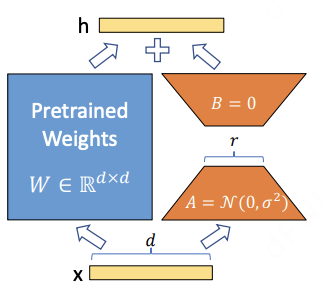

**结果展示**：

知识蒸馏可以显著提升判责的准召，**等比例**采样方法生成数据集在准召上提高较多

| 方法 <br> | precision <br> | recall <br> |
| --- | --- | --- |
| 原模型 <br> | 0.8577 <br> | 0.6866 <br> |
| 等比例 <br> | 0.9380 <br> | 0.7317 <br> |
| 1:3比例 <br> | 0.9366 <br> | 0.6920 <br> |

**GRPO方案**：在SFT训练完的模型上再做一次强化学习方法微调，使用GRPO方法，期望进一步提高判责的准召。

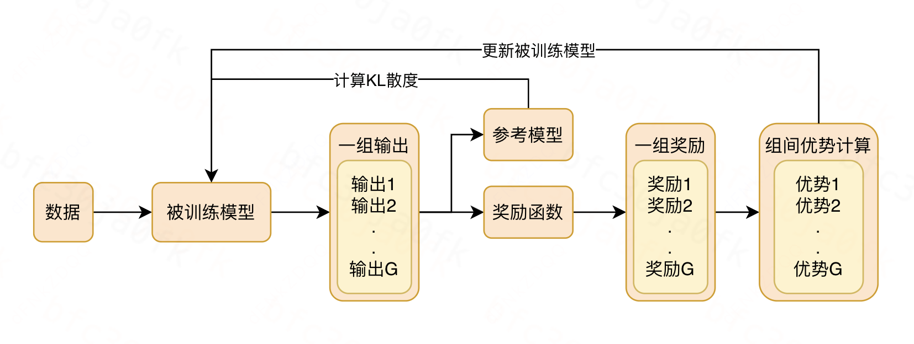

- 组采样（Group Sampling）：对同一prompt一次生成G条候选回复，将这G条结果视为一个候选组（GRPO）。

- 奖励计算（Relative Reward）：使用自定义的奖励函数对回复进行打分，使用平均值当baseline计算优势函数，进行优化

- 奖励函数设计：使用基于规则的奖励函数，包括格式分（1分）和正确分（2分）

训练奖励函数如下图所示，在step=10时训练接近收敛

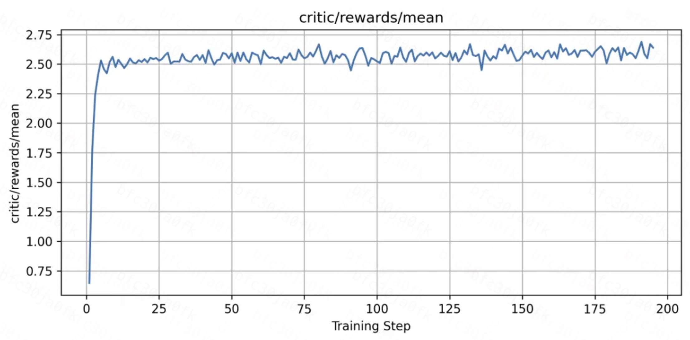

**结果对比：**使用GRPO方法后，precision折损1.03pp，recall提高了12.78pp，后续可通过增加新时间段的数据集或者使用DAPO等方法，进一步提高模型表现。

| 方法 <br> | precision <br> | recall <br> |
| :---: | :---: | :---: |
| SFT <br> | 0.9380 <br> | 0.7317 <br> |
| GRPO <br> | 0.9277 <br> | 0.8595 <br> |

## 2.5 输出结果规范化

**结构化输出可提升可解释性**：根据业务侧对“触发根因—根因特征—细分责任—理由描述”四要素的要求，设计了统一的输出格式，推理链路上做了和分子一样的**人机协同适配**，实现判责结论、推理依据与解释内容的结构化呈现，增强了判责环节的可解释性。

| 原输出格式 <br> | 现输出格式 <br> |
| --- | --- |
| 以“司机有责”或者“司机无责”开头，再论述判责的原因 <br> | &lt;result&gt;触发的根因&lt;/result&gt; <br>&lt;res_feature&gt;判断根因所基于的具体特征&lt;/res_feature&gt; <br>&lt;responsibility&gt;司机恶意有责，司机错误有责或司机无责&lt;/responsibility&gt; <br>&lt;reason&gt;简单描述理由&lt;/reason&gt; <br> |

针对现输出格式限制的输出结果，发现大模型判责的根因特征<res_feature>判断根因所基于的具体特征</res_feature>存在不规范的问题（即不在限定的list中），例如：“司乘未碰面，诱导乘客取消”，大模型可能会输出成“司乘未碰面，司机让乘客取消”，这会导致两个问题：

- 司机处置通知书取不到判责依赖的根因特征，只能取兜底文案

- 大模型判的订单正常会流入人机协同技能组，取不到根因特征将流入常规技能组

通过修改system prompt，对原模型容易输出的不规范的根因特征，添加到输出格式的正确示例中，强化对规范化根因的输出，实现根因特征规范化。离线测算可以将不规范率从11.59%降低至0.79%。

```PlainText
## 输出格式严格保证!!!：<result>触发的根因</result>。<res_feature>判断根因所基于的唯一特征!!!</res_feature>。<responsibility>司机恶意有责，司机错误有责或司机无责</responsibility>。<reason>简单描述理由</reason>
正确示例：
<result>乘客不满足平台乘车要求</result>。<res_feature>乘客在无责时间外不用车导致订单取消</res_feature>。<responsibility>司机无责</responsibility>。<reason>乘客表示不用车，且取消时间距离接单时间为10分钟，超过平台通常无责时间范围。</reason>
<result>平台规定范围内合理取消</result>。<res_feature>乘客在无责时间内不用车导致订单取消</res_feature>。<responsibility>司机无责</responsibility>。<reason>乘客在无责时间内取消订单。</reason> 
<result>司机扰乱平台秩序</result>。<res_feature>司乘未碰面，诱导乘客取消</res_feature>。<responsibility>司机恶意有责</responsibility>。<reason>司乘未碰面，司机让乘客取消。</reason>
<result>司机服务能力不足</result>。<res_feature>无特殊情况，司机未到达上车点</res_feature>。<responsibility>司机错误有责</responsibility>。<reason>无特殊情况，司机未到达上车点，属于司机服务能力不足判错误有责。</reason>
```

## 2.6 高准场景挖掘

一方面，在判责任务中，“误判”往往比“漏判”更为严重，“误判”会对无责司机造成较大伤害。另一方面，随着大模型判责准召的提升，将在申诉环节带来更多需要人工复核的工单量，需要增加人工判责的资源，否则在链路上对于不能进人判的工单最终将无责流出，难以提升终判有责率。

因此，有必要挖掘高准场景，当命中高准场景时，直接流出大模型判责结果，减少人判资源的消耗。

**方法一**：让大模型多次推理，利用置信度和争议度联合决策。

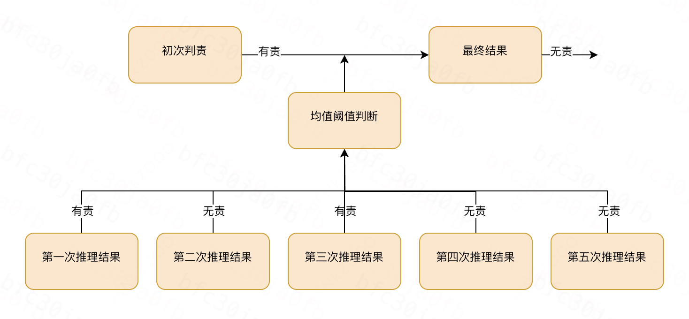

- **置信度**：多次推理中支持首判的比例

- **争议度**：多次推理结果的一致性

| 符号 <br> | 公式 <br> | 解释 <br> |
| --- | --- | --- |
| 单次标签$$l_i$$ <br> | $$l_i=1\{r_i=r_{首判}\}$$ <br> | 结果与首判一致记1，否则记0 <br> |
| 置信度$$\mu$$ <br> | $$\mu = \frac{\sum^{k}_{i=1}l_i}{k}$$ <br> | 结果支持首判比例，k是推理次数 <br> |
| 争议度$$\sigma^2$$ <br> | $$\sigma^2=\frac{\sum_{i=1}^{k}(l_i-\mu)^2}{k}$$ <br> | 结果一致性 <br> |

**决策逻辑**：

| 条件 <br> | 操作 <br> | 说明 <br> |
| --- | --- | --- |
| $$\mu<均值阈值$$ <br> | 反转初判结果 <br> | 多数意见推翻首判，改变首判结果 <br> |
| $$\sigma^2>方差阈值$$ <br> | 交给人判复核 <br> | 高争议样本交给人判，保证精准 <br> |
| 其他 <br> | 维持原判 <br> | 节省人工资源 <br> |

**测算结果：**

| 均值 <br> | 0.5 <br> | 0.5 <br> | 0.5 <br> | 0.3 <br> | 0.3 <br> | 0.3 <br> | 0.1 <br> | 0.1 <br> | 0.1 <br> |
| --- | --- | --- | --- | --- | --- | --- | --- | --- | --- |
| 方差 <br> | 0.3（1137） <br> | 0.2（920） <br> | 0.1（700） <br> | 0.3（1137） <br> | 0.2（920） <br> | 0.1（700） <br> | 0.3（1137） <br> | 0.2（920） <br> | 0.1（700） <br> |
| 准确率 <br> | 0.9050 <br> | 0.9180 <br> | 0.9266 <br> | 0.9086 <br> | 0.9180 <br> | 0.9266 <br> | 0.9141 <br> | 0.9250 <br> | 0.9266 <br> |
| 召回率 <br> | 0.6790 <br> | 0.7054 <br> | 0.6857 <br> | 0.6728 <br> | 0.7054 <br> | 0.6857 <br> | 0.6552 <br> | 0.6837 <br> | 0.6857 <br> |

结论：通过大模型多次推理，评估置信度的方式，需要消耗五倍的计算资源，并且难以达到较高的精度（例如0.98）

**方法二**：基于dfs算法遍历给定特征组合长度下的所有特征组合，判断特定子集是否满足高准

- 基于“大模型机判有责全部去申诉”假设

- 限定组合长度，在搜索过程中，一旦某一组合场景下的模型精度达到0.98，提前剪枝

- 对命中元能力组合场景下tp比例设置下限约束，过滤掉由于样本极少导致的“伪高准”场景

**结果**：约束高准组合下的tp数 / 全量样本下tp数 > x%，挖掘高准场景。

| tp约束 <br> | 特征组合 <br> | 精确度 <br> | 高准覆盖率 <br> |
| :---: | :---: | :---: | :---: |
| x = 5 <br> | 司机取消: 1, 上车点禁停: 0, 订单取消之后2小时内司机没有完单: 1 <br> | 0.9824 <br> | 23% <br> |
| 上车点禁停: 0, 司机无法在司机迟到时间前到达上车点: 1, 是否连环派: 0 <br> | 0.9845 <br> |
| 司机接驾途中在原地停留时长大于3分钟: 1, 本单是未开跨城费城市的跨城单: 0, 是否连环派: 0 <br> | 0.9832 <br> |
| x = 4  <br> | 实时单取消前，司乘无成功通话，乘客主叫司机的通话未成功大于1次: 1 <br> | 1.0 <br> | 32% <br> |
|  司机接单位置在路口或高架桥: 0, 上车点禁停: 0, lt_15s: 1 <br> | 0.9861 <br> |
| 司机接单位置在路口或高架桥: 0, 订单取消之后2小时内司机没有完单: 1, 是否连环派: 0 <br> | 0.9851 <br> |
| 司机取消: 1, 上车点禁停: 0, 订单取消之后2小时内司机没有完单: 1 <br> | 0.9824 <br> |
| 上车点禁停: 0, 司机无法在司机迟到时间前到达上车点: 1, 是否连环派: 0 <br> | 0.9845 <br> |
| 司机接驾途中在原地停留时长大于3分钟: 1, 本单是未开跨城费城市的跨城单: 0, 是否连环派: 0 <br> | 0.9832 <br> |
| 取消时刻司机行驶距离大于300米: 1, 订单取消之后2小时内司机没有完单: 1, 是否连环派: 0 <br> | 0.9839 <br> |
| 上车点禁停: 0, 本单是未开跨城费城市的跨城单: 0, 司机接驾途中在原地停留时长大于3分钟: 1 <br> | 0.9872 <br> |

值得注意的是，高准场景挖掘和覆盖率测算是基于“大模型机判有责全部去申诉”这一假设的。

离线覆盖率口径:（不申诉命中高准量 + 申诉命中高准量） / （不申诉初判有责量 + 申诉机判有责量）

若机判环节判的准，司机认同判责结果将不会申诉，其中不申诉的高准命中率会更高，进而影响实际的覆盖率，实际高准覆盖率会偏低。

**后续优化**：积累线上申诉环节大模型判责真实数据，重新挖掘高准场景和测算覆盖率。

# 三、实验结果

## 3.1 离线评估

大模型判责效果显著提升，离线测算相对分子模型精确率提升约10pp，召回率提升达30pp。

后续补充实验了蒸馏qwen2.5-7b以及qwen3-4b的效果，整体准召表现和蒸馏qwen3-8b差异不大。说明判责任务的语言推理难度不高，后续迭代可以使用更小的模型，减少计算资源开销。更全面的评估可以参考<https://cooper.didichuxing.com/knowledge/2199610335356/2206065479060>。

|  <br> | 分子模型 <br> | qwen3-8b-distill  <br> | qwen2.5-7b-distil <br> | qwen3-4b-distill <br> |
| --- | --- | --- | --- | --- |
| 数据集 <br> | precision <br> | recall <br> | precision <br> | recall <br> | precision <br> | recall <br> | precision <br> | recall <br> |
| 414-504 <br> | 0.8079 <br> | 0.4987 <br> | 0.9004 <br> | 0.8019 <br> | 0.8914 <br> | 0.7988 <br> | 0.8992 <br> | 0.7953 <br> |
| 707-717 <br> | 0.8124 <br> | 0.4814 <br> | 0.9219 <br> | 0.7906 <br> | 0.9259  <br> | 0.7962 <br> | 0.9282 <br> | 0.7941 <br> |
| 917-924 <br> | 0.8327  <br> | 0.4938 <br> | 0.9312  <br> | 0.8570 <br> | 0.9324  <br> | 0.8549 <br> | 0.9283 <br> | 0.8512 <br> |

## 3.2 在线判责漏斗

| 上线 <br>前后 <br> | 周期 <br> | 机判 <br> | 申诉 <br> | 人判 <br> | 终判&处置 <br> |
| :---: | :---: | :---: | :---: | :---: | :---: |
| 大盘取消订单数 <br> | 机判有责量 <br> | 机判有责率 <br> | 机判恶意有责量 <br> | 恶意有责率 <br> | 申诉订单量 <br> | 申诉率 <br> | 申诉通过量 <br> | 申诉通过率 <br> | 申诉进人判订单量 <br> | 人判有责订单量 <br> | 申诉人判有责率 <br> | 终判有责订单量 <br> | 终判有责率 <br> | 处置费用 <br> |
| 上线前 <br> | 09-13\~09-19 <br> | 143734 <br> | 7243 <br> | **5.04%** <br> | 2801 <br> | **1.95%** <br> | 3479 <br> | **48.03%** <br> | 2363 <br> | **67.92%** <br> | 1454 <br> | 965 <br> | **66.37%** <br> | 4880 <br> | **3.40%** <br> | 7439 <br> |
| 09-20\~09-26 <br> | 150252 <br> | 7109 <br> | **4.73%** <br> | 2728 <br> | **1.82%** <br> | 3404 <br> | **47.88%** <br> | 1885 <br> | **55.38%** <br> | 2003 <br> | 1346 <br> | **67.20%** <br> | 5223 <br> | **3.48%** <br> | 7008 <br> |
| 上线后 <br> | 11-01\~11-07 <br> | 131473 <br> | 36769 <br> | **27.97%** <br> | 3870 <br> | **2.94%** <br> | 15659 <br> | **42.59%** <br> | 12212 <br> | **77.99%** <br> | 2269 <br> | 1289 <br> | **56.81%** <br> | 24605 <br> | **18.71%** <br> | 34884 <br> |
| 11-08\~11-14 <br> | 118744 <br> | 33685 <br> | **28.37%** <br> | 4257 <br> | **3.59%** <br> | 11830 <br> | **35.12%** <br> | 7276 <br> | **61.50%** <br> | 4498 <br> | 2762 <br> | **61.41%** <br> | 26442 <br> | **22.27%** <br> | 35463    <br> |

治理判责大模型10.27在烟台、清远两城开量20%实际生效，10.28两城全量生效，下图为近3个月两城大盘总取消数趋势图，大模型上线后，两城的取消订单量呈下降趋势，说明对司机恶意取消有明显的治理效果。

整体机判有责率由约5%提升至28%；同时申诉率显著下降，表明司机对判责的争议减少；终盘有责率从3.5%提升至约20%，判罚处置费用提升了约5倍；整体治理效率和判责质量得到系统性提升。

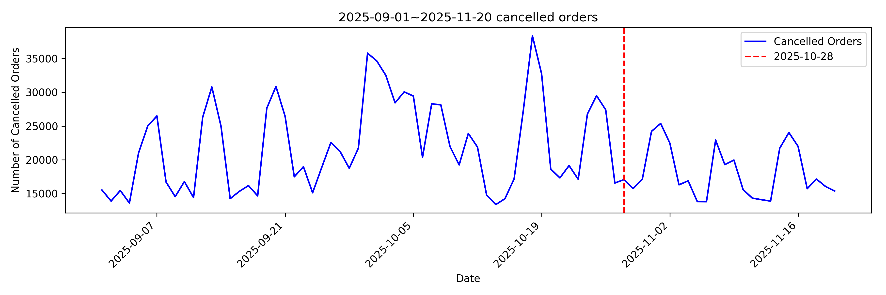

## 3.3 线上准召

真实标签由质检职场抽单判定，分司机取消和乘客取消场景分别抽取，乘客取消为有偏抽取，需要还原大盘真实水准，还原方式如下：

**司机取消场景：**

采用简单随机抽样，因此样本中计算得到的Precision和Recall均为大盘水平的无偏估计，因此无需还原。

**乘客取消场景：**

Precision评估只依赖抽单中判有责的子集，该子集被随机抽检，因此Precision无需还原；

Recall 依赖 pred=1 / pred=0 全量真实分布，由于抽样采用 1:2 分层方式，需按大盘比例还原：

- $$TP_p  = 抽单TP  /  抽单中判有责数 × 大盘 判有责数$$

- $$FN_p = 抽单FN / 样本中判无责数 × 大盘判无责数$$

- $$Recall_{p} = TP_p / (TP_p + FN_p)$$

**整体大盘准召**：

- $$Precision_{all} = (TP_p + TP_d) / (TP_P + TP_d + FP_P + FP_d)$$ 

- $$Recall_{all} = (TP_p + TP_d) / (TP_P + TP_d + FN_P + FN_d)$$

| 判责环节 <br> | 抽检方式 <br> | 准召评估抽单量 <br> | 评估指标 <br> | 计算值 <br> | 还原值 <br> |
| :---: | --- | :---: | :---: | :---: | --- |
| 机判环节 <br> | 10.30机判量，且订单时间在10.29-10.30期间的订单 <br>司机取消：随机抽取乘客取消：有责:无责=1:2 <br> | 1000 <br> | 司机取消机判有责准确率 <br> | 92.21% <br> | - <br> |
| 司机取消机判有责召回率 <br> | 92.36% <br> | - <br> |
| 1000 <br> | 乘客取消机判有责准确率 <br> | 78.83% <br> | - <br> |
| 乘客取消机判有责召回率 <br> | 79.61% <br> | 38.11% <br> |
| 2000 <br> | 机判整体有责准确率 <br> | 87.82% <br> | 90.57% <br> |
| 机判整体有责召回率 <br> | 88.20% <br> | 79.98% <br> |
| 一申环节 <br> | 10.29-10.31申诉量，且订单时间在10.26-10.31期间的订单，抽取一申模型判有责且命中高准的订单 <br>司机取消：随机抽取乘客取消：有责:无责=1:2 <br> | 5856 <br> | 司机取消机判高准覆盖率 <br> | 13.29% <br> | - <br> |
| 857 <br> | 乘客取消机判高准覆盖率 <br> | 9.68% <br> | - <br> |
| 6713 <br> | 取消机判高准覆盖率 <br> | 12.83% <br> | - <br> |
| 500 <br> | 司机取消机判有责准确率 <br> | 93.44% <br> | - <br> |
| 司机取消机判有责召回率 <br> | 99.78% <br> | - <br> |
| 32 <br> | 乘客取消机判有责准确率 <br> | 100.00% <br> | - <br> |
| 乘客取消机判有责召回率 <br> | 100.00% <br> | 100% <br> |
| 532 <br> | 一申整体有责准确率 <br> | 93.83% <br> | 94.06% <br> |
| 一申整体有责召回率 <br> | 99.80% <br> | 95.79% <br> |

# 四、大模型如何上线

除了离线迭代治理判责大模型，大模型的上线也是一个从零到一的过程。大模型具有数十亿甚至百亿参数，计算复杂度高，对GPU硬件要求高，我们需要通过压测对上线资源进行合理预估。除常规指标（QPS，并发数）外，大模型压测还需要关注特有指标，包括首token耗时（TTFT），输出单token平均耗时（不含首token），输出token长度分布等。

日均取消订单峰值200万，需在24h内完成全部推理，我们基于鲁班平台在线推理任务，使用一卡H20-3e进行压测。

通过固定最大并发量，调节QPS（每秒发送请求次数），看最大可以达到的请求吞吐量。

## 4.1 压测结果

| 最大并发量 <br> | QPS <br> | 请求吞吐量（req/s） <br> | 总吞吐量（token/s） <br> | 平均端到端耗时（ms） <br> | 中位端到端耗时（ms） <br> | Mean TTFT (ms) <br> |
| :---: | :---: | :---: | :---: | :---: | :---: | --- |
| 64 <br> | 10 <br> | 2.93 <br> | 19539.91 <br> | 19570.88 <br> | 17330.07 <br> | 101.50 <br> |
| 64 <br> | 20 <br> | 2.96 <br> | 19750.54 <br> | 19862.47 <br> | 17053.61 <br> | 122.68 <br> |
| 64 <br> | 30 <br> | 3.08 <br> | 20535.26 <br> | 20163.26 <br> | 17599.13 <br> | 136.21 <br> |
| 64 <br> | 40 <br> | 2.98 <br> | 21641.04 <br> | 20517.27 <br> | 18420.66 <br> | 168.99 <br> |
| 64 <br> | 50 <br> | 3.01 <br> | 21857.56 <br> | 19886.63 <br> | 17893.45 <br> | 159.65 <br> |

按照这个单卡速度，24小时处理200w条数据需要（2000000/24h/60min/60s/3.08req/s）=7.5约8张H20-3e

## 4.2 线上实际情况

目前线上使用8个内蒙古03在线1卡H20-3E实例部署了治理判责大模型，监控情况如下：

| 监控指标 <br> | 监控情况 <br> | 说明 <br> |
| --- | --- | --- |
| QPS <br> | 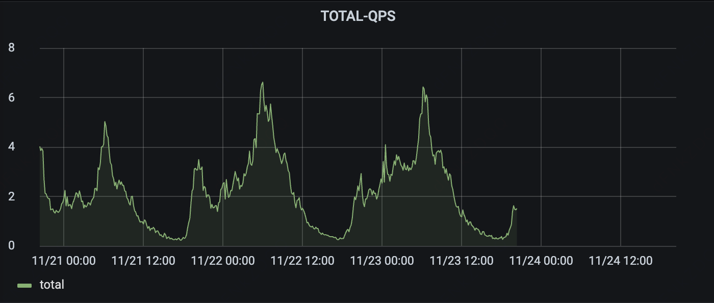 <br> | - 目前实际QPS峰值不超过8 <br><br> |
| 端到端延时 <br> | 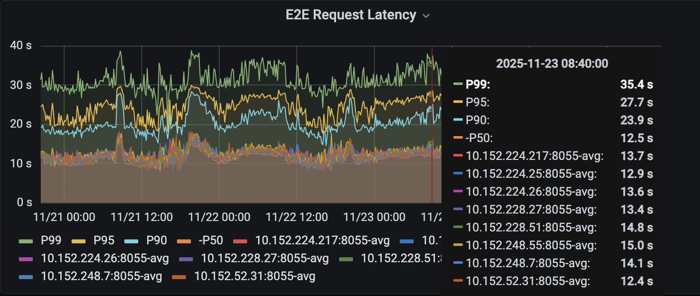 <br> | - 端到端平均延时不超过20s <br><br> |
| 首token耗时 <br> | 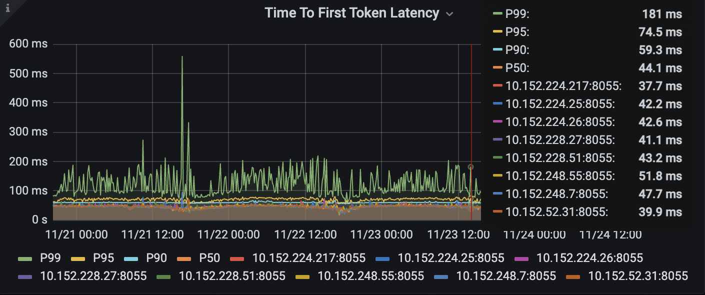 <br> | - 首token耗时不超过100ms <br><br> |
| 输出token长度分布 <br> | 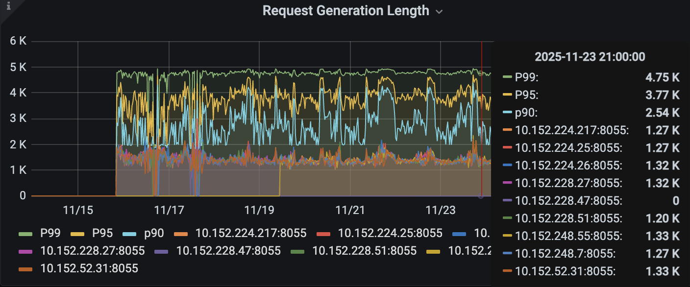 <br> | - 输出token长度平均为1.5K <br><br> |
| 输出单token耗时 <br> | 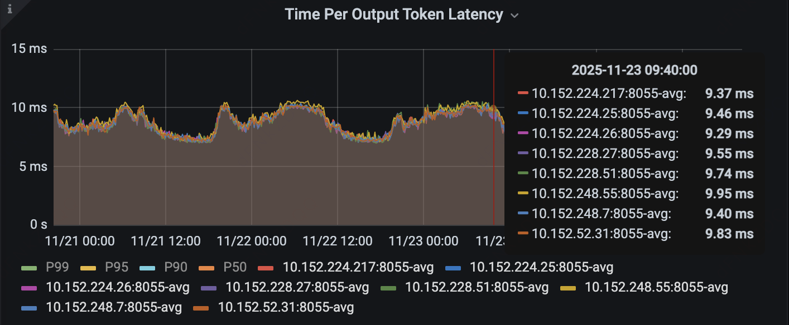 <br> | - 输出单token平均耗时（不含首token）大概是10ms <br><br> |

# 五、后续规划

未来将引入司机报备和申诉信息（文本+图片），基于多模态大模型进一步提高取消场景判责的准召。

- 构建高质量的训练集

- 探索更多RLHF相关方法，对其人工判责偏好

- 限制根因特征的准召

- 长期关注人判与机判不一致的badcase，持续优化

# 六、引用和鸣谢

治理判责大模型策略离线链路部分大多为卢锐、昊远、纪元的工作，感谢他们的付出；

感谢吴健在项目全过程中的指导，感谢博辉、组内同学以及创新策略同学提出的宝贵建议；

感谢治理技术工程团队和AI平台部同学对本项目的支持

# 放量实验和策略线上现状

策略上线并已推全
