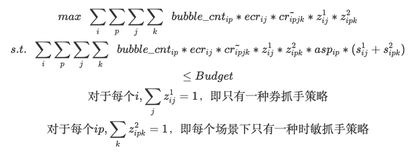
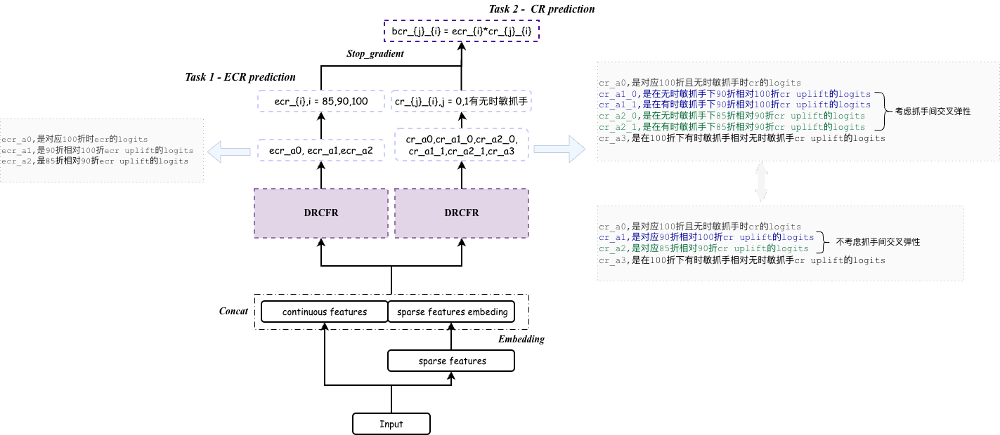
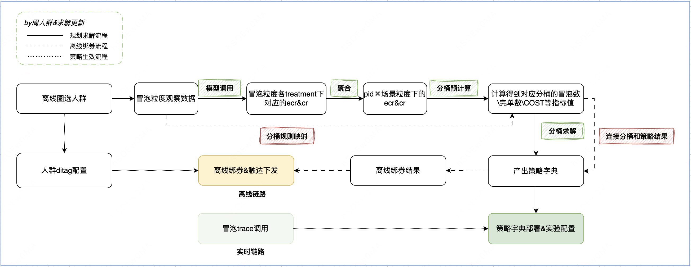
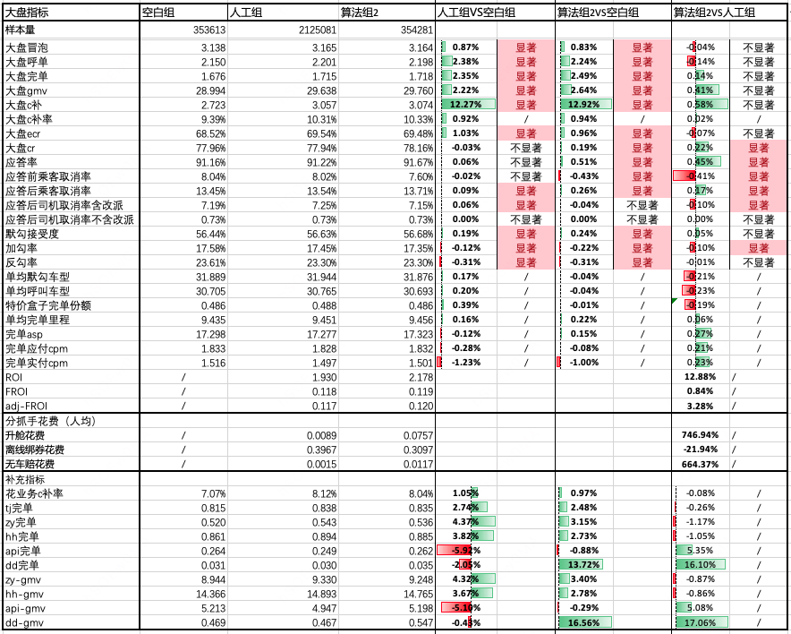
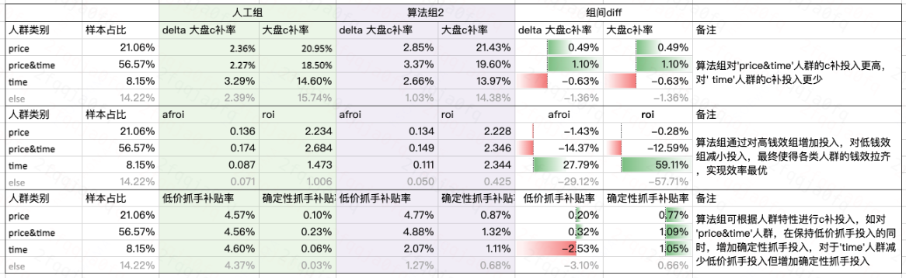
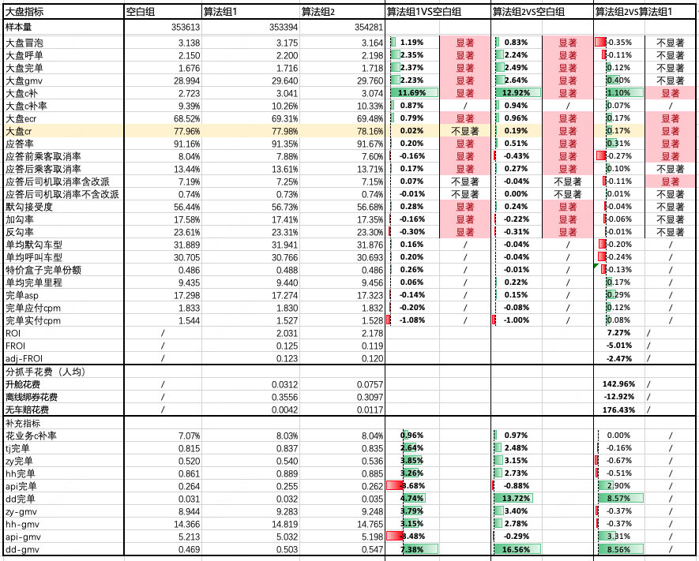
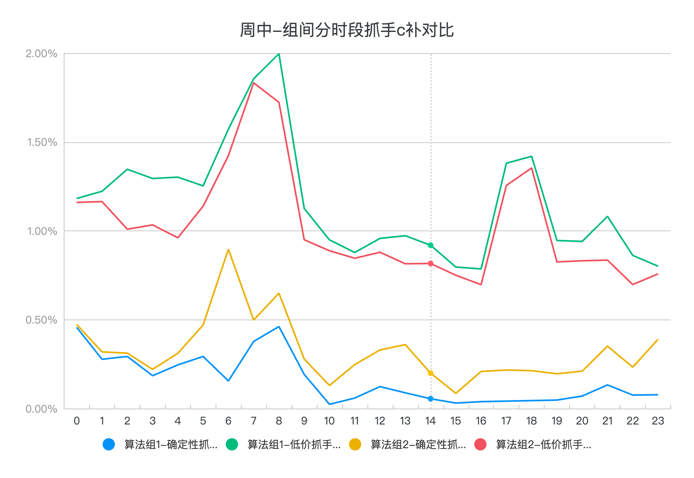
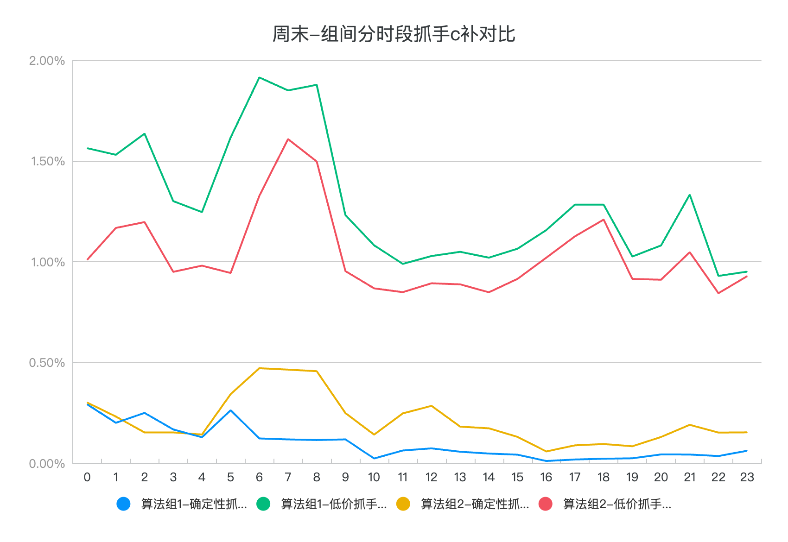
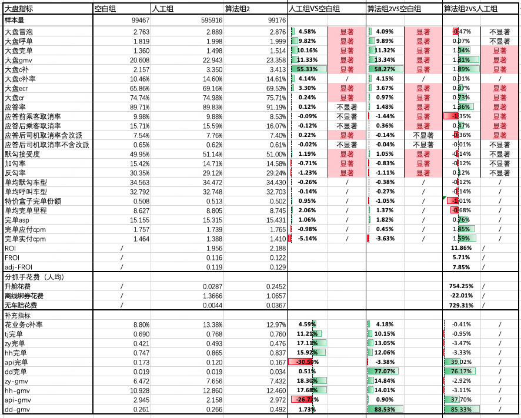
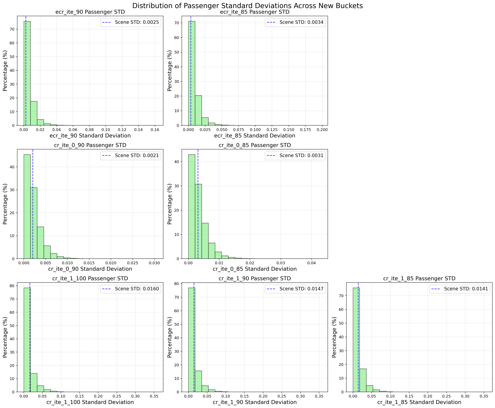

# 【LR25042】ACTI多抓手联合决策算法V0

[Cooper 原文](https://cooper.didichuxing.com/knowledge/2199610335356/2205948348659)

# 一、背景

ACTI项目是专门针对竞争人群制定策略的。在6月份的峰期免溢价实验中，验证了**对竞争人群做抓手组合有1+1>2的收益，且用户具备不同的价敏和时敏表现，不同人群有不同诉求（低价/确定性）。**基于此，根据竞争用户的价敏和时敏程度细分了四类竞争人群，并对此四类竞争人群进行了**精细化人工策略投放，得到了预期中的钱效和完单增益**。

然而，这种细分人群的精细化人工策略存在以下**问题**：

	1. 目前时敏人群划分由用户历史行为统计得到，暂未使用算法进行弹性建模，用户的时敏属性计算并不科学；

	2. 策略制定时未考虑抓手间的交叉弹性；

	3. 抓手间的预算划分通过人工经验拍定，存在一定的效率折损；

因此，针对以上问题，我们构建了「多抓手联合决策算法框架」，建模了竞争用户的价格&时敏弹性，并使用最优化求解算法产出P维度抓手组合策略，以期提升竞争人群策略的总体钱效及完单规模，并探索出一套可供算法策略参考的多抓手决策范例。

# 二、技术方案

## 2.1 基本内容介绍

- 作用的人群范围

	- 四类竞争人群的并集

> Q：为什么作用人群不是全量竞争人群？

> A：受线上能力限制，目前只支持四类竞争人群的标签透传，不能支持更多种竞争人群标签

四类竞争人群的定义
时敏&价敏：「90天呼叫数<=32  &&  应答前取消率>30%」    &&    「Top20%价敏」

仅时敏：「90天呼叫数<=32  &&  应答前取消率>30%」    &&    非「Top20%价敏」

仅价敏：非「90天呼叫数<=32  &&  应答前取消率>30%」    &&    「Top20%价敏」

普通：非「90天呼叫数<=32  &&  应答前取消率>30%」    &&    「20-50%价敏」

- 可用的抓手

	- 离线绑券&触达

每个用户一天最多发一张券，提前求解出发券pid，并配置pope活动定时下发

	- 升舱

by trace 实时判断是否触发升舱，若触发升舱，follow旧升舱策略逻辑(lambda判断和生效场景)

	- 无车赔

by trace 实时判断是否触发无车赔，若触发无车赔，follow现有无车赔策略逻辑(赔付规则)

## 2.2 问题抽象

| 符号   | 含义   |
| :---: | :---: |
| $$i$$   | 表示第$$i$$个用户，若为分桶求解，即代表第$$i$$个分桶   |
| $$p$$   | 表示第$$p$$种场景，例如0=高峰，1=平峰   |
| $$j$$   | 表示第$$j$$种折扣，例如0=100折，1=90折，2=85折   |
| $$k$$   | 表示第$$k$$种时敏抓手，例如0=无，1=有，其中时敏抓手无车赔&升舱绑定   |
| $$bubble\_cnt_{ip}$$   | 表示第$$i$$个用户/分桶在第$$p$$种场景下的冒泡数   |
| $$ecr_{ij}$$   | 表示第$$i$$个用户/分桶在第$$j$$种折扣下的冒泡发单率   |
| $$cr_{ipjk}$$   | 表示第$$i$$个用户/分桶在第$$p$$种场景第$$j$$种折扣第$$k$$种时敏抓手下的成交率   |
| $$\tilde{cr_{ipjk}}$$   | 结合升舱真实覆盖面得到调整后的用户升舱时敏弹性  $$\tilde{cr_{ipjk}}=cr_{ipj0}+ite\_cr_{ipjk}*upgrade\_tgr$$   |
| $$z^{1}_{ij}$$   | 决策变量1，表示是否给第$$i$$个用户/分桶第$$j$$种折扣   |
| $$z^{2}_{ijk}$$   | 决策变量2，表示是否给第$$i$$个用户/分桶在第$$p$$种场景第$$k$$种时敏抓手   |
| $$asp_{ip}$$   | 表示第$$i$$个用户/分桶在第$$p$$种场景下的平均客单价   |
| $$s^{1}_{ij}$$   | 表示第$$i$$个用户/分桶在第$$j$$种折扣下的补贴率   |
| $$s^{2}_{ipk}$$   | 表示第$$i$$个用户/分桶在第$$p$$种场景第$$k$$种时敏抓手的补贴率   |

- **需要考虑的问题**

	- **决策粒度不统一**：券抓手生效粒度为每天1张，升舱&无车赔可by 场景生效（不同场景下时敏弹性存在差异，场景信息如周中周末、平高峰）

假设：折扣券可以覆盖全天全场景需求（优化目标和预算约束中都作此假设）

解法：增加场景粒度，根据pid✖️场景分桶进行ecr&cr数据聚合，在求解中保证对某一用户而言，所有场景下的折扣都相同

	- **策略结果未必生效导致求解非最优**：如果策略求解结果中某个pid在某场景下的冒泡应触发升舱&无车赔，但受到升舱&无车赔的触发限制（如升舱无运力举手、冒泡不满足无车赔规则等），最终可能无法生效

解法：在最优化目标和预算约束中均考虑抓手触发面。使用升舱&无车赔触发面对相应cr_ite进行加权，在计算补贴花费时使用真实触发升舱的大盘c补率

- **问题解法：考虑抓手真实触发面的二维差异化粒度决策变量最优化问题**

多抓手联合决策，以最大化完单为目标，优化问题如下：

## 2.3 弹性建模

- **建模粒度**：trace_id粒度建模 （分pid&分场景聚合应用于求解中）

- **treatment设计**：二维treatment

	- 折扣券treatment--85/90/100折

	- 无车赔和升舱绑定的联合时敏抓手treatment--<u>是否真实触发</u> 无车赔&升舱（而非策略命中）

		1. 考虑到升舱生效样本占比较少，为了保证样本量，将无车赔和升舱的联合treatment处理为二者有1即为1

	- 券treatment既影响冒泡-呼叫的转化，也影响呼叫-完单的转化；时敏抓手（有无 无车赔&升舱）只影响呼叫-完单的转化

- **特征：**历史离线P维度特征+城市离线特征+端外实时特征，特征优选后得到256维特征

- **输出**：在3种折扣券和不同时敏抓手的情况下，共有9维输出

	- 用户分别在不同折扣下的ecr（冒泡发单率）

	- 用户在有时敏抓手下分别在不同折扣下的cr（成交率）

	- 用户在没有时敏抓手下分别在不同折扣下的cr（成交率）

- **需要考虑的问题**

	- **多任务**：ecr只受券treatment影响，cr既受券又受时敏抓手的影响，最终策略目标为是否完单即bcr

解法：建模双任务模型，对于ecr任务，建模单treatment--券的弹性曲线；对于cr任务，需要考虑双treatment；同时考虑到任务间建模的难易程度和参数共享，进行stop_gradient设计

	- **观察数据建模**：虽然开展了随机价格实验，但对于升舱&无车赔这一联合时敏抓手treatment为<u>是否真实触发</u>，存在样本选择性偏差

	- **样本不均衡**：引入ecr\\cr两个弹性建模任务，不可避免的问题是任务间样本不均衡，特别对于cr任务，仅预测cr时训练样本为呼叫样本，但在推理阶段样本为冒泡样本

解法：由于ecr\\cr的样本空间不同，借鉴ESMM建模思想，引入与ecr样本空间相同的bcr，通过优化bcr进而得到cr

	- **场景信息**：先验判断场景信息是弹性曲线的重要影响因素，特别对于时敏抓手，因此在建模cr、bcr时应该考虑周中周末 x 时段（峰期）的场景信息

解法：对原始特征（day_of_week, hour_of_day,city_id）做embedding（目前使用的sparse feature相对低维，判断embedding应该足够）

- **最终模型：包含场景信息embedding层的基于ESMM的双DRCFR模型**

- **模型评估**

	- **存在的问题：**

		- **反事实前提不满足**：时敏抓手--无车赔&升舱，是否真实触发受各自抓手规则限制，因此回收的实验数据中，是否真实触发「无车赔&升舱」的样本间存在分布偏差，导致因果评估的前提被打破，二者并不能互为反事实。

		- **存在抓手补贴率不可知**：无车赔抓手--受抓手核销规则限制，在当单数据下无法获取补贴金额（因为无车赔券只能在下一次使用），这导致MTAUCC的计算面临挑战。

		- **双label评估**：需要评估的label有两个--ecr 和 bcr，其中bcr受到双treatment干预，即券✖️「无车赔&升舱」

	- **初步解法：**

		- 秉着最大程度与线上结果保持一致的原则，基于事实样本进行时敏弹性评估

		- 由于无车赔c补率很低且真实cost无法获取，在涉及roi的评估指标中暂时剔除无车赔

		- 双label逐一评估，bcr弹性评估指标为主，ecr弹性评估指标为辅

			- ecr评估，treatment = 券：dini&AUCC&MTAUCC

			- bcr评估，treatment= 券✖️升舱：AUCC & MTAUCC

				- 为满足看清单抓手弹性预估准确性的诉求，采取固定一维评估另一维的思路

				- 以评估升舱，固定券=85折为例：

					- treatment=有升舱且85折，control = 无升舱且85折

					- 排序指标：在【最大化完单】的目标下，对评估样本$$\hat{roi} = \frac{\Delta bcr}{\Delta cost} = \frac{bcr_{upgrade,85}-bcr_{no,85}}{cost*bcr_{upgrade,85}-0}$$，排序指标既受模型bcr预估的影响也受cost预估的影响

					- 累计增量：使用treatment组样本的真实finishi和cost计算

					- 升舱抓手与生俱来的样本偏差：因为该样本偏差无法通过实验手段进行消除，对于那些配置了升舱但不能真正生效升舱的样本，不属于策略作用范围，因此使用事实升舱样本进行评估，用于指示模型对真实升舱弹性的学习效果，这样的评估方式是更能与线上真实样本构成相对应的方案。（不可避免的，我们需要决策那些样本需要配置升舱，对于没有被评估覆盖的未升舱样本即使策略判断升舱也大概率难以真实生效升舱，不会造成资源浪费；但可能会扰乱整体升舱钱效排序，导致该升舱的样本没有升舱，可以及时观察线上补贴率及时调整预算key配置）

## 2.4 规划求解与策略生效

## 2.5 创新点与复杂度

- 创新性

	- 首次打破价格侧抓手与交易侧抓手的壁垒，实现乘客价格心智和用车效率双向联动做功

- 复杂度

	- 实验复杂度高 

		- 开发：「大盘分流+分人群策略投放+p维度差异化」实验诉求，加大需求沟通难度与开发工作量 

		- 配置：涉及触达、离线绑券、无车赔&升舱活动 

		- 协同：覆盖多抓手，涉及到跨部门协作

	- 策略求解复杂

		- 建模：多抓手交叉弹性

		- 求解：异粒度双变量

# 三、实验结论

## 3.1 实验基本信息

实验周期：2025.11.18～2025.11.24

实验城市：24,105,13,32,143,259,301,16,18,34,85,占大盘GMV为24.17%

实验分流：如下表

| 实验组及流量   | 策略方案   | 说明   |
| --- | --- | --- |
| 空白组 10%   | /   | /   |
| 实验组1-分人群差异化策略 60%   | 第一类竞争人群（时敏&价敏）  - 触达 + A1    - 高峰：B+C2；平峰：B+C3    | **符号说明**  - **A1**（深折扣券）：全天1张85折券，分两次下发   - **A2**（浅折扣券）：全天1张9折券，分两次下发   - **B**（必无车赔）：全天除00:00-06:00外必现   	- 所有参数与峰期免溢价时期参数一致   - **C1**（必升舱）：能升舱的场景均升舱   	- 无lambda配置，随机升舱且概率为100%   - **C2**（强升舱）：除去钱效极低场景的升舱   	- lambda = 0.001，其他参数与C1参数一致   - **C3**（弱升舱）：仅在钱效较高场景升舱   	- lambda  = 0.08，其他参数与C1参数一致    |
| 第二类竞争人群（仅时敏）  - 触达 + A2    - 高峰：B+C2；平峰：B+C3    |
| 第三类竞争人群（仅价敏）  - 触达 + A1     |
| 第四类竞争人群（普通）  - 触达 + A2     |
| 实验组2-个体差异化策略 20%，包含：  算法组1-10%  算法组2-10%     | 【**只对四类竞争人群过策略**】  离线绑券由策略同学产出人群并配置活动  升舱&无车赔 由线上实时读取策略字典实现   | 【升舱 】和实验组1保持一致  - 按照旧策略lambda判断   - 生效场景按照旧场景   【无车赔】和实验组1保持一致  - 必无车赔，除00:00-06:00外必现   **【升舱无车赔的人群优先级】**  - follow 旧有配置    |

## 3.2 实验核心结论

自评报告[【自评报告】ACTI多抓手联合决策v0版实验](https://cooper.didichuxing.com/knowledge/2199610335356/2205960990541)

 

**实验结论（拉齐大盘补贴率的情况下）：**

- 核心结论：拉齐c补，算法组2相比人工组，大盘完单**+0.14%**，大盘GMV**+0.41%**，afroi提升**3.28%**，roi提升**12.88%**

- 收益路径分析：在抓手间预算分配上，算法组2将部分离线绑券的补贴腾挪到确定性抓手，在保证冒泡、呼叫、ecr尽量低的折损下获得了显著+0.22pp的cr提升，从而使得大盘完单的增量提升

- 拆分运力来看，由于升舱获得更多补贴，相比其他运力，dd运力更加充足，因此获得了更多的GMV和完单提升

# 四、实验结果分析

## 4.1 抓手间预算分配合理性

根据p维度策略生效情况，算法组竞争人群可以分为以下四类：

1. price & time：始终命中低价抓手与确定性抓手

2. price：only始终命中低价抓手

3. time：only始终命中确定性抓手

4. else：其他（含偶尔命中某一抓手）

严格版具体含义
（同一pid会在不同日期类型和场景下有多个冒泡trace，不同的trace策略结果会不同）

1. price & time：不论日期类型和场景，均给非100折和时敏抓手的人群

2. price：不论日期类型和场景，均给非100折但某些情况下不会给时敏抓手的人群

3. time：不论日期类型和场景，均给时敏抓手但某些情况下会给100折的人群

4. else：以上三种都不是的人群

5. non：非实验人群

前三类人群离线仿真结果和线上策略执行结果一定程度上一致

通过仿真各组人群在同一策略下的结果，我们可以得到命中相同p维度策略的人群（可能落在空白/人工/各算法组），并基于此进行人群下钻分析

从'price & time'、'price'和'time'三类人群上看，算法组能做到较好的补贴分配，相比人工组各人群的钱效更加拉齐；特别地，对于'price & time'人群，算法组较好的识别了该人群的时敏弹性，从而追加了更多的升舱补贴，得到了更多的增量收益。

 

## 4.2 抓手间交叉弹性重要性

从随机价格实验组间的cr对比来看，不同折扣在有无确定性抓手的cr弹性存在一定差异，说明折扣券与确定性抓手存在交叉弹性。但是在固定折扣券后，计算得到的有无确定性抓手的cr弹性，不同折扣间的cr弹性较为接近。

| **对比不同确定性抓手下，折扣的cr弹性**   | **cr_ite**   | **对比不同折扣下，有无确定性抓手的cr弹性**   | **cr_ite**   |
| --- | --- | --- | --- |
| 有确定性抓手，85折vs100折   | -0.43%   | 85折下，有无确定性抓手   | 0.51%   |
| 有确定性抓手，90折vs100折   | -0.45%   | 90折下，有无确定性抓手   | 0.49%   |
| 无确定性抓手，85折vs100折   | -0.21%   | 100折下，有无确定性抓手   | 0.67%   |
| 无确定性抓手，90折vs100折   | -0.27%   |    |    |

基于以上数据表现，我们对模型-子任务塔cr部分做了两种设计，一种不考虑抓手间的cr交叉弹性，另一种考虑抓手间的cr交叉弹性。从实验结果上，算法组2-交叉弹性组 vs 算法组1-无交叉弹性组，能够得到显著的cr提升。

算法组1vs 算法组2 低价抓手和确定性抓手的分场景分时段补贴率曲线

# 五、未来规划

1. 扩量计划：只保留最优算法组并进行扩量90%，空白组10%

2. 目前来看策略版本的迭代链路是由 单抓手的人工策略->多抓手的人工策略-> 多抓手的算法策略，未来考虑进行单抓手的算法策略 vs 多抓手的算法策略 对比

1. 进一步扩大策略覆盖人群，从四类竞争人群扩充到全量竞争人群

2. 进一步引入供需特征，提升cr学习效果

3. 尝试进行实验城市统一求解，在城市间进行预算腾挪

4. follow 新流升舱，接入新场景

# 六、QA

1. 算法组2的收益是否存在人群挤占效应，尤其对于升舱抓手而言，策略组扩量后是否收益有所收窄？

从当前流量划分来看，不存在明显的挤占效应（大盘钱效并未有明显折损）；扩量后会持续观察。

|    | 全量人群口径   | 实验命中人群口径   |
| :---: | :---: | :---: |
|    | froi   | roi   | froi   | roi   |
| 人工组   | 0.117   | 1.930   | 0.119   | 1.956   |
| 算法组2   | 0.120   | 2.178   | 0.129   | 2.188   |

实验命中人群视角-实验评估结果

# 七、引用与致谢

引用：[【LR25028】ACTI分人群多抓手联合策略](https://cooper.didichuxing.com/knowledge/2199610335356/2205183981137)

感谢：

感谢工程同学刘志远、业务同学王雨潭&李婉怡在实验配置上的大力支持和耐心配合；

感谢晓鹏在模型训练和代码开发上的宝贵建议和人力支持；

感谢之烁在整个算法上线过程中的专业指导和宝贵建议；

感谢价格策略部的所有同学在技术研讨会上提出的宝贵建议。

# 八、TODO

## 1 补充模型离线评估结果

[多抓手联合决策模型调优](https://cooper.didichuxing.com/knowledge/2199610335356/2205508333794)

在核心指标「平均升舱aucc」和「平均券mtaucc」上，算法组2相比算法组1分别提升0.0092和0.0031

|    | **评估ecr**   | **评估bcr**   |    |
| --- | :---: | :---: | --- |
|    | dini_85   | dini_90   | **mtaucc**   | 固定100折券，  升舱aucc   | 固定90折券，  升舱aucc   | 固定85折券，  升舱aucc   | **平均升舱aucc**   | 固定升舱，  券mtaucc   | 固定不升舱，  券mtaucc   | **平均券mtaucc**   |
| 算法1组对应模型的离线评估结果   | 0.2005   | 0.0809   | 0.2353   | 0.0079   | 0.0334   | -0.0007   | **0.0135**   | 0.3844   | 0.3378   | **0.3611**   |
| 算法2组对应模型的离线评估结果   | 0.2990   | 0.0534   | 0.2319   | 0.0558   | 0.0017   | 0.0106   | **0.0227**   | 0.3919   | <u>0.3365</u>   | **0.3642**   |
| 算法组2vs算法组1的绝对提升   | 0.0985   | -0.0275   | -0.0034   | 0.0479   | -0.0317   | 0.0113   | **0.0092**   | 0.0075   | -0.0013   | **0.0031**   |
| 算法组2vs算法组1的相对提升   | 49.13%   | -33.99%   | -1.44%   | 606.33%   | -94.91%   | ==-==1614.29%   | **67.73%**   | 1.95%   | -0.38%   | **0.86%**   |

## 2 补充同一人在不同场景下的弹性是否有差异

1. **数据准备**

数据来源：11.20-11.26日的竞争人群冒泡数据，共包含570279个乘客的冒泡数据

模型：online_v1版本，包含交叉弹性建模的基于ESMM的双DR-CFR模型

数据选择：362455（63.56%）乘客在不同场景下具有冒泡数据，207824（36.44%）乘客只在单一场景下具有冒泡数据，后续分析选择具有不同场景冒泡数据的乘客

比较的弹性指标：模型预测得到的ecr_85, ecr_90, ecr_100, cr_1_85, cr_1_90, cr_1_100, cr_0_85, cr_0_90, cr_0_100，进而得到弹性值，ecr_ite_90, ecr_ite_85, cr_ite_0_90, cr_ite_0_85, cr_ite_1_100, cr_ite_1_90, cr_ite_1_85

比较的场景：d0h0, d0h1, d0h2, d0h3, d0h4, d1h0, d1h1, d1h2, d1h3, d1h4（其中d0代表周中、d1代表周末，h0代表\[0,6\]点、h1代表(6,9\]点，h2代表(9,16\]点，h3代表(16,20\]点，h4代表(20,23\]点）

2. **衡量指标**

通过在不同场景下对同一弹性指标计算标准差，来衡量弹性差异的大小。具体来说，分别计算了乘客层面的标准差和场景层面的标准差（作为参考）：

- **乘客层面的标准差计算步骤：**

	1. 对每个pid，by`场景粒度，`计算弹性均值

	2. 对每个pid，计算不同`场景`间弹性值的标准差

**含义：** 衡量同一乘客在不同场景下弹性预测值的波动程度，反映模型对同一人群在不同场景下预测的一致性

- **场景层面的标准差计算步骤：**

	1. 对每个场景，计算全样本各弹性指标的平均值

	2. 计算所有`场景`均值之间的标准差

**含义：**该指标衡量不同场景之间弹性均值的离散程度，反映场景间的差异大小

下表为**场景层面的弹性均值**结果，其中最后一行为**场景层面的标准差**：

|    | **ecr_ite_90**   | **ecr_ite_85**   | **cr_ite_0_90**   | **cr_ite_0_85**   | **cr_ite_1_100**   | **cr_ite_1_90**   | **cr_ite_1_85**   |
| --- | --- | --- | --- | --- | --- | --- | --- |
| **new_bucket**   |    |    |    |    |    |    |    |
| d0h0   | 0.018585   | 0.027206   | 0.005297   | 0.007379   | 0.077228   | 0.079315   | 0.080402   |
| d0h1   | 0.023849   | 0.034385   | 0.008824   | 0.012731   | 0.040047   | 0.044630   | 0.047026   |
| d0h2   | 0.023334   | 0.034017   | 0.008772   | 0.012647   | 0.039612   | 0.044143   | 0.046517   |
| d0h3   | 0.023814   | 0.034615   | 0.009504   | 0.013758   | 0.042544   | 0.047536   | 0.050176   |
| d0h4   | 0.021136   | 0.030944   | 0.009152   | 0.013209   | 0.043172   | 0.047846   | 0.050315   |
| d1h0   | 0.018920   | 0.027586   | 0.004447   | 0.006084   | 0.083860   | 0.085367   | 0.086131   |
| d1h1   | 0.022816   | 0.032889   | 0.008924   | 0.012878   | 0.040646   | 0.045268   | 0.047692   |
| d1h2   | 0.025215   | 0.036467   | 0.010089   | 0.014628   | 0.046163   | 0.051433   | 0.054261   |
| d1h3   | 0.026117   | 0.037677   | 0.010663   | 0.015502   | 0.049222   | 0.054868   | 0.057927   |
| d1h4   | 0.023248   | 0.033717   | 0.010017   | 0.014499   | 0.047731   | 0.052877   | 0.055641   |
| **std**   | **0.002471**   | **0.003449**   | **0.002053**   | **0.003108**   | **0.015967**   | **0.014744**   | **0.014103**   |

3. **可视化**

对于乘客层面的标准差，对波动程度等宽分为10个桶，画出频率直方图如下所示，其中蓝线代表了场景层面的标准差：

4. **结果分析**

计算对于所有弹性指标，乘客**在不同场景下的弹性标准差**小于**场景层面的标准差**的比例：

ecr_ite_90: 123458/362455 (34.06%)

ecr_ite_85: 119662/362455 (33.01%)

cr_ite_0_90: 213044/362455 (58.78%)

cr_ite_0_85: 214120/362455 (59.07%)

cr_ite_1_100: 272745/362455 (75.25%)

cr_ite_1_90: 255750/362455 (70.56%)

cr_ite_1_85: 243634/362455 (67.22%)

## 3 补充无车赔和升舱

无车赔相关材料（内含BRD\\PRD）：[大盘无车赔策略-副本](https://cooper.didichuxing.com/knowledge/2199610335356/2202187987086)

升舱相关材料（内含BRD\\PRD）：[升舱策略方案](https://cooper.didichuxing.com/knowledge/2199610335356/2202868040174)

策略开发记录中对升舱和无车赔的细节设计：[多抓手联合决策策略开发记录](https://cooper.didichuxing.com/knowledge/2199610335356/2205335302468)

# 九. 目标&约束

## 9.1 策略目标

- 大盘完单提升、大盘完单ROI提升

## 9.2 约束指标项

- ecr折损尽量低的同时提升CR

# 十. 推全情况与现状追踪

推全情况&现状追踪：后续被[ACTI多抓手联合决策算法V1](https://cooper.didichuxing.com/knowledge/2199610335356/2206652243628)覆盖
