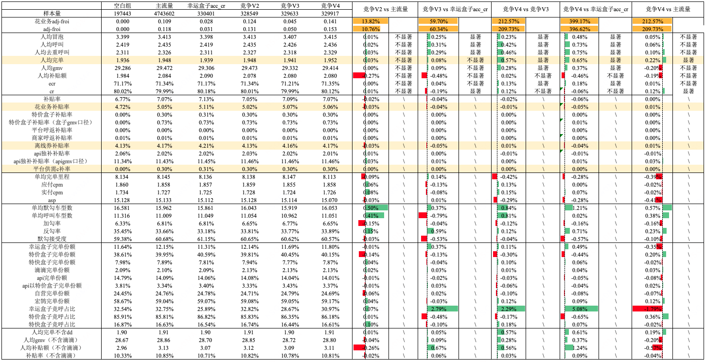

# 【LR25043】平台联合决策竞争人群策略v0

[Cooper 原文](https://cooper.didichuxing.com/knowledge/2199610335356/2205961411062)

# 一、背景

结合业务经验和前置分析，我们发现竞争人群价格敏感度较高、冒泡/呼叫/完单增量更大（在同样的补贴投入下）。基于联合决策AB实验进行分人群对比分析，发现竞争人群相比非竞争人群：c补率+0.32pp，froi+9.56%(0.1872->0.2051)。从最优化线上效率的角度出发，制定分人群策略，寻求分人群的边际收益，可以实现线上效率最优。

幸运盒子收拢至平台联合决策后，存在策略参数，支持我们进行人群策略探索，本次方案中探索的参数有以下内容：

	1. 考虑到竞争人群的价敏心智，竞争人群平台联合决策幸运盒子最低折扣应更低，折扣求解空间更大

	2. 考虑到非竞争人群价格不敏感，非竞争人群的幸运盒子acc_cr阈值应适当调高，以降低幸运盒子展现面，从而提升乘客默勾接受度，在勾选车型较多时保证成交率，最后实现完单提升

## 目标&约束

- 大盘完单提升

- 无其他约束

# 二、策略细节

## 2.1 竞争人群判别

竞争人群**来源**：历史竞争行为用户 && 当天竞争行为用户

- 历史竞争行为用户：支持多种标签定义，如历史14天有过双冒行为的用户，历史14天hxz双冒份额<0.5等。本期使用标签为「历史14天有过双冒行为的用户」。

- 当天竞争行为用户：依赖于「用户当天双冒行为预测模型」。

### 2.1.1 竞争人群离线标签

本期实验，根据离线hive表取离线标签：is_14d_sm = 1，表示历史14天内有过双冒行为

```SQL
select 
    passenger_id,
    is_14d_sm
from 
    kflower_strategy.competition_pid_tag
where 
    dt = date_sub('${begin}',1)
```

### 2.1.2 用户当天双冒行为预测模型

- **模型基本信息**

label：用户当天是否有双冒行为，label = 1表示用户当天会双冒即该用户为当天双冒用户。

样本粒度：全量冒泡，一个trace_id对应一条训练样本

为什么样本粒度（trace_id）label粒度（pid）不一致？
1. 我们预测的是人群标签，策略作用的是人群，因此适配的建模方式是passenger_id粒度样本对应p维度label：在最初的离线建模中，我们确实也先使用XGB建模「当天全量冒泡用户」是否出现双冒行为。

2. 但在后续的探索中，随着可用特征的变化，建模样本粒度随之进行了调整：考虑到端外实时特征能很大程度反应冒泡用户的双冒信息，将其纳入建模特征，但这类实时特征是冒泡trace粒度，因此建模样本粒度调整为冒泡trace粒度，也更贴合线上调用模型的最细粒度。

- **特征工程**

候选特征池如下：最终共1172个可用特征

| 表名 <br> | [kflower_marketplace.dwi_gizzle_realtime_user_feature_dry_run_dump_di](https://datamap.didichuxing.com/detail?uri=hive://mycluster-tj:kflower_marketplace:dwi_gizzle_realtime_user_feature_dry_run_dump_di&keyword=kflower_marketplace,realtime,kflower_marketplace+dwi_gizzle_realtime_user_feature_dry_run_dump_di,marketplace,di,dwi_gizzle_realtime_user_feature_dry_run_dump_di,kflower,dry,run,feature,dwi,dump,user,gizzle) <br> | [kflower_strategy.dm_user_behavior_multi_app_stat](https://datamap.didichuxing.com/detail?uri=hive://mycluster-tj:kflower_strategy:dm_user_behavior_multi_app_stat&keyword=kflower_strategy,dm_user_behavior_multi_app_stat,kflower_strategy+dm_user_behavior_multi_app_stat) <br> | [kflower_strategy.dm_user_pricing_prefer_stat](https://datamap.didichuxing.com/detail?uri=hive://mycluster-tj:kflower_strategy:dm_user_pricing_prefer_stat&keyword=dm_user_pricing_prefer_stat) <br> | [kflower_strategy.dm_user_common_behavior_stat](https://datamap.didichuxing.com/detail?uri=hive://mycluster-tj:kflower_strategy:dm_user_common_behavior_stat&keyword=stat,common,dm_user_common_behavior_stat,dm,behavior,user) <br> | [kflower_strategy.dm_user_compete_tag_stat](https://datamap.didichuxing.com/detail?uri=hive://mycluster-tj:kflower_strategy:dm_user_compete_tag_stat) <br> | ==[kflower_strategy.competition_pid_tag](https://datamap.didichuxing.com/search?keyword=kflower_strategy.competition_pid_tag)== <br> |
| --- | --- | --- | --- | --- | --- | --- |
| 含义 <br> | 端外竞争特征信息--含冒泡、呼叫，如乘客P + X端 + Tmin内 + 起点为O + 终点为D + 最近一次冒泡，T=1/5/10/30min； <br> | 用户多端行为统计，如用户在hxz/wyc/pbd端上的冒泡/呼叫/完单/gmv等统计，以及竞争双冒行为统计 <br> | 平台呼返联合决策搭建p维度特征，如用户历史1个月内的未呼叫价格，乘客维度勾选特价/特快/非盒子的历史发单占比/ecr/cpm等 <br> | wyc加工的用户公共特征 <br> | 考虑到双冒用户在行为习惯上的特点，分周中周末统计了双冒行为、以及手机型号、访问端/app等 <br> | 用户离线标签，即过去xx天是否发生竞争行为 <br> |

使用XGB进行特征优选，最后只使用top50特征。

全量用户当天实时双冒top50特征
| 特征类型 <br> | hive表 <br> | 特征名 <br> | 字段含义 <br> | 备注 <br> |
| --- | --- | --- | --- | --- |
| P维度历史特征 <br> | [kflower_strategy.dm_user_pricing_prefer_stat](https://datamap.didichuxing.com/detail?uri=hive://mycluster-tj:kflower_strategy:dm_user_pricing_prefer_stat&keyword=dm_user_pricing_prefer_stat) <br>【平台呼返联合决策搭建p维度特征，如用户历史1个月内的未呼叫价格，乘客维度勾选特价/特快/非盒子的历史发单占比/ecr/cpm等】 <br> | pas_ecr_1month <br> | 历史1个月内用户的平均ecr <br> |  <br> |
| pas_called_one_price_basic_ratio_avg_1month <br> | 历史1个月呼叫订单中最低券后价相比一口价应付的平均价格水位 <br> |  <br> |
| pas_called_one_price_basic_ratio_max_1month <br> | 历史1个月呼叫订单中最低券后价相比一口价应付的最大价格水位 <br> |  <br> |
| [kflower_strategy.dm_user_compete_tag_stat](https://datamap.didichuxing.com/detail?uri=hive://mycluster-tj:kflower_strategy:dm_user_compete_tag_stat) <br>【考虑到双冒用户在行为习惯上的特点，分周中周末统计了双冒行为、以及手机型号、访问端/app等】 <br> | other_sm_cnt_weekday_28d <br> | 历史28天周中非hxz端的双冒数 <br> |  <br> |
| pbd_gd_sm_cnt_30d <br> | 历史30天在pbd和gd端的双冒数 <br> |  <br> |
| sm_cnt_weekday_14d <br> | 历史14天周中含hxz端的双冒数 <br> |  <br> |
| sm_cnt_weekend_28d <br> | 历史28天周末含hxz端的双冒数 <br> |  <br> |
| sm_cnt_weekday_28d <br> | 历史28天周中含hxz端的双冒数 <br> |  <br> |
| [kflower_strategy.dm_user_common_behavior_stat](https://datamap.didichuxing.com/detail?uri=hive://mycluster-tj:kflower_strategy:dm_user_common_behavior_stat&keyword=stat,common,dm_user_common_behavior_stat,dm,behavior,user) <br>【wyc加工的用户公共特征】 <br> | type_convert_dm_user_base_oneid_info_last_use_kflw <br> | 集团访问域 - 末次业务(天)使用了花小猪 <br> | 源字段为dm_user_base_oneid_info_last_use_kflw，进行类型转换为string-&gt;double <br> |
| dm_user_vzt_pub_rfmpeat_kflw_a <br> | 集团访问域 - 花小猪访问活跃度分 <br> | rfm模型结果 <br> |
| dm_user_vzt_pub_rfmpeat_ut_f <br> |  集团访问域 - UT访问频度分 <br> | rfm模型结果 <br> |
| dm_user_vzt_pub_rfmpeat_other_p <br> | 集团访问域  - 其他访问事件密度分 <br> | rfm模型结果 <br> |
| dm_user_mkt_netcar_ordacc_gcsv2_cost_mean <br> | 网约车交易域 - 累积100单-补贴均值 <br> |  <br> |
| dm_user_vzt_pub_rfmpeat_other_synth <br> | 集团访问域 - 其他访问RFMPEAT综合评估分 <br> |  <br> |
| dm_user_base_oneid_info_age <br> | 集团用户域 - 年龄 <br> |  <br> |
| dm_user_vzt_pub_rfmpeat_btls_a <br> | 集团访问域 - 顺风车访问活跃度分 <br> |  <br> |
| dm_user_mkt_netcar_ordacc_jie_subsidy_c_order_ratio <br> | 网约车交易域 - 累积100单-整体C补率 <br> |  <br> |
| dm_user_mkt_biz_abst_kflw_cancel_types_divg <br> | 业务线交易域 - 花小猪下单取消类型散度 <br> |  <br> |
| dm_user_vzt_pub_rfmpeat_ut_a <br> | 集团访问域 - UT访问活跃度分 <br> | rfm模型结果 <br> |
| dm_user_behv_netcar_htpp_vzt_city_num <br> | 网约车行为域 - 去过城市数量 <br> |  <br> |
| dm_user_vzt_pub_rfmpeat_ut_r <br> | 集团访问域 - UT访问近度分 <br> | rfm模型结果 <br> |
| [kflower_strategy.dm_user_behavior_multi_app_stat](https://datamap.didichuxing.com/detail?uri=hive://mycluster-tj:kflower_strategy:dm_user_behavior_multi_app_stat&keyword=kflower_strategy,dm_user_behavior_multi_app_stat,kflower_strategy+dm_user_behavior_multi_app_stat) <br>【用户多端行为统计，如用户在hxz/wyc/pbd端上的冒泡/呼叫/完单/gmv等统计，以及竞争双冒行为统计】 <br> | hxz_finish_asp_28d <br> | 历史28天内在hxz端上的平均订单价格 <br> |  <br> |
| is_kf_student_verify <br> | 是否完成hxz学生认证 <br> |  <br> |
| hxz_finish_cnt_weekday_28d <br> | 历史28天周中hxz端的完单数 <br> |  <br> |
| dd_kf_sm_bubble_cnt_14d <br> | 历史14天didi&hxz端的双冒数 <br> |  <br> |
| pbd_bubble_cnt_weekday_28d <br> | 历史28天周中pbd端的冒泡数 <br> |  <br> |
| wyc_bubble_cnt_1d <br> | 历史1天didi端冒泡数 <br> |  <br> |
| pbd_bubble_cnt_7d <br> | 历史7天pbd端上的冒泡数 <br> |  <br> |
| call_ratio_7d <br> | 历史7天hxz端呼叫份额=hxz呼叫数/（hxz呼叫数+didi呼叫数） <br> |  <br> |
| dd_pbd_sm_bubble_cnt_7d <br> | 历史7天didi&pbd端的双冒数 <br> |  <br> |
| hxz_finish_cnt_7d <br> | 历史7天hxz端的完单数 <br> |  <br> |
| dd_gd_sm_cnt_30d <br> | 历史30天didi&gd端的双冒数 <br> |  <br> |
| kf_gd_sm_cnt_30d <br> | 历史30天在gd&hxz端的双冒数 <br> |  <br> |
| hxz_finish_cnt_28d <br> | 历史28天hxz端的完单数 <br> |  <br> |
| call_ratio_28d <br> | 历史28天hxz端呼叫份额=hxz呼叫数/（hxz呼叫数+didi呼叫数） <br> |  <br> |
| kf_gd_sm_cnt_7d <br> | 历史7天gd&hxz端的双冒数 <br> |  <br> |
| wyc_bubble_cnt_14d <br> | 历史14天didi端冒泡数 <br> |  <br> |
| [kflower_strategy.competition_pid_tag](https://datamap.didichuxing.com/detail?uri=hive://mycluster-tj:kflower_strategy:competition_pid_tag) <br>【用户标签表，含多个竞争口径】 <br> <br> | is_5d_sm <br> | 历史5天内是否含hxz端的同ODT双冒行为 <br> | 用户双冒行为历史标签表 <br> |
| is_1d_sm <br> | 历史1天内是否含hxz端的同ODT双冒行为 <br> | 用户双冒行为历史标签表 <br> |
| is_3d_sm <br> | 历史3天内是否含hxz端的同ODT双冒行为 <br> | 用户双冒行为历史标签表 <br> |
| is_14d_sm <br> | 历史14天内是否含hxz端的同ODT双冒行为 <br> | 用户双冒行为历史标签表 <br> |
| is_28d_sm <br> | 历史28天内是否含hxz端的同ODT双冒行为 <br> |  <br> |
| is_10d_sm <br> | 历史10天内是否含hxz端的同ODT双冒行为 <br> |  <br> |
| 实时特征 <br> | [kflower_marketplace.dwi_gizzle_realtime_user_feature_dry_run_dump_di](https://datamap.didichuxing.com/detail?uri=hive://mycluster-tj:kflower_marketplace:dwi_gizzle_realtime_user_feature_dry_run_dump_di&keyword=kflower_marketplace,realtime,kflower_marketplace+dwi_gizzle_realtime_user_feature_dry_run_dump_di,marketplace,di,dwi_gizzle_realtime_user_feature_dry_run_dump_di,kflower,dry,run,feature,dwi,dump,user,gizzle) <br> | didi_order_created_total_cnt_s60 <br> | 用户过去60min内在didi端的呼叫数 <br> |  <br> |
| didi_bubble_total_cnt_s120 <br> | 用户过去120min内在didi端的冒泡数 <br> | dt分区，每天写入前一天的数据，实时查询可通过接口查询 <br> |
| didi_order_created_cnt_s30 <br> | 用户过去30min内在didi端的呼叫数 <br> |  <br> |
| didi_bubble_total_avg_estimate_time_minutes_s60 <br> | 用户过去60min内在didi端所有冒泡的「所有品类平均预估送驾时长」的平均 <br> |  <br> |
| didi_bubble_total_avg_estimate_distance_metre_s120 <br> | 用户过去120min内在didi端所有冒泡的「所有品类平均预估送驾距离」的平均 <br> |  <br> |
| tencent_service_order_created_total_cnt_s60 <br> | 用户过去60min内在腾讯出行端的呼叫数 <br> |  <br> |
| tencent_service_order_created_cnt_s30 <br> | 用户过去30min内在腾讯出行端与hxz端同OD的呼叫数 <br> |  <br> |

- **模型设计**

	- 训练特征：top50特征(离线P维度&端外实时特征) + 加工特征is_bubble_s10

		- is_bubble_s10加工规则：用户10min内存在同odt端外冒泡时，is_bubble_s10=1，否则为0 *——即能够通过实时端外特征直接确定的竞争行为*

	- 模型训练：DNN模型中加入规则，若is_bubble_s10=1时直接预测label=1，否则以DNN模型输出为准

	- 离线效果：(trace_id粒度样本，p维度特征+实时特征+is_bubble_s10规则，p维度label)，**AUC最高0.821**

Case：同一用户同天多次冒泡预测结果不一致
思考：因为是trace_id粒度的建模，线上也会在每次冒泡都请求模型，如果对同一用户每次调用结果不一致如何处理？

回答：离线结果表明这部分样本占比较低，可以接受

- 对于全量人群，使用top50特征和is_bubble_before，利用dnn进行预测

- 测试集总passenger_id数: 652620

- 预测label不一致的passenger_id数: 2894，比例为**0.44%**

	- 其中，真实label为1但有预测为0的passenger_id数: 2596

	- 其中，真实label为0但有预测为1的passenger_id数: 298

- 分类阈值**threshold**确定

设置的分类阈值**threshold**，根据模型输出的概率值prob值，给出用户实时双冒标签，若prob>threshold，is_td_sm_pred = 1，表示当天用户有双冒行为

可根据人群覆盖面和模型准确性，确定最终的分类阈值，本次实验采用的阈值threshold=0.34（与真实正例比例拉齐）

分类阈值结果
| DNN vs 规则 <br> |  <br> | 正例比例 <br> | ==recall== <br> | ==precision== <br> |
| --- | --- | --- | --- | --- |
| 真实 <br> |  <br> | 31.03% <br> | / <br> | / <br> |
| 模型+离线特征+实时特征 <br> | 正负样本阈值为0.34 <br> | 选取阈值至31.03% <br> | 63% <br> | 63% <br> |
| 规则（is_3d_sm） <br> |  <br> | 21.23% <br> | 35.2% <br> | 51.4% <br> |
| 模型+离线特征+实时特征 <br> | 正负样本阈值为0.61 <br> | 选取阈值至21.23% <br> | 40.0% <br> | 96.9% <br> |
| 规则（is_5d_sm） <br> |  <br> | 27.55% <br> | 43.5% <br> | 49.0% <br> |
| 模型+离线特征+实时特征 <br> | 正负样本阈值为0.54 <br> | 选取阈值至27.55% <br> | 50.1% <br> | 89.1% <br> |
| 规则（is_7d_sm） <br> |  <br> | 31.59% <br> | 48.4% <br> | 47.5% <br> |
| 模型+离线特征+实时特征 <br> | 正负样本阈值为0.51 <br> | 选取阈值至31.59% <br> | 55.8% <br> | 83.9% <br> |
| 规则（is_10d_sm） <br> |  <br> | 38.08% <br> | 55.0% <br> | 44.8% <br> |
| 模型+离线特征+实时特征 <br> | 正负样本阈值为0.49 <br> | 选取阈值至38.08% <br> | 64.1% <br> | 75.4% <br> |
| 规则（is_14d_sm） <br> |  <br> | 43.08% <br> | 59.8% <br> | 43.1% <br> |
| 模型+离线特征+实时特征 <br> | 正负样本阈值为0.47 <br> | 选取阈值至43.08% <br> | 69.8% <br> | 69.8% <br> |
| 规则（is_21d_sm） <br> |  <br> | 50.14% <br> | 66.1% <br> | 40.9% <br> |
| 模型+离线特征+实时特征 <br> | 正负样本阈值为0.43 <br> | 选取阈值至50.14% <br> | 76.4% <br> | 62.3% <br> |
| 规则（is_28d_sm） <br> |  <br> | 56.00% <br> | 70.8% <br> | 39.2% <br> |
| 模型+离线特征+实时特征 <br> | 正负样本阈值为0.41 <br> | 选取阈值至56.00% <br> | 81.2% <br> | 56.8% <br> |

## 2.2 分人群参数制定

### 2.2.1 分人群幸运盒子折扣下探

考虑到竞争人群的价敏心智，竞争人群在平台联合决策中幸运盒子最低折扣应更低，折扣求解空间更大。

因此，在分人群策略中：

对于判别的非竞争人群，幸运盒子最低折扣82折,特价盒子最低折扣82折

 对于判别的竞争人群，幸运盒子最低折扣73折,特价盒子最低折扣82折

| **竞争人群** <br>**幸运盒子👇/特价盒子👉** <br> | 100 <br> | 97 <br> | 94 <br> | 91 <br> | 88 <br> | 85 <br> | 82 <br> |  <br> | **非竞争人群** <br>**幸运盒子👇/特价盒子👉** <br> | 100 <br> | 97 <br> | 94 <br> | 91 <br> | 88 <br> | 85 <br> | 82 <br> |
| --- | --- | --- | --- | --- | --- | --- | --- | --- | --- | --- | --- | --- | --- | --- | --- | --- |
| **幸运盒子不展现** <br> | ✅ <br> | ✅ <br> | ✅ <br> | ✅ <br> | ✅ <br> | ✅ <br> | ✅ <br> |  <br> | **幸运盒子不展现** <br> | ✅ <br> | ✅ <br> | ✅ <br> | ✅ <br> | ✅ <br> | ✅ <br> | ✅ <br> |
| 97 <br> | ✅ <br> | 　 <br> | 　 <br> | 　 <br> | 　 <br> | 　 <br> | 　 <br> |  <br> | 97 <br> | ✅ <br> | 　 <br> | 　 <br> | 　 <br> | 　 <br> | 　 <br> | 　 <br> |
| 94 <br> | ✅ <br> | ✅ <br> | 　 <br> | 　 <br> | 　 <br> | 　 <br> | 　 <br> |  <br> | 94 <br> | ✅ <br> | ✅ <br> | 　 <br> | 　 <br> | 　 <br> | 　 <br> | 　 <br> |
| 91 <br> | ✅ <br> | ✅ <br> | ✅ <br> | 　 <br> | 　 <br> | 　 <br> | 　 <br> |  <br> | 91 <br> | ✅ <br> | ✅ <br> | ✅ <br> | 　 <br> | 　 <br> | 　 <br> | 　 <br> |
| 88 <br> | ✅ <br> | ✅ <br> | ✅ <br> | ✅ <br> | 　 <br> | 　 <br> | 　 <br> |  <br> | 88 <br> | ✅ <br> | ✅ <br> | ✅ <br> | ✅ <br> | 　 <br> | 　 <br> | 　 <br> |
| 85 <br> | ✅ <br> | ✅ <br> | ✅ <br> | ✅ <br> | ✅ <br> | 　 <br> | 　 <br> |  <br> | 85 <br> | ✅ <br> | ✅ <br> | ✅ <br> | ✅ <br> | ✅ <br> | 　 <br> | 　 <br> |
| 82 <br> | ✅ <br> | ✅ <br> | ✅ <br> | ✅ <br> | ✅ <br> | ✅ <br> |  <br> |  <br> | 82 <br> | ✅ <br> | ✅ <br> | ✅ <br> | ✅ <br> | ✅ <br> | ✅ <br> |  <br> |
| 79 <br> | ✅ <br> | ✅ <br> | ✅ <br> | ✅ <br> | ✅ <br> | ✅ <br> | ✅ <br> |  <br> |  <br> |  <br> |  <br> |  <br> |  <br> |  <br> |  <br> |  <br> |
| 76 <br> | ✅ <br> | ✅ <br> | ✅ <br> | ✅ <br> | ✅ <br> | ✅ <br> | ✅ <br> |  <br> |  <br> |  <br> |  <br> |  <br> |  <br> |  <br> |  <br> |  <br> |
| 73 <br> | ✅ <br> | ✅ <br> | ✅ <br> | ✅ <br> | ✅ <br> | ✅ <br> | ✅ <br> |  <br> |  <br> |  <br> |  <br> |  <br> |  <br> |  <br> |  <br> |  <br> |

### 2.2.2 分人群幸运盒子acc_cr阈值设置

考虑到非竞争人群价格不敏感，非竞争人群的幸运盒子acc_cr阈值应适当调高，以降低幸运盒子展现面，从而提升乘客默勾接受度，在勾选车型较多时保证成交率，最后实现完单提升。

因此，在分人群策略中：

对于判别的非竞争人群，幸运盒子acc_cr阈值 = X（follow [品类调优实验方案251121](https://cooper.didichuxing.com/knowledge/2199610335356/2205880841976)中实验组「幸运盒子acc_CR组」中阈值的设定--分平高峰、日期类型，未完单的呼叫勾选车型的预估acc_cr的10分位点）

对于判别的竞争人群，幸运盒子acc_cr阈值 = 0

# 三、实验结论

## 3.1 实验基本信息

实验周期：2025.11.22～2025.11.28

实验城市：5,6,8,9,12,14,15,16,19,22,24,25,26,29,33,34,35,38,42,44,50,58,60,74,81,83,85,86,125,133,134,153,157,160,254

实验分流：如下表

| **实验组** <br> | **流量占比** <br> | **参数设置** <br> |
| :---: | :---: | :---: |
| 幸运盒子acc_cr阈值 <br> | 幸运盒子折扣range <br> | 竞争人群判别方式 <br> |
| 实验组1 <br>【联合决策V3组】 <br> | -- 主流量 <br> | 全量人群=0 <br> | 全量人群折扣不下探 <br> | 无 <br> |
| 实验组2 <br>【竞争V2组】 <br> | 5% <br> | 全量人群=0 <br> <br> | 判别方式1竞争人群下探至==**73折**== <br>非竞争人群不下探 <br> | 判别方式1=离线人群标签 is_14_sm <br> |
| 实验组3 <br>【竞争V3组】 <br> | 5% <br> | 判别方式1竞争人群=0，非竞争人群=X <br> | 判别方式1竞争人群下探至==**73折**== <br>非竞争人群不下探 <br> | 判别方式1=离线人群标签 is_14_sm <br> |
| 实验组4 <br>【竞争V4组】 <br> | 5% <br> | 判别方式2竞争人群=0，非竞争人群=X <br> | 判别方式2竞争人群下探==**73折**== <br>非竞争人群不下探 <br> | 判别方式2 = (离线人群标签 is_14_sm)$$\cup$$(实时双冒预测模型prob阈值&gt;threshold) <br> |
| 实验组5 <br>【幸运盒子acc_cr组】 <br> | 5% <br> | 全量人群=X <br> | 全量人群折扣不下探 <br> | 无 <br> |

## 3.2 实验核心结论

 

1. **对竞争人群进行幸运盒子折扣下探是否有收益？——基于历史竞争人群**

	1. 观察组：竞争V2 vs 主流量

		1. 差异：「历史竞争人群幸运盒子折扣下探」 VS 「幸运盒子折扣未下探」

	2. 结果：相比主流量组，拉齐补贴率的情况下，竞争V2组在大盘冒/呼/完/GMV/ecr/cr等指标上均没有显著提升

	3. 结论：基于历史竞争人群进行分人群折扣下探无收益

2. **对竞争人群进行幸运盒子acc_cr阈值约束放宽是否有收益？——基于历史竞争人群**

	1. 背景：幸运盒子acc_cr组是基于平台联合决策品类调优需求，差异化平高峰时段的阈值设置，以达到差异化幸运盒子展现面的效果的实验设置；

  幸运盒子acc_cr阈值X = 分平高峰、日期类型，未完单的呼叫勾选车型的预估acc_cr的10分位点

	2. 观察：竞争V3 vs 幸运盒子acc_cr(未来可能扩量组)

		1. 差异1：「历史竞争人群acc_cr为0 + 非竞争为X」  VS 「全量人群为X」

		2. 差异2【问题1.中 已验证无收益】：「历史竞争人群折扣下探」 vs 「折扣未下探」

	3. 结果：相比幸运盒子acc_cr组，拉齐补贴率的情况下，竞争V3组

		1. 交易漏斗：大盘冒泡显著**+0.25%**，大盘呼叫显著**+0.31%**，大盘ecr不显著+0.04pp，大盘cr显著**-0.19pp**，大盘完单不显著+0.08%，大盘GMV不显著+0.09%

		2. 品类份额：平台一口价品类份额提升0.24pp（其中幸运盒子份额上升0.37pp，特价盒子份额下降0.13pp）

	4. 结论：将竞争人群幸运盒子acc_cr阈值放宽为0后，可带来乘客需求的提升，但同时由于幸运盒子展现面提升带来cr的负向，最终大盘完单无显著提升

3. **新增实时双冒竞争人群进行分人群策略是否有收益？**

	1. 观察：竞争V4 vs 竞争V3

		1. 差异：「竞争人群判别方式 = (离线人群标签 is_14_sm)$$\cup$$(实时双冒预测模型prob阈值>threshold)」VS 「竞争人群判别方式=离线人群标签 is_14_sm」

	2. 结果：相比竞争V3组，拉齐补贴率的情况下，竞争V4组

		1. 交易漏斗：大盘冒泡显著**+0.23%**，大盘呼叫显著**+0.42%**，大盘ecr显著**+0.13pp**，大盘cr不显著+0.12pp，大盘完单显著**+0.57%**，大盘GMV显著**+0.28%**

		2. 品类份额：平台一口价品类份额下降0.19pp（其中幸运盒子份额上升0.11pp，特价盒子份额下降0.30pp）

	3. 结论：在历史竞争人群的基础上，新增模型预测的实时双冒人群作为策略作用的竞争人群，可带来冒泡/呼叫/ecr上的增量，并在cr不显著负向时，带来完单收益

4. **本策略收益range**

	1. 下界：

		1. 观察：竞争V4 vs 主流量

		2. 差异：「竞争人群幸运盒子acc_cr=0&非竞争人群幸运盒子acc_cr=X；竞争人群幸运盒子折扣下探」VS 「全量人群幸运盒子acc_cr=0」

		3. 完单收益：**相比主流量组，拉齐补贴率的情况下，竞争V4组大盘完单显著+0.22%**

		4. 品类份额：平台一口价品类份额下降0.15pp（其中幸运盒子份额下降0.35pp，特价盒子份额上升0.20pp）

	2. 上界：

		1. 观察：竞争V4 vs 幸运盒子acc_cr

		2. 差异：「竞争人群幸运盒子acc_cr=0&非竞争人群幸运盒子acc_cr=X；竞争人群幸运盒子折扣下探」VS 「全量人群幸运盒子acc_cr=X」

		3. 完单收益：相比幸运盒子acc_cr组，拉齐补贴率的情况下，竞争V4组大盘完单显著**+0.65%**

		4. 品类份额：平台一口价品类份额上升0.05pp（其中幸运盒子份额上升0.49pp，特价盒子份额下降0.44pp）

# 四、未来规划

1. 进一步验证实时双冒竞争人群的单独收益

- 目前竞争V4 vs 主流量，有两部分差异：\[收益+0.22%\]

	1. 历史+当天竞争人群：幸运盒子折扣range下探

	2. 非「历史+当天竞争」人群：幸运盒子acc_cr阈值上调

- 收益来源分析：

	1. 竞争人群幸运盒子折扣range下探

		1. 已验证：历史竞争人群进行幸运盒子折扣range下探无收益

		2. 待验证：实时双冒竞争人群进行幸运盒子折扣range下探是否有收益

	2. 非竞争人群幸运盒子acc_cr阈值上调

		1. 已验证：历史竞争人群口径下，非竞争人群幸运盒子acc_cr阈值上调后无完单收益

		2. 待验证：实时双冒竞争人群口径下，非竞争人群幸运盒子acc_cr阈值上调后是否有收益

# 五、致谢

感谢平台联合决策的策略同学国华、嘉曦提供的业务输入，尤其感谢在实验配置中的大力支持！

感谢工程同学张聪、昕昊的辛苦开发和事后监控！

感谢门畅、之烁在策略方案制定过程中的宝贵建议，感谢一玮在前期数据分析、实时双冒模型训练&部署以及策略校验中的工作付出！

# 六、todo完成

1.补充模型离线评估结果 

[多抓手联合决策模型调优](https://cooper.didichuxing.com/knowledge/2199610335356/2205508333794)

|  <br> | **评估ecr** <br> | **评估bcr** <br> |
| --- | :---: | :---: |
|  <br> | dini_85 <br> | dini_90 <br> | **mtaucc** <br> | 固定100折券， <br>升舱aucc <br> | 固定90折券， <br>升舱aucc <br> | 固定85折券， <br>升舱aucc <br> | **固定升舱，** <br>**券mtaucc** <br> | **固定不升舱，** <br>**券mtaucc** <br> |
| 算法组2所用模型 <br> | 0.2990 <br> | 0.0534 <br> | 0.2319 <br> | 0.0558 <br> | 0.0017 <br> | 0.0106 <br> | 0.3919 <br> | <u>0.3365</u> <br> |

2.补充同一人在不同场景下的弹性是否有差异 

3.补充无车赔和升舱相关材料

无车赔相关材料（内含brd\\prd链接）：<https://cooper.didichuxing.com/knowledge/2199610335356/2202187987086>

升舱相关材料（同目录下材料可自行查阅）：<https://cooper.didichuxing.com/knowledge/2199610335356/2202868040174>

# 七. 推全情况与现状追踪

推全情况&现状追踪：

- 25.12：已推全

- 26.1：基于旧版acc_CR，在发现acc_CR阈值有bug后下线

	- 原计划在acc_CR阈值修复后重开实验，后续因优先级问题，未开启
