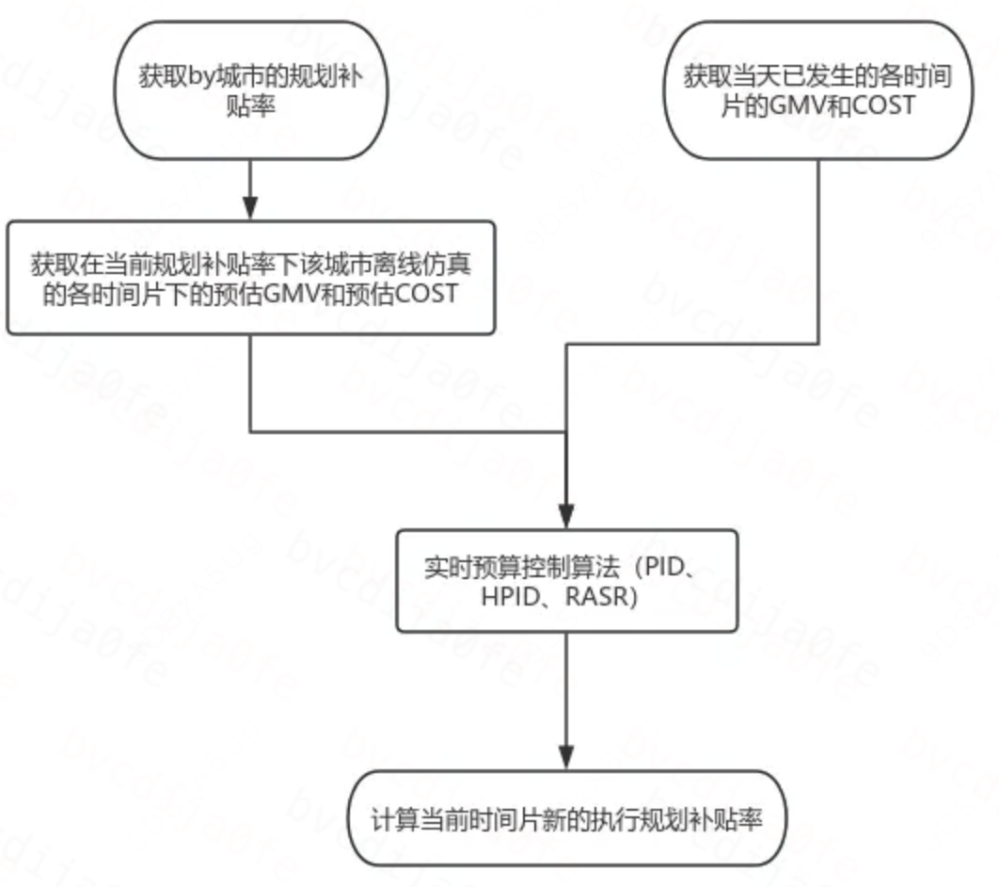
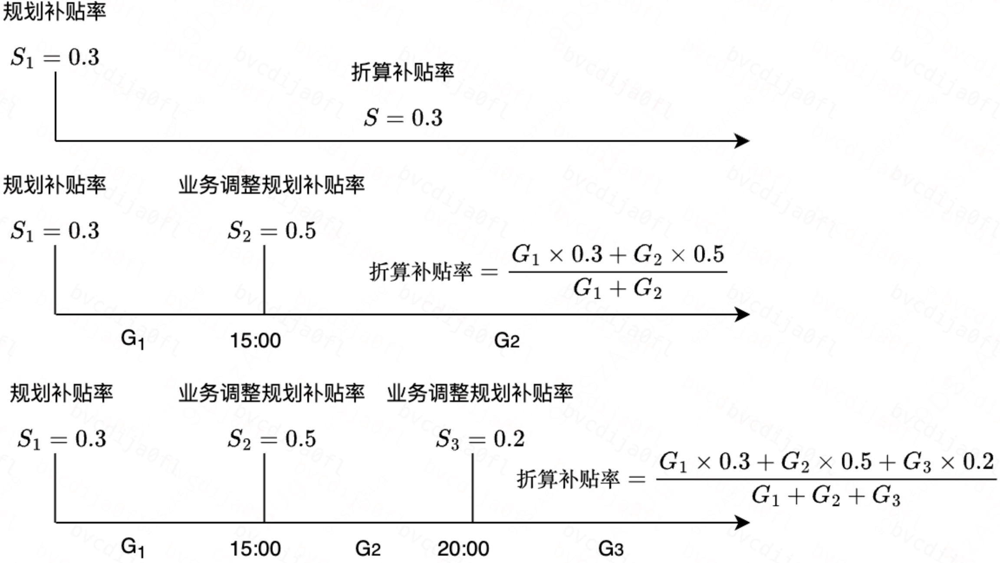
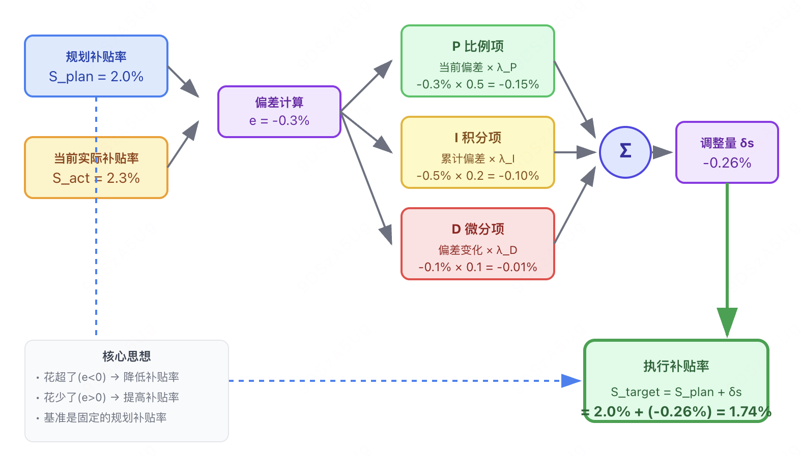
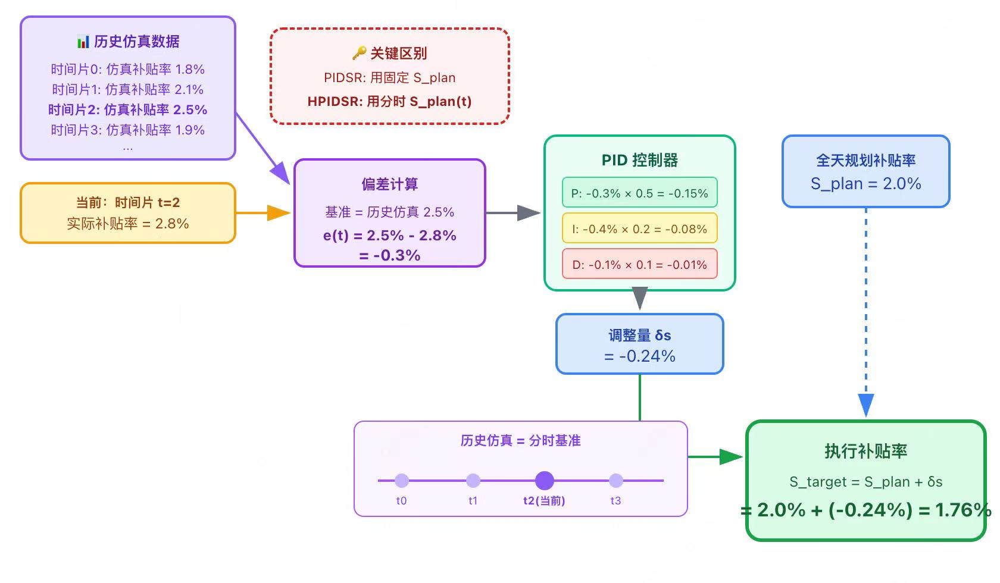
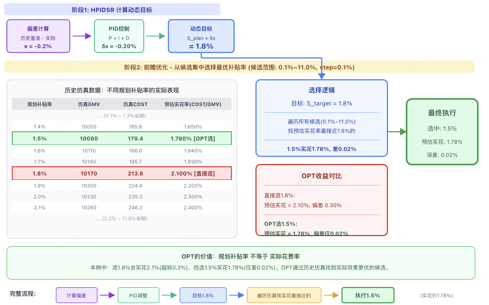
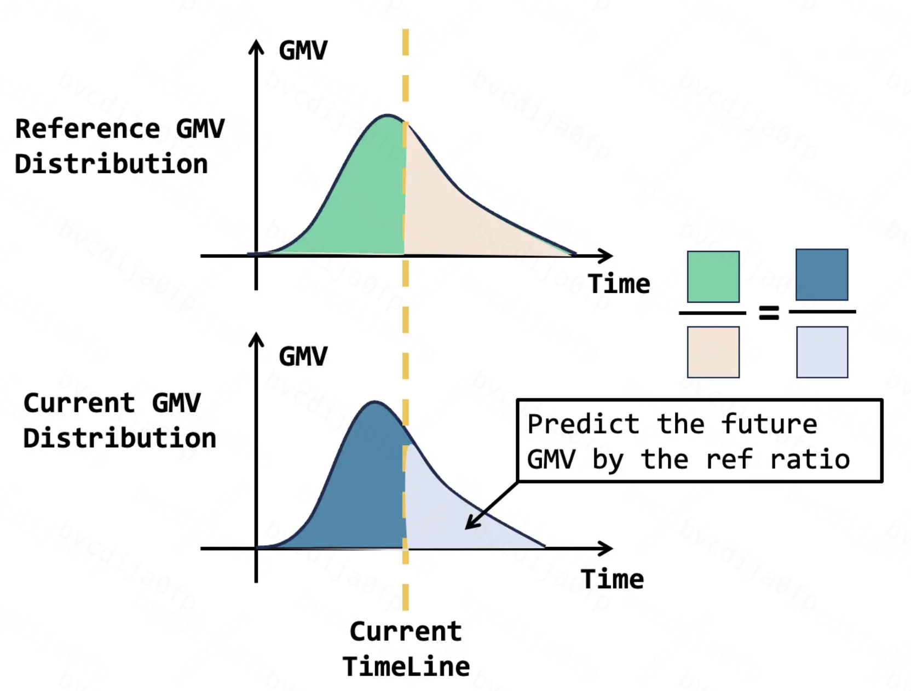
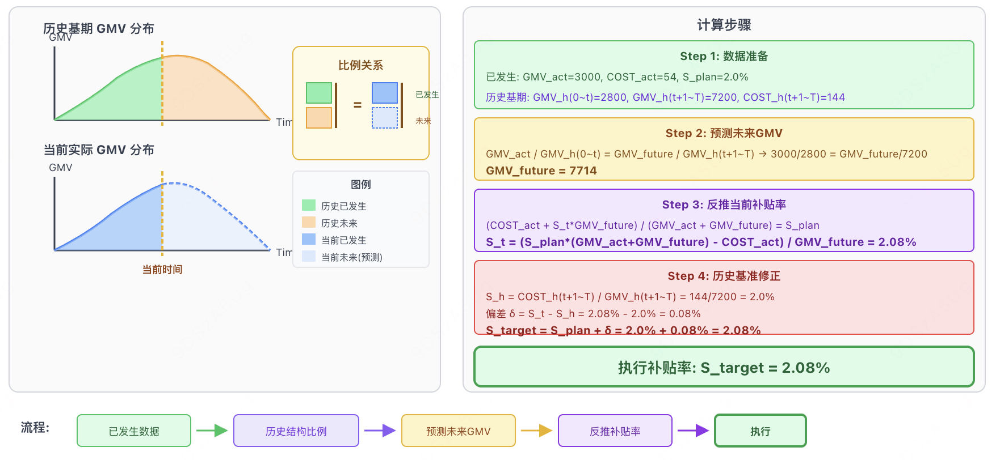
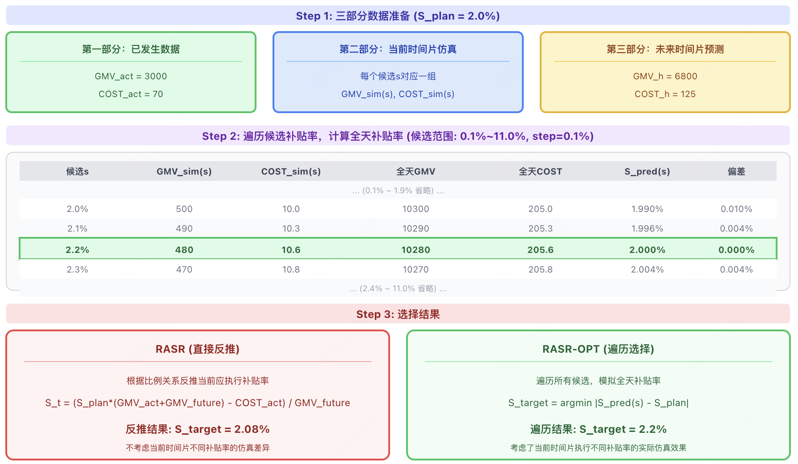
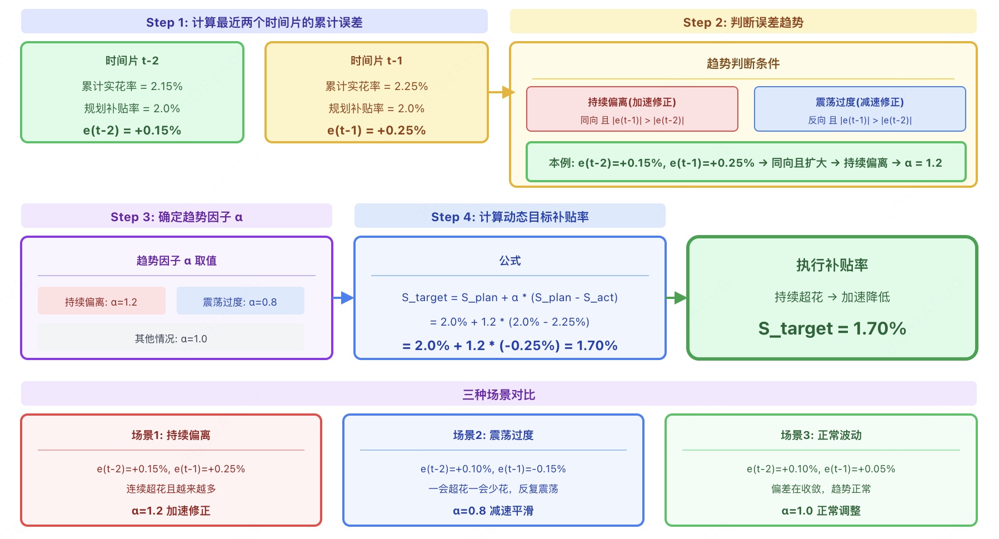
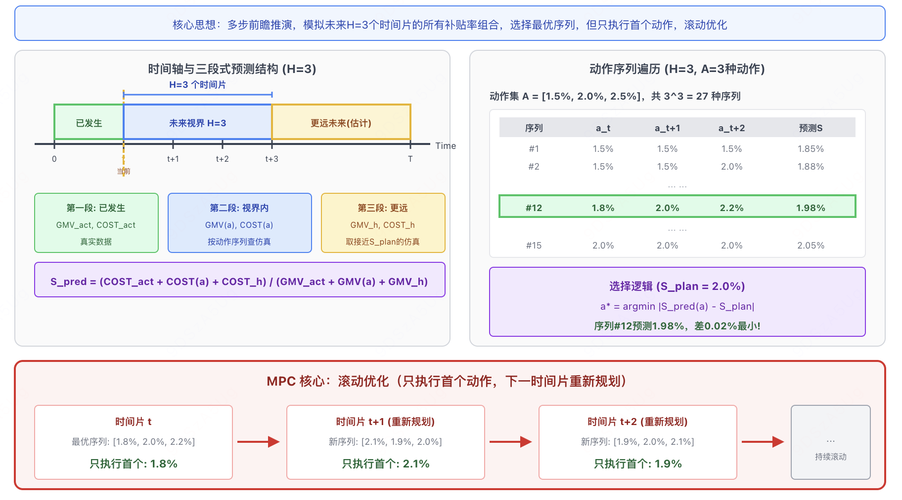

# 【LR25052】平台联合决策实时预算控制

[Cooper 原文](https://cooper.didichuxing.com/knowledge/2199610335356/2206086322984)

# 1. 背景

## 1.1 项目背景

在平台联合决策中，λ 把完单最大化目标，与预算不能超约束，通过拉格朗日方法融合到一个统一的无约束优化框架里。对每个 λ，都调用求解器对整城样本重新打分，观察由该 λ 推导出的补贴率是否与目标规划补贴率一致。通过不断缩小区间，最终找到使补贴率逼近目标值的 λ，并将其记录为“城市 × 目标 × 补贴率”三维字典。

因冒泡分布的变化和模型值准性会存在误差，通过离线仿真和贪心规划求解出来的字典，在线上执行时不能保证满足规划补贴率的约束，会出现花不准的情况。目前线上是基于历史基期的规划补贴率和实花情况，人工通过buffer来调整线上实际生效的执行规划补贴率，从而减小实际执行误差。

人工调整buffer的方式，存在以下问题：

1. 准确性严重依赖于基期的选择，如果所选基期冒泡分布与当前不一致的话，效果得不到保障；

2. 可调整的时间粒度较粗，只能by天调整；

3. 人力成本较高，一次分城市的调整，大约需要0.5天，且经常需要连续几天持续调整；

以下是预算控制人工调整方案在W26的表现，全国日 GAP 最高有 0.43pp；分城市来看，不少重点城市的实际花费与规划目标存在较大偏差，部分甚至高达 5pp。

|     | 25.6.23   | 25.6.24   | 25.6.25   | 25.6.26   | 25.6.27   | 25.6.28   | 25.6.29   |
| :---: | :---: | :---: | :---: | :---: | :---: | :---: | :---: |
| 规划   | 1.9%   | 1.90%   | 1.90%   | 2.60%   | 2.10%   | 2.10%   | 2.10%   |
| 实花   | 2.02%   | 2.02%   | 2.94%   | 3.03%   | 2.28%   | 2.04%   | 2.03%   |
| 误差   | 0.12pp   | 0.30pp   | 0.34pp   | **0.43pp**   | 0.18pp   | -0.06pp   | -0.07pp   |

| 城市ID   | 城市   | 盒子口径C补率误差   |
| :---: | :---: | :---: |
| 16   | 哈尔滨   | 5.77pp   |
| 34   | 福州   | 4.99pp   |
| 133   | 惠州   | 3.25pp   |
| ...   | ...   | ...   |
| 160   | 肇庆   | -3.02pp   |
| 81   | 潍坊   | -3.97pp   |
| 254   | 河源   | -5.89pp   |

## 1.2 目标&约束

- by城市每天误差<｜0.2｜pp

- 全国每天误差< |0.1| pp

# 2. 预算控制Overview

## 2.1 框架

对一天按照半个小时时间片切分，基于

- 当天已发生各时间片的COST和GMV（事实）

- 历史基期离线仿真产出的各时间片的COST和GMV（仿真数据）

每个时间片都会基于最新偏差动态调整下一片的补贴率，以达到全天实花逼近规划补贴率。

实时预算控制是by城市进行的，当城市超花或少花的时候，我们会对城市进行调整，逼近该城市的规划补贴率，但策略不会做城市之间的预算腾挪。

## 2.2 离线仿真

离线仿真包括两个部分：

**阶段一：基期结构仿真**

基于基期冒泡数据，对一天内按半小时切分的各时间片进行离线仿真。遍历不同规划补贴率（0～11pp，步长 0.1pp），为每个冒泡选择对应规划补贴率下的最优策略组合，预估其 GMV 与 COST，并聚合得到各时间片在不同补贴率下的仿真 GMV 与仿真 COST，形成用于预算控制的基期结构表。

**阶段二：策略执行仿真**

基于实验期冒泡数据，按照半小时粒度切分时间片，并在采样的规划补贴率集合上（步长0.5pp），完整复现线上预算控制逻辑（PIDSR / HPIDSR / RASR 等）。仿真过程中逐时间片动态调整执行补贴率，计算在调整后补贴率下产生的 GMV 与 COST，用于评估不同控制策略在实际执行中的预算收敛能力，使实花补贴率尽可能逼近规划补贴率。

## 2.3 线上逻辑

### 2.3.1 数据准备

**基期：**和离线仿真思路一致，基于基期的冒泡，离线仿真出来的在各个补贴率下，各个时间片的仿真COST和GMV。基期以周为单位滚动更新：例如本周线上执行所使用的基期数据来自上周仿真数据。

|    | 城市   | 规划补贴率   | 时间片index   | 仿真GMV   | 仿真COST   |
| --- | --- | --- | --- | --- | --- |
| 字段描述   | 城市id   | 遍历所有的规划补贴率，单位为pp   | 一天为48个时间片，index从0开始   | 仿真得到的GMV   | 仿真得到的COST   |
| 字段实例   | 8   | 0.5   | 0   | 5000   | 200   |

**线上实时：**by城市记录当前城市在各个已发生的时间片上真实发生的COST和GMV

### 2.3.2 熔断逻辑

根据预估的全天GMV，计算出当天cost的上限，当发现补贴额花完了，就触发提前熔断。

之前数据中，没有计算出因。这会导致实际补贴成本被高估，预算控制口径与真实业务表现不一致。在 kflower_marketplace.ods_log_kflower_platform_call_return_public_log_h 日志表中，记录了平台呼返过程的详细信息，其中的 is_fuse、fuse_discount 以及 box_call_return_saved_by_fuse、platform_call_return_saved_by_fuse 等是识别熔断事件与计算节省成本的字段。新建了表 **pltf_union_stg_subsidy_detail_by_order_with_fuse**，以订单为粒度、包含熔断回补后成本的宽表。表中新增了字段 fuse_saved_uabox_c 和 fuse_saved_pltf_c 分别表示因熔断节省的 特价盒子去 与平台成本，并在此基础上计算了“含熔断”的各类补贴金额。

### 2.3.3 延迟核销

对全量补贴城市历史数据分析，超过 70% 的城市在完单后的 7 天内就能完成 99% 以上的补贴入账，因此以「完单日到第 7 天」作为核销期建模。

基于历史数据为每个城市构建了核销节奏，把补贴从完单到入账的真实节奏量化成一个 8 位数组代表完单日到第 7 天每日的核销比例。

在给出规划补贴率 S₁ 后，将城市核销节奏加入计算，使策略侧生成延迟核销逻辑后的补贴率 S₂ 更接近真实入账逻辑，让预算执行更符合真实的花费节奏。

### 2.3.4 适配一天多次调整规划补贴率

当前运营可能会在一天内多次调整补贴率，需要按照已发生GMV份额和未发生GMV份额比例对新的全天新规划补贴率进行折算，得到目前时间点折算后的新规划补贴率（把已经发生的 GMV与未发生的 GMV 进行加权平衡）。

### 2.3.5 前瞻部分优化

对所有城市的历史补贴率做了统计，约 90% 的城市历史最高补贴率都在 6pp 以下。

对前瞻模块增加了“补贴率上限约束”，将候选补贴率截断在 6pp，使策略更符合真实业务区间，有效减少了早期波动，预算执行显著变稳。

# 3. 控制方法

## 3.1 PID类方法

PID 类方法设计理念来自经典控制理论，通过对偏差进行比例（P）、积分（I）和微分（D）分解，使系统不仅能对当前偏差立即做出反应，还能考虑累积偏差对全天预算的长期影响，并对偏差变化趋势进行提前调整。在算法结构上，PID 类方法每到一个新的时间片，就会基于当前的预算执行情况计算偏差，并据此生成下一时间片的执行补贴率，通过实时偏差即时调整使实际补贴率逐步贴近规划目标。

### 3.1.1 PIDSR

PIDSR\[1\]通过比较规划补贴率与实际补贴率之间的偏差，在每个时间片动态调整下一阶段的目标补贴率，使实际补贴率能够逐步逼近规划目标。在时间片 t，系统首先计算当前偏差与累计偏差，当前偏差可表示为

$$e^{(t)} = s_{plan} - s_{act}^{(t)}$$

累计偏差可表示为

$$e^{(:t)} = s_{plan} - s_{act}^{(:t)}$$

同时系统还会判断偏差的变化趋势，即当前偏差与上一时间片偏差之间的差异。根据这些偏差信息，PIDSR 通过比例、积分、微分三个部分共同作用，计算出补贴率的调整量

$$\delta_s = \lambda_P e^{(t)} + \lambda_I e^{(:t)} + \lambda_D (e^{(t)} - e^{(t-1)})$$

最终生成下一时间片的执行目标补贴率

$$s_{target}(t) = s_{plan} + \delta_s$$

系统在时间片 t+1 根据新的目标补贴率执行策略，并在随后的时间片中不断重复该过程，使一天内的累计实际补贴率逐渐逼近规划目标。

较详细的过程&推导
PIDSR 会在每个时间片计算出当前的偏差，包括当前偏差（实际值和目标值的差）、累计偏差（历史误差的累积）以及偏差的变化趋势（偏差是变大还是变小）算出一个补贴调整量 δₛ。最后，这个调整量会叠加到当前的规划补贴率上，生成下一时间片的执行目标补贴率。

具体公式如下：

$$\begin{aligned} e^{(t)} &= s_{plan} - s_{act}^{(t)} \\ e^{(:t)} &= s_{plan} - s_{act}^{(:t)} \\ \delta_s &= \lambda_P \cdot e^{(t)} + \lambda_I \cdot e^{(:t)} + \lambda_D \cdot (e^{(t)} - e^{(t-1)}) \\[4pt]s_{\mathrm{target}}(t) &= s_{\mathrm{plan}} + \delta_s \end{aligned}$$

其中：

- $$s_{plan}$$：城市的规划补贴率，该城市在预算规划中希望全天保持的目标补贴率

- $$s_{act}^{(t)}$$：城市在当前时间片 t的实际发生补贴率

- $$s_{act}^{(:t)}$$：截止到当前时间片 t的累计实际发生补贴率

- $$e^{(t)}$$: 当前偏差

- $$e^{(:t)}$$: 累计偏差

- $$\delta_s$$: 补贴率调整量

- $$s_{\mathrm{target}}(t)$$ :当前时间片经调整后的动态目标补贴率，为了实现全天规划目标所应达到的执行补贴率

在这个公式中，三个参数 $$\lambda_P$$​、$$\lambda_I$$和 $$\lambda_D$$ 分别对应 比例项、积分项 和 微分项，由离线仿真得到，最优参数组合为使得离线仿真系统中执行误差最小的参数组合。

- **比例项：**反映当前偏差的直接影响，当实际补贴率偏离目标时立即进行调整；

- **积分项：**考虑偏差的累积效应，用于修正长期偏差，防止系统持续偏高或偏低；

- **微分项**：衡量偏差的变化趋势，能够提前感知波动并进行平滑修正，避免过度调整。

计算出调整量 $$\delta_s$$ 后，我们将其加在当前的规划补贴率 $$s_{plan}$$ 上，得到执行规划补贴率，即：$$s_{\mathrm{target}}(t) = s_{plan} + \delta_s$$。

这样，在时间片 t+1中，系统就会按照新的补贴率水平进行策略执行。通过持续迭代这一过程，PIDSR 能够在一天的多个时间片内自动调节补贴率，使累计实际补贴率逐步逼近规划目标。

### 3.1.2 HPIDSR

HPIDSR \[1\] 是在 PIDSR 控制框架基础上的改进方法，用于刻画不同时间片之间在 GMV 与成本结构上的差异。由于不同时间片的业务规模和补贴结构并不一致，如果始终使用全天固定的规划补贴率作为偏差计算基准，容易在高峰或低谷时段产生偏差判断失真。为此，HPIDSR 在偏差计算中引入了基于离线仿真得到的分时间片规划补贴率，使控制器在实时调节时同时参考当前实际数据与历史结构性规律。在时间片 t，系统将实际补贴率与该时间片对应的仿真规划补贴率进行比较，得到当前偏差和累计偏差，例如

$$e^{(t)} = s_{\text{plan}}^{(t)} - s_{\text{act}}^{(t)}, \qquad e^{(:t)} = s_{\text{plan}}^{(t)} - s_{\text{act}}^{(:t)}$$

基于这些偏差信息，HPIDSR 仍采用 PID 形式计算补贴率调整量

$$\delta_s = \lambda_P e^{(t)} + \lambda_I e^{(:t)} + \lambda_D \big(e^{(t)} - e^{(t-1)}\big)$$

并生成当前时间片的动态目标补贴率

$$s_{\mathrm{target}}(t) = s_{\text{plan}} + \delta_s$$

系统在后续时间片中按照新的目标补贴率执行策略，从而在保持全天规划目标约束的同时，实现对不同时间片结构差异的自适应调节。

较详细的推导&过程
HPIDSR是在 PIDSR 控制框架基础上的改进，兼顾不同时间片的结构性差异与历史规律。不同时间片的 GMV 和 cost 结构并不一致，如果将一个全天固定的规划补贴率作为偏差计算基准，会导致系统在例如高峰时段的判断不准。HPIDSR 在偏差计算中引入离线仿真得到的分时间片预估补贴率，使得控制器能够同时利用实时数据与历史结构性信息，从而获得更加稳定、合理的调节能力。HPIDSR 将传统 PIDSR 中的固定规划补贴率 $$s_{\text{plan}}$$替换为在时间片 $$t$$ 下的历史仿真补贴率 $$s_{\text{plan}}^{(t)}$$。在时间片 $$t$$ 内，基于实时数据计算当前补贴率与累计补贴率，并分别与仿真预估补贴率进行比较，得到当前偏差与累计偏差。

$$\begin{aligned} e^{(t)} &= s_{\text{plan}}^{(t)} - s_{\text{act}}^{(t)} \\ e^{(:t)} &= s_{\text{plan}}^{(t)} - s_{\text{act}}^{(:t)} \\ \delta s &= \lambda_P \cdot e^{(t)} + \lambda_I \cdot e^{(:t)} + \lambda_D \cdot \big(e^{(t)} - e^{(t-1)}\big) \\[4pt]s_{\mathrm{target}}(t) &= s_{\mathrm{plan}} + \delta_s\end{aligned}$$

其中：

- $$s_{\text{plan}}^{(t)}$$：城市在时间片 t下的规划补贴率，这里不是一个固定常数，而是基于离线仿真得到的、在时间片内的预估补贴率，反映了历史上在该时间片下的典型成本结构与补贴水平，用作动态基准

- $$s_{act}^{(t)}$$：城市在当前时间片 t的实际发生补贴率

- $$s_{act}^{(:t)}$$：截止到当前时间片 t的累计实际发生补贴率

- $$e^{(t)}$$: 当前偏差

- $$e^{(:t)}$$: 累计偏差

- $$\delta_s$$: 补贴率调整量

- $$s_{\mathrm{target}}(t)$$ :当前时间片经调整后的动态目标补贴率，为了实现全天规划目标所应达到的理想执行补贴率

利用$$s_{\text{act}}^{(t)}$$和$$s_{\text{act}}^{(:t)}$$这两个偏差量，系统分别衡量当下的实时偏离、历史累计偏离，以及两个时间片之间的偏差变化趋势。

在得到偏差修正量 $$\delta_s$$后，将其叠加到规划补贴率$$s_{\text{plan}}$$上，形成当前时间片的动态目标补贴率$$s_{\text{target}}(t)$$，用于指导下一时间片的实际补贴率执行。

### 3.1.3 HPIDSR-OPT

HPIDSR-OPT 是在 HPIDSR 之上，引入前瞻性优化步骤。与仅依赖实时偏差修正不同，HPIDSR-OPT 在确定下一时间片的补贴率时，同时利用历史基期中不同补贴率对应的 GMV 与成本表现，对可选补贴率的实际执行效果进行预估。在时间片 t，系统首先与 HPIDSR 相同，基于实时发生的补贴率与分时间片仿真规划补贴率计算偏差，并得到一个动态目标补贴率

$$s_{\text{target}}(t) = s_{\text{plan}} + \delta_s$$

但在实际执行时，HPIDSR-OPT 并不直接采用该值，而是考虑当前时间片内允许执行的补贴率集合 $$S_{\mathrm{avail}}(t)$$。对于集合中的每一个候选补贴率 $$s_{\text{cand}}$$，系统会利用历史仿真数据估计其在相同时间片下产生的实际补贴率 $$\hat{s}_{\text{act}}(t \mid s_{\text{cand}})$$。随后，在所有候选补贴率中，系统选择其预估实际补贴率最接近动态目标补贴率的候选值作为最终执行补贴率，即

$$s_{\text{exec}}(t) = \operatorname*{arg\,min}_{s_{\text{cand}}\in S_{\mathrm{avail}}(t)} \bigl|\,s_{\text{target}}(t) - \hat{s}_{\text{act}}\!\bigl(t\mid s_{\text{cand}}\bigr)\bigr|$$

通过这一方式，HPIDSR-OPT在逼近动态目标的同时，避免直接执行连续控制结果可能带来的剧烈跳变或噪声放大问题，使补贴率调整更加稳定、可控。

较详细的推导&过程
HPIDSR-OPT 是在 HPIDSR 基础上引入前瞻性优化步骤，使系统在决定下一时间片应采用的补贴率时，不仅依赖实时偏差，也利用历史基期中不同补贴率下的 GMV 与成本表现，对当前可选补贴率的未来实际效果进行预估。

在 HPIDSR-OPT 的第一阶段，系统利用实时发生的补贴率与历史仿真补贴率构建当前偏差，与HPIDSR相同：

$$\begin{aligned} e^{(t)} &= s_{\text{plan}}^{(t)} - s_{\text{act}}^{(t)},\\ e^{(:t)} &= s_{\text{plan}}^{(t)} - s_{\text{act}}^{(:t)},\\ \delta s &= \lambda_P\, e^{(t)} + \lambda_I\, e^{(:t)} + \lambda_D\bigl(e^{(t)} - e^{(t-1)}\bigr),\\[4pt] s_{\text{target}}(t) &= s_{\text{plan}} + \delta_s. \end{aligned}$$

第二步中，HPIDSR-OPT不直接使用 $$s_{\text{target}}(t)$$作为下一时间片执行值，而是对时间片 $$t$$ 可选的所有候选补贴率集合 $$S_{\mathrm{avail}}(t)$$逐一进行预估。对于任意候选补贴率 $$s_{\text{cand}}$$，系统从历史基期仿真数据中查得其在时间片 $$t$$下对应的 GMV 与cost表现：

$$\bigl(g_h(t, s_{\text{cand}}),\; c_h(t, s_{\text{cand}})\bigr)$$

并进一步计算其预估瞬时实际补贴率：

$$\hat{s}_{\text{act}}\!\bigl(t \mid s_{\text{cand}}\bigr) = \frac{c_h(t, s_{\text{cand}})}{g_h(t, s_{\text{cand}})}$$

该值表示若在当前时段采用补贴率 $$s_{\text{cand}}$$​，其在历史相同时间片下曾产生的真实补贴水平。

随后，在所有候选补贴率中，系统选择使预估实际补贴率最接近动态目标补贴率的候选值，作为本时间片最终执行的补贴率：

$$s_{\text{exec}}(t) = \operatorname*{arg\,min}_{s_{\text{cand}}\in S_{\mathrm{avail}}(t)} \bigl|\,s_{\text{target}}(t) - \hat{s}_{\text{act}}\!\bigl(t\mid s_{\text{cand}}\bigr)\bigr|$$

这样系统不再直接将反馈控制的输出作为执行动作，而是在可行补贴率集合中挑选一个历史上表现最接近该目标且更稳定的补贴率，实现对动态目标的近似执行，同时避免过度跳变或由于偏差噪声带来的误判。

## 3.2 RASR类方法

RASR 类方法是一组基于历史结构规律和数据比例关系构建的无参预算控制策略，与 PID 类依赖超参数调节的反馈式控制不同，RASR 方法通过结构推断比例计算的方式，利用历史基期的 GMV / COST 分布结构对未来未发生部分进行预测，再从全天规划补贴率反推当前时段应执行的补贴率，使得“已发生部分 + 未来预测部分”在全天维度尽量贴近目标。其核心逻辑依赖数据本身的结构稳定性。

### 3.2.1 RASR

RASR\[1\]不依赖任何超参数，它完全基于“历史结构规律 + 当前已发生数据”的比例关系来推算未来可能发生的 GMV，从而反推当前时间片应采用的补贴率，使全天实际补贴率尽可能逼近规划目标补贴率。它的核心思想是既然一天的 GMV 和COST在时间片上的结构分布具有明显规律，那么只要“已发生部分”与“未来未发生部分”在比例关系上大致稳定，就可以根据历史结构推断未来规模，进而计算当下应该采取怎样的补贴率，使最终结果贴合目标。

假设一天共有 $$T$$ 个时间片，当前处于第 $$t$$ 片。时间片 1 到$$t-1$$的 GMV 与成本已经真实发生，时间片 $$t$$ 之后的部分尚未到来。为了估计未来部分的规模，RASR 利用历史基期仿真中的 GMV 分布作为结构参考，假设实际与历史分布的相对比例保持一致。基于这一结构性假设，系统构建未来剩余 GMV 的估计量 $$\hat{g}_t^{\text{rest}}$$，并通过如下比例关系求得：

$$\frac{\hat{g}_t^{\text{rest}}}{\sum_{i=1}^{t-1} g_i + \hat{g}_t^{\text{rest}}} = \frac{h_t^{\text{rest}}}{\sum_{i=1}^{T} h_i},$$

其中 $$g_i$$为当前实验期实际 GMV，$$h_i$$ 为历史基期的仿真 GMV，$$h_t^{\text{rest}}=\sum_{i=t}^{T}$$ 表示历史中从时间片 $$t$$ 开始到一天结束的 GMV。根据比例，可以解出未来剩余 GMV 的估计值：

$$\hat{g}_t^{\text{rest}} = h_t^{\text{rest}} \cdot \frac{\sum_{i=1}^{t-1} g_i}{\sum_{i=1}^{T} h_i - h_t^{\text{rest}}}$$

这样一来，就知道了未来需要覆盖的 GMV 规模。随后，RASR 利用规划补贴率目标 $$S^*$$来反推当前时间片应采用的补贴率 $$s$$。目标是使“已发生成本 + 预计未来成本”除以“已发生 GMV + 预计未来 GMV”尽可能等于规划补贴率：

$$\frac{\sum_{i=1}^{t-1} \text{cost}_i + \hat{g}_t^{\text{rest}}\cdot s} {\sum_{i=1}^{t-1} g_i + \hat{g}_t^{\text{rest}}} = S^*$$

化简可得当前应执行的补贴率：

$$s = \frac{ S^*\cdot\left(\sum_{i=1}^{t-1} g_i + \hat{g}_t^{\text{rest}}\right) - \sum_{i=1}^{t-1} \text{cost}_i } {\hat{g}_t^{\text{rest}}}$$

为了进一步避免因未来结构变化造成偏差，RASR 引入一个来自历史基期的“结构基准补贴率”。系统会计算历史上在时间片 $$t$$之后的加权平均补贴率：

$$s_h = \frac{ \sum_{i=t}^{T} h_i \cdot s_i^{\text{history}} } {h_t^{\text{rest}}}$$

代表了历史上在类似位置（时间片 $$t$$ 及之后）系统通常维持的补贴水平，用于反映历史结构。当前反推的补贴率与历史基准之间的差异：

$$\Delta s = s - s_h$$

体现了当前节奏相对于历史规律的偏离程度。系统将该偏差叠加在规划补贴率上得到下一时间片的执行值：

$$s_{\text{exec}}(t+1) = s_{\text{plan}} + \Delta s$$。

### 3.2.2 RASR-OPT

RASR-OPT 是在 RASR 的基础上引入前瞻性模拟的方法。与直接根据比例关系反推出当前补贴率不同，RASR-OPT 在当前时间片会比较“如果现在选择不同补贴率，最终全天补贴率会是多少”，并从中选出最接近规划目标的执行值。在时间片 t，系统将全天补贴率拆分为三部分：已发生的事实部分、当前时间片在不同补贴率下的仿真表现，以及未来时间片基于历史结构的预测部分。对于当前可选的补贴率 $$s_{\text{cand}}$$，系统会估计若在当前时间片采用该补贴率，最终全日的预期补贴率 $$\hat{s}_{\mathrm{final}}(s_{\text{cand}})$$，并选择其与规划补贴率 $$s_{\text{plan}}$$偏差最小的补贴率作为当前时间片的执行值，即

$$s_{\mathrm{exec}}(t)=\arg\min_{s_{\mathrm{cand}}} \left|\,s_{\text{plan}}-\hat{s}_{\mathrm{final}}(s_{\text{cand}})\right|$$。

较详细的推导&过程
RASR-OPT是在 RASR 的基础上，模拟如果当前时间片采用不同补贴率，最终全天补贴率将会是多少，并以最接近规划补贴率的目标选择当前时间片的执行补贴率。

在执行时，系统首先保留 RASR 的三部分：已发生的 GMV 与 COST、当前时间片不同补贴率下的仿真表现（由离线仿真预先计算的 $$g(t,s)$$ 和 $$c(t,s)$$）、以及未来时间片的基期预测。与基础 RASR 不同，前瞻版 RASR 不再直接反推当前补贴率，而是遍历当前可用补贴率集合，模拟每一个候选补贴率在“当前事实 + 当前仿真 + 未来预测”下能产生的全天最终补贴率，从而选出最优执行值。

在时间片 $$t$$，已发生的 GMV 与 COST 分别为 $$\sum_{i=1}^{t-1} g_i$$ 和 $$\sum_{i=1}^{t-1} \text{cost}_i$$。对于未来部分，即时间片 $$t+1$$ 到 $$T$$，系统从历史基期仿真中查得其对应的 GMV 与 COST 预测值：

$$G_h(t+1{:}T) = \sum_{\tau=t+1}^{T} g_h(\tau, s_\tau), \qquad C_h(t+1{:}T) = \sum_{\tau=t+1}^{T} c_h(\tau, s_\tau)$$

其中 $$s_\tau$$​ 为在历史基期时间片$$\tau$$中最接近整体规划补贴率 $$s_{\text{plan}}$$ 的可行补贴率，即：

$$s_\tau = \operatorname*{arg\,min}_{s\in S_h(\tau)} |\,s_{\text{plan}} - s\,|$$

这样，未来未发生部分的 GMV 和成本规模就由基期结构决定。

接下来，对当前时间片所有候选补贴率 $$s_{\text{cand}}\in S_{\mathrm{avail}}(t)$$分别进行模拟。基期中已经给出了在当前时间片执行补贴率$$s_{\text{cand}}$$ 时的瞬时 GMV 与 COST：

$$g(t,s_{\text{cand}}),\qquad c(t,s_{\text{cand}})$$

系统将这两项与已发生事实和未来部分拼接，即可得到如果当前选择 $$s_{\text{cand}}$$，最终全日的预计补贴率：

$$\hat{s}_{\mathrm{final}}(s_{\mathrm{cand}})= \frac{ \sum_{i=1}^{t-1}\text{cost}_i + c(t,s_{\mathrm{cand}}) + C_h(t+1{:}T) }{ \sum_{i=1}^{t-1}g_i + g(t,s_{\mathrm{cand}}) + G_h(t+1{:}T) }$$

该值表示当前动作在“整天尺度”上的补贴率结果。系统随后将所有候选补贴率的预估全天补贴率与规划目标 $$s_{\mathrm{plan}}$$​ 逐一比较，选择偏差最小者作为本时间片最终执行的补贴率：

$$s_{\mathrm{exec}}(t) = \operatorname*{arg\,min}_{s_{\mathrm{cand}}\in S_{\mathrm{avail}}(t)} \left|\, s_{\mathrm{plan}} - \hat{s}_{\mathrm{final}}(s_{\mathrm{cand}}) \right|$$

前瞻机制能够有效避免基础 RASR 在结构变化、波动较大的城市中出现的短期误判，因为其不是根据比例关系直接反推，而是明确比较不同动作在未来一整天的表现，从而实现更精细、更稳健的补贴率控制。

### 3.2.3 RASR-ET

RASR-ET\[1\]是在 RASR 的框架上，引入误差趋势的动态自适应机制，用以增强在强波动时段下的补贴率调整稳定性。在实际业务中，累计补贴率的偏差往往呈现趋势性变化，例如连续几片持续“超花”或“少花”。若仍以静态步幅调整补贴率，则系统可能出现修正过慢或震荡过度的情况。RASR-ET 通过动态观察过去几个时间片的误差方向与变化幅度，判断补贴执行是否正在“加速偏离”或“反向震荡”，并对调整幅度做出自适应放大或平滑处理，使预算控制具备趋势识别能力。

在时间片 $$t$$，系统首先基于截至上两个时间片的累计实际补贴率与规划补贴率计算累计误差：

$$e(:t-1)=s_{\mathrm{plan}}-s_{\mathrm{act}}(:t-1), \qquad e(:t-2)=s_{\mathrm{plan}}-s_{\mathrm{act}}(:t-2)$$

若两次误差符号相同（说明补贴执行连续两片同向偏离规划目标），且偏差绝对值进一步扩大，即：

$$e(:t-1)\cdot e(:t-2) > 0 \quad \land \quad |e(:t-1)| > |e(:t-2)|$$

则判断系统存在“持续偏离”的趋势。此时应提高调整力度，使补贴率更快回到规划区间，采用加速因子$$\lambda_{\mathrm{accel}}$$。

若两次误差方向相反，且偏差绝对值反而放大，即：

$$e(:t-1)\cdot e(:t-2) < 0 \quad \land \quad |e(:t-1)| > |e(:t-2)|$$

则说明系统存在“震荡过度”现象，调整速度需放缓，采用减速因子 $$\lambda_{\mathrm{decel}}$$。

其余情况使用默认因子 1。

由此构成自适应趋势系数：

$$\lambda_{\text{agg}}= \begin{cases} \lambda_{\text{accel}}, & e(:t-1)e(:t-2)>0 \;\land\; |e(:t-1)|>|e(:t-2)|,\\[4pt] \lambda_{\text{decel}}, & e(:t-1)e(:t-2)<0 \;\land\; |e(:t-1)|>|e(:t-2)|,\\[4pt] 1, & \text{otherwise.} \end{cases}$$

随后，通过将该趋势因子作用于当前累计偏差，系统得到动态目标补贴率：

$$s_{\mathrm{target}}(t)=s_{\mathrm{plan}}+\lambda_{\mathrm{agg}}\cdot e(:t-1)$$

## 3.3 MPC

MPC是基于滚动时域优化的补贴率调控方法，核心思想是在每个时间片进行一次短期前瞻规划：通过模拟未来一段时间内所有可能的补贴率组合，预测其对全天最终补贴率的影响，从中选择偏差最小的动作序列作为当前的最优策略，并只执行该序列的首个补贴率，随后在下一时间片重新获取新的事实数据，再次向前推演。与单步前馈式方法相比，MPC 通过多步前瞻推演提高了决策的全局稳健性。

假设当前处于时间片 $$t$$，系统设定一个长度为 $$H$$ 的未来视界，并在当前实际可选的补贴率集合 $$S_{\text{avail}}(t)$$ 与未来时间片的离散补贴率集合 $$S_{\text{disc}}$$ 上生成所有可能的动作序列 $$U_t = (s_t, s_{t+1}, \ldots, s_{t+H-1})$$。系统将对每一个候选序列模拟其对全天最终补贴率的影响，并计算其预测的全天补贴率

$$s_{\text{final}}^{\text{pred}}(U_t) = \frac{C_{:t-1}+C_{t:t+H-1}^{s}(U_t)+C_{t+H{:}T}^{h}} {G_{:t-1}+G_{t:t+H-1}^{s}(U_t)+G_{t+H{:}T}^{h}}$$

其中，$$G_{:t-1}, C_{:t-1}$$ 表示截至 $$t-1$$已发生的 GMV 与 COST；

$$C_{t:t+H-1}^{s}(U_t)=\sum_{\tau=t}^{t+H-1} c_h(\tau,s_\tau),\qquad G_{t:t+H-1}^{s}(U_t)=\sum_{\tau=t}^{t+H-1} g_h(\tau,s_\tau)$$

为在未来 $$H$$ 个时间片内按序列中的补贴率查得的仿真 GMV 与 COST；

$$C_{t+H{:}T}^{h}=\sum_{\tau=t+H}^{T} c_h(\tau,s_\tau'),\qquad G_{t+H{:}T}^{h}=\sum_{\tau=t+H}^{T} g_h(\tau,s_\tau')$$

则表示对更远未来（$$t+H$$ 至 $$T$$）的估计，系统假设在这些时间片中执行最接近整体规划补贴率 $$s_\text{plan}$$的仿真可用补贴率

$$s_\tau'=\arg\min_{s\in S_h(\tau)} |s_{\text{plan}}-s|$$

通过上述三段式的拼接模拟（历史事实、短期预测、长期估计），MPC 可以在整天尺度上评估当前动作序列的预算执行效果。

随后系统求解以下最优控制序列：

$$U_t^{*} = \arg\min_{\substack{s_t\in S_{\text{avail}}(t)\\ s_{t+1,\ldots,t+H-1}\in S_{\text{disc}}}} \bigl|\,s_{\text{plan}}-s_{\text{final}}^{\text{pred}}(U_t)\bigr|$$

即选取预测结果最接近规划目标补贴率 $$s_\text{plan}$$ 的动作序列作为最优序列。MPC 的滚动式并不会一次性执行整个序列，而是仅采用最优序列 $$U_t^{*}$$ 的首个动作作为当前时间片的最终执行补贴率：

$$s_{\text{exec}}(t)=s_t^{*}$$

当系统进入下一个时间片$$t+1$$，最新的 $$(G_{:t},C_{:t})$$ 将被纳入，再次构建新的未来视界 $$(t+1 \ldots t+H)$$，并重新进行一轮预测与优化。通过持续的滚动优化，MPC 能不断修正对未来的估计，使预算执行在多个时间片中保持对全局目标的最优逼近。

Parameters
$$s_{\text{plan}}$$：整体规划补贴率

$$s_{\text{exec}}(t)$$：时间片 $$t$$ 最终执行补贴率 

$$H$$：未来视界长度（超参数） 

$$S_{\text{disc}}$$：推演未来使用的离散动作集合（超参数）

$$S_{\text{avail}}(t)$$：时间片 $$t$$ 实际可用补贴率集合 

$$U_t$$：候选动作序列 $$（t\ldots t+H-1)$$

$$G_{:t-1},C_{:t-1}$$：截至 $$t-1$$ 的累计实际 GMV 与 COST

$$g_h(\tau,s),c_h(\tau,s)$$：历史基期中在 $$\tau$$执行 $$s$$ 的预估 GMV 与 COST  

$$S_h(\tau)$$：历史基期中时间片 $$\tau$$ 的可用补贴率集合 

$$s_\tau'$$：$S_h(\\tau)$ 中最接近 $$s_{\text{plan}}$$ 的补贴率

## 3.4 总结 & 对比

| **算法**   | **核心逻辑**   | **优点**   | **缺点**   |
| :---: | :---: | :---: | :---: |
| **PIDSR**   | 实时对比规划补贴率与实际发生补贴率的偏差，综合当前偏差、累计偏差与偏差变化趋势计算补贴调整量。在每个时间片更新下一片的执行补贴率，使整体实花逐步收敛到规划目标。   | 1. 基于实时偏差调整补贴率，能在短时间内纠正预算偏离。   2. 依赖误差项（P/I/D），整体逻辑易解释，工程开发成本最低。   3. 在波动较小、结构相对平稳的城市中表现可靠。    | 1. 无法感知日内 GMV 结构变化（不依赖期）。   2. 依赖参数调优，若离线测算数据分布差距与线上大会导致调整不准。   3. 对噪声敏感，易在波动场景中震荡    |
| **HPIDSR**   | HPIDSR 以仿真得到的时间片级预测补贴率取代 PIDSR 中的固定规划补贴率。偏差的计算从“实际 vs 固定目标”升级为“实际 vs 仿真预估”，让补贴调整同时考虑实时执行情况与历史数据的结构性分布。   | 1. 引入时间片级仿真，使控制逻辑基于基期具备结构感知能力。   2. 目标值动态变化，使偏差计算更真实，减少由单片异常造成的过度修正。    | 1. 对仿真质量依赖强，若仿真假设与线上偏离，控制方向被误导。   2. 以即时反馈为主，缺乏前瞻性，无法根据未来走势提前修正策略。    |
| **HPIDSR-OPT**     | HPIDSR-OPT在HPIDSR的基础上对每个候选补贴率查仿真表，计算该补贴率下的预期 GMV、Cost 和由此得到的实际补贴率。再将预估值与当前目标补贴率逐一比较，挑选最接近目标的补贴率执行。   | 1. 执行前对候选补贴率逐一预估，可提前过滤不合理的执行值，让补贴跳动显著减小。   2. 在局部波动较大的时间片中，通过预估机制提升了稳定性，避免目标很准但最后选择偏。    | 1. 需要对每个候选补贴率查表计算，实时计算成本显著提高。   2. 仿真数据若存在偏差，预估环节会将偏差放大。    |
| **RASR**   | RASR 使用历史 GMV 在一天内的分布比例来估计当前时间片之后还会产生多少 GMV，然后根据“已发生成本 + 预计未来成本 = 目标整体成本”倒推出当前应该使用的补贴率。无参策略，只靠比例关系保证全天补贴率按目标补贴率收敛。   | 1. 不依赖参数调节，通过历史 GMV 分布自然实现动态预算控制。   2. 通过“已发生 + 预计未来”的结构化推断，使预算执行更加平滑、稳定性更强。    | 1. 对历史数据分布依赖强，若当天结构发生异常，预测误差放大。   2. 缺乏误差趋势感知，面对连续偏离时调整不够及时。       |
| **RASR-ET**     | RASR-ET在RASR的基础上，判断最近两个时间片的补贴率偏差是否“同向且扩大”或“反向震荡”。当偏差持续扩大时放大补贴调整幅度、当偏差反向震荡时减小调整幅度，让补贴率的收敛速度更稳定均衡。   | 1. 根据误差的连续趋势自适应调整节奏，使控制更平滑。   2. 抑制 RASR 在连续偏离时慢响应，提高纠偏敏感度。   3. 在误差震荡时自动降低步幅，减少补贴率来回跳动，提高稳定性。    | 1. 趋势判断窗口短，可能在异常结构下误判趋势，导致调整节奏偏快/慢。   2. 逻辑相对更复杂，对参数设置敏感，部署与调试成本更高。       |
| **RASR-OPT**     | RASR-OPT在RASR的基础上对每个候选补贴率构建全天模拟，把已发生的真实GMV/Cost、当前候选补贴率的仿真表现以及未来时间片的基期预测拼在一起，算出若执行该补贴率时的全天最终补贴率。从所有候选值中挑选出全天效果最接近规划目标的补贴率。   | 1. 对每个候选补贴率进行全天效果模拟，使决策从当前最优提升到全局最优。   2. 减少输出补贴率的极端值，避免超花/少花等偏离风险。   3. 提升结构变化场景下的适应性    | 1. 计算开销大，所有候选补贴率都需试算整天结果。   2. 对仿真数据和未来预测高度依赖，未来结构偏离时可能产生累计误差。       |
| **MPC**     | MPC 把当前和未来几个时间片的补贴率遍历组合成不同决策序列，并模拟每条序列的全天补贴表现。系统选择最优序列后，只执行序列的第一步，并在下一片重新计算，使补贴策略始终保持短期全局最优。   | 1. 能向前规划多个未来时间片，构建短期全局最优的补贴序列。   2. 将未来影响显式纳入决策，使补贴策略在多片视角下更合理稳定。    | 1. 决策序列数量随视界长度爆炸式增长，计算资源和工程复杂度极高。       |

# 4. 结果

## 4.1 离线结果

|     | PIDSR   | HPIDSR   | HPIDSR-OPT   | RASR   | RASR-ET   | RASR-OPT   | MPC   |
| :---: | :---: | :---: | :---: | :---: | :---: | :---: | :---: |
| 误差绝对值&lt;0.2pp比例   | 72.88%   | 60.74%   | 65.62%   | 73.01%   | 77.67%   | **84.38%**   | 82.60%   |
| Top41城所有补贴率平均误差   | 0.4pp   | 1.0pp   | 0.5pp   | 0.3pp   | 0.3pp   | **0.2pp**   | **0.2pp**   |

## 4.2 线上结果

### 4.2.1 平台联合决策V2

**实验日期：**2025-11-18 ～ 2025-11-24

**实验城市：**平台联合决策Top41城市

（2, 5, 6, 8, 9, 12, 13, 14, 15, 16, 17, 18, 19, 21, 22, 24, 25, 26, 29, 32, 33, 34, 35, 38, 42, 44, 50, 58, 60, 74, 81, 83, 85, 86, 125, 133, 134, 153, 157, 160, 254）

**实验组流量分配:**

- 20% RASR-OPT

- 20% MPC

- 50% 主流量

|    | 实验期大盘规划补贴率   | 实验期大盘实花补贴率   | 实验期误差   |
| --- | --- | --- | --- |
| RASR-OPT   | 0.89pp   | 0.99pp   | 0.10pp   |
| MPC   | 0.90pp   | 1.00pp   | 0.10pp   |
| 主流量   | 0.89pp   | 1.20pp   | 0.31pp   |

|     | RASR-OPT   | MPC   | 主流量   |
| --- | --- | --- | --- |
| 实验期误差绝对值&lt;0.2pp比例   | 61.6%（+23.9pp）   | **77.8%（+40.1pp）**   | 37.7%   |

|     | 合肥   | 河源   | 江门   | 昆明   | 南昌   | 南宁   | 青岛   | 厦门   | 石家庄   | 绵阳   | 武汉   | 烟台   | 肇庆   | 海口   | 柳州   | 邯郸   | 清远   | 太原   | 威海   | 惠州   |
| --- | --- | --- | --- | --- | --- | --- | --- | --- | --- | --- | --- | --- | --- | --- | --- | --- | --- | --- | --- | --- |
| MPC   | 0.02pp   | 0.20pp   | 0.10pp   | 0.15pp   | 0.17pp   | 0.11pp   | 0.10pp   | 0.20pp   | 0.10pp   | 0.17pp   | 0.19pp   | 0.11pp   | 0.13pp   | 0.06pp   | 0.20pp   | 0.12pp   | 0.35pp   | 0.19pp   | 0.20pp   | 0.34pp   |
| RASR-OPT   | 0.06pp   | 0.20pp   | 0.16pp   | 0.20pp   | 0.19pp   | 0.13pp   | 0.08pp   | 0.20pp   | 0.09pp   | 0.28pp   | 0.20pp   | 0.19pp   | 0.34pp   | 0.12pp   | 0.33pp   | 0.05pp   | 0.31pp   | 0.18pp   | 0.35pp   | 0.5pp   |
| 主流量   | 0.22pp   | 0.36pp   | 0.16pp   | 0.35pp   | 0.17pp   | 0.59pp   | 0.39pp   | 0.74pp   | 0.45pp   | 0.62pp   | 0.39pp   | 0.16pp   | 0.39pp   | 1.00pp   | 0.68pp   | 0.10pp   | 0.35pp   | 0.11pp   | 0.11pp   | 0.63pp   |

|     | 人均完单   | 人均呼叫   | 人均GMV   | 花业务补贴率   | GMV ROI(与主流量对比）   | 花业务AFROI（与主流量对比）   |
| --- | --- | --- | --- | --- | --- | --- |
| MPC   | 1.523   | 1.896   | 21.847   | 5.03pp   | 0.68   | 0.02   |
| RASR-OPT   | 1.528 **(+0.13%)**   | 1.901 **(+0.15%)**   | 21.966 **(+0.36%)**   | 5.14pp   | 1.53   | 0.07   |
| 主流量   | 1.526   | 1.898   | 21.893   | 5.11pp   | /(基准）   | /(基准）   |

### 4.2.2 平台联合决策V3

**实验日期：**2026-01-30 ～ 2025-02-04

**实验城市：**平台联合决策Top37城市

（5,6,8,9,12,13,14,15,16,19,22,24,25,26,29,32,33,34,35,38,42,44,50,58,60,74,81,83,85,86,125,133,134,153,157,160,254）

**实验组流量分配:**

- 5% RASR-OPT

- 5% MPC

- 5% 实时预算控制空白组

|    | 实验期大盘规划补贴率   | 实验期大盘实花补贴率   | 实验期误差   |
| --- | --- | --- | --- |
| RASR-OPT   | 0.92pp   | 0.97pp   | 0.05pp   |
| MPC   | 0.92pp   | 0.96pp   | 0.04pp   |
| 空白组   | 0.92pp   | 0.77pp   | 0.15pp   |

                                               \[Table 1\] 实验期大盘误差

|    | 2026-01-30   | 2026-01-31   | 2026-02-01   | 2026-02-02   | 2026-02-03   | 2026-02-04   |
| --- | --- | --- | --- | --- | --- | --- |
| RASROPT   | 0.11pp   | 0.01pp   | 0.05pp   | 0.05pp   | 0.08pp   | 0.07pp   |
| MPC   | 0.09pp   | 0.01pp   | 0.04pp   | 0.04pp   | 0.08pp   | 0.07pp   |
| 空白组   | 0.15pp   | 0.38pp   | 0.40pp   | 0.18pp   | 0.11pp   | 0.01pp   |

                                                                             \[Table 2\] by天大盘误差

|     | RASR-OPT   | MPC   | 空白组   |
| --- | --- | --- | --- |
| 实验期by城市误差绝对值&lt;0.2pp比例   | 79.5%  （+27.2pp）   | 75%  （+22.7pp）   | 52.3%   |

                                                  \[Table 3\]by城市by天误差<0.2pp比例

|     | 临沂   | 南宁   | 南昌   | 厦门   | 吉林   | 大同   | 大连   | 太原   | 威海   | 惠州   | 柳州   | 江门   | 沈阳   | 河源   | 泉州   | 海口   | 清远   | 温州   | 烟台   | 石家庄   | 福州   | 绵阳   | 肇庆   | 邯郸   | 长春   | 青岛   | 比例   |
| --- | --- | --- | --- | --- | --- | --- | --- | --- | --- | --- | --- | --- | --- | --- | --- | --- | --- | --- | --- | --- | --- | --- | --- | --- | --- | --- | --- |
| RASR-OPT   | 0.05pp   | 0.37pp   | 0.12pp   | 0.11pp   | 0.82pp   | 0.15pp   | 0.06pp   | 0.07pp   | 0.37pp   | 0.09pp   | 0.18pp   | 0.25pp   | 0.13pp   | 0.03pp   | 0.28pp   | 0.22pp   | 0.14pp   | 0.11pp   | 0.01pp   | 0.11pp   | 0.07pp   | 0.06pp   | 0.16pp   | 0.43pp   | 0.10pp   | 0.10pp   | 76.9%   |
| MPC   | 0.05pp   | 0.39pp   | 0.15pp   | 0.10pp   | 0.85pp   | 0.13pp   | 0.07pp   | 0.06pp   | 0.37pp   | 0.16pp   | 0.20pp   | 0.26pp   | 0.13pp   | 0.03pp   | 0.31pp   | 0.20pp   | 0.14pp   | 0.10pp   | 0.04pp   | 0.11pp   | 0.07pp   | 0.06pp   | 0.14pp   | 0.41pp   | 0.08pp   | 0.10pp   | 76.9%   |
| 空白组   | 0.62pp   | 0.19pp   | 0.15pp   | 0.10pp   | 0.75pp   | 0.07pp   | 0.37pp   | 0.01pp   | 0.19pp   | 0.09pp   | 0.10pp   | 0.17pp   | 0.10pp   | 0.27pp   | 0.02pp   | 0.89pp   | 0.26pp   | 0.16pp   | 0.16pp   | 0.48pp   | 0.67pp   | 0.10pp   | 0.16pp   | 0.84pp   | 0.06pp   | 0.02pp   | 65.4%   |

                                                                                                               \[Table 4\]实验期by城市总误差

|     | 人均完单   | 人均呼叫   | 人均GMV   | 花业务补贴率   | GMV ROI(与无预算组对比）   | 花业务AFROI（与无预算组对比）   |
| --- | --- | --- | --- | --- | --- | --- |
| RASR-OPT   | 1.922   | 2.388   | 29.249   | 0.056   | 0.756   | 0.105   |
| MPC   | 1.919   | 2.387   | 29.288   | 0.056   | 1.036   | 0.079   |
| 空白组   | 1.919   | 2.383   | 29.297   | 0.056   | 1.465   | 0.096   |
| 无预算组   | 1.910   | 2.375   | 29.163   | 0.053   | /（基准）   | /（基准）   |

                                                                                                                     \[Table 5\] 实验期钱效

# 5. 未来规划&放量

- 平台联合决策V3于10月上线、11月逐步扩量。为适配V3链路，已完成预算控制上线准备，等待12月中实验开启。

- 目前线上联合决策V3保持5%小流量预算控制组。

# 6. 致谢

感谢所有价格策略+工程同学给我的支持！

# 7. Reference

\[1\]柯晓鹏. (2025年6月9日). LR25009*品牌优惠实时预算控制算法设计以及离线仿真* . 花小猪策略部. 

[【LR25009】品牌优惠实时预算控制算法设计以及离线仿真](https://cooper.didichuxing.com/knowledge/2199610335356/2204571469455)
