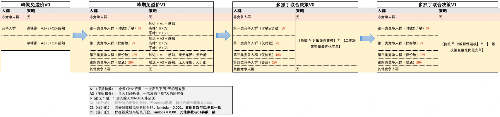
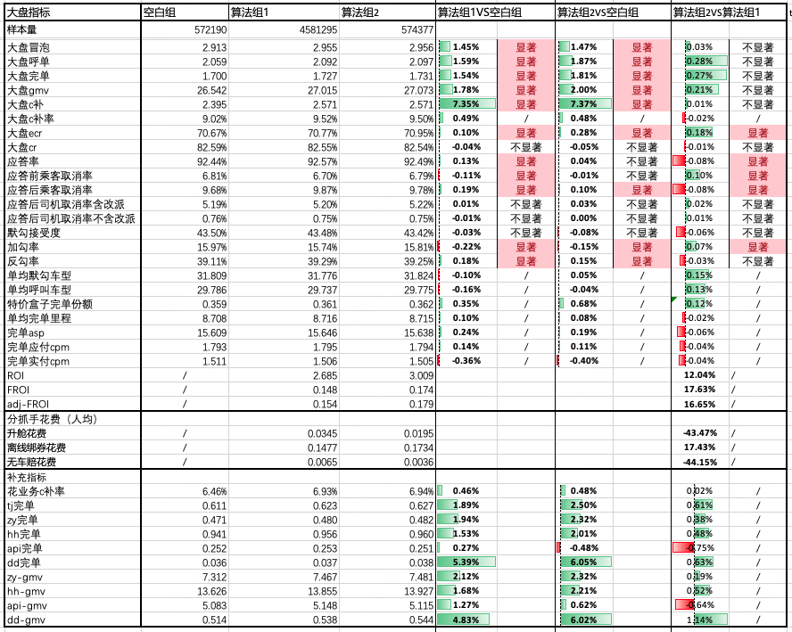
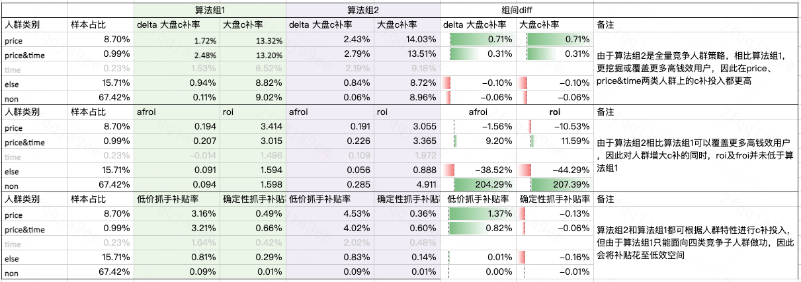
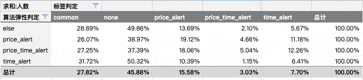

# 【LR26-001】乘客与增长-增长策略-ACTI多抓手联合决策算法-V1

[Cooper 原文](https://cooper.didichuxing.com/knowledge/2199610335356/2206652243628)

# 基础信息

| brd文档链接   | 无   |
| --- | --- |
| 最后通过的策略方案链接   | [多抓手联合决策策略方案](https://cooper.didichuxing.com/knowledge/2199610335356/2204952127973)   |
| 实验链接（评估大师）   | [https://x.intra.hongyibo.com.cn/exp/448295258488833?globalBusinessId=120000&globalProjectId=330331944058881&expFlowTab=design](https://x.intra.hongyibo.com.cn/exp/448295258488833?globalBusinessId=120000&globalProjectId=330331944058881&expFlowTab=design)   |
| 核心贡献点（创新点，可供其他算法同学借鉴的点）   | 本策略的核心创新在于将多抓手联合决策从四类竞争子人群扩展至全量竞争人群，并通过价敏/时敏弹性建模与最优化求解，在离线绑券、升舱、无车赔等抓手间进行预算联合分配；同时考虑不同抓手真实触发面的差异，使离线策略更贴近线上生效逻辑。实验表明，该框架能够识别更大范围内的高钱效用户，并将预算从低效确定性抓手腾挪至高效低价抓手，在拉齐补贴率下提升完单、GMV 和 ROI，为后续多抓手、多人群、差异化粒度的联合决策策略提供了可复用方法。   |
| 第一贡献人   | 张入月   |
| 共同贡献人（没有的话，可以置空）   |    |
| 后续策略负责人   | 韩一玮   |

# 一、背景

在「ACTI多抓手联合决策算法V0」中，我们构建了「多抓手联合决策算法框架」，通过建模**四类竞争子人群**的价格&时敏弹性，并使用最优化求解算法产出P维度抓手组合策略。基于四类竞争人群回收P维度算法策略vs人工组的AB实验结论，结论表明：由于P维度算法策略能够更精准的预测用户价敏&时敏弹性，并进行抓手间的预算分配，相比人工组带来大盘完单+0.14%的收益。目前，我们已将此算法策略扩量。

进一步，为了能更好地利用算法优势从而扩大策略收益，我们计划将策略作用人群从四类竞争子人群调整为**全量竞争人群**，在更大的策略覆盖面上，使用算法识别高价值用户并做好抓手间的预算腾挪，预期拿到更高的完单收益。

# 二、技术方案

## 2.1 基本内容介绍

- 作用的人群范围

	- 全量竞争人群

> Q：全量竞争人群定义

> A：历史14d内有过ODTP双冒的用户

四类竞争人群的定义
时敏&价敏：「is_14_sm = 1 」&「90天呼叫数<=32  &&  应答前取消率>30%」    &&    「Top20%价敏」

仅时敏：「is_14_sm = 1 」&「90天呼叫数<=32  &&  应答前取消率>30%」    &&    非「Top20%价敏」

仅价敏：「is_14_sm = 1 」& 非「90天呼叫数<=32  &&  应答前取消率>30%」    &&    「Top20%价敏」

普通：「is_14_sm = 1 」& 非「90天呼叫数<=32  &&  应答前取消率>30%」    &&    「20-50%价敏」

- 可用的抓手

	- 离线绑券&触达

每个用户一天最多发一张券，提前求解出发券pid，并配置pope活动定时下发

	- 升舱

by trace 实时判断是否触发升舱，若触发升舱，follow旧升舱策略逻辑(lambda判断和生效场景)

	- 无车赔

by trace 实时判断是否触发无车赔，若触发无车赔，follow现有无车赔策略逻辑(赔付规则)

- 算法策略框架：同ACTI多抓手联合决策算法V0

	- 优化求解：考虑抓手真实触发面的二维差异化粒度决策变量最优化问题

	- 弹性建模：包含场景信息embedding层的基于ESMM的双DRCFR模型

- 模型离线评估结果

[多抓手联合决策模型调优-全量竞争人群](https://cooper.didichuxing.com/knowledge/2199610335356/2206231110023)

| dini_85   | dini_90   | **mtaucc**   | 固定100折券，  升舱aucc   | 固定90折券，  升舱aucc   | 固定85折券，  升舱aucc   | **固定升舱，**  **券mtaucc**   | **固定不升舱，**  **券mtaucc**   |
| :---: | :---: | :---: | :---: | :---: | :---: | :---: | :---: |
| 0.6989   | 0.3983   | 0.3992   | -0.0191   | -0.0100   | -0.0219   | 0.6018   | 0.4466   |

# 三、实验结论

## 3.1 实验基本信息

实验周期：2026.01.21～2026.01.27

实验城市：226,153,138,38,13,256,19,254,5,156,6,71,34,167,26,14,85,32,16 总计占大盘GMV37.5%

实验分流：如下表

| 实验组及流量   | 策略方案   | 说明   |
| --- | --- | --- |
| 空白组 10%   | /   | /   |
| 实验组1 80%  四类竞争子人群策略    | 1. 只使用**四类竞争人群**数据求解策略字典   2. 只对**四类竞争人群**下发离线绑券&触达        | 【标签透传】  	- <u>标签透传人群即为策略作用人群对应is_14_sm=1的全量竞争人群</u>   【实验配置】  	- 离线绑券由策略同学产出人群并配置活动   	- 升舱&无车赔由线上实时读取策略字典实现   【升舱 】  	- 强升舱：ambda = 0.001   	- 生效场景按照旧场景   【无车赔】  	- 必无车赔，除00:00-06:00外必现    |
|  |
|  |
|  |
| 实验组2 10%  全量竞争人群策略      | 1. 使用**全量竞争人群**数据求解策略字典   2. 对**全量竞争人群**下发离线绑券&触达    |

## 3.2 实验核心结论

自评报告[【自评报告】ACTI多抓手联合决策v1版实验](https://cooper.didichuxing.com/knowledge/2199610335356/2206725846039)

 

**实验结论（拉齐大盘补贴率的情况下）：**

- 核心结论：拉齐c补，算法组2相比算法组1，大盘完单**+0.27%**，大盘GMV**+0.21%**，afroi提升**16.65%**，roi提升**12.04%**

- 收益路径分析：在抓手间预算分配上，算法组2将部分升舱和无车赔的预算腾挪到离线绑券，在保证几乎不折损大盘cr的情况下ecr显著提升0.18%，从而使得大盘完单的增量提升。推测扩充了策略人群后，引入较多高钱效价敏用户导致。

- 拆分运力来看：由于离线绑券补贴除api商家及滴滴外运力，因此特价、宏鹄及自营获得了更多的GMV和完单提升。

- 收益累加：基于V0和V1两版策略迭代，当前<u>基于全量竞争人群的多抓手P维度算法策略</u>相比<u>基于四类竞争子人群的人工组策略</u>，可以获得大盘完单累计**+0.41%**，大盘GMV累计**+0.62%**的收益。

# 四、实验结果分析

## 4.1 抓手间预算分配合理性

根据p维度策略生效情况，算法组竞争人群可以分为以下四类：

1. price & time：始终命中低价抓手与确定性抓手

2. price：only始终命中低价抓手

3. time：only始终命中确定性抓手

4. else：其他（含偶尔命中某一抓手）

5. non：未被策略覆盖的人群（实验期访问用户中非离线标签竞争人群的部分）

严格版具体含义
（同一pid会在不同日期类型和场景下有多个冒泡trace，不同的trace策略结果会不同）

1. price & time：不论日期类型和场景，均给非100折和时敏抓手的人群

2. price：不论日期类型和场景，均给非100折但某些情况下不会给时敏抓手的人群

3. time：不论日期类型和场景，均给时敏抓手但某些情况下会给100折的人群

4. else：以上三种都不是的人群

5. non：非实验人群

前三类人群离线仿真结果和线上策略执行结果一定程度上一致

通过仿真各组人群在算法组2下的结果，我们可以得到命中相同p维度策略的人群（随机落在空白/算法组1/算法组2），并基于此进行人群下钻分析

从'price & time'、'price'和'time'三类人群上看，算法组2能够覆盖更多的高钱效人群，在增加c补的情况下froi/roi并未降低；反而算法组1由于覆盖的策略人群少，遗漏了一部分高钱效人群，而将预算花费至低效人群，最终表现为总c补贴花费一致的情况下，算法组2能有更多的GMV/完单增量。

 

## 4.2 人群标签准确性

将算法组2的p维度策略生效情况下的竞争人群分类，与竞争人群标签进行对比发现，算法定义人群和标签定义人群存在比较大的差异，可推定当前的用户标签准确性较低，考虑到当前标签有较长时期未更新，应当关注该部分功能的定期维护。

# 五、未来规划<!--评论:[{"u":"zhouzhishuo","c":"考虑实时标签、实时抓手（e.g. 天降）"},{"u":"zhangruyue","c":"已加入未来规划"}] -->

1. 扩量计划：只保留最优算法组并进行扩量90%，空白组10%

2. 目前来看策略版本的迭代链路是由 单抓手的人工策略->多抓手的人工策略-> 多抓手的算法策略，未来考虑进行单抓手的算法策略 vs 多抓手的算法策略 对比

3. 考虑实时标签、实时抓手（e.g. 天降）

4. 进一步引入供需特征，提升cr学习效果

5. follow 新流升舱，接入新场景

# 六、引用与致谢

引用：[【LR25042】ACTI多抓手联合决策算法V0](https://cooper.didichuxing.com/knowledge/2199610335356/2205948348659)

感谢：

感谢工程同学刘志远、业务同学王雨潭&李婉怡在实验配置上的大力支持和耐心配合；

感谢之烁在整个算法迭代过程中的专业指导和宝贵建议。

# 七、 目标&约束

## 7.1 策略目标

- 大盘完单提升、大盘完单ROI提升

## 7.2 约束指标项

- ecr折损尽量低的同时提升CR

# 八. 推全情况与现状追踪

推全情况：策略已推全<https://x.intra.hongyibo.com.cn/exp/448295258488833?globalBusinessId=120000&globalProjectId=330331944058881&expFlowTab=design>

现状追踪：目前线上为10%的空白组，90%的策略组四（策略目标位全体竞争人群）
