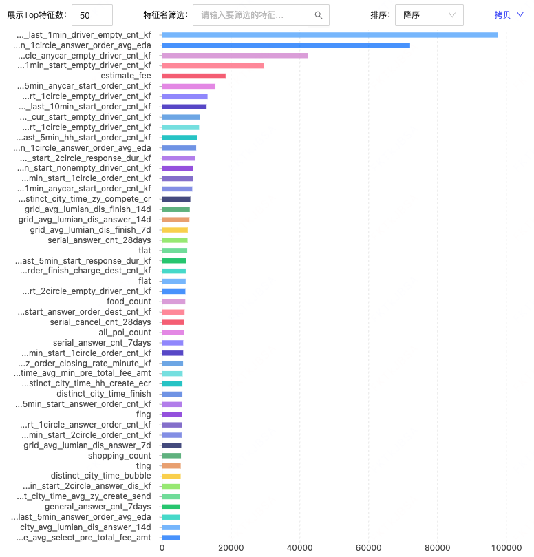
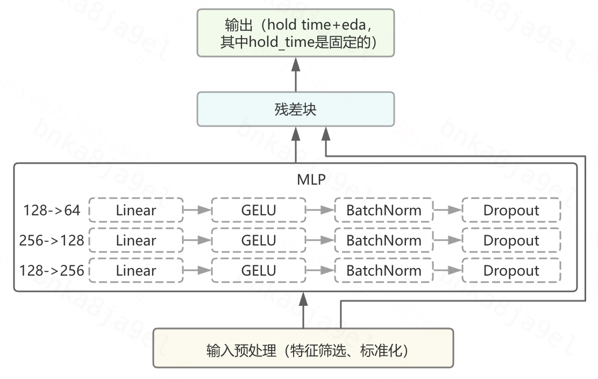

# 【LR26-003】交易生态-优化接驾体验-订单hold策略-V0

[Cooper 原文](https://cooper.didichuxing.com/knowledge/2199610335356/2206992617058)

# 零、基础信息

| brd文档链接   | ==[订单hold策略 BRD文档](https://cooper.didichuxing.com/docs2/document/2205278430452)==   |
| --- | --- |
| 最后通过的策略方案链接   | ==[以降接驾距离为目标的订单hold 策略方案](https://cooper.didichuxing.com/docs2/document/2205249521156)==   |
| 实验链接（评估大师）   | [https://x.intra.hongyibo.com.cn/exp/466819710582785?globalBusinessId=120000&globalProjectId=330331944058881&expFlowTab=dashboard&dashboardTab=metricDetail&windowTab=468476036972546](https://x.intra.hongyibo.com.cn/exp/466819710582785?globalBusinessId=120000&globalProjectId=330331944058881&expFlowTab=dashboard&dashboardTab=metricDetail&windowTab=468476036972546)   |
| 核心贡献点（创新点，可供其他算法同学借鉴的点）   | 将订单 hold 决策解耦为「hold 秒数」和「最优接驾距离阈值」两个独立模型，并通过"多轮滑窗 GS 仿真 + 不动点迭代"求解全局动态下的反事实最优接驾距离 label；  同时建立"hold 秒数 → 应答前取消 → 完单"的端到端折算链路用于参数选择和风险定价，配合"低预测值兜底"修正模型在低区间的失效问题。   |
| 第一贡献人   | 罗玉   |
| 共同贡献人（没有的话，可以置空）   | 武荣莉   |
| 后续策略负责人   | 罗玉   |

# 一、背景

- **背景一(降接驾距离)：**在接驾体验中，**接驾距离影响乘客等待时长与司机空驶成本**，司乘双边的接驾体验均会因接驾距离的增加而变差。当前在5s之内应答的订单数占呼叫的24.08%，且5s之内应答的订单中，接驾距离>=2.5km的订单占5s内总应答量的16.36%(完整数据见附录)，这类订单的特点是**“应答快但接驾距离远”**。基于此，希望以降低接驾距离为目标，对订单hold X s，让远距离订单有机会找到更近的司机，降接驾距离提升双边整体的接驾体验；

- **背景二(降应答后取消)：**观察不同应答时长对应不同预估接驾距离下的应答后乘客取消率数据和司机取消率数据，我们发现，如果只考虑应答时间短而忽视接驾距离的远近，即便**较快应答，司乘会因接驾距离远而取消订单**，最终导致应答后司乘取消率均升高(5s内应答且接驾距离>=2.5km订单，应答后乘客取消率25.34%，应答后司机取消率11.78%；20s内应答且接驾距离<2.5km的订单，应答后乘客取消率10.30%，应答后司机取消率5.97%，完整数据见附录)。这也印证了**司乘均会将接驾距离远近作为衡量各自接驾体验的参考**；

# 二、目标与约束

- **订单hold策略目标：<!--评论:[{"u":"rongbohui","c":"目标需要有量化值"},{"u":"luoyuluoyu","c":"量化值已补充"}] -->hold订单应答，匹配更近的司乘对，降低接驾距离，提升司乘双边体验。**虽然风险为乘客应答前取消的增加，但降低预估接驾距离的同时可以降低应答后司乘取消率，最终达到【hold订单应答，降eda，完单不显著负】的效果。

- **策略目标：接驾距离-50m，接驾bad-case率降低-15%，约束：完单不显著负**

# 三、策略方案

## 3.1 方案框架

- **核心：**

	- by订单的**最大hold秒数**(V0方案中所有订单统一hold Xs)；

	- by订单的hold X秒内的**最优接驾距离阈值<!--评论:[{"u":"tommywujian","c":"为什么一定要是最优的？是不是对应的应答后取消率比应答前取消率低就行了？"},{"u":"luoyuluoyu","c":"因为订单hold策略是for接驾距离，完单不显著负是约束，而非for完单"}] -->**。

- **整体思路：**

	- 在分单轮次中，如果该轮中订单当前的接驾距离 **>** 模型预测得到的该订单的最优接驾距离阈值，则该订单被hold至下一轮，最多hold X 秒；

	- 在最大hold秒数内，订单匹配到司机<!--评论:[{"u":"cintiaxiong","c":"司机在这10s内可能被分到其他订单吗？"},{"u":"luoyuluoyu","c":"司机在X秒内，仍然可以正常接其他符合条件的订单，不会因为某一单的hold而空等。"}] -->的接驾距离 **<** 自身最优接驾距离阈值时，进行分单，超出X秒后，订单释放，参与正常分单。

[图表01 · 源文件](附件/LR26-003/图表01.json) · [在 Cooper 查看图形](https://cooper.didichuxing.com/knowledge/2199610335356/2206992617058)

## 3.2 方案细节

> V0方案核心是在固定hold秒数下，预测订单的最优接驾距离阈值。因此，在方案细节中，主要介绍【固定hold秒数的选择】和【最优接驾距离模型】。

### 3.2.1 模型一：订单的hold秒数

> **hold秒数的选择影响的是应答前乘客取消风险**。

> 因此，对于hold秒数的测算，需要衡量的是应答前乘客取消最终带来的完单折损是否在约束范围内。

**固定hold秒数的测算方式：**

> 核心逻辑：模拟计算订单hold X秒的应答前乘客取消率变化，进而测算对完单折损的影响。详细数据见[订单holdv0统一hold秒数选择测算](https://cooper.didichuxing.com/docs2/sheet/2206775795163)

- 计算每个订单从呼叫时间到最终状态时间（应答/取消）的生存时长（s）；

- 以2秒为时间粒度生成 \[0-2)、\[2-4)、\[4-6)、…、\[198-200) 的时间区间；

- 统计每个时间区间内：仍存活的订单数、在该区间内取消的订单数、在该区间内应答的订单数、该区间内的应答前取消率；

- 统计每个时间区间内，hold X秒的应答前取消量 = 该区间内的生存订单量 \* **max(**该区间内的应答前取消率，\[X-2, X)区间内的应答前取消率**)**

> 例如，在\[4,6)这一时间区间下计算hold 10s的应答前取消量时，生存订单量直接选择该区间内的生存订单量，应答前取消率取生存订单当下所处时间区间的真实应答前取消率和将要hold到的时间区间\[8,10)的真实应答前取消率的最大值。

- 统计hold X秒(X取10s，20s，30s)下，不hold时的订单Xs内的应答前取消率<!--评论:[{"u":"rongbohui","c":"N和X是同一个意思？"},{"u":"luoyuluoyu","c":"是相同意思，已修正"}] -->和hold X秒的应答前取消率，以及hold X秒带来的应答前取消率的绝对值变化量，最终结果如下：

|    | 不hold时的Ns内应答前取消率   | hold-Ns的应答前取消率   | hold-Ns带来的应答前取消率变化   |
| --- | --- | --- | --- |
| hold-10s   | 0.54%   | 0.98%   | 0.44pp   |
| hold-20s   | 0.92%   | 1.52%   | 0.60pp   |
| hold-30s   | 1.48%   | 2.91%   | 1.43pp   |

> 以hold 10s为例，应答前取消率变化了0.44pp，假设应答率90%，对应答量的影响是89.56 / 90 - 1 （约等于 -0.48%），我们预期 eda 降低40m～50m，应答后乘客取消可-0.4pp，对应的履约率+0.4pp。假设履约率80%，hold10s后履约率变为80.4%，履约率的相对变化为（80.4-80）/80=0.5%， 最终对完单的相对变化（约等于履约率相对变化+应答量相对变化）为-0.48%+0.5% = 0.02%，对完单几乎没有影响。因此我们选择了hold 10s。

### 3.2.2 模型二：预测最优接驾距离阈值模型

#### (1) 数据集构建

> 选用全国一周分单数据(来自 分单日志kflower_marketplace.ods_log_kflower_stgmatrix_hh)

**打label方式：**

**目标：**为每一个订单计算一个“最优接驾距离阈值”标签**。**

**难点：反事实（随机试验or离线仿真，这里我们选择离线仿真的方式）**

- 如果只看单个订单，那么问题很简单，观察这一个订单在未来若干轮能遇到的最近的司机的接驾距离即可；

- 然而实际情况是**全局动态**的：

	- **所有订单同时在hold**：某一轮中，order1在等待的时候，order2，order3也在等待，且彼此hold的状态也是不同的（可能order1被hold2轮了，order2被hold1轮，order3被hold4轮）；

	- **供需关系动态变化**：每一轮都会有新订单的流入、旧订单的分配成功与应答、旧订单的应答前取消、取消订单的重发单；

**核心：**模拟订单的多轮hold逻辑，经过gs分单得到的接驾距离，在不同hold轮次下的接驾距离的最小值就是该订单在hold X 轮下的最小接驾距离。

**解决办法：模拟所有订单在hold策略下的分单结果，通过多轮迭代，让所有订单的最优接驾距离收敛达到稳态**

- 在模拟中，我们需要：

	- **数据准备与构建：**从分单日志表中读取分单数据，每条记录包含：分单轮次uuid、订单id、司机id、订单经纬度、司机经纬度、订单价值；数据需要严格按照uuid的顺序排序。

	- **使用滑动窗口模拟不同hold轮次：**每个窗口内的所有订单与司机合并，进行一次gs匹配。不同窗口模拟了订单在不同时间点进入市场的场景，反映hold不同轮次面临的供需环境。最终会取窗口中该订单获得的最小接驾距离作为其在当前轮次的label值；

	- **离线模拟GS匹配逻辑：**订单的偏好设置为按照接驾距离升序排序（距离越近越好）、司机的偏好设置为按照订单价值iph降序排序（收益越高越好）；同时需要有阈值过滤机制来模拟“订单按照其label进行hold决策”的行为；

	- **多轮迭代收敛**：

		- round1具备初始化作用,为每个订单建立一个初始的接驾距离，只有全局播单半径阈值限制，每个订单在x个窗口下分别获得一个接驾距离，取x个值的最小值作为label_1；

		- round2及之后具备迭代收敛作用，开始生效hold策略，在do对匹配上使用label\_{上一轮}+50m进行过滤，同时考虑订单应答前取消、应答后取消、重发单的情况（以尽量模拟真实分单发生的事），最终得到label_N；

		- 添加收敛判定：当前轮订单label与前一轮订单label差异小于50m时，该订单稳定，全局稳定订单占比超过90%或已经达到系统设置的最大round次数时，迭代结束。

	- **结果输出：**每一个订单通过合理hold能够获得的最优接驾距离。部分订单的最终label值为null（原因是订单取消或在播单半径内无满足条件的候选司机，大概占总订单10%～15%），这部分订单后续label统一设置为3600（播单半径的粗估），相当于不hold。

**打标签逻辑图**：

[图表02 · 源文件](附件/LR26-003/图表02.json) · [在 Cooper 查看图形](https://cooper.didichuxing.com/knowledge/2199610335356/2206992617058)

**特征使用：**

v0版本共计使用特征128个，涉及格子维度实时供需特征、乘客维度历史取消行为特征、格子维度poi特征、平台口径城市&星期&小时维度特征、历史接驾距离相关特征（格子、乘客、城市维度），具体可见特征list。

特征list
| **输入**   |
| --- |
| **特征128（117dufe+11传入）**   | **关联key**   | **类型**   | **dufe/工程传入**   |
| grid_avg_lumian_dis_answer_7d   | grid_id   | double   | dufe   |
| grid_avg_lumian_dis_answer_14d   | double   | dufe   |
| grid_avg_lumian_dis_finish_7d   | double   | dufe   |
| grid_avg_lumian_dis_finish_14d   | double   | dufe   |
| grid_avg_lumian_dis_connect_7d   | double   | dufe   |
| grid_avg_lumian_dis_connect_14d   | double   | dufe   |
| city_avg_lumian_dis_answer_7d   | city_id   | double   | dufe   |
| city_avg_lumian_dis_answer_14d   | double   | dufe   |
| city_avg_lumian_dis_finish_7d   | double   | dufe   |
| city_avg_lumian_dis_finish_14d   | double   | dufe   |
| city_avg_lumian_dis_connect_7d   | double   | dufe   |
| city_avg_lumian_dis_connect_14d   | double   | dufe   |
| passenger_avg_lumian_dis_finish_7d   | passenger_id   | double   | dufe   |
| passenger_avg_lumian_dis_finish_14d   | double   | dufe   |
| passenger_avg_lumian_dis_finish_30d   | double   | dufe   |
| passenger_avg_lumian_dis_answer_7d   | double   | dufe   |
| passenger_avg_lumian_dis_answer_14d   | double   | dufe   |
| passenger_avg_lumian_dis_answer_30d   | double   | dufe   |
| general_answer_cnt_28days   | passenger_id   | double   | dufe   |
| general_cancel_cnt_28days   | double   | dufe   |
| general_cancel_rate_28days   | double   | dufe   |
| general_finish_cnt_28days   | double   | dufe   |
| general_answer_cnt_14days   | double   | dufe   |
| general_cancel_cnt_14days   | double   | dufe   |
| general_cancel_rate_14days   | double   | dufe   |
| general_finish_cnt_14days   | double   | dufe   |
| general_answer_cnt_7days   | double   | dufe   |
| general_cancel_cnt_7days   | double   | dufe   |
| general_cancel_rate_7days   | double   | dufe   |
| general_finish_cnt_7days   | double   | dufe   |
| serial_answer_cnt_28days   | double   | dufe   |
| serial_cancel_cnt_28days   | double   | dufe   |
| serial_cancel_rate_28days   | double   | dufe   |
| serial_finish_cnt_28days   | double   | dufe   |
| serial_answer_cnt_14days   | double   | dufe   |
| serial_cancel_cnt_14days   | double   | dufe   |
| serial_cancel_rate_14days   | double   | dufe   |
| serial_finish_cnt_14days   | double   | dufe   |
| serial_answer_cnt_7days   | double   | dufe   |
| serial_cancel_cnt_7days   | double   | dufe   |
| serial_cancel_rate_7days   | double   | dufe   |
| serial_finish_cnt_7days   | double   | dufe   |
| food_count   | grid_id   | bigint   | dufe   |
| hotel_count   | bigint   | dufe   |
| amusement_count   | bigint   | dufe   |
| company_count   | bigint   | dufe   |
| home_count   | bigint   | dufe   |
| shopping_count   | bigint   | dufe   |
| food_rate   | double   | dufe   |
| hotel_rate   | double   | dufe   |
| amusement_rate   | double   | dufe   |
| company_rate   | double   | dufe   |
| home_rate   | double   | dufe   |
| shopping_rate   | double   | dufe   |
| all_poi_count   | double   | dufe   |
| distinct_city_time_ecr   | city_id,day_of_week,hour   | double   | dufe   |
| distinct_city_time_finish   | double   | dufe   |
| distinct_city_time_send   | double   | dufe   |
| distinct_city_time_bubble   | double   | dufe   |
| distinct_city_time_hh_create_ecr   | double   | dufe   |
| distinct_city_time_api_create_ecr   | double   | dufe   |
| distinct_city_time_zy_create_ecr   | double   | dufe   |
| distinct_city_time_hh_compete_cr   | double   | dufe   |
| distinct_city_time_api_compete_cr   | double   | dufe   |
| distinct_city_time_zy_compete_cr   | double   | dufe   |
| distinct_city_time_avg_hh_create_send   | double   | dufe   |
| distinct_city_time_avg_hh_send   | double   | dufe   |
| distinct_city_time_avg_api_create_send   | double   | dufe   |
| distinct_city_time_avg_api_send   | double   | dufe   |
| distinct_city_time_avg_zy_create_send   | double   | dufe   |
| distinct_city_time_avg_zy_send   | double   | dufe   |
| distinct_city_time_avg_hh_finish   | double   | dufe   |
| distinct_city_time_avg_api_finish   | double   | dufe   |
| distinct_city_time_avg_zy_finish   | double   | dufe   |
| distinct_city_time_avg_min_pre_total_fee_amt   | double   | dufe   |
| distinct_city_time_avg_min_estimate_fee_amt   | double   | dufe   |
| distinct_city_time_avg_select_pre_total_fee_amt   | double   | dufe   |
| distinct_city_time_avg_select_estimate_fee_amt   | double   | dufe   |
| coord_last_5min_start_2circle_response_dur_kf   | flat,flng   | double   | dufe   |
| coord_last_5min_start_response_dur_kf   | flat,flng   | double   | dufe   |
| coord_last_5min_start_1circle_empty_driver_cnt_kf   | flat,flng   | double   | dufe   |
| coord_last_5min_start_2circle_answer_order_cnt_kf   | flat,flng   | double   | dufe   |
| coord_last_1min_start_2circle_empty_driver_cnt_kf   | flat,flng   | double   | dufe   |
| grid_last_1min_anycar_start_order_cnt_kf   | flat,flng   | double   | dufe   |
| coord_last_1min_start_1circle_response_dur_kf   | flat,flng   | double   | dufe   |
| coord_last_1min_start_1circle_answer_dis_kf   | flat,flng   | double   | dufe   |
| coord_last_1min_start_1circle_answer_order_cnt_kf   | flat,flng   | double   | dufe   |
| coord_last_5min_start_driver_strived_wait_cnt_kf   | flat,flng   | double   | dufe   |
| grid_last_5min_start_driver_strived_wait_cnt_kf   | flat,flng   | double   | dufe   |
| coord_last_5min_anycar_start_driver_strived_wait_cnt_kf   | flat,flng   | double   | dufe   |
| coord_last_1min_start_empty_driver_cnt_kf   | flat,flng   | double   | dufe   |
| coord_last_5min_start_answer_dis_kf   | flat,flng   | double   | dufe   |
| coord_last_5min_start_answer_order_cnt_kf   | flat,flng   | double   | dufe   |
| coord_last_1min_start_2circle_response_dur_kf   | flat,flng   | double   | dufe   |
| coord_last_1min_start_2circle_answer_dis_kf   | flat,flng   | double   | dufe   |
| coord_last_1min_start_2circle_answer_order_cnt_kf   | flat,flng   | double   | dufe   |
| grid_last_5min_anycar_start_order_finish_charge_dest_cnt_kf   | flat,flng   | double   | dufe   |
| grid_last_5min_anycar_start_passenger_wait_pick_time_sum_kf   | flat,flng   | double   | dufe   |
| grid_last_5min_anycar_start_answer_order_dest_cnt_kf   | flat,flng   | double   | dufe   |
| coord_last_1min_start_1circle_order_cnt_kf   | flat,flng   | double   | dufe   |
| coord_cur_start_empty_driver_cnt_kf   | flat,flng   | double   | dufe   |
| coord_last_1min_start_2circle_order_cnt_kf   | flat,flng   | double   | dufe   |
| grid_last_5min_anycar_start_order_cnt_kf   | flat,flng   | double   | dufe   |
| grid_last_5min_biz_order_closing_rate_minute_kf   | flat,flng   | double   | dufe   |
| grid_last_1min_driver_empty_cnt_kf   | flat,flng   | double   | dufe   |
| grid_1circle_last_5min_hh_start_order_cnt_kf   | flat,flng   | double   | dufe   |
| coord_last_10min_start_order_cnt_kf   | flat,flng   | double   | dufe   |
| coord_last_5min_start_2circle_answer_dis_kf   | flat,flng   | double   | dufe   |
| coord_last_1min_start_1circle_empty_driver_cnt_kf   | flat,flng   | double   | dufe   |
| coord_last_5min_start_2circle_order_cnt_kf   | flat,flng   | double   | dufe   |
| grid_last_1min_1circle_anycar_empty_driver_cnt_kf   | flat,flng   | double   | dufe   |
| coord_last_10min_start_1circle_order_cnt_kf   | flat,flng   | double   | dufe   |
| kf_flow_grid_startgrid_day_hour_answer_dur_mean   | fgrid,day_of_week,hour   | double   | dufe   |
| grid_last_5min_start_nonempty_driver_cnt_kf   | flat,flng   | double   | dufe   |
| dw_platform_biz_distinct_start_dest_avg_zy_finish   | coord_start_grid_id, coord_end_grid_id   | double   | dufe   |
| kf_flow_grid_startgrid_day_hour_total_cnt   | fgrid,day_of_week,hour   | double   | dufe   |
| kf_flow_grid_startgrid_day_hour_answer_cnt   | fgrid,day_of_week,hour   | double   | dufe   |
| day_of_week   |    | bigint   | 传入   |
| hour   |    | bigint   | 传入   |
| flng   |    | double   | 传入   |
| flat   |    | double   | 传入   |
| tlat   |    | double   | 传入   |
| tlng   |    | double   | 传入   |
| estimate_fee   |    | double   | 传入   |
| grid_last_5min_answer_order_avg_eda   |    | double   | 传入   |
| grid_last_10min_answer_order_avg_eda   |    | double   | 传入   |
| grid_last_5min_1circle_answer_order_avg_eda   |    | double   | 传入   |
| grid_last_10min_1circle_answer_order_avg_eda   |    | double   | 传入   |

在v0方案使用的128个特征中，有22个特征为订单hold新建设的乘客/格子/城市维度与接驾距离相关的特征（其中新增dufe特征18个，工程传入特征4个），以下为新增特征说明：

新增特征22个
| **特征**   | **特征含义**   | **类型**   |
| --- | --- | --- |
| passenger_avg_lumian_dis_finish_7d   | 乘客历史前一周内完单的订单平均预估接驾距离   | dufe   |
| passenger_avg_lumian_dis_finish_14d   | 乘客历史前两周内完单的订单平均预估接驾距离   | dufe   |
| passenger_avg_lumian_dis_finish_30d   | 乘客历史前一个月内完单的订单平均预估接驾距离   | dufe   |
| passenger_avg_lumian_dis_answer_7d   | 乘客历史前一周内应答的订单平均预估接驾距离   | dufe   |
| passenger_avg_lumian_dis_answer_14d   | 乘客历史前两周内应答的订单平均预估接驾距离   | dufe   |
| passenger_avg_lumian_dis_answer_30d   | 乘客历前一个月内应答的订单平均预估接驾距离   | dufe   |
| city_avg_lumian_dis_answer_7d   | ==城市历史前一周内应答的订单平均预估接驾距离==   | dufe   |
| city_avg_lumian_dis_answer_14d   | ==城市历史==前两周==内应答的订单平均预估接驾距离==   | dufe   |
| city_avg_lumian_dis_finish_7d   | ==城市历史前一周内完单的订单平均预估接驾距离==   | dufe   |
| city_avg_lumian_dis_finish_14d   | ==城市历史==前两周==内完单的订单平均预估接驾距离==   | dufe   |
| city_avg_lumian_dis_connect_7d   | ==城市历史前一周内连过边的订单平均预估接驾距离==   | dufe   |
| city_avg_lumian_dis_connect_14d   | ==城市历史==前两周==内连过边的订单平均预估接驾距离==   | dufe   |
| grid_avg_lumian_dis_answer_7d   | ==格子历史前一周内应答的订单平均预估接驾距离==   | dufe   |
| grid_avg_lumian_dis_answer_14d   | ==格子历史==前两周==内应答的订单平均预估接驾距离==   | dufe   |
| grid_avg_lumian_dis_finish_7d   | ==格子历史前一周内完单的订单平均预估接驾距离==   | dufe   |
| grid_avg_lumian_dis_finish_14d   | ==格子历史==前两周==内完单的订单平均预估接驾距离==   | dufe   |
| grid_avg_lumian_dis_connect_7d   | ==格子历史前一周内连过边的订单平均预估接驾距离==   | dufe   |
| grid_avg_lumian_dis_connect_14d   | ==格子==历史前两周==内连过边的订单平均预估接驾距离==   | dufe   |
| grid_last_5min_answer_order_avg_eda   | ==订单所在格子近5分钟内应答平均接驾距离==   | ==工程传入==   |
| grid_last_10min_answer_order_avg_eda   | ==订单所在格子近10分钟内应答平均接驾距离==   | ==工程传入==   |
| grid_last_5min_1circle_answer_order_avg_eda   | ==订单所在格子及周围一圈格子近5分钟内应答平均接驾距离==   | ==工程传入==   |
| grid_last_10min_1circle_answer_order_avg_eda   | ==订单所在格子及周围一圈格子近10分钟内应答平均接驾距离==   | ==工程传入==   |

其中，实时供需特征（如空车司机数、应答数等）、历史接驾距离相关特征（格子、乘客、城市维度）、实时传入的格子维度应答平均eda特征均为高重要性特征，详细的重要性top 50特征如下：

特征重要性（XGB）
特征重要性：

#### (2) 模型构建

v0一期实验中使用xgboost回归模型、v0二期实验中使用DNN回归模型<!--评论:[{"u":"rongbohui","c":"离线评估数据"},{"u":"luoyuluoyu","c":"已补充"}] -->。

模型构建细节
|    | v0一期模型   | v0二期模型   | 说明   |
| --- | --- | --- | --- |
| 模型结构   | XGB   | DNN：MLP 特征提取→残差→回归输出     |    |
| 数据集   | 20251122-20251128出现在分单矩阵中的全部订单   | 20251201-20251207出现在分单矩阵中的全部订单   | 一周数据量总计2800万左右；训练集：测试集=7:3   |
| 离线评估mae   | mae：623   | mae：617   |    |

## 3.3 hold策略在交易链路上的实现

平台整体交易的流程：**呼叫 ➡️ 匹配(找到运力) ➡️ pk(运力举手) ➡️ 应答 ➡️ 完单。**简单地说涉及了以下步骤：

- 乘客可以在不同的端发起呼叫（可能来自于花小猪主端、滴滴端、PBD），这些呼叫可以分到不同的商家（自营、宏鹄、API）；<!--评论:[{"u":"menchang","c":"不在呼叫后进行hold，而在分单和pk环节hold，原因是什么"}] -->

- 各个商家召回各自的运力，计算订单价值，根据订单价值确定交易模式；

- 在各个商家中，DO对进行匹配；

- 每一个商家举出一个司机参加平台聚合pk，胜出司机应答订单进入后续环节。

目前，**自营与宏鹄商家的分单匹配由平台负责，API商家的分单匹配由API商家自主负责，最终所有商家举手的运力参与平台的统一PK。**

由于在我们的聚合平台模式中，不同商家分单控制权不同，因此hold策略在交易链路中**分环节、分商家差异化生效**：

- 对于**由平台负责分单的自营&宏鹄商家，hold策略在分单环节生效**。不满足最优接驾距离阈值的司机将被直接拦截，无法进入PK环节；

- 对于**自行负责分单的API商家，hold策略在PK环节生效**。API商家会正常完成内部运力的匹配的司机举手，平台会在PK环节校验API商家举手司机的接驾距离，如果不满足最优阈值，则PK失败，商家重新举手，直至举出满足要求的司机。

订单hold策略在交易链路上对于不同商家的生效节点说明
自营、宏鹄商家在**分单**节点处生效hold策略，API商家在**PK**节点处生效hold策略。

[图表03 · 源文件](附件/LR26-003/图表03.json) · [在 Cooper 查看图形](https://cooper.didichuxing.com/knowledge/2199610335356/2206992617058)

# 四、实验评估

**收益与风险链路：**

[图表04 · 源文件](附件/LR26-003/图表04.json) · [在 Cooper 查看图形](https://cooper.didichuxing.com/knowledge/2199610335356/2206992617058)

**最终的实验效果：**

| 实验组(3%全国pid实验)   | 接驾距离相对变化   | 完单量相对变化   | CR相对变化   | 应答后C取消率相对变化   | 应答后B取消率相对变化   | 应答前C取消率相对变化   |
| --- | --- | --- | --- | --- | --- | --- |
| hold 10s   | **-37m**   | **-0.29%**   | -0.05pp   | **-0.28pp**   | **-0.08pp**   | **+0.36pp**   |
| hold 6s   | **-43m**   | -0.28%   | -0.08pp   | **-0.33pp**   | -0.002pp   | **+0.40pp**   |
| **hold 10s + 1000m兜底值✅**   | **-39m**   | +0.11%   | +0.06pp   | **-0.31pp**   | -0.03pp   | **+0.24pp**   |

## 4.1 实验前置说明

订单hold V0共进行了两期实验，我们将两期实验中策略的不同之处前置说明，见下表。

两期实验不同之处说明
|    | 一期实验策略   | 二期实验策略   | 其他说明   |
| --- | --- | --- | --- |
| **评估周期**   | 2025.12.10～2025.12.16   | 2026.01.23～2026.01.29   |    |
| **实验城市**   | 部分城市（占全国完单份额55%）  城市list：武汉，上海，杭州，南京，合肥，呼和浩特，金华，沈阳，长春，大同，成都，邯郸，临沂，哈尔滨，日照，深圳，温州，重庆，晋中，广州，大连，龙岩，济南，郑州，青岛，福州，昆明，长沙，南昌，清远，江门，石家庄，泉州，东莞，烟台，吉林   | 全国城市   |    |
| **实验分流**   | 3%流量pid分流实验  - 空白组 94%；   - 实验组1 订单hold (hold 20s) 3%；   - 实验组2 平台规范策略 3%    | 3%流量pid分流实验  - 空白组88%；   - 实验组1 hold 10s 3%；   - 实验组2 hold 6s 3%；   - 实验组3 hold 10s+1000m兜底 3%；   - 实验组4 平台规范策略 3%   其中组3的1000m兜底表示多一层输出的处理：max(模型产出值，1000)   |    |
| **策略细节**   | - 固定hold秒数=20s；   - 最优接驾距离阈值模型为XGB模型    | - 固定hold秒数=10s、6s；   - 最优接驾距离阈值模型为DNN模型    | 策略细节变更原因：一期实验与预期不符后，check细节发现离线测算hold秒数代码存在问题，且模型产出值过于苛刻，具体见实验下钻分析   |
| **核心关注指标**   | 单均预计接驾距离、应答前乘客取消率、应答后乘客取消率、完单量   | 均为小猪端内   |
|    |    |    |    |

实验部分将按照一期实验➡️发现一期不符合预期➡️分析一期数据➡️调整策略➡️开二期实验➡️二期数据表现➡️分析二期数据的顺序进行说明。

## 4.2一期实验

|     | 内容   | 备注   |
| --- | --- | --- |
| 算法侧实验验证人   | 罗玉   |     |
| 实验方式   | 乘客分流实验   |     |
| 实验平台   | 评估大师   |     |
| 分流方式   | 乘客分流实验   |     |
| 分流细节   | - 3%实验组1；   - 3%实验组2；   - 3%实验组3；   - 3%实验组4；   - 88%空白组    | - 实验组1：订单hold NN模型1（hold 10s）   - 实验组2：订单hold NN模型2（hold 6s）   - 实验组3: 订单hold NN模型3（hold10s+低估重罚+1000m最小值兜底）   - 实验组4：平台规范策略pk3.5   - 空白组：无任何策略干扰    |
| 实验周期   | 7天   |     |
| 流量范围   | 小猪端内   |     |
| - 小猪一口价   - 小猪打车   - 小猪特价   - 小猪特快   - 宏鹄       | 品类：  - 特价盒子   - 特快盒子   - 实时计价盒子   - 宏鹄   - 小猪一口价   - 小猪打车   - 小猪特价   - 小猪特快    |
| 小猪轮次分单   |     |
| 全国城市   |     |
| 实验生效商家   | **自营&宏鹄&API**   |
| 是否联动实验   | 否   |     |
| 评估指标   | 端内平均接驾距离，bad-case率，端完单等   | 策略侧负责指标添加   |
| 评估人   | 评估大师   |     |

### 4.2.1 一期实验效果

[实验整体效果](https://x.intra.hongyibo.com.cn/exp/457941323153409?globalBusinessId=120000&globalProjectId=330331944058881&expFlowTab=dashboard&dashboardTab=metricDetail&windowTab=460983995072514)：

| 实验组(3%部分城市pid实验)   | 接驾距离相对变化   | 完单量相对变化   | CR相对变化   | 应答后C取消率相对变化   | 应答后B取消率相对变化   | 应答前C取消率相对变化   |
| --- | --- | --- | --- | --- | --- | --- |
| 订单hold 20s   | **-81m**   | **-1.49%**   | **-0.54pp**   | **-0.69pp**   | **+0.25pp**   | **+1.19pp**   |
| 平台规范   | **-69m**   | -0.3%   | -0.09pp   | **-0.43pp**   | **+0.13pp**   | **+0.49pp**   |

### 4.2.2 一期问题发现

**一期实验过程中发现了与预期不相符的两点：**

- 一期实验中，我们按照固定hold秒数的选择依据，测算后选定hold秒数为20s。虽然实验开展前已知订单hold的风险时应答前乘客取消率涨，但一期实验数据展示，订单hold组的应答前乘客取消率涨幅高达1.19pp，远超测算预期，与**离线测算的hold秒数不符**（<!--评论:[{"u":"menchang","c":"这是20s组的什么指标与离线测算测算的什么不符"},{"u":"luoyuluoyu","c":"应答前取消率测算指标不符，已补充在正文"}] -->修复后测算hold20s的应答前取消为1.63%，原测算hold20s的应答前取消为0.86%，测算低估了0.77pp）。<!--评论:[{"u":"menchang","c":"这是20s组的什么指标与离线测算测算的什么不符"},{"u":"luoyuluoyu","c":"应答前取消率测算指标不符，已补充在正文"}] -->

- 单均接驾距离显著降低，应答后乘客取消率显著降，但**司机取消率却显著涨**，这**与我们已有的“降低接驾距离，优化司乘双边体验”认知不符**

### 4.2.3 一期下钻分析

**进行实验分析后，我们发现了几个导致问题的原因：**

- 重新检查离线测算代码发现，by2秒的生存时间区间测算存在问题（全部为开区间），导致生存时间恰好等于区间值的订单被漏算，最终低估了hold20s对完单折损的负面影响，具体可见[订单hold v0一期实验离线测算hold秒数复盘](https://cooper.didichuxing.com/docs2/document/2206376442587)。

> 正常应为：

> 以2秒为时间粒度生成 \[0-2)、\[2-4)、\[4-6)…\[198-200) 的时间区间；

> 统计每个时间区间内：仍存活的订单数、在该区间内取消的订单数、在该区间内应答的订单数、该区间内的应答前取消率；

> 但check代码后发现，以2秒为时间粒度生成的是 (0-2)、(2-4)、(4-6)…(198-200) 的时间区间；

- XGB模型产出的订单接驾距离阈值均值1400m，这一阈值要求严格（相比对照组，实验组整体应答时长均值延长了7s）。因此，存在大量订单无法遇到满足模型产出的接驾要求的司机，等到20s才被释放，释放后也无法保证订单立刻被应答，乘客体验反而变差，加重了应答前乘客取消的增加；

- 模型产出的接驾距离阈值使得GS与topspeed下的连环派非连环派订单份额出现腾挪，最终导致应答后司机取消率不降反增。

#### (1) 应答时长分布情况

一期实验的应答时长分布情况见下表。

- 应答时长均值：对照组（24.07s）<hold策略组（31.13s）<平台规范策略组（26.14s）；

- 订单hold策略一期hold20s+XGB模型产出预测值(平均1400)，**导致整体应答时长较对照组延长7s**。

一期实验的应答时长分布情况
|    | 对照组   | 组1:订单hold策略   | 组2:平台规范策略   |
| --- | --- | --- | --- |
| 应答时长均值   | 24.07   | 31.13   | 26.14   |
| 应答时长最小值   | 0   | 0   | 0   |
| 应答时长最大值   | 1458   | 1469   | 1318   |
| 应答时长10分位点   | 2   | 3   | 3   |
| 应答时长20分位点   | 5   | 5   | 5   |
| 应答时长30分位点   | 5   | 6   | 5   |
| 应答时长40分位点   | 5   | 6   | 6   |
| 应答时长50分位点   | 6   | 14   | 6   |
| 应答时长60分位点   | 6   | 22   | 7   |
| 应答时长70分位点   | 7   | 25   | 11   |
| 应答时长80分位点   | 19   | 31   | 26   |
| 应答时长90分位点   | 55   | 65   | 60   |
| 应答时长95分位点   | 107   | 117   | 112   |
| 应答时长99分位点   | 313   | 325   | 322   |

#### (2) 整体连环派占比情况

在排查【单均接驾距离显著降低，应答后乘客取消率显著降，但**应答后司机取消率却显著涨**】这一实验表现的原因时候，我们按照以往认知，认为应答后的司机取消和订单是否连环派、订单的价格或价值、订单的接驾体验有关，所以我们先排查了这一数据表现是否由连环派应答份额增加导致。

分析整体连环派占比发现：

- 一期实验中，组1（hold 20s）整体连环派订单应答份额-1.3pp，并非应答后司机取消涨的原因；

- 订单hold实验组的连环派应答份额减少原因：订单hold策略在订单发单时给出需要参考的接驾距离阈值，**不对连环派订单和非连环派订单做策略上的区分**。由于整体上，**连环派订单的平均接驾距离>非连环派订单的平均接驾距离**，因此，对所有订单一视同仁给出接驾距离阈值时，连环派订单会被限制地更严重，预期连环派订单的占比会减少。实验数据展示，**连环派占比变化符合预期**。

一期实验的整体连环派占比情况
|    | 是否连环派   | 应答量含改   | 连环派与非连环派应答份额   | 实验组 vs. 对照组 连环派与非连环派应答份额变化   |
| --- | --- | --- | --- | --- |
| 对照组   | 非连环派   | 19902433   | 84.85%   |    |
| 连环派   | 3553686   | 15.15%   |    |
| 组1:hold20s   | 非连环派   | 633426   | 86.15%   | +1.3pp   |
| 连环派   | 101840   | 13.85%   | -1.3pp   |
| 组2:平台规范   | 非连环派   | 617549   | 82.72%   | -2.13pp   |
| 连环派   | 129011   | 17.28%   | +2.13pp   |

#### (3) 司机取消率分析

> 优先排查了整体连环派占比的变化情况后，我们依次排除了是否为应答后司机接到的订单价格或价值变低导致的应答后取消涨。

> 后续，我们对不同分单模式下的司机取消进行了拆解分析。

假设共有M种分单模式，则**整体应答后司机取消率**可通过下面的公式进行计算：

$$整体应答后司机取消率 = \sum\limits_i^M(模式_i的应答份额 × 模式_i的应答后司机取消率)$$

令$$a_{0i}$$为对照组模式i的应答份额，$$b_{0i}$$为对照组模式i的应答后司机取消率，则对照组的应答后司机取消率为$$\sum\limits_i^Ma_{0i}b_{0i}$$ ，$$\Delta a_i$$为实验组相比对照组模式i的应答份额变化量，$$\Delta b_i$$为实验组相比对照组模式i的应答后司机取消率变化量，则实验组整体的应答后司机取消率为$$\sum\limits_i^M(a_{0i}+ \Delta a_i)(b_{0i}+\Delta b_i)$$。

因此，**整体应答后司机取消率的变化**可以通过下面的公式进行计算：

$$\Delta应答后司机取消率=\sum\limits_i^M(a_{0i}+ \Delta a_i)(b_{0i}+\Delta b_i)-\sum\limits_i^Ma_{0i}b_{0i}  =\sum\limits_i^Ma_{0i}\Delta b_i +\sum\limits_i^M b_{0i}\Delta a_i + \sum\limits_i^M\Delta a_i \Delta b_i$$，其中：

- $$\sum\limits_i^Ma_{0i}\Delta b_i$$代表应答份额变化效应(模式应答份额变化所带来的取消率变化)，

- $$\sum\limits_i^M b_{0i}\Delta a_i$$代表模式取消率变化效应（模式取消率变化所带来的取消率变化），

- $$\sum\limits_i^M\Delta a_i \Delta b_i$$代表二者的交互效应。

**一期实验单均接驾距离降低，应答后司机取消率显著涨归因：**

- 在当前分单策略中，**所有订单仅在发单时有一次topspeed分单机会<!--评论:[{"u":"tommywujian","c":"不能进下一轮tp？？？"},{"u":"luoyuluoyu","c":"目前分单现况是topspeed只在发单时有一次。我们在设计策略的时候follow了当下的分单现况，没有在hold策略下单独做tp和gs的改造。"}] -->**。在hold策略生效场景下，如果订单发单时没有遇到满足模型产出的接驾距离阈值的司机，则要么在GS分单中被hold直到遇见满足eda阈值的司机时进行分单；要么达到了hold秒数上限，释放后只能参与GS分单（不再走topspeed）。因此，出现了**topspeed应答份额腾挪至GS**；

- GS轮次分单本身应答后司机取消率高于topseed应答后司机取消率（在线上策略中，topspeed的召回半径约束比GS严格），GS应答份额增加直接拉高了最终应答后司机取消率。

一期实验的应答后司机取消率——拆分分单模式变化分析
| **应答后司机取消率-分单模式变化分析**   | DD+API   | 宏鹄topspeed   | 宏鹄出租车-抢单   | 宏鹄出租车-全指派   | 宏鹄轮次-抢单   | 宏鹄轮次-半指派   | 宏鹄轮次-全指派   | 宏鹄选单   | 自营topspeed   | 自营轮次-抢单   | 自营轮次-半指派   | 自营轮次-全指派   | 自营选单   |    |
| --- | --- | --- | --- | --- | --- | --- | --- | --- | --- | --- | --- | --- | --- | --- |
| 对照组路面距离   | 1456.05   | 1198.04   | 1454.67   | 1781.05   | 2559.53   | 1856.66   | 1695.16   | 2228.5   | 1288.74   | 2240.07   | 1901.81   | 1806.53   | 2237.48   |    |
| hold20s-实验组路面距离   | 1378.21   | 762.39   | null   | 1729.02   | 2343.92   | 1471.23   | 1610.77   | 2088.12   | 791.5   | 1876.99   | 1614.15   | 1747.73   | 2103.56   |    |
| hold20s-距离变化   | -77.84   | -435.65   | null   | -52.03   | -215.61   | -385.43   | -84.39   | -140.38   | -497.24   | -363.08   | -287.66   | -58.8   | -133.92   |    |
| 对照组应答份额   | 18.72%   | 22.30%   | 0.00%   | 0.01%   | 0.19%   | 3.34%   | 30.30%   | 3.07%   | 8.28%   | 0.08%   | 1.12%   | 11.16%   | 1.42%   |    |
| hold20s-实验组应答份额   | 17.58%   | 12.92%   | 0.00%   | 0.01%   | 0.27%   | 4.62%   | 35.32%   | 4.42%   | 4.42%   | 0.12%   | 1.45%   | 16.77%   | 2.11%   |    |
| hold20s-应答份额变化   | -1.14pp   | **-9.38pp**   | 0.00pp   | 0.01pp   | 0.08pp   | 1.28pp   | 5.02pp   | 1.34pp   | **-3.87pp**   | 0.03pp   | 0.33pp   | 5.60pp   | 0.69pp   |    |
| 对照组司机取消率   | 2.44%   | 5.28%   | 33.33%   | 10.13%   | 8.40%   | 7.74%   | 8.12%   | 7.37%   | 4.81%   | 7.35%   | 5.94%   | 7.21%   | 5.30%   |    |
| hold20s-实验组司机取消率   | 2.61%   | 5.63%   | 0.00%   | 8.33%   | 8.60%   | 7.69%   | 8.06%   | 6.67%   | 5.36%   | 7.72%   | 6.29%   | 7.02%   | 4.88%   |    |
| hold20s-取消率变化   | 0.16pp   | **0.35pp**   | 0   | -1.80pp   | 0.20pp   | -0.05pp   | -0.06pp   | -0.70pp   | **0.55pp**   | 0.36pp   | 0.35pp   | -0.20pp   | -0.42pp   |    |
| hold20s-模式份额变化带来的取消率变化（应答份额变化量\*对照组取消率）   | -0.03pp   | -0.50pp   | 0.00pp   | 0.00pp   | 0.01pp   | 0.10pp   | 0.41pp   | 0.10pp   | -0.19pp   | 0.00pp   | 0.02pp   | 0.40pp   | 0.04pp   | **0.37pp**   |
| hold20s-模式取消率变化带来的取消率变化（取消率变化量\*对照组应答份额）   | 0.03pp   | 0.08pp   | 0pp   | 0.00pp   | 0.00pp   | 0.00pp   | -0.02pp   | -0.02pp   | 0.05pp   | 0.00pp   | 0.00pp   | -0.02pp   | -0.01pp   | **0.09pp**   |
| hold20s-份额变化\*取消率变化   | 0.00pp   | -0.03pp   | 0pp   | 0.00pp   | 0.00pp   | 0.00pp   | 0.00pp   | -0.01pp   | -0.02pp   | 0.00pp   | 0.00pp   | -0.01pp   | 0.00pp   | **-0.08pp**   |
| **hold20s-取消率变化贡献**   |    |    |    |    |    |    |    |    |    |    |    |    |    | **0.37pp**   |

下面，我们对【topspeed与GS之间应答份额的腾挪】做了**是否连环派维度**的拆解，数据见下表。

**发现：**当不对连环派与非连环派订单进行区分，统一给出一个eda阈值时，GS分单下的订单连环派份额减少符合已有认知**，但topspeed下的订单连环派份额增多**。

**归因：**

- 大盘上，非连环派订单单均接驾距离<连环派订单单均接驾距离。**但在topspeed分单模式下，非连环派订单单均接驾距离>连环派订单单均接驾距离。**

- 目前，连环派司机感知到自己有无责取消的权利，所以即便接驾距离相同或更近，仍然比非连环派的取消率高（挑单）。而订单hold策略水下生效，司机无法感知到，即便这一单是连环派订单，但已经是一个接驾距离比较近的单了；

- 最终，对于topspeed和gs之间应答份额的腾挪，其实是**topspeed的非连环派订单腾挪到了gs非连环派**。

因此，以降接驾距离为目标的接驾体验优化，是否真的能够显著提升司乘双边的接驾体验(显著降低应答后乘客取消和司机取消)？

- 从实验表现来看，策略对**乘客侧**的接驾体验贡献更大，降低应答后的单均接驾距离，应答后乘客取消显著降；

- **司机的诉求相比乘客却更多元**，订单是否连环派、接单自由度约束、订单收益等都会影响司机侧的接驾体验，而接驾距离只是其中的一个因素。

一期实验topspeed与GS下连环派非连环派腾挪的数据见下表。

一期实验topspeed与GS腾挪——是否连环派维度下拆
| 对照组   | 应答量含改   | 应答含改占比   | 应答后司机取消量含改   | 应答后司机取消率含改   | 应答eda均值   | 订单hold实验组   | 应答量含改   | 应答含改占比   | 应答含改占比-delta   | 应答后司机取消量含改   | 应答后司机取消率含改   | 应答后司机取消率含改-delta   | 应答eda均值   | 应答eda均值-delta   |
| --- | --- | --- | --- | --- | --- | --- | --- | --- | --- | --- | --- | --- | --- | --- |
| tp连环派   | 765148   | 4.31%   | 51262   | 6.70%   | 1167.32   | tp连环派   | 23198   | 4.23%   | -0.08pp   | 1558   | 6.72%   | 0.02pp   | 1098.94   | -68.38   |
| **tp非连环派**   | 6016483   | 33.89%   | 285098   | 4.74%   | 1220.39   | tp非连环派   | 103677   | 18.92%   | **-14.97pp**   | 5257   | 5.07%   | **0.33pp**   | 718.14   | -502.25   |
| gs连环派   | 2275702   | 12.82%   | 187502   | 8.24%   | 2136.94   | gs连环派   | 63458   | 11.58%   | -1.24pp   | 5173   | 8.15%   | -0.09pp   | 2081.91   | -55.03   |
| **gs非连环派**   | 7627104   | 42.97%   | 593094   | 7.78%   | 1650.85   | gs非连环派   | 314197   | 57.35%   | **14.38pp**   | 24365   | 7.75%   | -0.02pp   | 1588.89   | -61.96   |
| 选单连环派   | 344   | 0.00%   | 60   | 17.44%   | 3135.79   | 选单连环派   | 8   | 0.00%   | 0.00pp   | 0   | 0.00%   | -17.44pp   | 2684.44   | -451.35   |
| 选单非连环派   | 1066373   | 6.01%   | 68847   | 6.46%   | 2184.25   | 选单非连环派   | 43339   | 7.91%   | 1.90pp   | 2611   | 6.02%   | -0.43pp   | 2076.45   | -107.80   |

## 4.3 二期实验

针对一期实验展现出的问题，我们在二期中进行了以下优化，并开启**全国**小流量pid分流实验：

- 修复离线测算hold秒数的代码，**重新测算**，最终测算**hold 10s**符合我们对完单的约束要求；

- **切换模型**，使用**DNN模型**产出的订单接驾距离阈值；

- 设置若干实验组：hold10s、hold6s、hold10s+1000m兜底值，观察司机取消率的变化

> 二期实验插曲：

> 二期实验共进行了两次，第一次实验中途rd同学发现工程侧链路上存在一个开关导致实验bug(预期开全国实验，但部分**城市在 PK<!--评论:[{"u":"menchang","c":"为什么hold实验还需要再pk侧开启？"}] --> 侧没有开启**，相当于只hold了宏鹄和自营，**没有限制住 API 商家**)，具体见[20260119 订单hold策略实验配置城市不及预期影响评估](https://cooper.didichuxing.com/knowledge/2199660684923/2206525835378)。因此二期实验共进行了两次，其中第二次为真实的全国小流量pid分流实验，**以下实验效果与分析均为真实生效全国3%流量的第二次实验**）

### 4.3.1 二期实验效果

[实验整体效果](https://x.intra.hongyibo.com.cn/exp/466819710582785?globalBusinessId=120000&globalProjectId=330331944058881&expFlowTab=dashboard&dashboardTab=metricDetail&windowTab=468476036972546)：

| 实验组(3%全国pid实验)   | 接驾距离相对变化   | 完单量相对变化   | CR相对变化   | 应答后C取消率相对变化   | 应答后B取消率相对变化   | 应答前C取消率相对变化   |
| --- | --- | --- | --- | --- | --- | --- |
| hold 10s   | **-37m**   | **-0.29%**   | -0.05pp   | **-0.28pp**   | **-0.08pp**   | **+0.36pp**   |
| hold 6s   | **-43m**   | -0.28%   | -0.08pp   | **-0.33pp**   | -0.002pp   | **+0.40pp**   |
| **hold 10s + ****1000m兜底值**<!--评论:[{"u":"tommywujian","c":"加上兜底之后，其实距离并没有怎么变？能看下有多少被1000m兜底住了吗"},{"u":"luoyuluoyu","c":"对比组1（无兜底）与组3（有1000m 兜底），两组接驾距离优化幅度基本一致，但组 3 的应答前取消率涨幅明显更小。这主要是因为两个实验组对接驾距离真正有优化贡献的绝大多数都是预测阈值在1000m以上的订单。组1中原始预测值低于1000m的订单，本身对距离的优化没有贡献，反而因阈值偏低，在10s内难以匹配到符合距离要求的司机，使得应答前取消涨幅高于组3。因此，1000m兜底的核心不在于进一步降低eda，而是修正过低的eda阈值带来的取消风险，降低对完单的影响。"}] -->   | **-39m**   | +0.11%   | +0.06pp   | **-0.31pp**   | -0.03pp   | **+0.24pp**   |
| 平台规范   | **-88m**   | **-0.71%**   | **-0.36pp**   | **-0.64pp**   | **+0.14pp**   | **+1.00pp**   |

### 4.3.2 二期下钻分析

#### (1) 应答时长分布情况

- 应答时长均值：对照组（20.68s）＜hold 10s+1000 兜底组（21.63s）＜hold 10s组（21.80s）＜hold 6s组（21.89s）＜平台规范组（23.68s）

- 实验中，影响应答时长的因素有【hold的秒数】和【模型产出的接驾距离阈值】。由于hold 6s模型产出的接驾距离均值(2400)小于hold10s模型产出的接驾距离均值(2700)（按理来说，hold越久，遇到更近司机的概率越大，eda阈值越小，模型预测值越小，但v0中模型没有单调性约束，将在v1中迭代），因此平均应答时长高；由于hold10s下使用1000兜底值放宽了部分订单的接驾距离阈值，因此平均应答时长相比hold10s组要小。

二期实验应答时长分布情况
|    | 对照组   | 组1:hold10s实验组   | 组2:hold6s实验组   | 组3:hold10s+1000兜底实验组   | 组4:平台规范实验组   |
| --- | --- | --- | --- | --- | --- |
| 应答时长均值   | 20.68   | 21.80   | 21.89   | 21.63   | 23.68   |
| 应答时长最小值   | 0   | 0   | 0   | 0   | 0   |
| 应答时长最大值   | 1497   | 1480   | 1323   | 1446   | 1316   |
| 应答时长10分位点   | 3   | 3   | 4   | 3   | 4   |
| 应答时长20分位点   | 5   | 5   | 5   | 5   | 5   |
| 应答时长30分位点   | 5   | 5   | 5   | 5   | 5   |
| 应答时长40分位点   | 5   | 6   | 6   | 6   | 6   |
| 应答时长50分位点   | 6   | 6   | 6   | 6   | 6   |
| 应答时长60分位点   | 6   | 6   | 6   | 6   | 7   |
| 应答时长70分位点   | 7   | 8   | 9   | 8   | 11   |
| 应答时长80分位点   | 15   | 18   | 18   | 18   | 25   |
| 应答时长90分位点   | 47   | 50   | 51   | 50   | 54   |
| 应答时长95分位点   | 91   | 94   | 95   | 94   | 99   |
| 应答时长99分位点   | 257   | 260   | 259   | 259   | 266   |

#### (2) 整体连环派占比情况

- 二期实验中，组1（hold 10s）连环派订单应答份额-0.35pp，组2（hold 6s）连环派订单应答份额-0.54pp，组3（hold 10s+1000m）连环派订单应答份额-0.34pp；

二期实验整体连环派占比情况
|    | 是否连环派   | 应答量含改   | 连环派与非连环派应答份额   | 实验组 vs. 对照组 连环派与非连环派应答份额变化   |
| --- | --- | --- | --- | --- |
| 对照组   | 非连环派   | 24561110   | 84.84%   |    |
| 连环派   | 4387902   | 15.16%   |    |
| 组1:hold10s   | 非连环派   | 834874   | 85.19%   | 0.35pp   |
| 连环派   | 145131   | 14.81%   | -0.35pp   |
| 组2:hold6s   | 非连环派   | 834555   | 85.38%   | 0.54pp   |
| 连环派   | 142927   | 14.62%   | -0.54pp   |
| 组3:hold10s+1000兜底   | 非连环派   | 836661   | 85.18%   | 0.34pp   |
| 连环派   | 145523   | 14.82%   | -0.34pp   |
| 组4:平台规范   | 非连环派   | 802084   | 82.39%   | -2.45pp   |
| 连环派   | 171409   | 17.61%   | 2.45pp   |

#### (3) 司机取消率分析

二期实验中，DNN模型产出的单均接驾距离阈值更高，使得**原本可以参与topspeed分单的订单大多数不受影响**，topspeed份额只有0.48pp的降幅，使得最终的应答后司机取消率不受模式份额变化的影响。而每一模式下的司机取消率正向作用了整体应答后司机取消率，使得最终单均接驾距离降低，应答后司机取消率不显著降。

以实验组3（hold10s+1000m）为例，其他实验组完整数据见[订单hold V0实验分析-新二期全国20260121-0127](https://cooper.didichuxing.com/docs2/sheet/2206616639691?sheetId=8BzB2)

二期实验应答后司机取消率分析
| **应答后司机取消率-分单模式变化分析**   | DD+API   | 宏鹄topspeed   | 宏鹄出租车-抢单   | 宏鹄出租车-全指派   | 宏鹄轮次-抢单   | 宏鹄轮次-半指派   | 宏鹄轮次-全指派   | 宏鹄选单   | 自营topspeed   | 自营轮次-抢单   | 自营轮次-半指派   | 自营轮次-全指派   | 自营选单   |    |
| :---: | :---: | :---: | :---: | :---: | :---: | :---: | :---: | :---: | :---: | :---: | :---: | :---: | :---: | :---: |
| 对照组路面距离   | 1456.78   | 1161.63   | 1346.98   | 1853.35   | 2860.2   | 1859.62   | 1744.62   | 2217   | 1249.49   | 2259.62   | 1913.49   | 1897.01   | 2270.85   |    |
| hold10s+1000-实验组路面距离   | 1407.89   | 1114.99   | 1417.17   | 1781.63   | 2709.05   | 1802.08   | 1704.48   | 2265.87   | 1187.89   | 2183.15   | 1901.17   | 1860.56   | 2320.74   |    |
| hold10s+1000-距离变化   | -48.89   | -46.64   | 70.19   | -71.72   | -151.15   | -57.54   | -40.14   | 48.87   | -61.6   | -76.47   | -12.32   | -36.45   | 49.89   |    |
| 对照组应答份额   | 25.16%   | 19.93%   | 0.00%   | 0.02%   | 0.18%   | 2.20%   | 25.23%   | 1.92%   | 9.50%   | 0.12%   | 1.24%   | 13.21%   | 1.29%   |    |
| hold10s+1000-实验组应答份额   | 25.00%   | 19.45%   | 0.00%   | 0.02%   | 0.18%   | 2.36%   | 25.29%   | 2.13%   | 9.14%   | 0.12%   | 1.33%   | 13.56%   | 1.41%   |    |
| hold10s+1000-应答份额变化   | -0.16pp   | **-0.48pp**   | 0.00pp   | 0.00pp   | 0.00pp   | 0.16pp   | 0.06pp   | 0.21pp   | **-0.35pp**   | 0.01pp   | 0.08pp   | 0.35pp   | 0.12pp   |    |
| 对照组司机取消率   | 2.54%   | 4.36%   | 6.96%   | 8.83%   | 6.53%   | 6.60%   | 7.25%   | 6.52%   | 4.12%   | 6.34%   | 5.20%   | 6.69%   | 5.09%   |    |
| hold10s+1000-实验组司机取消率   | 2.48%   | 4.33%   | 16.67%   | 7.73%   | 7.00%   | 6.82%   | 7.15%   | 6.56%   | 4.08%   | 6.07%   | 5.31%   | 6.63%   | 5.08%   |    |
| hold10s+1000-取消率变化   | -0.05pp   | -0.03pp   | 9.71pp   | -1.11pp   | 0.47pp   | 0.22pp   | -0.10pp   | 0.04pp   | -0.03pp   | -0.27pp   | 0.11pp   | -0.06pp   | -0.01pp   |    |
| hold10s+1000-模式份额变化带来的取消率变化（应答份额变化量\*对照组取消率）   | 0.00pp   | -0.02pp   | 0.00pp   | 0.00pp   | 0.00pp   | 0.01pp   | 0.00pp   | 0.01pp   | -0.01pp   | 0.00pp   | 0.00pp   | 0.02pp   | 0.01pp   | **0.02pp**   |
| hold10s+1000-模式取消率变化带来的取消率变化（取消率变化量\*对照组应答份额）   | -0.01pp   | -0.01pp   | 0.00pp   | 0.00pp   | 0.00pp   | 0.01pp   | -0.02pp   | 0.00pp   | 0.00pp   | 0.00pp   | 0.00pp   | -0.01pp   | 0.00pp   | **-0.05pp**   |
| hold10s+1000-份额变化\*取消率变化   | 0.00pp   | 0.00pp   | 0.00pp   | 0.00pp   | 0.00pp   | 0.00pp   | 0.00pp   | 0.00pp   | 0.00pp   | 0.00pp   | 0.00%   | 0.00pp   | 0.00pp   | **0.00%**   |
| **hold10s+1000-取消率变化贡献**   |    |    |    |    |    |    |    |    |    |    |    |    |    | **-0.02pp**   |

二期实验topspeed与GS腾挪——是否连环派维度下拆
| **hold10s+1000m兜底**   | topspeed连环派   | topspeed非连环派   | gs连环派   | gs非连环派   | 选单连环派   | 选单非连环派   |
| --- | --- | --- | --- | --- | --- | --- |
| 对照组应答量含改   | 929225   | 7756293   | 2810986   | 9614573   | 244   | 948217   |
| 对照组应答量含改份额   | 4.2124%   | 35.1607%   | 12.7427%   | 43.5847%   | 0.0011%   | 4.2984%   |
| 实验组应答量含改   | 31572   | 254971   | 92363   | 336270   | 9   | 35498   |
| 实验组应答量含改份额   | 4.2058%   | 33.9652%   | 12.3039%   | 44.7952%   | 0.0012%   | 4.7288%   |
| 应答量含改份额delta   | -0.0066pp   | -1.1955pp   | -0.4389pp   | 1.2106pp   | 0.0001pp   | 0.4303pp   |
| 对照组应答后司机取消量   | 56774   | 315194   | 216157   | 649289   | 39   | 56352   |
| 对照组应答后司机取消率   | 6.1098%   | 4.0637%   | 7.6897%   | 6.7532%   | 15.9836%   | 5.9429%   |
| 实验组应答后司机取消量   | 2044   | 10147   | 7130   | 22446   | 1   | 2118   |
| 实验组应答后司机取消率   | 6.4741%   | 3.9797%   | 7.7195%   | 6.6750%   | 11.1111%   | 5.9665%   |
| 应答后司机取消率delta   | 0.3643pp   | -0.0841pp   | 0.0298pp   | -0.0782pp   | -4.8725pp   | 0.0236pp   |
| 对照组应答eda均值   | 1104.2977   | 1200.2541   | 2043.5647   | 1743.6804   | 3258.9456   | 2238.2407   |
| 实验组应答eda均值   | 1106.3488   | 1142.2603   | 1966.8994   | 1718.5034   | 2965.1867   | 2287.4224   |
| eda均值delta   | 2.0510   | -57.993   | -76.6653   | -25.1770   | -293.7589   | 49.1817   |

#### (4) 策略触发情况

起初，我们对hold策略正向作用和非正向作用的订单采用以下定义：

- 应答时长在2～10s内且应答的eda确实小于订单label；

- 2s（代表快速应答）直接应答一个小于label的司机，该订单不归属于策略正向作用的订单，而是在当下供需中的自然匹配；

- 超出hold时长10s后，应答到一个小于label的司机，也不归属于策略正向作用

但在这样的定义下，由于存在以下两个问题，导致仍然无法真实、精准地量化订单hold策略对多少订单起到了正向作用：

- 如何敲定几秒代表着快速应答；

- 一个订单本就会在2～10s内遇到一个小于eda阈值的司机，却被误判为策略正向的作用。

**本质上我们无法做 “有策略 vs. 无策略” 的平行对比(同一订单无法同时观测 “hold” 和 “不hold” 的结果)。**

基于此，对于策略的触发情况，代替性方案为衡量实验组和对照组，X秒内应答且应答的eda小于label的订单数的占比。 

> 对照组订单没有label，且部分特征为工程传入，没有落表，因此无法使用对照组订单id关联所有的特征底表，走模型预测产出label

数据表现见下表，其中对照组由于无法产出label，使用hold10s模型的平均预测值和hold 6s模型的平均预测值代替（数据仅供参考）

| **二期实验**   | 应答总订单数   | X秒内应答且应答eda小于label的订单数   | X秒内应答且应答eda小于label的订单占比   |
| --- | --- | --- | --- |
| 对照组 X=10   | 28949012   | 20630333   | 71.26%   |
| 对照组 X=6   | 28949012   | 16973888   | 58.63%   |
| 实验组1-hold10s X=10   | 980003   | 697750   | 71.20%   |
| 实验组2-hold6s X=6   | 977482   | 575914   | 58.92%   |
| 实验组3-hold10s+1000 X=10   | 982178   | 701030   | 71.38%   |

### 

## 4.4 实验核心结论与总结

- 一期实验中，组1（hold 20s）虽然单均接驾距离降低81m，但由于hold 秒数设置过高+模型产出的平均eda阈值较小，导致应答前取消增幅远超预期，完单折损显著；

- 订单hold最好的状态是通过hold秒数与接驾距离阈值的配合，让应答后乘客取消的降幅完全cover过应答前乘客取消的涨幅，同时应答后司机取消也有所降低；

- 相比一期实验，**二期实验组3（hold 10s + 1000m兜底值）符合我们的要求**，但这是一种为了压应答前乘客取消的“粗糙地保守hold”（所有订单统一hold10s）。为了探索更大的eda降幅，同时进一步降低应答前乘客取消的涨幅，订单hold策略迭代的方向是【**精准hold**】（对不愿等乘客少hold或不hold，对愿等乘客多hold）。

# 五、放量决策和后续规划

v0版本更倾向于初步实现hold策略，将链路走通，初步验证了策略思路的可行性和收益，并通过实验数据的分析看清收益来源，在模型上并未深入探索更适合的建模方式。因此订单hold的后续规划如下：

- 一定做：

	- 建设与乘客应答前取消行为相关的特征，用于挖掘乘客等应答的容忍行为；建设应答后的接驾距离相关的特征（离线建设完毕）；

	- 优化订单hold整体形态，迭代V1版本: 生存分析建模by订单hold秒数+特征交叉模型预测by订单的最优接驾距离阈值（初步建模完成，已过brd评审待方案优化后过策略评审）；

	- 完成距离计算方式优化：模拟打标中，对司机和订单经纬度对的距离计算方式改为调用公司地图接口（已完成离线跑通）；

	- v0近期封线后完成时间片实验，by周放量（10%，30%，50%，70%，100%每个节点停留一周），v1做pid分流实验+时间片实验，后续v1与v0版本做实验对比。

- 可能做：

	- 目前没有做乘客端的感知能力，后续考虑乘客端在应答前与应答后不同感知的迭代（压应答前c取消和应答后c取消）。

|    |    | 预期扩量时间节奏   | 实际扩量时间   | 放量暂停点详情   | 放量暂停点效果评估   | 是否需要设置长期对照组（默认不需要，此列无需填写）   |
| --- | --- | --- | --- | --- | --- | --- |
|    |    |    | LR通过后，根据实际情况，填写这3列   |    |
| 放量决策意见   | 决策人   |    |
| 决策意见：  - 通过   - 不通过，给出原因   - 扩大流量实验    | 通过   |
| 放量需要周知的利益相关方   | 没有的话，无需填写   | ——   | ——   | ——   | ——   | ——   |
| 放量策略   | 实验组3   | ——   | ——   | ——   | ——   | ——   |
| 放量节奏   | ==[时间片实验-未推全](https://cooper.didichuxing.com/docs2/document/2207035615365)==  （无需全国时间片实验，但是需证明实验城市有全国代表性）<!--评论:[{"u":"zhuzhengdan","c":"求一个时间片结论@罗玉  需要看对各个运力的影响"},{"u":"luoyuluoyu","c":"核心关注指标、运力完单情况以及时间片实验链接已补充在文档：五、放量决策和后续规划中@朱正丹"}] -->     | 2026.3.16开启时间片实验   | 2026.3.16开启时间片实验   | ——   | ——   | ——   |
| 小流量放量观察留存   | 2026.4.10 放量20%流量观察留存影响   | 2026.4.10 放量20%流量观察留存影响   | 需要暂停并评估留存   | 评估数据：7日、14日、21日、28日呼叫留存、完单留存   | ——   |
| 留存数据产出，推全量   | 2026.6.23 推全   | 2026.6.23 推全   | 评估数据见[订单hold v0放量留存看清](https://cooper.didichuxing.com/docs2/document/2208150698255?vchannelId=3858945420919658752)   |    |    |

> **注：因V0版本接驾距离降低对留存的影响未看清，**[==最近正在看清对订单hold-V0对留存的影响==](https://cooper.didichuxing.com/docs2/document/2208150698255)**，发现整体对留存影响偏正，故决策6.23号放量**

**时间片实验效果：**

更多详情见[评估大师链接](https://x.intra.hongyibo.com.cn/exp/476025704546305?globalBusinessId=120000&globalProjectId=261878894821377&expFlowTab=dashboard&dashboardTab=metricDetail&windowTab=479283250528258)

| 指标   | 对照组指标值   | 实验组指标值   | 绝对提升   | 相对提升   |
| --- | --- | --- | --- | --- |
| 小猪端\_整体\_完单量   | 5,817,903   | 5,809,782   | -8120.736261   | -0.14％   |
| 大聚合\_整体\_完单量   | 8,365,278   | 8,384,560   | 19,282.13   | 0.23%   |
| 小猪端\_整体\_单均预计接驾距离含改派   | 1,624.84   | 1,570.54   | -54.300153   | -3.34％   |
| 小猪端\_鸿鹄\_完单量   | 2,753,011   | 2,748,634   | -4377.201931   | -0.16％   |
| 小猪端\_自营\_完单量   | 1,808,211   | 1,808,660   | 448.78528   | 0.02%   |
| 小猪端\_API\_完单量   | 1,098,012   | 1,089,162   | -8850.13164   | -0.81％   |
| 小猪端\_滴滴\_完单量   | 154,381   | 161,452   | 7,070.86   | 4.58%   |

# 六、Q&A

Q1：之前已经优化了接驾距离，是出现了什么问题，导致我们想要使用订单hold的方式？  

A1:首先，此前虽已围绕降低接驾距离开展过相关优化，但整体仍以城市/供需维度的阈值配置为主（如设置统一可派单距离阈值），难以做到订单维度的精细化调控，订单hold希望实现by订单的分单距离指导；其次，其他抓手无法有效解决“应答速度快，但接驾距离远”这一场景带来的差接驾体验。通过订单的短暂hold，能为订单争取一定时间内更多的司机连边可能，让原本快速应答的接驾距离远的订单，在不显著牺牲应答时效的前提下，有效降低接驾距离，进而提升接驾体验。  

Q2：之前距离优化是用时间片来评估的，这次需要吗？ 为什么 

A2：  pid分流实验有正向收益是在0123-0129期间，由于临近春节，在节假日附近我们没有做时间片实验，节后两会封线，会在封线结束后做一次时间片实验。

Q3：要扩量吗 

A3：v0近期封线后完成时间片实验，完成后by周放量（10%，30%，50%，70%，100%每个节点停留一周），观察效果（尤其是完单影响和留存影响），同步迭代v1。

Q4：二期下钻分析，核心想要得到什么？为什么选择这几个维度做分析 

A4：二期实验已经符合预期的同时，希望进一步看清二期实验的收益来源，以及和一期实验相同分析视角的不同结果对比。所以选择展示的这几个维度均和一期下钻保持一致。

# 七、引用与鸣谢

- 感谢荣莉在策略全流程中的悉心指导、辉哥在方案设计和实验分析上提出的宝贵建议；感谢浩伟、王嵩、董听、丞勇在模型部署与dufe特征建设中给予的支持、感谢鸿霏在前置数据分析工作中的协助、以及所有团队伙伴在日常工作中的交流探讨；

- 感谢工程团队要飞、超宇的开发支持和实验配置，感谢晨晨在一期实验分析中带来的启发。

# 八、附录

- 订单hold V0的相关方案文档：[订单hold策略 BRD文档](https://cooper.didichuxing.com/docs2/document/2205278430452)、[以降接驾距离为目标的订单hold 策略方案](https://cooper.didichuxing.com/docs2/document/2205249521156)

- 背景部分的【当前在5s之内应答的订单中，接驾距离>=2.5km的订单占5s内总应答量的16.36%】等数据，数据参考20250701-0707全国应答数据，见[应答时长by秒接驾距离by区间下的应答订单情况](https://cooper.didichuxing.com/docs2/sheet/2206918234574?sheetId=nGZU6)

# 八、LR会议后todo完成情况

| todo   | 完成情况说明   |
| --- | --- |
| 量化目标补充到文档   | 量化目标（接驾距离-50m，完单不显著负）已补充至【背景与目标】。   |
| 离线评估数据补充到文档   | 离线评估数据已补充至【2.2.2 模型构建】。   |
| 对于自营、宏鹄、API进行hold位置不同进行补充   | 在第二节策略方案中，添加【2.3 hold策略在交易链路上的实现】，其中对不同商家的生效节点说明进行了补充。   |

**其他Q&A整理：**

Q1: 最优接驾距离阈值，为什么一定要是最优的？是不是对应的应答后取消率比应答前取消率低就行了？

A1: 因为订单hold策略是for接驾距离，完单不显著负是约束，而非for完单。

Q2: hold10s，司机在这10s内可能被分到其他订单吗？

A2: 订单被hold期间，只对这个订单本身 在一定时间和距离约束下“暂缓分单”，不是把司机也锁住。司机在X秒内，仍然可以正常接其他符合条件的订单。

Q3: 为什么hold实验还需要在pk侧开启？

A3：目前，自营与宏鹄商家的分单匹配由平台负责，API商家的分单匹配由API商家自主负责，最终所有商家举手的运力参与平台的PK。因此为了保证商家之间的公平性，hold策略在交易链路中分环节、分商家差异化生效：对于由平台负责分单的自营&宏鹄商家，hold策略在分单环节生效，对于自行负责分单的API商家，hold策略在PK环节生效。具体可见补充的2.3小节：hold策略在交易链路上的实现。

Q4: 加上兜底之后，其实距离并没有怎么变？能看下有多少被1000m兜底住了吗。

A4: 对比组1（无兜底）与组3（有1000m 兜底），两组接驾距离优化幅度基本一致，但组 3 的应答前取消率涨幅明显更小。这主要是因为两个实验组对接驾距离真正有优化贡献的绝大多数都是预测阈值在1000m以上的订单。组1中原始预测值低于1000m的订单，本身对距离的优化没有贡献，反而因阈值偏低，在10s内难以匹配到符合距离要求的司机，使得应答前取消涨幅高于组3。因此，1000m兜底的核心不在于进一步降低eda，而是修正过低的eda阈值带来的取消风险，降低对完单的影响。
