# 【LR26-004】乘客与增长-表单策略-平台联合决策链路26年Q1修复

[Cooper 原文](https://cooper.didichuxing.com/knowledge/2199610335356/2207216477648)

# 一、背景

平台联合决策V3通过联合决策幸运盒子定价、特价盒子呼返、默勾锚点，取得显著完单收益。在V3扩量后，通过挖掘异常现象，完成「CR逻辑修复」、「SDS特征修复」、「幸运盒子单勾适配联合决策」3个问题的修复，达成完单收益。

# 二、技术方案

在此处详细给出问题发现、排查过程、问题原因，供借鉴参考。

## 2.1 CR计算逻辑修复

### 2.1.1 问题发现

在分析详细日志时，发现平台GMV、cost存在负值，而理论上不可能存在负值。

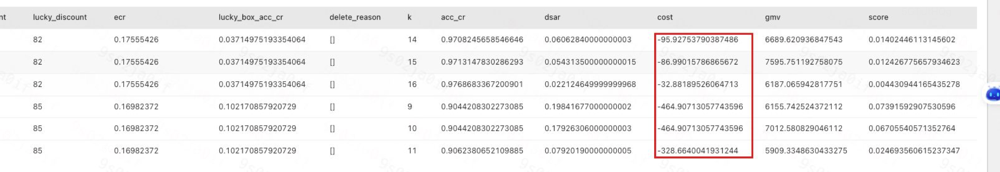

### 2.1.2 排查过程

符号说明
| **Symbolic** <br> | **解释** <br> |
| :---: | :---: |
| $$i$$ <br> | 表示第$$i$$个冒泡 <br> |
| $$j$$ <br> | 表示第j种折扣，是一个二元组，（幸运盒子折扣，特价盒子折扣），目前有21种折扣组合 <br> |
| $$k$$ <br> | 表示默勾勾选到第$$k$$个车型 <br> |
| $$l$$ <br> | 表示表单中第$$l$$个车型 <br> |
| $$p_{ijk}$$ <br> | 对于第i个冒泡，在给定折扣组合j的情况下，平台默勾前k个车型时，订单预估的GMV <br> |
| $$pr$$ <br> | 当订单以某一车型组合被呼叫时，最终有可能被其中的任一一个车型应答和完单，pr预估的是最终以每一个车型完单的概率，所有被呼叫车型的预估概率相加等于1，在acc_CR中是通过模型产出 <br> |
| $$p'$$ <br> | 前置折扣扣减后的券后价 <br>背景：平台呼返为折上折形式，即若GMV为100元，前置券9折，平台呼返8折，则最终实付价为100\*0.9\*0.8=72元，平台呼返补贴金额为100\*0.9\*(1-0.8) = 18元 <br> |
| $$d_j$$ <br> | 折扣，用于计算最终补贴的金额 <br> |

决策链路中，cost由各车型的核销金额（$$p'_l*(1-d_j)$$）与商家完单概率加权得到，理论上核销金额不可能为负，因此是线上CR模型在聚合冒泡维度结果时，商家完单概率被错误计算为负值。


### 2.1.3 问题原因

幸运盒子CR模型输出值是基于特价盒子100折扣组下的特价盒子头的输出，乘上惩罚系数计算得到的。通过工程排查发现，由于在计算幸运盒子输出结果时，误修改了特价盒子100折下的输出结果，导致幸运盒子CR、特价盒子100折的CR偏低，且GMV、cost中存在负值<!--评论:[{"u":"rongbohui","c":"这个下面的举例，也没对应上？ 还是没看懂为什么会有负值"},{"u":"chenjiaxi","c":"是工程的代码实现问题，具体见复盘文档1.1.1 https://cooper.didichuxing.com/knowledge/2200004056890/2206205620977"}] -->。举例如下：

| 操作 <br> | 惩罚项 <br> | 特价盒子100折输出结果 <br> | 幸运盒子各折扣输出结果 <br> |
| --- | --- | --- | --- |
| 原本数据 <br> |  <br> | 1 <br> |  <br> |
| 获取幸运盒子97折输出结果 <br> | 0.97 <br> | 0.97 <br> | 0.97 <br> |
| 获取幸运盒子94折输出结果 <br> | 0.94 <br> | 0.97\*0.94=0.91 <br> | 0.97\*0.94=0.91 <br> |
| 获取幸运盒子91折输出结果 <br> | 0.91 <br> | 0.97\*0.94\*0.91=0.82 <br> | 0.97\*0.94\*0.91=0.82 <br> |

## 2.2 SDS特征修复<!--评论:[{"u":"zhouzhishuo","c":"工程需发起复盘"}] -->

### 2.2.1 问题发现

对比25年11月与26年2月，在CR无变化的情况下，默勾变多，具体表现为<!--评论:[{"u":"menchang","c":"小流量上线后3个月发现，太久了；且发现过程有一定偶然性。有什么办法能在下次发生同类问题时一定发现、更早发现吗？"},{"u":"chenjiaxi","c":"建设完善监控，观察每天、每月波动：实验指标包含人均完单、默勾水位、默勾接受度、品类份额等；抓手包含默勾CR阈值、幸运盒子CR阈值；模型相关包含特征均值、缺失率、模型在线AUC等"}] -->

- 平均默勾车型占比（盒子口径）从27%左右上涨到70%左右，展现口径从25%上涨到60%左右

- 默勾价格系数从1.46上涨到1.9左右

- 默勾单勾率下降，从37%左右下降到10%左右

- 默勾全勾占比上涨，从1%\~6%上涨到10%\~20%

| BY月CR <br> | 2025年11月默勾水位 <br> | 2026年2月默勾水位 <br> |
| --- | --- | --- |
| 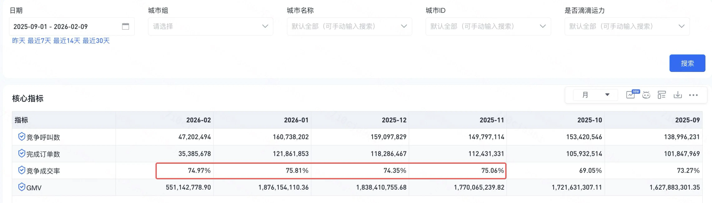 <br> | 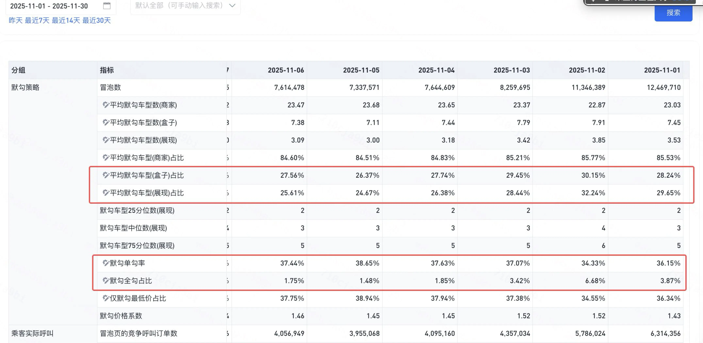 <br> | 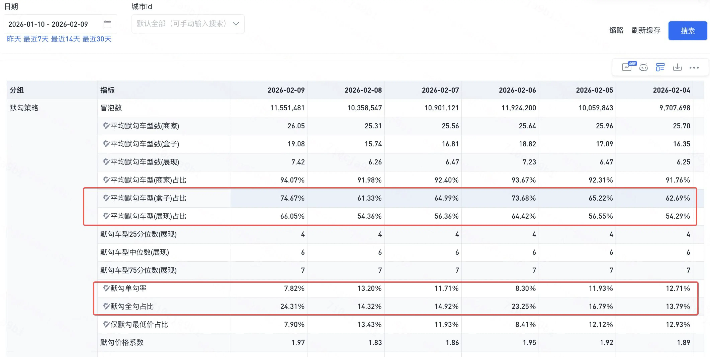 <br> |

### 2.2.2 排查过程

Step0 回溯变更的时间线

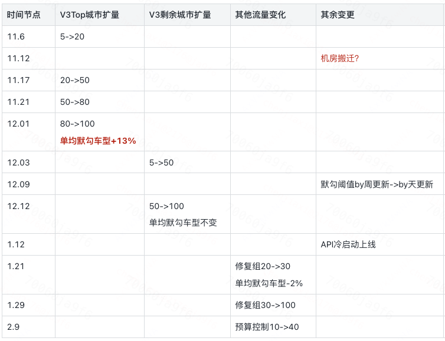

Step1 默勾CR阈值分析：由于默勾CR阈值直接影响默勾水位，因此通过分析by月默勾水位、默勾CR阈值，发现11月以来，**默勾acc_cr 60分位点（浅蓝色线）缓慢上涨20pp，与默勾水位上涨趋势一致**

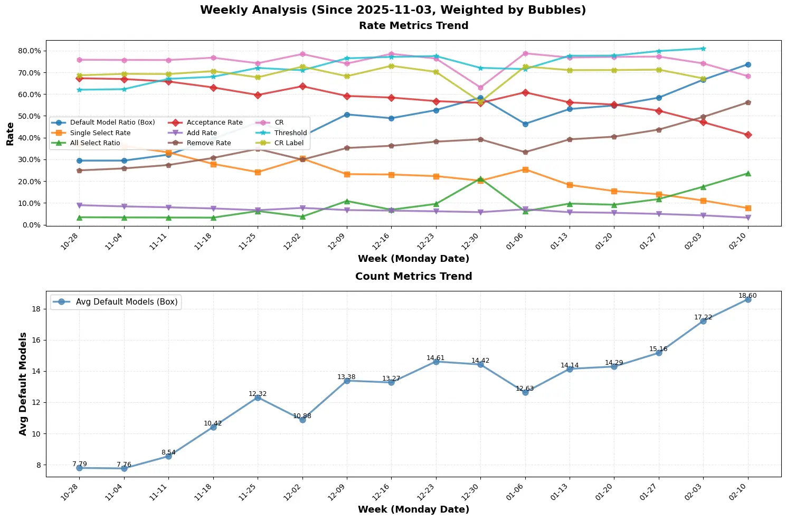

Step2 特征偏移分析：由于默勾CR阈值依赖CR模型的离线仿真任务，因此通过均值偏移、PSI评估偏移的方式，对离线特征均值、特征缺失率的分天变化进行分析，发现SDS特征“商家应答率”，存在特征均值偏移、特征缺失率偏移，且发生偏移的日期与V3放量时间线完全一致。

- 特征均值偏移：

	- 商家过去10分钟应答率(merchant_ar_10m)均值从0.04变化到0.2

	- 商家过去10分钟应答率-一圈格子(merchant_ar_10m_one_circle_grid) 从0.04变化到0.18

- 特征缺失率偏移：

	- 实时sds特征1.13号后，缺失率+8pp

| 均值变化 <br> | 缺失率变化 <br> |
| --- | --- |
| 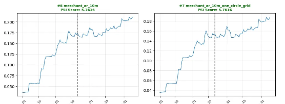 <br> | 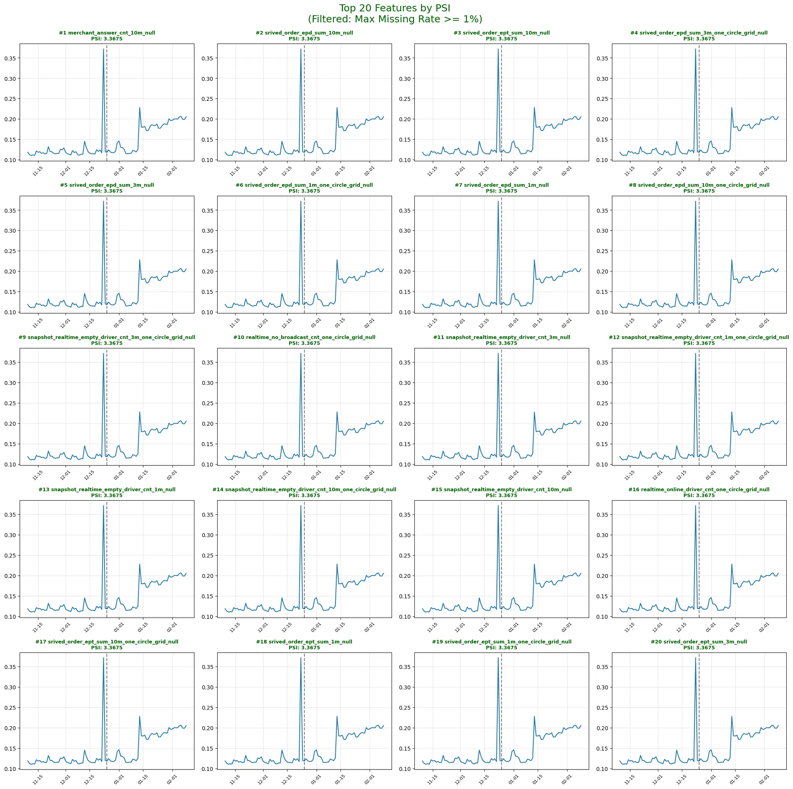 <br> |

Step3 离线消融实验：在模型不变的基础上，对比“原始特征” vs “商家应答率赋空值”的模型预测结果，发现由于偏移特征赋空值后，模型会自动填充均值，因此模型预测结果不再偏高，与样本CR保持一致。

- 商家应答率特征：**merchant_ar_10m、merchant_ar_10m_one_circle_grid**

| 样本CR <br> | 原始特征预测CR <br> | 商家应答率赋空值预测CR <br> |
| --- | --- | --- |
| 0.709 <br> | 0.813 <br> | 0.710 <br> |

### 2.2.3 问题原因

- 问题原因：

	- V2、V3代码里把获取应答、发单特征的API商家给跳过了，所以导致API的发单、应答都是-9999的默认值

	- V3链路中，计算AR值时，所在格子发单数、应答数为空值-9999的时候，应该默认填充-9999，但是计算为应答数/发单数=1，所以会导致AR偏大

- 影响面：

	- 含API商家的冒泡，CR值偏高

	- API商家的商家完单概率偏高

	- 离线仿真的默勾CR阈值偏高，导致默勾水位上涨

## 2.3 幸运盒子单勾适配联合决策V3

为适配联合决策V2+幸运盒子链路，athena有一个默勾后处理逻辑，如果默勾勾选幸运盒子+特价盒子，会后处理为单勾幸运盒子

在联合决策V3中，幸运盒子定价收拢至联合决策后，不需要进行默勾的后处理

# 三、实验结果

## 3.1 CR计算修复实验结果

### 3.1.1 实验背景

- 实验城市：由于只在有幸运盒子的场景存在错误，因此实验城市为幸运盒子开城城市

	- 5,6,8,9,12,13,14,15,16,19,22,24,25,26,29,32,33,34,35,38,42,44,50,58,60,74,81,83,85,86,125,133,134,153,157,160,254,11,18,20,37,39,40,41,46,47,57,71,72,76,79,87,102,108,121,127,135,137,138,142,143,146,156,166,167,168,193,226,253,256,258,259,270,300,301,306,308

- 实验周期：2026.01.14\~2026.01.20

- 实验分组：

| 实验组 <br> | 策略 <br> | 默勾acc_cr阈值分位点 <br> | 流量 <br> |
| --- | --- | --- | --- |
| V3 <br> | V3主流量 <br> | 50 <br> | 57% <br> |
| V3空白 <br> | V3主流量，不出呼返，幸运盒子智能定价 <br> | 3% <br> |
| V3修复 <br> | V3，修复CR计算问题 <br> | 60 <br> | 10% <br> |

### 3.1.2 实验结论

V3修复 vs V3

- Top37城（完单占比82%）：花业务补贴率显著-0.1pp，人均完单显著**+0.18%**，幸运盒子完单份额+1.8%

- 其他40城（完单占比18%）：花业务补贴率不显著-0.09pp，人均完单显著**-0.33%**，幸运盒子完单份额+0.73%

- 打包结果：花业务补贴率-0.1pp，人均完单**+0.09%**

| 有幸运盒子Top37城市 <br> | 有幸运盒子其他40城 <br> |
| --- | --- |
| 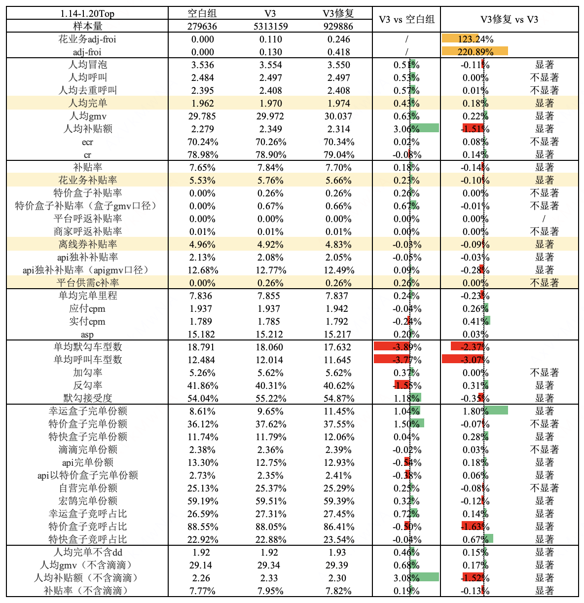 <br> | 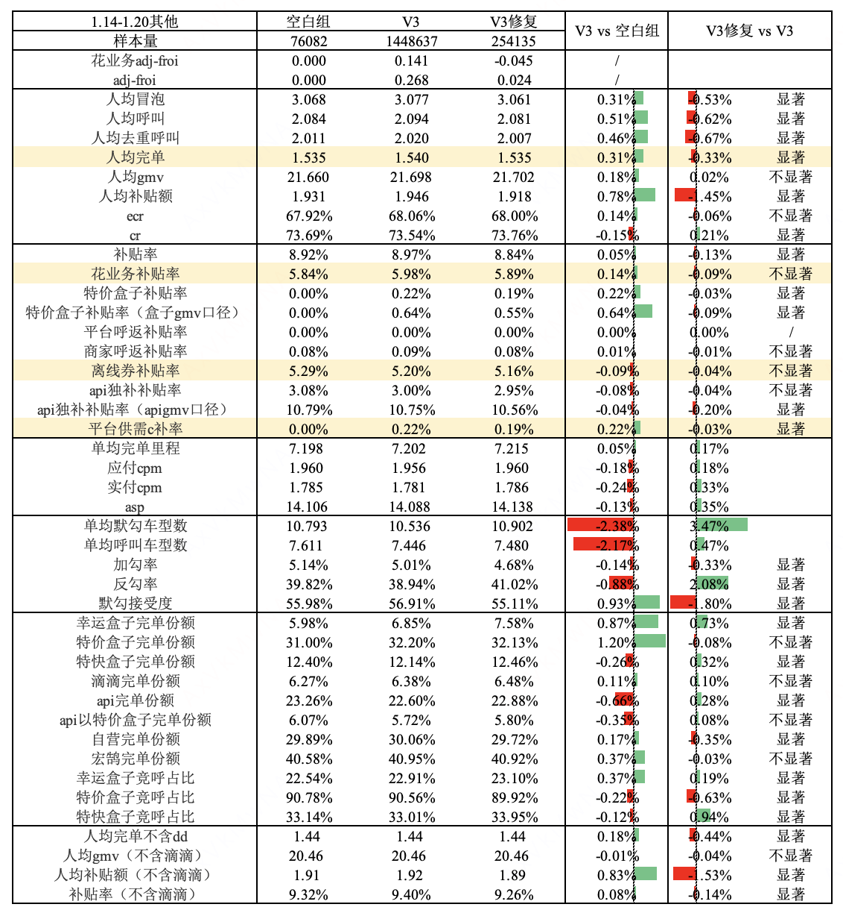 <br> |

## 3.2 SDS特征修复实验结果

### 3.2.1 实验背景

- 实验城市：全国

- 实验周期：2026.03.04～2026.03.10

- 实验分组：

| 实验组 <br> | 流量 <br> | 其他策略 <br> |
| --- | --- | --- |
| 主流量 <br> | 70% <br> | V3主流量 <br> |
| 默勾50 <br> | 3% <br> | 修复ACC_CR模型的AR特征，默勾acc_cr阈值使用修复后的未完单50分位点，相比主流量少勾 <br> |
| 默勾60 <br> | 3% <br> | 修复ACC_CR模型的AR特征，默勾acc_cr阈值使用修复后的未完单60分位点，相比主流量少勾 <br> |
| 默勾70 <br> | 3% <br> | 修复ACC_CR模型的AR特征，默勾acc_cr阈值使用修复后的未完单70分位点，相比主流量多勾 <br> |

### 3.2.2 实验结论<!--评论:[{"u":"zhouzhishuo","c":"后续补充「默勾水位」，26&amp;25版口径都包含（26年口径：补充惊喜特惠&amp;其他细节，http://kfdata.didichuxing.com/?menuId=0JmkRTi2p）"}] -->

vs 主流量实验结果如下，由于**BUG导致高估API的完单贡献，且离线默勾CR阈值上涨，因此修复组的实验结果中API份额下跌、默勾水位下降**

- 默勾50组：

	- 交易漏斗：花业务补贴率+0.1pp，人均完单**+0.31%**，**CR-0.37pp**

	- 品类份额：幸运盒子完单份额**+1.87pp**，特价盒子完单份额**+1.37pp**，api完单份额-1.02%

	- 默勾：单均默勾车型数-16.32%，默勾接受度+6.35pp

- 默勾60组：

	- 交易漏斗：花业务补贴率+0.05pp，人均完单**+0.02%**，CR-0.02pp

	- 品类份额：幸运盒子完单份额**+1.64pp**，特价盒子完单份额**+0.41pp，**api完单份额-0.61%

	- 默勾：单均默勾车型数-7.57%，默勾接受度+2.60pp

- 默勾70组：

	- 花业务补贴率-0.01pp，人均完单**-0.5%**，**CR+0.13pp**

	- 幸运盒子完单份额+0.99pp，特价盒子完单份额-0.69pp，api完单份额+0.35%

	- 默勾：单均默勾车型数+2.79%，默勾接受度-1.89pp

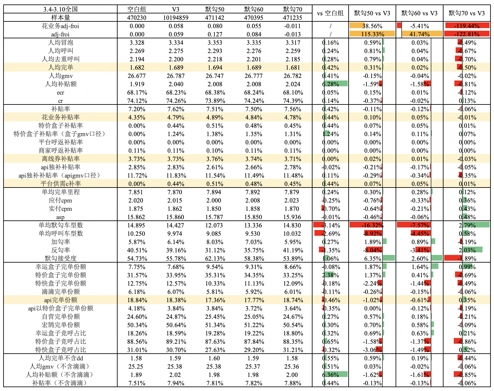

### 3.2.3 长期视角评估

> [表单策略评估优化](https://cooper.didichuxing.com/docs2/document/2207167183408)

评估详情
评估sql:

```PlainText
with pas_info_raw as 
(
    select distinct 
        pid,
        exp_group,
        dt
    from
        kflower_strategy.pltf_union_stg_exp_evaluation_pas_tag 
    where
        dt between '${begin_date}' and '${end_date}'
        and city_id in (${city})
),

pas_info_cnt as 
(
    select
        pid,
        count(distinct exp_group) as pid_cnt
    from
        pas_info_raw
    group by
        pid
),

pas_info as 
(
    select
        pid,
        max(exp_group) as exp_group,
        min(dt) as min_date
    from
        pas_info_raw
    where
        pid in 
        (
            select distinct 
                pid
            from
                pas_info_cnt
            where
                pid_cnt = 1
        )
    group by 
        pid
),

bubble as 
(
    select 
        a.passenger_id,
        sum(bubble_cnt) as bubble_cnt
    from 
    (
        select 
            passenger_id,
            dt,
            count(distinct distinct_bubble_id) as bubble_cnt 
        from 
        (
            select
                *
            from 
                kflower_dw.dwd_kf_trd_bubble_base_di
            where 
                dt between '${begin_date}' and '${end_date}' 
                and city_id in (${city})
                and product_1level in (1,2)
                and is_anycar_form = 1
                and is_from_waiting_response <> 1 
                and passenger_id <> 0
        ) a 
        left join 
        (
            select  
                estimate_id
                ,distinct_bubble_id
            from    
                kflower_dw.dim_kf_trd_unity_bubble_anycar_label_di
            where   
                dt between '${begin_date}' and '${end_date}'
                and source_id = 'kf'
        ) c 
        on a.bubble_id = c.estimate_id
        group by 
            passenger_id,
            dt
    ) a 
    left join pas_info b on a.passenger_id = b.pid 
    where 
        a.dt >= b.min_date
    group by 
        a.passenger_id
),

bubble_call as 
(
    select 
        a.passenger_id,
        sum(can_reverse_cnt) as can_reverse_cnt,
        sum(had_reverse_cnt) as had_reverse_cnt,
        sum(can_append_cnt) as can_append_cnt,
        sum(had_append_cnt) as had_append_cnt,
        sum(only_selected_call_cnt) as only_selected_call_cnt
    from 
    (
        select
            passenger_id,
            dt,
            count(case when is_can_reverse = 1 then a.order_id end) as can_reverse_cnt,
            count(case when is_had_reverse = 1 then a.order_id end) as had_reverse_cnt,
            count(case when is_can_append = 1 then a.order_id end) as can_append_cnt,
            count(case when is_had_append = 1 then a.order_id end) as had_append_cnt,
            count(case when only_selected_call_cnt > 0 then a.order_id end) as only_selected_call_cnt
        from
        (
            select 
                order_id,
                max(passenger_id) as passenger_id,
                max(dt) as dt
            from 
                kflower_dw.dwd_kf_trd_order_base_di
            where 
                dt between '${begin_date}' and '${end_date}'
                and start_city_id in (${city})
                and is_td_call = 1 
                and source_type <> 2
                and product_1level not in (3,4) 
            group by 
                order_id
        ) a 
        left join
        (
            select 
                order_id,
                max(call_cp_cnt) as call_cp_cnt, 
                max(selected_cp_cnt) as selected_cp_cnt, 
                max(only_selected_call_cnt) as only_selected_call_cnt, -- 仅呼叫默勾的订单数
                max(if(selected_bubble_cnt > 0, 1, 0)) as is_can_reverse, 
                max(if(selected_cp_cnt > size(both_bub_call_product_arr), 1, 0)) as is_had_reverse, 
                max(if(bubble_cnt - selected_cp_cnt > 0, 1, 0)) as is_can_append,
                max(if(call_cp_cnt > size(both_bub_call_product_arr), 1, 0)) as is_had_append
            from 
                kflower_dw.dwm_kf_trd_order_bubble_di
            where
                dt between '${begin_date}' and '${end_date}'
                and form_type = 3 -- 聚合表单
                and order_type = 0 -- 实时单
                and source_type <> 2 -- 非改派单
            group by 
                order_id
        ) b 
        on a.order_id = b.order_id 
        group by 
            passenger_id,
            dt
    ) a
    left join pas_info b on a.passenger_id = b.pid 
    where 
        a.dt >= b.min_date
    group by 
        a.passenger_id
),

call as 
(
    select 
        a.passenger_id,
        sum(call_cnt) as call_cnt,
        sum(tj_call_cnt) as tj_call_cnt,
        sum(xy_call_cnt) as xy_call_cnt
    from 
    (
        select 
            passenger_id,
            a.dt,
            count(distinct case when is_compete_call = 1 then a.order_id end) as call_cnt,
            count(distinct case when is_compete_call = 1 and level_type = 105 then a.order_id end) as tj_call_cnt,
            count(distinct case when is_compete_call = 1 and level_type = 107 then a.order_id end) as xy_call_cnt
        from 
        (
            select 
                *,
                start_city_id as city_id 
            from 
                kflower_dw.dwd_kf_trd_unity_order_anycar_di
            where 
                dt between '${begin_date}' and '${end_date}' 
                and start_city_id in (${city})
                and passenger_id <> 0
                and is_hxz_call = 1
                and to_date(call_time) = dt
                and product_id <> 26 
        ) a 
        left join
        (
            select 
                source_id,
                dt,
                order_id,
                estimate_id,
                product_id,
                call_car_level_id,
                is_compete_call,
                is_objective_call,
                is_platform_objective_call
            from 
                kflower_dw.dim_kf_trd_unity_order_anycar_label_di
            where 
                dt between '${begin_date}' and '${end_date}'
        ) c 
        on a.order_id = c.order_id and a.estimate_id = c.estimate_id and a.product_id = c.product_id and a.call_car_level_id = c.call_car_level_id and a.dt = c.dt
        group by 
            passenger_id,
            a.dt
    ) a 
    left join pas_info b on a.passenger_id = b.pid 
    where 
        a.dt >= b.min_date
    group by 
        a.passenger_id
),

zyhh_income as 
(
    select 
        open_oid,
        sum(driver_income) as driver_income,
        sum(online_driver_divide) as online_driver_divide,
        sum(subsidy_b) as subsidy_b
    from 
    (
        select distinct 
            driver_id
            ,order_id
            ,gmv_amt
            ,is_td_call
            ,is_td_answer
            ,is_td_cancel
            ,cancel_type
            ,is_td_finish
            ,open_oid
        from 
            kflower_dw.dwd_hh_trd_order_base_di --宏鹄订单表
        where 
            dt between '${begin_date}' and '${end_date}'
            and is_td_finish = 1
            and start_city_id in (${city})
    ) a 
    left join 
    (
	    select  
            driver_id
            ,order_id
            ,sum(subsidy_b) as subsidy_b
            ,sum(online_driver_divide) as online_driver_divide
            ,sum(online_driver_divide + subsidy_b) as driver_income
	    from 
	        kflower_dw.dwm_kf_fin_order_report_di 
	    where 
	        dt between '${begin_date}' and date_add('${end_date}',2)
	        and product_id = 80
	    group by 
	        driver_id,
            order_id

	    union all 

	    select  
	        driver_id_honghu as driver_id
            ,order_id_honghu as order_id
            ,sum(subsidy_b) as subsidy_b
            ,sum(online_driver_divide) as online_driver_divide
            ,sum(online_driver_divide + subsidy_b) as driver_income
	    from 
	        kflower_dw.dwm_hh_fin_rpt_order_report_di
	    where 
	        dt between '${begin_date}' and date_add('${end_date}',2)
	        and company_id <> 1400
	    group by 
	        driver_id_honghu,
            order_id_honghu
	) b on a.driver_id = b.driver_id and a.order_id = b.order_id
    group by 
        open_oid
),

finish as 
(
    select 
        a.passenger_id,
        sum(fin_cnt) as fin_cnt,
        sum(zy_fin_cnt) as zy_fin_cnt,
        sum(hh_fin_cnt) as hh_fin_cnt,
        sum(api_fin_cnt) as api_fin_cnt,
        sum(dd_fin_cnt) as dd_fin_cnt,
        sum(tj_fin_cnt) as tj_fin_cnt,
        sum(xy_fin_cnt) as xy_fin_cnt,
        sum(ykj_fin_cnt) as ykj_fin_cnt,
        sum(ss_fin_cnt) as ss_fin_cnt,
        sum(gmv) as gmv,
        sum(subsidy_c) as subsidy_c,
        sum(grab_before_cannel_cnt) as grab_before_cannel_cnt,
        sum(ans_cnt) as ans_cnt,
        sum(ans_cnt_without_reassign) as ans_cnt_without_reassign,
        sum(grab_after_pas_cancel_cnt_without_reassign) as grab_after_pas_cancel_cnt_without_reassign,
        sum(grab_after_dri_cancel_cnt) as grab_after_dri_cancel_cnt,
        sum(grab_after_dri_cancel_cnt_without_reassign) as grab_after_dri_cancel_cnt_without_reassign,
        sum(before_cancel_dur) as before_cancel_dur,
        sum(first_ans_dur) as first_ans_dur,
        sum(order_charge_dis) as order_charge_dis,
        sum(zyhh_subsidy_b) as zyhh_subsidy_b,
        sum(zyhh_online_driver_divide) as zyhh_online_driver_divide,
        sum(zyhh_driver_income) as zyhh_driver_income
    from 
    (
        select 
            passenger_id,
            a.dt,
            count(distinct case when is_td_finish = 1 then a.order_id end) as fin_cnt,
            count(distinct case when product_type = '花小猪自营' and is_td_finish = 1 then a.order_id end) as zy_fin_cnt,
            count(distinct case when product_type = '三方品牌' and apply_from = 1 and is_td_finish = 1 then a.order_id end) as hh_fin_cnt,
            count(distinct case when product_type = '三方品牌' and apply_from = 4 and is_td_finish = 1 then a.order_id end) as api_fin_cnt,
            count(distinct case when product_type = '滴滴自营' and is_td_finish = 1 then a.order_id end) as dd_fin_cnt,
            count(distinct case when level_type in (105) and is_td_finish = 1 then a.order_id end) as tj_fin_cnt,
            count(distinct case when level_type in (107) and is_td_finish = 1 then a.order_id end) as xy_fin_cnt,
            count(distinct case when price_type in (0,1) and is_td_finish = 1 then a.order_id end) as ykj_fin_cnt,
            count(distinct case when price_type in (2) and is_td_finish = 1 then a.order_id end) as ss_fin_cnt,

            sum(case when is_td_finish = 1 then a.gmv_amt end) as gmv,
            sum(case when is_td_finish = 1 then subsidy_c end) as subsidy_c,

            count(distinct case when is_grab_before_cannel = 1 then a.order_id end) as grab_before_cannel_cnt,
            count(distinct case when is_td_answer = 1 then a.order_id end) as ans_cnt,
            count(distinct case when is_td_answer_without_reassign = 1 then a.order_id end) as ans_cnt_without_reassign,
            count(distinct case when is_grab_after_pas_cancel_without_reassign = 1 then a.order_id end) as grab_after_pas_cancel_cnt_without_reassign,
            count(distinct case when is_grab_after_dri_cancel = 1 then a.order_id end) as grab_after_dri_cancel_cnt,
            count(distinct case when is_grab_after_dri_cancel_without_reassign = 1 then a.order_id end) as grab_after_dri_cancel_cnt_without_reassign,

            sum(case when is_grab_before_cannel = 1 then cancel_dur end) as before_cancel_dur,
            sum(case when is_td_answer = 1 and a.origin_order_id = a.order_id then ans_dur end) as first_ans_dur,
            sum(case when is_td_finish = 1 then a.order_charge_dis end) as order_charge_dis,
            sum(case when is_td_finish = 1 then subsidy_b end) as zyhh_subsidy_b,
            sum(case when is_td_finish = 1 then online_driver_divide end) as zyhh_online_driver_divide,
            sum(case when is_td_finish = 1 then driver_income end) as zyhh_driver_income
        from 
        (
            select distinct 
                passenger_id,
                source_id,
                product_id,
                order_id,
                product_type,
                gmv_amt,
                start_city_id as city_id,
                is_grab_before_cannel,
                est_arrive_dur,
                est_arrive_dis / 1000 as est_arrive_dis,
                call_car_level_id,
                dt,
                case 
                    when answer_time != '0000-00-00 00:00:00' then (unix_timestamp(answer_time) - unix_timestamp(call_time))
                    else (unix_timestamp(cancel_time) - unix_timestamp(call_time))
                end as wait_dur,
                level_type,
                order_charge_dis/1000 as order_charge_dis,
                coalesce(call_reassign_order_id,answer_reassign_order_id,order_id) as origin_order_id,
                (unix_timestamp(answer_time) - unix_timestamp(call_time)) as ans_dur,
                (unix_timestamp(cancel_time) - unix_timestamp(call_time)) as cancel_dur,
                price_type,
                tripcloud_open_oid
            from 
                kflower_dw.dwd_kf_trd_unity_order_di
            where 
                dt between '${begin_date}' and '${end_date}'
                and is_hxz = 1
                and start_city_id in (${city})
        ) a 
        left join 
        (   
            select  
                *
            from    
                kflower_dw.dim_kf_trd_unity_order_label_di
            where   
                dt between '${begin_date}' and '${end_date}'
                and source_id = 'kf'
        ) label
        on a.source_id = label.source_id and a.order_id = label.order_id and a.dt = label.dt
        left join
        (
            select
                order_id,
                sum(subsidy_c) as subsidy_c
            from 
                kflower_dw.dwm_kf_fin_order_subsidy_c_di
            where 
                dt between '${begin_date}' and date_add('${end_date}',2)
                and subsidy_type <> 64 -- 幸运盒子假c
            group by 
                order_id 
        ) b on a.order_id = b.order_id
        left join
        (
            select 
                product_id,
                max(apply_from) as apply_from
            from 
                kflower_dw.dim_hh_com_id_map_df
            where 
                dt = '${end_date}'
            group by 
                product_id
        ) hh on a.product_id = hh.product_id
        left join zyhh_income on a.tripcloud_open_oid = zyhh_income.open_oid
        group by 
            passenger_id,
            a.dt
    ) a 
    left join pas_info b on a.passenger_id = b.pid 
    where 
        a.dt >= b.min_date
    group by 
        a.passenger_id
),


raw0 as 
(
    select 
        exp_group
        ,pid
        ,sum(nvl(bubble_cnt,0)) as bubble_cnt
        ,sum(nvl(call_cnt,0)) as call_cnt
        ,sum(nvl(tj_call_cnt,0)) as tj_call_cnt
        ,sum(nvl(xy_call_cnt,0)) as xy_call_cnt
        ,sum(nvl(fin_cnt,0)) as fin_cnt
        ,sum(nvl(zy_fin_cnt,0)) as zy_fin_cnt
        ,sum(nvl(hh_fin_cnt,0)) as hh_fin_cnt
        ,sum(nvl(api_fin_cnt,0)) as api_fin_cnt
        ,sum(nvl(dd_fin_cnt,0)) as dd_fin_cnt
        ,sum(nvl(tj_fin_cnt,0)) as tj_fin_cnt
        ,sum(nvl(xy_fin_cnt,0)) as xy_fin_cnt
        ,sum(nvl(ykj_fin_cnt,0)) as ykj_fin_cnt
        ,sum(nvl(ss_fin_cnt,0)) as ss_fin_cnt
        ,sum(nvl(gmv,0)) as gmv
        ,sum(nvl(subsidy_c,0)) as subsidy_c
        ,sum(nvl(can_reverse_cnt,0)) as can_reverse_cnt
        ,sum(nvl(had_reverse_cnt,0)) as had_reverse_cnt
        ,sum(nvl(can_append_cnt,0)) as can_append_cnt
        ,sum(nvl(had_append_cnt,0)) as had_append_cnt
        ,sum(nvl(only_selected_call_cnt,0)) as only_selected_call_cnt
        ,sum(nvl(ans_cnt_without_reassign,0)) as ans_cnt_without_reassign
        ,sum(nvl(ans_cnt,0)) as ans_cnt
        ,sum(nvl(grab_before_cannel_cnt,0)) as grab_before_cannel_cnt
        ,sum(nvl(grab_after_pas_cancel_cnt_without_reassign,0)) as grab_after_pas_cancel_cnt_without_reassign
        ,sum(nvl(grab_after_dri_cancel_cnt,0)) as grab_after_dri_cancel_cnt
        ,sum(nvl(order_charge_dis,0)) as order_charge_dis
        ,sum(nvl(zyhh_subsidy_b,0)) as zyhh_subsidy_b
        ,sum(nvl(zyhh_online_driver_divide,0)) as zyhh_online_driver_divide
        ,sum(nvl(zyhh_driver_income,0)) as zyhh_driver_income
    from 
        pas_info
        left join bubble on pas_info.pid = bubble.passenger_id 
        left join bubble_call on pas_info.pid = bubble_call.passenger_id 
        left join call on pas_info.pid = call.passenger_id 
        left join finish on pas_info.pid = finish.passenger_id 
    group by 
        exp_group,
        pid
),

raw as 
(
    select 
        exp_group
        ,count(distinct pid) as `样本量`

        ,sum(bubble_cnt)/count(distinct pid) as `人均冒泡`
        ,sum(call_cnt)/count(distinct pid) as `人均呼单`
        ,sum(tj_call_cnt)/count(distinct pid) as `人均特价盒子呼叫`
        ,sum(xy_call_cnt)/count(distinct pid) as `人均幸运盒子呼叫`

        ,sum(fin_cnt)/count(distinct pid) as `人均完单`
        ,sum(zy_fin_cnt)/count(distinct pid) as `人均自营完单`
        ,sum(hh_fin_cnt)/count(distinct pid) as `人均宏鹄完单`
        ,sum(api_fin_cnt)/count(distinct pid) as `人均API完单`
        ,sum(dd_fin_cnt)/count(distinct pid) as `人均滴滴完单`
        ,sum(tj_fin_cnt)/count(distinct pid) as `人均特价盒子完单`
        ,sum(xy_fin_cnt)/count(distinct pid) as `人均幸运盒子完单`
        ,sum(ykj_fin_cnt)/count(distinct pid) as `人均一口价完单`
        ,sum(ss_fin_cnt)/count(distinct pid) as `人均实时计价完单`

        ,sum(gmv)/count(distinct pid) as `人均GMV`
        ,sum(subsidy_c)/count(distinct pid) as `人均C补`
        ,sum(subsidy_c)/sum(gmv) as `C补率`
        ,sum(call_cnt)/sum(bubble_cnt) as `ECR`
        ,sum(fin_cnt)/sum(call_cnt) as `CR`
    
        ,sum(ans_cnt_without_reassign)/sum(call_cnt) as `应答率`
        ,sum(grab_before_cannel_cnt)/sum(call_cnt) as `应答前乘客取消率`
        ,sum(grab_after_pas_cancel_cnt_without_reassign)/sum(ans_cnt_without_reassign) as `应答后乘客取消率`
        ,sum(grab_after_dri_cancel_cnt)/sum(ans_cnt) as `应答后司机取消率含改派`

        ,sum(had_reverse_cnt)/sum(can_reverse_cnt) as `反勾率`
        ,sum(had_append_cnt)/sum(can_append_cnt) as `加勾率`
        ,sum(only_selected_call_cnt)/sum(call_cnt) as `默勾接受度`

        ,sum(tj_call_cnt)/sum(call_cnt) as `特价盒子呼叫份额`
        ,sum(xy_call_cnt)/sum(call_cnt) as `幸运盒子呼叫份额`
        ,sum(tj_fin_cnt)/sum(fin_cnt) as `特价盒子完单份额`
        ,sum(xy_fin_cnt)/sum(fin_cnt) as `幸运盒子完单份额`
        ,sum(ykj_fin_cnt)/sum(fin_cnt) as `一口价完单份额`
        ,sum(order_charge_dis)/sum(fin_cnt) as `单均计费里程`
        ,sum(zyhh_subsidy_b) as `可控运力b补`
        ,sum(zyhh_online_driver_divide) as `可控运力在线分成`
        ,sum(zyhh_driver_income) as `可控运力总收入`

        ,var_pop(coalesce(bubble_cnt,0))/count(distinct pid) as `var_冒泡`
        ,var_pop(coalesce(call_cnt,0))/count(distinct pid) as `var_呼单` 
        ,var_pop(coalesce(fin_cnt,0))/count(distinct pid) as `var_完单`
        ,var_pop(coalesce(gmv,0))/count(distinct pid) as `var_gmv`
        ,var_pop(coalesce(subsidy_c,0))/count(distinct pid) as `var_c补`
        ,var_pop(tj_fin_cnt)/count(distinct pid) as `var_特价盒子完单`
        ,var_pop(xy_fin_cnt)/count(distinct pid) as `var_幸运盒子完单`
    from 
        raw0
    group by 
        exp_group
)

select * from raw
```

```PlainText
with pas_info_raw as 
(
    select distinct 
        pid,
        if(exp_group = 'stg_platform_uabox_fix','stg_bucket_1206',exp_group) as exp_group,
        dt
    from
        kflower_strategy.pltf_union_stg_exp_evaluation_pas_tag 
    where
        dt between '${begin_date}' and '${end_date}'
        and city_id in (${city})
),

pas_info_cnt as 
(
    select
        pid,
        count(distinct exp_group) as pid_cnt
    from
        pas_info_raw
    group by
        pid
),

pas_info as 
(
    select
        pid,
        max(exp_group) as exp_group,
        min(dt) as min_date
    from
        pas_info_raw
    where
        pid in 
        (
            select distinct 
                pid
            from
                pas_info_cnt
            where
                pid_cnt = 1
        )
    group by 
        pid
),

unity_order_base as  
    (
        select 
            a.*
            --label表状态
            ,is_td_answer
            ,is_td_finish
            ,gmv
            ,order_charge_dis
            ,charge_dur / 3600 as charge_dur
            ,is_grab_after_dri_cancel
            ,is_grab_after_pas_cancel
            ,is_grab_after_srvc_cancel
            ,is_td_answer_without_reassign
            ,is_grab_after_dri_cancel_without_reassign
            ,is_grab_after_pas_cancel_without_reassign
            ,is_grab_after_srvc_cancel_without_reassign   
            ---funnel表取预估接驾信息
            ,est_arrive_dis_funnel
            ,est_arrive_dur_funnel
            ,driver_to_last_dest_eta
            ,last_dest_to_start_eta
        from 
            (
                select distinct 
                    start_city_id city_id
                    ,dt
                    ,order_id
                    ,estimate_id
                    ,driver_id
                    ,passenger_id
                    ,source_id
                    ,is_td_call
                    --,is_td_cancel --不含改派口径，如果订单被司机取消导致改派了不会记is_cancel = 1
                    ,is_pbd
                    ,is_hxz
                    ,is_thlm
                    ,product_id
                    ,product_type
                    ,platform_name
                    ,answer_time
                    ,cancel_time
                    ,call_time
                    ,answer_reassign_order_id --平台侧改派发单原始订单id
                    ,call_reassign_order_id
                    ,channel_name
                    ,driver_phone_md5 --手机号
                    ,tripcloud_open_oid
                    --,order_charge_dis --计入计费订单里程，米
                    --,est_arrive_dis --预估接驾距离(米)
                    --,est_arrive_dur --预估接驾时长（s）
                    ,is_reassign --是否改派单
                    ,is_td_reassign --是否被改派
                    ,begin_charge_time --开始计费时间
                    ,is_grab_before_cannel
                    ,coalesce(call_reassign_order_id,answer_reassign_order_id,order_id) as origin_order_id --原始改派订单
                    ---新增
                    ,call_car_level_id
                    ,coalesce(combo_type,0) as combo_type --场景类型
                    ,coalesce(level_type,0) as level_type --运力类型
                    ,is_serial_assign --流量侧是否连环派
                from
                    kflower_dw.dwd_kf_trd_unity_order_di
                where 
                    dt between '${begin_date}' and '${end_date}'
                    and is_hxz = 1
                    and start_city_id in (${city})
            )a 
        left join 
            (
                select distinct 
                    dt dt2,
                    source_id,
                    order_id as order_id2,    
                    is_td_answer,
                    is_td_finish,  
                    gmv_amt as gmv,
                    order_charge_dis, --计入计费订单里程，米
                    charge_dur, --计费时长
                    --被司机取消or当日被改派，被乘客取消，被客服关单
                    is_grab_after_dri_cancel,
                    is_grab_after_pas_cancel,           
                    is_grab_after_srvc_cancel,
                    --按照原始订单呼叫时间排序取最后一单（订单最终状态），被司机取消，被乘客取消，被客服关单
                    is_td_answer_without_reassign,
                    is_grab_after_dri_cancel_without_reassign,
                    is_grab_after_pas_cancel_without_reassign,
                    is_grab_after_srvc_cancel_without_reassign
                from 
                    kflower_dw.dim_kf_trd_unity_order_label_di 
                where 
                    dt between '${begin_date}' and '${end_date}'
            )b 
        on a.source_id = b.source_id and a.order_id = b.order_id2 and a.dt = b.dt2
        left join 
            (
                select  
                    order_id
                    ,product_id
                    ,call_car_level_id
                    ,coalesce(combo_type,0) as combo_type
                    ,coalesce(level_type,0) as level_type
                    ,driver_start_eda as est_arrive_dis_funnel --预估接驾距离
                    ,driver_start_eta as est_arrive_dur_funnel --预估接驾时长
                    ---连环派订单ab + bc距离
                    ,driver_to_last_dest_eta --ab段
                    ,last_dest_to_start_eta --bc段
                from   
                    kflower_dw.dwm_kf_trd_unity_trade_funnel_order_anycar_di --聚合看板呼单漏斗表，预估接驾时长&距离和连环派信息从这张表取比较准（from算法）
                where   
                    dt between '${begin_date}' and '${end_date}'
            )c
        on a.order_id = c.order_id and a.product_id = c.product_id and a.call_car_level_id = c.call_car_level_id and a.combo_type = c.combo_type and a.level_type = c.level_type
    ),

order_rank_max as  
    (
        select 
            a.* 
            ,case 
                when is_td_answer = 0 and is_grab_before_cannel = 1 then '应答前乘客取消'
                when is_td_answer = 1 and is_td_finish = 1 then '完单' --改派单当日无应答算司机取消，跨天应答完单的单可能会有司机取消记录。完单优先级最高
                when is_td_answer = 1 and is_grab_after_dri_cancel = 1 and is_grab_after_dri_cancel_without_reassign = 1 then '司机取消无改派'
                when is_td_answer = 1 and is_grab_after_dri_cancel = 1 and is_grab_after_dri_cancel_without_reassign <> 1 then '司机取消改派'
                when is_td_answer = 1 and is_grab_after_pas_cancel = 1 and is_grab_after_pas_cancel_without_reassign = 1 then '乘客取消无改派'
                when is_td_answer = 1 and is_grab_after_pas_cancel = 1 and is_grab_after_pas_cancel_without_reassign <> 1 then '乘客取消改派'
                when is_td_answer <> 1 and is_grab_after_pas_cancel_without_reassign = 1 then '有过应答且最后一单应答前乘客取消'
                when is_td_answer = 1 and is_grab_after_srvc_cancel = 1 then '客服取消无改派'            
            end as order_status
            ,case when b.order_id is not null then 1 else 0 end as is_callmoredri_sub_ord --是否换车子单
        from 
            (
                select 
                    order_id --订单粒度
                    ,max(origin_order_id) as origin_order_id
                    ,max(city_id) as city_id
                    ,max(driver_id) as driver_id
                    ,max(product_id) as product_id
                    ,max(passenger_id) as passenger_id
                    ,max(is_td_call) as is_td_call
                    ,max(is_td_answer) as is_td_answer
                    ,max(is_td_finish) as is_td_finish
                    ,max(gmv) as gmv
                    ,max(is_grab_before_cannel) as is_grab_before_cannel

                    ,max(is_grab_after_dri_cancel) as is_grab_after_dri_cancel
                    ,max(is_grab_after_pas_cancel) as is_grab_after_pas_cancel
                    ,max(is_grab_after_srvc_cancel) as is_grab_after_srvc_cancel

                    ,max(is_td_answer_without_reassign) as is_td_answer_without_reassign
                    ,max(is_grab_after_dri_cancel_without_reassign) as is_grab_after_dri_cancel_without_reassign
                    ,max(is_grab_after_pas_cancel_without_reassign) as is_grab_after_pas_cancel_without_reassign
                    ,max(is_grab_after_srvc_cancel_without_reassign) as is_grab_after_srvc_cancel_without_reassign

                    ,max(call_time) as call_time
                    ,max(answer_time) as answer_time
                    ,max(begin_charge_time) as begin_charge_time
                    ,max(cancel_time) as cancel_time

                    ,max(order_charge_dis) as order_charge_dis
                    ,max(est_arrive_dis_funnel) as est_arrive_dis_funnel --预估接驾距离
                    ,max(est_arrive_dur_funnel) as est_arrive_dur_funnel--预估接驾时长
                    ,max(is_serial_assign) as is_serial_assign --是否连环派(播单会播多个司机，只要有一个司机连环派就算)
                    ,max(case when is_td_answer=1 and is_serial_assign=1 then 1 else 0 end) as is_answer_serial_assign --是否连环派被应答(只看最终应答的订单是否为连环派)
                from 
                    unity_order_base   
                where 
                    1=1
                    and substr(call_time,1,10) between '${begin_date}' and '${end_date}' --小猪端呼叫订单
                group by order_id
            )a
        left join 
            (
                select 
                    distinct order_id --换车子单
                from 
                    (
                        select 
                            distinct order_id
                            ,get_json_object(call_more_driver, '$.change_car_type') change_car_type --=2接驾久真换车，=1诱导真换车
                            ,get_json_object(call_more_driver, '$.type') fz_type --区分真换车父单+子单
                        from
                            (
                                select 
                                    * 
                                    ,get_json_object(extend_feature, '$.call_more_driver') as call_more_driver
                                from 
                                    kflower_dw.dwm_kf_trd_hxz_order_base_view_di 
                                where 
                                    dt between '${begin_date}' and '${end_date}'
                            )t
                    )t
                where 
                    change_car_type in (1,2) --换车场景 
                    and fz_type = 2 --子单
            )b  
        on a.order_id = b.order_id
    ),

origin_order_detail as --原始订单id粒度统计
    (
        select 
            *
            ,to_date(call_time_min) as dt
            ,unix_timestamp(cancel_time_all_min) - unix_timestamp(call_time_min) as call_to_firstcancel_dur
            ,unix_timestamp(answer_time_min) - unix_timestamp(call_time_min) as call_to_firstans_dur --发单到首次应答时间（秒）
            ,unix_timestamp(begin_charge_time_min) - unix_timestamp(call_time_min) as call_to_firstcharge_dur
            ,unix_timestamp(begin_charge_time_max) - unix_timestamp(call_time_min) as call_to_lastcharge_dur
        from   
            (
                select 
                    origin_order_id
                    ,max(passenger_id) passenger_id 
                    --本次发单首次发单时间
                    ,min(case when is_td_call=1 then call_time end) call_time_min
                    --本次发单首次和末次被应答时间
                    ,min(case when is_td_answer=1 then answer_time end) answer_time_min
                    ,max(case when is_td_answer=1 then answer_time end) answer_time_max
                    --本次发单首次和末次被取消时间
                    ,min(case when is_td_answer=1 and is_td_finish<>1 then cancel_time end) cancel_time_min
                    ,max(case when is_td_answer=1 and is_td_finish<>1 then cancel_time end) cancel_time_max         
                    --上车时间
                    ,min(case when is_td_answer=1 and is_td_finish=1 then begin_charge_time end) begin_charge_time_min
                    ,max(case when is_td_answer=1 and is_td_finish=1 then begin_charge_time end) begin_charge_time_max    
                    --本次发单首次和末次被取消时间(不应答也算)
                    ,min(case when is_td_finish<>1 and cancel_time not in ('0000-00-00 00:00:00') then cancel_time end) cancel_time_all_min
                    ,max(case when is_td_finish<>1 and cancel_time not in ('0000-00-00 00:00:00') then cancel_time end) cancel_time_all_max  

                    --本次归一发单最终状态
                    ,count(distinct order_id) origin_ord_cnt --订单数（是否改派）
                    ,max(is_td_answer) is_td_answer
                    ,max(is_grab_before_cannel) as is_grab_before_cannel
                    ,max(case when order_status in ('完单') then 1 else 0 end) as is_last_finish --本次发单是否完单 
                    ,max(case when reassign_rank_desc = 1 then order_status end) as order_status_reassign_rank_desc --按最后一个发单状态
                    ,count(distinct case when is_grab_after_dri_cancel=1 then order_id end) o_dri_cancel_cnt
                    ,count(distinct case when is_grab_after_pas_cancel_without_reassign=1 then order_id end) o_pas_cancel_cnt
                    ,count(distinct case when is_td_finish=1 then order_id end) o_finish_cnt

                    --特定场景订单数
                    ,count(distinct case when est_arrive_dis_funnel >= 3500 then order_id end) as o_est_arrive_dis_far --本单应答预估接驾距离超过3.5km
                from 
                    (
                        select 
                            a.* 
                            ----订单状态
                            ,row_number()over(partition by origin_order_id order by call_time) reassign_rank --看订单按时间顺序排序
                            ,row_number()over(partition by origin_order_id order by call_time desc) reassign_rank_desc --看订单按时间倒序排序
                            ,row_number()over(partition by origin_order_id,is_td_answer order by call_time) ans_reassign_rank --看订单按时间顺序排序,按应答状态分开排
                            ,row_number()over(partition by origin_order_id,is_td_answer order by call_time desc) ans_reassign_rank_desc --看订单按时间倒序排序,按应答状态分开排
                        from
                            order_rank_max a   
                        left join 
                            (
                                select 
                                    distinct order_id 
                                from 
                                    order_rank_max
                                where is_callmoredri_sub_ord = 1 and is_td_answer <> 1 --未应答换车子单
                            )b
                        on a.order_id = b.order_id
                        where b.order_id is null --过滤掉换车未应答子单
                    )t
                group by origin_order_id
            )t  
        where 
            is_last_finish = 1
    ),

raw as 
(
    select 
        exp_group
        ,count(distinct pid) as `样本量`
        ,sum(fin_origin_ord_cnt)/count(distinct pid) as `人均完单`
        ,sum(call_to_firstcharge_dur)/sum(fin_origin_ord_cnt) as `单均最早呼叫-最早计费时长`
        ,sum(call_to_lastcharge_dur)/sum(fin_origin_ord_cnt) as `单均最早呼叫-最晚计费时长`
    from 
        pas_info a 
        left join 
        (
            select 
                a.passenger_id,
                count(distinct origin_order_id) as fin_origin_ord_cnt,
                sum(call_to_firstcharge_dur) as call_to_firstcharge_dur,
                sum(call_to_lastcharge_dur) as call_to_lastcharge_dur
            from 
                origin_order_detail a 
                left join pas_info b on a.passenger_id = b.pid 
            where 
                a.dt >= b.min_date
            group by 
                a.passenger_id
        ) b on a.pid = b.passenger_id
    group by 
        exp_group
)

select * from raw 
```

评估表格：

[202603默勾修复实验长期评估.xlsx](附件/LR26-004/013.xlsx)

长期指标的思考：

- 只做C侧AB实验时，只看短期完单，倾向于乘客利益 -> 长期关注司乘双边利益

	- 司机利益：一口价完单占比、单均司机收入

	- 司乘利益：呼叫-计费时长

- SDS特征修复长期指标负向原因

	- 从指标分析：1）SDS特征修复后，默勾少勾且API商家的完单贡献会变低，导致一口价品类份额上涨->司机单均收入下跌<!--评论:[{"u":"rongbohui","c":"这个有点奇怪，司机单均收入是说自营、hh司机？API完单降低，zy、hh收入会增加才对？"},{"u":"chenjiaxi","c":"zy、hh的收入增加，但一口价品类份额上涨导致司机**单均**收入下降"},{"u":"rongbohui","c":"一口价品类份额上涨，愿意是少勾吧？   和API完单贡献变低有关系吗？"},{"u":"chenjiaxi","c":"有的，BUG导致多勾的原因有两个：1）离线默勾CR阈值上涨，导致多勾；2）高估了一个冒泡中盒子外API商家的完单概率，决策中更倾向于多勾至勾选上盒子外API商家"}] -->；2）少勾->运力侧应答能力变差，导致呼叫-计费时长变长。因此在长期指标评估体系下，达成长期指标正向难度成倍增长

	- 从业务看，一口价份额上涨符合乘客的短期利益，但是由于单均司机收入下降，长期会对司机造成负向影响

	- **问题：如果长期指标是负的，那么能推全么？**

		- **若短期收益高于某个阈值，则短期推全并长期观察**

		- **若短期收益低于阈值，则不推全**

- 对长期评估指标的思考

	- 从实验结果看：

		- 默勾水位与长期指标呈正相关，随默勾增加，一口价完单占比下降、单均司机收入上涨、呼叫-计费时长变短

		- 默勾水位与短期指标呈负相关，随默勾增加，人均完单降低

		- 思考：若长期评估指标添加默勾接受度，当默勾接受度增加，长期价值也增加，此时能稍微减少默勾水位对长短期指标影响的GAP

	- 从指标之间的相关性看，一口价份额与单均司机收入相关，随一口价份额上涨，单均司机收入下降；

		- 思考：看清两个指标之间的因果关系，是否要都保留

- 对后续迭代的思考：

	- 业务思考

		- 短期指标 vs 长期指标的平衡：很难在短期指标不折损的同时，达成长期目标正向，两者的利益本身就有点冲突，e.g价格上乘客想便宜，司机想多赚

			- 建议同时上四个组：求解结果中，短期正，长期负；短期微正，长期不负；短期不负，长期微正；短期负，长期正

		- 对长期指标如何设立合理的系数？既然可能折损短期指标，那么长期指标的科学性就更加重要。需要从因果图 or 长期实验中计算系数么？

			- 初版评估指标 -> 初版策略 -> 次版评估指标 -> 次版策略

	- 策略思考

		- 从建模角度，可建模指标有一口价完单占比、单均司机收入；需新增的建模指标为呼叫-计费时长，但该指标与AR相关

		- 可实现性：不改变V3模型框架的情况下，也可计算出一口价完单占比、单均司机收入

- todo：为什么现状的策略这么重视短期利益？

基于DS产出的表单策略长期视角评估，vs 主流量的长期完单结果如下，3组均负，保守系数下最优组为默勾60组，激进系数下最优组为默勾70组

|  <br> | 默勾50组 <br> | 默勾60组 <br> | 默勾70组 <br> | 评估详情 <br> |
| --- | --- | --- | --- | --- |
| 保守系数 <br> | -0.31% <br> | -0.25% <br> | -0.42% <br> | 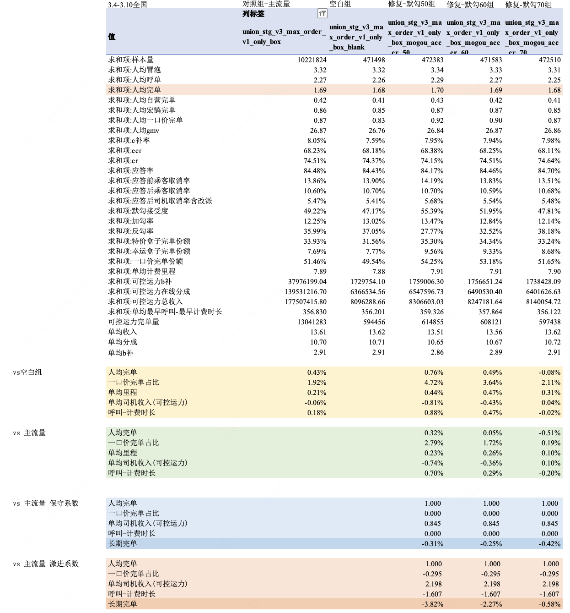 <br> |
| 激进系数 <br> | -3.82% <br> | -2.27% <br> | -0.58% <br> |

## 3.3 幸运盒子单勾适配联合决策实验结果

### 3.3.1 实验背景

- 实验城市：全国

- 实验周期：2026.03.04～2026.03.10

- 实验分组

| 分组 <br> | 流量 <br> | 策略 <br> |
| --- | --- | --- |
| 主流量 <br> | 95% <br> | 默勾勾选幸运盒子+特价盒子，会后处理为单勾幸运盒子 <br> |
| 无后处理组 <br> | 5% <br> | 不会进行默勾后处理 <br> |

### 3.3.2 实验结果

- 主要结果：花业务补贴率拉齐，人均完单显著**+0.32%**

- 品类份额：由于无后处理组不会将默勾 幸运盒子+特价盒子后处理为单勾幸运盒子，因此**幸运盒子完单份额-0.85pp，特价盒子完单份额+1.01pp**

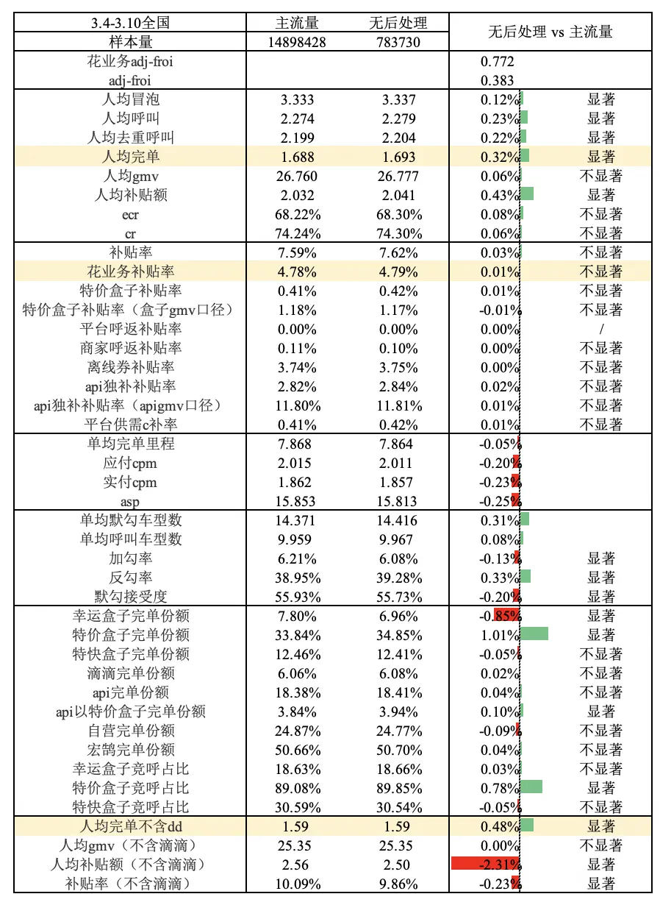

### 3.3.3 长期视角评估

vs 主流量的长期完单结果如下

|  <br> | 无后处理组 <br> | 评估详情 <br> |
| --- | --- | --- |
| 保守系数 <br> | 0.21% <br> | 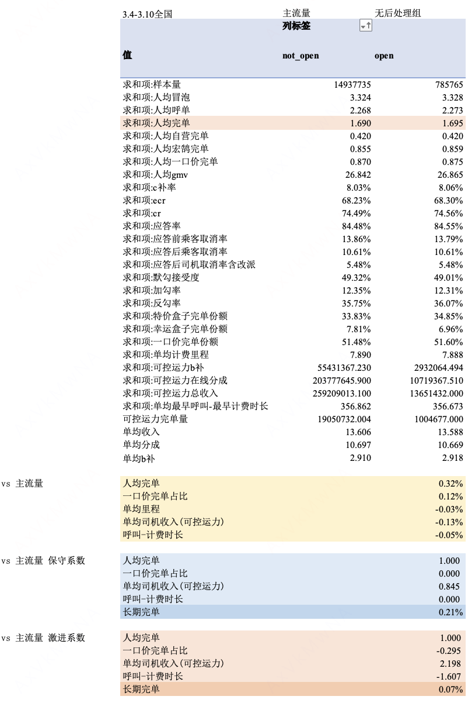 <br> |
| 激进系数 <br> | 0.07% <br> |

# 四、后续规划

- 各实验组的放量节奏如下：

	- CR计算逻辑修复：放量V3修复组

		- 2026.01.21，放量30%

		- 2026.01.29，放量100%

	- SDS特征修复：由于默勾50组CR显著负，因此放量默勾60组

		- 2026.03.13，放量21%

		- 2026.03.18，放量28%

		- 2026.03.26，放量60%

		- 2026.03.30，放量80%

		- 2026.04.02，放量100%

		- 2026.04.20，更改为放量默勾50组，4.21号 20%，4.23号 50%，4.27号 80%，4.28号97%

	- 幸运盒子单勾适配联合决策：放量无后处理组

		- 由于对幸运盒子份额有负向影响，暂不放量<!--评论:[{"u":"zhouzhishuo","c":"4月底完成放量"}] -->

# 五、引用和鸣谢

## 引用

- CR计算修复：

	- 复盘文档：[20251218 联合决策V3平台GMV和平台Cost出现负值](https://cooper.didichuxing.com/knowledge/2200004056890/2206205620977)

	- 实验方案：[联合决策V3 acc_CR bug修复实验260105](https://cooper.didichuxing.com/knowledge/2199610335356/2206382975464)

- SDS特征修复：

	- 分析文档：[默勾多勾分析 2602](https://cooper.didichuxing.com/knowledge/2199610335356/2206780520424)

	- 实验方案： [联合决策品类调优实验四期实验方案260304](https://cooper.didichuxing.com/knowledge/2199610335356/2206903441885)

- 幸运盒子单勾适配联合决策

	- 实验方案： [幸运盒子单勾适配联合决策实验评估](https://cooper.didichuxing.com/knowledge/2199610335356/2206792074234)

## 鸣谢

感谢门畅、国华对于异常现象的发现与深挖

感谢之烁给出超有效的排查方向

感谢张聪、白振龙、陈昕昊对于问题的细心排查和及时修复

# 六、TODO
