# 【LR26-006】乘客与增长-增长策略-套餐sku基于用户分层钱效差异化配置算法策略-V2

[Cooper 原文](https://cooper.didichuxing.com/knowledge/2199610335356/2207399170533)

# 基础信息

| brd文档链接   | [https://cooper.didichuxing.com/m/c/docs/document/2205869009207](https://cooper.didichuxing.com/m/c/docs/document/2205869009207)    |
| --- | --- |
| 最后通过的策略方案链接   | [套餐sku基于用户分层钱效差异化配置算法策略需求](https://cooper.didichuxing.com/knowledge/2199610335356/2205917227848)   |
| 实验链接（评估大师）   | [https://yunchou.intra.hongyibo.com.cn/experimentManage/1380](https://yunchou.intra.hongyibo.com.cn/experimentManage/1380)   |
| 核心贡献点（创新点，可供其他算法同学借鉴的点）   | 对于某个抓手的业务核心指标无显著算法收益空间时，或者收益强受制于补贴率时，可以尝试对于抓手作用人群进行钱效分层并针对高钱效人群做功   |
| 第一贡献人   | 郭建庭   |
| 共同贡献人（没有的话，可以置空）   |    |
| 后续策略负责人   | 待新人入职   |

# 一 背景

去年Q1\~Q3对套餐（定价&sku）的算法迭代：

- 目标：呼单用户渗透率（=购买套餐且呼单用户数/呼单用户数）

- 结果：[【LR25019】套餐智能sku模型V0](https://cooper.didichuxing.com/knowledge/2199610335356/2204724694085)、[【LR25030】套餐定价+sku叠加策略V0](https://cooper.didichuxing.com/knowledge/2199610335356/2205375971925)

	- 呼单用户渗透率涨幅显著（**+25.01%(0.96%->1.20%)）**

	- 但大盘人均访问、冒泡、呼单、完单等都没有显著变化

以上归因于套餐补贴率低+入口少+产品力较差，很难显著影响大盘指标。

经与业务方讨论，自去年Q4起，调整套餐策略迭代方向：

- 补贴率不变；通过缩小覆盖人群，加深目标人群的平均补贴，提升套餐影响力

- 人群确定：基于PSM评估，确定各分层用户钱效。由于当前低C补水平下，套餐策略对大盘人均呼叫等核心指标的牵引较弱，基于AB实验难以观测到显著增益（即便最深折扣组相较空白组也无显著提升），因此需要引入PSM方法，对套餐购买行为的真实因果效果进行更稳健的评估。通过匹配实验组与对照组用户，刻画套餐购买对访问、冒泡、呼单、完单等指标的增量贡献，并进一步下钻不同人群分组间的效果差异，从而识别出“高钱效（高呼叫ROI）”人群，为后续策略资源的精准投放提供依据。

- 在此基础上，结合PSM评估结果对用户进行钱效分层，在当前线上全量人群接入p维度算法策略的基础上，进一步进行差异化策略配置（包括特定人群是否接入p维度算法策略、补贴率设置等）。核心目标是在总体C补不变的约束下，将资源集中投向对套餐响应更敏感、呼叫ROI更高的人群，实现对高钱效人群的呼叫提频，同时避免对低钱效人群的无效补贴，从而整体提升资源使用效率与策略影响力。若分层用户策略能实现大盘呼叫不负，且目标人群呼叫提升显著，后续业务方将对该部分人群进行产品力优化(例如新增入口等)

# 二 目标 & 约束

## 2.1 策略目标

- 主目标：套餐曝光人群人均呼叫（核心指标）vs无用户钱效分层旧算法组相对+0.2%。

- 是否在 DDO 中：是

- 过程目标：

	- 高钱效人群（level0）：人均呼叫vs无用户钱效分层旧算法组同人群相对+2.0%。

	- 低钱效人群（level2/3）：套餐 C 补率显著下降，人均呼叫不显著负向。

## 2.2 约束指标项 & 约束程度

| 约束项   | 约束方向   | 约束程度（前置明确）   |
| --- | --- | --- |
| 大盘 C 补率（套餐曝光人群）   | 不抬升   | 与对照组拉齐，允许 ±0.1pp 内波动   |
| 大盘人均完单 / GMV   | 不显著负向   | 不允许出现显著负向（p&lt;0.05）   |
| 低钱效人群（level2/3）人均呼叫   | 不显著负向   | 撤补不带来显著呼叫下跌   |

# 三 技术方案

## 3.1 模型复用

本次基于套餐sku用户分层配置算法策略，并不对于当前套餐线上智能sku策略与智能定价策略的uplift模型和规划求解部分进行任何改动，因此算法策略自身的出价链路仍可以参考[【LR25030】套餐定价+sku叠加策略V0](https://cooper.didichuxing.com/knowledge/2199610335356/2205375971925)中的下图，智能sku策略的购买率模型与规划求解原理可参考[【LR25019】套餐智能sku模型V0](https://cooper.didichuxing.com/knowledge/2199610335356/2204724694085)

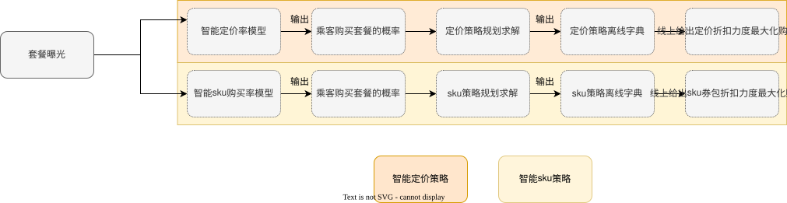

## 3.2 链路改造

本次策略改造需要对不同钱效分档人群进行不同的策略配置(是否接入p维度算法，补贴率设置等)，因此用户请求套餐曝光在进入上述出价链路(只涉及其中的智能sku策略)之前，需要首先进行人群分档判断，链路如下图所示

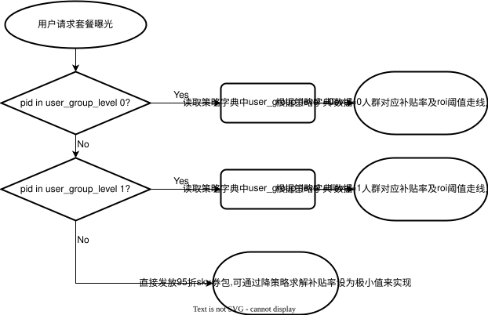

## 3.3 人群分档

### 3.3.1 基于psm评估结果的人群分档初版划分方法

由于在当前低C补水平下，算法策略带来的渗透率相对提升，折算到全量大盘人群上的覆盖面仍然较小，基于ab实验的评估结果看不到大盘人均呼叫的显著提升。甚至rct实验组中的最深折扣组(75折)相比于空白组(95折)也同样无显著的人均呼叫提升。因此我们希望**通过psm评估的方法去评估套餐购买行为能够带来的对于访问，冒泡，呼单，完单等指标带来的牵引效果**，以及进一步下钻这种牵引效果在不同人群分组间的差异，以**指导我们在有限的C补水平下，更好地定位套餐购买牵引呼叫提频效果更强的人群。**

匹配方法为分别使用rct中的各折扣组(75,80,85,90)中的发生套餐购买的用户去匹配空白组(95)中的套餐曝光人群，拉齐aa期指标，分析C补率提升、人均冒泡、呼叫、完单、GMV提升、呼叫roi、完单roi、GMVroi。人群分组则是选用仅「用户生命周期标签」以及「用户生命周期标签」✖️「行业高活小猪低份额竞争」进行划分。[psm评估结果](https://cooper.didichuxing.com/knowledge/2199610335356/2205709321617)如下

#### 3.3.1.1 仅「用户生命周期标签」人群分组的评估结果

| 实验组vs对照组   | 75vs95   | 80vs95   | 85vs95   | 90vs95   |
| --- | --- | --- | --- | --- |
| 匹配情况   | <table><tr><th>**维度**  </th><th>**匹配前样本数**  </th><th>**匹配后样本数**  </th><th>**匹配率**  </th></tr><tr><td>大盘  </td><td>7007  </td><td>6876  </td><td>98.13%  </td></tr><tr><td>活跃-新客成长  </td><td>101  </td><td>91  </td><td>90.10%  </td></tr><tr><td>活跃-低活  </td><td>2014  </td><td>2002  </td><td>99.40%  </td></tr><tr><td>活跃-中活  </td><td>1531  </td><td>1497  </td><td>97.78%  </td></tr><tr><td>活跃-高活  </td><td>1430  </td><td>1376  </td><td>96.22%  </td></tr><tr><td>新客  </td><td>304  </td><td>304  </td><td>100.00%  </td></tr><tr><td>沉默  </td><td>984  </td><td>971  </td><td>98.68%  </td></tr><tr><td>流失  </td><td>643  </td><td>635  </td><td>98.76%  </td></tr></table>‍   | <table><tr><th>**维度**  </th><th>**匹配前样本数**  </th><th>**匹配后样本数**  </th><th>**匹配率**  </th></tr><tr><td>大盘  </td><td>4860  </td><td>4785  </td><td>98.46%  </td></tr><tr><td>活跃-新客成长  </td><td>72  </td><td>64  </td><td>88.89%  </td></tr><tr><td>活跃-低活  </td><td>1351  </td><td>1346  </td><td>99.63%  </td></tr><tr><td>活跃-中活  </td><td>1077  </td><td>1067  </td><td>99.07%  </td></tr><tr><td>活跃-高活  </td><td>1167  </td><td>1128  </td><td>96.66%  </td></tr><tr><td>新客  </td><td>164  </td><td>161  </td><td>98.17%  </td></tr><tr><td>沉默  </td><td>664  </td><td>655  </td><td>98.64%  </td></tr><tr><td>流失  </td><td>365  </td><td>364  </td><td>99.73%  </td></tr></table>‍   | <table><tr><th>**维度**  </th><th>**匹配前样本数**  </th><th>**匹配后样本数**  </th><th>**匹配率**  </th></tr><tr><td>大盘  </td><td>3070  </td><td>3016  </td><td>98.24%  </td></tr><tr><td>活跃-新客成长  </td><td>39  </td><td>25  </td><td>64.10%  </td></tr><tr><td>活跃-低活  </td><td>752  </td><td>752  </td><td>100.00%  </td></tr><tr><td>活跃-中活  </td><td>761  </td><td>752  </td><td>98.82%  </td></tr><tr><td>活跃-高活  </td><td>964  </td><td>940  </td><td>97.51%  </td></tr><tr><td>新客  </td><td>78  </td><td>76  </td><td>97.44%  </td></tr><tr><td>沉默  </td><td>304  </td><td>299  </td><td>98.36%  </td></tr><tr><td>流失  </td><td>172  </td><td>172  </td><td>100.00%  </td></tr></table>‍   | <table><tr><th>**维度**  </th><th>**匹配前样本数**  </th><th>**匹配后样本数**  </th><th>**匹配率**  </th></tr><tr><td>大盘  </td><td>1849  </td><td>1808  </td><td>97.78%  </td></tr><tr><td>活跃-新客成长  </td><td>14  </td><td>14  </td><td>100.00%  </td></tr><tr><td>活跃-低活  </td><td>436  </td><td>432  </td><td>99.08%  </td></tr><tr><td>活跃-中活  </td><td>428  </td><td>422  </td><td>98.60%  </td></tr><tr><td>活跃-高活  </td><td>717  </td><td>687  </td><td>95.82%  </td></tr><tr><td>新客  </td><td>40  </td><td>40  </td><td>100.00%  </td></tr><tr><td>沉默  </td><td>156  </td><td>155  </td><td>99.36%  </td></tr><tr><td>流失  </td><td>58  </td><td>58  </td><td>100.00%  </td></tr></table>‍   |
| AB期指标   | 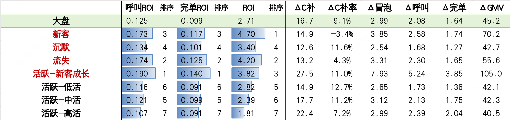   | 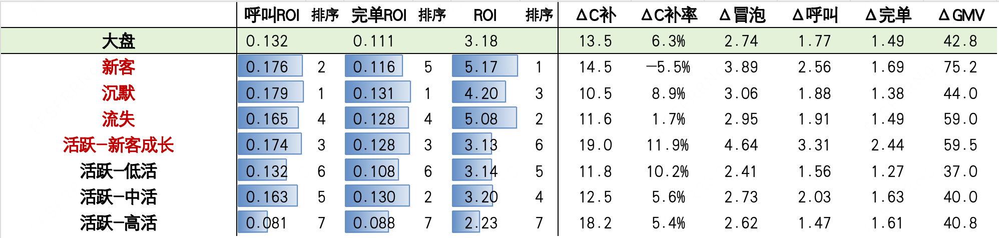   | 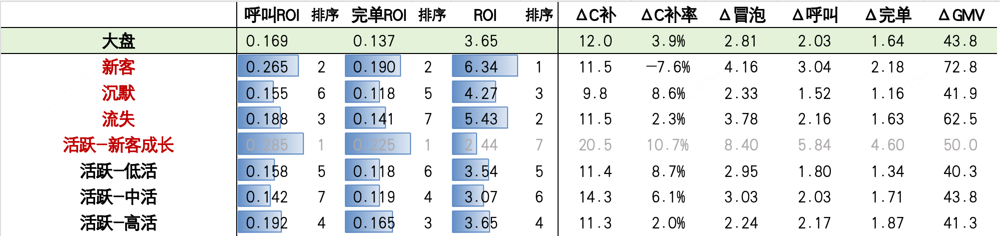   | 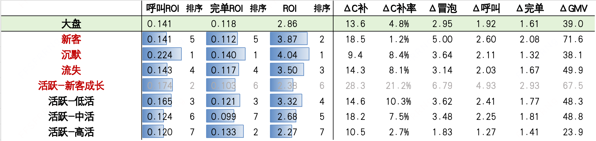   |

‍基于呼叫roi来看，综合4个折扣组与95折空白组的psm结果，**「活跃-新客成长、新客、流失、沉默用户」的呼叫ROI总体上要高于「活跃(低中高活)用户」**。

#### 3.3.1.2 基于「用户生命周期标签」✖️「行业高活小猪低份额竞争」人群分组的评估结果

| 实验组vs对照组   | 75vs95   | 80vs95   | 85vs95   | 90vs95   |
| --- | --- | --- | --- | --- |
| 匹配情况   | <table><tr><th>**维度**  </th><th>**匹配前样本数**  </th><th>**匹配后样本数**  </th><th>**匹配率**  </th></tr><tr><td>大盘  </td><td>495  </td><td>445  </td><td>89.90%  </td></tr><tr><td>活跃-新客成长  </td><td>13  </td><td>6  </td><td>46.15%  </td></tr><tr><td>活跃-低活  </td><td>235  </td><td>219  </td><td>93.19%  </td></tr><tr><td>活跃-中活  </td><td>71  </td><td>56  </td><td>78.87%  </td></tr><tr><td>活跃-高活  </td><td>8  </td><td>1  </td><td>12.50%  </td></tr><tr><td>新客  </td><td>20  </td><td>20  </td><td>100.00%  </td></tr><tr><td>沉默  </td><td>74  </td><td>71  </td><td>95.95%  </td></tr><tr><td>流失  </td><td>74  </td><td>72  </td><td>97.30%  </td></tr></table>‍   | <table><tr><th>**维度**  </th><th>**匹配前样本数**  </th><th>**匹配后样本数**  </th><th>**匹配率**  </th></tr><tr><td>大盘  </td><td>299  </td><td>253  </td><td>84.62%  </td></tr><tr><td>活跃-新客成长  </td><td>9  </td><td>3  </td><td>33.33%  </td></tr><tr><td>活跃-低活  </td><td>128  </td><td>121  </td><td>94.53%  </td></tr><tr><td>活跃-中活  </td><td>41  </td><td>28  </td><td>68.29%  </td></tr><tr><td>活跃-高活  </td><td>8  </td><td>1  </td><td>12.50%  </td></tr><tr><td>新客  </td><td>8  </td><td>5  </td><td>62.50%  </td></tr><tr><td>沉默  </td><td>46  </td><td>43  </td><td>93.48%  </td></tr><tr><td>流失  </td><td>59  </td><td>52  </td><td>88.14%  </td></tr></table>‍   | <table><tr><th>**维度**  </th><th>**匹配前样本数**  </th><th>**匹配后样本数**  </th><th>**匹配率**  </th></tr><tr><td>大盘  </td><td>149   </td><td>124   </td><td>83.22%  </td></tr><tr><td>活跃-新客成长  </td><td>4   </td><td>2   </td><td>50.00%  </td></tr><tr><td>活跃-低活  </td><td>60   </td><td>60   </td><td>100.00%  </td></tr><tr><td>活跃-中活  </td><td>28   </td><td>24   </td><td>85.71%  </td></tr><tr><td>活跃-高活  </td><td>13   </td><td>2   </td><td>15.38%  </td></tr><tr><td>新客  </td><td>9   </td><td>6   </td><td>66.67%  </td></tr><tr><td>沉默  </td><td>16   </td><td>14   </td><td>87.50%  </td></tr><tr><td>流失  </td><td>19   </td><td>16   </td><td>84.21%  </td></tr></table>‍   | <table><tr><th>**维度**  </th><th>**匹配前样本数**  </th><th>**匹配后样本数**  </th><th>**匹配率**  </th></tr><tr><td>大盘  </td><td>95  </td><td>75  </td><td>78.95%  </td></tr><tr><td>活跃-新客成长  </td><td>1  </td><td>  </td><td>  </td></tr><tr><td>活跃-低活  </td><td>44  </td><td>44  </td><td>100.00%  </td></tr><tr><td>活跃-中活  </td><td>28  </td><td>14  </td><td>50.00%  </td></tr><tr><td>活跃-高活  </td><td>4  </td><td>  </td><td>  </td></tr><tr><td>新客  </td><td>3  </td><td>3  </td><td>100.00%  </td></tr><tr><td>沉默  </td><td>7  </td><td>6  </td><td>85.71%  </td></tr><tr><td>流失  </td><td>8  </td><td>8  </td><td>100.00%  </td></tr></table>‍   |
| AB期指标   | 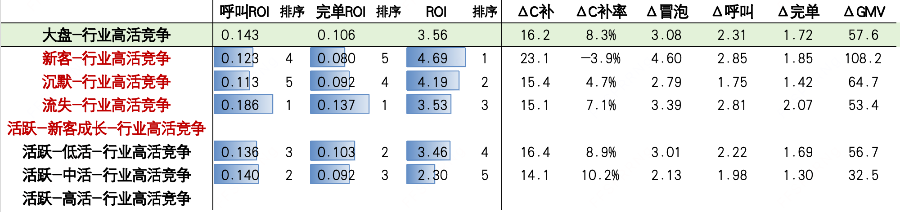   | 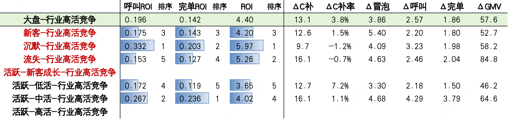   | 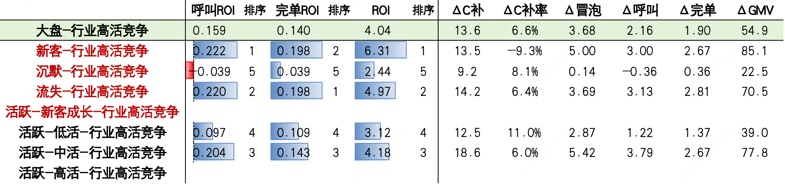   | 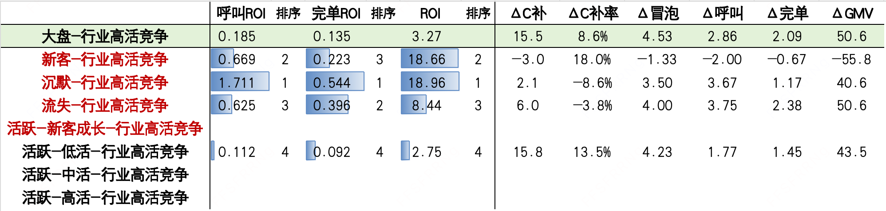   |

‍对比「行业高活小猪低份额竞争大盘」相比于「全量用户大盘」，从表中可发现，**综合四个实验组vs对照组的结果，「行业高活小猪低份额竞争大盘」的**$$\Delta$$**呼叫和呼叫roi都要高于「全量用户大盘」**。

基于上述psm评估结果我们对于人群分档的初步划分如下：

1. 行业高活小猪低份额竞争(第一档，综合呼叫钱效最高)

2. 非竞争 & 新/沉/流/活跃成长/活跃-高(第二档，综合呼叫钱效次高)

3. 非竞争 & 活跃-低/活跃-中(第三档，综合呼叫钱效最低)

### 3.3.2 高钱效人群细分

3.3.1中的初版划分方法对于「行业高活小猪低份额竞争大盘」的定义为「行业历史28天冒泡量>=10 & hxz历史28d冒泡占比<0.5」，此人群分档在套餐曝光人群中占比约为6.8%。在当前补贴率持续收缩的背景下，我们认为此人群分档粒度仍然较为粗糙，人群占比仍较大，需进一步细化以支撑精细化投放和呼叫ROI最大化的目标。我们对于「行业历史28天冒泡量 & hxz历史28d冒泡占比」的阈值进行了如下探索。

| 阈值   | industry_bubble_cnt_28d &gt;= 18 and hxz_bubble_ratio_28d &lt; 0.2   | industry_bubble_cnt_28d &gt;= 16 and hxz_bubble_ratio_28d &lt; 0.3   | industry_bubble_cnt_28d &gt;= 15 and hxz_bubble_ratio_28d &lt; 0.3   | industry_bubble_cnt_28d &gt;= 14 and hxz_bubble_ratio_28d &lt; 0.35   | industry_bubble_cnt_28d &gt;= 13 and hxz_bubble_ratio_28d &lt; 0.4   |
| --- | --- | --- | --- | --- | --- |
| 钱效   | <table><tr><th>分组-人群分档  </th><th>人均呼叫  </th><th>人均总C补  </th><th>人均套餐C补  </th><th>呼叫roi  </th><th>套餐做功呼叫roi  </th></tr><tr><td>空白组-分档0  </td><td>1.543  </td><td>2.557  </td><td>0.048  </td><td>-  </td><td>-  </td></tr><tr><td>空白组-分档1  </td><td>1.955  </td><td>2.498  </td><td>0.059  </td><td>-  </td><td>-  </td></tr><tr><td>策略组-分档0  </td><td>1.575  </td><td>2.569  </td><td>0.045  </td><td>2.544  </td><td>/  </td></tr><tr><td>策略组-分档1  </td><td>1.958  </td><td>2.469  </td><td>0.076  </td><td>-0.079  </td><td>0.131  </td></tr></table>‍   | <table><tr><th>分组-人群分档  </th><th>人均呼叫  </th><th>人均总C补  </th><th>人均套餐C补  </th><th>呼叫roi  </th><th>套餐做功呼叫roi  </th></tr><tr><td>空白组-分档0  </td><td>1.649  </td><td>2.488  </td><td>0.043  </td><td>-  </td><td>-  </td></tr><tr><td>空白组-分档1  </td><td>1.986  </td><td>2.532  </td><td>0.065  </td><td>-  </td><td>-  </td></tr><tr><td>策略组-分档0  </td><td>1.670  </td><td>2.476  </td><td>0.051  </td><td>/  </td><td>2.701  </td></tr><tr><td>策略组-分档1  </td><td>1.989  </td><td>2.509  </td><td>0.080  </td><td>/  </td><td>0.178  </td></tr></table>‍   | <table><tr><th>分组-人群分档  </th><th>人均呼叫  </th><th>人均总C补  </th><th>人均套餐C补  </th><th>呼叫roi  </th><th>套餐做功呼叫roi  </th></tr><tr><td>空白组-分档0  </td><td>1.628  </td><td>2.479  </td><td>0.044  </td><td>-  </td><td>-  </td></tr><tr><td>空白组-分档1  </td><td>2.017  </td><td>2.542  </td><td>0.065  </td><td>-  </td><td>-  </td></tr><tr><td>策略组-分档0  </td><td>1.653  </td><td>2.470  </td><td>0.049  </td><td>/  </td><td>4.920  </td></tr><tr><td>策略组-分档1  </td><td>2.016  </td><td>2.515  </td><td>0.083  </td><td>/  </td><td>-0.081  </td></tr></table>‍   | <table><tr><th>分组-人群分档  </th><th>人均呼叫  </th><th>人均总C补  </th><th>人均套餐C补  </th><th>呼叫roi  </th><th>套餐做功呼叫roi  </th></tr><tr><td>空白组-分档0  </td><td>1.686  </td><td>2.481  </td><td>0.048  </td><td>-  </td><td>-  </td></tr><tr><td>空白组-分档1  </td><td>2.033  </td><td>2.553  </td><td>0.065  </td><td>-  </td><td>-  </td></tr><tr><td>策略组-分档0  </td><td>1.710  </td><td>2.467  </td><td>0.054  </td><td>/  </td><td>3.607  </td></tr><tr><td>策略组-分档1  </td><td>2.028  </td><td>2.528  </td><td>0.084  </td><td>/  </td><td>-0.247  </td></tr></table>‍   | <table><tr><th>分组-人群分档  </th><th>人均呼叫  </th><th>人均总C补  </th><th>人均套餐C补  </th><th>呼叫roi  </th><th>套餐做功呼叫roi  </th></tr><tr><td>空白组-分档0  </td><td>1.746  </td><td>2.496  </td><td>0.050  </td><td>-  </td><td>-  </td></tr><tr><td>空白组-分档1  </td><td>2.037  </td><td>2.548  </td><td>0.067  </td><td>-  </td><td>-  </td></tr><tr><td>策略组-分档0  </td><td>1.764  </td><td>2.473  </td><td>0.061  </td><td>/  </td><td>1.695  </td></tr><tr><td>策略组-分档1  </td><td>2.033  </td><td>2.539  </td><td>0.083  </td><td>/  </td><td>-0.259  </td></tr></table>‍   |

如上表中所示，随着分档阈值从industry_bubble_cnt_28d >= 18 and hxz_bubble_ratio_28d < 0.2 到 industry_bubble_cnt_28d >= 13 and hxz_bubble_ratio_28d < 0.4这个逐渐放松过程中，随着覆盖人数的增加，分档0会不断地囊括更多分档1中套餐做功呼叫roi正向的人群。<u>在「industry_bubble_cnt_28d >= 15 and hxz_bubble_ratio_28d < 0.3」这个阈值时，分档0的套餐做功呼叫roi阈值达到高点，后续开始呈现递减趋势；同时分档1套餐做功呼叫roi首次出现负值，代表剩余人群的套餐做功钱效较低。</u> 因此**将最终的分档阈值固定位industry_bubble_cnt_28d >= 15 and hxz_bubble_ratio_28d < 0.3较为合适。**且对比分档0，分档1的人群我们有以下结论‍

1. **分档0**人均呼叫提升更高，且套餐C补消耗更少，但总C补消耗更大，**总体呼叫钱效弱于分档1，而套餐做功钱效高于1** 原因可能是该部分行业活跃度更高，且竞争更为激烈的人群，**推测受到套餐牵引提频，但最终核销其他抓手的补贴**

2. 分档1人均呼叫提升略低，套餐C补消耗更多，但总C补消耗更小，可以在总C补下降的情况下达到呼叫提升，**总体呼叫钱效强于分档0，而套餐做功钱效低于0**. 原因可能是该部分人群活跃度与竞争性略弱于分档0，**推测受到套餐牵引提频后，最终核销也主要为套餐券补**

## 3.4 分档策略配置

基于3.3.2人群细分结果，我们此次策略的配置方法如下：

1. 「行业历史28天冒泡量>=15 & hxz历史28d冒泡占比<0.3」(level 0)：在当前算法策略的基础上加补，下探折扣范围至\[75,95\]

2. 「行业历史28天冒泡量>=10 & hxz历史28d冒泡占比<0.5 & not in level 0」(level 1)：维持当前算法策略不变

3. 非竞争 & 新/沉/流/活跃成长/活跃-高(level 2，综合呼叫钱效较低)：统一给浅折扣95折

4. 非竞争 & 活跃-低/活跃-中(level 3，综合呼叫钱效最低)：统一给浅折扣95折

# 四 实验评估

## 4.1 实验背景

- 实验城市：全国

- 评估周期：2026-03-13\~2026-03-19

- 分流方式：pid分流

| odt_exp_group_name   | 分组名称   | 策略   | 流量   |
| --- | --- | --- | --- |
| v3_drcfr_multi_head_hx_avg_hx_old_with_level   | 实验组1   | 基于用户分层钱效配置的算法策略(实验组1)   | 2.5%   |
| v3_drcfr_multi_head_hx_avg_hx_old   | 实验组2   | 不基于用户分层钱效的原算法策略(实验组2)   | 2.5%   |
| hx_check_control   | 人工策略组   | 人工策略组   | 2.5%   |
| hx_check_blank   | 空白组   | 空白组   | 2.5%   |

- 核心指标：人均呼叫

- 拉齐指标：总C补率

## 4.2 实验结论

实验期内套餐曝光用户评估结果：

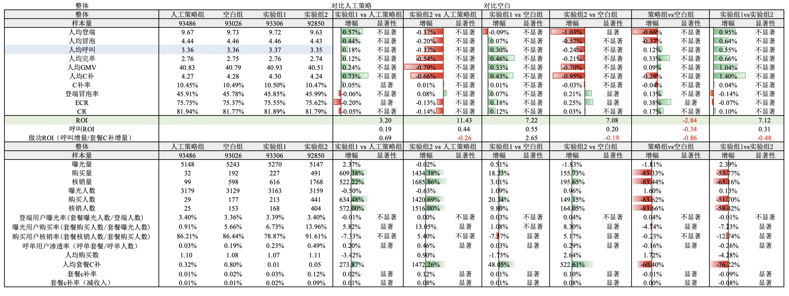

> 登端冒泡率=登端量/冒泡量，ROI=GMV增量/C补增量，呼叫ROI=呼叫增量/C补增量，做功ROI=呼叫增量/套餐C补增量。

> 登端用户曝光率=套餐曝光人数/登端人数，曝光用户购买率=套餐购买人数/套餐曝光人数，购买用户核销率=套餐核销人数/套餐购买人数，呼单用户渗透率=呼单且购买套餐人数/呼单人数

> 人均购买数=套餐购买数/套餐购买人数

> 人工策略对应的券包item_id业务方暂未提供完全，因此人工策略的套餐相关指标暂不可看

结论：

- 结果指标，实验各组由于呼单渗透率低对大盘拉动小，访冒呼完无显著差异；实验组1 vs 空白组，呼叫ROI=0.55，ROI=7.22，呼叫+0.30%（均不显著）；实验组1vs 实验组2 ，delta呼叫ROI=0.31，deltaROI = 7.12，呼叫+0.55%（不显著）；实验组1 vs 人工，delta呼叫ROI=0.19，deltaROI = 3.20，呼叫+0.18%（不显著）

	- 实验组1**套餐c补率**显著低于实验组2，即分层后能够显著降低套餐补贴

	- 实验组1在套餐C补率-0.09pp的情况下，人均呼叫+0.02(相对+0.55%)，套餐钱效显著高于实验组2

- 套餐过程指标（人头），实验组1、实验组2均能显著提升曝光后购买率、呼单渗透率：

	- 实验组1-2能够推动曝光后购买率显著增加，实验组1-2 vs 空白组显著+1.07pp(相对+18.9%)、+8.3pp(相对+146.6%)，实验组1低由于策略控制，符合预期

	- 实验组组1-2呼单用户中购买套餐渗透率，vs 空白组分别显著+0.03pp(相对+15.8%)、+0.29pp(相对+152.6%)

	- 实验组组1在分层策略（倾向level0&1，舍弃level2&3）下，**呼单渗透率**vs组2：level0 +0.22pp，level1 +0.03pp，level2 -0.37pp，level3 -0.21pp；总体 -0.26pp

## 4.3 人群分档下钻

| 人群分档   | level0   | level1   | level2   | level3   |
| --- | --- | --- | --- | --- |
| 评估结果   | 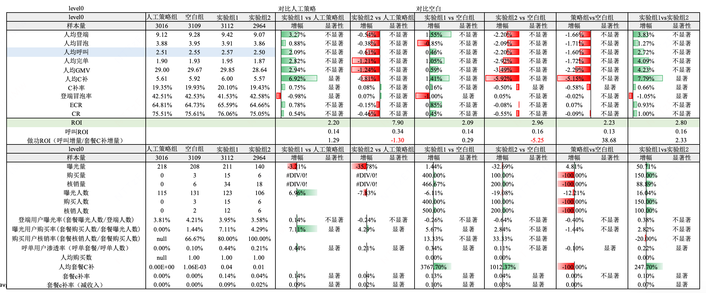   | 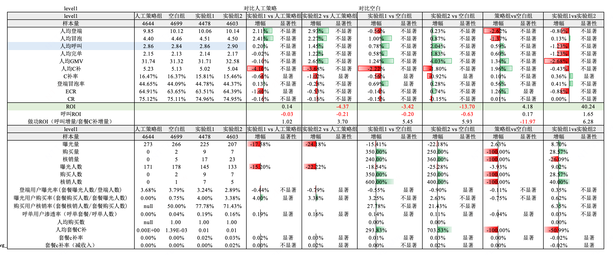   | 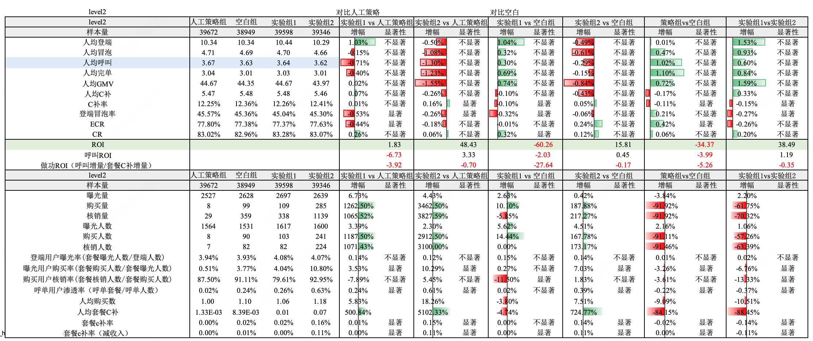   | 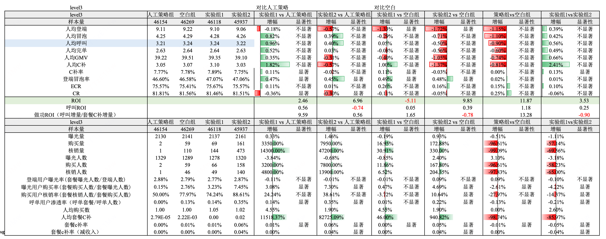   |

我们主要在每个人群分档下，对比实验组1与实验组2之间各指标的差异。

- level0（加补人群）中，**人均呼叫相对+2.72%**（不显著但涨幅最大），同时C补率+0.66pp、套餐C补+0.10pp，说明加补可直接带来呼叫增益。

- level2/3（撤补人群）中，**套餐C补率显著下降（-0.14pp / -0.05pp）**，但**人均呼叫仍小幅正向**（相对**+0.60% / +0.56%**，均不显著），表明该部分人群呼叫钱效较低，撤补对呼叫无显著负向影响。

- 由于level2/3人群占比更高，将其补贴资源向level0倾斜，可在显著降低套餐C补的同时，实现整体人均呼叫不显著提升。

# 五 放量决策

|    |    | 预期扩量时间节奏   | 实际扩量时间   | 放量暂停点详情   | 放量暂停点效果评估   | 是否需要设置长期对照组（默认不需要，此列无需填写）   |
| --- | --- | --- | --- | --- | --- | --- |
|    |    |    | LR通过后，根据实际情况，填写这3列   |    |
| 放量决策意见   | 决策人   | ——   | ——   | ——   | ——   | ——   |
| 决策意见：  - 通过   - 不通过，给出原因   - 扩大流量实验    |    |    |    |    |    |
| 放量需要周知的利益相关方   | 没有的话，无需填写   | ——   | ——   | ——   | ——   | ——   |
| 放量策略   | eg. 实验组1  放量组收益   | ——   | ——   | ——   | ——   | ——   |
| 放量节奏   | 直接推全-随机分流   | 2026.04.21放量至90%     | 2026.04.21放量至90%   | 暂停点时间 ：-  暂停点持续时长：-  流量比例：90%实验组  实验链接：[https://yunchou.intra.hongyibo.com.cn/experimentManage/1380](https://yunchou.intra.hongyibo.com.cn/experimentManage/1380)   | -   | 需要保留长期对照组  对照组流量比例：  - 人工策略组：5%   - 空白组：5%   定期review人：张帅帅  定期review频率：1次/月  定期review结果：-   |

‍

# 六 Q & A 

Q：为什么不直接对大盘用户进行产品力优化？

A：直接做大盘产品力优化会被人群异质性稀释——高钱效与低钱效人群混在一起，资源容易被低呼叫ROI人群消耗，整体ROI和能下降(和当前大盘整体加补达成的结果类似，高低呼叫ROI人渗透率同时提升，但低呼叫ROI人群占比大，此部分人群的套餐渗透后牵引呼叫能力弱，会掩盖少部分高呼叫ROI人群受套餐牵引的呼叫提频)。人群分层，基于PSM识别钱效差异，将资源集中投向高呼叫ROI人群、减少低效人群投入，从而在相同或更低成本下提升整体ROI。同时也让策略在更同质人群内优化，效果更稳定、收敛更快。

Q: 人群分层本质是牺牲了策略的搜索空间，加了约束，为什么还能表现得更好？还有什么额外的好处？

A: 虽然分层减少了全局最优搜索空间，但通过引入“钱效先验约束”，避免了资源在低ROI人群上的无效探索，使优化更聚焦于高潜人群，提升了收敛效率与稳定性。且由于套餐原算法模型建模目标为呼单用户渗透率而非人均呼叫，而不同人群分档的呼单用户渗透率与人均呼叫的先验关系也不相同，当前人群分层本质上是在引入「呼单用户渗透率」-「人均呼叫」之间的先验

Q: 能拿到哪些learning，比如具备怎样特性的策略就适合人群分层策略？

A: 适合做人群分层的策略通常具备以下特征：1）人群间收益（如ROI、转化率）存在显著差异且排序稳定；2）资源（如补贴预算）受限，需要做结构性分配；3）套餐渗透对于不同人群产生的呼叫牵引提频效应不同，已有模型建模目标为渗透率与新业务指标人均呼叫之间存在gap，但通过人群分层策略可定位到同向部分的人群。

此版本策略的核心learning是：当低钱效人群占比较高时，通过“撤补+资源腾挪”到高钱效人群，可以在控制甚至降低成本的同时，实现整体效果不下降甚至提升，同时也方便业务同学集中其它资源（如曝光、触达）进行投放。

# 七 后续规划

1. 待DS完成psm评估后补充评估结果，进一步验证收益

2. 扩量此版本基于用户分层钱效的策略为套餐线上算法主流量，并阶段性close套餐的算法迭代

# 八 引用和鸣谢

## 引用

[【LR25019】套餐智能sku模型V0](https://cooper.didichuxing.com/knowledge/2199610335356/2204724694085)

[【LR25030】套餐定价+sku叠加策略V0](https://cooper.didichuxing.com/knowledge/2199610335356/2205375971925)

## 鸣谢

感谢之烁以及价格策略全体同学在人群分档探索中给出的宝贵意见

感谢DS同学对于多期评估需求的积极快速响应
